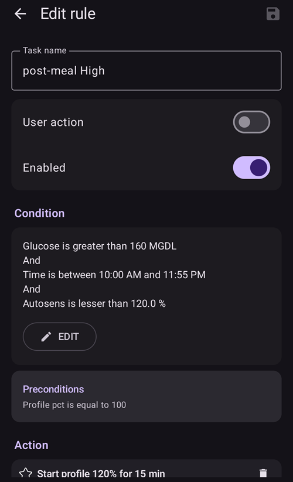

# Loop totalmente fechado

```{contents} In this page
:backlinks: entry
:depth: 2
```

A principal vantagem do loop totalmente fechado **FCL** é que pode imitar um pâncreas artificial e facilitar a gestão diária, sem necessidade de dar bólus para as refeições.

Embora o **loop fechado híbrido** («HCL») seja baseado num algoritmo, ainda exige que o utilizador administre bólus manualmente antes das refeições. Como resultado, o loop pode entrar numa paragem temporária (basal temporária de zero) para evitar administrar insulina a mais.

No **FCL**, os bólus ligados ao tamanho da refeição deixam de ser necessários: deixe isso ao algoritmo!  O **AAPS** consegue lidar com refeições sem que o utilizador dê qualquer bólus e sem introduzir hidratos de carbono, num modo chamado «refeições não anunciadas» **(«RNA»)**. A **RNA** permite ao **AAPS** tolerar melhor entradas de hidratos de carbono incorretas, sendo mais agressivo.

## O que esperar?

Há muitos estudos publicados sobre os resultados favoráveis que o **FCL** pode alcançar. Para mais leitura, consulte o seguinte:

1)   National Library of Medicine, PubMed [First Use of Open-Source Automated Insulin Delivery AndroidAPS in Full Closed-Loop Scenario: Pancreas4ALL Randomized Pilot Study](https://pubmed.ncbi.nlm.nih.gov/36826996/);

2)  ClinicalTrials.gov National Library of Medicine, Clinical Trial [Feasibility and Safety Study of the Automated Insulin Delivery Closed Loop System Pancreas4ALL (ASAP)](https://www.clinicaltrials.gov/study/NCT04835350?term=Feasibility%20and%20Safety%20Study%20of%20the%20Automated%20Insulin%20Delivery%20Closed%20Loop%20System%20Pancreas4ALL%20(ASAP)&rank=1)

O sucesso do **FCL** exige que o utilizador:

- verifique se cumpre os requisitos do **FCL**;
- configure **Automatizações** adaptadas às necessidades da sua gestão diária; e
- afine e ajuste as definições do **AAPS** (sobretudo as **Automatizações**).


## Considerações gerais sobre porque (não) passar de HCL para FCL

O **FCL** não é para todos:

- Alguns utilizadores de **FCL** atingem um TIR (70–180) de cerca de 90 % e HbA1c abaixo de 6 %, mas outros utilizadores preferem um controlo mais apertado. Em particular, minimizar valores acima de 140 mg/dl numa alimentação com hidratos de carbono rápidos provavelmente exige pré-bólus.
- A afinação do **AAPS** pode ser difícil. Não é para utilizadores que se sentem sobrecarregados pelo AAPS.  Vai precisar de dedicar algumas semanas para ajustar e afinar o seu **FCL**. Investir esse tempo pode trazer melhores resultados e um melhor controlo da **glicose**.
- A gestão das refeições pode ficar mais fácil, mas o exercício ainda pode ser difícil no **FCL**. A maioria de nós gosta de limitar os lanches durante o desporto, para tentar controlar o peso.
- Continua a ser difícil estabelecer um **FCL** para crianças (ver abaixo).


## Loop fechado híbrido bem afinado

Recomenda-se estabelecer primeiro um **HCL** bem afinado antes de pensar na passagem para o **FCL**.  O sucesso com o **FCL** exige uma afinação muito personalizada das definições do utilizador, para que o **AAPS** possa dar insulina de forma a imitar de perto o SEU modo de loop fechado híbrido bem-sucedido.

O **FCL** exige que o utilizador configure e afine as suas **Automatizações**. No entanto, o utilizador tem de compreender bem as suas necessidades de insulina antes de começar o **FCL**. Os erros podem ser escondidos por outros erros que os compensam. Isto pode criar um sistema **FCL** instável e difícil de corrigir mais tarde. Deve contar com atingir no seu FCL uma %TIR comparável à que vê hoje no seu **HCL**.

**O FCL é uma configuração DIY de Automatizações, definida pelo utilizador ao analisar os seus dados, tanto do seu HCL bem-sucedido como da experiência inicial com FCL, ao afinar as suas definições.**

## Insulina rápida (Lyumjev, Fiasp)

O **FCL** exige insulina rápida.  Isto serve para que, no início da subida de **glicose** ligada à refeição, o **FCL** consiga manter a **glicose** no alvo (pela definição comum, abaixo de 180 mg/dl (10 mmol/l)).

Um estudo de modelação (detalhes em LINK FullLoop V2/March2023; ver a secção 2.2) mostra em termos quantitativos que as *insulinas mais rápidas*

Fonte:

 


IEEE Control Systems Magazine, ResearchGate [The Artificial Pancreas and Meal Control: An Overview of Postprandial Glucose Regulation in Type 1 Diabetes](https://www.researchgate.net/publication/322866519_The_Artificial_Pancreas_and_Meal_Control_An_Overview_of_Postprandial_Glucose_Regulation_in_Type_1_Diabetes);

- resultam em picos de **glicose** bem mais baixos do que as insulinas mais lentas;
- tolerar um atraso de alguns minutos no primeiro bólus da refeição sem causar picos de altura inaceitável; e
- minimizar o efeito de diferentes quantidades de hidratos de carbono (tamanhos de refeição) no pico de **glicose**.

É pouco provável que o **FCL** seja eficaz com outra insulina que não Lyumjev ou Fiasp, a não ser que o utilizador siga uma alimentação muito moderada ou pobre em hidratos de carbono.

No entanto, Fiasp ou Lyumjev podem causar oclusões frequentes da bomba, mesmo depois de otimizar coisas como o comprimento da agulha. É importante estar atento ao tempo de uso da cânula ou do pod. Muitos utilizadores acham que 48 horas é o limite de eficácia da insulina antes de a cânula/o pod falhar.

## Pré-requisitos

São necessários valores de **glicose** e uma ligação Bluetooth estável para que o **AAPS** funcione da melhor forma sem perder tempo valioso. O **FCL** exige um sistema tecnicamente estável 24/7:

- o **desempenho do seu CGM**. O seu CGM não deve produzir valores de **glicose** com saltos, que o **FCL** possa interpretar mal como sinal de uma refeição a começar. Da mesma forma, as calibrações do **CGM** podem produzir resultados com saltos.
- como e onde é feita a suavização do **CGM**, e o que isso pode significar para a sua afinação. Sobretudo a forma como o delta é definido, e o AAPS reconhecer isso como sinal de que uma refeição começou.
- estabilidade do Bluetooth da bomba e do CGM;
- evitar (ou pelo menos reconhecer cedo) a oclusão da bomba;
- o fluxo de dados, as aplicações usadas no seu telefone e a diferença entre os dias de uso do sensor;
- manter todos os componentes do **AAPS** bem carregados e peças sobresselentes por perto; e
- fazer as mudanças de cânula (ou de pod) sempre cedo o suficiente para reduzir o risco de oclusão;

O que está acima varia conforme os componentes do seu sistema **AAPS** e o seu estilo de vida.

## Limitações ligadas às refeições

- Configurar um **FCL** pode ser mais fácil para pessoas cuja alimentação não inclui alimentos com efeito rápido e forte na **glicose**, e cujo padrão de refeições não varia muito de dia para dia. Isto não significa necessariamente uma alimentação pobre em hidratos de carbono.

- Uma alimentação rica em gordura ou proteína, ou uma digestão lenta/gastroparesia, tornam as coisas mais fáceis e não mais difíceis para o **FCL**, porque os hidratos de carbono tardios cobrem bem as inevitáveis «caudas» de ação tardia do bólus necessário perto do pico.

### Índice glicémico e efeito na glicose

The challenge for the **UAM** mode rises with rising 'Effect on Blood Glucose' ('EBG')

- Comece com valores moderados/baixos e afine as definições do seu **Perfil**. Só depois «teste» refeições com **EBG** alto.
- Considere um bólus inicial < 50 % se consumir alimentos com **EBG** muito alto.

1) **Sem EBG**: p. ex. carne fresca, peixe, ovos, bacon, óleos, queijo. 2) **EBG baixo**: p. ex. legumes frescos e frutos vermelhos, cogumelos, frutos secos, leite, iogurte, queijo cottage. 3) **EBG moderado**: p. ex. pão/massa integral, batatas, arroz selvagem, aveia, fruta desidratada. 4) **High EBG**: e.g. wheat breads, baguette, toast, waffles, cookies, mash potatoes, noodles, rice. 5) **EBG muito alto**: p. ex. açúcar, bebidas açucaradas, sumos de fruta, cornflakes, rebuçados, doces, batatas fritas de pacote, palitos salgados (pretzel).


As refeições mais difíceis para o **FCL** são as que têm apenas componentes de **EBG** muito alto e alto (ver a vermelho na imagem): não só a **glicose** sobe muito depressa, como também há pouca gordura/proteína/fibra para equilibrar a inevitável «cauda» da atividade da insulina, que resulta das tentativas de controlar a glicose alta mais cedo.

O consumo irregular de lanches e bebidas açucaradas, cheios de hidratos de carbono de absorção rápida, é problemático para o **FCL**.


## Preparar-se para atividade/desporto

Ao fazer exercício ou estar ativo, com uma bomba ou com loop fechado híbrido, recomenda-se que o utilizador reduza a **IA** antes do exercício.

Com o **FCL**, o algoritmo está afinado para detetar **RNA** e administrar insulina automaticamente para combater as subidas de **glicose**.  Um **Alvo temporário** alto e uma **Percentagem do Perfil** mais baixa (já ativa perto do início da refeição) devem ser definidos bem antes de qualquer atividade.

Níveis de exercício pouco habituais ou irregulares criam dificuldades para o **FCL**. É preciso planear o exercício com antecedência (sobretudo se quiser reduzir a necessidade de hidratos de carbono/lanches de recurso durante baixas no desporto). After an active day it is recommended that a lower  **Percentage Profile** is set for overnight after the evening meal is fully digested: set in **Automations** an elevated (>100 mg/dL) **BG**  target, with **Enable SMB with high temp target** switched off in **AAPS** **Settings**.

## Obstáculos para crianças

O **FCL** pode trazer desafios extra para crianças, entre eles:

- Lyumjev ou Fiasp podem não estar disponíveis ou não ser bem tolerados.
- A taxa basal horária pode ser muito baixa, o que é uma base fraca para **SMB** grandes.
- A alimentação pode ser rica em componentes doces. Com o volume de sangue tipicamente baixo de um corpo pequeno, há uma forte tendência para picos muito altos de **glicose**.
- As hormonas de crescimento e as fortes alterações da sensibilidade à insulina tornam difícil manter o **FCL** bem afinado.


## Ativar SMB reforçados: segurança

No **HCL** existem restrições de segurança quanto ao tamanho dos bólus que o loop pode dar automaticamente.

Os utilizadores de **FCL** já não precisam de dar um bólus grande perto do início da refeição. Por isso, as restrições de tamanho máximo dos **SMB** têm de ser alargadas, para que o loop consiga administrar **SMB** suficientemente grandes.

Se usar o **AAPS** na versão Master, sugere-se configurar nas **Definições** do **AAPS** o tamanho máximo de **SMB** permitido que o **FCL** pode dar (maxUAMSMBBasalMinutes=120, ou seja, 2 horas de basal a essa hora do dia).

Se a sua taxa basal for muito baixa, os limites de **SMB** resultantes podem ser demasiado baixos para permitir um controlo suficiente das subidas de **glicose** após as refeições. Uma solução possível é evitar alimentos que causam picos fortes de **glicose**. O algoritmo [Auto ISF](#Open-APS-features-auto-isf) (disponível apenas numa versão dev com modo de engenharia) tem uma definição **Extensão máx. do intervalo SMB** que aumenta o máximo padrão de 2 horas de basal por um fator >1, e permite aumentar o **Rácio de administração SMB** predefinido de 50 %.

**Siga as instruções para permitir que o AAPS imite os seus bólus através de alguns SMB**.

Verifique periodicamente o ecrã do plugin **APS** (**Configuração → APS → Abrir plugin**) para ver se os seus **SMB** podem ser suficientemente grandes para administrar a insulina de que o loop precisa perto do início das refeições.

Caso contrário, os seus esforços de afinação vão por vezes ser em vão!


```{admonition} Boosting **ISF** can become dangerous
:class: danger

Observe/analise com atenção os tamanhos dos **SMB** pouco depois do início da refeição. Afine por passos e não altere mais de 1 ou 2 parâmetros de cada vez.

As definições do seu **AAPS** têm de estar suficientemente bem configuradas para lidar com a (sua!) variedade de refeições.
```

## Deteção de refeições/as suas Automatizações para reforço

Para um **FCL** bem-sucedido, o **FSI** é o principal parâmetro de afinação. Ao usar o **AAPS** (versão Master) + **Automatizações**, uma **troca de perfil > 100 % tem de ser acionada automaticamente quando a refeição é reconhecida** (através dos deltas de glicose) e fornecer o **FSI** reforçado.

O **AAPS** Master permite um **Perfil** temporário até 130 % no modo **HCL**. O reforço do **FSI** é feito em 3 passos:

- Step 1 -  review the **ISF** applicable for this meal time hour within the **Profile**, and see whether e.g. Autosens suggest a modification that takes care of the current (last few hours’) insulin sensitivity status of the body.
- Passo 2 – aplique um fator (1/Perfil%, como definido na **Automatização**) para reforçar o **FSI**.
- Passo 3 – verifique se o **FSI** sugerido está dentro dos limites de segurança definidos.

### Modelos de Automatização do FCL

Caixas a marcar no topo. Tem a opção:

- Na sua lista de **Automatizações**, pode DESMARCAR a caixa (à esquerda de cada campo) => isto desativa essa **Automatização**. Por exemplo, pode fazer isto em todas as **Automatizações** **FCL** do pequeno-almoço, para passar a **HCL** no pequeno-almoço.

- Em cada regra de **Automatização** pode marcar a caixa Ação do utilizador => assim, as Ações definidas não são executadas automaticamente quando as Condições se aplicam. Em vez disso, o ecrã principal do **AAPS** vai alertá-lo sempre que o seu **FCL** fosse dar automaticamente um **SMB**. Nessa altura, pode dizer «sim» ou «não». Isto é extremamente útil na fase de afinação.

Esta funcionalidade pode ser útil em certas situações, como a síndrome «pé no chão» («foot to floor»), em que há uma subida súbita da **glicose** ao levantar de manhã, mas o utilizador quer evitar uma resposta totalmente automática de «pequeno-almoço iniciado».

A secção abaixo explica como agrupar as Condições das **Automatizações** e como lidar com situações em que o **AAPS** deve aumentar (ou diminuir) a administração de insulina. Como o **FSI** não pode ser afinado diretamente, aumentar a **Percentagem do Perfil** acima de 100 % tem o mesmo efeito para o nosso objetivo.

### SMB grandes automáticos na subida da glicose

The key to successful **FCL**: **at the beginning of BG increases from meals, very large automatic SMBs must be given by the loop as quickly as possible** “to catch up” with the required **IOB** needed (compare with your typical administered bolus for similar meal in **HCL**!)

To achieve this, data from your **HCL** should be analyzed to determine which **deltas** might not be meal-related and which might be.

- Como pode definir a **Automatização** dentro de uma janela de tempo pré-definida, só precisa de analisar esse período.
- Se fizer refeições muito diferentes (p. ex. um pequeno-almoço rico em hidratos de carbono, mas um almoço pobre em hidratos de carbono), pode criar dois (conjuntos de) **Automatizações** diferentes, um para cada intervalo de tempo.
- Exclua as noites se vir saltos ocasionais causados por falsas baixas por compressão do sensor.
- Normalmente, basta usar o delta dos últimos 5 minutos.
- Mas também pode usar um dos deltas médios. Comparando os deltas nas condições das suas **Automatizações**, pode até definir ações de agressividade diferente, conforme a **glicose** sobe de forma acelerada ou não.

> ( delta – short avg delta )>n   é uma expressão que pode ser usada para detetar a aceleração e acionar o primeiro **SMB** ao primeiro sinal de subida da **glicose**. -                                                                             
> Atenção: não é possível usar com valores de **CGM** fracos ou muito suavizados!

Um **CGM** com dados irregulares deixa o utilizador numa má situação porque, por segurança, tem de ser muito conservador ao definir que delta é com certeza sinal de uma refeição iniciada. Isto significa:

- o **FCL** perde tempo adicional, o que resulta em picos de **glicose** mais altos e menor %**TIR**;
- não pode usar um delta mais cedo ou menor, que poderia acionar, também sem refeição, os **SMB** que devem substituir um bólus do utilizador no **FCL**.

Além disso, as primeiras subidas após uma refeição caracterizam-se por haver **IA baixa**. Com isto em mente, uma Automatização (#1) para um jantar pode ser assim:


Automatização #1

Se as Condições se aplicarem, o **AAPS** dá 1 ou 2 **SMB** nos 12 minutos seguintes, usando um **FSI** reforçado de acordo com a **Percentagem do Perfil** elevada definida (no exemplo, um reforço de 30 % do insulinReq). Enquanto estas Condições se aplicarem, a regra de **Automatização** prolonga-se por mais 12 minutos. Uma refeição pobre em hidratos de carbono pode ter uma subida de **glicose** mais lenta. Seria útil ter outra Automatização (#2) que atua com um delta menor e dá um reforço de insulina mais fraco.


A mesma **Automatização** provavelmente também vai atuar em refeições mais ricas em hidratos de carbono, quando a subida acentuada definida na Automatização #1 tiver terminado.

Tem de «escalonar» estas duas (+ talvez uma terceira) **Automatizações** de acordo com o que vê nas suas refeições (variedade) => definir tamanhos de salto, critérios de **IA** e amplificações adequados será um processo de afinação iterativo.  Além disso, se incluir intervalos de tempo adequados nas Condições, pode facilmente criar Automatizações diferentes para as horas das suas diferentes refeições diárias (pequeno-almoço, almoço, jantar).

Note que, ainda na fase de subida (!), o «excesso» de **IA** tem de ser bloqueado, para que os efeitos tardios da **insulina** (a «**cauda**» após 3–5 horas) não ultrapassem a capacidade de travagem do loop através de basais temporárias de zero («retirar» basal para reduzir o risco de hipoglicemia).

Com refeições grandes há **por vezes uma segunda subida**. Nessa altura, normalmente a IA também já desceu um pouco, e as Automatizações mais agressivas voltam a atuar. (Verifique se a condição de IA na Automatização #2 não está definida demasiado baixa para que isto aconteça.)

Pouco depois de serem dados alguns **SMB** iniciais, vem uma **fase equilibrada**, em que uma administração moderada de insulina deve cobrir os hidratos de carbono adicionais absorvidos. (Exceto em refeições pobres em hidratos de carbono, em que o loop pode ver uma subida de **glicose** demasiado fraca e passar logo para basais temporárias de zero.)

O ecrã principal do **AAPS** (onde vê HCA=0 no loop total com **RNA**) pode, nesta fase, indicar que são necessários mais hidratos de carbono. No modo **RNA**, isso simplesmente significa que pode fazer uma verificação de plausibilidade muito aproximada: é provável que essa quantidade de hidratos de carbono esteja no seu corpo, ainda não absorvida da refeição de há cerca de uma hora (sobre a qual não deu nenhuma informação ao loop)?


### Limiar de IA

Muitas vezes, as **Automatizações** #1 e/ou #2 fazem a IA subir a valores que normalmente são suficientes para as **suas** refeições. Para uma afinação personalizada, procure nos seus dados de **HCL** os valores máximos de IA que ocorrem em refeições bem geridas (muitas vezes: o seu bólus de refeição) e a partir de que valor ocorreu uma hipoglicemia (ou necessidade de hidratos de carbono extra) no fim.

Os **limiares de IA** sensatos, a partir dos quais deve reduzir a agressividade do seu loop, podem não ser os mesmos para todas as refeições. Mas sobretudo na primeira hora após o início de uma refeição, que é muito importante no modo **RNA**. Será diferente para cada utilizador. Em alguns utilizadores são absorvidos apenas cerca de 30 g/hora, e pode ser possível definir uma **IA** útil, independente da refeição exata.

Para refeições excecionais, ou para o baixar se for fazer desporto a seguir, o limiar de **IA** pode ser rapidamente alterado na sua **Automatização**.

Automation (#3), "iobTH reached => **SMBs** off”, is defined to end (or pause, until another wave of carb-related rise hits) the aggressive **SMB** boosting.


Automatização #3

Diz ao loop que, acima do **limiar de IA** definido, é melhor não usar mais **SMB**

- O exemplo dado faz isto definindo AT=111 (o que é um pouco arbitrário; escolha um número>100 que reconheça facilmente como o seu bloqueio automático de **SMB**)
- Nas [Definições → OpenAPS SMB](#Preferences-openaps-smb-settings) do **AAPS**, em geral não permita **SMB** com alvo elevado.                                                                                                                   
  A insulina necessária terá então de ser administrada com muito mais cautela, através do «gargalo» das **basais temporárias**

**Atenção: a Automatização #3 só funciona quando não há nenhum alvo temporário ativo.** Assim, se usou um EatingSoonTT, este tem de terminar até lá, o que normalmente deve ser 30–40 minutos após o início da refeição.

Uma forma de o fazer é configurar uma Condição de **Automatização** que termina um EatingSoonTT eventualmente ativo, com a Condição **IA**>65 % * iobTH.
> Formas de trabalhar com o EatingSoonTT Alguns loopers definem (premindo o botão AT, ou de forma automática através de um alvo de **glicose** mais baixo no **Perfil**, se os horários das refeições forem bastante fixos) um EatingSoonTT cerca de uma hora ou mais antes do início da refeição, apenas para garantir uma **glicose** inicial baixa e uma **IA** ligeiramente aumentada. But, assuming the **FCL** is always en route towards target, this might not yield much and you may prefer to define an **Automation** that sets an EatingSoonTT at recognition of meal start (glucose delta, or acceleration = delta > avg delta). Um **AT** baixo é importante nesta fase porque o loop calcula cada **SMB** usando (glicose prevista menos AT)/sens, por isso um AT baixo torna o insulinReq resultante maior.

Depois de dados os primeiros **SMB** reforçados, o iobTH definido e a **Automatização** #3 devem encontrar um bom equilíbrio entre limitar o pico de glicose e não levar a uma hipoglicemia após a refeição.

Se o seu pequeno-almoço tiver um conteúdo de hidratos de carbono muito diferente do seu jantar médio, pode ser útil definir **Automatizações** que se aplicam nas respetivas horas do dia e têm **iobTH** diferentes (talvez também deltas diferentes e uma **Percentagem do Perfil** diferente). Tanto o utilizador, ao definir o seu leque de refeições e as definições (sobretudo o **iobTH**), como o loop, ao gerir a curva de **glicose** em curso, têm de aceitar certas alturas de pico para reduzir o perigo de hipoglicemia no fim da **DAI** dos **SMB**.

### Estagnação com valores de glicose altos

Se, após uma refeição «rica», houver uma estagnação prolongada com **glicose alta**, a **Automatização** #4 (abaixo), «post-meal High», ajuda a lidar com a resistência causada pelos ácidos gordos: depois de refeições com vários pratos, uma pizza grande e gordurosa ou uma noite de raclette, a curva de glicose pode formar duas bossas ou, muito frequentemente, um planalto alto e prolongado.



Automatização #4


Automatização #5

A Automatização #4, «post-meal High», também é adequada no loop fechado híbrido.

Além disso, é necessária uma Automatização de fim, a #5, «Stop pmH», para que a agressividade da administração de insulina seja reduzida logo que o valor de glicose comece a descer. (No entanto, muitas vezes o loop já limita a insulina adicional para prevenir hipoglicemias, porque a glicose prevista já está baixa.)

## Prevenção de hipoglicemias

O problema principal é que o **FCL** com **RNA** (sem entradas de hidratos de carbono) pode **não fazer ideia de quantos g de hidratos de carbono ainda estão disponíveis** para absorção, que poderiam consumir essa insulina da «cauda» sem que entre em hipoglicemia.

Com **SMB** reforçados, o **FCL** «recuperou» o que antes fazíamos com um bólus de refeição. Mas, **no fim («cauda») da atividade da insulina, a prevenção de hipoglicemias pode tornar-se um tema sério**.

Na preparação para o **FCL**, o utilizador tem de observar com atenção a **evolução da IA ao longo do tempo** nas refeições típicas e avaliar **quando se torna demasiada e como pode controlar isso ao afinar as suas Automatizações**. Isto é possível porque temos vários «parafusos de ajuste». Pode ser difícil acertar nisto

Em geral, não faz sentido continuar a otimizar as definições para um único tipo de refeição. Quando tiver uma definição suficientemente boa, p. ex. para um tipo de almoço que come com frequência, teste como funciona com outros tipos e como pode chegar a um «compromisso».

Para prevenir hipoglicemias nas horas 3–5 após a refeição, reduza a agressividade antes de se acumular demasiada IA. Abordagens específicas:

- Torne o **FSI** cada vez mais suave já durante a subida da glicose, como nos exemplos de Automatização #1 e #2.
- Defina o limiar de IA a partir do qual o **AAPS** se torna muito mais cauteloso (Automatização #3, acima). Note que esta **IA** pode ser ultrapassada pelo último **SMB** antes de entrar em vigor, e depois ainda mais pelas basais temporárias, se o loop vir insulinReq. Os hidratos de carbono a ser absorvidos vão provocar um movimento contrário, no sentido de uma IA mais baixa.
- O limiar de IA pode ser diferente conforme as refeições: ao clonar as automatizações, pode facilmente diferenciar os intervalos de pequeno-almoço, almoço e jantar (ou até localizações, como a cantina da empresa ou a casa da sogra, etc.)
> Pode diferenciar ainda mais dentro destes intervalos, definindo AT diferentes para refeições pobres em hidratos de carbono vs. hidratos de carbono rápidos, etc., e assim «codificar» diferentes classes de refeições que podem ocorrer a esta hora do dia, e ativá-las com **Automatizações** afinadas especialmente para elas. Isto provavelmente não é necessário, a não ser que os seus hábitos alimentares variem muito.

Antes de uma refeição especial, pode aumentar o seu limiar de **IA** ou fazer outra alteração em qualquer das suas Automatizações em menos de 5 segundos, diretamente no seu telefone AAPS (**Gerir → Automatização**).

O perigo de hipoglicemia algumas horas após a refeição depende essencialmente de a composição da refeição ter sido tal que as **caudas de insulina, que vêm de combater a maior parte dos hidratos de carbono,** sejam **consumidas por «hidratos de carbono prolongados»** (absorção de hidratos de carbono excessiva/atrasada, proteína, gordura, fibra).

Com o tempo, vai aprender padrões e afinar as suas Automatizações – talvez até ajustar um pouco os seus hábitos alimentares, p. ex. comer de vez em quando um pequeno(!) lanche tardio, que pode ajudar a manter um bom **equilíbrio entre a atividade da insulina e a absorção de hidratos de carbono** durante **todo** o tempo da refeição (digestão, absorção), e assim facilitar a vida ao seu loop (e a si próprio).

### Ordem das Automatizações programadas

Podem surgir problemas com definições sobrepostas nas **Automatizações**. Exemplo: o problema é que delta >8 também é delta >5, ou seja, pode haver duas **Automatizações** em concorrência. O que faz o loop nesse caso? Decide sempre de acordo com a ordem em que as suas **Automatizações** aparecem em **Gerir → Automatização**.  Exemplo: a regra delta > +8 tem de vir primeiro (e lançar o reforço mais forte, se todas as condições se aplicarem); depois vem a verificação de delta >5 (e uma resposta mais suave). Se for feito ao contrário, a regra delta>8 nunca teria efeito, porque o delta>5 já se aplica e o caso fica encerrado.
> Dica para Automatizações: é muito fácil alterar a ordem. Em **Gerir → Automatização**, toque sem soltar na pega **=** à direita de uma regra e arraste-a para outra posição.

Além disso, é muito fácil e rápido ajustar quaisquer condições ou ações em qualquer momento, em segundos, diretamente no seu smartphone AAPS; por exemplo, se for a um evento com uma refeição muito especial. (Mas não se esqueça de voltar ao normal para o dia seguinte.)

(full-closed-loop-troubleshooting)=

## Resolução de Problemas

### Como voltar ao loop fechado híbrido

Pode desmarcar as caixas das **Automatizações** ligadas ao seu **FCL**, voltar a dar bólus para as refeições e voltar a introduzir hidratos de carbono. Se tiver removido os botões **Insulina** ou **Calculadora** do ecrã principal, adicione-os de novo na configuração da [barra de ferramentas QuickLaunch](#quicklaunch) (estão sempre disponíveis em **Tratamentos** na navegação inferior). Tenha em conta que agora volta a ter de dar bólus para as refeições.

Pode ser sensato fazer **FCL** apenas nas refeições (intervalos de tempo) em que as **Automatizações** estão totalmente definidas e ativadas, e desativar apenas as das outras refeições em que prefere fazer **HCL** (ou em que ainda não tem nenhuma definida, no seu período de transição).

Por exemplo, é perfeitamente possível, sem passos extra depois de definir as **Automatizações** para os intervalos do jantar, fazer **FCL** apenas aos jantares, enquanto o pequeno-almoço e o almoço são feitos em **HCL**, como está habituado.


### As condições prévias para o FCL ainda se verificam?

- O **Perfil** base ainda está correto?
- A qualidade do **CGM** piorou?
- Consulte os pré-requisitos (acima).

### A glicose sobe demasiado

- As refeições não são reconhecidas o mais cedo possível
    - Verifique a (in)estabilidade do Bluetooth
    - Verifique se pode definir deltas menores para acionar o primeiro **SMB**
    - Experimente um aperitivo ou uma sopa alguns minutos antes do início da refeição
- Os SMB são demasiado fracos
    - Verifique a ordem das **Automatizações** (p. ex.: delta grande antes de delta pequeno)
    - Verifique (em tempo real) no ecrã do plugin **APS** se a basal horária do perfil e os minutos definidos (máx. 120) limitam o tamanho permitido do SMB
    - Verifique (em tempo real) no ecrã do plugin **APS** se a %perfil tem de ser maior
- Se todas as suas definições estiverem no limite, poderá ter de aceitar a subida temporária ou ajustar a sua alimentação.
> Se estiver pronto para testar uma versão dev, o [Auto ISF](#Open-APS-features-auto-isf) também permite SMB ainda maiores. Alguns utilizadores também recorrem a um pequeno pré-bólus no seu «FCL». No entanto, isto interfere com o comportamento da curva de glicose e, portanto, com a deteção de subidas e os **SMB** acionados; assim, não é fácil de implementar com um benefício global convincente.
- Uma observação importante dos utilizadores piloto foi que a forma como as suas curvas de glicose e de IA se aproximam do início da refeição influencia muito os picos causados pelos hidratos de carbono: Descer (p. ex. em direção a um EatingSoonTT definido), acumular alguma IA e já curvar para uma forte aceleração positiva parece ajudar muito a manter os picos baixos.

### A glicose desce demasiado

- As refeições são reconhecidas por engano
    - Verifique se pode definir deltas maiores para acionar o primeiro **SMB**
    - Clique em «Ação do utilizador» na Automatização relacionada, para que no futuro possa decidir no momento bloquear a execução da Automatização se não estiver ligada a uma refeição
    - Para evitar que os lanches acionem **SMB** como se fossem uma refeição, defina um AT>100 quando comer um lanche (como faria de qualquer forma no desporto e para lanches contra hipoglicemias)
- Os SMB administram, no total, demasiada insulina
    - Verifique (em tempo real) no ecrã do plugin **APS** se a **Extensão máx. do intervalo SMB** tem de ser menor
    - Verifique (em tempo real) no ecrã do plugin **APS** se a **Percentagem do Perfil** tem de ser menor
    - Provavelmente pode definir um rácio de administração SMB menor. Note que, neste caso, funciona para todos os **SMB** (todos os intervalos de tempo),
- Problemas com a «cauda» de insulina após as refeições
    - Pode ter de comer um lanche (ao ver a previsão de hipoglicemia) ou pastilhas de glicose (se já estiver na zona de hipoglicemia). Mas tenha em conta que os hidratos de carbono necessários que o loop lhe pode indicar a certa altura são muito provavelmente exagerados, porque o loop não tem absolutamente nenhuma informação sobre a quantidade de hidratos de carbono ingeridos que ainda está à espera de ser absorvida (enquanto o utilizador talvez consiga estimar quanto ainda falta, incl. de gorduras e proteínas).
    - Uma informação valiosa seria saber se o problema já tem origem sobretudo na fase de subida da glicose. Nesse caso, definir um iobTH mais baixo pode ser uma solução fácil.
    - Se precisar de hidratos de carbono adicionais com frequência, anote quantos gramas foram necessários (sem contar o que eventualmente comeu a mais e que voltou a exigir insulina extra).  Depois use o valor de IHC do seu perfil para estimar quanta insulina a menos o **SMB** devia ter administrado, e use esta informação na sua afinação (quanto à **Percentagem do Perfil** nas **Automatizações**, ou talvez também ao iobTH definido). This may relate to the **SMBs** given when glucose was high, or also to the **SMBs** during the **BG** rise.
    - Pode bem ser que simplesmente tenha de aceitar picos de **glicose** mais altos para não ter baixas. Ou mude a alimentação para algo com menos hidratos de carbono e mais proteína e gordura.


### Mais informação

Mantenha-se em contacto com outros utilizadores de **FCL**.

Discussão sobre o loop totalmente fechado com Automatizações:

- Inglês:   [Canal Discord](https://discord.gg/ChXj8BaKwA)

- Alemão:  [German Looper Community](https://de.loopercommunity.org/t/ueber-die-kategorie-full-loop/10107)
