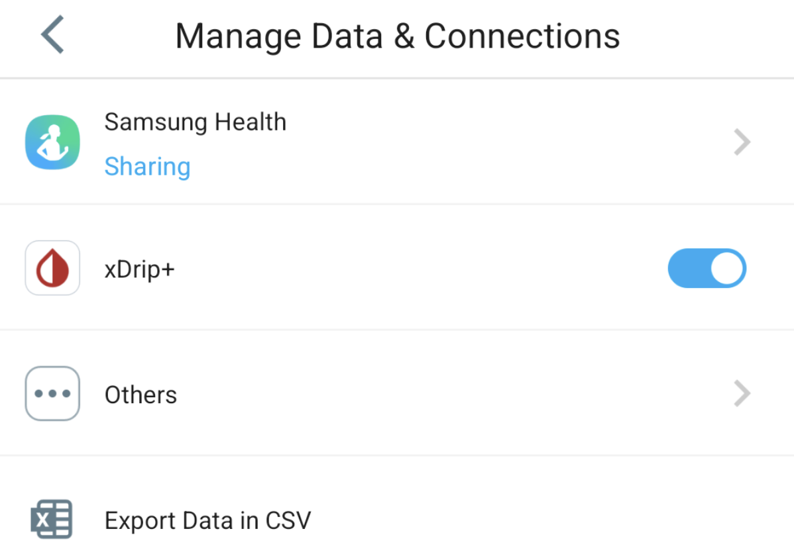

# CareSens

Há várias formas de usar os dados do CareSens com o **AAPS**:

- xDrip
- Juggluco

**Nota:** Não precisa da app de seguidor Sens365 para ligar ao AAPS.

## 1. xDrip

1. Instale e configure a app oficial CareSens.
2. Na app CareSens, vá a settings -> Manage Data and Connections -> ative o interruptor xDrip. Se preferir, desligue as ligações de dados para CareLevo, DIA:CONN, CloudLoop, etc. em «others».

2. Instale o xDrip: [xDrip](https://github.com/NightscoutFoundation/xDrip).
3. No xDrip, vá a settings -> hardware data source e selecione `Companion App` como fonte de dados.
4. No **AAPS**, selecione xDrip em [**Configuração → Fonte da Glicose**](#Config-Builder-bg-source).

## 2. Juggluco

1. Instale a app Juggluco.
2. No Juggluco, abra o menu esquerdo e selecione `Photo`
3. Leia o código QR na embalagem do sensor.
4. No menu esquerdo -> settings -> exchange data, confirme que o xDrip broadcast está ativado.
5. No **AAPS**, selecione xDrip em [**Configuração → Fonte da Glicose**](#Config-Builder-bg-source).
