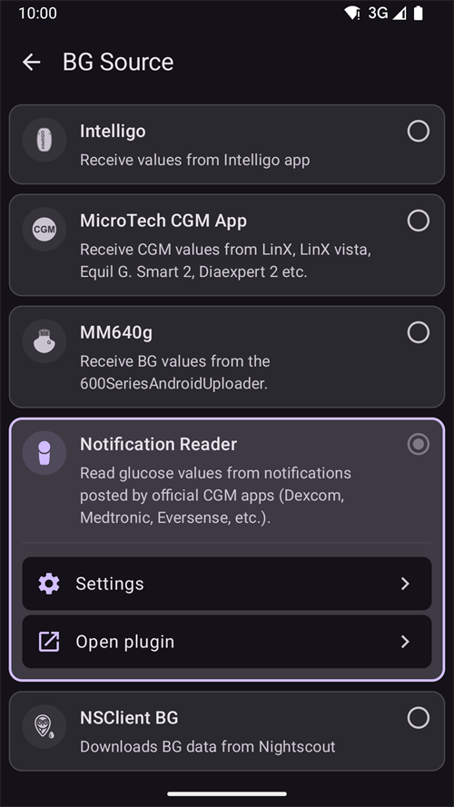

# Dexcom G6 e ONE

## O básico primeiro

-   Siga as recomendações gerais de higiene do CGM e de colocação do sensor [aqui](../CompatibleCgms/GeneralCGMRecommendation.md).

## Dicas gerais para usar o loop com o G6 e o ONE

- Os transmissores recentes chamam-se Firefly. Os sensores não podem ser reiniciados sem retirar o transmissor, que por sua vez não pode ser reposto; também não geram dados brutos.

- Se reiniciar sensores, esteja pronto para calibrar e vigie a variação.

- A pré-imersão (pre-soak) do G6/ONE com calibração de fábrica pode dar variação nos resultados. Se fizer pré-imersão (pre-soak), para ter os melhores resultados, provavelmente terá de calibrar o sensor.

Leia mais no [artigo](https://www.diabettech.com/artificial-pancreas/diy-looping-and-cgm/) publicado por Tim Street em [www.diabettech.com](https://www.diabettech.com).

## Se usar o G6 ou o ONE com o xDrip

- Se ainda não o fez, transfira o [xDrip](https://github.com/NightscoutFoundation/xDrip) e ajuste as suas definições seguindo a [página de definições do xDrip](../CompatibleCgms/xDrip.md).
- Selecione xDrip em [**Configuração → Fonte da Glicose**](#Config-Builder-bg-source).
- Os transmissores Dexcom G6 e ONE podem estar ligados ao mesmo tempo ao recetor Dexcom (ou, em alternativa, à bomba t:slim) e a uma app no seu telefone.
- Se usar o xDrip como recetor, desinstale primeiro a app Dexcom. **Não pode ligar o xDrip e a app Dexcom ao transmissor ao mesmo tempo!**
- Se precisa do Clarity e quer aproveitar os alarmes do xDrip, use a [BYODA](#DexcomG6-if-using-g6-with-build-your-own-dexcom-app) (só G6) com transmissão local para o xDrip.
- You can also use xDrip as a companion app of the official Dexcom app, but you might experience delays in BG readings. Para ler as notificações da app Dexcom sem o xDrip, como fonte de dados fiável, use o [Leitor de notificações](#DexcomG6-notification-reader).
- Com os transmissores atuais, o xDrip usa sempre o [algoritmo nativo](https://navid200.github.io/xDrip/docs/Native-Algorithm.html) do transmissor; não há razão para o desativar. Os [reinícios preventivos](https://navid200.github.io/xDrip/docs/Preemptive-Restart.html) só funcionam em transmissores antigos (firmware 1.6.5.25 ou anterior), onde são precisos para evitar que o sensor pare ao fim de 10 dias; os transmissores recentes (Firefly) ignoram-nos. Veja [Reiniciar um sensor](https://navid200.github.io/xDrip/docs/Restart-G6-sensor.html) antes de tentar qualquer reinício.
- Tudo o que diz respeito ao próprio sensor e transmissor está documentado na [página Dexcom do xDrip](https://navid200.github.io/xDrip/docs/Dexcom_page.html).

(DexcomG6-if-using-g6-with-build-your-own-dexcom-app)=
## Se usar o G6 com a Build Your Own Dexcom App

```{admonition} Old app version
:class: warning
A Dexcom BYODA é agora uma versão muito antiga da app e não pode ser atualizada.
```

-   A [Build Your Own Dexcom App](https://docs.google.com/forms/d/e/1FAIpQLScD76G0Y-BlL4tZljaFkjlwuqhT83QlFM5v6ZEfO7gCU98iJQ/viewform?fbzx=2196386787609383750) (BYODA) suporta transmissão local para o AAPS e/ou o xDrip

-   Esta app permite usar o seu Dexcom G6 com qualquer smartphone Android.
-   Desinstale a app original da Dexcom ou a app Dexcom modificada, se usou uma delas antes (**não pare** o sensor que está a funcionar)
-   Instale o apk transferido
-   Introduza o código do sensor e o número de série do transmissor na app modificada.
-   Nas definições do telefone, vá a apps > Dexcom G6 > permissions > additional permissions e carregue em 'Access Dexcom app'.
-   Passado pouco tempo, o BYODA deve captar o sinal do transmissor.

### Definições do AAPS

-   Selecione **BYODA** em [**Configuração → Fonte da Glicose**](#Config-Builder-bg-source).

-   Se não receber valores, selecione outra fonte de dados e depois selecione de novo **BYODA** para que sejam pedidas as permissões que estabelecem a ligação entre o AAPS e a transmissão da BYODA.

### Definições do xDrip

-   Selecione '640G/Eversense' como fonte de dados.
-   O comando 'start sensor' tem de ser executado no xDrip para receber valores. Isto não afeta o sensor atual, controlado pela Build Your Own Dexcom App.

(DexcomG6-notification-reader)=
## Se usar o G6 ou o ONE com o Leitor de notificações

A app oficial Dexcom G6 ou ONE continua ligada ao transmissor. O **AAPS** lê o valor da glicose diretamente da notificação da app Dexcom, sem nenhuma outra app pelo meio.

```{admonition} Trusted data source
:class: note
As leituras das apps Dexcom G6 e ONE são uma [fonte de dados de glicose fiável](#GettingStarted-TrustedBGSource): os SMB podem ser permitidos em qualquer momento.
```

Em comparação com o BYODA ou o xDrip, o Leitor de notificações tem limites:

- **Sem seta de tendência** e **sem preenchimento de falhas (backfill)**: as leituras perdidas enquanto o telefone estava desligado ou fora de alcance perdem-se.
- Cada leitura fica com a hora em que a notificação apareceu, não com a hora exata da leitura do sensor.
- Só são lidos valores entre 40 e 405 mg/dl (2,2 e 22,5 mmol/l). «LOW» e «HIGH» não são lidos.

### Configurar a app Dexcom

-   Mantenha a app Dexcom instalada e ligada ao transmissor.
-   Confirme que a app Dexcom mostra o valor atual da glicose na sua notificação. As notificações da app têm de ficar visíveis: não as silencie nem as oculte.
-   Use as mesmas unidades de glicose (mg/dl ou mmol/l) na app Dexcom e no **AAPS**. Caso contrário, o **AAPS** não consegue ler o valor.

### Configuração no AAPS

-   Selecione **Leitor de notificações** em [**Configuração → Fonte da Glicose**](#Config-Builder-bg-source) e confirme a mudança.

    

-   De volta ao ecrã principal, o **AAPS** mostra **Permissões necessárias**. Ao lado de **Acesso às notificações**, toque em **Conceder**.

    

-   O Android abre a sua lista de acesso às notificações (o nome depende da sua versão do Android, por exemplo *Leitura, resposta e controlo de notificações*). Selecione o **AAPS**, ative **Permitir acesso às notificações** e confirme com **Permitir**.

    

    O Android avisa que o **AAPS** poderia ler todas as suas notificações. O **AAPS** só lê as notificações das apps de CGM suportadas e ignora todas as outras.

    

-   Se **Permitir acesso às notificações** estiver a cinzento (*Controlado por uma definição restrita*), o Android bloqueia-o porque o **AAPS** não foi instalado a partir da Play Store. Abra as informações da app **AAPS** (toque longo no ícone do **AAPS** > **Informações da app**), toque no menu de três pontos no canto superior direito e selecione **Permitir definições restritas**. Depois volte ao ecrã de acesso às notificações e permita o acesso.
-   As leituras aparecem no **AAPS** quando a app Dexcom mostra um novo valor.

```{warning}
Se a notificação da app Dexcom mostrar mais do que um valor de glicose, ou nenhum, o **AAPS** ignora essa notificação.
```


(DexcomG6-troubleshooting-g6)=
## Resolução de problemas do G6 e do ONE

### Resolução de problemas específicos do Dexcom G6/ONE

-   Desça até **Troubleshooting** [aqui](https://navid200.github.io/xDrip/docs/Dexcom_page.html).

### Resolução de problemas geral

A resolução de problemas geral para CGM está [aqui](#general-cgm-troubleshooting).

### Transmissor novo com sensor em funcionamento

Se tiver de mudar o transmissor durante uma sessão de sensor em curso, pode tentar retirar o transmissor sem danificar o suporte do sensor. Pode encontrar um vídeo [aqui](https://navid200.github.io/xDrip/docs/Remove-transmitter.html). Se preferir [esta solução](https://youtu.be/tx-kTsrkNUM), tenha cuidado para não [danificar os contactos do sensor](https://navid200.github.io/xDrip/docs/Petroleum-jelly-in-Dexcom-G6-Sensor.html) com a tira.
