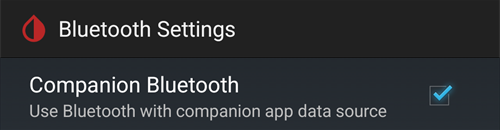

# Dexcom G7, ONE+ e Stelo


## Fundamental antes de começar

É de notar que os sistemas G7, ONE+ e Stelo, ao contrário do G6, não suavizam os valores, nem na app nem no recetor. Mais detalhes sobre isto [aqui](https://www.dexcom.com/en-us/faqs/why-does-past-cgm-data-look-different-from-past-data-on-receiver-and-follow-app).

```{admonition} Smoothing method 
Leia as sugestões em [Suavizar os dados da glicose](../CompatibleCgms/SmoothingBloodGlucoseData.md) sobre o método a usar com Dexcom G7/ONE+/Stelo
```

## 1. xDrip (ligação direta ao G7, ONE+ ou Stelo)

- O próprio xDrip liga-se ao sensor: desinstale a app da Dexcom, porque só uma app pode estar ligada ao sensor. Para manter a app da Dexcom, use antes a [xDrip Companion App](#DexcomG7-xdrip-companion-app).
- Siga as instruções aqui: [xDrip G7, ONE+ e Stelo](https://navid200.github.io/xDrip/docs/Dexcom/G7.html). É necessária uma versão recente do xDrip — veja a versão mínima na página indicada.
- Selecione xDrip em [**Configuração → Fonte da Glicose**](#Config-Builder-bg-source).

- Ajuste as definições do xDrip de acordo com as explicações da página [Definições do xDrip](../CompatibleCgms/xDrip.md).

## 2. Build Your Own Dexcom App (só G7)

```{admonition} Old app version
:class: warning
A Dexcom BYODA é agora uma versão muito antiga da app e não pode ser atualizada. Não está disponível para ONE+ nem Stelo.
```

-   A [Build Your Own Dexcom App](https://docs.google.com/forms/d/e/1FAIpQLScD76G0Y-BlL4tZljaFkjlwuqhT83QlFM5v6ZEfO7gCU98iJQ/viewform?fbzx=2196386787609383750) (BYODA) suporta o envio local (broadcast) para o AAPS

-   Esta app permite usar o seu Dexcom G7 com qualquer smartphone Android.
-   Desinstale a app original da Dexcom
-   Instale o apk transferido
-   Introduza o código do sensor na app modificada (patched)
-   After a short time BYODA should pick up the sensor signal.

(DexcomG7-xdrip-companion-app)=

## 3. xDrip Companion App (G7, ONE+ e Stelo)

A app oficial da Dexcom continua ligada ao sensor. O xDrip lê os valores de glicose das notificações da app da Dexcom e envia-os para o **AAPS**.

```{admonition} Not a trusted data source
:class: note
**AAPS** does not consider xDrip in Companion App mode a [trusted BG data source](#GettingStarted-TrustedBGSource): SMBs are not allowed all the time.

To read the Dexcom app notifications without xDrip, as a trusted data source, use the [Notification Reader](#DexcomG7-notification-reader).
```

### Ler as notificações da app da Dexcom

- Mantenha a app da Dexcom instalada e ligada ao sensor. As notificações da app têm de ficar visíveis: não as silencie nem as oculte.
- Transfira e instale o [xDrip](https://github.com/NightscoutFoundation/xDrip). Use no xDrip as mesmas unidades de glicose que na app da Dexcom.
- No xDrip, vá a **Settings** > **Hardware Data Source** e selecione **Companion App**.

  

- O xDrip pede permissão para ler as notificações. Toque em **OK**, depois selecione **xDrip** na lista e ative **Permitir acesso às notificações**.

  

- Se **Permitir acesso às notificações** estiver a cinzento (*Controlado por uma definição restrita*), o Android bloqueia-o porque o xDrip não foi instalado a partir da Play Store:

  

  Abra as informações da app xDrip (toque longo no ícone do xDrip > **Informações da app**), toque no menu de três pontos no canto superior direito e selecione **Permitir definições restritas**. Depois volte ao ecrã de acesso às notificações e permita o acesso.

  

  

- As leituras aparecem no xDrip quando a app da Dexcom mostra um valor novo. Se nada aparecer, pode ser preciso iniciar um sensor no xDrip: isto não tem efeito no sensor real. Neste modo, o Stelo dá uma leitura a cada 15 minutos.

### Companion Bluetooth (G7)

Quando a app da Dexcom está ligada a um sensor G7, o xDrip também pode ouvir por Bluetooth as leituras que o sensor envia para a app da Dexcom. O xDrip não emparelha com o sensor e não precisa de introduzir o código do sensor: a app da Dexcom continua a controlar o sensor.

Com **Companion Bluetooth**, o xDrip recebe do sensor a hora exata e a tendência de cada leitura, em vez da hora em que a notificação apareceu, e preenche as falhas de quando o telefone esteve fora de alcance (backfill).

- No xDrip, vá a **Settings** > **Less common settings** > **Bluetooth Settings** e ative **Companion Bluetooth**.

  

- Isto não funciona em todos os telefones e versões do Android. Desative-o se notar problemas.
- Se um sensor Dexcom antigo ainda estiver na lista de Bluetooth do telefone, o xDrip pode ouvir o sensor errado: nas **Definições** do Android > **Dispositivos ligados**, esqueça os sensores que já não usa.
- O Companion Bluetooth foi feito para o G7. Com ONE+ e Stelo, use as notificações.

### Configuração no AAPS

- Selecione xDrip em [**Configuração → Fonte da Glicose**](#Config-Builder-bg-source).
- Ajuste as definições do xDrip de acordo com as explicações da página [Definições do xDrip](../CompatibleCgms/xDrip.md).

## 4. Juggluco (G7 e ONE+)

É necessária a versão 9.0 ou superior

- Desative a app que estava ligada ao sensor antes: desinstale a app ou use «Forçar paragem». Desative a permissão «Dispositivos próximos» nas definições da app. Restrinja o uso da bateria da app.

- Esqueça o sensor nas definições de Bluetooth: nas definições do Android, encontre o sensor nos dispositivos associados e selecione «Esquecer». Os nomes dos sensores Dexcom G7 começam por DXCM.

- Evite interferências de outros sensores: mantenha os sensores Dexcom antigos fora do alcance do Bluetooth.

- Ligue o sensor G7 ao Juggluco: abra o Juggluco → menu à esquerda → Photo. Leia o código Data Matrix no aplicador do sensor G7. Aguarde até 5 minutos até o Juggluco encontrar o sensor.

- Requisitos para o emparelhamento: aceite emparelhar o sensor com o Juggluco. Garanta que o ecrã não está bloqueado durante o emparelhamento. Se o emparelhamento falhar, aguarde 5 minutos antes de tentar de novo.

- Exceção: os relógios Wear OS podem associar-se sem premir um botão de aceitar.

(DexcomG7-notification-reader)=

## 5. Notification Reader (G7, ONE+ and Stelo)

A app oficial da Dexcom continua ligada ao sensor. **AAPS** reads the glucose value directly from the notification of the Dexcom app, without any other app in between.

```{admonition} Trusted data source
:class: note
Readings from the Dexcom G7, ONE+ and Stelo apps are a [trusted BG data source](#GettingStarted-TrustedBGSource): SMBs can be allowed all the time.
```

Compared to the other methods on this page, the Notification Reader has limits:

- **No trend arrow** and **no backfill**: readings missed while the phone was off or out of range are lost.
- Each reading gets the time the notification appeared, not the exact time of the sensor reading.
- Only values between 40 and 405 mg/dL (2.2 and 22.5 mmol/L) are read. "LOW" and "HIGH" are not read.
- Stelo gives a reading every 15 minutes.

### Set up the Dexcom app

- Mantenha a app da Dexcom instalada e ligada ao sensor.
- Make sure the Dexcom app shows the current glucose value in its notification. As notificações da app têm de ficar visíveis: não as silencie nem as oculte.
- Use the same glucose units (mg/dL or mmol/L) in the Dexcom app as in **AAPS**. Otherwise **AAPS** cannot read the value.

### Configuração no AAPS

- Select **Notification Reader** in [**Configuration → BG Source**](#Config-Builder-bg-source) and confirm the switch.

  

- Back on the main screen, **AAPS** shows **Permissions Required**. Next to **Notification Access**, tap **Grant**.

  

- Android opens its notification access list (its name depends on your Android version, for example *Notification read, reply & control*). Select **AAPS**, turn on **Allow notification access** and confirm with **Allow**.

  

  Android warns that **AAPS** could read all your notifications. **AAPS** only reads the notifications of supported CGM apps and ignores all others.

  

- If **Allow notification access** is greyed out (*Controlled by Restricted Setting*), Android blocks it because **AAPS** was not installed from the Play Store. Open the **AAPS** app info (long press the **AAPS** icon > **App info**), tap the three dots menu at the top right and select **Allow restricted settings**. Depois volte ao ecrã de acesso às notificações e permita o acesso.
- Readings appear in **AAPS** when the Dexcom app shows a new value.

```{warning}
If the Dexcom app notification shows more than one glucose number, or none, **AAPS** skips that notification.
```
