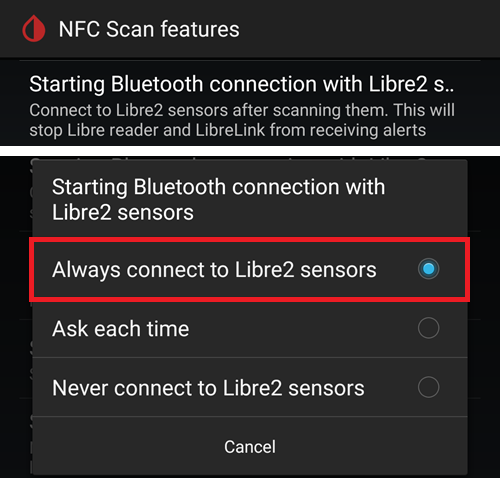
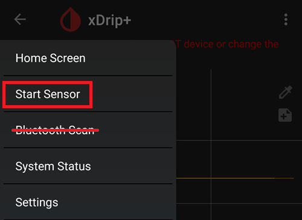

# Como configurar o FSL 2 e o OOP2 para usar uma ligação Bluetooth nativa no xDrip

Transferido de [MinimalL00per](https://www.minimallooper.com/post/how-to-setup-freestyle-libre-2-and-oop2-to-use-a-native-Bluetooth-connection-in-xdrip) para markdown e **revisto/atualizado**: 25 de agosto de 2025, psonnera

Há uma lista de definições no fim deste documento. Se não conhecer algum termo ou abreviatura, *[salte para baixo](#minimallooper-definitions)* para ver a explicação.

 

## Configuração

### Hardware

- *FSL2 e 2+* **NOTA: as versões dos EUA, Canadá, Nova Zelândia e Austrália NÃO são suportadas**

**(OPCIONAL) Leitor** (não é compatível com o FSL2+)

- Leitor 1 (com firmware atualizado)

- Leitor 2

*NOTA: se planeia usar o leitor nesta solução, TEM DE INICIAR o sensor PRIMEIRO COM O LEITOR. Se não o fizer, não poderá usar o leitor para obter leituras do sensor ativado. Depois de o sensor aquecer, pode obter leituras com a aplicação LL ou com o xDrip.*

### Software

**OOP** - Out of Process Algorithm (algoritmo fora do processo), uma aplicação Android externa (APK) que ajuda a obter os dados brutos do sensor para calcular os valores de glicose. O xDrip envia os dados brutos BT recolhidos do FSL2 para o OOP, e os valores de glicose são devolvidos ao xDrip.

- **OOP2**

  - **Funciona apenas com sensores FSL2/2+ europeus**

  - Código fechado (não está disponível no GitHub)

  - O objetivo é decifrar os valores brutos cifrados do sensor e devolvê-los ao xDrip. Depois, o xDrip pode ser usado com os dados brutos, que precisam de calibração, ou fornecer valores de glicose semelhantes aos do leitor 1.

[***xDrip***](https://jamorham.github.io/)

- [*Nightly*](https://github.com/NightscoutFoundation/xDrip/releases): o código mais recente, compilado todas as noites. Não foi testado a fundo

- [*Stable*](https://xdrip-plus-updates.appspot.com/stable/xdrip-plus-latest.apk): a versão estável e testada mais recente.

- **NOTA: os sensores novos precisam de uma app OOP2 atualizada. Para isso, recomendamos usar pelo menos a versão estável (Stable) mais recente do xDrip, que corresponde ao OOP2 mais recente.**

 

## Processo

- *Primeiro, transfira e instale as apps abaixo*
- *Desinstalar apps que possam causar conflitos*
- *Como iniciar um sensor FSL2 no modo Bluetooth nativo com a app LL e o xDrip
  - [*Passo 1: Instalação e configuração das aplicações*](#minimallooper-step1)
  - [*Passo 2: Configuração das definições do xDrip*](#minimallooper-step2)
  - [*Passo 3: Inserir fisicamente o sensor*](#minimallooper-step3)
  - [*Passo 4: Abrir a app LL e iniciar o sensor com a primeira leitura NFC*](#minimallooper-step4)
  - [*Passo 5: Abrir o xDrip e LER POR NFC o sensor FSL2*](#minimallooper-step5)
  - [*Passo 6: Iniciar o novo sensor no xDrip*](#minimallooper-step6)
  - [*Passo 7: Esperar 60 segundos e voltar a ler o sensor por NFC*](#minimallooper-step7)
  - [*Passo 8: Recolha de dados entre 3 e 15 minutos*](#minimallooper-step8)
  - [*Passo 9: Verificar se o sensor está ligado e a enviar dados*](#minimallooper-step9)

- *[Notas](#minimallooper-notes)*
- *[Vantagens](#minimallooper-advantages)*
- *[Desvantagens](#minimallooper-disadvantages)*
- <u>*\[Resolução de Problemas\](#minimallooper-troubleshooting)*</u>

## Antes de começar

Recomendamos muito que siga este processo com um **sensor novo**. Embora haja relatos de que é possível ligar a um sensor já em uso (***veja [abaixo](#minimallooper-started-sensor)***), é muito provável que a app LL ou o leitor criem uma nova chave privada partilhada para a comunicação durante a ligação. Isto significa que, após a associação, o xDrip não conhece a nova chave e não vai conseguir comunicar com o sensor. Tente ligar a um sensor já em uso por sua conta e risco, de preferência perto do fim da vida do sensor.

### Primeiro, transfira e instale as apps abaixo

(Libre2_OOP2)=

- **OOP2** - As versões do oop2 estão em:

  (*Nota: precisa de ter sessão iniciada no Google para abrir a ligação.*)

*[oop2.apk](https://drive.google.com/file/d/1106h2s12b3Ev9gKCTU2G75q8h9ChHjcz/view?usp=sharing)* - OOP2_21_09_25 (05d1989) **2025.09.21** (versão mais recente)

- **xDrip** - a **<u>versão mais recente</u>** (versão mínima 2025.09.26) está em:

[*xDrip.apk*](https://github.com/NightscoutFoundation/xDrip/releases)

(minimallooper-started-sensor)=

### E se o meu sensor já estiver iniciado? Can I still get readings in xDrip? SIM!

Muitas pessoas perguntaram se este método pode ser usado com um sensor já ativo, e posso dizer com um claro **SIM**: pode iniciar um sensor que já está a funcionar.

1.  **PRIMEIRO**, confirme que fez as alterações de configuração e as definições no xDrip e que instalou e configurou o OOP2 como mostrado abaixo.

2.  **DEPOIS**, avance para o *Passo 5* e **CERTIFIQUE-SE** de que forçou o fecho da app LL antes de começar. Depois, siga o processo até ao fim.

*NOTA: não poderá usar o seu sensor FSL2 ativado com o leitor FSL (FSLReader) SE ele não tiver sido iniciado primeiro com o leitor. Se ele FOI iniciado primeiro com o leitor FSL (FSLReader), poderá **ler** o sensor e obter leituras TANTO do sensor como de apps como a LL e o xDrip.*

## Como iniciar um sensor FSL2 no modo Bluetooth nativo com a app LL e o xDrip

*NOTA: se nas capturas de ecrã houver definições que não estão marcadas com uma CAIXA e estão DESMARCADAS (ou seja, desativadas), MANTENHA-AS DESATIVADAS. As capturas de ecrã mostram uma configuração que funciona para TODAS as definições mostradas. If you want to experiment turning other features on/off after you have a working sensor, you are free to do so at your own risk.*

(minimallooper-step1)=

### Passo 1: Instalação e configuração das aplicações

**Instale e configure o OOP2** e verifique se funciona, abrindo simplesmente a app.


**Definições**

- *Use service* **on**

- *Use foreground service* **on**

- *Timer Duration* **5 minutes**

  - Mude para **1 sec** se não estiver a obter resultados com rapidez suficiente (a captura de ecrã abaixo mostra esta definição).

**Versão 2: 93e5cac-2020.12.08 (versão mais recente)**


**Instale o xDrip**, versão mínima: a versão (release) mais recente. Mais documentação sobre a instalação e configuração do xDrip está [*aqui*](../CompatibleCgms/xDrip.md).

(minimallooper-step2)=

### Passo 2: Configuração das definições do xDrip

**Hardware Data Source**: Libre Bluetooth


**NFC Scan features**: *as definições não mencionadas devem estar desligadas.*

- *Use NFC feature*: **on**
- *Sensor Age or Expiry*: **on**
- *Scan when not in xDrip*: **on**
- *Use Any-tag optimized reading method*: **off**, mas experimente **on** se tiver dificuldades em ler o sensor


- *Starting Bluetooth connection with FSL2 sensor*: **Always connect to libre2 sensors**



- *Smooth libre 3 data when using xxx method*: deixe o valor predefinido. Aumente o valor para sensores com muito ruído, diminua quando estiverem estáveis.


**Less Common Settings -\> Bluetooth Settings** (*são importantes e podem variar com o seu telefone/configuração*)

- *Turn Bluetooth on*: **on**
- *Trust Auto-Connect*: **on**
- *Use Background Scans*: **on**
- *Always discover services*: **on**

Pode configurar o xDrip com o código QR abaixo. Tem de o ler (ou carregar a imagem) em xDrip -> Auto Configure.

```{admonition} QR Code
:class: dropdown


```


Depois de ler o código QR acima, se tiver um telefone Samsung (isto também é útil para muitas marcas chinesas), leia o outro código QR abaixo para mudar as definições e ter uma ligação mais fiável:

- *Trust Auto-Connect*: **off**
- *Use Background Scans*: **off**

```{admonition} QR Code
:class: dropdown


```


**Advanced settings for FSL2** (*opcional, mas útil*)

- *show Raw values in Graph*: **on**

- *show Sensor info in Status*: **on**


**Extra Logging Settings** (*necessário para depurar se não funcionar bem*)

- *Extra tags for logging*: introduza este valor

`BgReading:d,jamorham librereceiver:v,LibreOOPAlgorithm:v,jamorham nsemulator:v,DexCollectionService:v`


(minimallooper-OOPsettings)=

**Less Common Settings -\> Other misc options**

> **Definições para a configuração do OOP2**

- *Out of process Libre algorithm*: **OFF**

(*CERTIFIQUE-SE DE QUE ISTO ESTÁ **OFF** PARA O OOP2, SENÃO NÃO RECEBE LEITURAS!*)


(minimallooper-step3)=

### Passo 3: Inserir fisicamente o sensor

(minimallooper-step4)=

### Passo 4: Abrir a app LL e iniciar o sensor com a primeira leitura NFC

Abra a app LL, leia o sensor acabado de inserir e depois feche e desative ou desinstale a app LL. **Mesmo assim, tem de esperar os 60 minutos completos de aquecimento do sensor antes de continuar e iniciar o sensor no xDrip**. Não confie nas leituras anteriores, porque o sensor ainda está a calibrar internamente e os valores variam muito.

#### Passo 4a (OPCIONAL, usar o leitor FSL):

**Inicie o sensor FSL2 (não o 2+) lendo-o com o leitor FSL (FSLReader) na primeira leitura NFC**

Se quiser usar o **leitor FSL (FSLReader)**, além da app LL ou do xDrip, para ler valores do sensor FSL2, então **tem de ler PRIMEIRO o sensor FSL2 acabado de inserir com o leitor FSL.** Depois de terminar o aquecimento do sensor, pode usar a app LL ou o xDrip para fazer leituras.

*NOTA: a app LL só é precisa para a PRIMEIRA leitura NFC após a inserção do sensor. Serve para enviar o sinal de inicialização do aquecimento; depois, a app TEM DE ser desativada (app settings-\>force close) ou desinstalada. Pode usar a app Patched 2.3 ou as versões oficiais, não faz diferença. O mais importante é impedir que a app LL esteja a funcionar quando o xDrip tenta iniciar a associação BT com o sensor, porque a app LL interfere com o processo de religação Bluetooth e perturba a comunicação.*

*Há relatos de que basta desligar a **permissão de localização** da app LL nas definições de sistema do Android para evitar que ela interfira com a ligação. Alguns utilizadores relatam que isto funciona. Repito: **recomendo desativar ou desinstalar a app**, mas pode tentar isto se quiser experimentar.*

(minimallooper-step5)=

### Passo 5: Abrir o xDrip e LER POR NFC o sensor FSL2

(*Lembrete! Confirme que a app LL está desativada (localização desligada) ou desinstalada E que esperou os 60 minutos completos para o sensor aquecer e calibrar internamente.*)

**LEIA POR NFC** o sensor FSL2 com o xDrip. Isto envia um sinal ao sensor para ligar o emparelhamento Bluetooth e iniciar o processo de associação (bonding). Vai aparecer por pouco tempo uma pequena notificação no fundo do ecrã principal (Overview) do xDrip com o texto **Scanning**, seguida da notificação **Scanned OK!** quando a leitura NFC do sensor FSL 2 tiver sucesso.


(minimallooper-step6)=

### Passo 6: Iniciar o novo sensor no xDrip

No **ecrã principal (Overview) do xDrip**, prima o **menu hambúrguer** no canto superior esquerdo. Depois, escolha **Start Sensor**.

No ecrã **Start New Sensor**, prima **Start Sensor**. Uma pergunta vai aparecer: **Did you insert it today?** Responda premindo **NOT TODAY**.




*NOTA: se clicou por engano em "YES, TODAY", tem de fazer "stop sensor" no menu principal do xDrip e depois "start sensor", repetindo o Passo 5.*

(minimallooper-step7)=

### Passo 7: Esperar 60 segundos e voltar a ler o sensor por NFC

A second NFC scan is needed in order to **ADD** the sensor as the Bluetooth device that xDrip will use to retrieve the readings. Quando terminar, verá uma notificação a dizer **NEW SENSOR STARTED**.


É obrigatório esperar 60 segundos, porque durante este processo o sensor não pode ser lido mais do que uma vez por minuto. Se o sensor for lido cedo demais, aparece o aviso **Not so quickly, wait 60 seconds** no ecrã principal (Overview) do xDrip.


Abra os registos de eventos (event logs) do xDrip e verifique se o sensor ficou bem emparelhado com o xDrip.


(minimallooper-step8)=

### Passo 8: Recolha de dados entre 3 e 15 minutos

Entre 3 e 15 minutos, são recolhidos dados suficientes para mostrar os primeiros valores. *Se ainda não receber leituras nessa altura, às vezes ajuda reiniciar o telefone.*

Se usar um telefone Samsung (ou de muitas marcas chinesas) e tiver problemas a receber dados, leia o código QR abaixo em xDrip -> Auto Configure.

```{admonition} QR Code
:class: dropdown


```

Ele vai mudar as definições Bluetooth do xDrip para:

- *Trust Auto-Connect*: **off**
- *Use Background Scans*: **off**

(minimallooper-step9)=

### Passo 9: Verificar se o sensor está ligado e a enviar dados

Prima o menu hambúrguer no canto superior esquerdo do ecrã principal (Overview) do xDrip e selecione **System Status**. No ecrã System Status, o campo ativo **Bluetooth Device:** mostra o nome Bluetooth do FSL2 no formato **ABB___XXXXXXXXXXX**, em que os X representam o número de série do sensor. The **Connection Status** field displays **Connected** and the **Sensor Start:** field displays the time the sensor was started.


No ecrã **BT Device** (deslize para a esquerda), pode verificar mais detalhes da ligação ao sensor e também usar este ecrã para resolver problemas de ligação. Abaixo está uma lista dos campos e da sua função, para ajudar a resolver problemas de ligação.

*NOTA: **<u>NÃO TOQUE</u> NEM MUDE Bluetooth Pairing de <u>Disabled</u>** nesta janela. Se o fizer, vai tentar um emparelhamento direto, que vai falhar (Not bonded), e terá de recomeçar todo o processo a partir do Passo 5.*


- **Phone Service State:** a última vez que o telefone fez uma ligação BT ao sensor (deve ter sido há menos de 5 minutos)
- **Bluetooth Device:** mostra o estado atual da ligação (**Connected** ou **Disconnected**)
- **Device Mac Address**: é o ID de hardware do sensor
- **Bluetooth Pairing**: This should be **<u>Disabled, tap to enable</u>**. Tenha cuidado para NÃO tocar aqui. Se tocar por engano, toque de novo até voltar a «disabled».
- **Slowest wake up**: pode ignorar isto. xDrip doesn't spend its time waiting for readings: it will start expecting them after a certain time (traditionally 5 minutes). Se nessa altura não chegarem dados, verá "Woke up early", o que significa que o xDrip esperava ter dados prontos, mas não há nenhuns. Slowest wake up é o maior atraso que ocorreu antes de receber dados normalmente.
- **Next Wake up**: deve indicar 5 minutos


(minimallooper-notes)=

### Notas

- **Usar leituras NFC da app LL DEPOIS de terminar a associação/emparelhamento no xDrip**: pode fazer leituras NFC, mas a associação/emparelhamento com o xDrip tem de estar terminada primeiro. Olhe sempre para o xDrip e veja se está perto da leitura dos 5 minutos (por exemplo, há 4 minutos). Se estiver perto dos 5 min, espere pela nova leitura BT e só depois faça a leitura NFC. Se o fizer na altura errada, vai perturbar o processo BT no xDrip e não receberá leituras BT. Pode demorar algum tempo a voltar a associar e a transmitir, e às vezes a ligação BT do sensor pode ser “roubada” pela app LL. No entanto, entre estas leituras BT, não tive problemas em fazer uma leitura NFC e desativar a app logo a seguir. Não tenho a certeza se a app LL tem de ser desativada todas as vezes, mas desativo-a por segurança.

- **What is going on?** When a Bluetooth connection is made a private shared key is created that is needed to allow communication between the sensor and the calling application/device. É muito provável que a app LL ou o leitor criem uma nova chave privada partilhada para a comunicação durante a ligação. Isto significa que, após a associação, o xDrip não conhece a nova chave e não vai conseguir comunicar com o sensor.

  - Vários utilizadores relatam que a app LL pode ser aberta de novo depois de iniciar o sensor com sucesso e de receber leituras no xDrip. Nas permissões Android da app LL, basta desligar a definição **Allow Location**. Depois disto, deve conseguir usar a app LL e o xDrip ao mesmo tempo. Recomendo que não escolha uma app predefinida para as leituras NFC e que escolha em cada leitura NFC a app com que quer ler o sensor. E NÃO SE ESQUEÇA: na próxima mudança de sensor, force o fecho da app LL após a leitura NFC inicial de aquecimento do sensor novo. Depois de o sensor estar configurado e a enviar leituras para o xDrip, pode voltar a abrir a app LL.

&nbsp;

- **Reiniciar o telefone**: após o reinício, e depois de desativar ou forçar o fecho da app, LEMBRE-SE de verificar que a app LL NÃO está a funcionar. Sugiro testar um reinício para ver se a app LL volta a arrancar sozinha. Pode ver isto nas definições da app LL, nas definições de aplicações do Android do seu telefone. Se ainda estiver ativa, desative de novo a app LL; desinstalar a app LL pode ser a única forma de evitar isto. Isto serve para evitar que a app LL roube por acidente a associação (bond) BT. Além disso, após um reinício, demora os mesmos 3–15 minutos a receber leituras BT do sensor. Tenha paciência e planeie isto se reiniciar perto de momentos em que precisa de um valor de glicose para dar um bólus, para refeições, etc.

&nbsp;

- **Definições de otimização da bateria**: EXCLUA estas apps das definições de otimização da bateria do seu telefone

  - xDrip

  - OOP 2

  - LL

  - AAPS

&nbsp;

- **Usar o modo de voo:** Há situações em que é preciso ligar o modo de voo (quando se apanha um avião ;-), ou quando se dorme à noite e não se quer sinais Wi-Fi ou de rede móvel ativos com o telefone perto da cabeça), e isto pode causar problemas na comunicação Bluetooth quando o modo de voo é ativado. Se ligar o modo de voo no telefone e depois ativar o Bluetooth, as leituras de glicose perdem-se. A única solução é reiniciar o coletor em xdrip+ -\> System Status -\> Classic Status Page. Depois de reiniciar o coletor, as leituras de glicose voltaram a aparecer.

 

(minimallooper-advantages)=

### Vantagens

- **A app LL modificada (patched) já não é necessária** Já não precisa de uma versão modificada da app LL para obter valores do sensor FSL2. Embora possa usar a app LL modificada, as versões oficiais da app LL também conseguem fazer a primeira leitura NFC de inicialização, da mesma forma que a app modificada. Não há diferença no que respeita à leitura NFC de inicialização para iniciar o sensor.

&nbsp;

- **Já não é preciso um leitor NFC de terceiros** Os leitores NFC de terceiros (como Miaomiao, Bubble ou Blucon) já não são necessários *(mas ainda podem ser usados)* para recolher leituras, porque agora o próprio sensor as pode enviar por Bluetooth. Menos hardware significa menos coisas que podem falhar, menos dispositivos para carregar e uma configuração mais minimalista.

&nbsp;

- **Continuará a poder fazer leituras NFC com o leitor FSL2 (versão 1 com firmware atualizado ou versão 2) SE o sensor FSL2 tiver sido iniciado PRIMEIRO com o leitor FSL.** O leitor FSL2 pode continuar a ser usado para ler o sensor ativo depois de este estar associado por Bluetooth ao xDrip.

  - **TEM DE** iniciar o sensor com a primeira leitura NFC, para começar o aquecimento do sensor, **PRIMEIRO com o leitor FSL**. A partir daqui, outras aplicações também vão conseguir fazer leituras NFC do sensor agora ativado.
- Pelo que sei, o sensor FSL2 (enquanto não tiver estabelecido uma ligação nem estiver a tentar estabelecê-la) anuncia sempre a sua presença (e disponibilidade) por BLE exatamente a cada 2 minutos (visível em qualquer dispositivo Bluetooth que consiga procurar dispositivos Bluetooth). O primeiro dispositivo a responder a este anúncio ganha a corrida e é o *único* dispositivo autorizado a ligar-se e a ler o sensor, porque durante o processo de ligação por leitura NFC é criada uma chave privada partilhada, usada para decifrar a comunicação do FSL 2. O sensor fica então indisponível para outros dispositivos que não têm esta chave privada partilhada e que também possam estar a tentar ligar-se. Parece que o leitor FSL 2 ganha sempre esta corrida, seja qual for o “adversário”.

&nbsp;

- **Configuração com o mínimo de hardware** O meu objetivo sempre foi ter o mínimo de dispositivos médicos no corpo. O FSL2 em combinação com o sistema Omnipod cumpriu este objetivo. Isto é ainda mais importante quando viajo (distâncias curtas e longas), porque há menos itens e menos trocas desses itens, o que me deixa mais espaço na bagagem para outras coisas. Espero que no futuro haja uma bomba patch que tenha apenas um reservatório substituível, e que o chip e o motor possam ser uma peça reutilizável. Isto reduziria o lixo e as embalagens nas mudanças de local, o que mais uma vez deixa mais espaço na mala para outras coisas.

&nbsp;

- **Acabaram as falhas de uma hora ao mudar de sensor** Como pode iniciar outro sensor com a app LL através de uma leitura NFC inicial, o sensor atual pode continuar a funcionar e a enviar leituras por Bluetooth ao mesmo tempo. Após 20 minutos, pode obter leituras do sensor novo, mas é melhor esperar 1 hora para o sensor calibrar internamente de forma correta. Isto significa que pode parar o sensor atual e iniciar o novo (depois de ter sido colocado e aquecido com a leitura NFC da app LL uma hora antes) e, dentro de 3 a 15 minutos, terá as suas calibrações iniciais e leituras.

&nbsp;

(minimallooper-disadvantages)=

### Desvantagens

- **Reiniciar o telefone:** Como o processo Bluetooth tem de começar de novo quando o telefone reinicia, tem primeiro de garantir que desativa manualmente a app LL (se não a desinstalou) e esperar com paciência pelas primeiras leituras (3 a 15 min). Isto significa escolher bem a hora dos reinícios do telefone, para que não aconteçam em momentos críticos, como bólus de correção ou refeições e lanches.

&nbsp;

- **Não pode usar a app LL e o xDrip ao mesmo tempo para leituras por Bluetooth**. A app LL vai sempre tentar "roubar" a ligação Bluetooth ao sensor e a associação (bond). Se isso acontecer, fica preso à app LL até ao fim da vida do sensor. Por isso, usar as apps ao mesmo tempo nem sempre funciona. Como digo abaixo, pode ativar a app LL e fazer uma leitura NFC para obter a leitura na app LL (se precisar de comparar, ou quiser obter o histórico para si ou para relatórios do endocrinologista). No entanto, deve desativá-la logo que tiver a leitura e não tentar fazer isto no minuto em que o xDrip vai obter a sua leitura Bluetooth. Não sei bem como funciona o leitor FSL2 enquanto se faz isto, mas vou testar mais tarde.
- Vários utilizadores relatam que a app LL pode ser aberta de novo depois de iniciar o sensor com sucesso e de receber leituras no xDrip. Nas permissões Android da app LL, basta desligar a definição **Allow Location**. Depois disto, deve conseguir usar a app LL e o xDrip ao mesmo tempo. Recomendo que não escolha uma app predefinida para as leituras NFC e que escolha em cada leitura NFC a app com que quer ler o sensor. E NÃO SE ESQUEÇA: na próxima mudança de sensor, force o fecho da app LL após a leitura NFC inicial de aquecimento do sensor novo. Depois de o sensor estar configurado e a enviar leituras para o xDrip, pode voltar a abrir a app LL.

&nbsp;

- **Os leitores NFC de terceiros ainda podem ser usados**. Sim, indiquei isto como desvantagem, mas também queria dizer que, se algo correr mal com o sensor e a app LL ficar com o controlo dele, pode sempre voltar a colocar um leitor NFC no sensor para obter leituras no xDrip. Também pode usar este dispositivo em vez de uma ligação Bluetooth direta, se preferir uma configuração com um leitor NFC de terceiros (Miaomiao, Bubble, Blucon). Às vezes, alguns telefones não funcionam bem com a associação Bluetooth nativa ao sensor e com a obtenção dos dados. Pode usar estes dispositivos como reserva ou no uso normal; de qualquer forma, continua a ter esta opção.
- Se planeia usar o **leitor FSL** como dispositivo NFC para fazer leituras, TEM DE iniciar o sensor FSL2 com a **PRIMEIRA leitura NFC**, para o aquecer, **PRIMEIRO COM O LEITOR**.

&nbsp;

- **Os dados não são enviados automaticamente para o LV** Como a app LL não tem uma ligação Bluetooth constante (porque a app LL não deve estar a funcionar ao mesmo tempo que o xDrip quando o sensor está a enviar leituras por Bluetooth), não recebe leituras do sensor automaticamente. Isto significa que os dados de glicose não são enviados automaticamente para o LV e, por consequência, para outros telefones com a app LL. Considero isto uma desvantagem, porque sei que muitos pais dependem desta função, tal como as pessoas que têm de usar os relatórios do LV para o seu prestador de cuidados de saúde. Pode ainda abrir a app LL e ler o sensor a cada 8 horas para passar para a app LL os dados preenchidos depois (backfill) a partir do sensor (3 vezes por dia, pelo menos a cada 8 horas, mas provavelmente são precisas mais leituras para obter os dados das 24 horas), mas, mais uma vez, é um processo manual.

&nbsp;

(minimallooper-definitions)=

### Definições

- **BT** - Bluetooth

- **BLE** - Bluetooth Low Energy

- **FSL** - FreeStyle Libre
  - **Libre 1 (FSL1)** - apenas NFC. Primeira versão do sensor

  - **Libre 2 (FSL2)** - Bluetooth and NFC. Segunda versão do sensor.

  - **Libre 3 (FSL3)** - Bluetooth e NFC. Terceira versão do sensor, mais pequena. Não é suportado pelo OOP2 (veja o Juggluco).

- **LL** - LibreLink, **aplicação** usada para iniciar o sensor com a leitura NFC inicial

- **LV** - LibreView, serviço na nuvem para partilhar dados com a sua equipa de endocrinologia (pense em usar o Tidepool ou o Nightscout)

- **MM** - MiaoMiao, nome e fabricante de um leitor NFC de terceiros que envia as leituras por Bluetooth para o xDrip.

- **NFC** - Near Field Communication (comunicação de campo próximo), uma ação física em que aproxima o sensor NFC do seu telefone do seu sensor para iniciar uma leitura. Muitas vezes chama-se a isto “ler o sensor”, “leitura do sensor” ou “leitura NFC”. Este processo não usa o Bluetooth de forma nenhuma.

- **OOP1** - Out of Process Algorithm versão 1, a app de terceiros que recebe os valores brutos (enviados do sensor para o xDrip por Bluetooth ou leitura NFC) e depois usa um algoritmo (muito parecido com o algoritmo de hardware no chip do sensor) para processar os valores brutos. Devolve ao xDrip um valor de glicose calibrado (pelo algoritmo OOP1, não pelas calibrações próprias do xDrip), para ser mostrado ou, se for preciso, processado pela calibração do xDrip (com uma calibração por picada no dedo).

- **OOP2** - Out of Process Algorithm version 2, the 3rd party app that receives encrypted data delivered from the FSL 2 sensor (by Bluetooth or NFC scan) and then decrypts the encrypted data. Depois de decifrados, os dados são enviados para o xDrip.

 

(minimallooper-troubleshooting)=

### Resolução de Problemas

#### Falha ao ler o sensor por NFC

- Confirme que o leitor NFC do telefone está ativado nas definições do Android.
- O leitor NFC tem de ser compatível com etiquetas **ISO 15693**. Alguns telefones Cubot são muito difíceis de usar.
- Consulte a documentação do seu telefone para saber onde fica a antena NFC. Aproxime-o do sensor e mantenha-o lá durante 10 segundos: a leitura NFC do xDrip demora mais do que a da app do fabricante ou do leitor.
- Experimente fechar o xDrip antes de ler o sensor.
- Confirme que nenhuma outra app quer ler o sensor (ao ler, pode aparecer uma escolha entre várias apps: selecione o xDrip, mas não mexa o telefone).
- Experimente todas as combinações das definições NFC do xDrip *Use faster multi-block reading method* e *Use Any-tag optimized reading method*, sabendo que as leituras NFC costumam ser mais fiáveis com estas duas opções **off**.

#### Preso em «collecting initial readings» (a recolher as leituras iniciais)

*Nota: o FSL 2 não é reconhecido como uma fonte de dados fiável quando é calibrado manualmente.*

Defina a estratégia de [calibração do OOP2](#minimallooper-OOPsettings) como "No calibration" até ter tudo a funcionar.

Depois, pode decidir se calibra ou não.


#### O sensor aparece como FSL1


Confirme que está a usar as versões mais recentes do xDrip e do OOP2.

#### A ligação ao sensor falha

- Verifique se o OOP1 está desativado (veja [aqui](#minimallooper-OOPsettings))


- Verifique se o OOP2 não é posto a dormir pelas apps e definições de poupança de bateria do telefone
- Verifique se o Google Play Protect está desativado, porque ele termina o OOP2
- Mudou o Bluetooth Pairing em System Status? Toque de novo para voltar a **<u>Disabled</u>**


#### Leituras em falta

Confirme que o OOP2 mostra valores que não são 0 nem -1; isso pode ser sinal de que o sensor está a falhar (exemplo abaixo em mmol/l).


Se a idade do sensor não avançou, isso também pode ser sinal de que o sensor tem problemas. Isto significa que o xDrip recebeu um valor, mas descartou-o porque não era aceitável (erro do sensor).


#### Recomeçar do zero o emparelhamento do sensor

1. Menu do xDrip -> Stop sensor (não para o FSL2, apenas muda o estado no xDrip para não iniciado)
2. Menu do xDrip -> System status -> Forget device
3. Leia o sensor com o NFC do xDrip. Espere pelo menos um minuto
4. Menu do xDrip -> Start sensor. Espere pelo menos um minuto
5. Scan the sensor with xDrip NFC, a few times, always waiting at least one minute between two scans.
