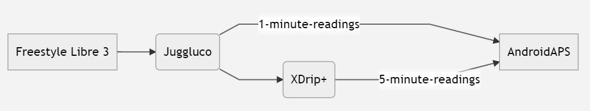
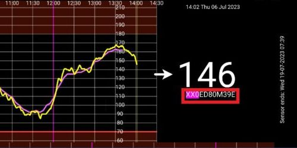

# **Freestyle Libre 3** e 3+

O Freestyle Libre 3 (FSL3) precisa de uma configuração própria para enviar os valores de glicose para o AAPS. Há duas formas de enviar os valores do Freestyle Libre 3 (FSL3) para o AAPS.

Os métodos abaixo usam a app separada Juggluco. Usa o Juggluco para receber do sensor os dados em bruto, em intervalos de 1 minuto, que depois são enviados para o xDrip ou para o AAPS. Os sensores novos podem ser iniciados com a app Libre 3 ou diretamente no Juggluco. O guia abaixo mostra como iniciar um sensor com a app Juggluco. Se o sensor foi iniciado com uma conta LibreView com sessão iniciada, também é possível alternar entre o Juggluco e a app Libre 3 como recetor.

O Juggluco também pode enviar dados para o LibreView, para os partilhar com os profissionais de saúde, quando o sensor foi iniciado com a app Libre 3.

No xDrip, o sensor pode ser calibrado no intervalo de -40 mg/dl a +20 mg/dl (-2,2 mmol/l a +1,1 mmol/l) para compensar as diferenças entre a medição manual no medidor e as leituras do sensor.

## Método 1: usar as leituras de 1 minuto diretamente
O **AAPS** foi feito para leituras de 5 minutos. Por isso, o processamento de valores de 1 minuto tem algumas limitações.

Veja [aqui](#juggluco-to-aaps).

## Método 2: converter as leituras de 1 minuto em valores de 5 minutos através do xDrip
Este método usa o Juggluco para receber do sensor os dados em bruto, em intervalos de 1 minuto, que depois são enviados para o xDrip, que os suaviza em dados de intervalos de 5 minutos para enviar ao AAPS.

### Passo 1: Configurar o Juggluco
Transfira e instale a app Juggluco a partir [daqui](https://www.juggluco.nl/Juggluco/download.html). Siga as instruções [aqui](https://www.juggluco.nl/Juggluco/libre3/)

Confirme que envia os valores de glicose para o xDrip: nas definições do Juggluco pode configurar o envio dos valores de glicose para outras apps. O Juggluco pode enviar três tipos destes broadcasts: o **Patched Libre broadcast** era usado inicialmente pela app Librelink modificada e pode ser usado para enviar os valores de glicose para o xDrip

### Passo 2: Configurar o xDrip

Os valores de glicose são recebidos pela app xDrip no telemóvel.

- Se ainda não estiver configurado, transfira o [xDrip](https://github.com/NightscoutFoundation/xDrip) e siga as instruções na página [Definições do xDrip](../CompatibleCgms/xDrip.md).
- No xDrip, selecione "Libre2 (patched app)" como fonte de dados.
- Se necessário, introduza "BgReading:d,xdrip libre_receiver:v" em Less Common Settings → Extra Logging Settings → Extra tags for logging. Isto regista mensagens de erro adicionais para a resolução de problemas.

- Tecnicamente, o valor atual da glicose é enviado para o xDrip a cada minuto. Um filtro de média ponderada calcula, por omissão, um valor suavizado dos últimos 25 minutos. Pode mudar o período no menu NFC Scan features.

  → Menu hambúrguer → Settings → NFC Scan features → Smooth libre 3 data when using xxx method

  

### Passo 3: Iniciar o sensor no xDrip

No xDrip, inicie o sensor com "Start Sensor" e "not today". Não é necessário encostar o telemóvel ao sensor. Na verdade, "Start Sensor" não inicia fisicamente nenhum sensor Libre 3 e não comunica com ele de forma alguma. Isto serve apenas para indicar ao xDrip que um sensor novo está a enviar valores de glicose. Se disponível, introduza dois valores medidos no sangue para a calibração inicial. Agora os valores de glicose devem aparecer no xDrip a cada 5 minutos. Os valores que faltam, por exemplo porque esteve demasiado longe do telefone, não são recuperados (backfill).

Se ainda não houver dados, espere pelo menos 15–20 minutos.

Após uma mudança de sensor, o xDrip deteta automaticamente o sensor novo e apaga todos os dados de calibração. Pode medir a glicose após a ativação e fazer uma nova calibração inicial.

### Passo 4: Configurar o AAPS

- Veja [aqui](#juggluco-to-xdrip) e depois volte.

- Se o **AAPS** não receber valores de glicose quando o telefone está em modo de avião, use "Identify receiver"
- Desligue a Suavização (já é feita no xDrip)

## Mudanças de sensor seguintes

1. Abra o Juggluco e anote o número de série do sensor atual

2. Agora basta ler o sensor novo com o leitor NFC do telefone. O Juggluco mostra um aviso se o processo foi iniciado com sucesso.
3. Quando estiver pronto para desativar o sensor antigo, abra o menu do Juggluco tocando em qualquer espaço vazio no canto superior esquerdo do ecrã.
4. Selecione o sensor expirado e toque em "Terminate"

Nota: quando há dois sensores ativos, o Juggluco envia para o xDrip o valor mais recente de qualquer um dos sensores. Se os sensores não estiverem calibrados e não medirem a glicose de forma parecida, o xDrip pode receber valores de glicose aos saltos. Se terminar o sensor errado, pode reativá-lo simplesmente lendo o sensor de novo.

## Alternar o sensor entre a app Libre 3 e a app Juggluco

Se o sensor foi iniciado com uma conta LibreView com sessão iniciada, também é possível alternar entre o Juggluco e a app Libre 3 como recetor. Para isso, siga estes passos:

1. Instale a app Libre 3 a partir da Google Play Store
2. Configure a app Libre 3 com a conta LibreView com que o sensor foi ativado.
3. Force a paragem da app Juggluco nas definições do Android.
4. No menu do Libre 3, toque em "Start Sensor", selecione "Yes", "Next" e leia o sensor.
5. Após alguns minutos, os valores de glicose devem aparecer na app Libre 3.

Para mudar da app Libre 3 para o Juggluco, tem de forçar a paragem da app Libre 3 nas definições do Android e seguir os passos 1 e 2.

(libre3-experiences-and-troubleshooting)=
## Experiências e resolução de problemas

### Resolução de problemas da ligação Libre3 -> Juggluco

- Confirme que está a usar uma versão atual da app Juggluco
- Verifique as suas definições segundo este guia
- Por vezes, pode ter de forçar a paragem da app Libre 3 e do Juggluco e reiniciá-las.
- Desative o Bluetooth e ative-o de novo
- Espere algum tempo ou tente fechar o Juggluco
- As versões antigas do Juggluco (abaixo da 2.9.6) não enviam os dados seguintes do sensor Libre3 para os dispositivos ligados (por exemplo, o Juggluco no WearOS). Pode ter de tocar em "Resend data" na app Libre3 modificada (menu do Juggluco).

### Mais ajuda

Instruções originais: [site do jkaltes](https://www.juggluco.nl/Juggluco/libre3/)

Repositório adicional no GitHub: [ligação para o GitHub](https://github.com/maheini/FreeStyle-Libre-3-patch)
