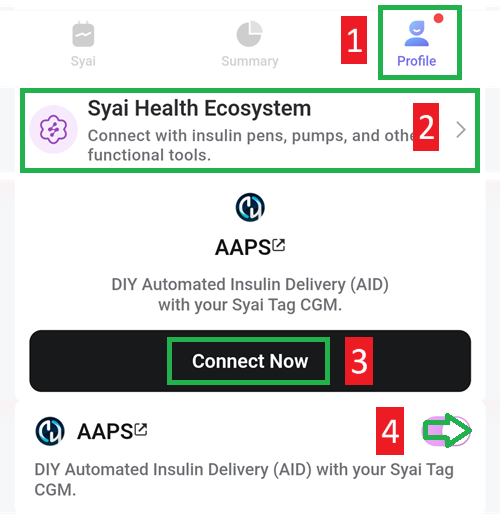

# Syai X1

## Usar o X1 com a app Syai Tag

-   Instale o apk a partir de <https://play.google.com/store/apps/details?id=com.syai.tag>.

-   Iniciar o sensor X1

- Selecione **Syai/Ottai** em [**Configuração → Fonte da Glicose**](#Config-Builder-bg-source).

Ative a difusão (broadcast) na app Syai:

1. Selecione Profile
2. Syai Health Ecosystem
3. Toque em Connect Now with AAPS e aceite o acordo de transferência de dados para terceiros
4. Ative a partilha de dados com o AAPS (Enable share data with AAPS)

