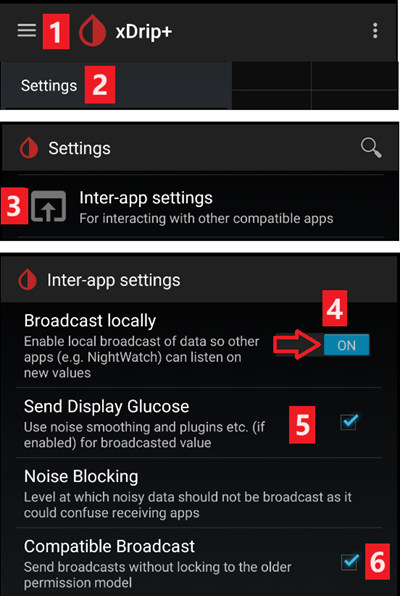

# Definições do xDrip

Se ainda não o fez, transfira e instale a versão mais recente do xDrip a partir da [página de versões do xDrip](https://github.com/NightscoutFoundation/xDrip/releases).

Desative a otimização da bateria e permita a atividade em segundo plano para a app xDrip.

## Definições básicas para todos os sistemas CGM e FGM

### Desativar o envio para o Nightscout

Não deve deixar nenhuma outra app enviar dados (glicose e tratamentos) para o Nightscout.

→ Menu (1) → Settings (2) → Cloud Upload (3) -> Nightscout Sync (REST-API)(4) → Desligue (**OFF**) `Enabled` (5)

#### Desativar a calibração automática e os tratamentos

Confirme que `Automatic Calibration` (7) está desativado. Se a caixa `Automatic Calibration` estiver marcada, ative `Download treatments` (6) uma vez, depois desmarque `Automatic Calibration` e volte a desativar `Download treatments`.

Toque em `Extra Options`(8)

    {admonition} Aviso de segurança
    :class: warning
    Tem de desativar "Upload treatments" no xDrip. Caso contrário, os tratamentos podem ficar duplicados no AAPS, o que dá valores errados de HCA e IA.

Desative `Upload treatments`(9) e confirme que **NÃO** vai usar `Back-fill data` (11).

A opção `Alert on failures` também deve ser desativada (10). Caso contrário, recebe um alarme a cada 5 minutos se houver problemas de Wi-Fi/rede móvel ou se o servidor não estiver disponível.

### **Inter-app Settings** (Broadcast)

Se vai usar o AAPS e os dados devem ser enviados, por exemplo, para o AAPS, tem de ativar a difusão (broadcast) no xDrip, em Inter-App settings.

→ Menu (1) → Settings (2) → Inter-app settings (3) → Broadcast locally **ON** (4)

Para que os valores no AAPS sejam iguais aos do xDrip, deve ativar `Send the displayed glucose value` (5).

Ative Compatible Broadcast (6).

Se também ativou `Accept treatments` no xDrip e `Ativar a difusão para o xDrip+` no plugin xDrip do AAPS, o xDrip vai receber do AAPS as informações de insulina, hidratos de carbono e basal.

Se ativar `Accept Calibrations`, o xDrip vai usar as calibrações do AAPS. Tenha cuidado ao usar esta função com sensores Dexcom: leia [isto](https://navid200.github.io/xDrip/docs/Calibrate-G6.html) primeiro.

Lembre-se de desativar Import Sounds para evitar que o xDrip toque um som sempre que o AAPS envia uma mudança de basal ou de perfil.

(xdrip-identify-receiver)=

#### Identify receiver (identificar o recetor)

- Se tiver problemas com a difusão local (o AAPS não recebe valores de glicose do xDrip), vá a → Menu (1) Settings (2) → Inter-app settings (3) → Identify receiver (7) e introduza `info.nightscout.androidaps` para a versão AAPS (se usar a versão PumpControl, introduza antes `info.nightscout.aapspumpcontrol`!!).
- Atenção: a correção automática do teclado às vezes muda o i para maiúscula. Tem de **usar apenas letras minúsculas** ao escrever `info.nightscout.androidaps` (ou `info.nightscout.aapspumpcontrol` para o PumpControl). Um I maiúsculo impede a app de receber valores de glicose do xDrip.
    
    

## Usar o AAPS para calibrar no xDrip

- Se quiser poder calibrar a partir do AAPS, no xDrip vá a Settings → Interapp Compatibility → Accept Calibrations e selecione ON. 
- Também pode rever as opções em Settings → Less Common Settings → Advanced Calibration Settings.

## Dexcom sensors

Tudo o que diz respeito ao próprio sensor e transmissor Dexcom (iniciar, parar, trocar, calibrar, resolução de problemas) está descrito e atualizado na [documentação Dexcom do xDrip](https://navid200.github.io/xDrip/docs/Dexcom_page.html). Siga essas instruções para o sensor; as definições que ligam o xDrip ao **AAPS** (descritas acima nesta página) são a única parte específica do AAPS.

### Dexcom G6 e ONE

- Configure o xDrip seguindo as [definições recomendadas](https://navid200.github.io/xDrip/docs/G6-Recommended-Settings.html).
- Os transmissores Dexcom G6 e ONE podem estar ligados ao mesmo tempo ao recetor Dexcom (ou, em alternativa, à bomba t:slim) e a uma app no seu telefone.
- Se usar o xDrip como recetor, desinstale primeiro a app Dexcom. **Não pode ligar o xDrip e a app Dexcom ao transmissor ao mesmo tempo!**
- Se precisa do Clarity e quer aproveitar as funções do xDrip, use a [Build Your Own Dexcom App](#DexcomG6-if-using-g6-with-build-your-own-dexcom-app) com difusão local para o xDrip, ou use o xDrip como app complementar (Companion app) que recebe as notificações da app oficial Dexcom (as leituras de glicose podem chegar com atraso).

#### Reinício do sensor

- Com os transmissores atuais, o xDrip usa sempre o [algoritmo nativo](https://navid200.github.io/xDrip/docs/Native-Algorithm.html) do transmissor; não há razão para o desativar.
- Os [reinícios preventivos](https://navid200.github.io/xDrip/docs/Preemptive-Restart.html) só funcionam em transmissores antigos (firmware 1.6.5.25 ou anterior), onde são precisos para evitar que o sensor pare ao fim de 10 dias. Os transmissores recentes (Firefly) ignoram-nos.
- Reiniciar um sensor num transmissor Firefly exige [retirar o transmissor](https://navid200.github.io/xDrip/docs/Remove-transmitter.html), e as leituras podem ter erros grandes depois do reinício, o que é perigoso em loop: leia todo o texto [Restart a sensor](https://navid200.github.io/xDrip/docs/Restart-G6-sensor.html) e [calibre com cuidado](https://navid200.github.io/xDrip/docs/Calibrate-after-G6Restart.html).

(xdrip-connect-g6-transmitter-for-the-first-time)=

#### Iniciar, parar e trocar sensores

Siga as instruções:

- [Iniciar um transmissor G6 ou ONE](https://navid200.github.io/xDrip/docs/Starting-G6.html)
- [Parar e iniciar um sensor G6 ou ONE](https://navid200.github.io/xDrip/docs/Dexcom/StartG6Sensor.html)
- [Retirar o transmissor de um sensor](https://navid200.github.io/xDrip/docs/Remove-transmitter.html)
- A [vida útil do transmissor](https://navid200.github.io/xDrip/docs/Transmitter-lifetime.html) só pode ser prolongada ([hard reset](https://navid200.github.io/xDrip/docs/Hard-Reset.html)) em transmissores com bateria trocada ou modificados, não nos Firefly.

(xdrip-replace-transmitter)=

#### Trocar um transmissor

- Desligue o recetor Dexcom original (se o usar) e não o volte a ligar antes de o xDrip mostrar leituras.
- Esqueça o dispositivo no xDrip (System Status → Forget Device) E nas definições de Bluetooth do telefone (aparece como DexcomXX, em que XX são os dois últimos dígitos do número de série do transmissor).
- Mantenha o transmissor antigo fora do alcance do Bluetooth para evitar que volte a ligar.
- Depois siga [Iniciar um transmissor G6 ou ONE](https://navid200.github.io/xDrip/docs/Starting-G6.html).

### Dexcom G7, ONE+ e Stelo

- Siga as [instruções para G7, ONE+ e Stelo](https://navid200.github.io/xDrip/docs/Dexcom/G7.html) (é preciso uma versão recente do xDrip — veja a página indicada).
- Veja também a [página Dexcom G7, ONE+ e Stelo](../CompatibleCgms/DexcomG7.md) para as configurações possíveis com o **AAPS**.

(xdrip-troubleshooting-dexcom-g5-g6-and-xdrip)=

### Resolução de problemas do Dexcom e do xDrip

- [Resolução de problemas de ligação do G6/ONE](https://navid200.github.io/xDrip/docs/Connectivity-troubleshoot.html)
- [Resolução de problemas do G7/ONE+/Stelo](https://navid200.github.io/xDrip/docs/Dexcom/G7_Troubleshooting.html)
- [Problema ao iniciar um novo sensor](https://navid200.github.io/xDrip/docs/Dexcom/SensorFailedStart.html)
- Lista completa: veja **Troubleshooting** na [página Dexcom do xDrip](https://navid200.github.io/xDrip/docs/Dexcom_page.html).

## Libre 1

- Configurar a bridge NFC para Bluetooth no xDrip
    
    → Menu (1) → Settings (2) → Less common settings (3) → Bluetooth Settings (4)

- Em Bluetooth Settings, marque as caixas exatamente como nas capturas de ecrã abaixo (5)
    
    - Desative os watchdogs, porque eles reiniciam o Bluetooth do telefone e interrompem a ligação à bomba.
    
    

- Pode tentar ativar as seguintes definições (7)
    
    - Use scanning
    - Trust Auto-Connect
    - Use Background Scans

- Se perder facilmente a ligação à bridge ou tiver dificuldade em recuperar a ligação, **DESATIVE-AS** (8).
    
    

- Deixe todas as outras opções desativadas, a não ser que saiba por que razão as quer ativar.
    
    

### Nível da bateria do leitor inteligente Libre

- O nível da bateria de bridges como MiaoMiao e Bubble pode ser mostrado no AAPS (não o Blucon).
- Os detalhes estão na [página das capturas de ecrã](#screens-sensor-level-battery).

### Ligar o transmissor Libre e iniciar o sensor

- Se o seu sensor precisar (Libre 2 EU e Libre 1 US), instale o algoritmo "out of process" mais recente.

- O sensor já tem de estar iniciado com a app do fabricante ou com o leitor (o xDrip não consegue iniciar nem parar sensores Libre).

- Defina a fonte de dados como Libre Bluetooth.
    
    → Menu (1) → Settings (2) → Selecione Libre Bluetooth em Hardware Data source (3)
    
    

- Procure por Bluetooth e ligue a bridge.
    
    → Menu (1) → Scan Bluetooth (2) → Scan (3)
    
    - Se o xDrip não encontrar a bridge, confirme que ela não está ligada à app do fabricante. Ponha-a a carregar e reinicie-a.
    
    

- Inicie o sensor no xDrip.
    
        {admonition} Aviso de segurança
        :class: warning
        Não use os dados do sensor antes de terminar o aquecimento de uma hora: os valores podem ser extremamente altos e levar o AAPS a tomar decisões erradas.
    
    → Menu (1) → Start sensor (2) → Start sensor (3) → Indique a hora exata em que iniciou o sensor com o leitor ou com a app do fabricante. Se não o iniciou hoje, responda "Not Today" (4).

(xdrip-libre2-patched-app)=

## App modificada para o Libre 2

- Defina a fonte de dados como Libre patched app.
    
    → Menu (1) → Settings (2) → Selecione Libre (patched App) em Hardware Data source (3)
    
    

- Pode adicionar `BgReading:d,xdrip libre_receiver:v` em Less Common Settings->Extra Logging Settings->Extra tags for logging. Isto regista mensagens de erro adicionais para a resolução de problemas.

