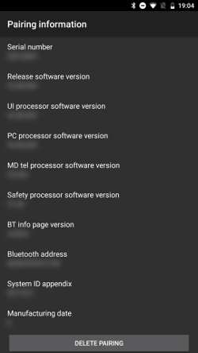

# Accu-Chek Insight

**Este software faz parte de uma solução DIY (faça você mesmo) de pâncreas artificial e não é um produto, mas exige que O UTILIZADOR leia, aprenda e compreenda o sistema, incluindo a forma de o usar. Não é algo que faz toda a gestão da sua diabetes por si, mas permite-lhe melhorar a sua diabetes e a sua qualidade de vida, se estiver disposto a dedicar-lhe o tempo necessário. Não tenha pressa, dê a si próprio tempo para aprender. Só o utilizador é responsável pelo que faz com ele.**

```{admonition} A Accu-Chek Insight está a ser retirada do mercado :class: note

A Roche está a sair do mercado das bombas de insulina para concentrar a sua oferta para a diabetes no CGM Accu-Chek SmartGuide. A Roche anunciou o fim das vendas das bombas Accu-Chek Combo e Accu-Chek Insight; a sua última bomba, a microbomba Accu-Chek Solo, também está a ser descontinuada (últimas entregas na Alemanha no final de 2025). A mudança está a ser feita por região, a começar pela Alemanha; espera-se que outros mercados europeus se sigam. O suporte da Insight já está indicado como terminado (veja [Bombas que já não são vendidas](./Future-possible-Pump-Drivers.md)). Se depende desta bomba, planeie com antecedência a passagem para uma bomba suportada.

    <br />```{note}
    Antes de o **AAPS** ter um controlador próprio para a Insight, a Insight era controlada pela app separada [SightRemote](https://github.com/TebbeUbben/SightRemote). A SightRemote já não é necessária nem mantida: se ainda a tem instalada desses tempos, desinstale-a e use uma versão atual do **AAPS**.
    

```{contents} Índice :depth: 1 :local: true

    <br />## Funções da bomba com o AAPS
    
    * Comunica com o **AAPS** pelo Bluetooth do próprio telefone, sem um dispositivo de comunicação adicional.
    * Mudança da hora de verão e do fuso horário automática.
    
    ## Requisitos de hardware e software
    
    * Uma bomba Roche Accu-Chek Insight (qualquer firmware, todos funcionam)
    
    Nota: o AAPS escreve os dados sempre no **primeiro perfil de basal da bomba**.
    
    * Um telefone Android com Android 12 ou mais recente (veja [Telefones](../Getting-Started/Phones.md))
    * A app AAPS instalada no telefone
    
    ## Configuração
    
    * A bomba Insight só deve estar ligada a um dispositivo de cada vez. Se já usou o controlo remoto da Insight (medidor), tem de retirar o medidor da lista de dispositivos emparelhados da bomba: **Menu** > **Settings** > **Communication** > **Remove device**.
    
       
    
    * Em [Configuração > Bomba](#Config-Builder-pump), selecione o cartão **Accu-Chek Insight**. Só pode estar ativa uma bomba de cada vez.
    
       
    
       Depois de selecionado, o cartão **Accu-Chek Insight** mostra dois botões, **Definições** e **Abrir plugin**:
    
       
    
       **Definições** abre as definições do controlador Accu-Chek Insight (veja [Definições no AAPS](#Accu-Chek-Insight-Pump-settings-in-aaps)).
    
       **Abrir plugin** (ou **Gerir → Bomba**) abre o ecrã da bomba Accu-Chek Insight. Antes de a bomba ser emparelhada, o ecrã tem este aspeto:
    
       
    
    (accu-chek-insight-pairing)=
    ### Emparelhamento
    
    * No ecrã da bomba, toque em **Emparelhamento Insight**. Abre-se o assistente de emparelhamento, que procura dispositivos Bluetooth próximos (parte de cima da imagem abaixo).
    * Na bomba Insight, vá a **Menu** > **Settings** > **Communication** > **Add Device**. A bomba mostra o ecrã seguinte (parte de baixo da imagem abaixo) com o número de série da bomba.
    
       
    
    * De volta ao telefone, toque no número de série da bomba na lista de dispositivos Bluetooth. Se o Android pedir para confirmar o emparelhamento, toque em **Emparelhar**.
    
       
    
    * A bomba e o telefone mostram ambos um código. Verifique se os códigos são iguais nos dois dispositivos. Confirme na bomba e toque em **Sim** no telefone. (Toque em **Não** se os códigos não forem iguais.)
    
       
    
    * O telefone mostra **Emparelhamento concluído**. Toque em **Sair** para voltar ao ecrã da bomba.
    
       
    
    * Para verificar se está tudo bem, veja o ecrã da bomba (**Gerir → Bomba**). Depois de a bomba estar emparelhada, o ecrã mostra informações sobre a bomba, como **Número de Série**, **Data de fabrico**, **Versão do software (release)** e **Endereço Bluetooth**.
    
       
    
       ```{admonition} Captura de ecrã antiga
       :class: note
       Exceto a parte de cima da primeira imagem, as capturas de ecrã do emparelhamento acima são de uma versão anterior do **AAPS** e podem ter um aspeto diferente no **AAPS** 4.
       ```
    
    * Para remover o emparelhamento, toque em **Desemparelhar** no ecrã da bomba e confirme **Repor as informações de emparelhamento?**. Depois, o botão **Emparelhamento Insight** volta a aparecer.
    
    Nota: não há uma ligação permanente entre a bomba e o telefone. O **AAPS** só se liga quando é necessário (por exemplo, para definir uma basal temporária, dar um bólus ou ler o histórico da bomba). Caso contrário, as baterias do telefone e da bomba gastavam-se demasiado depressa.
    
    (Accu-Chek-Insight-Pump-settings-in-aaps)=
    ## Definições no AAPS
    
    Abra as definições com **Definições** no cartão **Accu-Chek Insight** em **Configuração** > **Bomba**, ou com o ícone da roda dentada no canto superior direito do ecrã da bomba.
    
    
    
    In the Insight settings in **AAPS** you can enable the following options:
    
    * **Log reservoir changes**: automatically records an insulin cartridge change when you change the cartridge in the pump.
    
    * **Registar mudanças de tubo**: adiciona uma nota à base de dados do **AAPS** quando executa o programa «tube filling» na bomba.
    
    * **Registar mudanças de local**: adiciona uma nota à base de dados do **AAPS** quando executa o programa «cannula filling» na bomba. **Nota: uma mudança de local também repõe o Autosens.**
    
    * **Registar mudanças de bateria**: regista uma troca de pilha quando coloca uma pilha nova na bomba.
    
    * **Registar mudanças do modo de funcionamento**: adiciona uma nota à base de dados do **AAPS** sempre que inicia, para ou pausa a bomba.
    
    * **Registar alertas**: adiciona uma nota à base de dados do **AAPS** sempre que a bomba emite um alerta (exceto lembretes e cancelamento de bólus e de basal temporária, que não são registados).
    
    * **Ativar a emulação da basal temporária**: a bomba Insight só consegue definir basais temporárias (TBR) até 250%. Para contornar este limite, a emulação da basal temporária manda a bomba administrar um bólus prolongado com a insulina extra quando é pedida uma basal temporária acima de 250%.
    
      **Nota: use apenas um bólus prolongado de cada vez. Vários bólus prolongados ao mesmo tempo podem causar erros.**
    
    * **Desativar vibrações na entrega manual de bólus**: impede a bomba Insight de vibrar quando administra um bólus manual (ou um bólus prolongado). Só disponível com o firmware 3.x da Insight.
    
    * **Desativar vibrações na entrega automática de bólus**: impede a bomba Insight de vibrar quando administra um bólus automático (SMB ou basal temporária com emulação da basal temporária). Só disponível com o firmware 3.x da Insight.
    
    * **Duração mínima da recuperação [s]** e **Duração máxima da recuperação [s]**: quanto tempo o **AAPS** espera antes de tentar de novo depois de uma tentativa de ligação falhada. Pode escolher de 0 a 20 segundos. Se tiver problemas de ligação, escolha um tempo de espera mais longo.
        <br><br>Exemplo para duração mín. da recuperação = 5 e duração máx. da recuperação = 20
        <br><br>sem ligação -> esperar <b>5</b> s.
          <br>  tentar de novo -> sem ligação -> esperar <b>6</b> s.
          <br>  tentar de novo -> sem ligação -> esperar <b>7</b> s.
          <br>  tentar de novo -> sem ligação -> esperar <b>8</b> s.
          <br>...
          <br>tentar de novo -> sem ligação -> esperar <b>20</b> s.
          <br>tentar de novo -> sem ligação -> esperar <b>20</b> s.
          <br>...
    
    * **Atraso para desligar [s]**: quanto tempo (em segundos) o **AAPS** espera antes de se desligar da bomba depois de terminar uma operação. Pode escolher de 0 a 15 segundos. O valor predefinido é 5 segundos.
    
    Nos períodos em que a bomba esteve parada, o **AAPS** regista uma basal temporária de 0%.
    
    ### O ecrã da bomba
    
    O ecrã da bomba Accu-Chek Insight (**Gerir → Bomba**) mostra o estado atual da bomba, por exemplo **Estado**, **Última ligação**, **Modo de funcionamento**, **Bateria**, **Nível do reservatório**, as doses diárias totais de hoje (**TID Bólus**, **TID Basal**), as taxas basais e o último bólus. Depois de a bomba estar emparelhada, o ecrã tem estes botões:
    
    * **Atualizar**: atualiza o estado da bomba.
    * **Ativar notificação do fim da basal temporária (configuração da bomba)** / **Desativar notificação do fim da basal temporária (configuração da bomba)**: uma bomba Insight normal toca um alarme quando uma basal temporária termina. Este botão liga ou desliga esse alarme sem precisar de software de configuração.
    * **Desemparelhar**: remove o emparelhamento com a bomba (veja [Emparelhamento](#accu-chek-insight-pairing)).
    
    
    
    ```{admonition} Captura de ecrã antiga
    :class: note
    A captura de ecrã acima é de uma versão anterior do **AAPS**. No **AAPS** 4 o ecrã da bomba tem um aspeto diferente e tem também um botão **Desemparelhar**.
    

## Definições na bomba

Configure os alarmes na bomba da seguinte forma:

* Menu > Settings > Device settings > Mode settings > Quiet > Signal > Sound
* Menu > Settings > Device settings > Mode settings > Quiet > Volume > 0 (retire todas as barras)
* Menu > Modes > Signal mode > Quiet

Isto silencia todos os alarmes da bomba e deixa o AAPS decidir se um alarme é relevante para si. Se o AAPS não confirmar um alarme, o volume do alarme aumenta (primeiro bip, depois vibração).

(Accu-Chek-Insight-Pump-vibration)=

### Vibração

Conforme a versão do firmware da sua bomba, a Insight vibra brevemente sempre que é administrado um bólus (por exemplo, quando o AAPS dá um SMB ou quando a emulação da basal temporária administra um bólus prolongado).

* Firmware 1.x: sem vibração, por conceção.
* Firmware 2.x: a vibração não pode ser desativada.
* Firmware 3.x: o AAPS administra o bólus em silêncio.

A versão do firmware pode ser vista no menu.

## Troca da pilha

Battery life for Insight when looping ranges from 10 to 14 days, maximum 20 days. O utilizador que relatou isto usa pilhas de lítio Energizer.

A bomba Insight tem uma pequena bateria interna que mantém as funções essenciais, como o relógio, a funcionar enquanto troca a pilha removível. Se a troca da pilha demorar muito tempo, esta bateria interna pode ficar sem carga, o relógio é reiniciado e terá de introduzir uma nova hora e data depois de colocar uma pilha nova. Se isto acontecer, todos os registos no AAPS anteriores à troca da pilha deixam de entrar nos cálculos, porque não é possível identificar a hora correta.

(Accu-Chek-Insight-Pump-insight-specific-errors)=

## Erros específicos da Insight

### Bólus prolongado

Use apenas um bólus prolongado de cada vez, porque vários bólus prolongados ao mesmo tempo podem causar erros.

### Tempo esgotado

Por vezes a bomba Insight não responde enquanto o **AAPS** estabelece a ligação. O **AAPS** mostra então a notificação «Tempo excedido durante o handshake - reiniciar o Bluetooth».


Se isto acontecer, desligue o Bluetooth na bomba E no telefone durante cerca de 10 segundos e depois volte a ligá-lo.

## Mudar de fuso horário com a bomba Insight

Para informações sobre viagens entre fusos horários, veja a secção [Viajar entre fusos horários com bombas](#timezone-traveling-insight).

## Onde obter ajuda

O controlador da Insight é desenvolvido pela comunidade em regime de **voluntariado**. Antes de pedir ajuda:

1. **Leia** a secção relevante desta documentação para confirmar como a funcionalidade deve funcionar.
2. **Pergunte** no canal *#AAPS* do [Discord](https://discord.gg/4fQUWHZ4Mw) ou num dos outros [canais da comunidade](../GettingHelp/WhereCanIGetHelp.md).
3. **Comunique um erro**: procure primeiro nos [problemas existentes](https://github.com/nightscout/AndroidAPS/issues); se o seu não estiver na lista, abra um [novo problema](https://github.com/nightscout/AndroidAPS/issues) e anexe os seus [ficheiros de registo](../GettingHelp/AccessingLogFiles.md).

Ao pedir ajuda, indique a marca e o modelo do telefone, a versão do Android, a versão do **AAPS** e uma descrição clara do problema (o que mudou, quando funcionou pela última vez).