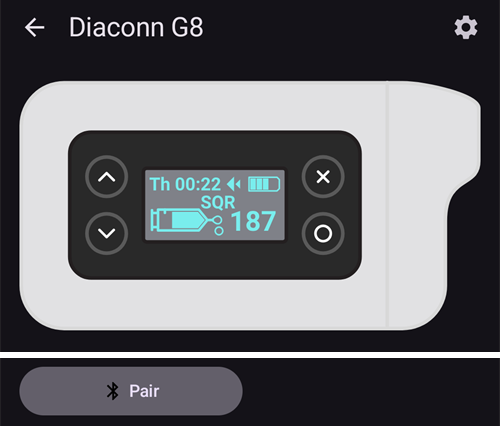
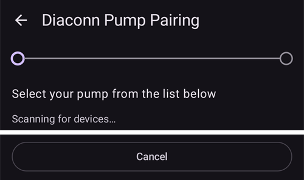
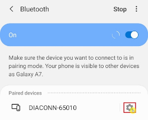

# Diaconn G8

```{contents} Table of contents
:depth: 1
:local: true
```

## Funções da bomba com o AAPS

* Comunica com o **AAPS** através do Bluetooth do seu telefone, sem outro dispositivo de comunicação.
* As mudanças de hora (hora de verão) e de fuso horário têm de ser feitas manualmente.

## Emparelhamento Bluetooth da bomba de insulina

- Toque no **menu** (☰) no canto superior esquerdo.


- Toque em **Configuração** > **Bomba** e selecione **Diaconn G8**.


Depois de selecionado, o cartão **Diaconn G8** mostra dois botões, **Definições** e **Abrir plugin**:


**Definições** abre as definições do controlador Diaconn G8 (ver [Definições da bomba de insulina Diaconn G8](#diaconn-g8-insulin-pump-option-setting) abaixo).

**Abrir plugin** (ou **Gerir** > **Bomba**) abre o ecrã da bomba Diaconn G8. Antes de a bomba ser emparelhada, o ecrã tem este aspeto:




```{admonition} Older screenshot
:class: note
A captura de ecrã acima é de uma versão anterior do **AAPS**. No **AAPS** 4, o emparelhamento começa com o botão **Emparelhar** no ecrã da bomba; não existe a definição **Bomba selecionada**.
```

- No ecrã da bomba, toque em **Emparelhar**. Abre-se o ecrã **Emparelhamento de bombas Diaconn** e o **AAPS** procura bombas próximas.
- Toque no número do modelo da sua bomba de insulina quando aparecer na lista (por exemplo **DIACONN-65010**).



- Há duas formas de ver o número do modelo:

1. Os últimos 5 dígitos do número de série (SN) na parte de trás da bomba.
2. Prima o botão O > Information > BLE > últimos 5 dígitos.


- Depois de selecionar a bomba, aparece uma janela a pedir um código PIN. Introduza o número PIN mostrado na bomba para concluir a ligação.

 

- Quando aparecer **Emparelhamento bem-sucedido!**, toque em **OK** para voltar ao ecrã da bomba.

## Verificar o estado da bomba e sincronizar os registos

- Depois de a bomba estar ligada, abra o ecrã da bomba (**Gerir** > **Bomba**). Mostra o estado da bomba (bateria, reservatório, última ligação, último bólus, taxa basal e mais).
- Toque em **Atualizar** para ligar à bomba, atualizar o estado e sincronizar os registos.
- Toque em **Histórico da Bomba** para ver o histórico lido da bomba.


```{admonition} Older screenshot
:class: note
A captura de ecrã acima é de uma versão anterior do **AAPS**. No **AAPS** 4, o estado da bomba é mostrado no ecrã da bomba (**Gerir** > **Bomba**) e sincronizado com o botão **Atualizar**.
```

(diaconn-g8-bluetooth-troubleshooting)=

## Resolução de problemas de Bluetooth

**O que fazer se a ligação Bluetooth com a bomba for instável.**

### Método 1) Reinicie o AAPS e depois verifique de novo a bomba

- Toque no **menu** (☰) no canto superior esquerdo.
- Toque em **Sair** no fundo do menu.


- Inicie de novo o **AAPS** e verifique a ligação à bomba.

### Método 2) Se o primeiro método não resultar, desligue o Bluetooth e volte a ligá-lo.

- Mantenha premido o botão Bluetooth no topo durante cerca de 3 segundos.


- Toque no botão de definições ao lado da bomba de insulina Diaconn G8 emparelhada.



- Desemparelhe.


- No **AAPS**, abra o ecrã da bomba (**Gerir** > **Bomba**), toque em **Desemparelhar** e confirme **Repor as informações de emparelhamento?**.
- Repita o processo de emparelhamento Bluetooth da bomba (ver acima).

## Mais informações

(diaconn-g8-insulin-pump-option-setting)=

### Definições da bomba de insulina Diaconn G8

- **Configuração** > **Bomba** > **Diaconn G8** > **Definições**
- Ou, no ecrã da bomba (**Gerir** > **Bomba**), toque no ícone das definições (roda dentada) no canto superior direito.


- **Velocidade do Bólus** define a rapidez com que a bomba administra um bólus.
- Se a opção **Registar mudança de reservatório** estiver ativa, os detalhes são enviados automaticamente para o Careportal quando ocorre um evento «Mudança de insulina».
- Se a opção **Registar mudança de agulha** estiver ativa, os detalhes são enviados automaticamente para o Careportal quando ocorre um evento «Mudança de local da bomba».
- Se a opção **Registar mudança de tubo** estiver ativa, os detalhes são adicionados automaticamente como nota quando ocorre um evento «Mudança de tubo».
- Se a opção **Registar mudança de bateria** estiver ativa, os detalhes são enviados automaticamente para o Careportal quando ocorre um evento «Mudança de bateria». Também pode registar uma troca de bateria com **Gerir** > **Troca Bateria Bomba**. (Nota: antes de trocar a bateria, pare todas as funções de injeção em curso.)
- **Sincronização com a Diaconn Cloud** envia os registos da bomba para a Diaconn Cloud.


```{admonition} Older screenshot
:class: note
A captura de ecrã acima é de uma versão anterior do **AAPS**. No **AAPS** 4, uma troca de bateria é registada com **Gerir** > **Troca Bateria Bomba**; não existe o separador **Ações**.
```

### Função de bólus prolongado

- Se usar o bólus prolongado, o loop fechado fica desativado.
- Veja [esta página](#extended-bolus-and-why-they-wont-work-in-closed-loop-environment) para saber porque é que o bólus prolongado não funciona num ambiente de loop fechado.

## Onde obter ajuda

O controlador Diaconn G8 é desenvolvido pela comunidade de forma **voluntária**. Antes de pedir ajuda:

1. **Leia** a secção relevante desta documentação para confirmar como a função deve funcionar.
2. **Pergunte** no canal *#AAPS* no [Discord](https://discord.gg/4fQUWHZ4Mw) ou num dos outros [canais da comunidade](../GettingHelp/WhereCanIGetHelp.md).
3. **Comunique um erro**: procure nos [problemas existentes](https://github.com/nightscout/AndroidAPS/issues); se o seu não estiver na lista, abra um [novo problema](https://github.com/nightscout/AndroidAPS/issues) e anexe os seus [ficheiros de registo](../GettingHelp/AccessingLogFiles.md).

Ao pedir ajuda, indique a marca e o modelo do telefone, a versão do Android, a versão do **AAPS** e uma descrição simples do problema (o que mudou, quando funcionou pela última vez).
