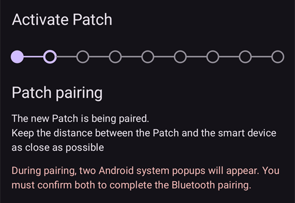
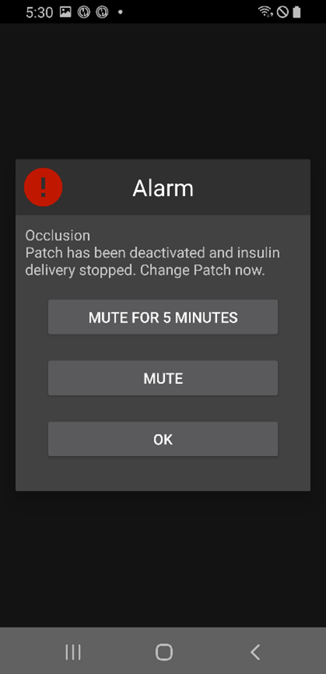

# EOPatch2

O patch precisa de insulina de ação rápida U-100, como NovoRapid ou Humalog. Use a insulina de ação rápida que o seu médico lhe receitou.

A dose mais pequena que o patch consegue administrar é 0,05 U. Defina cada taxa basal do seu **Perfil** com pelo menos 0,05 U/h, em passos de 0,05 U/h. Caso contrário, o **AAPS** arredonda cada taxa para os 0,05 U/h mais próximos (nunca para 0) e usa as taxas que o patch realmente administra; por isso, a insulina total por dia é um pouco diferente do seu **Perfil**. Da mesma forma, os bólus têm de ser de pelo menos 0,05 U.

```{contents} Table of contents
:depth: 1
:local: true
```

## Funções da bomba com o AAPS

* Comunica com o **AAPS** através do Bluetooth do seu telefone, sem outro dispositivo de comunicação.
* As mudanças de hora (hora de verão) e de fuso horário têm de ser feitas manualmente.

## Configuração da bomba

1. Abra o **menu** (☰) no canto superior esquerdo do ecrã principal do **AAPS** e selecione **Configuração**.
1. Na secção **Bomba**, selecione **EOPatch2**.
1. Prima a tecla Voltar para regressar ao ecrã principal.

 

Depois de selecionado, o cartão **EOPatch2** mostra dois botões, **Definições** e **Abrir plugin**:


## Definições

Abra as definições do EOPatch2 de uma de duas formas:

* prima **Definições** no cartão **EOPatch2** em **Configuração**, ou
* abra o ecrã da bomba (**Gerir** → **Bomba**) e prima o ícone da roda dentada no canto superior direito.

Há três definições:


### Alertas de reservatório baixo

Aparece um aviso quando a insulina que resta no patch desce para esta quantidade ou menos. Pode definir de 10 a 50 U, em passos de 5 U. O valor predefinido é 10 U.

### Lembrete de expiração do Patch

Lembra-o de quanto tempo falta até o patch atual expirar. Pode definir de 1 a 24 horas, em passos de 1 hora. O valor predefinido é 4 horas.

### Lembretes sonoros do Patch

Quando esta opção está ligada, o patch emite um bip quando um bólus, um bólus prolongado ou uma basal temporária começa e quando termina. Não tem efeito na sua basal normal. O valor predefinido é desligado.

## Ativar um novo patch

### Abrir o assistente de ativação

Abra o ecrã da bomba com **Gerir** → **Bomba** (ou prima **Abrir plugin** no cartão **EOPatch2** em **Configuração**). Quando não há nenhum patch ativo, o ecrã mostra **Não ativado** e um botão **Ativar Patch** em baixo.

Prima **Ativar Patch** para iniciar o assistente.


O assistente guia-o em cada passo. A fila de pontos no topo mostra em que ponto está.

```{note}
Se nunca ativou um **Perfil** no **AAPS**, o assistente mostra primeiro uma página **Perfil necessário**. Selecione o perfil a usar e prima **Ativar perfil**.
```

### Enchimento de insulina

Introduza a agulha da seringa na entrada de enchimento de insulina do patch. Empurre devagar o êmbolo para encher o patch. Quando houver mais de 80 U no patch, ele emite um bip e arranca (inicia).

Quando ouvir o bip, prima **Iniciar o emparelhamento**.


```{warning}
- Não rode a alavanca da agulha até o assistente lhe pedir. Rodá-la cedo demais pode causar problemas graves durante o enchimento ou a verificação de segurança.
- O patch leva de 80 a 200 U. Se colocar menos de 80 U, o patch não funciona.
- Tire a insulina do frigorífico 15 a 30 minutos antes de encher, para que fique à temperatura ambiente. A insulina tem de estar a pelo menos 10 °C.
```

### Emparelhamento do Patch

O **AAPS** tenta agora emparelhar automaticamente com o patch. Durante o emparelhamento aparecem dois pedidos de emparelhamento Bluetooth do Android. Prima **OK** no primeiro. Prima **OK** outra vez no segundo, que mostra uma chave de acesso.

```{warning}
- Durante o emparelhamento, mantenha o patch e o telefone a menos de 30 cm um do outro.
- Depois de o patch arrancar, emite um bip a cada 3 minutos até o emparelhamento estar concluído.
- Tem de concluir a ativação do patch nos 60 minutos seguintes ao arranque. Se não conseguir, descarte o patch.
```

  

```{admonition} Older screenshot
:class: note
As duas capturas de ecrã do emparelhamento Bluetooth são de uma versão anterior do **AAPS**: o ecrã do **AAPS** por trás do pedido de emparelhamento do Android tem um aspeto diferente no **AAPS** 4.
```

### Selecionar insulina

Selecione a insulina com que encheu o patch e prima **Seguinte**. O **AAPS** aplica uma troca de perfil com esta insulina após a ativação.

### Preparar a colocação do Patch

Retire a fita adesiva do patch e depois prima **Seguinte**.

Se uma agulha estiver de fora, ou se o patch estiver molhado, sujo ou com a fita adesiva dobrada, prima antes **Descartar** e use um patch novo.


### Local de inserção

Este passo só aparece se **Gerir a rotação dos locais da bomba** estiver ligado nas definições da rotação dos locais. Toque no local do diagrama do corpo onde vai colar o patch e prima **Seguinte**, ou prima **Saltar**.

### Colocar o Patch

A insulina deve ir para um local com tecido gordo debaixo da pele, mas com poucos nervos ou vasos sanguíneos. O abdómen, o braço ou a coxa são boas escolhas. Limpe e seque o local e depois cole o patch na pele.

Verifique o local de infusão e depois prima **Iniciar verificação de segurança**.

```{warning}
- Pressione de forma uniforme as bordas da fita do patch, para que todo o patch fique bem colado à pele.
- Se o patch não colar por completo, pode entrar ar entre o patch e a pele. Isto enfraquece o adesivo e a resistência à água do patch.
```


### Verificação de segurança

A verificação de segurança demora cerca de 30 segundos. Quando termina, o patch emite um bip. Se falhar, prima **Tentar Novamente**.

```{warning}
Para uma utilização segura, não rode a alavanca da agulha antes de a verificação de segurança estar concluída.
```

 

```{admonition} Older screenshot
:class: note
As capturas de ecrã de **Preparar a colocação do Patch** a **Verificação de segurança** são de uma versão anterior do **AAPS** e podem ter um aspeto diferente no **AAPS** 4.
```

### Inserir a agulha

Segure bem o patch. Rode a alavanca da agulha para cima mais de 100° para inserir a agulha. O patch emite um bip quando a agulha está bem inserida. Depois continue a rodar a alavanca até ao fim para a retirar. Prima **Seguinte**.

```{caution}
Se passar ao passo seguinte sem ouvir o bip, aparece um **Erro na inserção da agulha**. Confirme que ouve o bip e prima **Tentar Novamente**. Se o erro continuar, prima **Descartar** para desativar o patch.
```

### Ativação do Patch concluída

A última página confirma que o patch está ativo e que o vai avisar quando se aproximar da hora de expiração. Prima **Concluir** para voltar ao ecrã da bomba.

## Descartar o patch

Substitua o patch quando tiver pouca insulina, quando expirar ou se tiver uma avaria. Recomendamos usar cada patch durante no máximo 84 horas após o arranque.

1. Abra o ecrã da bomba (**Gerir** → **Bomba**). Com um patch ativo, prima **Descartar Patch**.
1. A página **Descartar Patch** mostra o tempo restante e a insulina que resta no patch. Prima **Descartar Patch**.
1. Uma janela pede-lhe que confirme. Prima **Descartar Patch** outra vez.
1. Quando o patch for desativado, o assistente mostra **O descarte do Patch está concluído.** Retire o patch do corpo e prima **Confirmar**.

Depois disso, o assistente passa diretamente à ativação de um novo patch (ver acima). Prima a seta para trás se quiser parar aqui.

Enquanto não houver nenhum patch ativo, o **AAPS** mostra a bomba como suspensa e regista uma basal temporária de 0 U/h; assim, nenhuma insulina basal é contada na IA até o próximo patch ser ativado.

   

```{admonition} Older screenshot
:class: note
As capturas de ecrã acima são de uma versão anterior do **AAPS**. No **AAPS** 4, o ecrã da bomba abre-se em **Gerir** → **Bomba**, e o botão nele chama-se **Descartar Patch**.
```

```{admonition} If the patch does not respond
:class: warning
Se o **AAPS** não conseguir comunicar com o patch, pode mostrar uma página sobre como desligar à mão o alarme do patch: retire o patch do corpo, remova a fita adesiva e use um clipe para pressionar com força o orifício ao lado da entrada de enchimento de insulina.

A página **Descartar Patch** tem também um botão **Reposição forçada**. Este botão apenas remove o patch do **AAPS**, sem enviar nenhum comando ao patch. O patch continua a administrar insulina até a bateria acabar ou até o desligar à mão. Use-o apenas se um descarte normal falhar, e retire o patch do corpo.
```

## Suspender e retomar a administração de insulina

Suspender a administração de insulina também cancela qualquer bólus prolongado e basal temporária. Quando retomar, estes **não** são reiniciados. Enquanto a administração de insulina está suspensa, o patch emite um bip a cada 15 minutos.

### Suspender a administração de insulina

1. Abra o ecrã da bomba (**Gerir** → **Bomba**) e prima **Suspender bomba**.
1. Uma janela explica o que vai ser suspenso. Prima **Confirmar**.
1. Na janela **Tempo de suspensão da basal**, escolha durante quanto tempo quer suspender: 30 min, 1 h, 1 h 30 min ou 2 h. Prima **Confirmar**.

A administração de insulina fica suspensa durante o tempo que escolheu.

  

```{admonition} Older screenshot
:class: note
As capturas de ecrã acima são de uma versão anterior do **AAPS**. No **AAPS** 4, o ecrã da bomba abre-se em **Gerir** → **Bomba**, e o botão nele chama-se **Suspender bomba**.
```

### Retomar a administração de insulina

1. Abra o ecrã da bomba (**Gerir** → **Bomba**) e prima **Retomar bomba**.
1. Na janela **Retomar a administração de insulina**, prima **Confirmar**.

 

```{admonition} Older screenshot
:class: note
As capturas de ecrã acima são de uma versão anterior do **AAPS**. No **AAPS** 4, o ecrã da bomba abre-se em **Gerir** → **Bomba**, e o botão nele chama-se **Retomar bomba**.
```

```{warning}
Quando o tempo de suspensão termina, o **AAPS** mostra um aviso **Fim da suspensão da insulina**. A administração de insulina **não** recomeça até a confirmar. Se não o fizer, pode ficar com hiperglicemia.
```

(eopatch2-alarms-and-warnings)=

## Alarmes e avisos

### Alarmes

Os alarmes são para situações urgentes, de prioridade máxima, e exigem uma ação imediata. O **AAPS** faz soar um alarme que continua até o confirmar e mostra a mensagem como notificação no ecrã **Visão geral**. Um alarme significa que há um problema com o patch em uso. Em muitos casos, o patch tem de ser descartado e substituído por um novo.

Quando prime **Confirmar** na notificação, o **AAPS** trata o alarme. Na maioria dos alarmes, isto desativa o patch. No alarme **Temperatura inadequada**, o botão é **Tentar Novamente**.

 

```{admonition} Older screenshot
:class: note
As capturas de ecrã dos alarmes são de uma versão anterior do **AAPS** e podem ter um aspeto diferente no **AAPS** 4.
```

Os diferentes alarmes são explicados abaixo.

| Alarme                      | Explicação                                                                                                                                                   |
| --------------------------- | ------------------------------------------------------------------------------------------------------------------------------------------------------------ |
| Reservatório vazio          | O patch ficou sem insulina.                                                                                                                                  |
| Patch expirado              | O tempo de utilização do patch terminou e ele já não pode administrar insulina.                                                                              |
| Oclusão                     | O caminho da insulina no patch parece estar bloqueado.                                                                                                       |
| Falha no autoteste ao ligar | O patch encontrou um erro inesperado durante o autoteste após o arranque.                                                                                    |
| Temperatura inadequada      | O patch está fora da sua temperatura normal de funcionamento enquanto o ativa ou usa. Leve o patch para um local com uma temperatura adequada (4,4 a 37 °C). |
| Erro na inserção da agulha  | A agulha não foi inserida corretamente durante a ativação. Verifique se a borda de inserção da agulha do patch e a alavanca da agulha estão em linha reta.   |
| Erro da bateria do Patch    | A bateria interna do patch está quase a acabar e o patch vai desligar-se.                                                                                    |
| Erro na ativação do Patch   | O patch não foi totalmente ativado nos 60 minutos seguintes ao arranque.                                                                                     |
| Erro do Patch               | O patch encontrou um erro inesperado durante a ativação ou a utilização.                                                                                     |

### Avisos

Os avisos são para situações de prioridade média ou baixa. Um aviso aparece como notificação no ecrã **Visão geral**.


```{admonition} Older screenshot
:class: note
Esta captura de ecrã é de uma versão anterior do **AAPS**: no **AAPS** 4, o aviso aparece no ecrã principal, que tem um aspeto diferente.
```

Os diferentes avisos são explicados abaixo.

| Aviso                         | Explicação                                                                                                                                |
| ----------------------------- | ----------------------------------------------------------------------------------------------------------------------------------------- |
| Fim da suspensão da insulina  | O tempo de suspensão que escolheu terminou. Prima **Retomar bomba** na notificação para reiniciar a administração de insulina.            |
| Reservatório baixo            | A insulina que resta no patch está abaixo da quantidade definida em **Alertas de reservatório baixo**.                                    |
| A vida útil do Patch terminou | O período de utilização do patch terminou.                                                                                                |
| O Patch vai expirar em breve  | O patch tem de ser descartado dentro de 1 hora.                                                                                           |
| Ativação do Patch incompleta  | A ativação do patch foi interrompida durante mais de 3 minutos após o emparelhamento. Abra o ecrã da bomba e conclua a ativação do patch. |
| Bateria do Patch fraca        | A bateria do patch está fraca.                                                                                                            |

## Onde obter ajuda

O controlador EOPatch2 é desenvolvido pela comunidade de forma **voluntária**. Antes de pedir ajuda:

1. **Leia** a secção relevante desta documentação para confirmar como a função deve funcionar.
2. **Pergunte** no canal *#AAPS* no [Discord](https://discord.gg/4fQUWHZ4Mw) ou num dos outros [canais da comunidade](../GettingHelp/WhereCanIGetHelp.md).
3. **Comunique um erro**: procure nos [problemas existentes](https://github.com/nightscout/AndroidAPS/issues); se o seu não estiver na lista, abra um [novo problema](https://github.com/nightscout/AndroidAPS/issues) e anexe os seus [ficheiros de registo](../GettingHelp/AccessingLogFiles.md).

Ao pedir ajuda, indique a marca e o modelo do telefone, a versão do Android, a versão do **AAPS** e uma descrição simples do problema (o que mudou, quando funcionou pela última vez).
