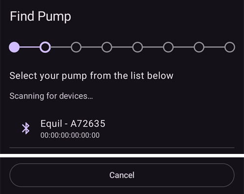

# Equil

Estas instruções servem para configurar a bomba de insulina Equil.

```{contents} Table of contents
:depth: 1
:local: true
```

## Funções da bomba com o AAPS

* Bomba patch sem tubo que comunica com o **AAPS** através do Bluetooth do seu telefone, sem outro dispositivo de comunicação.
* O **AAPS** trata a Equil como uma bomba patch com um reservatório de 200 U: o ecrã principal mostra as luzes de estado de bomba patch, e **Purgar/Preencher** e **Troca Bateria Bomba** não são oferecidos. O enchimento, a purga e a troca da bateria são feitos nos assistentes da bomba.
* Enquanto a bomba está suspensa ou parada, o **AAPS** regista uma basal temporária de 0 U/h; assim, nenhuma insulina basal é contada na IA.
* As mudanças de hora (hora de verão) e de fuso horário têm de ser feitas manualmente.

## Requisitos de hardware e software
* **Hardware Equil compatível**

  Atualmente são suportadas as Equil 5.3 e 5.4.

* **AAPS** compilado e instalado com as instruções de [Compilar o AAPS](../SettingUpAaps/BuildingAaps.md)

## Instalação

### Selecionar a bomba Equil

Abra o **menu** (☰) no canto superior esquerdo, escolha **[Configuração](#Config-Builder-pump)** e, em **Bomba**, selecione **Equil**.

Depois de selecionar a Equil, o cartão **Equil** mostra dois botões, **Definições** e **Abrir plugin**:


**Abrir plugin** (ou **Gerir** → **Bomba**) abre o ecrã da bomba Equil. Antes de a bomba ser emparelhada, o ecrã tem este aspeto:


### Definições

Abra as definições da Equil com **Definições** no cartão **Equil**, ou com o ícone da roda dentada no canto superior direito do ecrã da bomba.


* **Alarme de bateria fraca**: avisa quando a bateria da bomba está fraca.
* **Alarme de insulina baixa**: avisa quando a insulina no reservatório está baixa.
* **Som de alerta**: como a bomba o avisa: **Silêncio**, **Só vibração**, **Só som** ou **Vibração e som**.
* **Velocidade do bólus**: a rapidez com que um bólus é administrado: **1,5 U/min (padrão)**, **3 U/min**, **6 U/min** ou **12 U/min**. Um bólus mais rápido pode causar mais alarmes de oclusão.


```{admonition} Max basal and max bolus on the patch
:class: note
O próprio patch recusa qualquer taxa basal acima de um máximo que o **AAPS** nele programa. O **AAPS** usa o valor mais alto entre a sua [definição](../SettingUpAaps/Preferences.md) de **basal máxima** e a taxa basal horária mais alta do seu **Perfil**; assim, o patch aceita sempre o seu perfil e as basais temporárias que o loop pede. O **AAPS** também envia para o patch o bólus máximo permitido.

Quando altera a sua **basal máxima** ou o seu **bólus máximo**, o **AAPS** envia automaticamente os novos valores para o patch. Também são enviados em cada troca de perfil. Não há nada a definir no próprio patch.
```

### Emparelhar a bomba

No ecrã da bomba, prima **Emparelhar**. Um assistente guia-o em cada passo. A fila de pontos no topo mostra em que ponto está.

Se o Android perguntar se o **AAPS** pode encontrar dispositivos próximos e ligar-se a eles, prima **Permitir**. O **AAPS** precisa disto para encontrar a bomba.


O assistente tem estes passos. Prima **Seguinte** para avançar, ou **Cancelar** para sair do assistente.

1. **Perfil necessário**: só aparece se nunca ativou um **Perfil** no **AAPS**. Selecione o perfil a usar e prima **Ativar perfil**.
1. **Montar bomba**: junte a bomba, o reservatório cheio e a bateria carregada.

   

1. **Procurar bomba**: o **AAPS** procura bombas Equil próximas. Selecione a sua bomba na lista.

   
1. **Emparelhar dispositivo**: pode introduzir uma senha de emparelhamento em **Definir senha de emparelhamento**. Tem de ter 4 caracteres, escolhidos entre `ABCDEF0123456789`. Prima **Emparelhar**.

   

1. **Selecionar insulina**: só aparece se tiver mais de uma insulina configurada. Selecione a insulina que está no reservatório.
1. **Purgar / Preencher**: a bomba **não** pode estar na placa base. Prima **Purgar/Preencher** e purgue o reservatório até aparecer uma gota de insulina na ponta da agulha. Prima **Seguinte**.

   
1. **Rotação dos locais**: só aparece se **Gerir a rotação dos locais da bomba** estiver ligado nas definições da rotação dos locais. Toque no local onde vai colocar a bomba, ou prima **Saltar**.
1. **Colocar bomba**: coloque a bomba na placa base.

   
1. **Purgar cânula**: depois de a bomba estar na placa base, prima **Purgar ar** para retirar o ar da cânula. Prima **Seguinte**.

   

1. **Confirmar**: coloque a bomba no corpo e prima **Concluir**.

   

```{warning}
Se definir a sua própria senha de emparelhamento (recomendado para a sua segurança), guarde-a num local seguro. A senha fica guardada na bomba. A bomba pede-a em cada novo emparelhamento, até a desemparelhar corretamente no **AAPS**. Até lá, a bomba também não pode ser usada com o comando original (PDA).
```

### Ecrã da bomba após o emparelhamento

Depois de a bomba estar emparelhada, o ecrã da bomba mostra estes botões:

* **Atualizar**: lê agora o estado e o histórico da bomba.
* **Suspender** / **Retomar administração**: para ou reinicia a administração de insulina.
* **Mudar reservatório**: guia-o para retirar a bomba, colocar um novo reservatório (e, se for preciso, uma nova bateria), purgar e voltar a colocá-la. O primeiro passo pergunta *Vai também colocar um novo conjunto de infusão (placa base e cânula)?*
  * **Sim, novo conjunto de infusão**: escolhe o local, a cânula é purgada e o **AAPS** regista uma mudança de insulina e uma mudança de cânula.
  * **Não, só o reservatório ou a bateria**: a cânula não é purgada e o **AAPS** regista apenas uma mudança de insulina.

  Depois de uma mudança de reservatório, o nível da bateria mostra **-** até o **AAPS** o ler de novo da bomba.

  

* **Histórico**: mostra os eventos registados pela bomba.
* **Desemparelhar dispositivo**: guia-o para retirar a bomba e desemparelhá-la do **AAPS**. Isto para a administração de insulina, faz o êmbolo da bomba recuar até ao fundo e apaga o emparelhamento.

### Alarmes

* O alarme de insulina baixa soa uma vez em cada nível (10 U, 5 U e 2 U) e quando o reservatório fica vazio. O alarme de bateria fraca soa uma vez aos 10 % e uma vez aos 5 %. Cada nível dá alarme só uma vez até à próxima mudança de reservatório.
* Os alarmes e as paragens da bomba também são registados como anúncios nos tratamentos, à hora em que a bomba os registou; assim, pode ver mais tarde quando e porque é que a bomba parou.
* Se o reservatório ficar vazio durante um bólus, o **AAPS** regista apenas a insulina administrada até esse momento e indica-lhe as duas quantidades.

## Onde obter ajuda

O controlador Equil é desenvolvido pela comunidade de forma **voluntária**. Antes de pedir ajuda:

1. **Leia** a secção relevante desta documentação para confirmar como a função deve funcionar.
2. **Pergunte** no canal *#AAPS* no [Discord](https://discord.gg/4fQUWHZ4Mw) ou num dos outros [canais da comunidade](../GettingHelp/WhereCanIGetHelp.md).
3. **Comunique um erro**: procure nos [problemas existentes](https://github.com/nightscout/AndroidAPS/issues); se o seu não estiver na lista, abra um [novo problema](https://github.com/nightscout/AndroidAPS/issues) e anexe os seus [ficheiros de registo](../GettingHelp/AccessingLogFiles.md).

Ao pedir ajuda, indique a marca e o modelo do telefone, a versão do Android, a versão do **AAPS** e uma descrição simples do problema (o que mudou, quando funcionou pela última vez).
