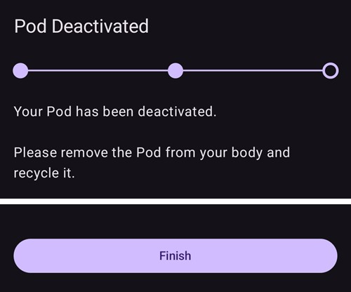
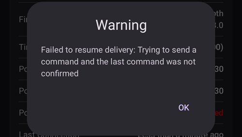
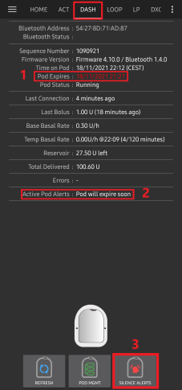

# Omnipod DASH

Estas instruções servem para configurar a bomba da geração **Omnipod DASH** **(NÃO a Omnipod Eros)**. O controlador DASH é uma forma bem estabelecida de fazer loop com a Omnipod.

```{contents} Table of contents
:depth: 1
:local: true
```

## Especificações da Omnipod DASH

Características principais da **Omnipod DASH** («DASH»):

- Os Pods DASH reconhecem-se pela **tampa azul da agulha** (o Pod EROS, mais antigo, tem uma tampa da agulha transparente). Fora isso, os Pods são idênticos nas dimensões físicas.
- A DASH não precisa de um dispositivo de ligação/ponte BLE (NÃO precisa de RileyLink, OrangeLink nem EmaLink).
- A ligação Bluetooth da DASH só é usada para enviar um comando (por exemplo, um bólus) e desliga-se logo após o envio do comando.
- O **AAPS** espera que o Pod esteja acessível para enviar comandos.
- Na ativação do Pod, o **AAPS** encontra um novo Pod DASH e liga-se a ele.
- Alcance esperado a partir do telefone: 5–10 metros (pode variar).

(omnipod-dash-constraints)=

## Restrições/problemas conhecidos da Omnipod DASH no AAPS
- O conselho geral é usar o **AAPS** no Android 14 ou 16. A comunidade comunicou muitos [problemas](https://github.com/nightscout/AndroidAPS/issues/3471) com o Android 15. No entanto, se usar o Android 15, vai provavelmente precisar de ligar o **Emparelhamento Bluetooth (bonding)** (na secção **Definições avançadas** das [Definições do Dash](#omnipod-dash-advanced-settings)) para conseguir ativar e usar os Pods; veja [Resolução de Problemas](../GettingHelp/GeneralTroubleshooting.md) para mais informação sobre as definições de emparelhamento (bonding).
- A hora de verão e as mudanças de fuso horário não são aplicadas automaticamente. Depois de uma mudança de hora, tem de atualizar o Pod à mão: prima **Atualizar** no ecrã da bomba DASH e depois prima **Definir hora** (aparece quando os fusos horários do Pod e do telefone são diferentes) ou faça uma **Troca de Perfil** (veja [Mudança de fuso horário com a Omnipod Dash](#timezone-traveling-with-pumps)).
- A Dash só suporta taxas basais em passos de 0,05 U/h. Se tentar definir a basal com passos de 0,01 no seu **perfil do AAPS**, o AAPS não dá nenhum aviso, embora o Pod arredonde a taxa para cima em passos de 0,05. Se abrir o **Histórico do Pod** no ecrã da bomba DASH, vai ver que foi definida uma basal de 0,05. Isto também significa que a taxa basal mais baixa permitida pela DASH no **AAPS** é 0,05 U/h.
- O ficheiro de definições contém a sessão do Pod ativo. Exporte as suas definições após cada ativação de Pod e leia [Exportar e importar definições](#omnipod-dash-export-import) antes de importar definições.
- Ao definir um novo perfil basal, a DASH suspende a administração antes de definir o novo **Perfil** basal. Se houver uma interrupção ou um erro de comunicação, o perfil basal não volta a iniciar automaticamente. Veja a secção [Retomar a administração de insulina](#omnipod-dash-resuming-insulin-delivery) para mais pormenores.
- Se os alertas estiverem configurados e o Pod estiver perto de expirar, o Pod continua a emitir beeps até os alertas serem silenciados; veja [Silenciar os alertas do Pod](#omnipod-dash-silencing-pod-alerts) para mais pormenores.
- Há vários problemas conhecidos com o Bluetooth que podem causar problemas na ativação do Pod. Veja [Problemas relacionados com o Bluetooth](../GettingHelp/BluetoothTroubleshooting.md) para o problema conhecido e as soluções para estes problemas.

(hardware-software-requirements)=

(omnipod-dash-hardware-software-requirements)=
## Requisitos de hardware e software

- A Omnipod DASH reconhece-se pela tampa azul da agulha.


- **Um telefone Android compatível** com Bluetooth Low Energy (BLE) (veja [Telefones](../Getting-Started/Phones.md) para mais informação); além disso, a informação seguinte ajuda a ter em conta outros pontos importantes para ativar e usar a DASH com sucesso num telefone compatível:
    -  O controlador Omnipod Dash do **AAPS** liga-se ao Pod DASH por Bluetooth.  
      O **AAPS** estabelece automaticamente uma nova ligação Bluetooth ao Pod sempre que precisa de enviar um comando (por exemplo, um bólus); depois de enviar o comando, a ligação Bluetooth é desligada de imediato.
       - **NOTE:**
         - A ligação Bluetooth pode ser interrompida/perturbada por outros dispositivos Bluetooth ligados ao telefone onde corre o **AAPS**, como auriculares, etc. Dispositivos como estes podem causar erros de ligação ou problemas na ativação do Pod em alguns modelos de telefones. Ao escolher o telefone para a Omnipod DASH, é boa ideia consultar a lista de [configurações de hardware testadas](https://docs.google.com/spreadsheets/u/1/d/e/2PACX-1vScCNaIguEZVTVFAgpv1kXHdsHl3fs6xT6RB2Z1CeVJ561AvvqGwxMhlmSHk4J056gMCAQE02sAWJvT/pubhtml?gid=683363241&single=true), com configurações que se sabe que funcionam.
         - Há vários problemas conhecidos com o Bluetooth que podem causar problemas na ativação do Pod (veja [Resolução de problemas](#troubleshooting) para conselhos sobre outros problemas de Bluetooth), em especial a secção [Problemas relacionados com o Bluetooth](#omnipod-dash-bluetooth-related-issues).
    - O telefone tem de ter o **Android 12 ou mais recente**, com o **AAPS** compilado e instalado segundo as instruções [**Compilar o AAPS**](../SettingUpAaps/BuildingAaps.md). Use sempre a versão publicada mais recente.
- Um [**monitor contínuo de glicose (CGM)**](../Getting-Started/CompatiblesCgms.md) suportado

As instruções abaixo explicam como ativar uma nova sessão de Pod com o **AAPS**. Deve esperar até o Pod atual estar perto de expirar, porque vai precisar de ativar um novo Pod com o **AAPS**. Depois de um Pod ser desativado, não pode voltar a ser usado/ativado; a desativação é definitiva.

## Antes de começar

Leia e compreenda todo este guia, a secção **Antes de começar** e também **[Restrições e problemas da Omnipod e do AAPS](#omnipod-dash-constraints)**, para evitar um problema conhecido.

### **SEGURANÇA PRIMEIRO** - **NÃO DEVE** tentar ligar o **AAPS** a um Pod pela primeira vez sem ter acesso a tudo o que se segue:
1. Pods extra (3 ou mais de reserva)
2. Insulina de reserva e material para MDI (canetas/seringas)
3. Um PDM Omnipod a funcionar (para o caso de o **AAPS** falhar)
4. Os telefones suportados são obrigatórios! (Veja [Requisitos de hardware/software](#hardware-software-requirements))
5. A versão correta do AAPS compilada e instalada

### O PDM da Omnipod Dash deixa de ser necessário depois de o controlador Dash do AAPS ativar o Pod.
- Antes de usar o **AAPS**, o utilizador ou o seu cuidador geria o Pod com o PDM Omnipod (ou, em algumas regiões, com uma app de telefone) para enviar comandos à DASH (por exemplo, um bólus).
- A DASH só aceita a ligação de um único dispositivo Bluetooth (por exemplo, PDM ou telefone) para a gerir e lhe enviar comandos.
- O dispositivo que ativa o Pod com sucesso é, a partir desse momento, o único dispositivo autorizado a comunicar com esse Pod. Isto significa que, depois de ativar uma DASH com o seu telefone Android através do **AAPS**, **deixa de poder usar o PDM com esse Pod!** Enquanto esse Pod estiver ativo, o controlador Dash do **AAPS** no seu telefone Android é o novo PDM do Pod.
- **NÃO deite fora o PDM!** Recomenda-se guardá-lo como reserva e para emergências, por exemplo quando perder o telefone ou quando o **AAPS** não estiver a funcionar bem.

### O Pod **NÃO** para de administrar insulina quando não está ligado ao AAPS.
As taxas basais predefinidas são programadas no Pod na ativação, como definido no [**Perfil**](../SettingUpAaps/YourAapsProfile.md) ativo.  
Enquanto o **AAPS** estiver a funcionar, envia comandos de ajuste da taxa basal que duram no máximo 120 minutos.  
Se, por algum motivo, o Pod não receber novos comandos (por exemplo, porque a comunicação se perdeu devido à distância Pod ➜ telefone), o Pod volta automaticamente às taxas basais predefinidas no seu [**Perfil**](../SettingUpAaps/YourAapsProfile.md).

### Os perfis do AAPS não suportam intervalos de 30 minutos na taxa basal
Se é novo no **AAPS** e está a configurar o seu [**Perfil**](../SettingUpAaps/YourAapsProfile.md) de taxas basais pela primeira vez, tenha em conta que taxas basais que começam à meia hora não são suportadas. Por exemplo, se no PDM Omnipod tiver uma taxa basal de 1,1 unidades que começa às 09:30 e dura 2 horas, até às 11:30, não é possível copiar exatamente este **Perfil** basal no **AAPS**.  
Tem de mudar esta taxa basal de 1,1 unidades para o intervalo 9:00–11:00 ou 10:00–12:00. Embora o hardware da DASH suporte intervalos de 30 minutos no **Perfil** basal, o **AAPS** NÃO suporta esta função.

### Taxas basais de 0 U/h no perfil NÃO são suportadas no AAPS
Embora a DASH suporte uma taxa basal de zero, o **AAPS** usa múltiplos da taxa basal do **Perfil** do utilizador para decidir o tratamento automático; não pode funcionar com uma taxa basal de zero.  
Em vez disso, pode obter uma taxa basal temporária de zero com a função «Desligar bomba», ou com uma combinação de Desativar loop/basal temporária ou Suspender loop/basal temporária.  
**NOTA:** A taxa basal mais baixa permitida pela DASH no **AAPS** é 0,05 U/h.

## Selecionar a Dash no AAPS

Há **duas** formas de selecionar o controlador Omnipod DASH no **AAPS**:

### Opção 1: Novas instalações

Quando instala o **AAPS** pela primeira vez, o **Assistente de Configuração** guia-o pelas funções principais e pelos requisitos de instalação do **AAPS**. Quando chegar ao passo **Bomba**, selecione **Omnipod Dash**.


Se ainda não tiver a certeza, pode selecionar **Bomba virtual** por agora e selecionar **Omnipod Dash** mais tarde, depois de configurar o **AAPS** (veja a Opção 2).

(omnipod-dash-option-2-config-builder)=
### Opção 2: O ecrã Configuração

Numa instalação existente, pode selecionar a bomba **Omnipod Dash** no ecrã **Configuração**:

1. Abra o **menu** (☰) no canto superior esquerdo do ecrã principal e selecione **Configuração**.
2. Toque em **Bomba** e selecione o botão de opção da **Omnipod Dash** (*«Integração para a Omnipod Dash (o modelo novo, com Bluetooth e uma proteção de agulha azul).»*).

3. Depois de a selecionar, o cartão **Omnipod Dash** mostra dois botões:
   - **Definições** abre as [Definições do Dash](#omnipod-dash-settings).
   - **Abrir plugin** abre o [ecrã da bomba DASH](#omnipod-dash-tab).

   

### Verificar a seleção do controlador Omnipod

Para verificar que a **Omnipod Dash** está selecionada, abra **Gerir** (navegação em baixo no ecrã principal) e toque em **Bomba**. Abre-se o ecrã da bomba DASH, como mostra a secção seguinte.

(omnipod-dash-tab)=

## The DASH pump screen

O ecrã da bomba DASH é onde gere os seus Pods: ativá-los e desativá-los, atualizar o estado do Pod, silenciar alertas e ver o histórico do Pod. Abra-o com **Gerir** > **Bomba**, ou com **Abrir plugin** no cartão **Omnipod Dash** em **Configuração** > **Bomba**.

Este é o ecrã sem um Pod ativo:


E este é o ecrã com um Pod ativo:


O ícone **Definições** (roda dentada) no canto superior direito abre as [Definições do Dash](#omnipod-dash-settings).

***NOTA:** Se um campo no ecrã da bomba mostrar (incerto), prima **Atualizar** para atualizar o estado do Pod.*

### Campos

- **Endereço Bluetooth:** O endereço Bluetooth do Pod.

- **Qualidade da Ligação:** Com que fiabilidade o **AAPS** se liga ao Pod, mostrada como *ligações com sucesso / todas as tentativas de ligação :: taxa de sucesso*, por exemplo `412/420 :: 98.10 %`. Depois de mais de 50 ligações com sucesso, o valor fica amarelo abaixo de 90 % e vermelho abaixo de 70 %. Um valor baixo indica um problema de Bluetooth (veja [Problemas relacionados com o Bluetooth](#omnipod-dash-bluetooth-related-issues)).

- **Estado da administração:** O estado da administração em bruto, comunicado pelo Pod. Este campo só aparece em versões compiladas no modo engineering.

- **ID Único:** O ID único que o **AAPS** deu ao Pod durante a ativação.

- **Número de LOTE:** O número do lote de produção do Pod.

- **Número da Sequência:** O número de sequência do Pod.

- **Versão do Firmware:** As versões do firmware e do Bluetooth do Pod.

- **Hora no Pod:** A hora atual no Pod, com o seu fuso horário. O texto fica vermelho quando o fuso horário do Pod é diferente do fuso horário do telefone, e amarelo quando a hora do Pod está desviada mais de 10 minutos.

- **Pod Expira:** A data e a hora em que o Pod expira (72 horas após a ativação). O texto fica amarelo nas últimas 4 horas antes desta hora. Nunca fica vermelho, porque o Pod continua a administrar insulina depois disso.

- **Fim definitivo do Pod:** O fim do período de tolerância do Pod (8 horas após **Pod Expira**, para uma vida máxima do Pod de 80 horas). O texto fica amarelo quando começa o período de tolerância (em **Pod Expira**) e vermelho nas últimas 4 horas antes do fim definitivo. Durante o período de tolerância, mostra também o tempo que falta, por exemplo *(17m remaining)*. O Pod para de administrar insulina no fim definitivo e tem de ser mudado.

- **Estado do Pod:** O estado do Pod: **Nenhum Pod Ativo**, **Configuração em progresso**, **A correr**, **Suspenso** ou, após uma falha do Pod, **ALARM**.

- **Última Ligação:** Há quanto tempo o **AAPS** comunicou pela última vez com o Pod.

  - *Momentos atrás* - há menos de 10 segundos.

  - *Há menos de um minuto* - entre 10 e 60 segundos.

  - *XX minutos atrás* - há mais de 1 minuto (e *X horas e XX minutos atrás* depois de uma hora).

- **Último Bólus:** A quantidade do último bólus enviado ao Pod e há quanto tempo foi dado. Um bólus não confirmado é marcado com (incerto).

- **Taxa Basal do Perfil:** A taxa basal programada para a hora atual no seu **Perfil** basal.

- **Taxa basal temporária:** A taxa basal temporária (TBR) em curso, com a hora de início e a duração. Este campo só aparece enquanto uma basal temporária está em curso.

- **Reservatório:** Mostra *Mais de 50 U restantes* quando restam mais de 50 unidades no reservatório. Abaixo de 50 unidades, é mostrada a quantidade exata. O valor fica vermelho abaixo de 20 unidades.

- **Total Administrado:** A quantidade total de insulina administrada a partir do reservatório. Inclui a insulina usada para purgar.

- **Alertas Pod Ativos:** Alertas que estão ativos no Pod neste momento, por exemplo *Pod vai expirar em breve* ou *Reservatório Baixo*.

- **Erros:** A falha do Pod, se o Pod falhou, mostrada a vermelho como *Falha no Pod:* seguida do código e do nome da falha, por exemplo *Falha no Pod: 020 ALARM_OCCLUDED*. Consulte o [Histórico do Pod](#omnipod-dash-view-pod-history) e os ficheiros de registo para ver erros passados e informação mais pormenorizada. Veja [Falhas do Pod](#omnipod-dash-pod-failures).

- **Notificação do PDM:** Só aparece depois de uma falha do Pod. Mostra a falha da forma como o PDM Omnipod a teria mostrado: um título (por exemplo *Oclusão detetada*, *Reservatório vazio* ou *Pod expirado*), o que aconteceu (por exemplo *A administração de insulina parou. Mude o Pod agora.*) e um código *Ref:*.

### Botões

Os botões na parte de baixo do ecrã da bomba mudam conforme o estado do Pod. Só aparecem os botões que fazem sentido nesse momento.

- **Atualizar:** Pede ao Pod o seu estado atual.
  - *Use-o para atualizar o estado do Pod e para limpar campos que mostram (incerto).*
  - *Veja a secção [Resolução de problemas](#omnipod-dash-troubleshooting) abaixo para mais informação.*

- **Silenciar Alertas:** Para os beeps de alerta do Pod (por exemplo, expiração do Pod ou reservatório baixo). Só aparece enquanto o Pod tem um alerta ativo. Veja [Silenciar os alertas do Pod](#omnipod-dash-silencing-pod-alerts).

- **Retomar Administração:** Retoma a administração de insulina num Pod suspenso. Só aparece quando a administração está suspensa. Veja [Retomar a administração de insulina](#omnipod-dash-resuming-insulin-delivery).

- **Definir hora:** Atualiza o Pod para o fuso horário do telefone, ao enviar outra vez o seu **Perfil** basal. Só aparece quando o fuso horário do Pod é diferente do fuso horário do telefone.

- [**Ativar Pod**](#omnipod-dash-activate-pod): Purga e ativa um novo Pod. Aparece quando não há nenhum Pod ativo.

- [**Desativar Pod**](#omnipod-dash-deactivate-pod): Desativa o Pod ativo. Aparece logo que um Pod é emparelhado com o **AAPS**, também quando uma ativação parou a meio (por exemplo, porque o Pod falhou durante a ativação). O **AAPS** pede-lhe confirmação antes de desativar o Pod.

- **Reproduzir Teste do Beep:** O Pod emite um único beep de teste.

- [**Histórico do Pod**](#omnipod-dash-view-pod-history): Mostra o histórico de atividade do Pod ativo.

- **Descartar Pod:** Remove do **AAPS** um Pod não terminado. Só aparece quando uma ativação de Pod parou a meio. O **AAPS** pede-lhe confirmação. Depois de descartar, o **AAPS** deixa de poder comunicar com esse Pod: retire-o do corpo.


```{admonition} Older screenshot
:class: note
A captura de ecrã acima é de uma versão anterior do **AAPS**, que tinha um menu **Gestão do Pod** separado. No **AAPS** 4, todas estas ações, incluindo **Ativar Pod**, **Desativar Pod**, **Reproduzir Teste do Beep** e **Histórico do Pod**, são botões com texto diretamente no ecrã da bomba.
```

(omnipod-dash-activate-pod)=

## Ativar Pod

1. Abra o ecrã da bomba DASH (**Gerir** > **Bomba**) e prima **Ativar Pod**. Abre-se o assistente de ativação.

   

   ```{admonition} Older screenshot
   :class: note
   A captura de ecrã acima é de uma versão anterior do **AAPS**. No **AAPS** 4, **Ativar Pod** é um botão diretamente no ecrã da bomba DASH, em vez de estar no menu **Gestão do Pod**.
   ```

   Se nunca ativou um **Perfil** no **AAPS**, o assistente mostra primeiro o passo **Perfil necessário**: selecione o perfil a aplicar na ativação e continue.

2. Aparece o passo **Encher Pod**. Encha um novo Pod com insulina suficiente para 3 dias, **pelo menos 80 unidades**. Espere ouvir dois beeps do Pod: significam que a quantidade mínima de 80 unidades foi enchida. Esvazie completamente a seringa de enchimento, mesmo depois de ouvir os dois beeps. Ainda não retire a tampa da agulha do Pod.

   ***NOTA:** Ao calcular a quantidade de insulina de que precisa para 3 dias, lembre-se de que a purga do Pod usa cerca de 3–10 unidades.*

   

   

   Certifique-se de que o novo Pod e o telefone com o **AAPS** estão perto um do outro e prima **Seguinte**.

3. Se usar mais do que uma insulina no **AAPS**, aparece o passo **Selecionar insulina**. Mostra a insulina **Atualmente ativa**. Se encheu o Pod com outra insulina, prima **Trocar** e selecione-a. O **AAPS** aplica uma **Troca de Perfil** com esta insulina quando a ativação terminar. Prima **Seguinte**.

   

4. No passo **Inicializar Pod**, o **AAPS** emparelha-se com o novo Pod e purga-o. Ouve um clique seguido de uma série de tiques enquanto o Pod se purga. Quando isto terminar com sucesso, aparece o botão **Seguinte**. Prima **Seguinte**.

       

   ***NOTA**: Se aparecer uma mensagem de erro como _A pesquisa falhou_ ou _'Could not find an available pod for activation'_ (isto pode acontecer), não entre em pânico. Prima **Tentar Novamente**. Na maioria dos casos, a ativação continua então com sucesso.*

   

   Se o Pod falhou (por exemplo, porque o seu tempo de ativação foi ultrapassado), aparece **Desativar Pod** em vez de **Tentar Novamente**. Use-o e comece de novo com um novo Pod.

   Se premir **Cancelar** antes de a ativação terminar, o **AAPS** pede-lhe que confirme que quer sair. Prima **OK** para sair do assistente, ou **Cancelar** para ficar.

   

5. Se gere a rotação dos locais da bomba no **AAPS** (**Gerir a rotação dos locais da bomba** nas definições de [Rotação dos locais](#Aapsscreens-site-rotation)), aparece o passo **Local de inserção**. Selecione no diagrama do corpo onde vai colocar o Pod e prima **Seguinte**, ou prima **Saltar**.

   

6. A seguir, prepare o local de infusão para o novo Pod. Lave as mãos para evitar qualquer risco de infeção. Limpe o local de infusão com água e sabão ou com um toalhete com álcool, e deixe a pele secar completamente ao ar antes de continuar. Se o adesivo irritar a pele, pense em usar um toalhete ou um spray de barreira.

   No passo **Colocar o Pod**, retire a tampa azul de plástico da agulha do Pod. Se a cânula ou outra coisa estiver a sair do Pod, ou se ele parecer estranho, **PARE**: prima **Cancelar** e comece de novo com um novo Pod. Se tudo parecer **OK**, retire o papel branco que protege o adesivo e cole o Pod no local escolhido do corpo.

   Quando terminar, prima **Seguinte**.

   

7. Aparece uma janela de confirmação: *Quando pressionar OK, a cânula será inserida.* **Prima OK SÓ quando estiver pronto para inserir a cânula!**

   

8. No passo **Inserir Cânula**, o **AAPS** define o seu horário basal e o Pod insere a cânula. Isto pode demorar algum tempo (no máximo 1–2 minutos). **Seja paciente!**

   ***NOTA:** É boa prática apertar a pele perto do ponto de inserção da cânula antes de a cânula ser inserida. Isto ajuda a agulha a entrar suavemente e reduz a probabilidade de oclusões (bloqueios).*

       

9. Quando a cânula tiver sido inserida com sucesso, aparece o botão **Seguinte**. Prima **Seguinte**.

   

10. Aparece o passo **Pod Ativado**. Verifique se a cânula foi bem inserida e mude o Pod se achar que não foi.

    Prima **Concluir**.

    Parabéns! Iniciou agora uma nova sessão de Pod.

    

11. Volta ao ecrã da bomba DASH. Agora mostra a informação do seu Pod ativo, incluindo a taxa basal atual, o nível do reservatório, a insulina administrada, os erros e os alertas do Pod. **Ativar Pod** é substituído por **Desativar Pod**: não pode ativar outro Pod sem primeiro desativar o Pod ativo.

    ***NOTA:** Para mais pormenores sobre a informação mostrada, veja [O ecrã da bomba DASH](#omnipod-dash-tab).*

    

    ***NOTA:** É boa prática exportar as definições DEPOIS de ativar o Pod. Exporte as definições após cada mudança de Pod e uma vez por mês. Copie o ficheiro de definições exportado para um armazenamento na nuvem (por exemplo, Google Drive) ou para outro local fora do telefone, para o caso de perder o telefone (veja [**Exportar definições**](../Maintenance/ExportImportSettings.md)).*

Se uma ativação anterior parou depois de o Pod ter sido purgado, premir **Ativar Pod** continua a partir do passo **Colocar o Pod**.

(omnipod-dash-deactivate-pod)=

## Desativar Pod

Em circunstâncias normais, um Pod dura três dias (72 horas), mais um período de tolerância de 8 horas após o aviso de expiração do Pod: 80 horas no total.

Para desativar um Pod (porque expirou ou porque falhou):

1. Abra o ecrã da bomba DASH (**Gerir** > **Bomba**) e prima **Desativar Pod**.

   

2. No passo **Desativar Pod**, prima **Seguinte**. Uma janela pergunta *Um Pod desativado não pode voltar a ser usado. Desativar este Pod agora?* Prima **OK** para começar a desativar o Pod, ou **Cancelar** para o manter. A desativação suspende toda a administração de insulina e não pode ser anulada.

   

3. O passo **A Desativar Pod** aparece enquanto o **AAPS** desativa o Pod. O Pod emite beeps para confirmar que a desativação teve sucesso.

   

   ```{admonition} Older screenshot
   :class: note
   A captura de ecrã acima é de uma versão anterior do **AAPS**. No **AAPS** 4, o assistente mostra o progresso como uma fila de pontos em cima, em vez de uma barra de progresso.
   ```

   Quando a desativação terminar com sucesso, aparece o botão **Seguinte**. Prima **Seguinte**.

   

   Se a desativação falhar, aparecem uma mensagem de erro e um botão **Descartar Pod**. Leia [Descartar um Pod](#omnipod-dash-discard-pod) abaixo antes de o usar. Também pode premir **Cancelar** e tentar **Desativar Pod** outra vez mais tarde.

4. Aparece o passo **Pod Desativado**. Retire o Pod do corpo e prima **Concluir**.

   

5. Volta ao ecrã da bomba DASH. Verifique se o campo **Estado do Pod** mostra **Nenhum Pod Ativo** e se o botão **Ativar Pod** aparece outra vez.

   

(omnipod-dash-discard-pod)=

### Descartar um Pod

Só descarte um Pod quando toda a comunicação com ele continuar a falhar. Se o **AAPS** ainda conseguir comunicar com o Pod, use **Desativar Pod**.

- O **AAPS** pede-lhe confirmação antes de descartar o Pod.
- Depois disso, o **AAPS** deixa de poder comunicar com esse Pod.
- **A administração de insulina NÃO foi suspensa**, porque o Pod não foi desativado corretamente. **Retire o Pod do corpo!**
- O passo **Pod Descartado** confirma que o estado do Pod foi descartado. Prima **Concluir**. Agora pode ativar um novo Pod.

(omnipod-dash-resuming-insulin-delivery)=

## Retomar a administração de insulina

**NOTA**: Durante as **Trocas de Perfil**, tal como com o PDM, o **AAPS** tem de suspender a administração no Pod antes de definir o novo **Perfil** basal. Se a comunicação falhar entre os comandos de suspensão e de retoma, a administração pode ficar suspensa. Leia [**Administração suspensa**](#omnipod-dash-delivery-suspended) na secção de resolução de problemas para mais pormenores.

Quando a administração de insulina está suspensa, tem de dizer ao Pod para retomar a administração de insulina. Quando o comando for processado com sucesso, o Pod volta a administrar insulina com a taxa basal da hora atual do seu **Perfil** basal ativo. O Pod volta a aceitar comandos de bólus, **basal temporária** e **SMB**.

1. Abra o ecrã da bomba DASH e verifique se o campo **Estado do Pod** mostra **Suspenso**. Prima **Retomar Administração** para dizer ao Pod que retome a administração normal de insulina.

   

2. Quando o comando tiver sucesso, o campo **Estado do Pod** mostra **A correr** e o botão **Retomar Administração** desaparece.

   

   

   ```{admonition} Older screenshot
   :class: note
   As capturas de ecrã acima são de uma versão anterior do **AAPS**, que mostrava uma janela de confirmação. No **AAPS** 4, confirma o resultado no ecrã da bomba DASH: o campo **Estado do Pod** mostra **A correr** e o botão **Retomar Administração** já não aparece.
   ```

   Se o comando falhar, o **AAPS** mostra uma janela de aviso que começa com *Falha ao retomar a administração*. Prima **Atualizar** e tente outra vez.

   

(omnipod-dash-silencing-pod-alerts)=

## Silenciar os alertas do Pod

Esta secção explica como parar os beeps do Pod quando o Pod se aproxima do fim da sua vida. O momento em que estes beeps começam depende das definições de **Alertas** (veja [Definições do Dash](#omnipod-dash-settings)):

- **Lembrete horas antes da expiração (72 horas):** quantas horas antes da expiração das 72 horas o Pod começa a emitir beeps.
- **Alerta horas antes de desligar (80 horas):** quantas horas antes de o Pod se desligar às 80 horas ele volta a emitir beeps.

A vida máxima de um Pod é de 80 horas (3 dias e 8 horas). No entanto, o fabricante do Pod recomenda não ultrapassar as 72 horas (3 dias).

***NOTA**: O botão **Silenciar Alertas** só aparece no ecrã da bomba DASH enquanto o Pod tem um alerta ativo, por exemplo expiração do Pod ou reservatório baixo. Se o botão **Silenciar Alertas** não aparecer mas ouvir o Pod a emitir beeps, prima **Atualizar**.*

1. Quando chega a hora do lembrete, o Pod emite beeps para avisar que vai expirar em breve e que tem de o mudar. No ecrã da bomba DASH, o campo **Pod Expira (1)** mostra a hora exata em que o Pod vai expirar (72 horas após a ativação). O texto fica amarelo 4 horas antes desta hora. Depois disso, **Fim definitivo do Pod** fica amarelo e mostra o tempo que falta até o Pod parar de administrar insulina. O campo **Alertas Pod Ativos (2)** mostra **Pod vai expirar em breve** e aparece o botão **Silenciar Alertas (3)**.

   

2. Prima **Silenciar Alertas**. O **AAPS** envia ao Pod o comando para parar os beeps de expiração.

   

   ```{admonition} Older screenshot
   :class: note
   A captura de ecrã acima é de uma versão anterior do **AAPS**, em que este ecrã era o separador **DASH**. No **AAPS** 4, o botão **Silenciar Alertas** está no ecrã da bomba DASH (**Gerir** > **Bomba**).
   ```

3. Quando os alertas tiverem sido silenciados, o alerta deixa de aparecer no campo **Alertas Pod Ativos**, o botão **Silenciar Alertas** desaparece e o Pod para os beeps de expiração.

   

   ```{admonition} Older screenshot
   :class: note
   A captura de ecrã acima é de uma versão anterior do **AAPS**, que mostrava uma janela de confirmação. No **AAPS** 4, confirma o resultado no ecrã da bomba DASH: o alerta já não aparece no campo **Alertas Pod Ativos**.
   ```

   Se o comando falhar, o **AAPS** mostra uma janela de aviso que começa com *Falha ao silenciar alertas*. Prima **Atualizar** e tente outra vez.

O alerta de reservatório baixo funciona da mesma forma. Quando a insulina que resta no Pod desce até ao valor de **No. Unidades** definido nas definições de **Alertas**, o Pod emite beeps. O campo **Reservatório** mostra a quantidade que resta, o campo **Alertas Pod Ativos** mostra **Reservatório Baixo** e aparece o botão **Silenciar Alertas**. Prima **Silenciar Alertas** para parar os beeps e planeie a próxima mudança de Pod.


(omnipod-dash-view-pod-history)=

## Ver o histórico do Pod

Esta secção explica como ver o histórico do seu Pod ativo e filtrá-lo por tipo de ação. O histórico do Pod mostra os comandos enviados ao seu Pod ativo e os seus resultados durante a vida de três dias (72–80 horas) do Pod.

É útil para verificar os bólus, as basais temporárias e os comandos de basal que foram enviados ao Pod. As outras categorias ajudam na resolução de problemas e mostram a ordem dos eventos que levaram a uma falha.

**NOTA:** **Só o último comando pode estar incerto**. Os novos comandos *não são enviados* até o **último comando «incerto» ficar «confirmado» ou «negado»**. Para «resolver» um comando incerto, prima **Atualizar** no ecrã da bomba DASH.

1. Abra o ecrã da bomba DASH e prima **Histórico do Pod**.

   

   ```{admonition} Older screenshot
   :class: note
   A captura de ecrã acima é de uma versão anterior do **AAPS**. No **AAPS** 4, **Histórico do Pod** é um botão diretamente no ecrã da bomba DASH, em vez de estar no menu **Gestão do Pod**.
   ```

2. O ecrã **Histórico do Pod** abre com o filtro **Tudo** selecionado. Lista todos os comandos com a hora e o resultado, os mais recentes primeiro, agrupados por dia. Use os botões de filtro em cima (por exemplo **Bólus** ou **Basais**) para mostrar só um tipo de comando. Prima a seta para trás para voltar ao ecrã da bomba DASH.

    

   ```{admonition} Older screenshot
   :class: note
   A segunda captura de ecrã acima é de uma versão anterior do **AAPS**, em que escolhia o tipo de comando numa lista **Tipo**. No **AAPS** 4, usa os botões de filtro mostrados na primeira captura de ecrã.
   ```

   Nos bólus, a quantidade é seguida do tipo de bólus quando não é um bólus normal, por exemplo *0,05 U (SMB)* ou *0,05 U (Correção basal)*. Uma correção basal é um bólus muito pequeno (um impulso do Pod, 0,05 U) que o controlador envia sozinho; não foi pedido por si.

   ```{admonition} Why basal corrections happen
   :class: note
   O Pod administra a insulina basal em impulsos de 0,05 U, marcados por um relógio interno. Sempre que a taxa basal muda (por exemplo, quando o loop define uma nova **basal temporária**), o Pod reinicia este relógio, e o impulso que estava a contar perde-se. Como o loop muda a taxa basal muitas vezes, sobretudo durante a noite, o Pod pode acabar por administrar menos insulina basal do que o esperado.

   O **AAPS** compara a insulina basal que o Pod diz ter administrado com a que devia ter administrado. Quando a falta chega a meio impulso ou mais, o controlador administra um impulso extra como correção basal, para que receba mesmo assim a insulina basal que o seu perfil e o loop pediram. Não é enviada nenhuma correção enquanto o Pod está suspenso ou enquanto está em curso uma **basal temporária** de zero.
   ```

(omnipod-dash-settings)=

## Definições do Dash

Há duas formas de abrir as definições do controlador Dash:

- Prima o ícone **Definições** (roda dentada) no canto superior direito do [ecrã da bomba DASH](#omnipod-dash-tab).
- Abra o **menu** (☰) no canto superior esquerdo do ecrã principal e selecione **Configuração** > **Bomba**. No cartão **Omnipod Dash**, prima **Definições**.

As definições estão agrupadas em quatro secções expansíveis: **Beeps de Confirmação**, **Alertas**, **Notificações** e **Definições avançadas**. Toque numa secção para a abrir:


A maior parte das definições são interruptores de ligar/desligar.

### Beeps de Confirmação


Beeps de confirmação do Pod para a administração e as alterações de bólus, basal, SMB e basal temporária.

**Beeps de bólus ativados:**    O Pod emite um beep quando um bólus é administrado. Ligado por predefinição.

**Beeps de basal ativados:**    O Pod emite um beep quando é definida uma nova taxa basal, ou quando a taxa basal ativa é cancelada ou alterada. Desligado por predefinição.

**Beeps SMB ativados:**  O Pod emite um beep quando um SMB é administrado. Ligado por predefinição.

**Beeps de basal temporária ativados:**  O Pod emite um beep quando uma basal temporária é definida ou cancelada. Desligado por predefinição.

### Alertas


```{admonition} Older screenshot
:class: note
A captura de ecrã acima é de uma versão anterior do **AAPS**. No **AAPS** 4, estas definições estão na secção expansível **Alertas**.
```

Alertas do Pod para a expiração do Pod, o fim (desligar) e o reservatório baixo. Quando muda estas definições com um Pod ativo, o **AAPS** envia as novas definições de alerta ao Pod.

***NOTA:** O **AAPS** mostra SEMPRE uma notificação para qualquer alerta, logo que o **AAPS** comunique com o Pod depois de o alerta ter sido acionado. Fechar a notificação NÃO para o alerta do Pod. Para parar o alerta, abra o ecrã da bomba DASH e prima **Silenciar Alertas**.*

**Lembrete de expiração ativado:**    Quando está ligado, o Pod emite beeps quando chega a hora do lembrete. Ligado por predefinição.

**Lembrete horas antes da expiração (72 horas):** Quantas horas antes da expiração do Pod às 72 horas começa o lembrete (1 a 24 horas; predefinição 4).

**Alerta de expiração ativado:**   Quando está ligado, o Pod emite beeps quando chega a hora do alerta, e outra vez 1 hora antes de se desligar. Ligado por predefinição.

**Alerta horas antes de desligar (80 horas):**  Quantas horas antes de o Pod se desligar às 80 horas começa o alerta (1 a 8 horas; predefinição 8).

**Alerta de reservatório baixo ativado:**    O Pod avisa-o quando a insulina que resta no reservatório desce até ao valor de **No. Unidades**. Ligado por predefinição.

**No. Unidades:**    O número de unidades em que o alerta de reservatório baixo é acionado (5 a 50 unidades; predefinição 20).

### Notificações


Escolha se o **AAPS** toca um som com as suas notificações quando não tem a certeza se uma basal temporária, um SMB ou um bólus foi administrado, e quando a administração é suspensa.

***NOTA:** Estas são apenas notificações do telefone; o próprio Pod não emite beeps.*

**Som ativado para notificações de basal temporária incerta:**  Toca um som com a notificação quando o **AAPS** não tem a certeza se uma basal temporária foi definida.

**Som ativado para notificações de SMB incerto:**  Toca um som com a notificação quando o **AAPS** não tem a certeza se um SMB foi administrado.

**Som ativado para notificações de bólus incerto:**    Toca um som com a notificação quando o **AAPS** não tem a certeza se um bólus foi administrado.

**Som ativado na notificação de administração suspensa:**     Toca um som com a notificação quando a administração de insulina é suspensa.

(omnipod-dash-advanced-settings)=

### Advanced Settings


**Emparelhamento Bluetooth (bonding):**  Emparelha o Pod com o telefone por Bluetooth. Experimente-o só se o Pod não conseguir manter uma ligação estável, por exemplo no Android 15 (veja [Restrições/problemas conhecidos da Omnipod DASH no AAPS](#omnipod-dash-constraints)). Quando está ligado, o telefone mostra pedidos de emparelhamento que tem de aceitar. Deixe-o desligado se o Pod se ligar bem. Não tem efeito abaixo do Android 15. Desligado por predefinição.

## Idade da insulina e da cânula

A [linha de estado](#screens-sensor-level-battery) no ecrã principal mostra a idade da insulina e da cânula. Com a Omnipod, isto funciona de forma um pouco diferente das bombas com tubo.

O **AAPS** regista automaticamente uma mudança de cânula e uma mudança de insulina sempre que ativa um Pod. Isto põe a zero as idades da **Insulina** e da **Cânula** após cada mudança de Pod. Não precisa de as registar com **Purgar/Preencher**. Isto acontece porque o Pod insere a cânula diretamente na pele onde está colado: a Omnipod não usa tubo.

A idade da **Bateria da Bomba** não é indicada: a bateria e o reservatório de insulina estão integrados em cada Pod, e a bateria dura sempre mais do que o próprio Pod (máximo 80 horas).


```{admonition} Older screenshot
:class: note
A captura de ecrã acima é de uma versão anterior do **AAPS**, em que estas idades apareciam na secção **Careportal** do separador **Ações**. No **AAPS** 4, aparecem na linha de estado do ecrã principal.
```

### Nível

**Nível de insulina**

O nível de insulina mostrado é a quantidade indicada pelo Pod. No entanto, o Pod só indica o nível real do reservatório quando está abaixo de 50 unidades. Até lá, aparece *Mais de 50 U restantes*. A quantidade indicada não é exata: quando o Pod indica «vazio», na maioria dos casos o reservatório ainda tem algumas unidades de insulina.

O ecrã da bomba DASH mostra o nível assim:

  * **Mais de 50 U restantes** - O Pod indica mais de 50 unidades no reservatório.
  * **Abaixo de 50 unidades** - A quantidade exata de insulina que resta no reservatório, como indicada pelo Pod.

Nota adicional:
  * **SMS** - Devolve o valor, ou 50+U quando há mais de 50 unidades, nas respostas por SMS.
  * **Nightscout** - Envia ao Nightscout o valor 50 quando há mais de 50 unidades (versão 14.07 e anteriores). As versões mais recentes indicam o valor 50+ quando há mais de 50 unidades.

(omnipod-dash-troubleshooting)=

## Resolução de Problemas

Esta secção trata de problemas conhecidos comuns e das suas soluções no uso da Omnipod DASH com o AAPS. Há também a secção [Resolução de Problemas](../GettingHelp/GeneralTroubleshooting.md) na documentação, que deve ser lida, porque também trata de temas relevantes para alguns problemas do Pod.

---

(omnipod-dash-bluetooth-related-issues)=

## Problemas relacionados com o Bluetooth

Para problemas conhecidos com ligações Bluetooth, perdas de ligação a bombas/Pods, ou problemas de ativação e de ligação, veja [Problemas relacionados com o Bluetooth](../GettingHelp/BluetoothTroubleshooting.md)

---

(omnipod-dash-delivery-suspended)=

### Administração suspensa

  - Já não existe um botão de suspensão. Se quiser «suspender» o Pod, pode definir uma **basal temporária** de zero durante x minutos.
  - Durante as **Trocas de Perfil**, a DASH tem de suspender a administração antes de definir o novo **Perfil** basal. Se a comunicação falhar entre os dois comandos, a administração pode ficar suspensa. Quando isto acontece:
     - Não há administração de insulina, incluindo basal, SMB, bólus manuais, etc.
     - Pode haver uma notificação a dizer que um dos comandos não foi confirmado: isto depende do momento em que a falha aconteceu.
     - O **AAPS** tenta definir o novo perfil basal a cada 15 minutos.
     - O **AAPS** mostra a cada 15 minutos uma notificação a informar que a administração está suspensa, se a administração ainda estiver suspensa (a retoma da administração falhou).
     - O botão [**Retomar Administração**](#omnipod-dash-resuming-insulin-delivery) aparece no ecrã da bomba DASH se quiser retomar a administração à mão.
     - Se o **AAPS** não conseguir retomar a administração sozinho (isto acontece se o Pod estiver inacessível, se o som estiver desligado, etc.), o Pod começa a emitir 4 beeps por minuto durante 3 minutos; depois repete a cada 15 minutos se a administração continuar suspensa durante mais de 20 minutos.
  - Para comandos não confirmados, prima **Atualizar** no ecrã da bomba DASH para os confirmar ou negar.

*****NOTA:** Quando ouvir beeps do Pod, não assuma que a administração vai continuar sem verificar o telefone; a administração pode ficar suspensa, ***por isso tem de verificar!******

---
(omnipod-dash-pod-failures)=

### Falhas do Pod

- Os Pods falham às vezes por vários motivos, incluindo problemas de hardware do próprio Pod.
- O melhor é não abrir pedidos de suporte/substituição na Insulet, porque o AAPS não é um método aprovado para usar os Pods.
- Pode [**encontrar aqui**](https://github.com/openaps/openomni/wiki/Fault-event-codes) uma lista de códigos de falha para ajudar a descobrir a causa.

Quando um Pod falha, para de administrar insulina e emite beeps sem parar. O **AAPS** mostra uma notificação no ecrã principal com o código e o nome da falha e o código *Ref:*, por exemplo *Falha no Pod: 020 ALARM_OCCLUDED*. Prima **Fechar** para fechar a notificação. Isto não para os beeps do Pod.


No ecrã da bomba DASH, o campo **Estado do Pod** mostra **ALARM**, o campo **Erros** mostra a falha do Pod e o campo **Notificação do PDM** explica-a, por exemplo *Oclusão detetada. A administração de insulina parou. Mude o Pod agora. Verifique a sua glicose*.


Um Pod que falhou não pode voltar a ser usado. Verifique a sua glicose, depois [desative o Pod](#omnipod-dash-deactivate-pod) e ative um novo.

---
### Evitar falhas do Pod com erro 49

Esta falha está ligada a um estado errado do Pod para um comando ou a um erro durante um comando de administração de insulina. Isto acontece quando o controlador e o Pod não concordam sobre o estado real. O Pod (por uma medida de segurança interna) reage então com o código de erro irrecuperável 49 (0x31), e acaba no que se chama um «screamer»: o beep longo e irritante que só pode ser parado com um furo no local certo na parte de trás do Pod. A origem exata de uma «falha 49 do Pod» é muitas vezes difícil de encontrar. Em situações em que se suspeita que esta falha pode acontecer (por exemplo, quando a aplicação falha, ao usar uma versão de desenvolvimento ou ao reinstalar).

---

### Alertas de bomba inacessível

Quando não é possível estabelecer comunicação com o Pod durante um tempo pré-configurado, é dado um alerta «Bomba inacessível». Os alertas de bomba inacessível podem ser configurados ao premir o ícone **Definições** (roda dentada) no canto superior direito do ecrã principal e selecionar **Alertas locais** ➜ **Limiar de bomba inacessível**. O valor recomendado é alertar após **120** minutos.

---
(omnipod-dash-export-import)=
### Exportar e importar definições

Exportar as definições do **AAPS** permite-lhe restaurar todas as definições e os Objetivos, por exemplo depois de reinstalar o **AAPS** ou num telefone novo. **Exporte as definições logo após cada ativação de Pod** e copie o ficheiro para um local seguro fora do telefone (por exemplo, Google Drive), para que o Pod ativo também possa ser restaurado. Veja [Criar e restaurar cópias de segurança](#ExportImportSettings-Settings-Export).

```{admonition} Importing settings can end your active Pod
:class: warning
No telefone que já está a controlar o Pod, deixe **Substituir também as definições da bomba** desmarcado: a sessão do Pod é mantida e só as outras definições são importadas. Marque-o só num telefone novo, com um ficheiro exportado durante o Pod que está a usar agora. Veja [Bombas sem tubo](#ExportImportSettings-tubeless-pumps).
```

Se as definições importadas contiverem um Pod que já não está ativo, veja a secção seguinte.

---
### Importar definições que contêm o estado de um Pod inativo

Ao importar definições com dados de um Pod que já não está ativo, o AAPS tenta ligar-se a ele, o que naturalmente falha. Nesta situação, não pode ativar um novo Pod.

Para remover a sessão do Pod antigo:
1. No ecrã da bomba DASH, prima **Desativar Pod**. A desativação vai muito provavelmente falhar.
2. Quando falhar, prima **Descartar Pod** e confirme (veja [Descartar um Pod](#omnipod-dash-discard-pod)).
3. Depois de o Pod antigo ser removido, pode ativar um novo Pod.

### Generic error: java.lang.IllegalStateException: Trying to set a Bluetooth Address to ***, but it is already set to ***.

Se receber este erro ao tentar inicializar um novo Pod, o **AAPS** falha porque ainda tem guardadas na configuração as definições de um Pod antigo.


Isto pode acontecer se restaurar uma cópia de segurança ou se a desativação de um Pod falhar.

Para resolver, prima **Cancelar** para sair da ativação. No ecrã da bomba DASH, prima **Descartar Pod** se aparecer. Se não aparecer, prima **Desativar Pod** e, quando a desativação falhar, prima **Descartar Pod** (veja [Descartar um Pod](#omnipod-dash-discard-pod)).

Agora deve conseguir ativar um novo Pod.

---
### Reinstalar o AAPS

Ao desinstalar o **AAPS**, perde todas as definições, os objetivos e a sessão do Pod atual. **Para os recuperar, tenha à mão um ficheiro de definições exportado recentemente!**

Com um Pod ativo, use uma exportação feita durante a sessão do Pod atual (veja [Exportar e importar definições](#omnipod-dash-export-import)).

1. Exporte as suas definições e guarde uma cópia num local seguro (por exemplo, Google Drive).
2. Desinstale o **AAPS** e reinicie o telefone.
3. Instale a nova versão do **AAPS**.
4. Importe as suas definições.
5. Verifique todas as preferências (opcionalmente, importe as definições outra vez).
6. Ative um novo Pod.
7. Quando terminar: exporte as definições atuais.

---
### Atualizar o AAPS para uma versão mais recente

Na maioria dos casos não é preciso desinstalar. Pode fazer uma instalação «por cima» ao iniciar a instalação da nova versão. Isto também é possível durante uma sessão de Pod ativa.

1. Exporte as suas definições.
2. Instale a nova versão do **AAPS**.
3. Verifique se a instalação teve sucesso
4. RETOME a administração do Pod ou ative um novo Pod.
5. Quando terminar: exporte as definições atuais.

---
### Alertas do controlador Omnipod

O controlador Omnipod Dash mostra vários alertas próprios no **ecrã principal**; a maior parte são informativos e podem ser fechados, enquanto alguns pedem uma ação ao utilizador para resolver a causa do alerta.

Segue-se um resumo dos principais alertas que pode encontrar:

- *Falha no Pod: XXX NOME*, seguido de *Ref: ...*: o Pod falhou e parou de administrar insulina. Mude o Pod. Veja [Falhas do Pod](#omnipod-dash-pod-failures).
- *Nenhum Pod Ativo*: não foi encontrada nenhuma sessão de Pod. Esta notificação continua a voltar até ativar um novo Pod. Depois de um Pod ser ativado, desaparece automaticamente.
- *Administração de insulina suspensa*: o Pod suspendeu a administração de insulina. Veja [Retomar a administração de insulina](#omnipod-dash-resuming-insulin-delivery).
- *A definição do perfil basal pode ter falhado. A administração pode estar suspensa! Atualize manualmente o estado do Pod no separador Omnipod e retome a administração se necessário.* A definição do **Perfil** basal no Pod pode ter falhado. Prima **Atualizar** no ecrã da bomba DASH (a mensagem ainda diz «separador Omnipod») e prima **Retomar Administração** se aparecer.
- *Não foi possível verificar se o SMB (X U) teve sucesso. Atualize o estado do Pod para confirmar ou negar este comando.* O **AAPS** não conseguiu confirmar que o **SMB** foi administrado. Prima **Atualizar** no ecrã da bomba DASH e verifique o campo **Último Bólus**.
- *O estado da administração do bólus é incerto. Atualize o estado do Pod para confirmar ou negar.* O mesmo para um bólus normal: prima **Atualizar** no ecrã da bomba DASH.
- *O fuso horário do Pod é diferente do fuso horário do telefone. A taxa basal está incorreta. Troque de perfil para corrigir* Veja a nota sobre a hora de verão e o fuso horário em [Restrições/problemas conhecidos da Omnipod DASH no AAPS](#omnipod-dash-constraints).

(omnipod-dash-where-to-get-help-for-dash)=

## Onde obter ajuda

Todo o trabalho de desenvolvimento para a DASH é feito pela comunidade em regime de **voluntariado**; tenha isto em conta e siga as orientações seguintes antes de pedir ajuda:

-  **Nível 0:** Leia a secção relevante desta documentação para ter a certeza de que compreende como deve funcionar a função com que está a ter dificuldades.
-  **Nível 1:** Se ainda tiver problemas que não consegue resolver com este documento, vá ao canal *#AAPS* no **Discord** com [este link de convite](https://discord.gg/4fQUWHZ4Mw). Há também muitos grupos no Facebook e noutros sítios onde pode perguntar (veja [**Onde posso obter ajuda?**](../GettingHelp/WhereCanIGetHelp.md))
-  **Nível 2:** Procure nos problemas existentes se o seu problema já foi comunicado em [Issues](https://github.com/nightscout/AndroidAPS/issues) Se existir, confirme/comente/acrescente informação sobre o seu problema. Se não, crie um [novo problema (issue)](https://github.com/nightscout/AndroidAPS/issues) e anexe [os seus ficheiros de registo](../GettingHelp/AccessingLogFiles.md).
-  **Seja paciente - a maior parte dos membros da nossa comunidade são voluntários de boa vontade, e resolver problemas exige muitas vezes tempo e paciência, tanto dos utilizadores como dos programadores.**

Quando pedir ajuda, tenha à mão a informação seguinte, para ajudar a comunidade com as suas perguntas e problemas específicos:
- Marca e modelo do telefone Android
- Versão do Android (por exemplo, 15 ou 16)
  - Atualizou recentemente a versão do Android?
- A versão do **AAPS** que está a usar
- Uma descrição simples do problema que tem, a pensar em alguns dos pontos seguintes
   - Funcionava antes?
   - Quando funcionou ou não funcionou?
   - Fez alterações à configuração ou às definições do perfil?
   - Emparelhou um novo dispositivo Bluetooth?
   - Atualizou ou instalou uma nova app?
   - Durante quanto tempo funcionou antes de deixar de funcionar?
