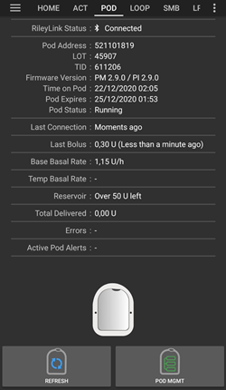
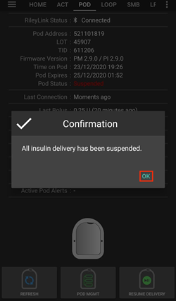
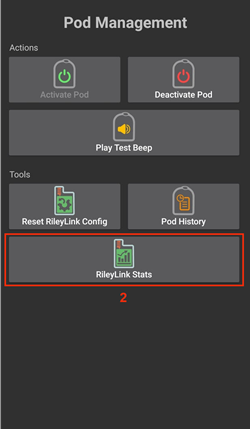
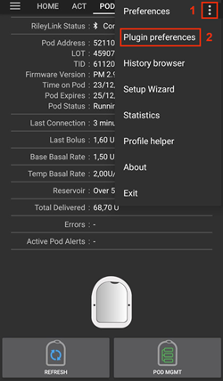
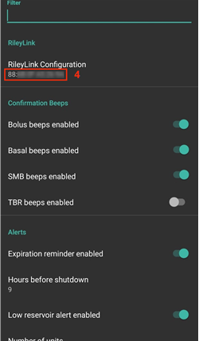

# Omnipod Eros

Estas instruções são para configurar a bomba Omnipod da geração Eros (**NÃO a Omnipod Dash**).

```{admonition} Omnipod Eros is being phased out
:class: note

O [Sistema Omnipod](https://www.omnipod.com/current-podders/resources/omnipod-system) (o Omnipod original, com o Personal Diabetes Manager (PDM) e o Pod) vai deixar de ser fabricado, e a data de fim varia de país para país. Por exemplo, deixa de estar disponível no Canadá depois de 30 de junho de 2026. Se depende da bomba Eros, planeie com antecedência a passagem para uma bomba suportada.
```

**Este software faz parte de uma solução «faça você mesmo» (DIY) de pâncreas artificial. Não é um produto: exige que o PRÓPRIO UTILIZADOR leia, aprenda e compreenda o sistema, incluindo a forma de o usar. Só o utilizador é responsável pelo que faz com ele.**

```{contents} Table of contents
:depth: 1
:local: true
```

## Requisitos de hardware e software

- **Dispositivo de comunicação com o Pod**

> Componente que faz a ponte de comunicação entre o seu telefone com o AAPS e os Pods da geração Eros.
> 
> > -   [Site do OrangeLink](https://getrileylink.org/product/orangelink)
> > -  [RileyLink de 433 MHz](https://getrileylink.org/product/rileylink433)
> > -   [Site do Emalink](https://github.com/sks01/EmaLink) - [Contacto](mailto:getemalink@gmail.com)
> > -   DiaLink - [Contacto](mailto:Boshetyn@ukr.net)
> > -   [Site do LoopLink](https://www.getlooplink.org/) - [Contacto](https://jameswedding.substack.com/) - Não testado

-   **Telemóvel**

> Componente que executa o AAPS e envia comandos de controlo para o dispositivo de comunicação com o Pod.
> 
> > - Um [telefone Android](#Phones-list-of-tested-phones) suportado, com o **AAPS** e os componentes relacionados configurados.

-   **Dispositivo de administração de insulina**

> Componente que interpreta os comandos recebidos do dispositivo de comunicação com o Pod, enviados a partir do seu telefone com o AAPS.
> 
> > - Um novo Pod Omnipod (geração Eros - **NÃO DASH**)

Estas instruções partem do princípio de que vai iniciar uma nova sessão de Pod. Se não for o caso, tenha paciência e comece este processo na próxima troca de Pod.

Nesta página, **RileyLink** significa qualquer um dos dispositivos de comunicação com o Pod indicados acima.

## Antes de começar

**SEGURANÇA EM PRIMEIRO LUGAR** - não faça este processo num ambiente onde não consiga recuperar de um erro (Pods extra, insulina, RileyLink carregado e telefone são obrigatórios).

**O seu PDM Omnipod deixa de funcionar depois de o controlador Omnipod do AAPS ativar o seu Pod**. Antes, usava o seu PDM Omnipod para enviar comandos ao seu Pod Omnipod Eros. Um Pod Omnipod Eros só permite que um único dispositivo comunique com ele. O dispositivo que ativa o Pod com sucesso é, a partir desse momento, o único dispositivo que pode comunicar com ele. Isto significa que, depois de ativar um Pod Omnipod Eros com o seu RileyLink através do controlador Omnipod do AAPS, **já não poderá usar o seu PDM com esse Pod**. O controlador Omnipod do AAPS com o RileyLink passa a ser o seu PDM. *Isto NÃO significa que deve deitar fora o seu PDM. Recomenda-se que o guarde como reserva e para emergências, caso o AAPS não esteja a funcionar corretamente.*

**Só um RileyLink de cada vez pode comunicar com um Pod.** O **AAPS** memoriza um RileyLink emparelhado. Se emparelhar outro, este substitui o anterior.

**O seu Pod não se desliga quando o RileyLink está fora de alcance.** Quando o seu RileyLink está fora de alcance ou o sinal está bloqueado e não consegue comunicar com o Pod ativo, o Pod continua a administrar a insulina basal. Ao ativar um Pod, o perfil basal definido no AAPS é programado no novo Pod. Se perder o contacto com o Pod, ele volta a usar este perfil basal. Não poderá enviar novos comandos até o RileyLink voltar a estar ao alcance e restabelecer a ligação.

**Os perfis basais com intervalos de 30 min NÃO são suportados no AAPS.** Se é novo no AAPS e está a configurar o seu perfil basal pela primeira vez, tenha em atenção que as taxas basais que começam à meia hora não são suportadas. Terá de ajustar o seu perfil basal para começar à hora certa. Por exemplo, se tiver uma taxa basal de 1,1 U que começa às 09:30 e dura 2 horas, terminando às 11:30, isto não vai funcionar.  Terá de mudar esta taxa basal de 1,1 U para o intervalo 9:00–11:00 ou 10:00–12:00.  Apesar de os intervalos de 30 min no perfil basal serem suportados pelo próprio hardware Omnipod, o AAPS ainda não os consegue ter em conta nos seus algoritmos.

## Ativar o controlador Omnipod no AAPS

Pode ativar o controlador Omnipod no AAPS de **duas formas**:

### Opção 1: o Assistente de Configuração

Depois de instalar uma nova versão do AAPS, o **Assistente de Configuração** arranca automaticamente. Se já exportou as suas definições de uma instalação anterior, pode importá-las no assistente. Numa instalação nova, continue abaixo.

Siga o [Assistente de Configuração](../SettingUpAaps/SetupWizard.md) até chegar ao passo **Bomba** e selecione **Omnipod Eros** (a descrição diz «Integração da bomba para Omnipod Eros»).


O Assistente de Configuração não emparelha o seu RileyLink. Depois de terminar o assistente, abra o ecrã da bomba Omnipod e emparelhe-o como descrito na [secção Configuração do RileyLink](#OmnipodEros-rileylink-setup).

**OU**

### Opção 2: O ecrã Configuração

Abra o **menu** (☰) no canto superior esquerdo > **Configuração** > **Bomba** e selecione o **botão de opção** da **Omnipod Eros**.

Depois de selecionada, o cartão **Omnipod Eros** mostra dois botões, **Definições** e **Abrir plugin**:


**Definições** abre as definições do controlador Omnipod (veja [Definições do Omnipod](#OmnipodEros-omnipod-settings)):


**Abrir plugin** abre o ecrã da bomba Omnipod. Também o pode abrir a qualquer momento a partir do ecrã principal com **Gerir** > **Bomba**. Nesta página chamamos-lhe **ecrã da bomba Omnipod**. Antes de emparelhar um RileyLink e de ativar um Pod, o ecrã tem este aspeto:


### Verificar a seleção do controlador Omnipod

Para confirmar que ativou o controlador Omnipod, abra **Gerir** > **Bomba** a partir do ecrã principal. Deve ver o ecrã da bomba **Omnipod Eros** mostrado acima. Se ainda não emparelhou um RileyLink, **Estado do RileyLink** mostra **Não Iniciado** e **Estado do Pod** mostra **Nenhum Pod Ativo**.

## Configuração do Omnipod

Todas as funções do Pod e do RileyLink são botões no [ecrã da bomba Omnipod](#OmnipodEros-omnipod-pod-tab) (**Gerir** > **Bomba**). Alguns botões só aparecem em certas situações, por exemplo quando há um Pod ativo.

>  Atualizar a ligação e o estado do Pod
> 
>  Gestão do Pod (ativar, desativar, reproduzir beep de teste, estatísticas do RileyLink e histórico do Pod)

```{admonition} Older screenshot
:class: note
As capturas de ecrã acima são de uma versão anterior do **AAPS**. No **AAPS** 4 não existe o botão **POD MGMT** nem o menu Gestão do Pod: **Atualizar** e todas as ações de gestão do Pod são botões no ecrã da bomba Omnipod.
```

(OmnipodEros-rileylink-setup)=

### Configuração do RileyLink

Se já emparelhou o seu RileyLink, continue para a [secção Ativar um Pod](#OmnipodEros-activating-a-pod) abaixo.

*Nota: um bom sinal visual de que o RileyLink não está ligado é a falta dos botões de tratamento (barra QuickLaunch) no ecrã principal. Isto também acontece durante cerca dos primeiros 30 segundos depois de o AAPS arrancar, porque está a ligar-se ao RileyLink.*

1. Garanta que o seu RileyLink está totalmente carregado e ligado.

2. Coloque o RileyLink [perto do seu telefone](#OmnipodEros-optimal-omnipod-and-rileylink-positioning) (~30 cm ou menos).

3. Abra o ecrã da bomba Omnipod (**Gerir** > **Bomba**) e prima **Emparelhar RileyLink**.

4. O ecrã **Emparelhar RileyLink** começa logo a procurar dispositivos Bluetooth. Toque no seu RileyLink na lista de dispositivos encontrados.

   

5. Quando aparecer **RileyLink emparelhado com sucesso** com o nome e o endereço do seu dispositivo, prima **OK**.

6. De volta ao ecrã da bomba Omnipod, confirme que **Estado do RileyLink** muda para **Ligado**. **Estado do Pod** deve mostrar **Nenhum Pod Ativo**. Se o RileyLink não se ligar, prima **Repor RileyLink** ou reinicie o **AAPS**.

 

 


```{admonition} Older screenshot
:class: note
As seis capturas de ecrã acima (depois do passo 6) são de uma versão anterior do **AAPS**. No **AAPS** 4, o RileyLink é emparelhado com o botão **Emparelhar RileyLink** no ecrã da bomba Omnipod, em vez de **RileyLink Configuration** nas definições do Omnipod, e a procura começa automaticamente.
```

```{note}
Para trocar para outro RileyLink (por exemplo, um dispositivo de reserva), prima outra vez **Emparelhar RileyLink** e selecione o novo dispositivo. Este substitui o que estava emparelhado antes. Não precisa de remover primeiro o dispositivo antigo.
```

(OmnipodEros-activating-a-pod)=

### Ativar um Pod

Antes de poder ativar um Pod, garanta que o seu RileyLink está emparelhado e que **Estado do RileyLink** mostra **Ligado**. O botão **Ativar Pod** fica desativado até o RileyLink estar pronto.

*LEMBRETE: por medidas de segurança, a comunicação com o Pod para o emparelhamento na ativação só funciona a curta distância. Antes do emparelhamento, o sinal de rádio do Pod é mais fraco; depois de emparelhado, funciona com a potência de sinal máxima. Durante estes procedimentos, garanta que o seu Pod está* [muito perto](#OmnipodEros-optimal-omnipod-and-rileylink-positioning) *(~30 cm ou menos), mas não em cima nem mesmo ao lado do RileyLink.*

01. Abra o ecrã da bomba Omnipod (**Gerir** > **Bomba**) e prima **Ativar Pod**.

    Se nunca ativou um perfil, aparece primeiro o passo **Perfil necessário**. Selecione o perfil a aplicar na ativação.

    >   
    > 
    > ```{admonition} Older screenshot
    >     :class: note
    >     As capturas de ecrã acima são de uma versão anterior do **AAPS**. No **AAPS** 4, **Ativar Pod** é um botão no ecrã da bomba Omnipod, em vez de estar no menu **POD MGMT**.
    > ```

02. É apresentado o ecrã **Encher Pod**. Encha um novo Pod com insulina suficiente para 3 dias e espere ouvir dois beeps. Estes indicam que foi atingida a quantidade mínima de 80 unidades. Esvazie completamente a seringa de enchimento, mesmo depois de ouvir os dois beeps. Ao calcular a quantidade total de insulina de que precisa para 3 dias, tenha em conta que a purga do Pod usa 12 a 15 unidades. Ainda não retire a tampa da agulha do Pod.

    > 
    > 
    > Garanta que o novo Pod e o RileyLink estão muito perto um do outro (~30 cm ou menos) e prima **Seguinte**.

03. **Selecionar insulina** (só aparece se tiver mais do que uma insulina configurada): selecione a insulina com que está a encher o Pod e prima **Seguinte**. Depois da ativação, é aplicada uma troca de perfil com esta insulina.

04. No ecrã **Inicializar Pod**, o Pod começa a purgar (ouve um clique seguido de uma série de tiques enquanto o Pod se purga). Se o RileyLink estiver fora do alcance do Pod que está a ser ativado, recebe a mensagem de erro **Sem resposta do Pod**. Se isto acontecer, [aproxime o RileyLink](#OmnipodEros-optimal-omnipod-and-rileylink-positioning) do Pod (~30 cm ou menos), mas não o coloque em cima nem mesmo ao lado do Pod, e prima **Tentar Novamente**.

    >  

05. Quando a purga é concluída com sucesso, aparece uma marca de verificação verde e o botão **Seguinte** fica ativo. Prima **Seguinte**.

    > 

06. **Local de inserção** (só aparece se **Gerir a rotação dos locais da bomba** estiver ativado em [Rotação dos locais](#Aapsscreens-site-rotation)): selecione o local do corpo onde coloca o Pod e prima **Seguinte**.

07. É apresentado o ecrã **Colocar o Pod**. Prepare o local de infusão do novo Pod. Retire a tampa de plástico da agulha do Pod e o papel branco que protege o adesivo, e coloque o Pod no local do corpo que escolheu. Se a cânula estiver de fora, prima **Cancelar** e descarte o Pod. Quando terminar, prima **Seguinte**.

    > 

08. Aparece uma janela de confirmação: «Quando pressionar OK, a cânula será inserida». **SÓ prima OK quando estiver pronto para inserir a cânula**.

    > 

09. No ecrã **Inserir Cânula**, o Omnipod pode demorar algum tempo a responder e a inserir a cânula (no máximo 1–2 minutos); tenha paciência.

    > Se o RileyLink estiver fora do alcance do Pod que está a ser ativado, recebe a mensagem de erro **Sem resposta do Pod**. Se isto acontecer, aproxime o RileyLink do Pod (~30 cm ou menos), mas não o coloque em cima nem mesmo ao lado do Pod, e prima **Tentar Novamente**.
    > 
    > Se o RileyLink estiver fora do alcance Bluetooth ou não tiver uma ligação ativa ao telefone, recebe a mensagem de erro **Sem resposta do RileyLink**. Se isto acontecer, aproxime o RileyLink do telefone e prima **Tentar Novamente**.
    > 
    > *NOTA: antes de a cânula ser inserida, é boa prática apertar a pele perto do ponto de inserção da cânula. Isto garante uma inserção suave da agulha e diminui o risco de oclusões.*
    > 
    > 
    > 
    >  

10. Quando a cânula é inserida com sucesso, aparece uma marca de verificação verde e o botão **Seguinte** fica ativo. Prima **Seguinte**.

    > 

11. É apresentado o ecrã **Pod Ativado**. Verifique se a cânula foi inserida corretamente e troque o Pod se achar que não foi. Prima **Concluir**. Parabéns! Iniciou agora uma nova sessão de Pod ativo.

    >  
    > 
    > ```{admonition} Older screenshot
    >     :class: note
    >     As capturas de ecrã dos passos 2 a 11 são de uma versão anterior do **AAPS** e podem ser diferentes no **AAPS** 4. Os passos **Selecionar insulina** e **Local de inserção** não aparecem nas imagens.
    > ```

12. Volta ao ecrã da bomba Omnipod. O botão **Ativar Pod** é substituído por **Desativar Pod**, porque não pode ativar outro Pod sem primeiro desativar o Pod ativo.

    O ecrã da bomba mostra agora informação sobre o seu Pod ativo, incluindo a taxa basal atual, o nível do reservatório, a insulina administrada, os erros e os alertas do Pod. Para mais detalhes, veja a secção [Ecrã da bomba Omnipod](#OmnipodEros-omnipod-pod-tab).

     

    ```{admonition} Older screenshot
    :class: note
    As capturas de ecrã acima são de uma versão anterior do **AAPS**. No **AAPS** 4 não existe o menu Gestão do Pod: volta diretamente ao ecrã da bomba Omnipod, onde **Desativar Pod** substitui **Ativar Pod**.
    ```

```{note}
Se a ativação foi interrompida depois da purga (por exemplo, porque a app foi fechada), prima outra vez **Ativar Pod**. O assistente continua a partir dos passos de inserção da cânula.
```

### Desativar um Pod

Em condições normais, um Pod deve durar três dias (72 horas) e mais 8 horas depois do aviso de expiração do Pod, num total de 80 horas de uso do Pod.

Para desativar um Pod (por ter expirado ou por uma falha do Pod):

1. Abra o ecrã da bomba Omnipod (**Gerir** > **Bomba**) e prima **Desativar Pod**.

   >   
   > 
   > ```{admonition} Older screenshot
   >    :class: note
   >    As capturas de ecrã acima são de uma versão anterior do **AAPS**. No **AAPS** 4, **Desativar Pod** é um botão no ecrã da bomba Omnipod, em vez de estar no menu **POD MGMT**.
   > ```

2. No ecrã **Desativar Pod**, garanta primeiro que o RileyLink está muito perto do Pod, mas não em cima nem mesmo ao lado do Pod. Depois prima **Seguinte**. Uma janela pergunta *Um Pod desativado não pode voltar a ser usado. Desativar este Pod agora?* Prima **OK** para começar a desativar o Pod, ou **Cancelar** para o manter. A desativação suspende toda a administração de insulina e não pode ser anulada.

   > 

3. Aparece o ecrã **A Desativar Pod** e o Pod emite um beep de confirmação de que a desativação teve sucesso.

   > 
   > 
   > **SE a desativação falhar** e não ouvir o beep de confirmação, pode receber a mensagem **Sem resposta do RileyLink** ou **Sem resposta do Pod**. Prima **Tentar Novamente** para tentar desativar outra vez. Se a desativação continuar a falhar, prima **Descartar Pod** e confirme. O **AAPS** esquece então o Pod. A administração de insulina **não** foi suspensa; por isso, retire o Pod do corpo. Se o seu Pod tiver um alarme contínuo, pode ter de o silenciar manualmente (com um alfinete ou um clipe), porque **Descartar Pod** não o silencia.
   > 
   > >   

4. Quando a desativação tem sucesso, aparece uma marca de verificação verde. Prima **Seguinte** para ver o ecrã **Pod Desativado**. Pode agora retirar o seu Pod, porque a sessão ativa foi desativada.

   > 

5. Prima **Concluir** para voltar ao ecrã da bomba Omnipod.

   >  
   > 
   > ```{admonition} Older screenshot
   >    :class: note
   >    As capturas de ecrã dos passos 2 a 5 são de uma versão anterior do **AAPS** e podem ser diferentes no **AAPS** 4.
   > ```

6. No ecrã da bomba Omnipod, confirme que **Estado do RileyLink** mostra **Ligado** e que **Estado do Pod** mostra **Nenhum Pod Ativo**.

   >    
   > 
   > ```{admonition} Older screenshot
   >    :class: note
   >    As capturas de ecrã acima são de uma versão anterior do **AAPS**. No **AAPS** 4, **Concluir** leva-o diretamente ao ecrã da bomba Omnipod; não existe o menu Gestão do Pod nem o separador **Omnipod (POD)**.
   > ```

### Suspender e retomar a administração de insulina

O processo abaixo mostra como suspender e retomar a administração de insulina.

*NOTA - se não vir o botão **Suspender***, é porque está oculto por predefinição. Ative **Mostrar Botão Suspender Administração no separador Omnipod** nas [definições do Omnipod](#OmnipodEros-omnipod-settings), em **Outro**.

#### Suspender a administração de insulina

Use este comando para pôr o Pod ativo num estado suspenso. Neste estado suspenso, o Pod deixa de administrar insulina. Este comando imita a função de suspensão que o PDM Omnipod original envia a um Pod ativo.

1. Abra o ecrã da bomba Omnipod (**Gerir** > **Bomba**) e prima **Suspender**. O comando de suspensão é enviado através do RileyLink para o Pod ativo.

2. Quando o Pod tiver suspendido toda a administração de insulina, **Estado do Pod** mostra **Suspenso** e o botão **Suspender** é substituído por **Retomar Administração**.

   >  
   > 
   > 
   > 
   >  
   > 
   > ```{admonition} Older screenshot
   >    :class: note
   >    As capturas de ecrã acima são de uma versão anterior do **AAPS**. No **AAPS** 4, estes passos acontecem no ecrã da bomba Omnipod, em vez do separador **Omnipod (POD)**, e o resultado aparece em **Estado do Pod**.
   > ```

Se o comando falhar, uma janela **Aviso** mostra «Falha ao suspender a administração» com o motivo. Verifique a ligação do RileyLink e tente outra vez.

#### Retomar a administração de insulina

Use este comando para dar ao Pod ativo, que está suspenso, a ordem de retomar a administração de insulina. Depois de o comando ser processado com sucesso, a insulina volta a ser administrada normalmente, com a taxa basal atual do perfil basal ativo para a hora atual. O Pod volta a aceitar comandos de bólus, basal temporária e SMB.

1. Abra o ecrã da bomba Omnipod e confirme que **Estado do Pod** mostra **Suspenso**. Prima **Retomar Administração**.

2. Quando o comando tem sucesso, **Estado do Pod** volta a mostrar **A correr** e o botão **Retomar Administração** desaparece (o botão **Suspender** volta a aparecer, se o tiver ativado).

   >  
   > 
   > 
   > 
   >  
   > 
   > ```{admonition} Older screenshot
   >    :class: note
   >    As capturas de ecrã acima são de uma versão anterior do **AAPS**. No **AAPS** 4, estes passos acontecem no ecrã da bomba Omnipod, em vez do separador **Omnipod (POD)**, e o resultado aparece em **Estado do Pod**.
   > ```

Se o comando falhar, uma janela **Aviso** mostra «Falha ao retomar a administração» com o motivo. Verifique a ligação do RileyLink e tente outra vez.

### Silenciar os alertas do Pod

*NOTA - O botão **Silenciar Alertas** só aparece no ecrã da bomba Omnipod quando o Pod tem um alerta ativo (por exemplo, o alerta de expiração do Pod ou de reservatório baixo) e só se **Silenciar automaticamente alertas do Pod** estiver desativado.*

O processo abaixo mostra como silenciar os beeps do Pod que começam quando o Pod chega à hora de aviso antes de expirar. Esta hora de aviso é definida com **Alerta horas antes de desligar (80 horas)** nas definições **Alertas** do Omnipod. A vida máxima de um Pod é de 80 horas (3 dias e 8 horas), mas a Insulet recomenda não ultrapassar o limite de 72 horas (3 dias).

*NOTA - Se ativou **Silenciar automaticamente alertas do Pod** nas definições **Alertas** do Omnipod, o **AAPS** silencia o alerta automaticamente na comunicação seguinte com o Pod e NÃO precisa de o fazer manualmente.*

1. Quando chega a hora de aviso, o Pod emite beeps para avisar que vai expirar em breve e que tem de ser trocado. No ecrã da bomba Omnipod, **Pod Expira** mostra a hora exata em que o Pod expira (72 horas depois da ativação); fica **amarelo** 4 horas antes. **Fim definitivo do Pod** mostra quando o Pod deixa de administrar insulina. **Alertas Pod Ativos** mostra **Pod vai expirar em breve** e aparece o botão **Silenciar Alertas**. O **AAPS** mostra também uma notificação sobre a expiração próxima do Pod.

   >   
   > 
   > ```{admonition} Older screenshot
   >    :class: note
   >    As capturas de ecrã acima são de uma versão anterior do **AAPS**. No **AAPS** 4, o botão **ACK ALERTS** chama-se **Silenciar Alertas** e está no ecrã da bomba Omnipod.
   > ```

2. Prima **Silenciar Alertas**. O RileyLink envia ao Pod o comando para parar os beeps de aviso de expiração.

   >  
   > 
   > ```{admonition} Older screenshot
   >    :class: note
   >    A captura de ecrã acima é de uma versão anterior do **AAPS**. No **AAPS** 4, o botão chama-se **Silenciar Alertas**.
   > ```

3. Quando os alertas são silenciados, o Pod emite dois beeps. **Alertas Pod Ativos** deixa de mostrar o aviso, o botão **Silenciar Alertas** desaparece e o Pod para os beeps de aviso de expiração.

   >  
   > 
   > ```{admonition} Older screenshot
   >    :class: note
   >    A captura de ecrã acima é de uma versão anterior do **AAPS**. No **AAPS** 4, o resultado aparece no ecrã da bomba Omnipod: o aviso desaparece de **Alertas Pod Ativos**.
   > ```

Se o comando falhar (por exemplo, se o RileyLink estiver fora do alcance do Pod), uma janela **Aviso** mostra «Falha ao silenciar alertas» com o motivo. Aproxime o RileyLink do Pod e tente outra vez.


```{admonition} Older screenshot
:class: note
A captura de ecrã acima é de uma versão anterior do **AAPS**. No **AAPS** 4, a janela **Aviso** mostra «Falha ao silenciar alertas» com o motivo.
```

(OmnipodEros-view-pod-history)=

### Ver o histórico do Pod

Esta secção mostra como consultar o histórico do Pod ativo e filtrá-lo por diferentes categorias de ações. A ferramenta de histórico do Pod permite ver as ações enviadas ao seu Pod ativo, e os seus resultados, durante a vida de três dias (72–80 horas) do Pod.

Esta função é útil para verificar bólus, basais temporárias e alterações da basal que foram enviados, mas em que não tem a certeza de que foram concluídos. As restantes categorias são úteis, em geral, para resolver problemas e para saber a ordem dos eventos que levaram a uma falha.

*NOTA:* Os comandos **incertos** aparecem no histórico do Pod, mas, pela sua natureza, não é possível garantir que estejam corretos.

1. Abra o ecrã da bomba Omnipod (**Gerir** > **Bomba**) e prima **Histórico do Pod**.

   >   
   > 
   > ```{admonition} Older screenshot
   >    :class: note
   >    As capturas de ecrã acima são de uma versão anterior do **AAPS**. No **AAPS** 4, **Histórico do Pod** é um botão no ecrã da bomba Omnipod, em vez de estar no menu **POD MGMT**.
   > ```

2. O ecrã **Histórico do Pod** lista todas as ações do Pod e os seus resultados, das mais recentes para as mais antigas, agrupadas por dia. Por predefinição, está selecionado **Tudo**. Toque num dos botões de filtro no topo para mostrar só uma categoria. Use a seta para trás no canto superior esquerdo para voltar ao ecrã da bomba Omnipod.

   > 

   >  
   > 
   > ```{admonition} Older screenshot
   >    :class: note
   >    A segunda captura de ecrã é de uma versão anterior do **AAPS** e pode ser diferente no **AAPS** 4.
   > ```

### Ver as definições e o histórico do RileyLink

O ecrã **Estatísticas do RileyLink** mostra as definições do seu RileyLink e do Pod ativo, e o histórico de comunicação de ambos. Tem dois separadores: **Definições** e **Histórico**.

O botão **Estatísticas do RileyLink** está oculto por predefinição. Para o mostrar no ecrã da bomba Omnipod, ative **Mostrar botão de Estatísticas do RileyLink no menu de Gestão do Pod** nas [definições do Omnipod](#OmnipodEros-omnipod-settings), em **Outro**.

#### Restabelecer manualmente a ligação Bluetooth do dispositivo de comunicação com o Pod

Se o seu dispositivo de comunicação com o Pod esteve algum tempo fora do alcance Bluetooth do telefone, **Estado do RileyLink** pode mostrar **RileyLink inacessível** no ecrã da bomba Omnipod. Normalmente, o **AAPS** volta a ligar-se sozinho quando o dispositivo volta a estar ao alcance. Se isso não acontecer:

1. Garanta que o RileyLink está ligado, carregado e perto do seu telefone.

2. No ecrã da bomba Omnipod, prima **Repor RileyLink**. Uma mensagem confirma **Configuração do RileyLink reposta**. Veja as [notas sobre Repor RileyLink](#OmnipodEros-reset-rileylink-config-notes) abaixo.

3. Se a **ligação Bluetooth** não for restabelecida, experimente **desligar** e voltar a **ligar** manualmente o Bluetooth do seu telefone.

4. Se mesmo assim não voltar a ligar-se, prima **Emparelhar RileyLink** e selecione outra vez o seu RileyLink.

5. Depois de voltar a ligar-se com sucesso, **Estado do RileyLink** mostra **Ligado**. Também pode verificar **Estado de Ligação** no separador **Definições** do ecrã **Estatísticas do RileyLink**. Parabéns, voltou a ligar ao AAPS o seu dispositivo de comunicação com o Pod!

 


```{admonition} Older screenshot
:class: note
As capturas de ecrã acima são de uma versão anterior do **AAPS**. No **AAPS** 4, volta a ligar com **Repor RileyLink** ou **Emparelhar RileyLink** no ecrã da bomba Omnipod, em vez do botão de atualizar no ecrã de definições do RileyLink.
```

#### Definições do dispositivo de comunicação com o Pod e do Pod ativo

Este ecrã mostra informação e estado do dispositivo de comunicação com o Pod emparelhado e do Pod Omnipod Eros ativo. A informação é atualizada automaticamente.

1. Abra o ecrã da bomba Omnipod (**Gerir** > **Bomba**) e prima **Estatísticas do RileyLink**. O separador **Definições** mostra o **RileyLink** emparelhado e o Pod ativo (**Dispositivo**).

   >   
   > 
   > ```{admonition} Older screenshot
   >    :class: note
   >    As capturas de ecrã acima são de uma versão anterior do **AAPS**. No **AAPS** 4, **Estatísticas do RileyLink** é um botão no ecrã da bomba Omnipod, em vez de estar no menu **POD MGMT**.
   > ```

   > 

##### Campos do RileyLink

> - **Endereço:** endereço MAC do dispositivo de comunicação com o Pod emparelhado.
> - **Nome:** nome Bluetooth do dispositivo de comunicação com o Pod emparelhado.
> - **Nível da Bateria:** o nível atual da bateria do dispositivo de comunicação com o Pod ligado. Só aparece quando **Mostrar o nível de bateria reportado pelo OrangeLink/EmaLink/DiaLink** está ativado.
> - **Estado de Ligação**: o estado atual da ligação Bluetooth entre o dispositivo de comunicação com o Pod e o telefone com o AAPS.
> - **Erro de Ligação:** se houver um erro na ligação Bluetooth do dispositivo de comunicação com o Pod, os detalhes aparecem aqui.
> - **Versão do Firmware:** versão do firmware instalada no dispositivo de comunicação com o Pod que está ligado.

##### Campos do dispositivo - com um Pod ativo

> - **Tipo de dispositivo:** o tipo de dispositivo que comunica com o dispositivo de comunicação com o Pod (Omnipod (Eros)).
> - **Modelo de Dispositivo Configurado:** o modelo do dispositivo configurado para comunicar com o dispositivo de comunicação com o Pod.
> - **Modelo de Dispositivo Ligado:** o modelo do dispositivo que está a comunicar com o dispositivo de comunicação com o Pod.
> - **Número de série da Bomba:** número de série do Pod ativado.
> - **Frequência da Bomba:** frequência de rádio usada para comunicar com o Pod.
> - **Última Frequência Usada:** a última frequência de rádio conhecida que o Pod usou para comunicar com o dispositivo de comunicação com o Pod.
> - **Último Contacto do Dispositivo:** data e hora do último contacto do Pod com o dispositivo de comunicação com o Pod.

(omnipod-eros-rileylink-and-active-pod-history)=
#### Histórico do RileyLink e do Pod ativo

Este separador lista, dos mais recentes para os mais antigos, cada estado ou ação do RileyLink ou do Pod ligado. O histórico só está disponível para o Pod ativo. Depois de uma troca de Pod, este histórico é apagado e só são registados e mostrados os eventos do Pod acabado de ativar.

1. Abra o ecrã da bomba Omnipod (**Gerir** > **Bomba**), prima **Estatísticas do RileyLink** e depois toque no separador **Histórico**.

   >   
   > 
   > ```{admonition} Older screenshot
   >    :class: note
   >    As capturas de ecrã acima são de uma versão anterior do **AAPS**. No **AAPS** 4, **Estatísticas do RileyLink** é um botão no ecrã da bomba Omnipod, em vez de estar no menu **POD MGMT**.
   > ```

   > 

##### Campos

Cada entrada mostra:

> - **Dispositivo:** o dispositivo a que a ação ou o estado se refere.
> - **Hora:** a hora do evento.
> - **Estado ou ação:** o estado do dispositivo ou a ação que ele fez.

(OmnipodEros-omnipod-pod-tab)=

## Ecrã da bomba Omnipod

Segue-se uma explicação dos campos de estado e dos botões do **ecrã da bomba Omnipod** (**Gerir** > **Bomba**, ou **Configuração** > **Bomba** > **Abrir plugin**).

O ícone da roda dentada no canto superior direito abre as [definições do Omnipod](#OmnipodEros-omnipod-settings).

*NOTA: se algum campo de estado mostrar (incerto), prima **Atualizar** para atualizar o estado do Pod e o limpar.*


```{admonition} Older screenshot
:class: note
A captura de ecrã acima é de uma versão anterior do **AAPS**, em que este ecrã era o separador **Omnipod (POD)**. No **AAPS** 4 é o ecrã da bomba Omnipod, e alguns nomes de campos e botões são diferentes.
```

### Campos

- **Estado do RileyLink:** mostra o estado atual da ligação do RileyLink. Os erros aparecem a vermelho.

- *Não Iniciado* - ainda não há nenhum RileyLink emparelhado, ou a ligação ainda não começou.
- *RileyLink inacessível* - o dispositivo de comunicação com o Pod está fora do alcance Bluetooth do telefone, está desligado ou tem uma falha que impede a comunicação por Bluetooth.
- *RileyLink pronto* - o dispositivo de comunicação com o Pod está ligado e a iniciar a ligação Bluetooth.
- *Ligado* - o dispositivo de comunicação com o Pod está ligado, conectado e pode comunicar por Bluetooth.

- **ID Único:** mostra o endereço do Pod ativo.

- **Número de LOTE:** mostra o número de LOTE do Pod ativo.

- **Número da Sequência:** mostra o número de série (TID) do Pod.

- **Versão do Firmware:** mostra a versão do firmware do Pod ativo.

- **Hora no Pod:** mostra a hora atual no Pod ativo. Fica destacado quando difere da hora do telefone em mais de 5 minutos.

- **Pod Expira:** mostra a data e a hora em que o Pod ativo vai expirar. O texto fica amarelo nas últimas 4 horas antes desta hora. Nunca fica vermelho, porque o Pod continua a administrar insulina depois disso.

- **Fim definitivo do Pod:** mostra o fim do período de tolerância do Pod (8 horas depois de **Pod Expira**, para uma vida máxima do Pod de 80 horas). O texto fica amarelo quando começa o período de tolerância (em **Pod Expira**) e vermelho nas últimas 4 horas antes do fim definitivo. Durante o período de tolerância, mostra também o tempo que falta, por exemplo *(17m remaining)*. O Pod para de administrar insulina no fim definitivo e tem de ser mudado.

- **Estado do Pod:** mostra o estado do Pod ativo (por exemplo, **Nenhum Pod Ativo**, **A correr** ou **Suspenso**).

- **Última Ligação:** mostra a última vez que houve comunicação com o Pod ativo. O texto fica vermelho quando o [limiar de bomba inacessível](#OmnipodEros-troubleshooting) é ultrapassado.

- *Momentos atrás* - há menos de 20 segundos.
- *Há menos de um minuto* - há mais de 20 segundos, mas menos de 60 segundos.
- *Há 1 minuto* - há mais de 60 segundos, mas menos de 120 segundos (2 min)
- *Há XX minutos* - há mais de 2 minutos, com o valor indicado por XX

- **Último Bólus:** mostra a dose do último bólus enviado ao Pod ativo e, entre parênteses, há quanto tempo foi enviado.

- **Taxa Basal do Perfil:** mostra a taxa basal programada para a hora atual no perfil basal.

- **Taxa basal temporária:** só aparece enquanto está a decorrer uma basal temporária. Mostra-a no formato seguinte:

- Unidades/hora @ hora em que a basal temporária foi enviada (minutos decorridos / total de minutos da basal temporária)
- *Exemplo:* 0.00U/h @18:25 ( 90/120 minutos)

- **Reservatório:** mostra **Mais de 50 U restantes** quando restam mais de 50 unidades no reservatório. Abaixo deste valor, mostra o número aproximado de unidades. O texto fica vermelho abaixo do limite de reservatório baixo definido nas [definições de Alertas](#OmnipodEros-omnipod-settings).

- **Total Administrado:** mostra o número total de unidades de insulina administradas a partir do reservatório. *Note que isto é uma aproximação, porque a purga e o enchimento do Pod não são processos exatos.*

- **Alertas Pod Ativos:** reservado para os alertas que estão a decorrer no Pod ativo. Normalmente usado quando o Pod já passou das 72 horas e os alertas sonoros (beeps) do próprio Pod estão a tocar.

- **Erros:** mostra o último erro que ocorreu (a vermelho). Consulte o [histórico do Pod](#OmnipodEros-view-pod-history), o [histórico do RileyLink](#omnipod-eros-rileylink-and-active-pod-history) e os ficheiros de registo para ver erros anteriores e informação mais detalhada.

### Botões

Os botões na parte de baixo do ecrã da bomba mudam conforme a situação. Os botões que não podem ser usados no momento aparecem a cinzento, por exemplo enquanto o RileyLink não está ligado.

**Botões do estado do Pod** (aparecem quando há um Pod ativo):

- **Atualizar:** envia um comando de atualização ao Pod ativo para atualizar o seu estado. Use-o para atualizar o estado do Pod e limpar os campos de estado que têm o texto (incerto). Veja a [secção Resolução de problemas](#OmnipodEros-troubleshooting) abaixo para mais informação.

  

  ```{admonition} Older screenshot
  :class: note
  A captura de ecrã acima é de uma versão anterior do **AAPS**. No **AAPS** 4, é um botão de texto chamado **Atualizar** no ecrã da bomba Omnipod.
  ```

- **Silenciar Alertas:** silencia os beeps e as notificações de expiração do Pod e de reservatório baixo. Só aparece quando o Pod tem um alerta ativo e **Silenciar automaticamente alertas do Pod** está desativado. Depois de os alertas serem silenciados, o botão desaparece.

  

  ```{admonition} Older screenshot
  :class: note
  A captura de ecrã acima é de uma versão anterior do **AAPS**. No **AAPS** 4, este botão chama-se **Silenciar Alertas**.
  ```

- **Definir hora:** atualiza a hora no Pod com a hora atual do seu telefone. Só aparece quando a hora no Pod difere da hora do telefone em mais de 5 minutos.

  

  ```{admonition} Older screenshot
  :class: note
  A captura de ecrã acima é de uma versão anterior do **AAPS**. No **AAPS** 4, é um botão de texto chamado **Definir hora** no ecrã da bomba Omnipod.
  ```

- **Suspender:** suspende a administração de insulina no Pod ativo. Só aparece se estiver ativado nas definições (**Mostrar Botão Suspender Administração no separador Omnipod**).

  

  ```{admonition} Older screenshot
  :class: note
  A captura de ecrã acima é de uma versão anterior do **AAPS**. No **AAPS** 4, é um botão de texto chamado **Suspender** no ecrã da bomba Omnipod.
  ```

- **Retomar Administração:** retoma a administração de insulina no Pod ativo que está suspenso. Só aparece enquanto o Pod está suspenso.

  

  ```{admonition} Older screenshot
  :class: note
  A captura de ecrã acima é de uma versão anterior do **AAPS**. No **AAPS** 4, é um botão de texto chamado **Retomar Administração** no ecrã da bomba Omnipod.
  ```

**Botões de gestão do Pod e do RileyLink:**


```{admonition} Older screenshot
:class: note
A captura de ecrã acima é de uma versão anterior do **AAPS**. No **AAPS** 4 não existe o menu Gestão do Pod: estas ações são botões diretamente no ecrã da bomba Omnipod.
```

- **Ativar Pod:** purga e ativa um novo Pod. Aparece quando não há nenhum Pod ativo. Só está ativo quando o RileyLink está ligado.

  

  ```{admonition} Older screenshot
  :class: note
  A captura de ecrã acima é de uma versão anterior do **AAPS**. No **AAPS** 4, **Ativar Pod** é um botão no ecrã da bomba Omnipod, em vez de estar no menu Gestão do Pod.
  ```

- **Desativar Pod:** desativa o Pod ativo. Aparece logo que um Pod esteja emparelhado, também quando uma ativação parou a meio (por exemplo, porque o Pod falhou durante a ativação). Só está ativo quando o RileyLink está ligado. O **AAPS** pede-lhe confirmação antes de desativar o Pod.

- Use este comando para desativar um Pod que está a apitar sem parar («screamer», erro 49).
- Se a desativação falhar, o assistente de desativação oferece a opção **Descartar Pod**.

  

  ```{admonition} Older screenshot
  :class: note
  A captura de ecrã acima é de uma versão anterior do **AAPS**. No **AAPS** 4, **Desativar Pod** é um botão no ecrã da bomba Omnipod, em vez de estar no menu Gestão do Pod.
  ```

- **Reproduzir Teste do Beep:** o Pod emite um único beep de teste quando o botão é premido. Aparece quando há um Pod emparelhado.

  

  ```{admonition} Older screenshot
  :class: note
  A captura de ecrã acima é de uma versão anterior do **AAPS**. No **AAPS** 4, **Reproduzir Teste do Beep** é um botão no ecrã da bomba Omnipod, em vez de estar no menu Gestão do Pod.
  ```

- **Histórico do Pod:** mostra o histórico de atividade do Pod ativo. Veja [Ver o histórico do Pod](#OmnipodEros-view-pod-history).

  

  ```{admonition} Older screenshot
  :class: note
  A captura de ecrã acima é de uma versão anterior do **AAPS**. No **AAPS** 4, **Histórico do Pod** é um botão no ecrã da bomba Omnipod, em vez de estar no menu Gestão do Pod.
  ```

- **Emparelhar RileyLink:** procura o seu dispositivo de comunicação com o Pod e emparelha-o. Veja [Configuração do RileyLink](#OmnipodEros-rileylink-setup).

- **Estatísticas do RileyLink:** abre o ecrã Estatísticas do RileyLink, com dois separadores. Só aparece se estiver ativado nas definições (**Mostrar botão de Estatísticas do RileyLink no menu de Gestão do Pod**).

- **Definições** - mostra as informações das definições do RileyLink e do Pod ativo
- **Histórico** - mostra o histórico de comunicação do RileyLink e do Pod

  

  ```{admonition} Older screenshot
  :class: note
  A captura de ecrã acima é de uma versão anterior do **AAPS**. No **AAPS** 4, **Estatísticas do RileyLink** é um botão no ecrã da bomba Omnipod, em vez de estar no menu Gestão do Pod.
  ```

- **Repor RileyLink:** repõe a configuração do dispositivo de comunicação com o Pod que está ligado. Quando a comunicação começa, são enviados e definidos no RileyLink dados específicos:

- São definidos os registos de memória
- São definidos os protocolos de comunicação
- É definida a frequência de rádio sintonizada
  > 
  > Veja as [notas adicionais](#OmnipodEros-reset-rileylink-config-notes) abaixo.

  

  ```{admonition} Older screenshot
  :class: note
  A captura de ecrã acima é de uma versão anterior do **AAPS**. No **AAPS** 4, este botão chama-se **Repor RileyLink** e está no ecrã da bomba Omnipod.
  ```

- **Descartar Pod:** descarta o estado de um Pod que não responde, depois de uma confirmação. Só aparece quando um Pod foi iniciado mas não ficou totalmente emparelhado, porque já não é possível desativá-lo corretamente:

- Um **Pod não está totalmente emparelhado** e, por isso, ignora os comandos de desativação.
- Um **Pod fica bloqueado** entre passos durante o processo de emparelhamento.
- Um **Pod simplesmente não emparelha.**
  > 
  > Depois de descartar um Pod, o **AAPS** já não consegue comunicar com ele. Retire o Pod do corpo.

  

  ```{admonition} Older screenshot
  :class: note
  A captura de ecrã acima é de uma versão anterior do **AAPS**. No **AAPS** 4, **Descartar Pod** é um botão no ecrã da bomba Omnipod, em vez de estar no menu Gestão do Pod.
  ```

(OmnipodEros-reset-rileylink-config-notes)=

#### *Notas sobre Repor RileyLink*

- Esta função usa-se sobretudo quando o dispositivo de comunicação com o Pod ativo não responde e a comunicação está bloqueada.
- Se o dispositivo de comunicação com o Pod for desligado e voltar a ser ligado, prima **Repor RileyLink** para que estes parâmetros de comunicação voltem a ser definidos no dispositivo de comunicação com o Pod.
- Se isto NÃO for feito, terá de reiniciar o AAPS depois de desligar e voltar a ligar o dispositivo de comunicação com o Pod.
- **NÃO** precisa de premir este botão quando troca entre diferentes dispositivos de comunicação com o Pod.

(OmnipodEros-omnipod-settings)=

## Definições do Omnipod

Para abrir as definições do controlador Omnipod, pode:

- premir o ícone da roda dentada no canto superior direito do ecrã da bomba Omnipod (**Gerir** > **Bomba**), ou
- abrir o **menu** (☰) no canto superior esquerdo > **Configuração** > **Bomba** e premir **Definições** no cartão **Omnipod Eros**.



```{admonition} Older screenshot
:class: note
A captura de ecrã acima é de uma versão anterior do **AAPS**. No **AAPS** 4, abre as definições com **Definições** no cartão **Omnipod Eros** ou com o ícone da roda dentada no ecrã da bomba Omnipod, em vez da roda dentada das definições em **Configuração** ou do menu de 3 pontos.
```

As definições estão agrupadas como se indica abaixo. Toque num grupo para o expandir. A maior parte das opções são interruptores que pode ativar ou desativar:


*NOTA: um asterisco (\*) indica que a definição está ativada por predefinição.*

### RileyLink

Definições do dispositivo de comunicação com o Pod. O próprio dispositivo é emparelhado com o botão **Emparelhar RileyLink** no ecrã da bomba (veja [Configuração do RileyLink](#OmnipodEros-rileylink-setup)).

- **Usar Pesquisa:** faz uma procura antes de ligar ao OrangeLink. Isto pode melhorar as ligações. Também pode ser usado com outros clones do RileyLink, se necessário.

- **Mostrar o nível de bateria reportado pelo OrangeLink/EmaLink/DiaLink:** indica o nível real da bateria do OrangeLink/EmaLink/DiaLink. Recomenda-se **vivamente** que todos os utilizadores de OrangeLink/EmaLink/DiaLink ativem esta definição.

- NÃO funciona com o RileyLink original.
- Pode não funcionar com alternativas ao RileyLink.
- Ativado - mostra o nível atual da bateria dos dispositivos de comunicação com o Pod suportados.
- Desativado - mostra o valor n/a.

- **Ativar o registo de mudança da bateria em Ações:** só está disponível quando a definição de indicação da bateria acima está ativada. Alguns dispositivos de comunicação com o Pod podem usar pilhas normais que pode trocar. Com esta definição ativada, pode registar uma **Troca Bateria Bomba** como [registo do Careportal](#aaps-screens-careportal), para anotar a troca e repor a idade da bateria.

### Beeps de Confirmação

O Pod emite beeps de confirmação quando administra ou altera bólus, basal, SMB e basal temporária.

- **\*Beeps de bólus ativados:** ativa ou desativa os beeps de confirmação quando é administrado um bólus.
- **Beeps de basal ativados:** ativa ou desativa os beeps de confirmação quando é definida uma nova taxa basal, quando a taxa basal ativa é cancelada ou quando a taxa basal atual é alterada.
- **\*Beeps SMB ativados:** ativa ou desativa os beeps de confirmação quando é administrado um SMB.
- **Beeps de basal temporária ativados:** ativa ou desativa os beeps de confirmação quando uma basal temporária é definida ou cancelada.

### Alertas

Dá alertas no AAPS e anúncios no Nightscout sobre a expiração do Pod, o desligar do Pod e o reservatório baixo, com base no limite de unidades definido.

*Note que o AAPS mostra SEMPRE uma notificação para qualquer alerta, após a primeira comunicação com o Pod depois de o alerta ter começado. Fechar a notificação NÃO silencia o alerta, A NÃO SER QUE **Silenciar automaticamente alertas do Pod** esteja ativado. Para silenciar o alerta MANUALMENTE, abra o ecrã da bomba Omnipod e prima **Silenciar Alertas**.*

- **\*Lembrete de expiração ativado:** quando está ativado, o Pod emite beeps quando chega a hora definida abaixo.
- **Alerta horas antes de desligar (80 horas):** o número de horas antes de o Pod se desligar (80 horas depois da ativação) em que o lembrete de expiração é dado (1 a 8 horas, predefinição 8).
- **\*Alerta de reservatório baixo ativado:** ativa ou desativa um alerta quando as unidades restantes no Pod chegam ao limite de reservatório baixo definido no campo N.º de unidades.
- **N.º de unidades:** o número de unidades em que é dado o alerta de reservatório baixo do Pod (5 a 50, predefinição 20).
- **Silenciar automaticamente alertas do Pod:** quando está ativado, continua a aparecer uma notificação, mas o alerta é silenciado automaticamente na comunicação seguinte com o Pod depois de o alerta ter começado.

### Notificações

Dá notificações no AAPS e alertas sonoros no telefone quando não há certeza de que uma basal temporária, um SMB ou um bólus foram feitos com sucesso.

*NOTA: são apenas notificações; o Pod não emite alertas sonoros (beeps).*

- **\*Som ativado para notificações de basal temporária incerta:** ative ou desative esta definição para ter um alerta sonoro e uma notificação visual quando o AAPS não tem a certeza de que uma basal temporária foi definida com sucesso.
- **\*Som ativado para notificações de SMB incerto:** ative ou desative esta definição para ter um alerta sonoro e uma notificação visual quando o AAPS não tem a certeza de que um SMB foi administrado com sucesso.
- **\*Som ativado para notificações de bólus incerto:** ative ou desative esta definição para ter um alerta sonoro e uma notificação visual quando o AAPS não tem a certeza de que um bólus foi administrado com sucesso.

### Outro

Dá acesso a definições avançadas para ajudar a depurar erros.

- **Mostrar Botão Suspender Administração no separador Omnipod:** oculta ou mostra o botão **Suspender** no ecrã da bomba Omnipod.
- **Mostrar botão de Pulse Log no menu de Gestão do Pod:** esta definição ainda aparece na lista, mas a versão atual do ecrã da bomba não tem o botão **Pulse Log**.

- **Mostrar botão de Estatísticas do RileyLink no menu de Gestão do Pod:** oculta ou mostra o botão **Estatísticas do RileyLink** no ecrã da bomba Omnipod.
- **\*Deteção de DST/Fuso Horário Ativado:** permite detetar automaticamente as mudanças de fuso horário se o telefone for usado numa região com hora de verão (DST).

### Trocar ou remover um dispositivo de comunicação com o Pod ativo (RileyLink)

Como existem muitos modelos alternativos ao RileyLink original (como o OrangeLink ou o EmaLink), ou pode precisar de vários dispositivos de comunicação com o Pod iguais, ou de reserva, pode ter de trocar para outro dispositivo.

Para trocar, abra o ecrã da bomba Omnipod (**Gerir** > **Bomba**), prima **Emparelhar RileyLink** e selecione o novo dispositivo, como descrito em [Configuração do RileyLink](#OmnipodEros-rileylink-setup). O novo dispositivo substitui o que estava emparelhado antes.

 


 

```{admonition} Older screenshot
:class: note
As capturas de ecrã acima são de uma versão anterior do **AAPS**. No **AAPS** 4, adiciona um dispositivo com **Emparelhar RileyLink** no ecrã da bomba Omnipod, em vez de **RileyLink Configuration** nas definições do Omnipod, e a procura começa automaticamente.
```

Não existe um botão separado para remover um dispositivo emparelhado. Se deixar de usar um RileyLink, basta emparelhar o novo quando precisar dele.


```{admonition} Older screenshot
:class: note
As capturas de ecrã acima são de uma versão anterior do **AAPS**. No **AAPS** 4 não existe o botão **Remove**: emparelhar um novo RileyLink substitui o anterior.
```

## Linha de estado e Careportal

Há alguns pontos específicos da forma como o Pod Omnipod é diferente das bombas com tubo, sobretudo depois de colocar um novo Pod.

As idades da **insulina** e da **cânula** na [linha de estado](#screens-sensor-level-battery) do ecrã principal são **repostas** a 0 dias e 0 horas **depois de cada troca de Pod**. Isto acontece por causa da forma como a bomba Omnipod é construída e funciona. A **bateria da bomba** e o **reservatório de insulina** estão dentro de cada Pod. Como o Pod insere a cânula diretamente na pele, no local onde o Pod é colocado, as bombas Omnipod não usam um tubo tradicional. *Por isso, depois de uma troca de Pod, a idade de cada um destes valores volta automaticamente a zero.* A **idade da bateria da bomba** não é mostrada, porque a bateria do Pod dura sempre mais do que a vida do Pod (máximo de 80 horas).


### Níveis

**Nível de insulina**

A quantidade de insulina no Pod Omnipod Eros não é indicada com exatidão. Isto acontece porque não se sabe exatamente quanta insulina foi posta no Pod; sabe-se apenas que, quando se ouvem os 2 beeps durante o enchimento do Pod, foram colocadas pelo menos 80 unidades. Um Pod pode conter no máximo 200 unidades. A purga também pode introduzir variações, porque não é um processo exato. Tendo em conta estes dois fatores, o controlador Omnipod foi escrito para dar a melhor aproximação possível da insulina que resta no reservatório.

> - **Acima de 50 unidades** - mostra o valor 50+U quando há mais de 50 unidades no reservatório.
> - **Abaixo de 50 unidades** - mostra um valor calculado aproximado da insulina que resta no reservatório.
> - **SMS** - devolve o valor ou 50+U nas respostas por SMS
> - **Nightscout** - envia para o Nightscout o valor 50 quando há mais de 50 unidades (versão 14.07 e anteriores).  As versões mais recentes mostram o valor 50+ quando há mais de 50 unidades.

**Nível da Bateria**

A indicação do nível da bateria é uma definição que pode ser ativada para mostrar o nível atual da bateria dos dispositivos de comunicação com o Pod, como o OrangeLink, o EmaLink ou o DiaLink.  O hardware do RileyLink não consegue indicar o nível da sua bateria.  O nível da bateria é atualizado depois de cada comunicação com o Pod; por isso, durante o carregamento, pode não ver um aumento linear.  Uma atualização manual mostra o nível atual da bateria.  Quando um dispositivo de comunicação com o Pod suportado está desligado, é indicado o valor 0%.

> - **O hardware do RileyLink NÃO consegue indicar o nível da bateria**
> - **A definição «Mostrar o nível de bateria reportado pelo OrangeLink/EmaLink/DiaLink» TEM de estar ativada nas definições do Omnipod para indicar os valores do nível da bateria**
> - **A indicação do nível da bateria SÓ funciona com os dispositivos OrangeLink, EmaLink e DiaLink**
> - **A indicação do nível da bateria PODE funcionar com outros dispositivos (exceto o RileyLink)**
> - **SMS** - devolve o nível atual da bateria na resposta quando existe um nível real; o valor n/a não é devolvido
> - **Nightscout** - o nível da bateria é enviado quando existe um nível real; o valor n/a não é enviado

(OmnipodEros-troubleshooting)=

## Resolução de Problemas

### Falhas do Pod

Os Pods falham às vezes por vários motivos, incluindo problemas de hardware do próprio Pod. É melhor não comunicar estas falhas à Insulet, porque o AAPS não é um uso aprovado. Pode encontrar uma lista de códigos de falha [aqui](https://github.com/openaps/openomni/wiki/Fault-event-codes), para ajudar a descobrir a causa.

### Evitar falhas do Pod com erro 49

Esta falha está ligada a um estado errado do Pod para um comando ou a um erro durante um comando de administração de insulina. Recomendamos que configure a sincronização do Nightscout para *só enviar*: mantenha desativadas todas as opções «Receber ... do NS» nas definições de sincronização do cliente Nightscout (veja [Nightscout](../SettingUpAaps/Nightscout.md)), para evitar possíveis falhas.

### Alertas de bomba inacessível

Recomendamos definir os alertas de bomba inacessível para **120 minutos**. Prima o ícone **Definições** (roda dentada) no canto superior direito do ecrã principal, selecione **Alertas locais** > **Limiar de bomba inacessível** e defina-o para **120**.

(OmnipodEros-import-settings-from-previous-aaps)=
### Importar as definições de um AAPS anterior

```{admonition} Importing settings can end your active Pod
:class: warning
No telefone que já está a controlar o Pod, deixe **Substituir também as definições da bomba** desmarcado: a sessão do Pod é mantida e só as outras definições são importadas. Marque esta opção só com um ficheiro exportado durante o Pod que está a usar agora. Veja [Bombas sem tubo](#ExportImportSettings-tubeless-pumps).
```

A forma mais segura de reinstalar o **AAPS** é entre dois Pods:

1. Desative a sua sessão de Pod. Confirme que não tem nenhuma sessão de Pod ativa.
2. Exporte as suas definições e guarde uma cópia num local seguro.
3. Desinstale a versão anterior do AAPS e reinicie o telefone.
4. Instale a nova versão do AAPS e confirme que não tem nenhuma sessão de Pod ativa.
5. Importe as suas definições e ative o seu novo Pod.

### Alertas do controlador Omnipod

Note que o controlador Omnipod mostra vários alertas próprios no **ecrã principal**. A maior parte é informativa e pode ser fechada; alguns indicam ao utilizador uma ação a fazer para resolver a causa do alerta. Segue-se um resumo dos principais alertas que pode encontrar:

#### Nenhum Pod Ativo

Não foi detetada nenhuma sessão de Pod ativa. Pode fechar este alerta temporariamente com **SILENCIAR**, mas ele continua a aparecer enquanto não for ativado um novo Pod. Depois de ativar o Pod, este alerta é silenciado automaticamente.

#### Pod suspenso

Alerta informativo de que o Pod foi suspenso.

#### Falha na configuração do perfil basal. A administração pode estar suspensa! Por favor, atualize manualmente o estado do Pod no separador Omnipod e retome a administração, se necessário.

Alerta informativo de que a definição do perfil basal do Pod falhou. Abra o ecrã da bomba Omnipod e prima **Atualizar** e depois **Retomar Administração**, se necessário.

#### Não é possível verificar se o bólus SMB foi bem sucedido. Se tiver a certeza de que o Bólus não foi bem sucedido, deve apagar manualmente a entrada SMB a partir de Tratamentos.

Alerta de que não foi possível verificar se o bólus SMB teve sucesso. Verifique o campo **Último Bólus** no ecrã da bomba Omnipod para ver se o SMB teve sucesso. Se não teve, apague o registo nos tratamentos.

#### Não há certeza de que a «tarefa bólus/basal temporária/SMB» foi concluída. Verifique manualmente se teve sucesso.

Por causa da forma como o RileyLink e o Omnipod comunicam, pode acontecer que não haja *certeza* de que um comando foi processado com sucesso. Foi necessário informar o utilizador desta incerteza.

Seguem-se alguns exemplos de situações em que pode aparecer uma notificação de incerteza.

- **Bólus** - os bólus incertos não podem ser verificados automaticamente. A notificação fica até ao bólus seguinte, mas uma atualização manual do Pod apaga a mensagem. *Por predefinição, os beeps de alerta estão ativados para este tipo de notificação, porque o utilizador tem de os verificar manualmente.*
- **Basais temporárias, estados do Pod, trocas de perfil, mudanças de hora** - uma atualização manual do Pod apaga a mensagem.
- **Desvio da hora do Pod -** quando a hora no Pod e a hora no seu telefone são muito diferentes, é difícil para o loop do AAPS funcionar e fazer previsões e recomendações de dose exatas. Se a diferença de hora entre o Pod e o telefone for superior a 5 minutos, aparece o botão **Definir hora** no ecrã da bomba Omnipod. Prima **Definir hora** para sincronizar a hora do Pod com a hora do telefone. Se depois **Estado do Pod** mostrar **Suspenso**, prima **Retomar Administração** para continuar o funcionamento normal do Pod.

## Boas práticas

(OmnipodEros-optimal-omnipod-and-rileylink-positioning)=

### Posição ideal do Omnipod e do RileyLink

A antena que o RileyLink usa para comunicar com um Pod Omnipod é uma antena helicoidal em espiral de 433 MHz. Pela sua construção, emite um sinal omnidirecional com a forma de um donut tridimensional, em que o eixo z representa a antena na vertical. Isto significa que há posições ideais para colocar o RileyLink, sobretudo durante a ativação e a desativação do Pod.


> *(Fig. 1. Gráfico de uma antena helicoidal em espiral com um padrão omnidirecional*)

Por motivos de segurança e proteção, a *ativação* do Pod tem de ser feita a uma distância *mais curta (~30 cm ou menos)* do que outras operações, como dar um bólus, definir uma basal temporária ou simplesmente atualizar o estado do Pod. Por causa da forma como o sinal é transmitido pela antena do RileyLink, NÃO se recomenda colocar o Pod diretamente em cima ou mesmo ao lado do RileyLink.

A imagem abaixo mostra a melhor forma de posicionar o RileyLink durante a ativação e a desativação do Pod. O Pod pode ativar-se noutras posições, mas terá mais sucesso com a posição da imagem abaixo.

*Nota: se a comunicação falhar mesmo com o Pod e o RileyLink na posição ideal, a causa pode ser a bateria fraca, que diminui o alcance de transmissão da antena do RileyLink. Para evitar este problema, garanta que o RileyLink está bem carregado ou ligado diretamente a um cabo de carregamento durante este processo.*


## Onde obter ajuda

Todo o trabalho de desenvolvimento do controlador Omnipod é feito pela comunidade, em regime de voluntariado. Pedimos que seja compreensivo e que siga estas orientações quando pedir ajuda:

- **Nível 0:** Leia a secção relevante desta documentação para ter a certeza de que compreende como deve funcionar a função com que está a ter dificuldades.
- **Nível 1:** Se ainda tiver problemas que não consegue resolver com este documento, vá ao canal *#androidaps* no **Discord** com [este link de convite](https://discord.gg/4fQUWHZ4Mw).
- **Nível 2:** Procure nos problemas existentes se o seu problema já foi comunicado; se não, crie um novo [problema (issue)](https://github.com/nightscout/AndroidAPS/issues) e anexe os seus [ficheiros de registo](../GettingHelp/AccessingLogFiles.md).
- **Seja paciente - a maior parte dos membros da nossa comunidade são voluntários de boa vontade, e resolver problemas exige muitas vezes tempo e paciência, tanto dos utilizadores como dos programadores.**
