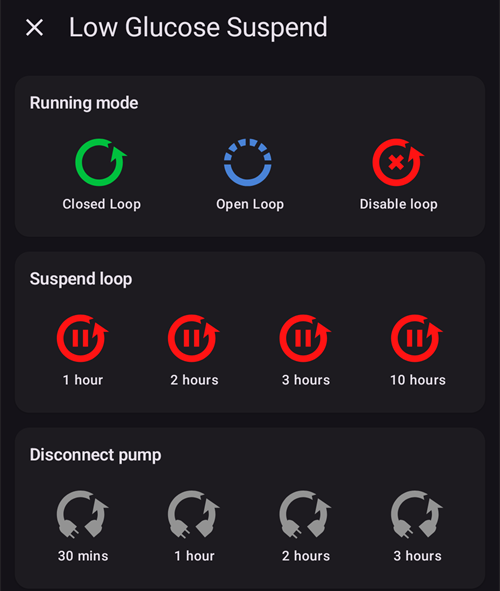
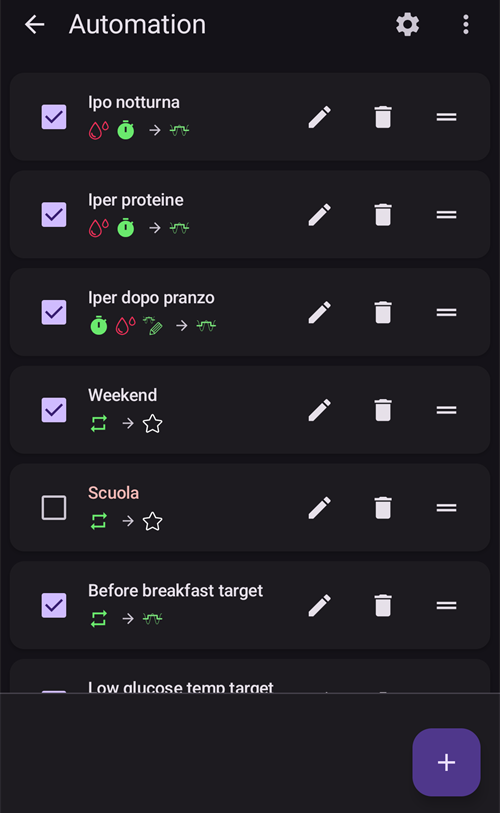

# Ecrãs do AAPS

```{contents}
:backlinks: entry
:depth: 2
```

(the-homescreen)= (AapsScreens-the-homescreen)=

## O ecrã principal


Este é o primeiro ecrã que vê quando abre o **AAPS**, e tem a maior parte da informação de que precisa no dia a dia.

### Secção A - Barra superior

* O **menu** (☰) à esquerda abre o menu de navegação com **Histórico de tratamentos**, **Navegador do histórico**, **Estatísticas**, **Assistente de Perfil**, **Manutenção**, **Assistente de Configuração**, **Configuração** e mais.
* A **barra de pesquisa** encontra definições, janelas e documentação — basta começar a escrever (veja [Pesquisa global](../DailyLifeWithAaps/GlobalSearch.md)).
* O ícone **Definições** (roda dentada) à direita abre todas as [definições](../SettingUpAaps/Preferences.md).

(aaps-screens-profile--target)=

### Secção B - Bloco de estado

#### Glicose atual

O último valor de glicose do seu CGM é mostrado no círculo grande à esquerda, junto com a diferença em relação ao valor anterior (delta) e a idade do valor.

A cor do valor da glicose mostra a sua posição em relação ao [intervalo](#Preferences-range-for-visualization) definido.

* verde = no alvo
* vermelho = abaixo do intervalo
* amarelo = acima do intervalo

  

(loop-status)= (AapsScreens-loop-status)=

#### Estado do loop


Ao lado do círculo da glicose, um ícone mostra o modo de funcionamento do loop (de cima para baixo na imagem):

1. Círculo verde = [loop fechado](#KeyAapsFeatures-ClosedLoop), loop a funcionar
2. Círculo roxo com linha pontilhada = [suspensão por glicose baixa (SGB)](#KeyAapsFeatures-LGS)
3. Círculo azul com linha pontilhada = [loop aberto](#KeyAapsFeatures-OpenLoop)
4. Círculo vermelho com cruz = loop desativado (não funciona, de forma permanente)
5. Ícone vermelho de pausa = loop suspenso (parado temporariamente, mas a insulina basal é administrada) - o tempo restante é mostrado ao lado do ícone
6. Círculo cinzento com ficha = bomba desligada (temporariamente sem nenhuma administração de insulina) - o tempo restante é mostrado ao lado do ícone

Prima o ícone para abrir a janela do Loop. O conteúdo da janela depende do estado atual:

* Enquanto o loop está **a funcionar** (fechado, aberto ou SGB), pode mudar o modo de funcionamento (Loop Fechado, Suspensão Glicose Baixa, Loop Aberto ou Desativar Loop), **suspender** o loop ou **desligar** a bomba durante o tempo escolhido.
* Enquanto o loop está **desativado**, pode voltar a ativá-lo escolhendo um modo de funcionamento, ou desligar a bomba.
* Enquanto o loop está **suspenso**, pode **retomá-lo**, desligar a bomba ou escolher uma nova duração em **Suspender loop** para prolongar a suspensão.
* Enquanto a bomba está **desligada**, pode **religar** a bomba, ou escolher uma nova duração em **Desligar bomba** para prolongar o tempo desligada.

Quando prolonga uma suspensão ou o tempo com a bomba desligada, a nova duração **começa agora**: substitui o tempo restante, não é somada a ele. Não precisa de retomar ou religar primeiro.

A janela enquanto o loop funciona em loop fechado:


A janela enquanto o loop está suspenso, com **Retomar** e as durações para prolongar a suspensão:


A janela enquanto a bomba está desligada, com **Religar bomba** e as durações para prolongar o tempo desligada:


A janela em Suspensão Glicose Baixa, em loop aberto e com o loop desativado só muda nos modos de funcionamento que oferece:




É assim que o ecrã principal fica em cada modo. A faixa de cor no topo do gráfico muda no momento da troca.

Suspensão Glicose Baixa:


Loop Aberto:


Loop desativado:


Loop suspenso — o tempo restante é mostrado ao lado do ícone:


Bomba desligada — o tempo restante é mostrado ao lado do ícone. Os botões de tratamento ficam na barra de ferramentas QuickLaunch, por isso ainda pode registar insulina dada com uma caneta, ou hidratos de carbono:


É preciso confirmar depois de cada escolha.

```{admonition} Alarme: a bomba não aceitou a basal temporária zero :class: warning Enquanto a bomba está desligada, o **AAPS** mantém uma basal temporária zero na bomba e volta a defini-la se ela faltar. Se isto continuar a falhar depois de 10 minutos, o **AAPS** dá um alarme urgente: *"A bomba não aceitou a basal temporária zero. Pode ainda estar a administrar insulina basal. Verifique a bomba."* O alarme repete-se a cada 15 minutos, até a basal temporária zero ser definida ou até a bomba deixar de estar desligada. Se o vir, verifique a sua bomba: pode estar a administrar insulina basal, embora o **AAPS** a mostre como desligada.

    <br />Nota: os modos oferecidos dependem do seu progresso nos [Objetivos](../SettingUpAaps/CompletingTheObjectives.md) — o Loop Fechado e a SGB só ficam disponíveis quando os completar.
    
    (aaps-screens-bg-warning-sign)=
    #### Sinal de aviso da glicose
    
    Se o **AAPS** detetar um problema nos valores de glicose que recebe, aparece na barra inferior do ecrã principal um atalho para a sua fonte da glicose (com o nome dela, por exemplo **Glicose xDrip+**), com um distintivo vermelho de aviso. Toque nele para abrir o [ecrã da fonte da glicose](#aaps-screens-bg-source).
    
    ##### Dados de glicose duplicados
    
    O sinal vermelho de aviso diz-lhe que tem de agir já: está a receber **dados de glicose duplicados**, o que impede o loop de funcionar bem. O **AAPS** não consegue calcular bem a tendência da glicose com valores duplicados, por isso deixa de fazer correções.
    
    Se o seu loop estava fechado, o **AAPS** muda-o para o modo [Suspensão por glicose baixa (SGB)](#KeyAapsFeatures-LGS): o ícone do loop fica roxo.
    
      
    
    Prima o ícone do loop: o cartão **Restrições** no topo diz-lhe porquê: "BgQualityCheck: Modo SGB devido a valores duplicados na fonte da glicose".
    
      
    
    ```{admonition} O seu loop está a funcionar em Suspensão por glicose baixa
    :class: note
    O seu loop continua a funcionar, mas só para o proteger de hipoglicemias: o **AAPS** ainda pode reduzir ou suspender a sua basal, mas não dá nenhuma insulina de correção até resolver este problema!
    

Tem de descobrir porque recebe valores de glicose duplicados:

* A ponte Dexcom (bridge) está ativada no seu site Nightscout? Desative a ponte no painel de administração do seu Nightscout: edite a variável "enable" e remova a parte "bridge". (Para o heroku, [os detalhes estão aqui](https://nightscout.github.io/troubleshoot/troubleshoot/#heroku).)
* Há várias fontes a enviar a sua glicose para o Nightscout? Se usar a app BYODA, ative o envio no **AAPS**, mas não o ative no xDrip, se usar o xDrip.
* Tem seguidores que recebem a sua glicose mas que também a voltam a enviar para o seu site Nightscout?
* Último recurso: nas [definições do NSClient](#Preferences-nsclient), selecione as definições de Sincronização e desative a opção «Receber dados CGM do NS».

Para remover o aviso de imediato e o loop voltar a corrigir, elimine os registos duplicados no ecrã da fonte da glicose: toque no atalho da barra inferior. O valor duplicado aparece realçado a vermelho. Prima um valor durante algum tempo para começar a selecionar, marque os duplicados e toque no ícone do caixote do lixo, no canto superior direito.


No entanto, quando há muitos duplicados, pode ser mais fácil

* [fazer uma cópia de segurança das suas definições](../Maintenance/ExportImportSettings.md),
* repor a base de dados no menu Manutenção e
* [importar as suas definições](../Maintenance/ExportImportSettings.md) novamente

    {admonition} Volte a mudar para Loop Fechado
    :class: important
    O **AAPS** não volta sozinho para **Loop Fechado** depois de os duplicados desaparecerem. Prima o ícone do loop no ecrã principal e selecione de novo **Loop Fechado**.

##### Dados de glicose constantes

Com algumas fontes da glicose (Libre 1, AiDEX, Glutec, Medtronic e fontes que não indicam o tipo de sensor), o **AAPS** também procura valores que não mudam: se a sua glicose mudou menos de 2 mg/dl (0,1 mmol/l) durante 45 minutos, os dados são considerados errados. O atalho da fonte da glicose mostra então um distintivo vermelho de tendência constante, e o loop para qualquer basal temporária alta e não dá insulina de correção até os valores voltarem a mudar. Verifique o seu sensor e a app que envia os valores.

##### Dados de glicose irregulares

Quando os valores chegam em intervalos irregulares ou faltam alguns, o **AAPS** calcula de novo valores de 5 em 5 minutos a partir dos valores que tem. Isto acontece, por exemplo, depois de uma troca de sensor, ou com sensores Libre, cujo horário se atrasa um ou dois minutos a cada poucas horas. O loop continua a funcionar e não precisa de fazer nada. O **AAPS** 4 já não mostra um sinal de aviso amarelo para isto.

#### Perfil atual

O perfil atual é mostrado ao lado do ícone da estrela.

Toque no nome do perfil para abrir o [ecrã Perfil](#aaps-screens-profile), onde pode ver os detalhes do perfil e [trocar entre perfis diferentes](../DailyLifeWithAaps/ProfileSwitch-ProfilePercentage.md).

Para **mudar a percentagem do perfil** (e a sua duração), toque no nome do perfil e depois no botão redondo **▶** (Ativar), no canto inferior direito do ecrã Perfil. No **AAPS** 3.x, este ecrã abria-se ao premir durante algum tempo o nome do perfil; no **AAPS** 4, premir durante algum tempo não faz nada. Passo a passo: [Mudar a percentagem do perfil](#ProfileSwitch-change-percentage).


1. Apresentação normal com a ativação de um perfil padrão.
2. Troca de perfil com uma percentagem de 90% e uma duração restante de 9 minutos — o nome do perfil fica amarelo enquanto uma troca de perfil temporária está ativa.
3. Troca de perfil com um deslocamento temporal de 1 hora e uma duração restante de 9 minutos.

#### Alvo


O nível de glicose alvo atual é mostrado por baixo do nome do perfil.

Toque brevemente no alvo para abrir o ecrã **[Alvo temporário](../DailyLifeWithAaps/TempTargets.md)**.

1. Apresentação normal: o intervalo alvo definido no seu perfil.
2. Se estiver definido um alvo temporário, o alvo fica amarelo/laranja com o ícone da predefinição usada, e o tempo restante em minutos aparece entre parênteses.

(AapsScreens-visualization-of-dynamic-target-adjustment)=

#### Visualização do ajuste dinâmico do alvo

Quando usa o [algoritmo SMB](#Config-Builder-aps) e a função [Autosens](#Open-APS-features-autosens), o **AAPS** pode ajustar o seu alvo de forma dinâmica, com base na sensibilidade.

Ative uma ou as duas opções seguintes nas [definições do OpenAPS SMB](#Preferences-openaps-smb-settings):

* «Sensibilidade sobe o alvo» e/ou
* «Resistência baixa o alvo»

Se o **AAPS** detetar resistência ou sensibilidade, o alvo muda em relação ao que está definido no perfil, e o alvo mostrado muda de cor para indicar o ajuste.

(aaps-screens-iob-cob-basal-sens)=

#### IA, HCA, basal e sensibilidade


1. **Seringa**: insulina ativa (IA) - quantidade de insulina ativa no seu corpo  
    O valor da insulina ativa seria zero se só estivesse a correr a sua basal padrão e não restasse insulina de bólus anteriores. 
    * A IA pode ser negativa se houve recentemente períodos de basal reduzida.
    * Prima o chip para ver a divisão entre insulina de bólus e insulina basal (primeira janela na imagem — aqui com uma IA negativa depois de um período de basal reduzida)
2. **Grão**: [hidratos de carbono ativos (HCA)](../DailyLifeWithAaps/CobCalculation.md) - hidratos de carbono que comeu antes e que ainda não foram absorvidos
3. O botão azul-petróleo à direita mostra a **administração basal atual**: uma linha plana quando está a correr a basal do perfil, um ícone diferente enquanto está ativa uma taxa basal temporária
4. A **linha da percentagem** mostra a sensibilidade atual ([Autosens](#Open-APS-features-autosens) / [DynamicISF](../DailyLifeWithAaps/DynamicISF.md)). Quando o loop muda o seu FSI, a linha mostra também o FSI do perfil, uma seta e o FSI que o loop usa agora, por exemplo "80% 2.0 ↗ 2.5". Prima-a para ver o valor do Autosens e o FSI efetivo (segunda janela na imagem). Se o loop trabalhar com um valor diferente do último resultado do Autosens (por exemplo, porque um alvo temporário muda a sua sensibilidade), a janela mostra também esse valor como **Autosens no algoritmo**. Quando o Autosens está desligado, o loop mantém o FSI do seu perfil e não é mostrado nenhum FSI efetivo.

A janela da IA, aberta ao premir o chip da IA:


Prima o botão azul-petróleo para ver a taxa basal temporária que está a correr, quando começou e há quanto tempo está a correr:


(aaps-screens-carbs-required)=

#### Hidratos de carbono necessários


As sugestões de hidratos de carbono aparecem quando o algoritmo de referência deteta que são precisos hidratos de carbono.

Isto acontece quando o algoritmo oref pensa que não o consegue salvar com uma basal temporária zero, e vai precisar de hidratos de carbono para corrigir.

As notificações de hidratos de carbono são muito mais elaboradas do que as da calculadora de bólus. Pode ver uma sugestão de hidratos de carbono enquanto a calculadora de bólus não mostra hidratos de carbono em falta.

Se quiser, as notificações de hidratos de carbono necessários podem ser enviadas para o Nightscout. Nesse caso, é mostrado e difundido um anúncio.

### Secção C - Linha de estado


A linha de estado dá um aviso visual para

* Idade da cânula
* Idade da insulina (dias de uso do reservatório) e nível do reservatório (unidades)
* Idade do sensor
* Idade e nível da bateria da bomba (%)

Se o limite de aviso for excedido, os valores são mostrados a amarelo.

Se o limite crítico for excedido, os valores são mostrados a vermelho.

The age is always shown in its short form, whatever the screen size: *4h* on the first day, *3d4h* later.

Os limites podem ser alterados com o pequeno ícone **Definições**, que aparece quando a linha de estado está **expandida** (seta à direita) — veja [Luzes de Estado](#Preferences-status-lights).

O painel de estado expandido tem também um botão no fim de algumas linhas para registar uma mudança, o que repõe a idade correspondente: **Adicionar** na linha **Sensor** regista a inserção de um sensor. Se a sua bomba o permitir, **Purgar/Preencher** aparece nas linhas **Cânula** (ou **Bomba patch**) e **Insulina**, e **Adicionar** na linha **Bateria da Bomba**.


Conforme a bomba que usa, pode não ter todos estes ícones.

(screens-sensor-level-battery)=

#### Nível do sensor (bateria)

Funciona com CGM com um transmissor adicional, como o MiaoMiao 2. (Tecnicamente, o sensor tem de enviar a informação do nível da bateria ao xDrip.)

Os limites podem ser definidos em [Luzes de Estado](#Preferences-status-lights).

(aaps-screens-main-graph)=

### Secção D - Gráfico principal


O gráfico mostra a sua glicose no sangue (glicose), como lida pelo seu monitor de glicose (CGM).

Use os gestos de deslizar e de afastar/juntar os dedos (zoom) no gráfico para mudar o período de tempo visível.

A área verde mostra o seu intervalo alvo.

Esta informação também é mostrada neste gráfico:

* Bólus manuais: triângulo azul logo acima da curva da glicose, a apontar para baixo, para o valor desse momento, com a quantidade de insulina
* Registos de hidratos de carbono: triângulo laranja logo abaixo da curva da glicose, a apontar para cima, para o valor, com a quantidade de hidratos de carbono. Uma refeição registada com o seu bólus parece um só marcador, dividido pelo valor.
* Os triângulos têm três tamanhos (pequeno, médio, grande), conforme a quantidade comparada com a maior do dia. Se não houver valor de glicose nessa hora (falha do sensor), o triângulo é desenhado no fundo do gráfico.
* Verificações de glicose e calibrações: desenhadas no seu próprio valor medido, para as poder comparar com a curva do sensor
* Alvo definido no perfil ou alterado por um alvo temporário: linha verde
* Trocas de perfil: ícones de estrela no topo do gráfico
* Estado do loop: faixa de cor no topo do gráfico quando o [modo de funcionamento](#AapsScreens-loop-status) não é loop fechado: azul = loop aberto, roxo = SGB, vermelho = loop desativado, amarelo = loop suspenso, cinzento = bomba desligada, laranja = superbólus (na captura de ecrã: roxo e depois amarelo). O histórico destas mudanças está listado em [Modo de funcionamento](#AapsScreens-running-mode)
* Os [SMB](#Open-APS-features-super-micro-bolus-smb) não são desenhados no gráfico da glicose (haveria um a cada poucos minutos): são mostrados no [gráfico da IA](#aaps-screens-iob).

Toque numa **verificação de glicose** no gráfico para ver o seu valor e a sua nota, se escreveu uma.

(aaps-screens-graph-press-and-hold)=

#### Ver os valores numa certa hora

**Prima e mantenha** o dedo no gráfico da glicose durante um momento para ver os valores de um registo. Um ponto marca o valor mais próximo, é desenhada uma linha tracejada nessa hora em todos os gráficos, e uma janela pop-up no topo do gráfico mostra:

* a hora e o valor da glicose
* IA, HCA (só quando é maior do que 0 g) e a taxa basal nessa hora — o ícone da basal mostra se estava a correr uma taxa basal temporária, como no ecrã principal
* qualquer bólus, SMB ou hidratos de carbono nessa hora, com os mesmos triângulos dos gráficos

Mantenha o dedo no ecrã e mova-o para a esquerda ou para a direita para passar de um valor para o seguinte. Sente uma pequena vibração em cada valor, e o gráfico não se desloca enquanto faz isto. A janela pop-up fica 2 segundos depois de levantar o dedo.

Funciona da mesma forma nos [gráficos adicionais](#aaps-screens-additional-graphs) por baixo do gráfico da glicose (IA, HCA...): prima e mantenha o dedo em qualquer um deles.


(aaps-screens-graph-clock-change)=

#### Clock changes

When the clock of the phone jumped, at a daylight saving change or in a new time zone, a dashed vertical line marks that moment in the BG graph, with a small clock icon at its foot. The same dashed line runs through the [additional graphs](#aaps-screens-additional-graphs) below.


(AapsScreens-activate-optional-information)=

#### Ativar informação opcional

Prima o ícone do **lápis** no canto superior direito do gráfico para abrir as definições do gráfico:


* **Altura do gráfico** ajusta a altura com que o gráfico é desenhado.
* **ATIV** sobrepõe a curva da atividade da insulina: uma linha contínua amarelo-esverdeada <span style="background:#141218;color:#D3F166;padding:0 0.3em;border:1px solid #141218;border-radius:4px">━━━━</span> (não confundir com a previsão RNA amarela pontilhada)
* **PREV** sobrepõe as [linhas de previsão](#aaps-screens-prediction-lines) (veja abaixo)

(aaps-screens-prediction-lines)=

#### Linhas de previsão

Quando **PREV** está ligado, o AAPS desenha as suas previsões como **linhas pontilhadas** à direita da linha «agora». Cada previsão tem a sua cor. O tema escuro usa tons mais claros das mesmas cores, e uma linha dentro do intervalo alvo verde pode parecer um pouco mais verde.

| Linha                     | Tema claro                                                                                                                        | Tema escuro                                                                                                                        | O que prevê                             |
| ------------------------- | --------------------------------------------------------------------------------------------------------------------------------- | ---------------------------------------------------------------------------------------------------------------------------------- | --------------------------------------- |
| **IA** (azul)             | <span style="background:#FFFFFF;color:#1E88E5;padding:0 0.3em;border:1px solid #CCCCCC;border-radius:4px">●●●●</span>             | <span style="background:#141218;color:#64B5F6;padding:0 0.3em;border:1px solid #141218;border-radius:4px">●●●●</span>              | só insulina                             |
| **HCA** (laranja)         | <span style="background:#FFFFFF;color:#FB8C00;padding:0 0.3em;border:1px solid #CCCCCC;border-radius:4px">●●●●</span>             | <span style="background:#141218;color:#FFB74D;padding:0 0.3em;border:1px solid #141218;border-radius:4px">●●●●</span>              | hidratos de carbono ativos              |
| **RNA** (amarelo)         | <span style="background:#FFFFFF;color:#C9BD60;padding:0 0.3em;border:1px solid #CCCCCC;border-radius:4px">●●●●</span>             | <span style="background:#141218;color:#E6D39A;padding:0 0.3em;border:1px solid #141218;border-radius:4px">●●●●</span>              | refeição não anunciada                  |
| **ZT** (ciano)            | <span style="background:#FFFFFF;color:#00D2D2;padding:0 0.3em;border:1px solid #CCCCCC;border-radius:4px">●●●●</span>             | <span style="background:#141218;color:#4DD4D4;padding:0 0.3em;border:1px solid #141218;border-radius:4px">●●●●</span>              | basal temporária zero (insulina parada) |
| **aCOB** (laranja pálido) | <span style="background:#FFFFFF;color:rgba(251,140,0,0.5);padding:0 0.3em;border:1px solid #CCCCCC;border-radius:4px">●●●●</span> | <span style="background:#141218;color:rgba(255,183,77,0.5);padding:0 0.3em;border:1px solid #141218;border-radius:4px">●●●●</span> | só o algoritmo mais antigo AMA          |

Quando duas previsões dão os mesmos valores, os pontos sobrepõem-se e só vê uma das cores (por exemplo, RNA por cima da IA quando a glicose está estável).

* Linha **HCA** (laranja): [hidratos de carbono ativos](CobCalculation) (o laranja é usado em todo o AAPS para os HCA e os hidratos de carbono)
    
    Esta linha de previsão mostra para onde vai a sua glicose (não para onde vão os HCA!) com base nas definições atuais do **Perfil**, supondo que os desvios causados pela absorção dos hidratos de carbono ficam constantes. Esta linha só aparece se houver HCA conhecidos.

* Linha **IA** (azul): insulina ativa (o azul é usado em todo o AAPS para a IA e a insulina)
    
    Esta linha de previsão mostra o que aconteceria só com o efeito da insulina. Por exemplo, se administrar alguma insulina e depois não comer hidratos de carbono.

* Linha **ZT** (ciano): basal temporária zero (glicose prevista se fosse definida uma taxa basal temporária de 0%)
    
    Esta linha de previsão mostra como mudaria a trajetória da glicose se a bomba parasse toda a administração de insulina (basal temporária de 0%). A linha para quando sobe acima do seu alvo.
    
    *Esta linha só aparece quando é usado o algoritmo [SMB](#Config-Builder-aps).*

* Linha **RNA** (amarela): [refeições não anunciadas](#SensitivityDetectionAndCob-sensitivity-oref1)
    
    Refeições não anunciadas significa que foi detetada uma subida importante da glicose causada por refeições, adrenalina ou outras influências. A linha de previsão é parecida com a **linha laranja dos HCA**, mas supõe que os desvios vão diminuindo a um ritmo constante (prolongando o ritmo atual de redução).
    
    *Esta linha só aparece quando é usado o algoritmo [SMB](#Config-Builder-aps), quando **Ativar RNA** está ligado nas definições do OpenAPS SMB e quando a glicose sobe mais do que a insulina sozinha explica.*

* Linha **aCOB** (laranja pálido, transparente): absorção acelerada dos hidratos de carbono
    
    Parecida com a dos HCA, mas supõe uma absorção fixa de hidratos de carbono de 10 mg/dl/5 min (-0,555 mmol/l/5 min). Obsoleto e de utilidade limitada.
    
    *Esta linha só aparece quando é usado o algoritmo mais antigo [AMA](#Config-Builder-aps).*

Normalmente, a sua curva real de glicose fica no meio destas linhas, ou perto da linha cujas suposições mais se parecem com a sua situação.

(aaps-screens-how-predictions-become-a-dosing-decision)=

#### Como o AAPS transforma as previsões numa decisão de dosagem

O AAPS não doseia a insulina só com base na sua glicose atual — em cada ciclo do loop (mais ou menos a cada 5 minutos) olha para todas as linhas de previsão acima ao mesmo tempo e decide o que é mais seguro fazer.

A regra principal é **primeiro a segurança**: se *qualquer* linha de previsão, em qualquer período de tempo, descer abaixo do seu limite de segurança baixo, o AAPS define uma basal temporária zero (taxa basal temporária de 0%) e não dá mais insulina, mesmo que a sua glicose atual esteja alta. Só quando todas as linhas de previsão ficam acima desse limite é que o AAPS pensa em dar mais insulina.

Quando é seguro dar mais insulina, o AAPS olha para onde se prevê que a glicose vai acabar (a **glicose final**) nas previsões combinadas, e calcula quanta correção é precisa para trazer essa glicose final de volta ao alvo — administrada como uma taxa basal temporária aumentada ou (se o algoritmo oref1/[SMB](#Open-APS-features-super-micro-bolus-smb) estiver ativado) como um pequeno bólus imediato. Se a glicose estiver alta agora, mas já estiver a descer o suficiente por si própria, o AAPS espera, ou pode até reduzir a taxa basal, em vez de dar insulina que só tornaria ainda mais baixa uma hipoglicemia mais tarde.

Para exemplos práticos desta lógica de decisão, com capturas de ecrã reais, veja os [cenários de dosagem no guia para médicos](#clinicianguide-dosing-scenarios) — foram escritos para médicos, mas servem para qualquer utilizador do AAPS.

*Para a explicação técnica completa de como estas previsões e a decisão de dosagem são calculadas, veja a [documentação do determine-basal do OpenAPS](https://openaps.readthedocs.io/en/latest/docs/While%20You%20Wait%20For%20Gear/Understand-determine-basal.html).*

#### Basais

Uma linha **azul contínua** mostra a basal administrada pela bomba e reflete a administração real ao longo do tempo.

A linha **azul pontilhada** mostra qual seria a taxa basal se não houvesse ajustes temporários da basal (basais temporárias).

Quando é dada a taxa basal padrão, a área abaixo da curva é mostrada a azul escuro. Quando a taxa basal é ajustada temporariamente (aumentada ou reduzida), a área abaixo da curva é mostrada a azul claro.

#### Atividade

A linha **amarela fina** mostra a atividade da insulina.

Baseia-se na descida esperada da glicose causada pela insulina no seu corpo, se não houvesse outros fatores (como hidratos de carbono).

(AapsScreens-section-g-additional-graphs)= (aaps-screens-additional-graphs)=

### Secção E - Gráficos adicionais

Pode ativar gráficos adicionais por baixo do gráfico principal. No [Modo simples](#preferences-simple-mode), os gráficos adicionais são predefinidos e não podem ser alterados. Desligue o **Modo simples** se quiser definir a sua própria configuração dos gráficos adicionais.

Os gráficos adicionais seguem o gráfico principal: quando desliza ou faz zoom no gráfico da glicose, eles movem-se com ele. Arrastar para o lado num gráfico adicional também desloca todos os gráficos. Não têm marcas de hora próprias — leia a hora no gráfico da glicose.

Para configurar um gráfico adicional, prima o ícone do **lápis** no seu canto superior direito:


Selecione os chips dos dados que quer ver neste gráfico; o botão **Remover** elimina o gráfico.

Para criar mais um gráfico, prima **Adicionar gráfico** por baixo do último gráfico e selecione os seus chips da mesma forma:


O novo gráfico é adicionado por baixo dos outros — aqui, um segundo gráfico adicional com **SENS%** e **DESV**:


A maioria dos utilizadores acha adequada a seguinte configuração dos gráficos adicionais:

* Gráfico 1 com IA, HCA, Alteração da sensibilidade
* Gráfico 2 com Desvios e IG.

#### Insulina absoluta (ABS)

Insulina ativa, incluindo bólus **e basal**.

(aaps-screens-iob)=

#### Insulina ativa (IA)

Mostra a insulina ativa (= insulina que ainda atua no seu corpo). Inclui a insulina de bólus e de basal temporária (**mas exclui as taxas basais definidas no seu perfil**).

Se não houvesse [SMB](#Open-APS-features-super-micro-bolus-smb), nem bólus, nem basal temporária durante o tempo da DAI, isto seria zero.

Os SMB são mostrados neste gráfico como triângulos azuis, em três tamanhos, conforme a quantidade comparada com o maior SMB do dia.

A IA pode ser negativa se não tiver bólus restante e tiver uma basal temporária zero ou baixa durante mais tempo.

A diminuição depende das suas [definições da DAI e do tipo de insulina](#Config-Builder-insulin-dia).

#### Hidratos de carbono ativos (HCA)

Mostra os hidratos de carbono ativos (= hidratos de carbono no seu corpo que ainda não foram absorvidos).

A diminuição depende dos [desvios que o algoritmo deteta](../DailyLifeWithAaps/CobCalculation.md).

Se detetar uma absorção de hidratos de carbono maior do que a esperada, é dada insulina e isto aumenta a IA (mais ou menos, conforme as suas definições de segurança).

#### Alteração da sensibilidade (SENS%)

Mostra a sensibilidade que o [Autosens](#Open-APS-features-autosens) detetou.

A sensibilidade é um cálculo da sensibilidade à insulina, que muda com o exercício, as hormonas, etc.

Note que tem de estar no [Objetivo 8](#objectives-objective8) para que a deteção de sensibilidade/o [Autosens](#Open-APS-features-autosens) possa ajustar automaticamente a quantidade de insulina administrada. Antes de chegar a esse objetivo, a linha no seu gráfico é mostrada só para informação.

### Sensibilidade variável (VSENS)

Mostra a sensibilidade calculada pelo [DynamicISF](../DailyLifeWithAaps/DynamicISF.md). Só tem dados se usar esta função.

(screen-heart-rate-steps)=

#### Frequência cardíaca (FC) e passos

Estes dados podem estar disponíveis quando usa um [smartwatch Wear](../WearOS/WearOsSmartwatch.md). Ative-os na app Wear do **AAPS** e dê permissão para os dados de saúde.

Steps are drawn as columns, and the heart rate as a curved line that breaks where the watch sent no data.

#### Desvios (DESV)

* As barras **cinzentas** mostram um desvio causado por hidratos de carbono.
* As barras **verdes** mostram que a glicose está mais alta do que o algoritmo esperava. As barras verdes são usadas para aumentar a resistência no [Autosens](#Open-APS-features-autosens).
* As barras **vermelhas** mostram que a glicose está mais baixa do que o algoritmo esperava. As barras vermelhas são usadas para aumentar a sensibilidade no [Autosens](#Open-APS-features-autosens).
* As barras **amarelas** mostram um desvio causado por RNA.
* As barras **pretas** mostram pequenos desvios que não contam para a sensibilidade

#### Impacto na glicose (-IG)

Esta linha mostra quanto a glicose «deveria» subir ou descer só por causa da atividade da insulina.


É uma boa combinação mostrar esta linha junto com as barras dos Desvios. Têm a mesma escala, mas é diferente da dos outros dados opcionais, por isso é boa ideia mostrá-las num gráfico separado, como acima. Comparar a linha do IG com as barras dos Desvios é outra forma de perceber como a **glicose** varia. Aqui, na hora marcada com **1**, as barras dos Desvios estão bem acima da linha do IG: a glicose sobe mais do que a atividade da insulina sozinha explica (por exemplo, depois de hidratos de carbono). Na hora marcada com **2**, as barras dos Desvios estão abaixo de zero (vermelhas): a glicose está mais baixa do que o algoritmo esperava.

### Secção F - Barra de ferramentas QuickLaunch


A barra de ferramentas flutuante no fundo do ecrã tem as suas ações **[QuickLaunch](../DailyLifeWithAaps/QuickLaunch.md)**. A pequena **roda dentada** abre a configuração do QuickLaunch, onde escolhe que botões são mostrados (tratamentos, registos do Careportal, ações do CGM, os ecrãs do painel **Gerir**, botões do [Assistente Rápido](../DailyLifeWithAaps/QuickWizards.md), [Cenas](../DailyLifeWithAaps/Scenes.md) e mais).

Acima é mostrada uma configuração típica: **Insulina**, **Hidratos** e o **Assistente de Bólus**.

Enquanto a bomba está **desligada**, os botões de tratamento ficam na barra de ferramentas, por exemplo para registar insulina dada com uma caneta (veja [Insulina](#aaps-screens-buttons-insulin) abaixo). As mesmas ações também estão disponíveis no [painel Tratamentos](#aaps-screens-treatments-sheet) da barra de navegação inferior.

(aaps-screens-buttons-insulin)=

#### Insulina


Para dar uma certa quantidade de insulina sem usar a [calculadora de bólus](#aaps-screens-bolus-wizard).

Se ativar **Iniciar AT de Comer Brevemente**, pode iniciar automaticamente o seu [alvo temporário Comer Brevemente](#TempTargets-eating-soon-temp-target).

Se não quiser fazer o bólus pela bomba, mas só registar uma quantidade de insulina (por exemplo, insulina dada com uma caneta), ative "**O bólus será apenas registado**". Uma linha adicional **Hora**, definida como **Agora**, permite registar uma injeção de insulina feita no passado: use **-** / **+** para a mudar, ou toque na seta para escrever os minutos ou escolher uma data e uma hora.

 

Pode usar os botões **+0.5 / +1.0 / +2.0** para aumentar depressa a quantidade de insulina. Os valores dos aumentos podem ser alterados nas [definições do Assistente de Bólus](#Preferences-deliver-this-part-of-bolus-wizard-result).

A janela Insulina também pode ser usada quando a bomba está suspensa ou desligada, por exemplo para registar insulina injetada com uma caneta. Neste caso, "**O bólus será apenas registado**" fica sempre ligado (mostrado a vermelho) e aparecem campos adicionais para escolher o tipo de insulina e um desvio de **Hora** para uma injeção feita no passado:


#### Hidratos


Para registar hidratos de carbono sem fazer bólus.

Certos [alvos temporários predefinidos](#TempTargets-hypo-temp-target) (Hipo, Comer Brevemente, Atividade) podem ser iniciados diretamente com os interruptores no topo.

**Hora dos hidratos**: quando vai comer / comeu os hidratos de carbono.

**Duração**: para usar com [«hidratos de carbono prolongados»](ExtendedCarbs). Esta linha está recolhida, para não escrever nela os gramas por engano: use **-** / **+** para a mudar, ou toque na seta para a abrir e escrever um valor.

Pode usar os botões **+5 / +10 / +20** para aumentar depressa a quantidade de hidratos de carbono.

#### Assistente Rápido

Introduza facilmente a quantidade de hidratos de carbono e defina as bases do cálculo com um só botão pré-configurado.

Os detalhes são definidos no [Assistente Rápido](../DailyLifeWithAaps/QuickWizards.md).

(aaps-screens-treatments-sheet)=

### Secção G - Navegação inferior

A barra de navegação inferior dá acesso a:

* **Tratamentos** — um painel de ações rápidas com as suas ações de tratamento:
    
    

* **Cenas** — só aparece quando tem pelo menos uma [cena](../DailyLifeWithAaps/Scenes.md) ou uma regra de **Automatização** marcada como **Ação do utilizador**. Abre um painel onde as pode iniciar; um distintivo mostra quantas pode iniciar neste momento. O **lápis** no topo do painel abre **Gerir → Cenas**.

* **Gerir** — o centro de tudo o que gere no **AAPS**: Perfil, Definições de insulina, Alvo temporário, Assistente Rápido, Cenas, Automatização, Alimentos, Rotação dos locais, Bomba e Clientes autorizados. Por baixo estão ações do dispositivo e da basal, como Inserção do sensor e Basal temporária. Alguns itens só aparecem quando se aplicam à sua configuração — por exemplo, Purgar/Preencher e a troca da bateria dependem da sua bomba, e Basal temporária, Bólus Prolongado e os registos do Careportal estão escondidos no [Modo simples](#preferences-simple-mode):
    
    

* **Objetivos** — o seu progresso nos [Objetivos](../SettingUpAaps/CompletingTheObjectives.md); um distintivo mostra quantos estão concluídos. Este item desaparece quando todos os objetivos estão concluídos, e não existe no **AAPSClient**.

(aaps-screens-notifications)=

#### Notificações

Pode aparecer uma **bolha de notificações** por cima da barra inferior, à direita. Junta as notificações ativas do **AAPS**; o pequeno número mostra quantas são. A sua cor segue a mais importante: vermelho para uma mensagem urgente, verde para uma simples informação.


Toque na bolha para abrir o painel **Notificação**. Cada mensagem mostra a hora em que apareceu. Prima **Fechar** por baixo de uma mensagem para a remover; algumas mensagens têm outro botão em vez deste, que o leva à definição que precisa da sua atenção.


(bolus-wizard)= (aaps-screens-bolus-wizard)=

## Assistente de Bólus


Quando quer fazer um bólus de refeição, normalmente é aqui que o faz.

### Secção I

O cabeçalho **Cálculo** mostra o bólus calculado. Se a insulina ativa já for maior do que o bólus calculado, só é mostrada a quantidade de hidratos de carbono ainda necessários.

A calculadora de bólus pode ser usada qualquer que seja a sua **glicose** atual, também quando está demasiado alta ou demasiado baixa. Se a **glicose** estiver acima do alvo, é somada uma correção ao bólus da refeição. Se a **glicose** estiver abaixo do alvo, o bólus é reduzido e, se a insulina ativa já for mais do que a necessária, a calculadora diz-lhe quantos hidratos de carbono ainda são precisos, em vez de propor insulina.

A linha de ícones por baixo do cabeçalho mostra que dados entram no cálculo (glicose, tendência, IA, alvo temporário, HCA). Premir um ícone inclui / exclui esse dado do cálculo; o ícone **(i)** mostra os números detalhados do cálculo.

#### Combinações de HCA e IA e o que significam

* Por razões de segurança, a IA não pode ser desativada quando os HCA estão ativados, porque poderia correr o risco de demasiada insulina, já que o **AAPS** não estaria a contar com o que já foi dado.
* Se ativar os HCA e a IA, são tidos em conta os hidratos de carbono não absorvidos que ainda não estão cobertos por insulina + toda a insulina administrada como basal temporária ou SMB.
* Se ativar a IA sem os HCA, o **AAPS** tem em conta a insulina já administrada, mas não a desconta dos hidratos de carbono que ainda vão ser absorvidos. Isto leva a um aviso de «hidratos de carbono em falta».
* Se fizer bólus para **comida adicional** pouco depois de um bólus de refeição (por exemplo, uma sobremesa), pode ajudar **desativar todos os dados**. Assim, só são somados os novos hidratos de carbono, porque a refeição principal pode ainda não ter sido absorvida, e por isso pouco depois de um bólus de refeição a IA não corresponde exatamente aos HCA.
* Por razões de segurança, um **alvo temporário** só é incluído no cálculo se ativar esse dado manualmente.

(AapsScreens-section-j)=

### Secção J - Campos de introdução

No campo **Hidratos**, introduz a sua estimativa da quantidade de hidratos de carbono, **em gramas**, para a qual quer fazer bólus; os botões **+** por baixo dele somam hidratos de carbono depressa. O **AAPS** só trabalha com gramas: se contar em unidades de pão ou equivalentes (*por exemplo*, os equivalentes «CHO» do DAFNE), converta-os em gramas antes de os introduzir. Veja a [nota sobre as unidades de pão](#your-aaps-profile-insulin-to-carbs-ratio) na página do perfil.

#### Tipo de hidratos de carbono: pão, bolo ou pizza

Por baixo do campo **Hidratos**, os botões **Pão**, **Bolo** e **Pizza** dizem ao **AAPS** quão depressa a refeição é absorvida. Com **Bolo** e **Pizza**, o bólus cobre só uma parte dos hidratos de carbono agora, e o resto é somado mais tarde como eCarbs. Veja [Tipo de hidratos de carbono: pão, bolo ou pizza](#AapsScreens-carbs-type) na página Hidratos de carbono prolongados, para as percentagens e os tempos.

A linha **Correção** serve para alterar a dose final, se tiver alguma razão para isso.

Só o campo **Hidratos** está sempre aberto. As outras linhas (**Correção**, **Hora dos hidratos**, **Glicose** e **Usar percentagem**) estão recolhidas: mostram o seu valor com botões **-** / **+**, para o poder mudar em pequenos passos. Toque na seta para abrir uma linha e escrever um valor, e toque de novo para fechar a linha. Isto evita escrever gramas no campo **Correção** por engano.


Toque em qualquer parte da linha **Perfil** para abrir a lista dos seus perfis e depois toque num nome para usar esse perfil neste cálculo.


O campo **Hora dos hidratos** serve para o pré-bólus: assim pode dizer ao sistema que os hidratos de carbono só vão chegar daqui a algum tempo. Pode pôr um número negativo neste campo se estiver a fazer bólus para hidratos de carbono já comidos.

**Definir alarme** (lembrete para comer): quando é introduzida uma hora dos hidratos no futuro, aparece um interruptor "**Definir alarme**", para ser lembrado na hora indicada de comer os hidratos de carbono que introduziu no **AAPS**:


The reminder starts when the bolus has been delivered. While it runs, a **Time to eat** bar on the main screen counts down, with **Stop** and **+5 min**. **+5 min** moves the end of the wait five minutes later, and the bar shows the total wait. When the time has come, the reminder rings with its own sound, a soft kitchen timer. Besides **Silence alarm** (the screen stays open) and **Silence and close**, the alarm screen offers **+5 min**, which starts a new five-minute wait. Once it has rung, the bar reads *The time is up* with **+5 min** and **Dismiss**; **Silence and close** removes the bar too. The bar and the alarm are also shown on **AAPSClient**, and on the [watch](#WearOsSmartwatch-wizard-carb-time). The reminder does not create a timer in your phone's clock app. If Android does not let **AAPS** set alarms, the wizard asks you to allow *Alarms and reminders* for **AAPS** in the Android settings. The bell is not offered for a carb time in the past.


O campo **Glicose** normalmente já está preenchido com o último valor do seu CGM. Se não tiver um CGM a funcionar, fica vazio. Quando o valor é recente, a linha **Glicose** fica recolhida. The field follows new readings while the wizard is open, until you change it yourself.

O botão de resultado no fundo mostra o bólus proposto; ao premi-lo, é pedida uma confirmação antes de ser administrada qualquer insulina. While the confirmation is waiting, the loop gives no SMB, so the bolus you confirm is still right. If an SMB is being delivered at that moment, **OK** waits until it has finished.

É bom saber:

* Se o bólus calculado for maior do que o seu **[Bólus máximo](#Preferences-maximum-bolus)**, é reduzido para o bólus máximo, e a confirmação mostra o aviso "Restrição de bólus aplicada". Um [Assistente Rápido](../DailyLifeWithAaps/QuickWizards.md) é recusado em vez disso.
* Quando o bólus é apenas registado (por exemplo, enquanto a bomba está desligada), o aviso "**O bólus será apenas registado**" fica no topo da janela, também quando desliza o conteúdo.
* Um bólus que dá à mão tem prioridade sobre um [SMB](#Open-APS-features-super-micro-bolus-smb) que está à espera de ser administrado: o SMB é descartado e o loop calcula de novo. Se um SMB estiver a ser administrado neste momento, o seu bólus é recusado com a mensagem "Está a ser administrado um SMB neste momento. Tente novamente quando terminar." Não é dada insulina, e os hidratos de carbono introduzidos com esse bólus não são guardados: espere um momento e introduza-os de novo.

(AapsScreens-wrong-cob-detection)=

#### Deteção errada dos HCA


Se vir o aviso acima depois de usar o assistente de bólus, o **AAPS** detetou que o valor calculado dos HCA pode estar errado. Por isso, se quiser fazer outro bólus depois de uma refeição anterior com HCA, tenha cuidado com uma sobredosagem!

Para mais detalhes, veja as dicas na [página Cálculo de HCA](#CobCalculation-detection-of-wrong-cob-values).

Procura o separador **Ações** do **AAPS** 3.x? As suas funções passaram para o ecrã principal, o painel **Gerir** e a barra de ferramentas QuickLaunch: veja [Para onde foi o separador Ações?](#screens-action-tab).

(aaps-screens-careportal)=

## Registos do Careportal

As idades e os níveis mostrados na [linha de estado](#screens-sensor-level-battery) (sensor, insulina, cânula, bateria da bomba) baseiam-se em registos do Careportal: **Purgar/Preencher** (regista as mudanças do local da bomba e do cartucho de insulina), **Inserção do sensor** e **Troca Bateria Bomba**.

Pode registá-los no painel de estado expandido do ecrã principal, no painel **Gerir** ou com botões do [QuickLaunch](../DailyLifeWithAaps/QuickLaunch.md).

**Purgar/Preencher** regista uma mudança do local da bomba e/ou uma mudança do cartucho de insulina, e pode administrar uma quantidade para purgar:


**Inserção do sensor** e **Troca Bateria Bomba** só pedem a hora do evento:


 Os registos de exercício, anúncio, questão e nota correspondem ao careportal do Nightscout e são formas especiais de notas.

No painel **Gerir**, desça e prima **Careportal** para mostrar estes registos: **Verificar Glicose**, **Nota**, **Exercício**, **Questão** e **Anúncio**.


**Verificar Glicose**, **Questão** e **Anúncio** permitem introduzir um valor de glicose (de um medidor, do sensor ou de outra fonte), uma nota e a hora do evento. Em **Questão** e **Anúncio**, a linha da glicose está recolhida e mostra o tipo de medição ao lado do valor: se mudar o valor, o tipo muda de **Sensor** para **Medidor**.


**Nota** e **Exercício** permitem introduzir uma duração (uma linha recolhida: use **-** / **+**, ou toque na seta para a escrever), uma nota e a hora do evento:


Em todas estas janelas (**Purgar/Preencher**, **Inserção do sensor**, **Troca Bateria Bomba** e os registos do Careportal), a hora do evento usa a mesma linha **Hora** da [janela Insulina](#aaps-screens-buttons-insulin) e do assistente de bólus: use **-** / **+** para mudar a hora em passos de 5 minutos (até uma semana para trás e 12 horas para a frente), ou toque na seta para escolher qualquer data e hora.

## Rotação dos locais

**Gerir → Rotação dos locais** regista onde cada cânula e cada sensor foi colocado, num mapa do corpo, para poder fazer a rotação dos locais: veja [Rotação dos locais](#Aapsscreens-site-rotation) na página Bombas e cânulas.

A **TID** (dose diária total) e a regra prática da proporção basal/bólus são explicadas no [separador Insulina das Estatísticas](#reviewing-tdd).

(AapsScreens-insulin-profile)=

## Insulina


**Gerir → Definições de insulina** mostra e gere as suas configurações da insulina. Cada configuração é mostrada num cartão com o seu **tempo de pico** e a **[DAI](#Config-Builder-insulin-dia)**; a que está em uso está marcada como **ATIVO**. Por baixo do cartão vê a curva da atividade. Pode editar o nome, o pico e a DAI de qualquer configuração, exceto a ativa: para mudar a insulina que usa, [adicione uma nova configuração e ative-a](#Config-Builder-insulin-change-active).

Veja [Duração da ação da insulina](#Config-Builder-insulin-dia) para saber mais sobre o que é e como a definir.

## Estado da Bomba


**Gerir → Bomba** (ou **Configuração → Bomba → Abrir plugin**) mostra o estado da sua bomba: última ligação, taxa basal de base, bateria, reservatório...

* A informação mostrada depende do modelo da sua bomba.
* Veja a [página das bombas](../Getting-Started/CompatiblePumps.md) para mais detalhes.

## Loop, AMA / SMB

**Configuração → Loop → Abrir plugin** (e **Configuração → APS → Abrir plugin**) mostram detalhes sobre os cálculos do algoritmo e porque é que o **AAPS** age como age: última execução, o pedido resultante e as restrições. O ecrã **Loop** só lista as restrições que limitaram de facto a taxa basal temporária ou o SMB administrados (e porque é que o loop fechado não é permitido, se for o caso); o ecrã **APS** lista todas as restrições que entraram no cálculo.

Os cálculos são feitos sempre que o sistema recebe um novo valor do CGM.

Para mais detalhes, veja a [secção APS da página Configuração](#Config-Builder-aps).

(aaps-screens-profile)=

## Perfil


**Gerir → Perfil** (ou um toque no nome do perfil no ecrã principal) abre o ecrã Perfil: os seus perfis num carrossel de cartões que pode deslizar, com botões para adicionar, editar, clonar, eliminar e **ativar** um perfil.

O perfil tem a informação das suas definições individuais da diabetes. Para mais informação, veja a página **[Perfil](../SettingUpAaps/YourAapsProfile.md)**.

## Automatização



**Gerir → Automatização** lista as suas regras de automatização. Veja a página dedicada [aqui](../DailyLifeWithAaps/Automations.md).

## ClienteNS


**Configuração → Comunicação → NSClientV3 → Abrir plugin** mostra o estado da ligação ao seu site Nightscout: URL, estado do websocket, fila e um registo da atividade de sincronização.

As definições podem ser alteradas nas [definições do NSClient](#Preferences-nsclient).

Para resolver problemas, veja esta [página](../GettingHelp/TroubleshootingNsClient.md).

(aaps-screens-bg-source)=

## Fonte da Glicose - xDrip, BYODA...


**Configuração → Fonte da Glicose → Abrir plugin** mostra o histórico dos valores do CGM e permite remover valores em caso de falha (por exemplo, compressão baixa) ou de valores duplicados.

## Histórico de tratamentos

Abra o **menu** (☰) e selecione **Histórico de tratamentos** para ver, verificar e corrigir tudo o que o **AAPS** registou: hidratos de carbono e bólus, basais temporárias, alvos temporários, trocas de perfil, registos do Careportal, mudanças do modo do loop e registos do utilizador. Veja [Histórico de tratamentos](#aaps-screens-treatments) na página Rever os seus dados.

## Navegador do histórico


Abra o **menu** (☰) e selecione **Navegador do histórico**.

Permite-lhe voltar atrás no histórico do **AAPS**. Veja a página dedicada [Rever os seus dados > Navegador do histórico](../Maintenance/Reviewing.md).

(aaps-screens-statistics)=

## Estatísticas


Abra o **menu** (☰) e selecione **Estatísticas**.

Dá-lhe estatísticas sobre a sua dose diária total, o tempo no alvo, o seu perfil de glicose ao longo do dia (AGP) e o padrão do ciclo da sua insulina, em quatro separadores. Veja a página dedicada [Rever os seus dados > Estatísticas](#reviewing-statistics).

(aaps-screens-profile-helper)=

## Profile Helper

Abra o **menu** (☰) e selecione **Assistente de Perfil**.


O Assistente de Perfil permite comparar perfis e criar perfis iniciais para crianças. Veja [O seu perfil AAPS](../SettingUpAaps/YourAapsProfile.md) — secções [Criar um perfil do zero para uma criança](#your-aaps-profile-profile-from-scratch-for-a-kid) e [Comparar dois perfis](#your-aaps-profile-compare-profiles).

(aaps-screens-widgets)=

## Widgets do ecrã principal

O **AAPS** tem cinco widgets que pode adicionar ao ecrã principal do seu telefone, para ver os seus dados sem abrir a app. Veja a página dedicada [Widgets do ecrã principal](../DailyLifeWithAaps/Widgets.md).

