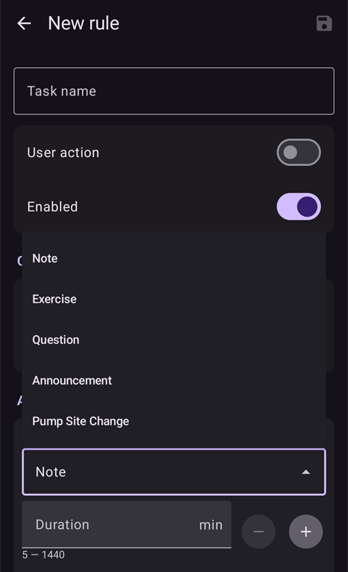
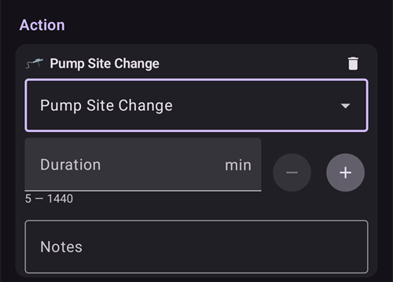

# Automatização

```{contents} In this page
:backlinks: entry
:depth: 2
```

## O que é uma Automatização?

A «**Automatização**» é uma funcionalidade que pode automatizar tarefas no AAPS.

A Automatização executa ações específicas com base numa ou mais condições («acionadores»). As condições podem incluir eventos irregulares, como níveis de glicose baixos ou altos, ou uma certa quantidade de insulina ativa (IA) negativa. As Automatizações também podem tratar de eventos recorrentes, como refeições ou exercício a certas horas do dia, ou de quando o utilizador está a uma certa distância de uma localização GPS ou na área de uma rede Wi-Fi (SSID). A Automatização pode fazer cópias de segurança das definições do AAPS segundo um horário ou em cada mudança de Pod.

As regras de Automatização são criadas e alteradas no ecrã **Automatização** (**Gerir → Automatização**). Cada regra é definida por duas propriedades:

- Uma ou mais condições («acionadores») que iniciam uma ação.

    Pense num certo horário, num evento ou num valor de uma propriedade no AAPS

- Uma ou mais ações a executar.

    Como um alarme, a definição de uma percentagem do perfil ou a exportação das definições do AAPS na mudança de Pod.


Há muitas opções de Automatização, e recomenda-se aos utilizadores que as estudem na app AAPS, na secção Automatização. Também pode procurar exemplos de Automatização de outros utilizadores nos grupos de utilizadores do AAPS no [**Facebook**](https://www.facebook.com/groups/AndroidAPSUsers) e no [**Discord**](https://discord.gg/4fQUWHZ4Mw).

## Como a Automatização pode ajudar

1. **Automatizar tarefas recorrentes:** executar automaticamente ações programadas, sem intervenção do utilizador.

1. **Menos cansaço de decisão:** a principal vantagem das **Automatizações** é libertar o utilizador do peso de ter de fazer intervenções manuais no **AAPS**. Um [estudo](https://www.ncbi.nlm.nih.gov/pmc/articles/PMC6286423/#ref4) estima que as pessoas com diabetes tipo 1 têm de tomar, em média, 180 decisões adicionais por dia. As **Automatizações** podem diminuir a carga mental e libertar a energia mental do utilizador para outros aspetos da vida.

1. **Possível melhoria do controlo glicémico:** por exemplo, as **Automatizações** podem ajudar a garantir que os **Alvos temporários** são sempre definidos quando necessário, mesmo em dias muito ocupados ou em períodos de esquecimento. Por exemplo, se uma criança com diabetes tem desporto na escola às terças-feiras às 10:00 e às quintas-feiras às 14:00 e precisa de um Alvo temporário alto («AT») iniciado 30 minutos antes da atividade desportiva, o **Alvo temporário** pode ser ativado através de uma **Automatização**.

1. **Permitir personalizar muito o AAPS**, para ser mais ou menos agressivo em situações específicas, conforme a preferência do utilizador. Por exemplo, ativar temporariamente uma % de **Perfil** reduzida durante um período definido se aparecer **IA** negativa a meio da noite, o que indica que o **Perfil** atual pode ser demasiado forte.

O exemplo abaixo mostra como uma **Automatização** pode eliminar passos.

O utilizador faz exercício todas as manhãs às 6:00: tem de se lembrar de definir manualmente no AAPS um «Alvo temporário - Atividade» às 5:00, antes do exercício.


O utilizador definiu uma **Automatização** que aciona às 5:00 um «Alvo temporário - Atividade», para garantir que a sua **glicose** e a sua **IA** estão ideais, em preparação para o exercício das 6:00:


## Pontos importantes antes de começar com as Automatizações

1. Antes de configurar certas Automatizações, deve ter um controlo razoável da **glicose** com o **AAPS**. As Automatizações não devem ser usadas para compensar definições de basal, **FSI** ou **IHC** pouco adequadas (falamos disto mais abaixo). Evite definir uma **Troca de Perfil** automática para compensar subidas da **glicose** causadas, _por exemplo,_ pela comida; estas são melhor tratadas com outras estratégias (SMB, etc.).

1. Como qualquer tecnologia, os **CGM**, as **bombas** e os telefones podem falhar: problemas técnicos ou erros do sensor podem perturbar as ações da **Automatização**, e pode ser preciso intervir manualmente.

1. **As necessidades de Automatização tendem a mudar quando as rotinas mudam**. Quando muda entre períodos de trabalho/escola/férias, crie um lembrete no seu calendário para rever que **Automatizações** estão ativas (são fáceis de ativar e desativar). Por exemplo, se for de férias e já não precisar de uma Automatização configurada para o desporto na escola ou para o exercício diário, ou se precisar de ajustar os horários.

1. As **Automatizações** podem entrar em conflito umas com as outras; é bom rever com cuidado qualquer definição de **Automatização(ões)** nova num ambiente seguro e perceber porque é que uma **Automatização** foi ou não acionada como esperava.

1. Se usar o Autosens, tente usar **Alvos temporários** em vez de **Trocas de Perfil**. Os **Alvos temporários** não repõem o Autosens a 0. As **Trocas de Perfil** repõem o Autosens.

1. A maioria das **Automatizações** deve ser definida apenas para uma **duração limitada**, depois da qual o **AAPS** pode reavaliar e repetir a **Automatização**, se for necessário e se a condição ainda se verificar. Por exemplo, «iniciar alvo temporário de 7,0 mmol/l durante 30 min» ou «iniciar **Perfil** a 110 % durante 10 min» _e_ «iniciar alvo temporário de 5,0 mmol/l durante 10 min». Usar **Automatizações** para criar alterações permanentes (por exemplo, para uma % de perfil mais forte) traz risco de hipoglicemia.

## Quando posso começar a usar a Automatização?

As **Automatizações** podem ser usadas a partir do **objetivo 10**.

## Onde estão as Automatizações no AAPS?

Abra **Gerir** na barra de navegação inferior do ecrã principal e selecione **Automatização**.

## Como posso configurar uma Automatização?

Para configurar uma **Automatização**, prima o botão **+** no ecrã Automatização para criar uma «regra»:


* dê um título à sua «regra» (Nome da Tarefa);
* prima «**EDITAR**» por baixo de **Condição**. No ecrã **Condição**, escolha como as condições são combinadas (**E**, **Ou**, **Exclusivo ou**) e prima «**Adicionar condição**»:


* adicione pelo menos uma condição:


* prima «**ADICIONAR**» por baixo de **Ação** e selecione uma ação:


* guarde a regra com o botão **Guardar** e confirme que a caixa à esquerda do nome da regra está «marcada», para ativar a **Automatização**:


Para desativar uma regra de **Automatização**, desmarque a caixa à esquerda do nome da **Automatização**. O exemplo abaixo mostra uma **Automatização** ativada («marcada») ou desativada («desmarcada»):


Ao configurar uma **Automatização**, pode testá-la primeiro ativando a opção «notificação» em «Ações». Isto faz com que o **AAPS** mostre primeiro uma notificação, em vez de executar realmente uma ação. Quando tiver a certeza de que a notificação foi acionada à hora e nas condições certas, a regra de **Automatização** pode ser alterada para substituir a «Notificação» por uma «Ação».


```{admonition} Important note
:class: note

As **Automatizações** continuam ativas quando o Loop está desativado!
```


## Quando as regras são verificadas

O **AAPS** verifica todas as regras de **Automatização** sempre que um novo valor de glicose é processado; assim, as regras são avaliadas ao ritmo do seu CGM, também com o ecrã do telefone desligado. As regras também são verificadas quando o telefone começa a carregar, quando a rede ou a localização mudam e quando um dispositivo Bluetooth se liga. Só corre uma verificação de cada vez; por isso, uma regra cujas ações demoram algum tempo (por exemplo, um comando para a bomba) não pode ser executada duas vezes.

## Limites de segurança

Existem limites de segurança para as **Automatizações**:

* Um **Alvo temporário** definido por uma **Automatização** tem de estar entre 72 e 180 mg/dl (ou entre 4 e 10 mmol/l).
* A **Percentagem do Perfil** tem de estar entre 50 % e 130 %.
* Há um intervalo mínimo de 5 minutos entre execuções da **Automatização** (e também antes da primeira execução).

## Uso correto de valores negativos

```{admonition} Warning
:class: warning

Tenha cuidado ao selecionar um valor negativo na **Automatização**
```

É preciso ter cuidado ao escolher um «valor negativo» numa «Condição» como «é menor que» nas **Automatizações**. Por exemplo:


**Exemplo 1:** criar uma Condição **«é menor que»** «-0,1 mmol/l» (ou «-2 mg/dl») vai:

Aciona uma **Automatização** para qualquer número **estritamente menor que** -0,1 (-2). Isto inclui números como -0,2, -0,3, -0,4 (-4, -6, -8) e assim por diante. Lembre-se de que o próprio -0,1 (-2) **não está** incluído nesta condição. (A condição «é igual ou menor que -0,1 mmol/l (-2 mg/dl)» _incluiria_ -0,1 mmol/l ou -2 mg/dl).

**Exemplo 2:** criar uma Condição «é maior que» -0,1 mmol/l (-2 mg/dl) vai:

Acionar uma **Automatização** para qualquer número **maior que** -0,1 mmol/l (-2 mg/dl). Isto inclui números como 0, 0,2, 0,4 mmol/l (0, 4, 8 mg/dl) e qualquer outro número positivo.

É importante pensar bem no objetivo exato da sua **Automatização** ao escolher estas condições e valores.

(automations-automation-triggers)=
## Condições da Automatização


Deslize para baixo para ver o resto da lista:


O utilizador pode selecionar várias «Condições». As condições são o que tem de se verificar para que a automatização seja executada. A lista abaixo não é completa:

**Condição:** ligar condições

**Opções:**

Várias condições podem ser ligadas com
* «E»
* «Ou»
* «Exclusivo ou» (significa que, se uma - e só uma - das condições se verificar, a(s) ação(ões) acontece(m))

**Condição:** hora vs. tempo recorrente

**Opções:**

* hora = evento numa única hora
* tempo recorrente = algo que acontece com regularidade (por exemplo, uma vez por semana, todos os dias úteis, etc.)

**Condição:** localização

**Opções:**

* em [Definições > Automatização](#preferences-maintenance-settings), o utilizador pode selecionar o serviço de localização que precisa.

**Condição:** serviço de localização

**Opções:**

* Usar a localização passiva: o **AAPS** só obtém a localização quando outras apps a pedem.
* Usar a localização da rede: localização da sua rede Wi-Fi.
* Usar a localização GPS (Atenção! Isto pode gastar muita bateria!)

**Condições**: dados da bomba e do sensor

* Condição Idade da cânula: disponível para todas as bombas
* Condição Idade da insulina: disponível para as bombas suportadas
* Condição Idade da bateria da bomba: disponível para as bombas suportadas
* Condição Idade do sensor: sempre disponível
* Condição Ativação do Pod: disponível para bombas patch

Note que, em todas as condições de idade, a comparação «é igual a» quase nunca é acionada; nesse caso, são precisas duas condições para criar um intervalo

* Condição Nível do reservatório: disponível para todas as bombas; a comparação "NOT\_AVAILABLE" não funciona nesta condição, porque o valor está sempre preenchido no **AAPS**
* Condição Nível da bateria da bomba: disponível para as bombas suportadas; a comparação "NOT\_AVAILABLE" não funciona nesta condição, porque o valor está sempre preenchido no **AAPS**

(automations-automation-action)=
## Ação


Deslize para baixo para ver o resto da lista:


**Ações:** iniciar **Alvo temporário**

**Opções:**

* A **glicose** tem de estar entre 72 mg/dl e 180 mg/dl (4 mmol/l e 10 mmol/l)
* O **AT** só funciona se não houver um Alvo temporário anterior — o **AAPS** adiciona isto automaticamente à regra como uma linha «**Precondições: Alvo Temp não existe**»

**Ações:** parar **Alvo temporário**

**Opções:**

nenhuma

**Ações:** **Percentagem do Perfil**

**Opções:**

* O **Perfil** tem de estar entre 50 % e 130 %
* só funciona se a percentagem anterior for 100 %

**Actions:** **Change smoothing** (in the **Loop & insulin** group)

**Opções:**

* select the [smoothing method](../CompatibleCgms/SmoothingBloodGlucoseData.md) to switch to. The list is the same as under **Configuration** > **Smoothing**, and the action does exactly what a change there does: the new method is saved, synced to paired clients, and the BG data is smoothed again right away.
* só é executada se esse método de suavização ainda não estiver ativo — o **AAPS** adiciona isto automaticamente à regra como uma linha «**Precondições: Suavização … não está ativa**». Quando a suavização selecionada já está ativa, a regra é ignorada sem aviso.
* Example: a new sensor is often noisy during its first day. Two rules with the **Sensor age** trigger give stronger filtering while the sensor settles, and lag-free smoothing after that:
  * **Sensor age** less than 24 h: **Change smoothing** to **Unscented Kalman Filter**
  * **Sensor age** more than 24 h: **Change smoothing** to **Average smoothing**

**Ações:** **Nota** (no grupo **Alertas** da lista)

**Opções:**

* selecione o evento a registar: **Nota**, **Exercício**, **Questão**, **Anúncio** ou **Mudança de local da bomba**, e uma nota opcional. O nome da ação muda para o evento que selecionar.
* **Duração**: usada para **Nota**, **Exercício** e **Mudança de local da bomba**. **Questão** e **Anúncio** não têm duração: em vez disso, registam a sua glicose atual.
* A **Mudança de local da bomba** repõe a idade da cânula, como se tivesse registado manualmente uma mudança de local. Exemplo: algumas bombas (como a Combo) registam sozinhas uma mudança de reservatório, mas não a mudança de local. Se muda sempre os dois ao mesmo tempo, uma regra com **Idade da insulina** menor que 1 hora e **Idade da cânula** maior que 24 horas pode registar a mudança de local por si.

 

**Ações:** **Enviar SMS** (no grupo **Alertas**)

**Opções:**

* introduza o texto da mensagem. É enviada para todos os números de telefone permitidos nas definições do [Comunicador SMS](../RemoteFeatures/SMSCommands.md). O plugin Comunicador SMS tem de estar ativo.

**Ações:** **Alterar perfil para** (no grupo **Perfil**)

**Opções:**

* selecione o **Perfil** a ativar. É ativado a 100 %, sem deslocamento temporal. Se este perfil já estiver ativo, a ação não faz nada.

**Ações:** **Ativar/desativar SMB** (no grupo **Loop e insulina**)

**Opções:**

* escolha **Ligado** ou **Desligado**. Isto altera a definição **Ativar SMB** do OpenAPS SMB, exatamente como se a tivesse alterado nas **Definições**, e mantém-se até o utilizador ou outra regra a voltar a alterar.

**Ações:** **Executar Autoajuste** (no grupo **Loop e insulina**)

**Opções:**

* selecione o perfil a ajustar e o número de dias: veja [Executar o Autoajuste com uma regra de automatização](#autotune-run-autotune-with-an-automation-rule).

**Ações:** **Parar processamento** (no grupo **Loop e insulina**)

**Opções:**

* nenhuma. While the conditions of a rule with this action are true, **AAPS** does not check the rules below it in the list. As soon as its conditions are false again, the rules below are checked as usual. Adicione-a a uma regra que deve ter prioridade sobre as regras abaixo dela (veja [a ordem das Automatizações](#Automations-the-order-of-the-automations-in-the-list-matters)).

**Ações:** **Executar cena**, **Ativar cena**, **Desativar cena** (no grupo **Cenas**)

**Opções:**

* selecione a [cena](Scenes.md) a executar, ativar ou desativar.

Depois de adicionar a «Ação», os valores predefinidos devem ser alterados para o número desejado, tocando neles e ajustando-os.


(Automations-the-order-of-the-automations-in-the-list-matters)=
## A ordem das **Automatizações** na lista é importante
 O **AAPS** executa as regras criadas por ordem de prioridade, a começar no topo da lista de **Automatização**. Por exemplo, se a **Automatização** «Baixa» for a **Automatização** mais importante, acima de todas as outras regras, então esta **Automatização** deve aparecer no topo da lista de **Automatização** do utilizador, como mostrado abaixo:


Para mudar a prioridade das regras de **Automatização**, toque sem soltar na pega **=** do lado direito da regra. Reordene as **Automatizações** movendo as regras para cima ou para baixo.


## Como eliminar regras de Automatização

Para eliminar uma regra de **Automatização**, toque no ícone do caixote do lixo.


## Exemplos de Automatizações

Abaixo estão exemplos de **Automatizações**. Pode encontrar mais discussões sobre as **Automatizações** e sobre como os utilizadores personalizaram a sua **Automatização** nos grupos de discussão do Facebook ou no Discord. Os exemplos abaixo não devem ser copiados sem que o utilizador perceba bem como a **Automatização** vai funcionar.

(automations-low-glucose-temp-target)=
### Alvo temporário para glicose baixa

Esta **Automatização** aciona automaticamente um **Alvo temporário** quando a **glicose** desce abaixo de um certo limiar — aqui, quando a glicose é menor que 70 mg/dl, é iniciado um alvo de 110 mg/dl durante 30 minutos:


### Alvo temporário à hora de almoço (com «Localização»)


Esta **Automatização** foi criada para um utilizador que almoça no trabalho mais ou menos à mesma hora todos os dias úteis, mas só é acionada se o utilizador estiver numa «localização» definida.  Assim, se num dia o utilizador não estiver no trabalho, esta **Automatização** não é ativada.

Esta **Automatização** define um **Alvo temporário** baixo (Comer Brevemente) às 13:00, para levar a glicose a 90 mg/dl (ou 5 mmol/l) em preparação para o almoço.

A condição «Localização» tem um nome, uma posição (toque em **Escolher no mapa** ou use a sua localização atual) e um raio em metros, e é acionada quando está dentro (ou fora) da área:


Por causa da ligação «E», a **Automatização** só acontece durante a «hora escolhida» e se o utilizador estiver na localização selecionada.

A **Automatização** não é acionada a nenhuma outra hora nesta localização, nem a esta hora fora do raio de 50 metros à volta da posição escolhida.

### Automatização com localização por SSID de Wi-Fi

Usar um SSID de Wi-Fi é uma boa opção para acionar uma **Automatização** quando está ao alcance de uma rede Wi-Fi específica (em comparação com o GPS): é bastante preciso, gasta menos bateria e funciona em espaços fechados, onde o GPS e outros serviços de localização podem não estar disponíveis.

Aqui está outro exemplo de configuração de um **Alvo temporário** só para os dias de trabalho, antes do pequeno-almoço (1).


A **Automatização** é acionada às 05:30 apenas de segunda a sexta-feira (2)  
e enquanto estiver ligado a uma rede Wi-Fi de casa (3).


Depois define um **Alvo temporário** de 75 mg/dl durante 30 minutos (4). Uma das vantagens de incluir a localização é que, por exemplo, não é acionada se o utilizador estiver de férias.


Desça no ecrã para ver a ação: um **Alvo temporário** de 75 mg/dl durante 30 minutos (4).


Aqui está a captura de ecrã com as condições da **Automatização**:

1) Sob o «E» principal (as duas condições têm de se verificar para acionar) 1) Tempo recorrente = S,T,Q,Q,S às 5:30  
1) WiFi SSID = My_Home_WiFi_Name


(automating-preference-settings-export)=

## Automatizar a exportação das definições

### Exportações sem intervenção: agendadas (diárias)

Capturas de ecrã com as condições da Automatização:

1) Condição: Tempo recorrente = S,T,Q,Q,S às 8:00 1) Ação: Exportação de definições (em «Texto nos tratamentos» escreva «Diária»)


Nota: a execução da exportação fica registada no Careportal

### Exportações sem intervenção: Ativação do Pod (só bombas patch)

Capturas de ecrã com as condições da Automatização:

1) Condição: Ativação do Pod 1) Ação: Exportação de definições (em «Texto nos tratamentos» escreva «Ativação do Pod: exportação de definições»)


Nota: a execução da exportação fica registada no Careportal. Nota: a Automatização **nunca** é acionada se ainda não tiver feito antes uma exportação manual das definições. Veja [Definições → Manutenção](#preferences-maintenance-settings) para ativar corretamente a exportação de definições sem intervenção.


## Registo da Automatização

O **AAPS** mostra um registo dos eventos mais recentes da **Automatização** na parte de baixo do ecrã **Automatização**, por baixo das regras. Use-o para confirmar que as suas regras foram acionadas quando esperava.

No exemplo abaixo, a regra **Low glucose temp target** (1) (veja [Alvo temporário para glicose baixa](#automations-low-glucose-temp-target) acima) está ativa. O registo (2) mostra que às 15:09 a glicose desceu abaixo de 70 mg/dl e a regra foi acionada:
* a ação foi «Iniciar Alvo Temp: 110mg/dL@30 min»: um **Alvo temporário** de 110 mg/dl durante 30 minutos;
* **OK** no fim significa que a ação foi executada com êxito.


(automations-troubleshooting)=

## Resolução de Problemas

* Problema: __As minhas automatizações não são acionadas pelo AAPS?__

Confirme que a caixa à esquerda do nome da **Automatização** está «marcada», para garantir que a regra está ativa:


* Problema: __As minhas automatizações são acionadas pela ordem errada.__

Confirme a ordem de prioridade das suas regras, como explicado acima.

* Problema: __Uma condição mostra «Condição desconhecida … - nunca verdadeira».__

A regra contém uma condição que esta versão do **AAPS** não consegue ler, por exemplo depois de voltar a uma versão mais antiga ou de importar definições de uma versão mais recente. Uma condição destas nunca é verdadeira, por isso a regra não é executada. É mantida sem alterações, para que uma versão mais recente ainda a possa usar. Edite a regra e substitua a condição, ou atualize o **AAPS**.

## Alternativas às Automatizações

Para utilizadores avançados, há outras formas de automatizar tarefas, com o IFTTT ou com uma app Android de terceiros chamada Automate. 
