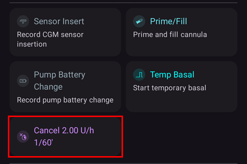

(Extended-Carbs-extended-carbs-ecarbs)=
# Hidratos de carbono prolongados / «eCarbs»

## O que são os eCarbs e quando são úteis?

Na terapia normal com bomba, os bólus prolongados são uma boa forma de lidar com refeições gordas ou de absorção lenta, que fazem subir a glicose durante mais tempo do que a insulina atua. No entanto, num loop, os bólus prolongados não fazem tanto sentido (e causam dificuldades técnicas), porque são basicamente uma basal temporária alta e fixa. Isto vai contra o funcionamento do loop, que ajusta a basal de forma dinâmica. Para mais detalhes, veja [bólus prolongado](#extended-bolus-and-why-they-wont-work-in-closed-loop-environment) abaixo.

Mas a necessidade de lidar com estas refeições continua a existir. É por isso que o AAPS suporta os chamados hidratos de carbono prolongados ou eCarbs.

Os eCarbs são hidratos de carbono distribuídos ao longo de várias horas. Para refeições normais, com mais hidratos de carbono do que gordura/proteína, introduzir os hidratos de carbono logo no início (e reduzir o bólus inicial, se for preciso) costuma ser suficiente para evitar insulina administrada cedo demais.  Mas, em refeições de absorção mais lenta, em que introduzir todos os hidratos de carbono logo no início leva a demasiada IA por causa dos SMB, os eCarbs podem ser usados para simular com mais exatidão como os hidratos de carbono (e os equivalentes em hidratos que introduzir para outros macronutrientes) são absorvidos e influenciam a glicose. Com esta informação, o loop pode administrar SMB de forma mais gradual para lidar com esses hidratos de carbono. Isto pode ser visto como um bólus prolongado dinâmico (também deve funcionar sem SMB, mas provavelmente é menos eficaz).

**Nota:** os eCarbs não se limitam a refeições ricas em gordura/proteína: também podem ajudar em qualquer situação em que algo faça subir a glicose, por exemplo outros medicamentos, como os corticosteroides.

## Como usar os eCarbs

Para introduzir eCarbs, abra a janela **Hidratos** (**Tratamentos** → **Hidratos**), introduza o total de hidratos, defina uma **Duração** e, se quiser, adie o início com **Hora dos hidratos** (*os números abaixo são apenas exemplos; terá de experimentar os seus próprios valores até obter uma resposta da glicose satisfatória para os seus casos*):

Os eCarbs no ecrã principal: o número entre parênteses no campo **HCA** mostra os hidratos que ainda vão chegar, e o gráfico **HCA** mostra cada registo futuro de eCarbs como uma marca cor de laranja. Se não vir um gráfico **HCA**, adicione um com **Adicionar gráfico** por baixo dos gráficos (ver [Ecrãs do AAPS](../DailyLifeWithAaps/AapsScreens.md)).

(AapsScreens-carbs-type)=
## Tipo de hidratos no Assistente de Bólus: pão, bolo ou pizza

No [Assistente de Bólus](#aaps-screens-bolus-wizard), três botões por baixo do campo **Hidratos** permitem escolher a rapidez com que a refeição é absorvida. Escolha um antes de confirmar. Conforme o tipo, o **AAPS** usa uma parte dos hidratos que introduziu como hidratos normais e acrescenta [hidratos de carbono prolongados («eCarbs»)](#Extended-Carbs-extended-carbs-ecarbs) mais tarde, para refeições lentas e ricas. Prima o ícone **(i)** ao lado dos botões para ver os alimentos típicos do tipo escolhido e o que ele faz aos seus hidratos.

| Tipo                  | Typical foods (examples from the app)                                                                                                     | Hidratos agora, usados para o bólus | eCarbs adicionados                                          |
| --------------------- | ----------------------------------------------------------------------------------------------------------------------------------------- | ----------------------------------- | ----------------------------------------------------------- |
| **Pão** (predefinido) | Pão, salgados, iogurte, fruta, batatas, arroz, papas de aveia, legumes                                                                    | 100 %                               | None                                                        |
| **Bolo**              | Bolinhos de massa recheados, massa, pratos asiáticos ricos em hidratos e gorduras, bolos doces e de massa levedada, cereais, mel, compota | 90 %                                | 20 %, a começar 60 minutos depois, distribuídos por 2 horas |
| **Pizza**             | Lasanha, piza, hambúrgueres, batatas fritas, batatas assadas, batatas fritas de pacote                                                    | 80 %                                | 35 %, a começar 60 minutos depois, distribuídos por 3 horas |

**Exemplo**: introduz 100 g e escolhe **Pizza**. O bólus é calculado para 80 g, registados agora. 35 g de eCarbs começam 1 hora depois e são distribuídos por 3 horas.

É bom saber:
* Não é uma simples divisão: com **Bolo** e **Pizza**, os hidratos registados somam **mais do que introduziu** (110 % e 115 %). O excesso está apenas nos eCarbs.
* O bólus cobre apenas os hidratos comidos agora. O **AAPS** não dá bólus antecipado para os eCarbs: o loop tem-nos em conta quando começam, como quaisquer outros [eCarbs](#Extended-Carbs-extended-carbs-ecarbs).
* Se definir uma **Hora dos hidratos**, os eCarbs começam 60 minutos depois dessa hora.
* A janela de confirmação mostra os eCarbs numa linha própria, _por exemplo_ «eCarbs 35 g / 3 h (+60 min)».
* Os gramas são arredondados por defeito para números inteiros.
* As percentagens, atrasos e durações são fixos; não podem ser alterados nas definições.
* A escolha não é guardada: o assistente abre sempre em **Pão**.

______________________________________________________________________

Uma forma de lidar com gordura e proteína com esta função está descrita aqui: [https://adriansloop.blogspot.com/2018/04/page-margin-0.html](https://adriansloop.blogspot.com/2018/04/page-margin-0.html)

______________________________________________________________________

## Configuração recomendada, exemplo e notas importantes

A configuração recomendada é usar o plugin APS OpenAPS SMB, com os SMB ativados e também com a preferência *Ativar SMB com HCA* ativada.

Um cenário, por exemplo para uma pizza, pode ser dar um bólus (parcial) logo no início com o *Assistente de Bólus* e depois usar a janela *Hidratos* para introduzir os restantes hidratos com uma duração de 4–6 horas, a começar após 1 ou 2 horas.

Para começar mais depressa, o *Assistente de Bólus* pode adicionar os eCarbs por si: escolha o [tipo de hidratos](#AapsScreens-carbs-type) **Bolo** ou **Pizza** por baixo do campo **Hidratos** (ver acima). As quantidades e os tempos são fixos; por isso, use a janela *Hidratos* se quiser outros valores.

**Notas importantes:** Claro que terá de experimentar para ver que valores concretos funcionam para si. Também pode ajustar com cuidado a definição *Máx. de minutos de basal para limitar SMB* para tornar o algoritmo mais ou menos agressivo. Com refeições com poucos hidratos e muita gordura/proteína, pode bastar usar só eCarbs, sem bólus manuais (ver o artigo do blog acima). Quando os eCarbs são criados, é também criada uma nota do Careportal com todos os valores introduzidos, para ser mais fácil repetir e melhorar os valores.

(extended-bolus-and-why-they-wont-work-in-closed-loop-environment)=
## Extended boluses and why they don't work in a closed-loop environment

Como dito acima, os bólus prolongados ou multionda não funcionam bem num loop fechado. [Veja abaixo](#why-extended-boluses-won-t-work-in-a-closed-loop-environment) para mais detalhes

(Extended-Carbs-extended-bolus-and-switch-to-open-loop-dana-and-insight-pump-only)=
### Bólus prolongado e passagem para loop aberto - apenas bombas Dana e Insight

Algumas pessoas pediram uma opção para usar o bólus prolongado no AAPS mesmo assim, porque queriam tratar alimentos especiais da forma a que estão habituadas.

É por isso que o **AAPS** oferece um bólus prolongado aos utilizadores das bombas Dana e Insight: abra **Gerir** e selecione **Bólus Prolongado**.

Primeiro, o **AAPS** avisa que o loop fechado será parado enquanto o bólus prolongado estiver a decorrer. Toque em **OK** para continuar:

Introduza a quantidade de **Insulina** e a **Duração**, depois toque no botão de confirmar em baixo e em **OK**:

Na bomba Insight, o bólus prolongado *não está disponível* se for usada a [emulação da basal temporária](#Accu-Chek-Insight-Pump-settings-in-aaps).

Enquanto o bólus prolongado está a decorrer, o loop funciona no modo **Loop Aberto** (o ícone do loop no ecrã principal muda), e o loop fechado volta a ser ligado automaticamente quando o bólus prolongado termina:

O menu **Gerir** mostra um botão **Cancelar** com a taxa e o tempo decorrido / total (por exemplo **Cancelar 2,00 U/h 1/60'**). Toque nele para parar o bólus prolongado mais cedo:

(why-extended-boluses-won-t-work-in-a-closed-loop-environment)=
### Porque é que os bólus prolongados não funcionam num loop fechado

1. O loop decide que agora devem ser administradas 1,55 U/h. Para o algoritmo, não importa se isto é administrado como bólus prolongado ou como basal temporária. De facto, algumas bombas usam o bólus prolongado. O que deve acontecer então? A maioria dos controladores de bombas para então o bólus prolongado -> Nem precisava de o ter iniciado.

2. Se o bólus prolongado fosse um valor de entrada, o que deveria acontecer no modelo?

   1. Deveria ser considerado neutro, junto com a basal, e o loop trabalharia sobre ele? Então o loop também deveria poder reduzir o bólus se, por exemplo, a glicose descer demasiado e toda a insulina «neutra» for retirada?
   2. O bólus prolongado deveria ser simplesmente somado? Então o loop deveria simplesmente poder continuar? Mesmo na pior hipoglicemia? Não me parece muito bom: uma hipoglicemia é prevista, mas não pode ser evitada?

3. A IA criada pelo bólus prolongado aparece após 5 minutos, na execução seguinte. Por isso, o loop daria menos basal. Portanto, pouco muda... exceto que se perde a possibilidade de evitar a hipoglicemia.
