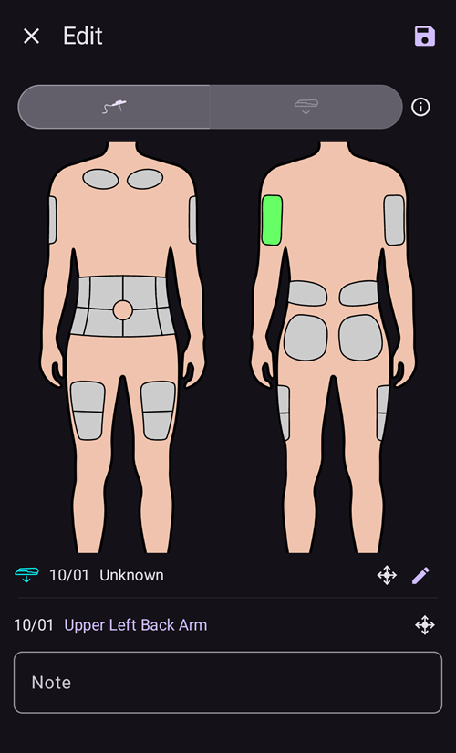

# Bombas e cânulas

## Mudar os conjuntos de infusão: reservatórios de insulina e cânulas

O procedimento descrito abaixo é só para bombas com tubo. Não se aplica a bombas patch como Omnipod, Medtrum Nano, Accu-Chek Solo, etc. Este procedimento é por vezes chamado «mudança do conjunto»: uma mudança «completa» inclui o reservatório de insulina e a cânula, e uma mudança «parcial» refere-se apenas à mudança da cânula.

As bombas patch enchem-se e purgam-se no seu próprio assistente de ativação, e a sua cânula já está no corpo. O **AAPS** não oferece uma purga para elas: **Purgar/Preencher** não aparece no painel **Gerir** nem no QuickLaunch. Consulte a página da sua bomba em [Bombas compatíveis](../Getting-Started/CompatiblePumps.md).

A mudança física do cartucho/reservatório não pode ser feita através do **AAPS** e tem de ser feita diretamente na bomba. Depois de concluída, tem de ser registada manualmente no **AAPS**.

(pumps-cannulas-changing-reservoir-and-cannula)=
### Guia para mudar o reservatório da bomba e a cânula

1. No **AAPS**, desligue a bomba: prima o [ícone do loop](#AapsScreens-loop-status) no ecrã principal e selecione **Desligar bomba** durante 1 hora. O ícone muda para uma ficha cinzenta, que indica que a bomba está desligada.

2. Mudar fisicamente o reservatório de insulina: desligue fisicamente a bomba do corpo e mude o reservatório/cartucho e a cânula conforme as instruções do fabricante.

3. Purgar/encher o tubo e a cânula: pode fazê-lo diretamente na bomba. Elimine todas as bolhas de ar do tubo.

4. Coloque a nova cânula no corpo. Depois de inserir a cânula e retirar a agulha, a cânula fica com um pequeno espaço de ar, que também tem de ser purgado. Para registar isto no **AAPS** e purgar o local: abra **Purgar/Preencher** (no painel de estado expandido do ecrã principal, no painel **Gerir** ou como botão do [QuickLaunch](QuickLaunch.md)) e marque **Registar mudança de local da bomba** e/ou **Registar mudança de cartucho de insulina**, conforme o caso, para registar a mudança. Agora prima a quantidade de purga predefinida para a cânula de insulina (normalmente cerca de 0,3 U, mas verifique se este valor está correto para a sua cânula) e selecione **OK**. Leia a mensagem de resumo e confirme a purga tocando em **OK**.

   


5. Volte a ligar a bomba no **AAPS**: prima o ícone da ficha cinzenta e selecione **Religar bomba** para continuar o loop.

### Informação útil sobre a mudança de insulina/cânula

* Registar uma mudança de local da bomba repõe o Autosens a 100 %. Também repõe as luzes de estado e as idades da cânula/insulina correspondentes no ecrã principal do **AAPS**.

* Pode definir/ajustar as quantidades de purga predefinidas nas definições de **Purgar/Preencher** — escreva "prime" na barra de pesquisa do ecrã principal para as abrir (ver [Definições](../SettingUpAaps/Preferences.md)). Veja no folheto de instruções da caixa das cânulas quantas unidades (conforme o comprimento da agulha e do tubo) deve purgar para a sua cânula.

* A insulina administrada com a função de purga não é tida em conta pelo **AAPS** no cálculo da insulina ativa (IA), e fica marcada no [Histórico de tratamentos](#aaps-screens-treatments) como "Purga".

* A insulina administrada em bólus pela bomba enquanto a bomba está desligada também não é tida em conta pelo **AAPS**. Se administrar um bólus diretamente na bomba enquanto o **AAPS** está desligado, depois de voltar a ligar a bomba pode registar esta insulina (sem a administrar) na janela **Insulina** (ver [Registar insulina já administrada sem dar um bólus](#pumps-cannulas-announce-insulin) abaixo).

### Problemas com a cânula, o local de infusão, o tubo e/ou a bomba

Se tiver a certeza de que não recebeu insulina durante algum tempo, apesar de o **AAPS** registar que sim, e souber exatamente quando o problema começou (_p. ex._ retira a cânula e vê que ficou dobrada durante a inserção), pode corrigir isto no **AAPS**. Tenha em conta que a insulina pode, de facto, ter sido administrada, mas estar a atuar lentamente por alguma razão.

```{admonition} Caution - Risk of Hypoglycemia
:class: danger
Só apague uma administração de insulina do **AAPS** com EXTREMO cuidado, caso a insulina _tenha_ sido realmente administrada, e vigie a glicose de perto nas 24 h seguintes.
```

Para remover os bólus e SMB que sabe que não foram administrados, abra o **menu** (☰), selecione [Histórico de tratamentos](#aaps-screens-treatments) e, no separador **Hidratos e bólus**, elimine com cuidado os bólus registados a partir do momento em que o incidente aconteceu. Isto corrige o valor da «insulina ativa» (IA), que é essencial para os cálculos do **AAPS**; se voltar agora ao ecrã principal, vê que a IA baixou. Atenção: não pode eliminar a insulina basal que o **AAPS** calcula ter sido administrada, por isso o **AAPS** continua a tê-la em conta.

Em casos menos óbvios de problemas na administração de insulina, _p. ex._ fugas, oclusões ou «tunneling» (a insulina sobe ao longo da cânula), em que não sabe quando o problema começou ou pensa que parte da insulina foi administrada, tem de ter cuidado. Pode detetar estes problemas pelo «cheiro» da insulina, por ver o adesivo molhado, por valores de glicose altos ou por um alarme. Como nunca vai saber quanta insulina entrou na pele (e que pode começar a atuar passado algum tempo), é difícil determinar a quantidade correta de insulina a retirar do valor atual da «insulina ativa» (IA). Uma estratégia é parar o loop durante 5 horas (ou a sua duração de ação da insulina) depois de resolver o problema da administração de insulina, e retomar o loop a seguir. Assim, a IA estará correta quando voltar a iniciar o loop.

(pumps-cannulas-disconnecting)=
## Desligar a bomba para tomar duche ou fazer uma atividade

Se tirar a bomba para tomar duche, banho, nadar, praticar desportos de contacto ou outras atividades, tem de informar o **AAPS** de que não está a ser administrada insulina, para manter a IA correta. A bomba pode ser desligada com o [ícone do loop](#AapsScreens-loop-status) no ecrã principal: prima-o e selecione **Desligar bomba** com a duração de que precisa. Se a atividade demorar mais do que o previsto, abra novamente a mesma janela e escolha uma nova duração em **Desligar bomba**: o período desligado é prolongado e a nova duração começa a contar a partir de agora. Não precisa de voltar a ligar primeiro.

Como não recebe insulina enquanto a bomba está desligada, deve voltar a ligá-la a cada duas horas para compensar a basal em falta. Pode fazê-lo ligando a bomba e administrando em bólus as quantidades de basal em falta (_p. ex._ das últimas duas horas) antes de a desligar novamente. Isto ajuda a evitar uma falta grave de insulina, que pode causar cetoacidose diabética (CAD). Se não for prático voltar a ligar a bomba durante a atividade (o local da cânula está tapado por um fato de mergulho, _etc._), considere uma injeção com caneta. Esta injeção manual pode ser registada no **AAPS**, e não tem de ser registada no momento da injeção (basta anotar a hora da injeção), porque pode registar a insulina e indicar a hora real em que foi dada quando voltar a ligar a bomba.

(pumps-cannulas-announce-insulin)=
## Para registar insulina administrada sem fazer um bólus

Para registar insulina administrada pela bomba enquanto o **AAPS** estava desligado, ou injeções com caneta: abra a [janela Insulina](#aaps-screens-buttons-insulin) (**Tratamentos** na barra de navegação inferior, ou um botão do QuickLaunch), introduza a quantidade em unidades e ative **O bólus será apenas registado (não administrado pela bomba)**. Aparece então uma linha **Hora** (definida como **Agora**) que permite registar a hora real da injeção: pode ignorá-la se a injeção foi dada há pouco tempo. Se o bólus foi dado há algum tempo, use **-** para recuar a hora (_p. ex._ -30 min), ou abra a linha com a seta para escolher a data e a hora exatas. O **AAPS** tem então em conta a duração da ação da insulina e calcula a insulina que ainda resta no corpo.

Se usa o **AAPS** como cuidador, pode desligar (e voltar a ligar) a bomba à distância com muita facilidade por [comando SMS](../RemoteFeatures/SMSCommands.md), com comandos como "pump disconnect 120" e "pump connect 120". A duração para desligar à distância vai de 1 a 120 min (neste exemplo, 120 minutos). Isto é muito útil quando o telefone do **AAPS** não está à mão, por exemplo enterrado numa bolsa de cintura de uma criança que corre para a piscina, ou bem guardado (ou em uso) por um adolescente.

## Religar a bomba depois da atividade

Depois de um longo período desligado (1 - 2 horas), é bastante comum o **AAPS** calcular que agora tem IA negativa. Quando voltar a ligar a bomba, conforme a sua preferência, o nível de glicose atual, a comida planeada ou a atividade seguinte, pode:

a) Simplesmente volte a ligar a bomba no **AAPS** (de cinzento para verde, para loop fechado) e deixe o **AAPS** começar a administrar insulina novamente

_ou_

b) Se quiser ser mais agressivo (por exemplo, se caminha para uma hiperglicemia), pode abrir o [Assistente de Bólus](#aaps-screens-bolus-wizard) e dar um bólus para zero hidratos de carbono, para administrar logo como bólus a insulina em falta calculada.

A estratégia que prefere é muito pessoal e descobre-se melhor por tentativa e erro.


(Aapsscreens-site-rotation)=
## Rotação dos locais

**Gerir → Rotação dos locais** abre a janela Rotação dos locais no modo de visualização:

- Com os dois botões no topo (ícone da cânula e ícone do sensor), pode mostrar só os locais da cânula, só os locais do sensor, ou ambos
- Estão disponíveis todos os eventos de mudança de cânula e de mudança de sensor dos últimos 45 dias.
- Toque numa zona de locais, ou num registo da lista abaixo, para filtrar a lista e mostrar só os registos da zona selecionada. A zona selecionada fica destacada a verde claro.
- Toque no ícone do **lápis** ao lado de um registo para abrir a vista de edição e alterar o Local de inserção, a Seta ou a Nota


- O ícone da **roda dentada** (canto superior direito) abre as definições: **Perfil do utilizador para a rotação dos locais** abre uma janela onde escolhe **Homem**, **Mulher** ou **Criança**, e os interruptores **Gerir a rotação dos locais da bomba** e **Gerir a rotação dos locais do CGM** escolhem os locais que gere.


*Nota: esta definição decide se a janela Rotação dos locais (modo de edição) abre automaticamente quando é feito um novo registo com o botão «Purgar/Preencher» ou o botão «Inserção do sensor».*

- Para uma mudança de local feita diretamente na bomba, tem de abrir o modo de visualização e editar o novo registo para escolher o Local de inserção e a Seta

O modo de edição permite escolher o Local de inserção, a Seta e a Nota do registo selecionado:

- O registo em edição aparece por baixo das imagens do corpo, com o ícone do seu tipo (cânula ou sensor)
- As vistas de frente e de trás aparecem lado a lado: toque na zona onde o colocou
- Depois de selecionar um local (destacado a verde), a lista abaixo mostra todos os registos feitos nesse local nos últimos 45 dias.



- Pode adicionar uma seta opcional tocando no ícone da seta à direita do registo: a janela **Selecionar seta** permite indicar uma sub-localização ou a orientação do Pod


- Também pode adicionar uma **Nota** sobre o local selecionado
- Toque no ícone **guardar** (canto superior direito) para registar o local

Pode filtrar graficamente na imagem, ou tocando num evento de terapia da lista Para remover o filtro, basta tocar na imagem fora de qualquer local


