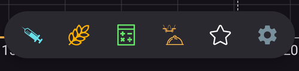
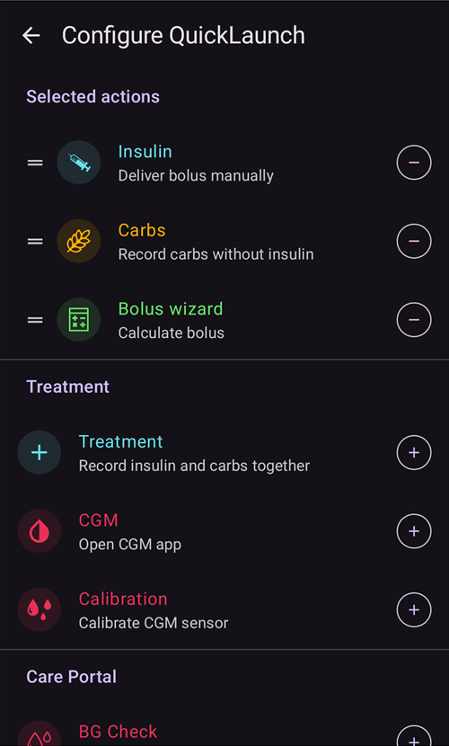

(quicklaunch)=
# QuickLaunch (barra de ações rápidas da visão geral)

O **QuickLaunch** é a pequena **barra de ações rápidas** que flutua na parte inferior da visão geral do **AAPS**, logo acima da navegação inferior. É uma linha personalizável de botões de um só toque: escolhe as ações que lá ficam e a sua ordem, para que as coisas que faz com mais frequência estejam sempre a um toque no ecrã principal.

```{contents} Table of contents
:depth: 2
:local: true
```



---

## Usar a barra

A barra fica na **visão geral**, entre os gráficos e a navegação inferior:


- **Toque** num ícone para executar a sua ação — exatamente como se a abrisse a partir do seu ecrã normal (um bólus ou um tratamento mostra primeiro a confirmação habitual).
- **Prima e mantenha o dedo** num ícone para ver uma **dica** com o nome da ação e uma descrição curta.
- Se adicionar **mais botões do que cabem** no ecrã, os botões a mais passam para um **menu de transbordo** (o botão **⋮** no fim da barra).
- Cada ícone mantém a **cor** da sua ação (p. ex. insulina, hidratos de carbono, alvo temporário), para ser reconhecido rapidamente.

```{admonition} The toolbar is always there
:class: note
O último botão é sempre **Configurar QuickLaunch** (a roda dentada **⚙️**). Não pode ser removido, por isso pode sempre chegar ao ecrã de configuração diretamente a partir da barra. Por predefinição, a barra tem só dois botões — o **Assistente de Bólus** e esta roda dentada.
```

---

## Configurar o QuickLaunch

Toque na roda dentada **⚙️** da barra (ou abra **[Configuração](../SettingUpAaps/ConfigBuilder.md) → … → Configurar QuickLaunch**) para abrir o ecrã **Configurar QuickLaunch** (*«Personalizar os botões de ação rápida na visão geral»*).



O ecrã tem duas partes:

- **Ações selecionadas** (no topo) — os botões que estão agora na sua barra, pela ordem da barra.
- Um **catálogo** por baixo — todas as ações que pode adicionar, agrupadas por categoria. Cada entrada do catálogo tem um botão **➕** para a adicionar.

### Ações selecionadas — reordenar, editar, remover

Cada ação selecionada tem:

- uma **⠿ pega** — prima e arraste para **reordenar** os botões (a ordem aqui é a ordem na barra),
- um botão **−** — **remove** a ação da barra,
- e, só para um atalho de **Perfil**, um botão **✏️** para editar a sua percentagem/duração (ver [Atalhos de perfil](#profile-shortcuts)).

As alterações têm efeito **imediatamente** — não há um botão *Guardar* separado. Uma ação adicionada vai para o fim da barra; reordene-a a partir daí.

---

## As categorias de ações

O catálogo agrupa tudo o que pode adicionar nas categorias seguintes, por esta ordem. As categorias sem nada para oferecer (p. ex. se não tem cenas) simplesmente não aparecem.

### Tratamento

As janelas de tratamento e de CGM do dia a dia:

- **Insulina** — administrar um bólus manualmente.
- **Hidratos** — registar hidratos de carbono sem insulina.
- **Assistente de Bólus** — abrir a calculadora de bólus.
- **Tratamento** — registar insulina e hidratos de carbono em conjunto.
- **CGM** — abrir a sua app de CGM (p. ex. xDrip).
- **Calibração** — calibrar o sensor do CGM.

### Careportal

Os eventos do Careportal e os registos de manutenção dos dispositivos:

- **Verificar Glicose**, **Nota**, **Exercício**, **Questão**, **Anúncio**,
- **Inserção do sensor**, **Troca Bateria Bomba**, **Mudança de local da bomba**, **Purgar/Preencher**, **Rotação dos locais**.

**Purgar/Preencher** e **Troca Bateria Bomba** só são oferecidos quando a sua bomba os usa. As bombas patch, por exemplo, enchem-se e mudam a bateria nos seus próprios passos de ativação, por isso estas entradas não aparecem para elas (tal como no painel **Gerir**).


São as mesmas entradas a que chegaria pelos painéis **[Tratamentos](#v4changes-treatments)** e **[Gerir](#v4changes-manage)** — o QuickLaunch apenas coloca na visão geral as que usa.

### Gerir

Os ecrãs do painel **[Gerir](#v4changes-manage)**, pela mesma ordem, para poder abrir a partir da barra o que usa mais:

- **Perfil**, **Definições de insulina** (gerir e ativar configurações de insulina — tem de propósito um nome diferente de **Insulina**, porque esse botão administra um bólus), **Alvo temporário**, **Assistente Rápido**, **Cenas**, **Automatização**, **Alimentos**,
- **Modo de funcionamento** — fechar ou abrir o loop, suspendê-lo ou desligar a bomba,
- **Clientes autorizados** — só num telefone principal ou num cliente emparelhado.

Estes botões abrem o ecrã; não iniciam nada sozinhos. Para iniciar uma cena ou um Assistente Rápido com um toque, adicione-o a partir da categoria **Cenas** ou **Assistente Rápido** abaixo.

 

### Assistente Rápido

Cada uma das suas predefinições do **[Assistente Rápido](QuickWizards.md)** pode ser adicionada como botão, para que uma refeição habitual fique a um toque da visão geral. O botão tem o nome da predefinição e mostra a quantidade de hidratos/insulina; ao tocar nele, o Assistente Rápido é executado com a confirmação habitual.

Os Assistentes Rápidos definidos para aparecer só no relógio não são oferecidos. Um botão do Assistente Rápido na barra segue as mesmas regras que no painel **Tratamentos**: fica oculto fora do seu [intervalo de tempo válido](#quickwizard_validity) e durante um curto período depois de ser usado. Continua na configuração da sua barra e volta a aparecer quando o Assistente Rápido puder ser usado novamente.

### Cenas

Cada **[cena](Scenes.md)** ativada pode ser adicionada como botão. Ao tocar nele, é pedida uma confirmação e depois a cena é ativada (o mesmo conjunto de ações que obteria a partir do ecrã Cenas). Esta categoria só aparece se tiver pelo menos uma cena.

A dica e o catálogo mostram o mesmo resumo que **Gerir → Cenas**, por exemplo *"3 ações, 2 h → Cooldown"*, em que o nome depois da seta é a cena seguinte.

### Automatização

As suas regras de automatização de **ação do utilizador** (as que inicia à mão) podem ser adicionadas como botões. Ao tocar num deles, é pedida uma confirmação e depois são executadas as ações dessa regra.

```{admonition} Automation buttons run on the master
:class: note
A automatização é executada no **telefone principal**, por isso os atalhos de automatização só são oferecidos e executados no telefone principal. Não estão disponíveis num **[cliente](../RemoteFeatures/ClientMasterControl.md)** emparelhado.
```

### Predefinições de alvo temporário

Cada uma das suas predefinições de **[Alvo temporário](TempTargets.md)** pode ser adicionada como botão (são mostrados o nome, o alvo e a duração, por exemplo *"Comer Brevemente — 5,0 mmol/l, 45 min"*). Ao tocar nele, é pedida uma confirmação e depois esse alvo temporário é iniciado.


(profile-shortcuts)=
### Perfil

Cada **[perfil](ProfileSwitch-ProfilePercentage.md)** pode ser adicionado como **atalho** que faz uma **troca de perfil** com um toque. Ao contrário da maioria dos atalhos, um atalho de Perfil tem a sua própria **percentagem** e **duração**, que define depois de o adicionar, com o botão **✏️**:

- **Percentagem** (30–250 %, em passos de 5 %) — ajusta o perfil quando é aplicado. 100 % usa o perfil tal como está.
- **Duração** (0–10080 min, ou seja, até 7 dias, em passos de 10 min) — quanto tempo dura a troca. **0 = Permanente** (até fazer outra troca).


Assim pode ter vários botões para o **mesmo** perfil com intensidades diferentes — por exemplo *«Perfil 100 %»* e *«Perfil 70 % durante 2 h»* — e aplicar qualquer um deles com um só toque. (Pode adicionar o mesmo perfil mais do que uma vez com definições diferentes.)

### Plugins


Por fim, qualquer **plugin ativado** que tenha o seu próprio ecrã pode ser adicionado como atalho para o abrir diretamente. Estes atalhos estão agrupados por tipo de plugin — **Bomba**, **Fonte da Glicose**, **APS**, **Loop**, **Deteção de sensibilidade**, **Suavização**, **Calibração**, **Restrições**, **Comunicação** e **Geral** — para que possa, por exemplo, ir diretamente da visão geral para o ecrã da sua bomba ou do loop.

---

## QuickLaunch e principal/cliente

Ao contrário da maioria das suas definições, a **barra QuickLaunch é configurada em cada dispositivo** — é guardada **localmente e não é sincronizada** entre o seu telefone principal e os clientes emparelhados, por isso cada dispositivo mantém o seu próprio conjunto de botões. (*Está* incluída numa **cópia de segurança/exportação** das definições, por isso um restauro repõe-na no mesmo dispositivo.)

O que cada dispositivo pode pôr na sua barra depende do que tem: os Assistentes Rápidos, as cenas, as predefinições de alvo temporário e os perfis são todos sincronizados, por isso o catálogo de um cliente oferece os mesmos itens — só os escolhe em cada dispositivo. Alguns detalhes a saber:

- Os botões cujo destino já não existe (um Assistente Rápido, uma cena ou uma predefinição eliminados, uma regra desativada) são **ignorados automaticamente**.
- Os atalhos de **Automatização** só são oferecidos e executados no **telefone principal** (a automatização é executada no telefone principal). Os botões de cena, de Assistente Rápido, de alvo temporário e de perfil estão disponíveis num cliente.
- Quando toca num cliente num botão que tem de ser executado no telefone principal (um bólus, um alvo temporário, uma troca de perfil ou uma cena), é o **telefone principal** que o executa e cria a confirmação. Ver [Controlo principal ↔ cliente](../RemoteFeatures/ClientMasterControl.md).

---


<!-- =====================================================================
     Screenshots captured from a real master device:
       - quicklaunch_toolbar.png    (cropped close-up of the overview toolbar pill)
       - quicklaunch_overview.png   (full overview showing the toolbar in place)
       - quicklaunch_config.png     (Configure QuickLaunch: Selected actions + Treatment + start of Manage)
       - quicklaunch_dynamic.png    (catalog: Quick Wizard / Scenes / Automation / Temp Target Presets)
       - quicklaunch_categories.png (catalog: Profile shortcuts + plugin categories)
     No QuickLaunch action was actually run (nothing delivered; only scrolled).
     Maintainers: relocate page + images and fix cross-links as needed.
     ===================================================================== -->
