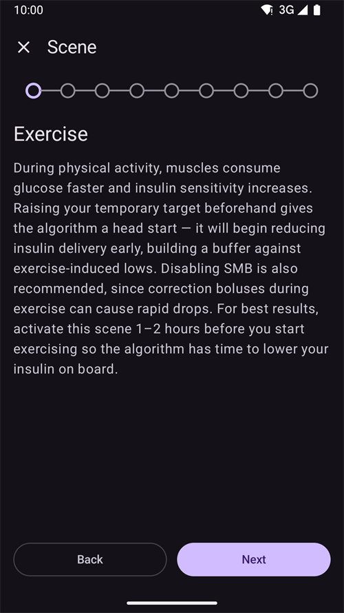

(scenes)=
# Cenas (predefinições para situações)

Uma **cena** é uma predefinição com nome que aplica um **conjunto de ações de uma só vez** — por exemplo, uma predefinição *Sono*, *Exercício* ou *Dia de doença* que troca o seu perfil, define um alvo temporário, liga ou desliga o SMB e adiciona uma nota do Careportal com um único toque, opcionalmente durante um tempo definido.

```{contents} Table of contents
:depth: 2
:local: true
```

---

## O que é uma cena

Em vez de alterar várias coisas à mão sempre que surge uma situação que se repete, configure-as uma vez como cena e ative-a com um toque. Uma cena pode juntar qualquer uma destas ações:

- **Troca de Perfil** — troca o perfil e/ou ajusta-o por uma percentagem (p. ex. 70 %).
- **Alvo Temporário** — define um alvo temporário (p. ex. *Atividade*, *Comer Brevemente* ou um valor personalizado).
- **SMB ligado/desligado** — ativa ou desativa os super micro bólus enquanto a cena está ativa.
- **Modo do loop** — altera o modo de funcionamento (p. ex. para um modo mais conservador).
- **Nota do Careportal** — regista um evento (p. ex. *Exercício*, *Doença*) para que apareça no gráfico e no Nightscout.

Uma cena também tem uma **duração** — um tempo fixo (minutos/horas/dias) ou *Indefinida (fim manual)* — e uma **ação final** que é executada quando termina: uma **notificação**, ou pode **encadear** outra cena (por exemplo *Dia de doença → Exercício*).

---

## Gerir cenas

Abra **Gerir → Cenas** para ver, criar, editar, ativar/desativar e reordenar as suas cenas.


Cada cartão de cena mostra:

- uma **caixa de seleção** para ativar/desativar a cena,
- um **ícone** e um **nome**,
- um resumo — *«N ações, duração»* — e a **→ cena encadeada**, se encadear outra cena,
- e três botões: **▶ ativar**, **✏️ editar**, **🗑️ eliminar**.

Toque no botão **+** para criar uma nova cena.

---

## Criar ou editar uma cena

### Começar a partir de um modelo

Para **criar** uma cena, toque no botão **+** no ecrã Cenas. O primeiro passo é **Começar a partir de um modelo**: escolha uma cena pronta para uma situação comum — *Exercício*, *Dia de doença*, *Dia de doença — Vómitos*, *Sono*, *Noite após exercício*, *Antes da refeição*, *Álcool*, *Condução*, *Banho*, *Fase lútea*, *Tempo quente*, *Procedimento médico* — ou comece a partir de uma cena *Em branco*. Cada modelo **preenche previamente as ações recomendadas** e pode ajustar tudo nos passos seguintes.


Depois de escolher um modelo, é explicado o seu objetivo — *quando* e *porquê* o usar — antes de continuar:



### Percorrer as ações

O resto do editor é um assistente curto, **passo a passo**. Cada passo é um tipo de ação com um interruptor *«Incluir … na cena»* — ligue-o só para as ações que quer que esta cena execute e deixe as outras desligadas.


Percorra os passos com **Seguinte**/**Voltar**: *Troca de Perfil*, *Alvo Temporário*, *SMB*, *Modo do loop*, *Nota do Careportal*, depois a **duração**, a **ação final** (notificar ou encadear outra cena) e, por fim, o **nome e ícone** da cena. Guarde quando terminar. (Para **editar** uma cena existente, toque no seu botão **✏️** — entra diretamente nestes passos.)

Cada passo começa com uma explicação curta do que a ação faz. Os passos são assim, aqui com o modelo *Exercício*:

**Alvo Temporário** — escolha uma das suas predefinições de alvo temporário:


**SMB** — ative ou desative o SMB enquanto a cena está ativa:


**Modo de funcionamento** — opcionalmente, altere o modo do loop:


**Careportal** — o tipo de evento e a nota a registar:


**Duração** — quanto tempo a cena fica ativa; 0 significa até que a termine por si:


**Cena seguinte** — opcionalmente, a cena que começa quando esta termina:


**Cena** — o nome e o ícone. Prima **Terminar** para guardar:


---

## Ativar uma cena

Ative uma cena a partir da lista **Cenas** (o botão **▶**) ou a partir da entrada **Cenas** da navegação inferior. No painel **Cenas** da navegação inferior, cada cena mostra o mesmo resumo que na lista Cenas, e o **lápis** no topo do painel abre **Gerir → Cenas** para criar ou editar as suas cenas.


If [bolus protection](#Preferences-protection) is on, **AAPS** asks for it before a scene starts or ends. Changing a scene needs the [settings protection](#Preferences-settings-protection) instead.

Antes de qualquer coisa ser aplicada, recebe uma **confirmação** que lista exatamente o que a cena vai fazer, para que a possa rever:


Se a cena encadear outra cena, a confirmação termina com **→** e o nome dessa cena seguinte, tal como aparece na lista Cenas.

Quando inicia a cena a partir da entrada **Cenas** da navegação inferior, a confirmação é uma janela mais simples com a mesma lista de ações. Prima **OK** para ativar:


Depois de confirmar, as ações são aplicadas e a **cena ativa** aparece no topo do ecrã principal com um botão **Terminar cena**. Se a cena encadear outra cena, a faixa também indica o nome dessa cena seguinte:


As ações da cena mantêm-se em vigor até:

- a sua **duração** terminar (a **ação final** é executada — uma notificação, ou o encadeamento na cena seguinte), ou
- tocar em **Terminar cena** para a terminar manualmente. Se a cena encadear outra cena, tem duas opções: **Saltar para** a cena seguinte (a cena ativa termina e a cena seguinte começa já), ou **Terminar cena** (a cena ativa termina e a cena seguinte não começa).

Uma cena sem cena seguinte apenas pede que confirme:


Terminar uma cena **reverte** as alterações que ela fez (por exemplo, a troca de perfil e o alvo temporário que iniciou).

Enquanto uma cena está ativa, o perfil e o alvo no ecrã principal mostram um pequeno ícone de cena quando foi a cena que os definiu. O painel **Cenas** da navegação inferior continua disponível para iniciar outra cena:


Quando a duração termina por si, as alterações são revertidas de imediato e a faixa muda para **Cena terminada** com um botão **Fechar**. Fechar apenas remove a faixa do ecrã — a cena em si já terminou, por isso as regras de automatização e uma cena encadeada continuam sem esperar por isso.

---

## Acionar cenas a partir da Automatização

Uma cena não tem de ser iniciada à mão — a **Automatização** pode executá-la por si. Quando adiciona uma ação a uma regra de automatização (**Gerir → Automatização**), a lista de ações tem uma categoria **Cenas**:

- **Executar cena** — ativa uma cena quando as condições da regra são cumpridas (por exemplo, a uma hora definida, quando chega a um local ou quando a glicose passa um limiar).
- **Ativar cena** / **Desativar cena** — torna uma cena disponível (ou indisponível) sem a ativar.


A Automatização também pode **reagir a** uma cena: a lista de condições inclui uma condição **Cena**, para que uma regra só seja executada enquanto uma determinada cena está ativa. Junto com a **ação final** de uma cena (reverter, notificar ou encadear outra cena), isto permite que as cenas comecem, continuem e terminem automaticamente.

---

## Cenas com telefone principal/cliente e um relógio

A **cena ativa é sincronizada** entre todos os seus dispositivos emparelhados — ative-a num telefone e os outros também a mostram.

Um **cliente** emparelhado (**AAPSClient**) também pode ativar ou terminar uma cena: o pedido é enviado para o **telefone principal**, que cria a confirmação e aplica a cena no seu próprio estado. Veja [Controlo principal ↔ cliente](../RemoteFeatures/ClientMasterControl.md) para saber como funciona.

(scenes-from-watch)=
### A partir de um relógio Wear OS

As cenas estão disponíveis num **relógio Wear OS** como um **mosaico Cena**. Deslize até ao mosaico **Cena** no carrossel de mosaicos do relógio (adicione-o primeiro a partir da lista de mosaicos do carrossel, se ainda não estiver lá) e toque na cena que quer iniciar:


O mosaico tem quatro posições. Por predefinição, cada posição é preenchida **automaticamente** com a próxima das suas cenas ativadas, pela ordem que têm no telefone. Para escolher por si, **mantenha o dedo premido no mosaico** e abra as suas definições: para cada uma das quatro posições pode manter **Automático**, fixar uma **cena específica** ou selecionar **Nenhum** para deixar a posição vazia. Uma posição fixada a uma cena que entretanto foi eliminada ou desativada mostra **Indisponível** — escolha outra cena para essa posição.

O relógio mostra então uma confirmação — toque em **✓** para ativar, ou deslize para trás para cancelar:


Tal como num cliente, **o telefone principal cria a confirmação e executa a cena**; o relógio apenas transmite o pedido (através do telefone cliente, se o relógio estiver emparelhado com um cliente).

Enquanto uma cena está em curso — ou a sua faixa **Cena terminada** ainda aparece no telefone — o mosaico mostra um botão **Terminar** com o nome da cena por baixo. Toque nele para terminar a cena ativa, ou para remover a faixa que ficou, a partir do seu pulso.

Se a cena em curso encadear outra cena, o mosaico também mostra um botão **Saltar** com o nome da cena seguinte por baixo. São as mesmas duas opções que no telefone:

- **Terminar** — a cena ativa termina. A confirmação indica que a cena seguinte não vai começar.
- **Saltar** — a cena ativa termina e a cena seguinte começa já. A confirmação indica o nome das duas cenas.

O [ecrã Estado do loop](#WearOsSmartwatch-loop-status) do relógio também mostra a cena ativa, o tempo que falta e a cena seguinte.

---


<!-- =====================================================================
     Screenshots captured from a real master device:
       - scenes_list.png        (Manage → Scenes management list)
       - templates_picker.png   (create: "Start from template" picker)
       - template_explanation.png (create: chosen template's explanation)
       - scene_editor.png       (scene editor, Profile switch step)
       - scene_confirmation.png (scene activation confirmation — also used on the Client/Master page)
       - scene_active_banner.png (overview active-scene banner with the End Scene button)
       - automation_scene_action.png (Automation action picker — Scenes category)
       - scene_watch_tile.png    (Wear OS Scene tile)
       - scene_watch_confirm.png (Wear OS scene confirmation)
     Maintainers: relocate page + images and fix cross-links as needed.
     ===================================================================== -->
