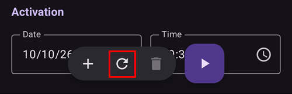
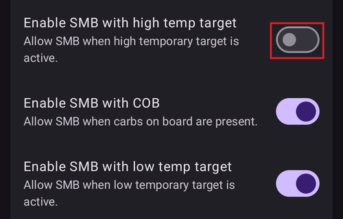

# Alvos temporários

## O que são alvos temporários e onde os posso definir e configurar?

Um **alvo temporário** (ou, abreviado, **AT**) é uma funcionalidade do **AAPS** que permite ao utilizador alterar o seu [intervalo alvo de **glicose**](#profile-glucose-targets) para atividades planeadas. Isto é conseguido pelo **AAPS** ao ajustar a insulina administrada ao utilizador.

Um alvo de glicose, sobretudo se for apenas de curta duração (menos de 4 horas), não tem de ser o *valor real* que espera ou quer que a sua glicose atinja. É antes uma boa forma de dizer ao **AAPS** para ser mais ou menos agressivo, mantendo a glicose no alvo.

Os alvos temporários podem ser definidos dentro destes limites:

|        | Alvo Temporário        |
| ------ | ---------------------- |
| Mínimo | 4 mmol/l ou 72 mg/dl   |
| Máximo | 10 mmol/l ou 180 mg/dl |

O **AAPS** tem três predefinições de **alvo temporário** incorporadas, adequadas para exercício (**Atividade**), refeições (**Comer Brevemente**) e hipoglicemia prevista (**Hipo**). Encontram-se no ecrã **Alvo temporário** (**Gerir** → **Alvo temporário**), que também pode abrir com um simples toque no **chip do alvo** no ecrã principal.

Os utilizadores devem ter expectativas realistas sobre os resultados que podem ser alcançados ao selecionar um **alvo temporário** no **AAPS**. O sucesso em atingir o alvo de **glicose** pretendido depende de vários fatores, como: a fiabilidade das definições do **AAPS** do utilizador, o controlo geral da **glicose**, a **IA**, a sensibilidade à insulina, a resistência à insulina, a intensidade do esforço durante o exercício, etc.

Um **alvo temporário** pode demorar cerca de 30 minutos ou mais a atingir o alvo de **glicose** pretendido. É impossível o **AAPS** atingir um alvo de **glicose** com efeito imediato, e os utilizadores devem ter isto em conta ao selecionar um **alvo temporário**.

The sections below summarize the features of **Temp-Target Activity**, **Temp-Target Eating soon** and **Temp-Target Hypo**. Os valores mostrados são os predefinidos de origem — pode [ajustar cada predefinição](#TempTargets-change-preset-defaults) às suas necessidades.

### AT - Atividade


**Alvo de glicose (predefinição, ajustável)**

O AAPS vai tentar atingir 140 mg/dl ou 7,8 mmol/l durante 1 h 30 min

**Outros fatores que os utilizadores podem querer ter em conta ao selecionar**:

Conforme o nível de **glicose**, o **AAPS** vai «diminuir» a insulina administrada para atingir o alvo de **glicose**. Se o alvo de **glicose** não estiver dentro do intervalo (ou seja, acima do alvo de **glicose** selecionado no **perfil** do utilizador), o **AAPS** pode manter a basal ligada.

No modo de loop fechado, o **SMB**:

- *pode ser* desativado (ver mais abaixo); e/ou
- a basal pode ser ativada se o **AAPS** estiver com **IA** negativa ou <0.

Os utilizadores também podem considerar:

- *selecionar* este **AT** 1–2 horas antes do exercício planeado, para garantir uma IA reduzida (o momento certo para este AT varia de pessoa para pessoa); e
- *selecionar* um perfil temporário (reduzido) durante a atividade planeada, para garantir uma **IA** reduzida;
- *garantir* que o **AT** é programado para ser *desativado* pouco antes do exercício, porque a **IA** já está reduzida e alguns utilizadores têm uma subida rápida da **glicose** após o exercício.

### AT - Comer Brevemente


**Alvo de glicose (predefinição, ajustável)**

O AAPS vai tentar atingir 90 mg/dl ou 5,0 mmol/l durante 45 minutos

**Outros fatores que os utilizadores podem querer ter em conta ao selecionar**:

No modo de loop fechado, o **SMB**:

- vai manter-se ativo; e/ou
- a basal também pode ser ativada, conforme as definições do **perfil** do utilizador.

Conforme o nível de **glicose**, o **AAPS** vai «aumentar» a insulina administrada, dentro dos parâmetros das definições do **AAPS** do utilizador, para atingir o alvo de **glicose** pretendido.

### AT - Hipo


**Alvo de glicose (predefinição, ajustável)**

O AAPS vai tentar atingir 160 mg/dl ou 8,9 mmol/l durante 1 hora

**Outros fatores que os utilizadores podem querer ter em conta ao selecionar**:

No modo de loop fechado, o **SMB**:

- *pode ser* desativado (ver mais abaixo); e/ou
- a basal pode ser ativada se o **AAPS** estiver com **IA** negativa ou <0.

(TempTargets-manage-v4)=

## Definir e gerir alvos temporários (Gerir → Alvo temporário)

No **AAPS** v4, gere as suas **predefinições** de AT e inicia um alvo temporário a partir do ecrã **Gerir** (navegação inferior) → **Alvo temporário** (*«Gerir e definir alvos temporários»*).


O ecrã tem três partes:

1. **Carrossel de predefinições** (em cima) — deslize pelas suas predefinições de AT. Cada cartão mostra o **nome**, o **alvo** e a **duração** da predefinição; o AT em curso aparece destacado.
2. **Editor** (ao meio) — o **Alvo Temporário** e a **Duração** que vão ser realmente aplicados, mais uma data/hora de **Ativação**.
3. **Barra de ações** (em baixo) — **➕ adicionar**, **‘️ eliminar** e o botão **▶ ativar**.

Selecionar um cartão de predefinição carrega o seu **alvo** e a sua **duração** no editor.

```{admonition} Predefinições incorporadas vs. personalizadas :class: note As predefinições incorporadas — **Comer Brevemente**, **Atividade** e **Hipo** — existem sempre e **não podem ser eliminadas** (mas pode alterar os seus valores e guardá-los). As predefinições que cria são **personalizadas** e podem ser editadas ou eliminadas livremente.

    <br />### Ativar um alvo temporário
    
    Deslize até à predefinição que quer (os seus valores são carregados no editor), ajuste opcionalmente o **alvo**/a **duração** no editor e depois toque em **▶ Ativar**. Uma confirmação mostra o alvo, a duração e o motivo exatos antes de qualquer coisa começar:
    
    
    
    Depois de confirmar, o alvo temporário começa de imediato (ou à hora de **Ativação** escolhida) e dura a **duração** definida.
    
    ```{admonition} Editar os números é só para uma vez — não altera a predefinição
    :class: important
    O **alvo** e a **duração** no editor são os valores que **Ativar** vai usar *agora*. Se os alterar, essa alteração é **temporária**: aplica-se só a esta ativação e **não modifica a predefinição guardada**. Assim pode «ajustar e ativar» um AT só para uma vez (por exemplo, ativar *Atividade* hoje com um alvo um pouco diferente) sem alterar a predefinição de forma permanente.
    

### Guardar alterações numa predefinição

Se *quiser* manter um valor editado, use **Guardar**: quando o editor difere da predefinição selecionada, aparece um ícone **Guardar** na barra de ferramentas superior. Tocar nele guarda o **alvo** e a **duração** atuais (e o nome, nas predefinições personalizadas) na predefinição selecionada. Nas predefinições incorporadas, também aparece um botão **Repor valores predefinidos** (↺) na barra de ações: repõe os valores predefinidos da predefinição.



Por isso, a regra prática é:

- **Ativar** → usa os números **uma vez** (a predefinição não muda).
- **Guardar** → torna os números os **novos valores** da predefinição.

Para repor uma predefinição incorporada tal como veio de origem, selecione-a e toque no botão **↺ Repor** — só aparece na barra de ações para uma predefinição **incorporada** cujos valores sejam diferentes dos valores de origem, e repõe o **alvo** e a **duração** originais dessa predefinição.

### Adicionar e remover predefinições

- **➕ Adicionar** — cria uma **nova predefinição personalizada** a partir dos valores atuais do editor. O novo cartão aparece no carrossel.
- **‘️ Eliminar** — remove a predefinição **personalizada** selecionada. As predefinições incorporadas (*Comer Brevemente*, *Atividade*, *Hipo*) não podem ser eliminadas.

Quando tiver pelo menos duas predefinições **personalizadas**, também pode mudar a sua ordem no carrossel: toque no ícone **Reordenar** (⇅) na barra superior, mova o cartão central com os **botões de mover ◀ / ▶** e depois confirme com **✓**. As predefinições incorporadas mantêm o seu lugar — só as predefinições personalizadas podem ser movidas. (Os controlos são iguais aos de [reordenar perfis](ProfileSwitch-ProfilePercentage.md).)

As suas predefinições fazem parte da configuração sincronizada, por isso são partilhadas entre o seu telefone principal e os clientes emparelhados.

### Outras formas de definir um alvo temporário

Também pode definir um alvo temporário sem abrir este ecrã:

- com os **interruptores de AT na janela Hidratos** — ver [abaixo](#TempTargets-carbs-dialog),
- com um **botão de predefinição na [barra de ferramentas QuickLaunch](QuickLaunch.md)** — a categoria *Predefinições de alvo temporário* em *Configurar QuickLaunch* oferece um botão de um toque para cada uma das suas predefinições,
- a partir de um **relógio Wear OS** (o item de menu / mosaico **Alvo temporário**),
- a partir de um **cliente** emparelhado — ver [Controlo principal ↔ cliente](../RemoteFeatures/ClientMasterControl.md),
- como parte de uma **[cena](Scenes.md)** (a ação *Alvo Temporário*), ou
- a partir de uma regra de **Automatização** (*Iniciar Alvo Temp* / *Parar Alvo Temp*).

* * *

(TempTargets-where-can-i-select-a-temp-target)=

## Onde posso selecionar um alvo temporário?

A forma mais rápida é tocar no **chip do alvo** no ecrã principal (mostra o seu intervalo alvo atual):


Isto abre o ecrã **Alvo temporário** descrito acima — deslize até uma predefinição e toque em **▶ Ativar**. O mesmo ecrã também pode ser aberto através de **Gerir** → **Alvo temporário**.

(TempTargets-carbs-dialog)= Ao introduzir hidratos de carbono, não precisa de abrir o ecrã **Alvo temporário**: a **janela Hidratos** (**Tratamentos** → **Hidratos**) tem os interruptores **Iniciar AT de Hipo**, **Iniciar AT de Comer Brevemente** e **Iniciar AT de atividade** no topo. Ligue um deles e a predefinição correspondente é ativada juntamente com o registo dos hidratos:


    {admonition} AT Hipo automático
    :class: note
    Se abrir a **janela Hidratos** quando a sua glicose está abaixo de 72 mg/dl (4 mmol/l), o **AAPS** pré-seleciona por si o interruptor **Iniciar AT de Hipo** (exceto se já estiver em curso um alvo temporário mais alto com uma duração restante mais longa).

(TempTargets-change-preset-defaults)=

## Onde posso alterar o alvo temporário predefinido e substituí-lo pelas minhas próprias preferências?

O **alvo** e a **duração** de cada predefinição são editados diretamente no ecrã **Alvo temporário** — já não há uma entrada separada nas preferências para isto:

1. Abra o ecrã **Alvo temporário** (toque no chip do alvo, ou **Gerir** → **Alvo temporário**).
2. Deslize até à predefinição que quer alterar.
3. Ajuste o **Alvo Temporário** e/ou a **Duração** no editor.
4. Toque no ícone **Guardar** que aparece na barra de ferramentas superior.


Enquanto o editor difere dos valores de origem de uma predefinição incorporada, também aparece um botão **↺ Repor** na barra de ações — toque nele para repor o alvo e a duração originais da predefinição.

## Como cancelo um alvo temporário?

Enquanto um alvo temporário está em curso, o chip do alvo no ecrã principal mostra o alvo e o tempo que falta. Toque nele — no ecrã **Alvo temporário**, a predefinição em curso aparece destacada como **ATIVO**, e aparece um botão vermelho **✗ Cancelar** no fim da barra de ferramentas em baixo, logo à esquerda do botão **▶ Ativar**. Toque nele e confirme:


Um alvo temporário em curso também pode ser parado a partir de um **relógio Wear OS**, de um **cliente** emparelhado ou por uma regra de **Automatização** (*Parar Alvo Temp*).

(TempTargets-hypo-temp-target)=

## Alvo temporário Hipo

O **alvo temporário Hipo** permite ao **AAPS** evitar que o utilizador tenha glicose baixa, reduzindo a insulina administrada. Se o utilizador prevê que a sua **glicose** vai baixar: normalmente o **AAPS** deve tratar disso, mas muito depende da estabilidade das definições do **AAPS** do utilizador. Um **alvo temporário Hipo** permite ao utilizador antecipar-se à hipoglicemia prevista e indicar ao **AAPS** que reduza a insulina.

Por vezes, quando são ingeridos hidratos de carbono para tratar uma hipoglicemia, a **glicose** do utilizador pode subir rapidamente, e o **AAPS** corrige a subida rápida da **glicose** com **SMB**.

Alguns utilizadores preferem evitar que sejam administrados **SMB** durante um **alvo temporário Hipo**. Isto é feito ao desativar *«Ativar SMB com alvo temporário alto»* em **Definições** → **OpenAPS SMB** (ver mais abaixo):

- Advanced, objective 9: the user can enable *“High temp target raises sensitivity”* for **Temp-Targets** of 100 mg/dL (5.6 mmol/L) or higher in OpenAPS SMB, **AAPS** will be more sensitive.

- Advanced, objective 9: the user can deactivate *“Enable SMB with high temp target”*, so that even if **AAPS** has COB > 0, “Enable SMB with low temp target” or “Enable SMB always” enabled and OpenAPS SMB active, **AAPS** will not give SMBs while high temp targets are active.

Nota: se abrir a **janela Hidratos** quando a sua glicose está abaixo de 72 mg/dl ou 4 mmol/l, o **AAPS** pré-seleciona automaticamente o interruptor **Iniciar AT de Hipo**.

(TempTargets-activity-temp-target)=

## Alvo temporário Atividade

Antes e durante o exercício, o utilizador pode precisar de um alvo mais alto para evitar uma hipoglicemia durante a atividade.

Para simplificar o **alvo temporário Atividade**, o utilizador pode configurar um **alvo temporário Atividade** predefinido que sobe os níveis de **glicose** ao reduzir a insulina administrada, para abrandar a descida da **glicose** e evitar uma hipoglicemia.

Os novos utilizadores do **AAPS** podem precisar de experimentar e personalizar as definições predefinidas do seu **alvo temporário Atividade**, para que esta funcionalidade funcione o melhor possível para eles. Cada pessoa é diferente quando se trata de manter a glicose estável durante o exercício. Veja também a [secção sobre desporto nas FAQ](#FAQ-sports).

Alguns utilizadores também preferem ativar uma **Troca de Perfil** (um perfil reduzido, abaixo de 100 %, para reduzir a insulina administrada pelo **AAPS**) antes e durante o **alvo temporário Atividade**. Pode iniciar os dois num só passo: toque no nome do perfil no ecrã principal, toque no botão redondo **▶**, defina uma **Percentagem** abaixo de 100 % e uma **Duração**, e depois ligue **Alvo Temporário / Atividade**. Veja [Alterar a Percentagem do Perfil](#ProfileSwitch-change-percentage).

Avançado, objetivo 9: os utilizadores podem ativar *«Alvo temporário alto aumenta a sensibilidade»* para **alvos temporários** de 100 mg/dl (5,6 mmol/l) ou mais no OpenAPS **SMB**. Um alvo de 99 mg/dl (5,5 mmol/l) é um alvo normal, nem alto nem baixo. Assim, o **AAPS** fica mais sensível.

Além disso, se *«Ativar SMB com alvo temporário alto»* estiver desativado, o **AAPS** não vai administrar **SMB**, mesmo com HCA > 0, *«Ativar SMB com alvo temporário baixo»* ou *«Ativar SMB sempre»* ativado e o OpenAPS **SMB** ativo.

(TempTargets-eating-soon-temp-target)=

## Alvo temporário Comer Brevemente

**Temp-Target Eating soon** can help accomplish a gentle drive down of **BG** and ensure there is ample **IOB** before eating.

This can be an important tool for those users who do not pre bolus, however the efficacy of **Temp-Target Eating soon** will depend on a number of factors including: the user’s settings, if they eat a low carb diet and whether they are using a fast acting insulin (like Fiasp or Lyumjev) in order to eliminate the need to pre bolus. Ordinarily, until users are experienced in **AAPS** they should expect to pre bolus when using **Temp-Target Eating soon** and this is particularly so, if eating a high carb diet.

Pode ler mais sobre o «modo Eating soon» (comer brevemente) no artigo ['How to do “eating soon” mode'](https://diyps.org/2015/03/26/how-to-do-eating-soon-mode-diyps-lessons-learned/) ou [aqui](https://diyps.org/tag/eating-soon-mode/).

Avançado, [objetivo 9](#objectives-objective9): se usar o OpenAPS SMB e tiver *«Alvo temporário baixo diminui a sensibilidade»* ativado, o **AAPS** funciona de forma um pouco mais agressiva. Para esta opção, o **alvo temporário** tem de ser de 98 mg/dl (5,4 mmol/l) ou menos.

## Como desligo o SMB durante os alvos temporários?

Para isso, abra **Definições** → **OpenAPS SMB** e desative *«Ativar SMB com alvo temporário alto»*.



Isto garante que o **AAPS** não administra **SMB**, mesmo com HCA > 0, *«Ativar SMB com alvo temporário baixo»* ou *«Ativar SMB sempre»* ativado e o OpenAPS SMB ativo.