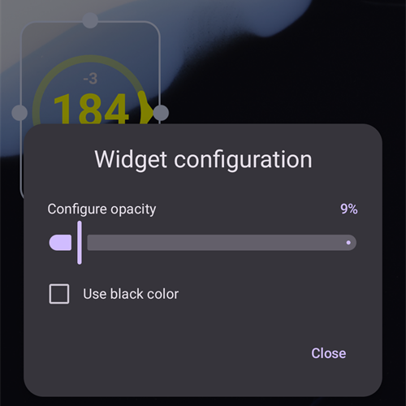

(widgets)=
# Widgets do ecrã principal

O **AAPS** tem widgets que pode adicionar ao ecrã inicial do seu telefone. Um widget mostra os seus dados atuais sem abrir a app. Toque num widget para abrir o **AAPS**.

```{contents} Table of contents
:depth: 2
:local: true
```

---

## Widgets disponíveis

Estão disponíveis cinco widgets. Aparecem em **AAPS** na lista de widgets do Android:


| Widget                                 | Tamanho padrão | O que mostra                                                                                                                                                                                                                                               |
| -------------------------------------- | -------------- | ---------------------------------------------------------------------------------------------------------------------------------------------------------------------------------------------------------------------------------------------------------- |
| **Widget AAPS**                        | 5 × 2          | The status block of the main screen: BG with trend and delta, the loop mode as an icon beside the profile name, target, sensitivity (shown as on the main screen), IOB and COB. The texts shrink to fit the size you give the widget instead of being cut. |
| **Círculo de glicose AAPS**            | 2 × 2          | O círculo de glicose do ecrã principal: um anel na cor da glicose, o arco da tendência, o delta, o valor da glicose e o tempo desde a última leitura.                                                                                                      |
| **AAPS Pequeno**                       | 2 × 2          | Nome do perfil, glicose com seta de tendência, tempo desde a última leitura, delta, IA e HCA.                                                                                                                                                              |
| **AAPS Glicose + IA + HCA (compacto)** | 4 × 1          | Uma linha com a glicose e a seta de tendência, a IA e a HCA.                                                                                                                                                                                               |
| **Gráfico de glicose AAPS**            | 3 × 1          | O valor da glicose com um pequeno gráfico das leituras recentes.                                                                                                                                                                                           |

O **Widget AAPS**, o **Círculo de glicose** e o widget **Pequeno** num ecrã inicial:


O widget **compacto** e o widget **Gráfico de glicose**:


Os valores da glicose usam as mesmas cores que no **AAPS**: verde no alvo, amarelo acima do alvo, vermelho abaixo do alvo.

---

## Adicionar um widget

Os passos exatos dependem do seu telefone e do launcher. Na maioria dos telefones:

1. Toque sem soltar numa área vazia do ecrã inicial e selecione **Widgets**.

   

2. Abra **AAPS** na lista e toque no widget que quer.
3. Prima **Adicionar** (ou arraste o widget para o local que quer).

   

O widget é colocado no ecrã inicial. Logo depois de o adicionar, o widget aparece com pegas: arraste uma pega para **redimensionar** o widget, ou arraste o widget para o mover. O círculo de glicose pode ser redimensionado para qualquer tamanho.


Se a página do ecrã inicial estiver cheia, o telefone coloca o widget numa nova página.

---

## Configuração do widget

Toque no botão **lápis** que aparece no widget logo depois de o adicionar. Mais tarde, toque sem soltar no widget para voltar a ver as pegas e o lápis.

A janela **Configuração do widget** tem duas definições:

- **Configurar opacidade** — quão opaco é o fundo do widget. Um valor baixo deixa ver o fundo do ecrã através do widget.
- **Usar cor preta** — usa um fundo preto em vez do fundo padrão.



Cada widget tem a sua própria configuração.

---

## É bom saber

- Um widget só **mostra** dados. Não é possível dar um bólus nem mudar nada a partir de um widget.
- O widget é atualizado pelo **AAPS**. Se o **AAPS** não estiver a funcionar, ou se o Android o restringir em segundo plano, o widget pode mostrar dados antigos. Verifique o tempo desde a última leitura e confirme que o **AAPS** está excluído da [otimização da bateria](#SetupWizard-StoragePermission).
- Com o **AAPSClient**, o **AAPSClient2** e o **AAPSClient3**, o fundo do widget é amarelo, azul ou verde, para que possa distinguir as apps. Aumente a opacidade na configuração do widget se a cor for difícil de ver. Ver [Sobre o AAPSClient, o AAPSClient2 e o AAPSClient3](#remotecontrol-aapsclient-versions).
