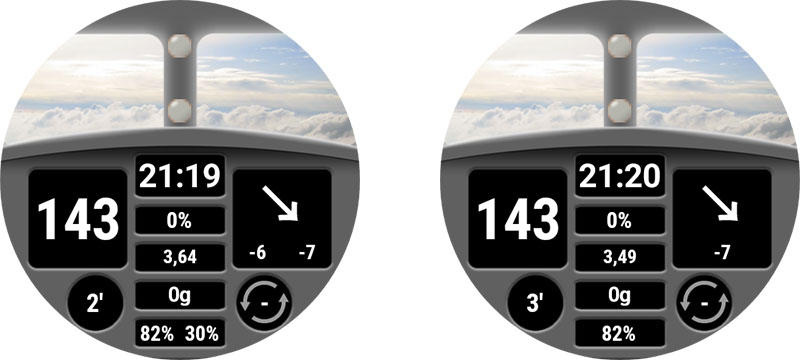

# Documento de referência das watchfaces personalizadas

Esta página é para quem desenha novas watchfaces. Lista todas as palavras-chave e funções disponíveis para criar ou animar uma nova watchface.

- As novas funções e chaves disponíveis na Custom Watchface V2 (Wear apk 3.3.0 ou superior) estão disponíveis [aqui](#cwf-reference-new-v2-features)

## Formato da watchface personalizada

A Custom Watchface é um formato aberto, criado para o AAPS e associado à nova watchface "AAPS (Custom)" disponível no relógio.

O ficheiro da watchface é um simples ficheiro zip, mas, para ser reconhecido como ficheiro de watchface, o ficheiro zip tem de conter os seguintes ficheiros:

- Um ficheiro de imagem chamado CustomWatchface (pode ser um ficheiro bitmap `CustomWatchface.jpg`, `CustomWatchface.png` ou um vetor `CustomWatchface.svg`). Este ficheiro é o pequeno ícone usado para selecionar a watchface quando clica no botão "Carregar Watchface", e também a imagem visível no plugin Wear do AAPS.
- Um ficheiro chamado `CustomWatchface.json` (ver [Estrutura JSON](#cwf-reference-json-structure) abaixo). Este segundo ficheiro é o ficheiro principal, que vai conter toda a informação necessária para desenhar a watchface. Este ficheiro json tem de ser válido (é provavelmente o ponto mais difícil quando edita este ficheiro à mão num editor de texto, porque basta uma vírgula a mais ou a menos para estragar o formato json). Este ficheiro JSON também tem de incluir um bloco `"metadata"` com uma chave `"name"` com um valor não vazio. Este é o nome da sua watchface personalizada (ver [Definições de metadados](#cwf-reference-metadata-settings) abaixo)
- o tamanho deste zip deve ser o menor possível (menos de cerca de 500 kb). Se este ficheiro for demasiado grande, é simplesmente bloqueado e não é transmitido para o relógio.

O ficheiro zip também pode conter alguns ficheiros de recursos adicionais:

- Nomes de ficheiro fixos para as imagens usadas nas vistas normais incluídas na watchface (como `Background`, `CoverChart`... ver [Lista de ficheiros de recursos fixos](#cwf-reference-list-of-hardcoded-resource-files) abaixo). Todos estes ficheiros podem estar no formato `jpg`, `png` ou `svg`. mas para a maioria deles terá de usar `png` ou `svg`, que suportam transparência (os ficheiros jpg são mais pequenos do que os png, mas não têm transparência). Note que a melhor qualidade com o menor tamanho consegue-se, em geral, com ficheiros svg (formato vetorial).
- Ficheiros de recursos adicionais com nomes livres. Estes ficheiros adicionais podem ser ficheiros de imagem ou ficheiros de tipo de letra (para os tipos de letra são aceites os formatos `ttf` e `otf`). Note que, para estes ficheiros adicionais, o `filename` (sem extensão) é usado como keyValue no ficheiro JSON, para indicar onde ou quando estes ficheiros devem ser usados.
  - os ficheiros de imagem são muitas vezes usados como fundo de vistas de texto ou para animações dinâmicas (por exemplo, o nível da bateria de 0% a 100%)
  - os ficheiros de tipo de letra permitem usar tipos de letra próprios na sua watchface

(cwf-reference-json-structure)=

## Estrutura JSON

Os ficheiros JSON podem ser editados no editor de texto Notepad (ou notepad++) (prefira o notepad++, que reconhece o JSON e usa formatação a cores)

- contém chaves de texto `"string_key":` e valores de chave, que podem ser texto como `"key value"`, números inteiros, booleanos como `true`ou `false` ou blocos de dados.
- cada valor é separado por uma vírgula `,`
- Um bloco de dados começa com `{`  e termina com `}`
- o ficheiro json é um bloco inteiro, por isso começa com  `{`  e termina com `}`, e dentro deste ficheiro todos os blocos incluídos estão associados a uma `"key"`, que deve ser única dentro do bloco
- Para facilitar a leitura do ficheiro json, este é em geral indentado (cada nova chave fica numa nova linha, cada novo bloco é deslocado para a direita com 4 espaços)

(cwf-reference-metadata-settings)=

### Definições de metadados

Este bloco é o primeiro bloco do ficheiro json e é obrigatório. Contém toda a informação associada a esta watchface, como o nome, o autor, a data de criação ou de atualização, a versão do autor ou a versão do plugin.

Veja abaixo um exemplo de bloco de metadados:

```text
"metadata": {
    "name": "Default Watchface",
    "author": "myName",
    "created_at": "07\/10\/2023",
    "author_version": "1.0",
    "cwf_version": "1.0",
    "comment": "Default watchface, you can click on EXPORT WATCHFACE button to generate a template"
},
```

Note que a `/` usada na data é um carácter especial. Para ser reconhecida corretamente no ficheiro json, tem de colocar antes dela um carácter de "escape" `\`

Em alguns ficheiros json pode ver uma chave adicional `"filename"`. Esta chave é criada ou atualizada automaticamente quando a watchface personalizada é carregada no AAPS (é usada para mostrar ao utilizador o nome do ficheiro zip na pasta exports), por isso pode remover esta chave do bloco de metadados.

(cwf-reference-general-parameter-settings)=

### Definições de parâmetros gerais

Depois do primeiro bloco com os metadados, define alguns parâmetros gerais (ver [Lista de parâmetros gerais](#cwf-reference-list-of-general-parameters) abaixo). Isto permite definir as cores do gráfico (hidratos de carbono, bólus, valores de glicose...) e também as cores predefinidas para valores no alvo, hiper ou hipo (cores predefinidas do valor da glicose e das setas)

Veja abaixo um exemplo de parâmetros gerais

```text
"highColor": "#FFFF00",
"midColor": "#00FF00",
"lowColor": "#FF0000",
"lowBatColor": "#E53935",
"carbColor": "#FB8C00",
"basalBackgroundColor": "#0000FF",
"basalCenterColor": "#64B5F6",
"gridColor": "#FFFFFF",
"pointSize": 2,
"enableSecond": true,
```
(cwf-reference-imageview-settings)=

### Definições de ImageView

Uma imagem personalizada pode ser ajustada usando o nome de ficheiro correto associado a cada ImageView incluída no layout da watchface personalizada. O bloco json serve apenas para definir a posição, o tamanho, se a vista está visível ou não e, opcionalmente, para ajustar a cor:

Veja abaixo um exemplo de um bloco de imagem para second_hand (neste caso não há nenhuma imagem incluída no ficheiro zip, por isso é usada a imagem predefinida do ponteiro dos segundos, mas com uma cor personalizada).

```text
"second_hand": {
    "width": 400,
    "height": 400,
    "topmargin": 0,
    "leftmargin": 0,
    "visibility": "visible",
    "color": "#BC906A"
}
```
Para ter o second_hand colorido com a cor de glicose predefinida (lowRange, midRange ou highRange), basta modificar a última linha com o keyValue `bgColor`

```json
    "color": "bgColor"
```

(cwf-reference-textview-settings)=

### Definições de TextView

TextView have more available parameters compare to ImageView: you can tune rotation (integer value in degrees), textsize (integer value in pixel), gravity (to define if text value will be centered (default value), or aligned left or right), set the font, fontStyle and fontColor, and also background color of the TextView

```text
"basalRate": {
    "width": 91,
    "height": 32,
    "topmargin": 133,
    "leftmargin": 249,
    "rotation": 0,
    "visibility": "visible",
    "textsize": 23,
    "gravity": "center",
    "font": "default",
    "fontStyle": "bold",
    "fontColor": "#BDBDBD"
},
```
Note que, se não quiser gerir uma vista na sua watchface, deve colocar a chave `"visibility"` em `"gone"`, mas também definir o tamanho e a posição fora da área visível, assim:

```text
"second": {
    "width": 0,
    "height": 0,
    "topmargin": 0,
    "leftmargin": 0,
    "rotation": 0,
    "visibility": "gone",
    "textsize": 46,
    "gravity": "center",
    "font": "default",
    "fontStyle": "bold",
    "fontColor": "#BDBDBD"
},
```
Se o tamanho e a posição estiverem dentro da área visível, pode ver um "flash" do valor escondido durante a atualização da watchface.

Se quiser personalizar a imagem de fundo de uma vista de texto, pode usar a chave `"background":` e colocar como keyValue o nome do ficheiro de uma imagem incluída no ficheiro zip. Também pode mudar só a cor de fundo com a chave `"color:"`.

```json
"background": "fileName"
```

Também tem 4 TextViews específicas (chamadas freetext1 a freetext4) que têm um parâmetro próprio `"textvalue":`, que pode ser usado, por exemplo, para definir uma etiqueta

(cwf-reference-chartview-settings)=

### Definições de ChartView

A vista de gráfico (Chart view) é uma vista muito específica, que pode partilhar alguns parâmetros com a ImageView ou com a TextView...

As definições normais desta vista são muito simples:

```text
"chart": {
    "width": 400,
    "height": 170,
    "topmargin": 230,
    "leftmargin": 0,
    "visibility": "visible"
},
```
Os 2 parâmetros adicionais que pode incluir na vista de gráfico são uma cor de fundo (a predefinição é transparente), com a chave `"color"`, ou uma imagem de fundo, com a chave `"background"`.

(cwf-reference-how-to-build-watchface)=

## Como criar/desenhar a sua primeira watchface

### Ferramentas necessárias

- Editor de texto: o meu conselho é usar o NotePad++ (ou equivalente), que é um editor de texto simples, mas com a vantagem de mostrar o texto formatado com cores, o que facilita encontrar erros. qualquer editor de texto simples serve. Porque o objetivo é ajustar a informação json.
- Editor de imagem (bitmap e/ou vetorial)
  - Se usar bitmap
    - O editor de imagem deve suportar transparência (necessária para todas as imagens por cima do fundo) e o formato png (se usar imagens bitmap)
    - A imagem de fundo pode estar no formato jpg (mais pequeno do que png)
    - O editor de imagem deve permitir medir objetos gráficos em píxeis (pode ser um simples quadrado) (top, left, width, height)
    - O editor de imagem deve conseguir mostrar as cores com o código RRGGBB em hexadecimal
    - O editor de imagem deve conseguir redimensionar a imagem para 400px x 400px (muito importante trabalhar com esta resolução)
  - Se usar vetores
    - A imagem vetorial deve ser exportada no formato svg

### Obter um modelo para não começar do zero

Quando quiser desenhar a sua primeira watchface, o melhor é começar pela watchface predefinida (assim tem a versão mais recente, com todas as vistas disponíveis ordenadas corretamente)

- Pode obter o ficheiro zip ao clicar no botão "Exportar modelo" no plugin Wear e encontrar o ficheiro zip na pasta AAPS/exports
- Note que precisa de ter um relógio ligado ao AAPS para ver os botões da watchface personalizada (o relógio também é necessário para verificar, testar e ajustar a sua watchface personalizada)

A watchface predefinida é muito simples, e o ficheiro zip contém só os 2 ficheiros:

- CustomWatchface.png (imagem da watchface predefinida para a seleção da WF)
- CustomWatchface.json

### Organizar os ficheiros no computador

The easiest way to work is to have phone connected to the computer, and work with two specific folders:

- um explorador aberto numa pasta específica que tem todos os ficheiros (json, imagens bitmap, imagens vetoriais, tipos de letra) e o ficheiro CustomWatchface.zip
- outro explorador (ou a árvore de navegação ajustada) aberto na pasta Telefone/AAPS/exports

Assim é muito fácil trabalhar: sempre que ajustar o ficheiro json num editor de texto ou uma imagem num editor de imagem (bitmap ou vetorial), só tem de:

1. guardar as alterações em cada aplicação
2. arrastar e largar todos os ficheiros para dentro do ficheiro CustomWatchface.zip
3. arrastar e largar o CustomWatchface.zip para a pasta AAPS/exports do telefone
4. enviar a CustomWatchface para o relógio para verificar o resultado

### Iniciar a personalização da watchface

Primeiro, tem de definir um nome para a watchface (necessário para a selecionar facilmente para testes) e começar a ajustar as chaves de metadados no início do ficheiro json

Depois tem de definir que informação quer mostrar, ou seja, que vistas devem estar visíveis ou escondidas.

- vai mostrar os segundos ou não?
- quer desenhar um relógio analógico ou um relógio digital (ou os dois...)

Agora pode começar a modificar o ficheiro json, com a chave `"visibility":` de cada vista definida como `"visible"` ou `"gone"` (para manter ou não a vista)

You can also start to tune approximately top, left margin and width height values to start organizing the watchface (these values will be tuned later using image editor)

Nota: tudo é desenhado dentro de um **retângulo de 400px x 400px**. Por isso, tudo é posicionado em coordenadas absolutas dentro deste tamanho.

Quando desenhar a sua primeira watchface, tem de saber que tudo está organizado por camadas, do fundo para a frente. Por isso, cada vista (ImageView ou TextView) pode esconder algo que está por trás...


No ficheiro json, todas as vistas estão ordenadas do fundo para a frente (isto ajuda a lembrar o que está por trás de quê...)

Se estiver a desenhar ou a ajustar a sua primeira watchface personalizada, comece por coisas simples: mude a visibilidade de algumas vistas, inclua uma imagem de fundo própria sem alterar o ficheiro json...

### Gerir as cores

No ficheiro json há várias chaves para indicar cores: `"color"`, `"fontColor"`para as vistas, mas também `"highColor"`, `"midColor"`, `"lowColor"`, ... (ver [Lista de parâmetros gerais](#cwf-reference-list-of-general-parameters))

As cores são indicadas com um campo de texto que começa por `#`, seguido dos valores RRGGBB (vermelho, verde, azul) em formato hexadecimal:

- `"#FFFFFF"` é branco, `"#000000"` é preto, `"#FF0000"` é vermelho...

Também pode incluir 2 valores adicionais para a camada alfa e indicar um nível de transparência (AARRGGBB):

- `"#00000000"`é completamente transparente, e `"#FF000000"` é completamente opaco ( por isso  `"#FF000000"` é equivalente a  `"#000000"`)

Também pode usar o valor de chave especial `"bgColor"` para usar automaticamente `"highColor"`, `"midColor"`, `"lowColor"`, indicadas nos parâmetros gerais, conforme o valor da glicose:

- `"fontColor": "bgColor",` define automaticamente a cor do texto da vista conforme o valor da glicose
- Note que as vistas `sgv` (valor da glicose) e `direction` (seta de tendência) aplicam automaticamente as cores de glicose definidas nos parâmetros gerais (para estas 2 vistas, se quiser cores diferentes, tem de usar a função avançada [dynData](#cwf-reference-dyndata-feature) com uma cor de um só passo...)

Para mais informação sobre as ImageViews e a chave `"color":`, veja o capítulo [Ajustar a cor da imagem](#cwf-reference-tune-image-color) abaixo.

### Incluir imagens fixas (Hardcoded)

a forma mais fácil de começar a ajustar a sua watchface é incluir no ficheiro zip algumas imagens com nomes específicos (ver [Lista de ficheiros de recursos fixos](#cwf-reference-list-of-hardcoded-resource-files))

- A imagem deve estar no formato `.jpg`, `.png` ou `.svg`. mas tenha cuidado: o jpg não suporta transparência, por isso só deve ser usado na camada de fundo. Para todas as camadas intermédias (cover_chart, cover_plate, ponteiros), use imagens `.png`ou `.svg`

- Se tiver um editor de imagens vetoriais (por exemplo o Illustrator), prefira este formato, que produz ficheiros de texto pequenos com a extensão `.svg` e a melhor qualidade.
- Tenha cuidado em usar o nome de ficheiro exato (incluindo maiúsculas/minúsculas)

Agora, se quiser uma imagem de fundo própria, só tem de incluir no ficheiro zip um ficheiro chamado `Background.jpg` (sem mudar mais nada). Envie o ficheiro zip para o relógio e verifique o resultado!

Se quiser personalizar hour_hand, minute_hand ou second_hand para um relógio analógico, basta incluir `HourHand.png` (ou `HourHand.svg`), `MinuteHand.png` e `SecondHand.png`.

- estas imagens rodam automaticamente à volta do centro da imagem, por isso as imagens devem estar na posição 00:00:00 (e para um relógio analógico de "ecrã inteiro", use um tamanho de 400 x 400 px, posicionado em top 0 left 0)

Também pode ver na [Lista de ficheiros de recursos fixos](#cwf-reference-list-of-hardcoded-resource-files) que, para cada vista de imagem, há dois nomes de ficheiro fixos adicionais, `High` e `Low` (por exemplo, pode incluir outras imagens chamadas `BackgroundHigh.jpg` e `BackgroundLow.jpg` no ficheiro zip). então a imagem muda automaticamente conforme o seu nível de glicose (no alvo, hiper ou hipo). Veja a watchface AIMICO como exemplo.

(cwf-reference-tune-image-color)=

### Ajustar a cor da imagem

A chave `"color"` pode  ser usada para ajustar a cor predefinida da imagem:

- aplicada à vista de fundo (background), define a cor de fundo (predefinição: preto)
- aplicada ao cover_plate (mostrador simples) ou aos ponteiros, substitui a cor da imagem predefinida (branco) pela cor indicada (incluindo `"bgColor"`)

Quando aplica a chave `"color"` a uma imagem bitmap (`.jpg` ou `.png`), a cor aplica um efeito interessante na saturação das cores. Assim, continua a reconhecer o seu bitmap.

Por fim, num ficheiro de imagem `.svg`, a chave `"color"`não tem efeito: considere as cores dos ficheiros vetoriais como fixas na imagem. Se quiser mudar as cores, tem de incluir vários ficheiros `svg` e usar a função avançada [dynData](#cwf-reference-dyndata-feature) para as mudar

### Usar tipos de letra adicionais nas TextViews

Já estão disponíveis vários tipos de letra predefinidos no apk do Wear (ver as chaves de tipo de letra incluídas no capítulo [Valores de chave](#cwf-reference-key-values)). Mas se quiser usar tipos de letra adicionais que não estão disponíveis por predefinição, pode incluir tipos de letra adicionais no ficheiro zip:

- os 2 formatos de tipo de letra aceites são os ficheiros `.ttf` e `.otf`
- se incluir um tipo de letra personalizado no ficheiro zip, por exemplo com um ficheiro chamado `myCustomFont.ttf`, tem de usar o nome do ficheiro para o usar numa TextView no ficheiro json:

```
"font": "myCustomFont",
```

Lembre-se de que alguns tipos de letra podem estar em ficheiros grandes (e há um tamanho máximo para o ficheiro zip). Por isso, se usar muito poucos caracteres (números, `.`, `,`), pode usar ferramentas gratuitas para remover os caracteres não usados (por exemplo [aqui](https://products.aspose.app/font/generator/ttf-to-ttf)) e assim reduzir o tamanho do tipo de letra.

(cwf-reference-advanced-features)=

## Funções avançadas

(cwf-reference-preference-feature)=

### Função de preferências

A CustomWatchface pode ajustar automaticamente algumas preferências do relógio, para a watchface ser mostrada corretamente (se o utilizador der autorização nas preferências do Wear).

Mas esta função deve ser usada com cuidado. As preferências são comuns a todas as outras watchfaces. Por isso, há várias regras a respeitar com esta função:

- nunca defina preferências relativas a vistas escondidas
- tente maximizar as vistas visíveis
- não hesite em aumentar a largura de algumas vistas:
  - A basal temporária (TBR) pode ser mostrada em percentagem (largura pequena), mas também em valores absolutos (muito mais largos)
  - o delta ou o delta médio com informação detalhada podem ser largos
  - o mesmo para iob2: esta vista pode mostrar a IA total, mas se a IA detalhada estiver selecionada, o texto pode ser muito longo

Se mesmo assim precisar de definições muito específicas para uma apresentação correta (no exemplo abaixo, se não houver espaço suficiente para a IA detalhada, pode "forçar" este parâmetro do relógio para `false`), pode incluir no bloco de metadados algumas restrições de definições, como esta

```text
"metadata": {
    "name": "Default Watchface",
    "author": "myName",
    "created_at": "07\/10\/2023",
    "author_version": "1.0",
    "cwf_version": "1.0",
    "comment": "Default watchface, you can click on EXPORT WATCHFACE button to generate a template",
    "key_show_detailed_iob": false
},
```

Se o utilizador autorizar a watchface personalizada a modificar os parâmetros do relógio (definição no plugin Wear), então «Mostrar IA detalhada» é definido como "desativado" e bloqueado como desativado (não é possível modificar este parâmetro até a autorização ser desativada nos parâmetros do plugin Wear ou até ser selecionada outra watchface)

- Note que, quando um utilizador seleciona uma watchface, pode ver o número de "parâmetros necessários" durante a seleção da watchface

No exemplo abaixo, a watchface Gota tem um parâmetro necessário. Se a autorização não for dada, o número é mostrado a branco; se a autorização for dada, este parâmetro é definido e bloqueado no relógio (neste caso o número aparece a cor de laranja)


(cwf-reference-twinview-feature)=

### Função TwinView

As vistas gémeas (twin views) dão uma forma simples de ajustar a posição de uma vista conforme as vistas visíveis. Não têm o poder de um layout feito inteiramente com LinearLayout, mas resolvem muitos casos comuns.

No exemplo abaixo pode ver a watchface AAPS (Cockpit) com todas as vistas visíveis nas definições e a mesma watchface com «Mostrar Bateria Equipamento» desativado e «Mostrar Delta Médio» desativado



Pode ver que, quando uma das vistas gémeas está escondida, a outra é deslocada para ficar centrada

neste exemplo, pode ver que no bloco `"uploader_battery"` foi adicionada a chave `"twinView":` para definir a vista `"rig_battery"`, e no bloco `"rig_battery"` a chave `"twinView":` define `"uploader_battery"` como gémea. Depois, a chave adicional `"leftOffsetTwinHidden":` define o número de píxeis que a vista é deslocada quando a gémea está escondida.

Para calcular este número, pode ver que a diferença entre a leftMargin das duas vistas gémeas é de 50 píxeis, por isso o deslocamento para ficar centrada é metade, numa direção ou na outra.

Se as vistas gémeas estiverem posicionadas na vertical, neste caso tem de usar a chave `"topOffsetTwinHidden":`

```text
"uploader_battery": {
    "width": 49,
    "height": 30,
    "topmargin": 354,
    "leftmargin": 150,
    "rotation": 0,
    "visibility": "visible",
    "textsize": 23,
    "gravity": "center",
    "font": "roboto_condensed_bold",
    "fontStyle": "bold",
    "fontColor": "#FFFFFF",
    "twinView": "rig_battery",
    "leftOffsetTwinHidden": 25
},
"rig_battery": {
    "width": 49,
    "height": 30,
    "topmargin": 354,
    "leftmargin": 200,
    "rotation": 0,
    "visibility": "visible",
    "textsize": 23,
    "gravity": "center",
    "font": "roboto_condensed_bold",
    "fontStyle": "bold",
    "fontColor": "#FFFFFF",
    "twinView": "uploader_battery",
    "leftOffsetTwinHidden": -25
},
```
(cwf-reference-dyndata-feature)=

### Função DynData

O DynData é a função mais poderosa se quiser incluir alguma animação na sua watchface, conforme alguns valores internos (como o valor da glicose, o nível da glicose, o delta, a % da bateria... veja a lista dos dados disponíveis [aqui](#cwf-reference-dyndata-key-values))

Para ilustrar esta função, vou usar o exemplo da watchface AAPS (SteamPunk):


Nesta watchface, temos de gerir a [rotação do valor da glicose](#cwf-reference-background-management) (de 30 graus a 330 graus) à direita, a [gama dinâmica do avg_delta](#cwf-reference-avg-delta-management) (escala até 5 mgdl, 10 mgdl ou 20 mgdl conforme o valor), a [rotação do ponteiro](#cwf-reference-dynamic-rotation-management), que deve estar sincronizada com a escala, e também as diferentes camadas das vistas...

Para gerir esta watchface, veja abaixo todas as imagens incluídas no ficheiro zip:

Nota: para se ver a transparência, todas estas imagens estão sobre um fundo amarelo e rodeadas por um quadrado vermelho


- Na primeira linha, Background.jpg e CoverPlate.png são associadas automaticamente à vista correspondente (nome de ficheiro predefinido das vistas), e steampunk_pointer.png é gerida pelo dynData
- Na segunda linha vê as 3 escalas da gama dinâmica do avg_delta, que também são geridas pelo dynData
- Na terceira linha, chartBackground.jpg é ligada manualmente na vista de gráfico, e os ficheiros HourHand.png e MinuteHand.png são associados automaticamente às vistas correspondentes

(cwf-reference-background-management)=

#### Gestão do fundo

Primeiro, quanto à imagem do valor da glicose, não há escolha: só pode estar na camada de fundo (caso contrário, fica à frente da vista de gráfico e o gráfico não fica visível!). Por isso temos de associar o valor da glicose ao fundo e depois rodar a imagem de fundo conforme o valor da glicose.

No bloco `"background"`, vamos incluir 2 chaves próprias para fazer esta rotação:

```text
"background": {
    "width": 400,
    "height": 400,
    "topmargin": 0,
    "leftmargin": 0,
    "dynData": "rotateSgv",
    "rotationOffset": true,
    "visibility": "visible"
},
```
A chave `"dynData":` define que bloco deve ser usado para definir a animação (valor, gama, conversão...); aqui este bloco chama-se "rotateSgv" (escolha um nome claro quando usar esta função),

`"rotationOffset": true,` define que a animação esperada conforme o valor deve ser uma rotação. (as outras chaves disponíveis são `"leftOffset"` e `"topOffset"`, se quiser criar um cursor deslizante)

Agora vamos para o fim do ficheiro, depois da última vista:

```text
"second_hand": {
    "width": 120,
    "height": 120,
    "topmargin": 140,
    "leftmargin": 140,
    "visibility": "gone"
},
"dynData": {
    "rotateSgv": {
        "valueKey": "sgv",
        "minData": 30,
        "maxData": 330
    },
```
Pode ver que, depois da última vista (`"second_hand"`), adicionámos um novo bloco `"dynData": { ... }`, que  contém todas as animações:

O bloco definido na vista `"background"`chama-se `"rotateSgv"`; é o primeiro bloco que vai encontrar em `"dynData"`!

Este bloco é simples: tem uma primeira chave chamada `"valueKey":`, que define que valor deve ser usado. neste caso, `"sgv"` é uma "keyValue" que define o valor da glicose (note que, na maioria dos casos, a keyValue tem o mesmo nome que a vista que mostra esta informação).

Quanto ao valor da glicose, o mínimo predefinido é 39 mgdl e o máximo é 400 mgdl (veja abaixo, em [Valores de chave DynData](#cwf-reference-dyndata-key-values), todos os keyValues disponíveis e os valores min/max associados).

No bloco `"rotateSgv"`, as duas chaves adicionais (`"minData":` e `"maxData":`) servem para ajustar os dados mínimo e máximo para 30 e 330. Com estes valores mínimo e máximo, podemos usar diretamente o valor dos dados (sem nenhuma conversão) para rodar o fundo em graus. Nesta situação, todos os valores de glicose acima de 330 mg/dl são limitados a 330, o limite superior da imagem.

#### Gestão do gráfico

O fundo predefinido do gráfico é transparente. Por isso, para esconder a escala de glicose incluída na imagem de fundo, temos de incluir uma imagem de fundo própria (esta imagem vai incluir as sombras gerais da watchface Steampunk). A ligação ao ficheiro chartBackground.jpg é feita com a chave `"background":`

Claro que o tamanho e a posição da vista têm de ser acertados ao píxel!

```text
"chart": {
    "width": 216,
    "height": 107,
    "topmargin": 280,
    "leftmargin": 80,
    "visibility": "visible",
    "background": "chartBackground"
},
```
(cwf-reference-avg-delta-management)=

#### Gestão do delta médio

Para gerir a gama dinâmica do delta médio, vamos usar as quatro vistas freetext. freetext1 serve para gerir a escala da imagem, e freetext2 a freetext4 servem para gerir a rotação do ponteiro conforme a escala.

**freetext1**

Como explicado antes, as vistas freetext estão à frente do gráfico e à frente do fundo, por isso incluímos uma área transparente para ver estas imagens (lado direito e parte de baixo da imagem)

Note que a parte de baixo removida destas imagens foi usada como fundo do gráfico, para uma integração perfeita.

```text
"freetext1": {
    "width": 400,
    "height": 400,
    "topmargin": 0,
    "leftmargin": 0,
    "rotation": 0,
    "visibility": "visible",
    "dynData": "avgDeltaBackground"
},
```
Para esta vista incluímos a ligação a outro bloco `"dynData"`chamado `avgDeltaBackground`. Este bloco gere a escala do avgDelta conforme o valor do avgDelta.

```text
"avgDeltaBackground": {
    "valueKey": "avg_delta",
    "minData": -20,
    "maxData": 20,
    "invalidImage": "steampunk_gauge_mgdl_5",
    "image1": "steampunk_gauge_mgdl_20",
    "image2": "steampunk_gauge_mgdl_20",
    "image3": "steampunk_gauge_mgdl_10",
    "image4": "steampunk_gauge_mgdl_5",
    "image5": "steampunk_gauge_mgdl_5",
    "image6": "steampunk_gauge_mgdl_10",
    "image7": "steampunk_gauge_mgdl_20",
    "image8": "steampunk_gauge_mgdl_20"
},
```
- `"valueKey":` faz a ligação com o valor `"avg_delta"`
- Os dados mínimo e máximo (min e max Data) também limitam a gama ao valor máximo disponível nesta watchface (de -20 mg/dl a 20 mg/dl). Os utilizadores de mmol devem lembrar-se de que, no AAPS, todos os valores internos estão sempre em mg/dl.

Agora vamos ver como gerir uma imagem de fundo dinâmica conforme o valor.

`"invalidImage":` é a chave que define a imagem a mostrar quando os dados são inválidos (ou quando faltam dados). Aqui fazemos a ligação a uma imagem adicional incluída no ficheiro zip, com uma escala de 5 mg/dl

Depois vamos usar uma série de imagens, de `"image1":` a `"image8":`. O número de imagens fornecidas define o número de passos entre `minData` e `maxData`.

- `image1` define a imagem a mostrar quando avg_delta é igual ou próximo de `minData`, e a imagem com o número mais alto (aqui `image8`) define a imagem a mostrar quando avg_delta é igual ou próximo de `maxData`
- entre -20 mgdl e 20 mgdl, a gama total é de 40 mgdl; dividida por 8 (número de imagens fornecidas), temos 8 passos de 5 mgdl
- Agora podemos associar as imagens de fundo ao valor de avg_delta, a começar pelos valores mais baixos: entre -20 e -15, e também entre -15 e -10, usamos  `steampunk_gauge_mgdl_20` para a escala, depois entre -10 e -5 `steampunk_gauge_mgdl_10`, e assim por diante até +15 e +20, onde voltamos a usar a imagem de fundo `steampunk_gauge_mgdl_20`

(cwf-reference-dynamic-rotation-management)=

**freetext2 a freetext4**

For these views we will combine dynamic images and rotation feature explained before:

```text
"freetext2": {
    "width": 276,
    "height": 276,
    "topmargin": 64,
    "leftmargin": 64,
    "rotation": 0,
    "visibility": "visible",
    "dynData": "avgDelta5",
    "rotationOffset": true
},
"freetext3": {
    "width": 276,
    "height": 276,
    "topmargin": 64,
    "leftmargin": 64,
    "rotation": 0,
    "visibility": "visible",
    "dynData": "avgDelta10",
    "rotationOffset": true
},
"freetext4": {
    "width": 276,
    "height": 276,
    "topmargin": 64,
    "leftmargin": 64,
    "rotation": 0,
    "visibility": "visible",
    "dynData": "avgDelta20",
    "rotationOffset": true
},
```
Aqui cada vista é dedicada a uma escala específica (por isso está ligada a um bloco dynData próprio). Também pode notar que a chave `"rotationOffset":` está ativada nestas 3 vistas. Agora veja o primeiro bloco dynData:

```text
"avgDelta5": {
    "valueKey": "avg_delta",
    "minData": -20,
    "maxData": 20,
    "rotationOffset": {
        "minValue": -120,
        "maxValue": 120
    },
    "invalidImage": "null",
    "image1": "null",
    "image2": "null",
    "image3": "null",
    "image4": "steampunk_pointer",
    "image5": "steampunk_pointer",
    "image6": "null",
    "image7": "null",
    "image8": "null"
},
```
Aqui, mesmo que a gama dinâmica só seja usada entre -5 e +5 de avg_delta, é importante manter a gama total de -20, +20 mgdl, para garantir que o ponteiro fica sincronizado com o fundo durante as mudanças de escala. Por isso mantemos a mesma gama total que para `avgDeltaBackground`  e o mesmo número de passos (8 imagens).

Pode notar que tanto `"invalidImage"` como várias `"imagexx"` têm o valor de chave `"null"` (pode ser qualquer texto que não exista como nome de ficheiro no ficheiro zip). Quando um nome de ficheiro não é encontrado, a imagem de fundo da vista fica transparente. Assim, a definição garante que o ponteiro só fica visível nos passos 4 e 5 (delta médio entre -5 mg/dl e +5 mg/dl) e não fica visível fora desta gama.

Agora pode ver um novo bloco `"rotationOffset":`, que tem dentro duas chaves `"minValue":` e `"maxValue":`. Estes valores servem para fazer a conversão entre os dados internos (em mgdl) e o ângulo de rotação que queremos.

- A watchface Steampunk foi desenhada para uma rotação máxima do ponteiro de -30 graus a 30 graus. Por isso, conforme a escala (aqui de -5 mg/dl a 5 mg/dl), queremos 30 graus para estes valores. Como `minData` e `maxData`são 4 vezes maiores, os minValues e maxValues correspondentes são 4 * 30 graus, ou seja, -120 e +120 graus. Mas para todas as rotações acima ou abaixo de +-30 graus o ponteiro fica escondido (nenhuma imagem visível), e o ponteiro só fica visível para valores entre -5 e +5 mg/dl... É exatamente o que se pretende aqui.

Os outros blocos dynData são definidos da mesma forma para ajustar `"avgDelta10"`e `"avgDelta20"`

#### vista loop

na watchface Steampunk, as setas verdes e vermelhas do loop (para o estado) estão desativadas. Isto também é gerido por um bloco dynData próprio, associado à vista loop.

```text
    "loopArrows": {
        "invalidImage": "greyArrows",
        "image1": "greenArrows",
        "image2": "redArrows"
    }
```
Como este bloco só é chamado pela vista loop, e os dados predefinidos geridos por esta vista são a informação do loop, a chave `"valueKey":` é opcional.

Os valores predefinidos de `minData` e `maxData` para o loop são 0 min e 28 min. Assim, com duas imagens, todos os valores abaixo de 14 min são mostrados com o fundo `image1` e todos os valores acima de 14 min são mostrados com `image2`. 14 min é exatamente o limite para mudar da seta verde para a seta vermelha.

Neste exemplo, os ficheiros `greyArrows`, `greenArrows` e `redArrows` não estão incluídos no ficheiro zip, por isso estas setas são simplesmente removidas (invisíveis). Mas pode usar este bloco "tal como está" se quiser ajustar as setas de estado com imagens de fundo personalizadas.

#### vistas rig_battery e uploader_battery

Para terminar a apresentação da função dynData, vamos ver a gestão da bateria. A ideia aqui é personalizar a cor do texto conforme o nível da bateria (de 0 a 100%)

```text
"uploader_battery": {
    "width": 60,
    "height": 28,
    "topmargin": 100,
    "leftmargin": 170,
    "rotation": 0,
    "visibility": "visible",
    "textsize": 20,
    "gravity": "center",
    "font": "default",
    "fontStyle": "bold",
    "fontColor": "#00000000",
    "dynData": "batteryIcons",
    "twinView": "rig_battery",
    "topOffsetTwinHidden": -13
},
"rig_battery": {
    "width": 60,
    "height": 28,
    "topmargin": 74,
    "leftmargin": 170,
    "rotation": 0,
    "visibility": "visible",
    "textsize": 20,
    "gravity": "center",
    "font": "default",
    "fontStyle": "bold",
    "fontColor": "#00000000",
    "dynData": "batteryIcons",
    "twinView": "uploader_battery",
    "topOffsetTwinHidden": 13
},
```
Pode ver aqui que estas duas vistas partilham o mesmo bloco `dynData` chamado `batteryIcons`. Isto é possível porque, por predefinição, os dados associados são os da vista (assim, sem indicar uma chave  `"valueKey":` no bloco  `batteryIcons`, este é aplicado aos dados de `uploader_battery` ou aos dados de `rig_battery`, conforme a vista).

Note que estas duas vistas também usam a função TwinView explicada [aqui](#cwf-reference-twinview-feature).

Agora vamos ver o bloco dynData:

```text
"batteryIcons": {
    "invalidFontColor": "#00000000",
    "fontColor1": "#A00000",
    "fontColor2": "#000000",
    "fontColor3": "#000000",
    "fontColor4": "#000000",
    "fontColor5": "#000000"        
},
```
Aqui usamos exatamente a mesma lógica que para a imagem de fundo dinâmica, mas com chaves próprias (`"invalidFontColor"` e  `"fontColor1"` a `"fontColor5"`, para indicar 5 passos de 20% cada um).

- `"fontColor1"` (vermelho escuro) é usada para todos os valores abaixo de 20%, e o branco é usado para todos os valores acima deste limite.
- Se quiser baixar o limite para "abaixo de 10%", só tem de adicionar 5 chaves adicionais, de `"fontColor6"` a `"fontColor10"` , mas também pode ajustar cada cor se quiser uma variação progressiva de verde para amarelo, laranja e vermelho...

(cwf-reference-dynpref-feature)=

### Função DynPref

Antes de ler este capítulo, tem de perceber como funciona o [dynData](#cwf-reference-dyndata-feature), porque o DynPref é um uso avançado do DynData: agora pode ajustar cada bloco DynData conforme as preferências definidas pelo utilizador:

Para ilustrar a função DynPref, vamos usar dois exemplos:

- Watchface Steampunk (uso simples, para incluir na mesma watchface a versão mgdl e a versão mmol; a watchface muda automaticamente conforme a unidade selecionada no AAPS).
- A watchface AAPS V2 combina diferentes preferências para gerir a cor do texto e o fundo conforme as preferências dark e match divider.

#### Uso simples do dynPref na watchface Steampunk

Within Steampunk, we have two sets of images according to units: `background` image that will have BG scale and will turn according to BG value. e `freeText1`, que contém a escala dinâmica conforme o valor do avgDelta. Para ter uma só watchface que mostre automaticamente as unidades corretas, devemos selecionar a imagem conforme a unidade selecionada.

Para isso, vamos substituir a chave `dynData` por uma chave `dynPref`no bloco da vista:

```text
 "background": {
    "width": 400,
    "height": 400,
    "topmargin": 0,
    "leftmargin": 0,
    "dynPref": "rotateSgv",
    "rotationOffset": true,
    "visibility": "visible"
},
```
O uso das chaves `dynPref`é muito parecido com o das chaves `dynData`explicadas no capítulo anterior

Agora vamos ver o fim do ficheiro json, depois do bloco `dynData`:

```text
"dynData": {
    ...
},
"dynPref": {
    "rotateSgv": {
        "prefKey": "key_units",
        "true": {
            "valueKey": "sgv",
            "minData": 30,
            "maxData": 330,
            "invalidImage": "Background_mgdl",
            "image1": "Background_mgdl"
        },
        "false": {
            "valueKey": "sgv",
            "minData": 30,
            "maxData": 330,
            "invalidImage": "Background_mmol",
            "image1": "Background_mmol"
        }
    },
    ...
}
```
Pode ver que a chave dynpref definida no bloco da vista `background` (`"dynPref": "rotateSgv"`) existe no bloco json `dynPref` incluído no fim do ficheiro json:

Este bloco deve conter uma chave `"prefKey"`que define que preferência deve ser usada. Neste exemplo, a chave `"key_units"` está ligada às unidades selecionadas no AAPS do telefone, e o valor é `"true"`se a unidade selecionada for mgdl e `"false"`se a unidade selecionada for mmol.

Depois vai encontrar dois blocos json que usam o formato "dynData" e que são usados conforme a preferência selecionada

Note que o nome de ficheiro "fixo" (HardCoded) da imagem de fundo é agora substituído por uma imagem dinâmica, que é a mesma seja qual for o valor da glicose (ficheiro `Background_mgdl.png`se key_units for "true", `Background_mmol.png` se key_units for false). Também incluímos uma chave `"invalidImage"` para ter sempre uma imagem de fundo, mesmo que não tenham sido recebidos dados do telefone.

#### Combinar diferentes preferências no dynPref com a AAPS V2

Na maioria das vezes, quando define uma preferência, não é para ter um "comportamento dinâmico", mas só o resultado conforme o que seleciona. No entanto, no dynPref, isto é considerado uma função dinâmica...

- no `dynData`indica um bloco completo de parâmetros (com images, fontColor, Color, ...); com o `dynPref`, pode combinar cada parâmetro conforme uma preferência específica.
- Aqui vamos ver como a preferência match divider é associada à preferência dark para mostrar, quando está ativada (true), texto branco sobre fundo preto numa watchface escura (parâmetro dark true) ou texto preto sobre fundo branco numa watchface clara (dark false)...

Primeiro, vamos ver o início do ficheiro json:

```text
"dynPrefColor": "prefColorDark",
"pointSize": 2,
"enableSecond": false,
"background": {
    "width": 400,
    "height": 400,
    "topmargin": 0,
    "leftmargin": 0,
    "visibility": "visible",
    "dynPref": "dark"
},
```
`"dynPrefColor": "prefColorDark"` indica o bloco dynPref de todas as cores predefinidas fora das vistas. Estas cores são ajustadas conforme o parâmetro dark em `"prefColorDark"`:

E no fim, dentro do bloco `dynPref`, vai ter um bloco dynPref específico para as cores predefinidas:

```text
"prefColorDark": {
    "prefKey": "key_dark",
    "true": {
        "highColor": "#FFFF00",
        "midColor": "#00FF00",
        "lowColor": "#FF0000",
        "lowBatColor": "#E53935",
        "carbColor": "#FB8C00",
        "basalBackgroundColor": "#0000FF",
        "basalCenterColor": "#64B5F6",
        "gridColor": "#FFFFFF"
    },
    "false": {
        "highColor": "#A0A000",
        "midColor": "#00A000",
        "lowColor": "#A00000",
        "lowBatColor": "#E53935",
        "carbColor": "#D07C00",
        "basalBackgroundColor": "#0000A0",
        "basalCenterColor": "#64B5F6",
        "gridColor": "#303030"
    }
}
```
A diferença entre este bloco dynPref e os outros blocos dynPref normais usados para as vistas é que aqui não há um bloco dynData para cada valor do parâmetro `"key_dark"`, mas só a lista das cores principais (`highColor`, `midColor` , ...)

Agora vamos ver os elementos incluídos na "faixa da divisória" (no exemplo abaixo, a vista `"basalRate"` ligada à vista dynPref `"matchDivider"`):

```text
"basalRate": {
    "width": 90,
    "height": 32,
    "topmargin": 127,
    "leftmargin": 242,
    "rotation": 0,
    ...
    "leftOffsetTwinHidden": 33,
    "dynPref": "matchDivider"
},
```
Depois, no bloco dynPref, pode ver que o parâmetro Match divider (chave `key_match_divider`) inclui os 2 blocos "true" e "false", mas estes dois blocos servem só para definir que a vista usa o dynBlock "dark" (ou seja, exatamente a mesma cor de fundo e de texto que as outras vistas fora da faixa) ou o dynBlock "white", que define cores opostas para o fundo e o texto...

```text
"matchDivider": {
    "prefKey": "key_match_divider",
    "true": {
        "dynPref": "dark"
    },
    "false": {
        "dynPref": "white"
    }
},
"dark": {
    "prefKey": "key_dark",
    "true": {
        "color1": "#000000",
        "fontColor1": "#FFFFFF"
    },
    "false": {
        "color1": "#FFFFFF",
        "fontColor1": "#000000"
    }
},
```
Note que aqui está dentro de um bloco "dynData". Por isso, para definir uma cor ou uma fontColor, usa um dynData (não indicado aqui) e um único passo (são usadas `"color1"` e `'fontColor1'`)

- para todos os parâmetros exceto `image`, o valor "inválido" predefinido (se não for definido especificamente pela chave `"invalidColor"` ou pelas chaves `"invalidFontColor"`) é `"color1"` e `"fontColor1"`.


Depois vamos ver um terceiro exemplo com as vistas de IA (`iob1` e `iob2`), onde vamos usar texto mais pequeno para a IA detalhada e texto maior para a IA total:

```text
"iob1": {
    "width": 125,
    "height": 33,
    "topmargin": 168,
    "leftmargin": 275,
    "rotation": 0,
    "visibility": "visible",
    "textsize": 19,
    ...
    "dynPref": "prefIob1"
},
"iob2": {
    "width": 125,
    "height": 33,
    "topmargin": 196,
    "leftmargin": 275,
    "rotation": 0,
    "visibility": "visible",
    "textsize": 24,
    ...
    "leftOffsetTwinHidden": -10,
    "dynPref": "prefIob2"
},
```
Nas definições predefinidas da vista vai ver o tamanho do texto (19 em `iob1` e 24 em `iob2`) e os dois blocos `dynPref` diferentes, que ajustam o textsize (conforme o parâmetro de IA detalhada) e as cores (conforme o parâmetro dark)

```text
"prefIob1": {
    "prefKey": "key_show_detailed_iob",
    "true": {
        "dynPref": "dark",
        "textsize1": 24
    },
    "false": {
        "dynPref": "dark"
    }
},
"prefIob2": {
    "prefKey": "key_show_detailed_iob",
    "true": {
        "dynPref": "dark",
        "textsize1": 19
    },
    "false": {
        "dynPref": "dark"
    }
},
```
Pode ver aqui que, conforme o parâmetro de IA detalhada (chave `"key_show_detailed_iob"`), quando é "true", o textsize é definido com um valor fixo maior do que o predefinido (24 em vez de 19): isto é feito com a função de "passos" do textsize, com um só valor, ou seja, um só passo... (note que, para todos os parâmetros exceto as imagens, se invalidTextSize não estiver definido, é usado textsize1 para os dados inválidos)

Then "dark" dynPref block will be used to set color and fontColor

Neste exemplo, o bloco dynData usado para a vista iob1 se a IA detalhada estiver ativada e dark estiver ativado é:

```text
{
    "color1": "#000000",
    "fontColor1": "#FFFFFF",
    "textsize1": 24
},
```

So the text will be in white on black background and the size 24 will replace default size of 19 set into the view

O bloco dynData usado para a mesma vista iob1 se a IA detalhada estiver desativada e dark estiver desativado é:

```text
{
    "color1": "#FFFFFF",
    "fontColor1": "#000000"
},
```

Agora o texto fica a preto sobre fundo branco, com o tamanho 19

#### Dicas e truques para o dynPref

- Pode combinar tantas preferências quantas quiser, mas tenha cuidado: o número de blocos a descrever pode aumentar muito depressa (é exponencial). Se encadear 3 parâmetros e quiser definir todas as situações, tem 8 blocos a descrever, se cada parâmetro tiver só 2 valores...
- Tenha cuidado para não criar um "ciclo infinito" (por exemplo, se o bloco dynpref1 tiver de ser completado pelo bloco dynpref2, que tem de ser completado pelo bloco dynpref1...). Neste caso, os blocos dynpref são considerados inválidos...
- Do not forget to include the numeric index after the key (when you use for example `"textsize"`key within a view, you will have to use `"textsize1"`within the dynPref  value block, because it's a "dynData" format, so linked to value with a single step in this case)
- Só deve ser definida uma chave `"valueKey"` por vista. Por isso, se o bloco `dynData` final for construído a partir de vários blocos `dynPref`, não inclua várias `"valueKey"`  (nem as `"minData"`, `"maxData"`, ... associadas)

(cwf-reference-new-v2-features)=

### Novas funções na CustomWatchface V2 (AAPS V3.3.0 ou superior)

Note que as watchfaces que usam estas novas funções ou vistas precisam do apk do Wear mais recente, compilado a partir da versão 3.3.0 do AAPS.

If you use a zip "v2" with a watch that includes CustomWatchface V1, you will have missing information or wrong content into the watchface.

A CustomWatchface V2 inclui estas novas funções:

- [Nova vista Status](#cwf-reference-new-status-feature)
- [Nova vista TempTarget](#cwf-reference-new-temp-target-feature)
- [Nova vista do nível do reservatório](#cwf-reference-new-reservoir-level-feature)
- [Nova função de formatação](#cwf-reference-new-formating-feature)
- [Mostrar dados externos para seguidores](#cwf-reference-show-external-datas) (até 3 conjuntos de dados numa só watchface, para AAPS, AAPSCLIENT e AAPSCLIENT2)

(cwf-reference-new-status-feature)=

#### Nova vista Status

A chave desta vista é `"status"`, e o bloco associado é incluído automaticamente no modelo exportado do apk do Wear "Custom Watchface V2" (compilado a partir da versão 3.3.0 do AAPS ou superior)

Esta vista estava incluída nas anteriores watchfaces AAPS (NoChart), AAPS (BigChart) e AAPS (Large) e mostrava um valor de texto (criado no apk do Wear).

These previous watchfaces have been removed and replaced by 3 new custom watchfaces in AAPS 3.3.0.

- a informação mínima é o valor da IA (sempre visível, seja qual for o parâmetro de IA no relógio)
- depois tem os valores detalhados da IA (BolusIOB|BasalIOB), se estiverem ativados nas preferências
- e o valor da IG (também se estiver ativado nas preferências)

Esta vista `"status"` está associada à chave `"key_show_loop_status"` (no dynPref) para gerir a visibilidade.

Na V1, esta vista podia ser gerida com as vistas existentes `"iob1"`, `"iob2"` e `"bgi"`  , mas eram precisas definições dynPref complexas para gerir o espaço entre cada informação conforme as diferentes definições selecionadas no relógio.

(cwf-reference-new-temp-target-feature)=

#### Nova vista TempTarget

A chave desta vista é `"tempTarget"`, e o bloco associado é incluído automaticamente no modelo exportado do apk do Wear "Custom Watchface V2" (compilado a partir da versão 3.3.0 do AAPS ou superior).

Mostra na watchface:

- O alvo do perfil (valor único ou valores de alvo mín-máx) (cor predefinida: branco)
- O alvo ajustado pelo loop (cor predefinida: verde)
- O alvo temporário definido pelo utilizador (cor predefinida: amarelo)

Esta vista `"tempTarget"` está associada à chave `"key_show_temp_target"` (no dynPref) para gerir a visibilidade.

A chave DynData (associada à informação de cor) é `"tempTarget"` (chave DynData predefinida associada à vista TempTarget)

O valor DynData é:

- 0 (alvo do perfil),
- 1 (alvo do loop) ou
- 2 (alvo temporário do utilizador)

Note que esta vista também está disponível para dados externos (ver [abaixo](#cwf-reference-show-external-datas)), com as chaves `"tempTarget_Ext1"` e  `"tempTarget_Ext2"` (vista e DynData)

(cwf-reference-new-reservoir-level-feature)=

#### Nova vista do nível do reservatório

A chave desta vista é `"reservoir"`, e o bloco associado é incluído automaticamente no modelo exportado do apk do Wear "Custom Watchface V2" (compilado a partir da versão 3.3.0 do AAPS ou superior).

Esta vista mostra o nível do reservatório (em `U`), com a cor predefinida branco, amarelo no nível de aviso e vermelho no nível urgente

Esta vista `"reservoir"` está associada à chave `"key_show_reservoir_level"` (no dynPref) para gerir a visibilidade.

As chaves DynData associadas ao nível do reservatório são:

-  `"reservoir"`  (chave DynData predefinida associada à vista do nível do reservatório), associada ao nível de insulina em `U`
  - O valor mínimo é 0,0 U
  - O valor máximo é 500,0 U
-  `"reservoirLevel"`
  - 0 (nível normal, cor branca por predefinição)
  - 1 (nível de aviso, cor amarela por predefinição)
  - 2 (nível urgente, cor vermelha por predefinição)

Note que esta vista também está disponível para dados externos (ver [abaixo](#cwf-reference-show-external-datas)), com as chaves `"reservoir_Ext1"`, `"reservoir_Ext2"`, `"reservoirLevel_Ext1"` e  `"reservoirLevel_Ext2"` (vista e DynData).

(cwf-reference-new-formating-feature)=

#### Nova função de formatação para DynData ou DynPref

Agora pode gerir uma formatação personalizada dos valores brutos recebidos pelo relógio e incluídos na [tabela de valores de chave dyndata](#cwf-reference-dyndata-key-values) abaixo.

Para ilustrar como funciona esta função, vamos usar como exemplo a watchface AAPS (Large) e ver o resultado conforme o valor "há quanto tempo" e a nova vista "status" visível ou não:


- Na primeira captura de ecrã, à esquerda, a vista status está visível (com IA, IA detalhada e IG), por isso só 1/3 da linha está disponível para mostrar o timestamp (informação muito compacta com `1'`, e para a informação da bateria do uploader `U: 55%`)
- Na segunda captura de ecrã, a vista `status`foi escondida nos parâmetros do relógio, por isso há muito espaço disponível para mostrar a etiqueta completa do timestamp e da bateria do uploader (`1 minute ago` e `Uploader : 55%`)
- Na terceira captura de ecrã, à direita, tem exatamente a mesma definição no relógio, mas agora o timestamp mudou e é maior do que "1". agora a watchface personalizada consegue mostrar a etiqueta atualizada com gestão do plural (`2 minutes ago`)

Não vou explicar abaixo como todas as vistas são geridas no ficheiro zip (posição de cada vista conforme as diferentes definições). Vou concentrar-me só na forma como gerimos a função de formatação e o valor dinâmico associado na watchface AAPS (Large).


**Esta função precisa de um "bloco dinâmico"** (pode ser um bloco `dynData` ou um bloco `dynPref`)

- Na watchface AAPS (Large), queríamos o formato ajustado conforme os parâmetros (formato curto ou longo conforme a visibilidade da vista `status`), por isso usámos um bloco `dynPref` para isso.

Primeiro, vamos começar pelas vistas:

```text
"uploader_battery": {
    "width": 200,
    "height": 50,
    "topmargin": 175,
    "leftmargin": 0,
    "rotation": 0,
    "visibility": "visible",
    "textsize": 25,
    "gravity": "center",
    "font": "roboto_condensed_light",
    "fontStyle": "normal",
    "dynPref": "uploader",
    "dynValue": false,
    "fontColor": "#BDBDBD"
},

"timestamp": {
    "width": 200,
    "height": 50,
    "topmargin": 175,
    "leftmargin": 0,
    "rotation": 0,
    "visibility": "visible",
    "textsize": 25,
    "gravity": "center",
    "font": "roboto_condensed_light",
    "fontStyle": "normal",
    "dynPref": "timestamp",
    "dynValue": false,
    "fontColor": "#FFFFFF"
},
```
aqui a chave mais importante é `"dynValue"`: com esta chave fica ativada a gestão dinâmica do valor bruto. o booleano a seguir (true ou false) define se o valor deve ser "convertido ou não"

- `false`: o valor bruto é usado tal como está, sem nenhum limite ou conversão
- `true`: o valor bruto é convertido (com as chaves `minData` e `maxData` no bloco dynData e com `minValue` e `maxValue` definidos no dynData)

Nesta watchface, os valores brutos são usados sem nenhuma conversão, por isso, nas duas vistas, a chave `"dynValue"` foi definida como `false`.


Agora vamos ver o bloco `"uploader"` definido em `"dynPref"`:

```text
"uploader": {
    "prefKey": "key_show_loop_status",
    "true": {
        "dynPref": "uploader_true_ago",
        "invalidTextvalue": "U: --",
        "textvalue1": "U: %.0f%%"
    },
    "false": {
        "dynPref": "uploader_false_ago",
        "invalidTextvalue": "Uploader: --",
        "textvalue1": "Uploader: %.0f%%"
    }
},
```
Por predefinição, a vista  `"uploader_battery"` está ligada a `"uploader_battery"` , por isso não é preciso adicionar uma linha explícita com

`"valueKey": "uploader_battery"` (valor mínimo 0, valor máximo 100, e o valor bruto é a percentagem da bateria do telefone)

O texto de formatação está incluído na chave `"textvalue1"` (as chaves `"textvalue1"`, `"textvalue2"`, etc. estão ligadas à chave `"textvalue"`, que pode estar incluída no bloco `view`)

- A chave `"textvalue"`  pode ser usada com informação de formatação no bloco da vista (nesta situação, o formato é estático, seja qual for o valor ou as definições)
- If you want to modify formatting information according to settings or values, then all dynData feature can be applied, and the dedicated keys are `"invalidTextValue"` key (without "formatting information" because value is not valid) and `"textvalue1"`, `"textvalue2"`... (and as many values that you want to manage steps between minData and maxData)
- as chaves `"dynPref"` adicionais servem para definir outros blocos para a variação da posição e a variação da cor, conforme as vistas visíveis e as definições dark e matchDivider

Quanto ao texto de formatação, a sintaxe é a seguinte: `%[flags][width][.precision]f`

- `%` é o início de uma formatação, `f` é o fim e deve ser usado para a conversão de valores Double.
  - Note que, se quiser usar o carácter `%` no seu texto, tem de usar `%%` para indicar que não é um texto de formatação, mas o carácter de percentagem.
- `[flag]` é opcional; pode ser sobretudo `+`, se quiser sempre um sinal antes do número, ou `(`, se quiser os valores negativos entre parênteses
- `[width]`  é opcional; define o número mínimo de caracteres a escrever no resultado
- `[.precision]` serve para definir o número de casas decimais.
  - Note que os valores são Double, por isso é boa ideia definir sempre uma precisão (para evitar muitos caracteres depois da vírgula decimal, devido à precisão do kotlin)

Assim, no exemplo acima, `%.0f` mostra o valor Double como um número inteiro


Agora vamos ver o bloco dynPref do timestamp para gerir o plural:

```text
"timestamp": {
    "prefKey": "key_show_loop_status",
    "true": {
        "dynPref": "timestamp_true_uploader",
        "invalidTextvalue": "U: --",
        "textvalue1": "%.0f'"
    },
    "false": {
        "dynPref": "timestamp_false_uploader",
        "minData": 0,
        "maxData": 3,
        "invalidTextvalue": "-- minute ago",
        "textvalue1": "%.0f minute ago",
        "textvalue2": "%.0f minutes ago"
    }
},
```
- aqui, se a vista `status` estiver visível (ou seja, a chave  `"key_show_loop_status"` for `true`), é usado um único formato (`"textvalue1"`), com `'`  como "unidade"
- se a vista  `status` estiver escondida, são usados 2 formatos diferentes: um para 0 ou 1, no singular, e outro para valores de 2 ou mais, no plural
  - `"minData"` e `"maxData"` servem para definir a gama e garantir que a mudança do singular para o plural acontece entre os valores 1 e 2
  - Note que `"maxData"` (número inteiro) foi definido como 3 e não 2, só porque os dados Double geridos pelo sistema não são inteiros. Assim, um valor um pouco acima ou um pouco abaixo de 1 pode ter o formato singular ou plural, mesmo que, depois de arredondado a inteiro, o valor seja 1.

- Na vista `timestamp`, é importante definir a chave `"dynValue"` como `false`; caso contrário, por causa da formatação (singular/plural), todos os valores acima de 3 ficam limitados a `3 minutes ago` pela conversão com `maxData`...


**Comentário adicional sobre a função de formatação**

- lembre-se de que os únicos valores dinâmicos disponíveis são os listados [aqui](#cwf-reference-dyndata-key-values)
- Todos os valores de `BG` estão em mgdl. Se quiser usar a função de formatação para mostrar os valores em mmol, tem de gerir a conversão de mgdl para mmol. Num bloco `dynData` ou `dynPref`, a chave usada para dar nome ao bloco que inclui `"minValue"`e `"maxValue"` para a conversão do valor deve chamar-se `"dynValue": { ...  }`. (ver [Chaves DynData](#cwf-reference-dyndata-keys))
- Se, numa vista, quiser usar um texto de formatação estático, com a chave `"textvalue"` para definir o formato e a chave `"dynValue"` para definir o uso do valor dinâmico, também tem de usar um bloco `"dynData"` ou `"dynPref"`(mesmo vazio) para poder usar a função de formatação.
- `"textvalue1"`, `"textvalue2"` a textvalue*n* podem ser usados sem a função de formatação, para substituir o passo do valor double por uma etiqueta de texto própria (por exemplo, com o valor de chave `"day_name"` e sete passos para definir nomes personalizados dos dias da semana, ... )

- Para a documentação completa, pode ver [Class Formatter](https://docs.oracle.com/javase/8/docs/api/java/util/Formatter.html)

(cwf-reference-show-external-datas)=

#### Mostrar dados externos para seguidores

A Custom Watchface pode agora mostrar na mesma watchface até 3 conjuntos de dados: AAPS, AAPSCLIENT e AAPSCLIENT2

Para usar esta função, tem de:

- ter pelo menos 2 das 3 aplicações seguintes instaladas no telefone (AAPS, AAPSCLIENT, AAPSCLIENT2)
- ativar o envio de dados (Broadcast data) no AAPSCLIENT e/ou no AAPSCLIENT2, para enviar os dados para a aplicação principal usada para sincronizar com a CustomWatchface (AAPS ou AAPSCLIENT)
- Usar uma CustomWatchface que tenha vistas com chaves que incluem `_Ext1` ou `_Ext2` (ver [Referência de chaves e valores de chave (KeyValue)](#cwf-reference-key-and-keyvalue-reference) abaixo)

Note que, se a aplicação principal no telefone for o AAPSCLIENT e a aplicação secundária que envia os dados for o AAPSCLIENT2, tem de ativar o parâmetro `Switch external data in watchface` («Trocar dados externos na watchface») nos parâmetros próprios da Custom Watchface, se usar uma watchface que usa as vistas normais e as vistas adicionais Ext1 (Ext1 está ligada ao AAPSCLIENT e Ext2 está ligada ao AAPSCLIENT2)

Additionally three new views (`"patient_name"` , `"patient_name_Ext1"`  and `"patient_name_Ext2"` *) have been added to be able to automatically include patient name (set within AAPS preferences) within watchface (see example below)


(cwf-reference-key-and-keyvalue-reference)=

## Referência de chaves e valores de chave (KeyValue)

(cwf-reference-list-of-metadata-keys)=

### Lista de chaves de metadados

(cwf-reference-list-of-standard-metadata-keys)=

#### Lista de chaves de metadados de informação padrão

| Chave              | Comentário                                                                                                                     |
| ------------------ | ------------------------------------------------------------------------------------------------------------------------------ |
| `"name"`           | Nome da watchface personalizada                                                                                                |
| `"author"`         | Nome ou pseudónimo do(s) autor(es)                                                                                             |
| `"created_at"`     | Data de criação (ou de atualização); tenha cuidado, `/` é um carácter especial, por isso, se o usar na data, coloque `\`antes |
| `"cwf_version"`    | Plugin de watchface compatível com o desenho da sua watchface                                                                  |
| `"author_version"` | O autor pode indicar aqui a versão da sua watchface                                                                            |
| `"comment"`        | Texto livre que pode ser usado para dar alguma informação ou limitação da watchface atual                                      |

(cwf-reference-preference-keys)=

#### Chaves de preferências

| Chave                         | Valor predefinido e comentário                                                                                                                                                                                                                                                                 |
| ----------------------------- | ---------------------------------------------------------------------------------------------------------------------------------------------------------------------------------------------------------------------------------------------------------------------------------------------- |
| `"key_show_detailed_iob"`     | true bloqueia os dados detalhados da IA na vista `iob2`; então `iob1` (se visível e não substituída por um ícone) mostra a IA total.<br />false bloqueia a IA total na vista `iob2`. pode ser usado se a largura de `iob2`for demasiado pequena para mostrar corretamente a IA detalhada |
| `"key_show_detailed_delta"`   | false (só se o desenho não for compatível com a largura do delta detalhado nas vistas `delta`e `avg_delta`)                                                                                                                                                                                    |
| `"key_show_bgi"`              | true se o seu desenho precisar da informação `bgi`                                                                                                                                                                                                                                             |
| `"key_show_iob"`              | true se o seu desenho precisar das vistas `iob1` ou `iob2`                                                                                                                                                                                                                                     |
| `"key_show_cob"`              | true se o seu desenho precisar das vistas `cob1` ou `cob2`                                                                                                                                                                                                                                     |
| `"key_show_delta"`            | true se o seu desenho precisar da informação `delta`                                                                                                                                                                                                                                           |
| `"key_show_avg_delta"`        | true se o seu desenho precisar da informação `avg_delta`                                                                                                                                                                                                                                       |
| `"key_show_temp_target"`      | true se o seu desenho precisar da informação `tempTarget`                                                                                                                                                                                                                                      |
| `"key_show_reservoir_level"`  | true se o seu desenho precisar da informação `reservoir`                                                                                                                                                                                                                                       |
| `"key_show_uploader_battery"` | true se o seu desenho precisar da informação `uploader_battery` (bateria do telefone)                                                                                                                                                                                                          |
| `"key_show_rig_battery"`      | true se o seu desenho precisar da informação `rig_battery`                                                                                                                                                                                                                                     |
| `"key_show_temp_basal"`       | true se o seu desenho precisar da informação `basalRate`                                                                                                                                                                                                                                       |
| `"key_show_direction"`        | true se o seu desenho precisar da informação `direction` (setas de variação da glicose)                                                                                                                                                                                                        |
| `"key_show_ago"`              | true se o seu desenho precisar da informação `timestamp` (minutos desde a última glicose recebida)                                                                                                                                                                                             |
| `"key_show_bg"`               | true se o seu desenho precisar da informação `sgv` (valor da glicose)                                                                                                                                                                                                                          |
| `"key_show_loop_status"`      | true se o seu desenho precisar da informação `loop` (estado do loop e há quanto tempo)                                                                                                                                                                                                         |
| `"key_show_week_number"`      | true se o seu desenho precisar da informação `week_number`                                                                                                                                                                                                                                     |
| `"key_show_date"`             | true se o seu desenho precisar da informação `Date`, `Month` ou `Day of the week`                                                                                                                                                                                                              |

#### Chaves internas

| Chave                 | Comentário                                                                                                                                                                                          |
| --------------------- | --------------------------------------------------------------------------------------------------------------------------------------------------------------------------------------------------- |
| `"filename"`          | Esta chave é criada (ou atualizada) automaticamente quando a watchface é carregada e contém o nome do ficheiro zip local na pasta exports                                                           |
| `"cwf_authorization"` | esta chave é criada (quando a watchface é carregada) e atualizada sempre que a preferência de autorização é alterada nas definições do Wear, e é usada para sincronizar a autorização com o relógio |

(cwf-reference-list-of-general-parameters)=

### Lista de parâmetros gerais

| Chave                    | Comentário                                                                                                                                                                                                                                         |
| ------------------------ | -------------------------------------------------------------------------------------------------------------------------------------------------------------------------------------------------------------------------------------------------- |
| `"highColor"`            | `"#FFFF00"`(predefinição: amarelo): cor do valor da glicose, das setas de tendência e do valor da glicose no gráfico se a glicose estiver acima do limite superior (hiper)                                                                         |
| `"midColor"`             | `"#00FF00"`(predefinição: verde): cor do valor da glicose, das setas de tendência e do valor da glicose no gráfico se a glicose estiver dentro do intervalo                                                                                        |
| `"lowColor"`             | `"#FF0000"`(predefinição: vermelho): cor do valor da glicose, das setas de tendência e do valor da glicose no gráfico se a glicose estiver abaixo do limite inferior (hipo)                                                                        |
| `"lowBatColor"`          | `"#E53935"`(default Dark Red): Color of `uploader_battery` when value is low (below 30%)                                                                                                                                                           |
| `"carbColor"`            | `"#FB8C00"`(predefinição: laranja): cor dos pontos de hidratos de carbono no gráfico                                                                                                                                                               |
| `"basalBackgroundColor"` | `"#0000FF"`(predefinição: azul escuro): cor da curva da basal temporária (TBR) no gráfico                                                                                                                                                          |
| `"basalCenterColor"`     | `"#64B5F6"`(predefinição: azul claro): cor dos pontos de bólus ou SMB no gráfico                                                                                                                                                                   |
| `"gridColor"`            | `"#FFFFFF"`(predefinição: branco): cor das linhas e da escala de texto no gráfico                                                                                                                                                                  |
| `"pointSize"`            | 2 (predefinição): tamanho dos pontos no gráfico (1 para pontos pequenos, 2 para pontos grandes)                                                                                                                                                    |
| `"enableSecond"`         | false (predefinição): indica se a watchface gere os segundos ou não nas vistas `time`, `second` ou `second_hand`. é importante haver coerência entre a visibilidade das vistas e esta definição geral, que permite atualizar a hora a cada segundo |
| `"dayNameFormat"`        | "E" (default): from "E" to "EEEE" specify dayname format (number, short name, full name)                                                                                                                                                           |
| `"monthFormat"`          | "MMM" (default): from "M" to "MMMM" specify month format (number, short name, full name)                                                                                                                                                           |

(cwf-reference-list-of-hardcoded-resource-files)=

### Lista de ficheiros de recursos fixos (HardCoded)

Na maioria das imagens, os sufixos High e Low permitem ajustar a imagem conforme o nível da glicose (no alvo, hiper ou hipo)

| Nomes de ficheiro                                               | Comentário                                                                                                                                                                                                      |
| --------------------------------------------------------------- | --------------------------------------------------------------------------------------------------------------------------------------------------------------------------------------------------------------- |
| CustomWatchface                                                 | Imagem mostrada na seleção da watchface e no plugin Wear                                                                                                                                                        |
| Background,<br />BackgroundHigh,<br />BackgroundLow | nenhuma (predefinição: preto): imagem de fundo. o fundo está sempre visível, e a cor predefinida é preto se não for fornecida nenhuma imagem. A cor pode ser modificada para se adaptar ao desenho da watchface |
| CoverChart,<br />CoverChartHigh,<br />CoverChartLow | nenhuma (predefinição): imagem à frente do gráfico (deve ter transparência para se ver o gráfico por trás). Pode ser usada para limitar os contornos do gráfico                                                 |
| CoverPlate,<br />CoverPlateHigh,<br />CoverPlateLow | mostrador simples (predefinição): imagem à frente de todos os valores de texto. a transparência é obrigatória para se verem todos os valores que estão por trás                                                 |
| HourHand,<br />HourHandHigh,<br />HourHandLow       | hour_hand (predefinição): imagem do ponteiro das horas. é fornecida uma imagem predefinida, que pode ser colorida para se adaptar a um desenho analógico. Note que o eixo de rotação é o centro da imagem       |
| MinuteHand,<br />MinuteHandHigh,<br />MinuteHandLow | minute_hand (predefinição): imagem do ponteiro dos minutos. é fornecida uma imagem predefinida, que pode ser colorida para se adaptar a um desenho analógico. Note que o eixo de rotação é o centro da imagem   |
| SecondHand,<br />SecondHandHigh,<br />SecondHandLow | second_hand (predefinição): imagem do ponteiro dos segundos. é fornecida uma imagem predefinida, que pode ser colorida para se adaptar a um desenho analógico. Note que o eixo de rotação é o centro da imagem  |
| ArrowNone                                                       | ?? (predefinição): imagem mostrada quando não há nenhuma seta válida.                                                                                                                                           |
| ArrowDoubleUp                                                   | ↑↑ (predefinição): imagem da seta dupla para cima                                                                                                                                                               |
| ArrowSingleUp                                                   | ↑ (predefinição): imagem da seta simples para cima                                                                                                                                                              |
| Arrow45Up                                                       | ↗ (predefinição): imagem da seta a 45 graus para cima                                                                                                                                                           |
| ArrowFlat                                                       | → (predefinição): imagem da seta horizontal                                                                                                                                                                     |
| Arrow45Down                                                     | ↘ (predefinição): imagem da seta a 45 graus para baixo                                                                                                                                                          |
| ArrowSingleDown                                                 | ↓ (predefinição): imagem da seta simples para baixo                                                                                                                                                             |
| ArrowDoubleDown                                                 | ↓↓ (predefinição): imagem da seta dupla para baixo                                                                                                                                                              |

Para cada um dos nomes de ficheiro acima, a extensão pode ser `.jpg`, `.png` ou `.svg`. Mas tenha cuidado: o `.jpg`não suporta transparência (por isso a maioria dos ficheiros deve ser .png ou .svg, para não esconder as vistas que estão por trás...)

(cwf-reference-list-of-view-keys)=

### Lista de chaves de vistas

Esta lista está ordenada do fundo para a frente. É muito importante conhecer esta ordem quando organiza a sua watchface, porque algumas imagens ou textos podem ficar escondidos por outras imagens.

Nota: todas as chaves que terminam com `_Ext1` ou `_Ext2` são novas e próprias das watchfaces com vários utilizadores.

| Chave                                                                                  | Tipo de vista                            | Dados associados                                                                                                                                       | Chave DynData                                                                                                                                    |
| -------------------------------------------------------------------------------------- | ---------------------------------------- | ------------------------------------------------------------------------------------------------------------------------------------------------------ | ------------------------------------------------------------------------------------------------------------------------------------------------ |
| `"background"`                                                                         | Image View                               |                                                                                                                                                        |                                                                                                                                                  |
| `"chart"`                                                                              | Vista de gráfico específica (Chart View) | Curvas gráficas                                                                                                                                        |                                                                                                                                                  |
| `"cover_chart"`                                                                        | Image View                               |                                                                                                                                                        |                                                                                                                                                  |
| `"freetext1"`                                                                          | Text View                                |                                                                                                                                                        |                                                                                                                                                  |
| `"freetext2"`                                                                          | Text View                                |                                                                                                                                                        |                                                                                                                                                  |
| `"freetext3"`                                                                          | Text View                                |                                                                                                                                                        |                                                                                                                                                  |
| `"freetext4"`                                                                          | Text View                                |                                                                                                                                                        |                                                                                                                                                  |
| `"patient_name"` *<br/>`"patient_name_Ext1"` *<br/>`"patient_name_Ext2"` * | Text View                                | Nome do paciente                                                                                                                                       |                                                                                                                                                  |
| `"iob1"`<br/>`"iob1_Ext1"` *<br/>`"iob1_Ext2"` *                           | Text View                                | Etiqueta da IA ou IA total                                                                                                                             |                                                                                                                                                  |
| `"iob2"`<br/>`"iob2_Ext1"` *<br/>`"iob2_Ext2"` *                           | Text View                                | IA total ou IA detalhada                                                                                                                               |                                                                                                                                                  |
| `"cob1"`<br/>`"cob1_Ext1"` *<br/>`"cob1_Ext2"` *                           | Text View                                | Etiqueta de hidratos                                                                                                                                   |                                                                                                                                                  |
| `"cob2"`<br/>`"cob2_Ext1"` *<br/>`"cob2_Ext2"` *                           | Text View                                | Valor de HCA                                                                                                                                           |                                                                                                                                                  |
| `"delta"`<br/>`"delta_Ext1"` *<br/>`"delta_Ext2"` *                        | Text View                                | Delta curto (5 min)                                                                                                                                    | delta<br/>delta_Ext1<br/>delta_Ext2                                                                                                  |
| `"avg_delta"`<br/>`"avg_delta_Ext1"` *<br/>`"avg_delta_Ext2"` *            | Text View                                | Delta médio (15 min)                                                                                                                                   | avg_delta<br/>avg_delta_Ext1<br/>avg_delta_Ext2                                                                                  |
| `"tempTarget"`*<br/>`"tempTarget_Ext1"` *<br/>`"tempTarget_Ext2"` *        | Text View                                | Alvo de glicose (valor único ou valores de alvo mín - máx)                                                                                             | tempTarget<br/>tempTarget_Ext1<br/>tempTarget_Ext2                                                                                   |
| `"reservoir"`*<br/>`"reservoir_Ext1"` *<br/>`"reservoir_Ext2"` *           | Text View                                | Nível do reservatório                                                                                                                                  | reservoir<br/>reservoirLevel<br/>reservoir_Ext1<br/>reservoirLevel_Ext1<br/>reservoir_Ext2<br/>reservoirLevel_Ext2 |
| `"uploader_battery"`                                                                   | Text View                                | nível da bateria do telefone (%)                                                                                                                       | uploader_battery                                                                                                                                 |
| `"rig_battery"`<br/>`"rig_battery_Ext1"` *<br/>`"rig_battery_Ext2"` *      | Text View                                | nível da bateria do equipamento (rig) (%)                                                                                                              | rig_battery<br/>rig_battery_Ext1<br/>rig_battery_Ext2                                                                            |
| `"basalRate"`<br/>`"basalRate_Ext1"` *<br/>`"basalRate_Ext2"` *            | Text View                                | % ou valor absoluto                                                                                                                                    |                                                                                                                                                  |
| `"bgi"`<br/>`"bgi_Ext1"` *<br/>`"bgi_Ext2"` *                              | Text View                                | mgdl/(5 min) ou mmol/(5 min)                                                                                                                           |                                                                                                                                                  |
| `"status"` *<br/>`"status_Ext1"` *<br/>`"status_Ext2"` *                   | Text View                                | Resumo da IA (seja qual for a definição de IA no relógio), da IA detalhada (conforme a definição no relógio) e da IG (conforme a definição no relógio) |                                                                                                                                                  |
| `"time"`                                                                               | Text View                                | HH:MM ou HH:MM:SS                                                                                                                                      |                                                                                                                                                  |
| `"hour"`                                                                               | Text View                                | HH                                                                                                                                                     |                                                                                                                                                  |
| `"minute"`                                                                             | Text View                                | MM                                                                                                                                                     |                                                                                                                                                  |
| `"second"`                                                                             | Text View                                | SS                                                                                                                                                     |                                                                                                                                                  |
| `"timePeriod"`                                                                         | Text View                                | AM ou PM                                                                                                                                               |                                                                                                                                                  |
| `"day_name"`                                                                           | Text View                                | nome do dia (cf. dayNameFormat)                                                                                                                        | day_name                                                                                                                                         |
| `"day"`                                                                                | Text View                                | DD data                                                                                                                                                | day                                                                                                                                              |
| `"week_number"`                                                                        | Text View                                | (WW) número da semana                                                                                                                                  | week_number                                                                                                                                      |
| `"month"`                                                                              | Text View                                | nome do mês (cf. monthFormat)                                                                                                                          |                                                                                                                                                  |
| `"loop"`<br/>`"loop_Ext1"` *<br/>`"loop_Ext2"` *                           | Text View                                | minutos desde a última execução e estado (setas coloridas no fundo); as setas coloridas podem ser ajustadas com DynData                                | loop                                                                                                                                             |
| `"direction"`<br/>`"direction_Ext1"` *<br/>`"direction_Ext2"` *            | Image View                               | TrendArrows                                                                                                                                            | direction                                                                                                                                        |
| `"timestamp"`<br/>`"timestamp_Ext1"` *<br/>`"timestamp_Ext2"` *            | Text View                                | número inteiro (minutos atrás)                                                                                                                         | timestamp                                                                                                                                        |
| `"sgv"`<br/>`"sgv_Ext1"` *<br/>`"sgv_Ext2"` *                              | Text View                                | valor sgv (mgdl ou mmol)                                                                                                                               | sgv<br />sgvLevel<br/>sgv_Ext1<br />sgvLevel_Ext1<br/>sgv_Ext2<br />sgvLevel_Ext2                                  |
| `"cover_plate"`                                                                        | Image View                               |                                                                                                                                                        |                                                                                                                                                  |
| `"hour_hand"`                                                                          | Image View                               |                                                                                                                                                        |                                                                                                                                                  |
| `"minute_hand"`                                                                        | Image View                               |                                                                                                                                                        |                                                                                                                                                  |
| `"second_hand"`                                                                        | Image View                               |                                                                                                                                                        |                                                                                                                                                  |

**Vista adicionada na Custom Watchface V2.0 ou superior (disponível no apk do Wear do AAPS 3.3.0 ou superior)*

(cwf-reference-list-of-json-keys)=

### Lista de chaves Json

(cwf-reference-common-keys)=

#### Chaves comuns

 que podem ser usadas em todos os tipos de vista (Text View, Image View, vista de gráfico)

| Chave                    | tipo    | comentário / valor                                                                                                                                                                                             |
| ------------------------ | ------- | -------------------------------------------------------------------------------------------------------------------------------------------------------------------------------------------------------------- |
| `"width"`                | int     | largura da vista em píxeis                                                                                                                                                                                     |
| `"height"`               | int     | altura da vista em píxeis                                                                                                                                                                                      |
| `"topmargin"`            | int     | margem superior em píxeis                                                                                                                                                                                      |
| `"leftmargin"`           | int     | margem esquerda em píxeis                                                                                                                                                                                      |
| `"rotation"`             | int     | ângulo de rotação em graus                                                                                                                                                                                     |
| `"visibility"`           | string  | ver a tabela de valores de chave                                                                                                                                                                               |
| `"dynData"`              | string  | nome do bloco de chave que indica os dados dinâmicos a ligar e a animação associada (cores, imagem, deslocamento, rotação)<br />`"dynData": "customName",` (ver abaixo )                                 |
| `"leftOffset"`           | boolean | inclua esta chave com o valor true para ativar o deslocamento horizontal (valor positivo ou negativo) conforme o valor do dynData                                                                              |
| `"topOffset"`            | boolean | inclua esta chave com o valor true para ativar o deslocamento vertical (valor positivo ou negativo) conforme o valor do dynData                                                                                |
| `"rotationOffset"`       | boolean | inclua esta chave com o valor true para ativar a rotação (valor positivo ou negativo) conforme o valor do dynData                                                                                              |
| `"twinView"`             | string  | chave da outra vista (em geral, a outra vista também inclui o parâmetro twinView com a chave desta vista)                                                                                                      |
| `"topOffsetTwinHidden"`  | int     | número de píxeis para deslocar a posição da vista na vertical se a vista gémea estiver escondida (valor positivo ou negativo)<br />topOffsetTwinHidden = (topOffset twinView - topOffset thisView)/2     |
| `"leftOffsetTwinHidden"` | int     | número de píxeis para deslocar a posição da vista na horizontal se a vista gémea estiver escondida (valor positivo ou negativo)<br />leftOffsetTwinHidden= (leftOffset twinView - leftOffset thisView)/2 |
| `"dynPref"`              | string  | nome do bloco de chave que indica a preferência dinâmica a ligar e a animação associada (cores, imagem, deslocamento, rotação)<br />`"dynPref": "customName",` (ver abaixo )                             |

(cwf-reference-textview-keys)=

#### Chaves de TextView

| Chave          | tipo    | comment                                                                                                                                                                                                                                                                                                                                                                                                                                                                                                                                                                                                                                                                                                                                                                                                                                                                     |
| -------------- | ------- | --------------------------------------------------------------------------------------------------------------------------------------------------------------------------------------------------------------------------------------------------------------------------------------------------------------------------------------------------------------------------------------------------------------------------------------------------------------------------------------------------------------------------------------------------------------------------------------------------------------------------------------------------------------------------------------------------------------------------------------------------------------------------------------------------------------------------------------------------------------------------- |
| `"textsize"`   | int     | tamanho do tipo de letra em píxeis (lembre-se de que o tipo de letra pode incluir margens em cima e em baixo, por isso o tamanho real do texto é em geral menor do que o número de píxeis definido). Note que o tamanho deve ser menor do que a altura da vista para não ser cortado                                                                                                                                                                                                                                                                                                                                                                                                                                                                                                                                                                                        |
| `"gravity"`    | string  | ver a tabela de valores de chave                                                                                                                                                                                                                                                                                                                                                                                                                                                                                                                                                                                                                                                                                                                                                                                                                                            |
| `"font"`       | string  | ver a tabela de valores de chave para os tipos de letra disponíveis.<br />Também pode ser o nome do ficheiro do tipo de letra (sem extensão), para tipos de letra incluídos no ficheiro zip                                                                                                                                                                                                                                                                                                                                                                                                                                                                                                                                                                                                                                                                           |
| `"fontStyle"`  | string  | ver a tabela de valores de chave                                                                                                                                                                                                                                                                                                                                                                                                                                                                                                                                                                                                                                                                                                                                                                                                                                            |
| `"fontColor"`  | string  | Gerir a cor do tipo de letra<br />`"#RRGGBB"`: código de cor no formato RGB, valores hexadecimais; #FF0000 é vermelho<br />`"#AARRGGBB"`: AA inclui a informação alfa (transparência); 00 é transparente, FF é opaco<br />`"bgColor"`: o keyValue bgColor é uma forma simples de usar highColor, midColor ou lowColor conforme o valor da glicose                                                                                                                                                                                                                                                                                                                                                                                                                                                                                                         |
| `"allCaps"`    | boolean | true se quiser o texto em maiúsculas (sobretudo o nome do dia ou o nome do mês)                                                                                                                                                                                                                                                                                                                                                                                                                                                                                                                                                                                                                                                                                                                                                                                             |
| `"background"` | string  | `resource_filename` pode incluir uma imagem de recurso como fundo da vista de texto (o ficheiro de recurso é redimensionado para a altura e a largura da vista de texto, mas mantém a proporção da imagem). o valor do texto fica à frente da imagem de fundo.<br />- Note que esta chave também pode ser usada na vista `chart` para definir um fundo personalizado para o gráfico, à frente da imagem de fundo                                                                                                                                                                                                                                                                                                                                                                                                                                                      |
| `"color"`      | string  | Gerir a cor do fundo da vista ou ajustar a cor da imagem (só bitmap)<br />`"#RRGGBB"`: código de cor no formato RGB, valores hexadecimais; #FF0000 é vermelho<br />`"#AARRGGBB"`: AA inclui a informação alfa (transparência); 00 é transparente, FF é opaco<br />`"bgColor"`: o keyValue bgColor é uma forma simples de usar highColor, midColor ou lowColor conforme o valor da glicose<br />- Nas imagens incluídas por predefinição (ponteiro, mostrador), a cor é aplicada diretamente; nas imagens bitmap (jpg ou png), é aplicado um filtro de gradiente de saturação à imagem<br />- Nos svg, este parâmetro não tem efeito (a cor dos ficheiros svg não pode ser modificada)<br />- Note que esta chave também pode ser usada na vista `chart` para definir um fundo personalizado para o gráfico, à frente da imagem de fundo |
| `"textvalue"`  | string  | Chave própria das 4 vistas de texto livre incluídas no layout (de freetext1 a freetext4). Permite definir o texto a incluir (pode ser uma etiqueta, ou só `:` se quiser adicionar um separador entre a vista das horas e a vista dos minutos...)  
A partir do plugin Custom Watchface v2 (AAPS 3.3), textvalue pode ser usado para incluir um texto de formato nas outras textViews (para usar com a chave `dynValue` e com `dynData` ou `dynPref`). por exemplo                                                                                                                                                                                                                                                                                                                                                                                                           |
| `"dynValue"`*  | boolean | true se quiser incluir o valor bruto em (double). Útil com a chave `textvalue` se quiser um formato próprio para mostrar o valor                                                                                                                                                                                                                                                                                                                                                                                                                                                                                                                                                                                                                                                                                                                                            |

**Chave adicionada na Custom Watchface V2.0 ou superior (disponível no apk do Wear do AAPS 3.3.0 ou superior)*

(cwf-reference-imageview-keys)=

#### Chaves de ImageView

| Chave     | tipo   | comment                                                                                                                                                                                                                                                                                                                                                                                                                                                                                                                                                                                                                                                                                                                                                                                                                                                                     |
| --------- | ------ | --------------------------------------------------------------------------------------------------------------------------------------------------------------------------------------------------------------------------------------------------------------------------------------------------------------------------------------------------------------------------------------------------------------------------------------------------------------------------------------------------------------------------------------------------------------------------------------------------------------------------------------------------------------------------------------------------------------------------------------------------------------------------------------------------------------------------------------------------------------------------- |
| `"color"` | string | Gerir a cor do fundo da vista ou ajustar a cor da imagem (só bitmap)<br />`"#RRGGBB"`: código de cor no formato RGB, valores hexadecimais; #FF0000 é vermelho<br />`"#AARRGGBB"`: AA inclui a informação alfa (transparência); 00 é transparente, FF é opaco<br />`"bgColor"`: o keyValue bgColor é uma forma simples de usar highColor, midColor ou lowColor conforme o valor da glicose<br />- Nas imagens incluídas por predefinição (ponteiro, mostrador), a cor é aplicada diretamente; nas imagens bitmap (jpg ou png), é aplicado um filtro de gradiente de saturação à imagem<br />- Nos svg, este parâmetro não tem efeito (a cor dos ficheiros svg não pode ser modificada)<br />- Note que esta chave também pode ser usada na vista `chart` para definir um fundo personalizado para o gráfico, à frente da imagem de fundo |

(cwf-reference-chartview-keys)=

#### Chaves de ChartView

| Chave          | tipo   | comment                                                                                                                                                                                                                                                                                                                                                                                                                                                                                                                                                                                                                                                                                                                                                                                                                                                                     |
| -------------- | ------ | --------------------------------------------------------------------------------------------------------------------------------------------------------------------------------------------------------------------------------------------------------------------------------------------------------------------------------------------------------------------------------------------------------------------------------------------------------------------------------------------------------------------------------------------------------------------------------------------------------------------------------------------------------------------------------------------------------------------------------------------------------------------------------------------------------------------------------------------------------------------------- |
| `"color"`      | string | Gerir a cor do fundo da vista ou ajustar a cor da imagem (só bitmap)<br />`"#RRGGBB"`: código de cor no formato RGB, valores hexadecimais; #FF0000 é vermelho<br />`"#AARRGGBB"`: AA inclui a informação alfa (transparência); 00 é transparente, FF é opaco<br />`"bgColor"`: o keyValue bgColor é uma forma simples de usar highColor, midColor ou lowColor conforme o valor da glicose<br />- Nas imagens incluídas por predefinição (ponteiro, mostrador), a cor é aplicada diretamente; nas imagens bitmap (jpg ou png), é aplicado um filtro de gradiente de saturação à imagem<br />- Nos svg, este parâmetro não tem efeito (a cor dos ficheiros svg não pode ser modificada)<br />- Note que esta chave também pode ser usada na vista `chart` para definir um fundo personalizado para o gráfico, à frente da imagem de fundo |
| `"background"` | string | `resource_filename` pode incluir uma imagem de recurso como fundo da vista de texto (o ficheiro de recurso é redimensionado para a altura e a largura da vista de texto, mas mantém a proporção da imagem). o valor do texto fica à frente da imagem de fundo.<br />- Note que esta chave também pode ser usada na vista `chart` para definir um fundo personalizado para o gráfico, à frente da imagem de fundo                                                                                                                                                                                                                                                                                                                                                                                                                                                      |

(cwf-reference-key-values)=

### Valores de chave

| Valor de chave               | chave      | comment                                                                                       |
| ---------------------------- | ---------- | --------------------------------------------------------------------------------------------- |
| `"gone"`                     | visibility | vista escondida                                                                               |
| `"visible"`                  | visibility | vista visível na watchface (mas a visibilidade pode ser ativada ou desativada nos parâmetros) |
| `"center"`                   | gravity    | o texto fica centrado na vertical e na horizontal dentro da vista                             |
| `"left"`                     | gravity    | o texto fica centrado na vertical, mas alinhado à esquerda dentro da vista                    |
| `"right"`                    | gravity    | o texto fica centrado na vertical, mas alinhado à direita dentro da vista                     |
| `"sans_serif"`               | font       |                                                                                               |
| `"default"`                  | font       |                                                                                               |
| `"default_bold"`             | font       |                                                                                               |
| `"monospace"`                | font       |                                                                                               |
| `"serif"`                    | font       |                                                                                               |
| `"roboto_condensed_bold"`    | font       |                                                                                               |
| `"roboto_condensed_light"`   | font       |                                                                                               |
| `"roboto_condensed_regular"` | font       |                                                                                               |
| `"roboto_slab_light"`        | font       |                                                                                               |
| `"normal"`                   | fontStyle  |                                                                                               |
| `"bold"`                     | fontStyle  |                                                                                               |
| `"bold_italic"`              | fontStyle  |                                                                                               |
| `"italic"`                   | fontStyle  |                                                                                               |

(cwf-reference-dyndata-keys)=

### Chaves DynData

| Chave                     | tipo   | comment                                                                                                                                                                                                                                                                                                                                                                                                                                                                                                       |
| ------------------------- | ------ | ------------------------------------------------------------------------------------------------------------------------------------------------------------------------------------------------------------------------------------------------------------------------------------------------------------------------------------------------------------------------------------------------------------------------------------------------------------------------------------------------------------- |
| `"dynData"`               | block  | define o bloco de todos os blocos de dados dinâmicos que são usados nas vistas. em geral depois da última vista.<br />Todas as chaves definidas neste bloco são usadas como valor de chave no bloco da vista:<br />`"dynData": { dynData blocks }`<br />e cada bloco é definido por um nome personalizado e várias chaves dentro dele:<br />`"customName": { one dynData block }`                                                                                                     |
| `"valueKey"`              | string | nome dos dados dinâmicos a usar (em geral, o mesmo que a chave da vista associada).<br />Se não existir, a predefinição são os valores usados pela vista que usa este bloco. <br />por exemplo, pode definir um bloco para personalizar a percentagem do nível da bateria sem indicar valueKey e depois usar o mesmo bloco para personalizar uploader_battery e rig_battery                                                                                                                     |
| `"minData"`               | int    | indica o valor mínimo a considerar para os dados do AAPS: por exemplo, se o valor for sgv (internamente em mgdl) e minData for 50, todos os valores de glicose abaixo de 50 mgdl passam a 50.<br />- Note que minData e maxData são usados para calcular os valores dinâmicos (em píxeis ou em graus).                                                                                                                                                                                                  |
| `"maxData"`               | int    | indica o valor máximo a considerar para os dados do AAPS: por exemplo, se o valor for sgv (internamente em mgdl) e maxData for 330, todos os valores de glicose acima de 330 mgdl passam a 330.                                                                                                                                                                                                                                                                                                               |
| `"leftOffset"`            | block  | Specify the horizontal shift of the view according to min and max values in pixels.<br />- It includes `minValue` key, `maxValue` key and `invalidValue` key (optional)<br />- If data is below or equal minData, then the view will be shifted to minValue pixels, and if data is above or equal to maxData, then the view will be shifted to maxValue pixels<br />Note that to apply this shift, `leftOffset` should be set to true within the view                                       |
| `"topOffset"`             | block  | Specify the vertical shift of the view according to min and max values in pixels.<br />- It includes `minValue` key, `maxValue` key and `invalidValue` key (optional)<br />- If data is below or equal minData, then the view will be shifted to minValue pixels, and if data is above or equal to maxData, then the view will be shifted to maxValue pixels<br />Note that to apply this shift topOffset should be set to true within the view                                             |
| `"rotationOffset"`        | block  | Specify the rotation angle in degrees of the view according to min and max values.<br />- It includes `minValue` key, `maxValue` Key and `invalidValue` key (optional)<br />- If data is below or equal `minData`, then the view will rotate by `minValue` degrees, and if data is above or equal to `maxData`, then the view will rotate by `maxValue` degrees<br />Note that to apply this rotation, `rotationOffset` should be set to true within the view                               |
| `"dynValue"`*             | block  | Specify the dynValue conversion from min and max range to min and max values.<br />- It includes `minValue` key, `maxValue` Key and `invalidValue` key (optional)<br />- If data is below or equal `minData`, then the dynValue sent will be minValue (converted to double) , and if data is above or equal to `maxData`, then the dynValue calculated will be maxValue (converted to double)<br />Note that to apply this conversion, `dynValue` key should be set to true within the view |
| `"minValue"`              | int    | valor resultante a aplicar à vista (chave aplicável só dentro de um bloco leftOffset, topOffset ou rotationOffset)                                                                                                                                                                                                                                                                                                                                                                                            |
| `"maxValue"`              | int    | valor resultante a aplicar à vista (chave aplicável só dentro de um bloco leftOffset, topOffset ou rotationOffset)                                                                                                                                                                                                                                                                                                                                                                                            |
| `"invalidValue"`          | int    | valor resultante a aplicar à vista se os dados forem inválidos (chave aplicável só dentro de um bloco leftOffset, topOffset ou rotationOffset)                                                                                                                                                                                                                                                                                                                                                                |
| `"invalidImage"`          | string | `resource_filename` a usar na ImageView ou no fundo da TextView se os dados forem inválidos                                                                                                                                                                                                                                                                                                                                                                                                                   |
| image*1_to_n*           | string | Imagem `resource_filename` a usar em cada passo entre minData (ou perto de minData), com `"image1"`, e maxData (ou perto de maxData), com image*n*<br />Se, por exemplo, colocar 5 imagens (de image1 a image5), a gama entre minData e maxData é dividida em 5 passos e, conforme o valor dos dados, é mostrada a imagem correspondente                                                                                                                                                                |
| `"invalidFontColor"`      | string | Gerir os passos da fontColor se os dados forem inválidos<br />`"#RRGGBB"` ou `"#AARRGGBB"`: cor a usar se forem recebidos dados inválidos (pode ser transparente se AA=00)                                                                                                                                                                                                                                                                                                                              |
| fontColor*1_to_n*       | string | Gerir os passos da fontColor<br />`"#RRGGBB"` ou `"#AARRGGBB"`: cor a usar em cada passo entre minData (ou perto de minData), com `"fontColor1"`, e maxData (ou perto de maxData), com fontColor*n*                                                                                                                                                                                                                                                                                                     |
| `"invalidColor"`          | string | Gerir os passos da cor do fundo ou da cor da imagem se os dados forem inválidos<br />`"#RRGGBB"` ou `"#AARRGGBB"`: cor a usar se forem recebidos dados inválidos (pode ser transparente se AA=00)                                                                                                                                                                                                                                                                                                       |
| color*1_to_n*           | string | Gerir os passos da cor do fundo ou da cor da imagem<br />`"#RRGGBB"` ou `"#AARRGGBB"`: cor a usar em cada passo entre minData (ou perto de minData), com `"color1"`, e maxData (ou perto de maxData), com color*n*                                                                                                                                                                                                                                                                                      |
| `"invalidTextSize"`       | int    | Gerir os passos do tamanho do texto se os dados forem inválidos                                                                                                                                                                                                                                                                                                                                                                                                                                               |
| textsize*1_to_n*        | int    | Gerir o tamanho do texto a usar em cada passo entre minData (ou perto de minData), com `"textsize1"`, e maxData (ou perto de maxData), com textsize*n*                                                                                                                                                                                                                                                                                                                                                        |
| `"invalidLeftOffset"`     | int    | Gerir os passos do leftOffset se os dados forem inválidos                                                                                                                                                                                                                                                                                                                                                                                                                                                     |
| leftOffset*1_to_n*      | int    | Gerir o leftOffset a usar em cada passo entre minData (ou perto de minData), com `"leftOffset1"`, e maxData (ou perto de maxData), com leftOffset*n*<br />Nota: pode ser usado com dynPref para deslocar uma vista quando outra está escondida...                                                                                                                                                                                                                                                       |
| `"invalidTopOffset"`      | int    | Gerir os passos do topOffset se os dados forem inválidos                                                                                                                                                                                                                                                                                                                                                                                                                                                      |
| topOffset*1_to_n*       | int    | Gerir o topOffset a usar em cada passo entre minData (ou perto de minData), com topOffset1, e maxData (ou perto de maxData), com topOffset*n*<br />Nota: pode ser usado com dynPref para deslocar uma vista quando outra está escondida...                                                                                                                                                                                                                                                              |
| `"invalidRotationOffset"` | int    | Gerir os passos do rotationOffset se os dados forem inválidos                                                                                                                                                                                                                                                                                                                                                                                                                                                 |
| rotationOffset*1_to_n*  | int    | Gerir o rotationOffset a usar em cada passo entre minData (ou perto de minData), com rotationOffset1, e maxData (ou perto de maxData), com rotationOffset*n*                                                                                                                                                                                                                                                                                                                                                  |
| `"invalidTextvalue"`*     | string | Gerir o textvalue se os dados forem inválidos                                                                                                                                                                                                                                                                                                                                                                                                                                                                 |
| textvalue*1_to_n* *     | string | Gerir o textvalue a usar em cada passo entre minData (ou perto de minData), com textvalue1, e maxData (ou perto de maxData), com textvalue*n*<br />Nota: pode incluir um texto de formatação se `"dynValue"` estiver definido como true na vista                                                                                                                                                                                                                                                        |

**Chave adicionada na Custom Watchface V2.0 ou superior (disponível no apk do Wear do AAPS 3.3.0 ou superior)*

(cwf-reference-dyndata-key-values)=

### Valores de chave DynData

| Valor de chave                                                                              | chave    | comment                                                                                                                                                                                                                                                                                                                   |
| ------------------------------------------------------------------------------------------- | -------- | ------------------------------------------------------------------------------------------------------------------------------------------------------------------------------------------------------------------------------------------------------------------------------------------------------------------------- |
| `"sgv"`<br/>`"sgv_Ext1"` *<br>`"sgv_Ext2"` *                                    | valueKey | minData predefinido = 39 mgdl<br />maxData predefinido = 400 mgdl<br />- Note que o maxData real depende do seu sensor, e as unidades dos valores internos são sempre mgdl                                                                                                                                    |
| `"sgvLevel"`<br/>`"sgvLevel_Ext1"` *<br/>`"sgvLevel_Ext2"` *                    | valueKey | minData predefinido = -1 (hipo)<br />maxData predefinido = 1 (hiper)<br />se a glicose estiver no alvo = 0                                                                                                                                                                                                    |
| `"direction"`<br/>`"direction_Ext1"` *<br/>`"direction_Ext2"` *                 | valueKey | default minData = 1 (double Down)<br />default maxData = 7 (double Up)<br />flat arrow data = 4<br />Error or missing data = 0                                                                                                                                                                          |
| `"delta"`<br/>`"delta_Ext1"` *<br/>`"delta_Ext2"` *                             | valueKey | minData predefinido = -25 mgdl<br />maxData predefinido = 25 mgdl<br />- Note que os valores reais de min e maxData podem ser maiores, e as unidades dos valores internos são sempre mgdl                                                                                                                     |
| `"avg_delta"`<br/>`"avg_delta_Ext1"` *<br/>`"avg_delta_Ext2"` *                 | valueKey | minData predefinido = -25 mgdl<br />maxData predefinido = 25 mgdl<br />- Note que os valores reais de min e maxData podem ser maiores, e as unidades dos valores internos são sempre mgdl                                                                                                                     |
| `"tempTarget"`*<br/>`"tempTarget_Ext1"` *<br/>`"tempTarget_Ext2"` *             | valueKey | default minData = 0 (Profile Target)<br />default maxData = 2 (Temp Target)<br />Target is adjusted by the loop = 1<br/>Default or missing information = 0                                                                                                                                              |
| `"reservoir"`*<br/>`"reservoir_Ext1"` *<br/>`"reservoir_Ext2"` *                | valueKey | minData predefinido = 0 U<br />maxData predefinido = 500 U                                                                                                                                                                                                                                                          |
| `"reservoirLevel"`*<br/>`"reservoirLevel_Ext1"` *<br/>`"reservoirLevel_Ext2"` * | valueKey | minData predefinido = 0 (cor normal)<br/>maxData predefinido = 2 (cor urgente)<br/>Cor de aviso = 1                                                                                                                                                                                                           |
| `"uploader_battery"`                                                                        | valueKey | minData predefinido = 0 %<br />maxData predefinido = 100%                                                                                                                                                                                                                                                           |
| `"rig_battery"`<br/>`"rig_battery_Ext1"` *<br/>`"rig_battery_Ext2"` *           | valueKey | minData predefinido = 0 %<br />maxData predefinido = 100%                                                                                                                                                                                                                                                           |
| `"timestamp"`<br/>`"timestamp_Ext1"` *<br/>`"timestamp_Ext2"` *                 | valueKey | minData predefinido = 0 min<br />maxData predefinido = 60 min                                                                                                                                                                                                                                                       |
| `"loop"`<br/>`"loop_Ext1"` *<br/>`"loop_Ext2"` *                                | valueKey | minData predefinido = 0 min<br />maxData predefinido = 28 min<br />- Note que as setas de estado ficam verdes abaixo de 14 min e vermelhas acima de 14 min. Por isso, se colocar 2 imagens, pode substituir o fundo do estado pelas suas imagens personalizadas, com os valores predefinidos de min e maxData |
| `"day"`                                                                                     | valueKey | minData predefinido = 1<br />maxData predefinido = 31                                                                                                                                                                                                                                                               |
| `"day_name"`                                                                                | valueKey | minData predefinido = 1<br />maxData predefinido = 7                                                                                                                                                                                                                                                                |
| `"month"`                                                                                   | valueKey | minData predefinido = 1<br />maxData predefinido = 12                                                                                                                                                                                                                                                               |
| `"week_number"`                                                                             | valueKey | minData predefinido = 1<br />maxData predefinido = 53                                                                                                                                                                                                                                                               |

**Chave adicionada na Custom Watchface V2.0 ou superior (disponível no apk do Wear do AAPS 3.3.0 ou superior)*

(cwf-reference-dynpref-keys)=

### Chaves DynPref

| Chave            | tipo   | comment                                                                                                                                                                                                                                                                                                                                                                                                                                                                                                                                                                               |
| ---------------- | ------ | ------------------------------------------------------------------------------------------------------------------------------------------------------------------------------------------------------------------------------------------------------------------------------------------------------------------------------------------------------------------------------------------------------------------------------------------------------------------------------------------------------------------------------------------------------------------------------------- |
| `"dynPref"`      | block  | define o bloco de todos os blocos de preferências dinâmicas que são usados nas vistas. Em geral depois da última vista ou depois do bloco dynData.<br />Todas as chaves definidas neste bloco são usadas como valor de chave no bloco da vista:<br />`"dynPref": { dynPref blocks }`<br />e cada bloco é definido por um nome personalizado e várias chaves dentro dele:<br />`"customName": { one dynPref block }`                                                                                                                                           |
| `"dynPref"`      | string | *Dentro de um bloco de vista*<br />nome do bloco dinâmico dynPref a usar (em geral, o mesmo que a chave da vista associada ou a preferência associada).                                                                                                                                                                                                                                                                                                                                                                                                                         |
| `"dynPref"`      | string | *Dentro de um bloco dynData parcial incluído num bloco dynPref*<br />nome do bloco dinâmico dynPref a usar para completar o bloco dynData. Isto permite ajustar um bloco dynData conforme várias preferências                                                                                                                                                                                                                                                                                                                                                                   |
| `"dynPrefColor"` | string | esta chave é própria do bloco principal com todas as cores principais (highColor, midColor, lowColor, cores do gráfico...). use-a se quiser ajustar as cores principais conforme as preferências                                                                                                                                                                                                                                                                                                                                                                                      |
| `"prefKey"`      | string | indica o valor da chave de preferência usado para obter as preferências do utilizador (ver [Valores de PrefKey](#cwf-reference-prefkey-values) abaixo). Esta chave deve ser usada dentro de um bloco `dynPref`.<br />Depois, conforme a chave de preferência, o bloco `dynPref`deve conter tantas chaves quantos os valores que a prefKey tem.<br />Note que, na maioria das vezes, as preferências são "booleanas", por isso deve encontrar no bloco dynPref estes dois blocos dynData: <br />`"true": { dynData Block },`<br />`"false": { dynData Block }` |
| `"true"`         | block  | a maioria das preferências define um booleano `"true"` ou `"false"`. Indica o bloco dynData a usar se a preferência selecionada pelo utilizador for true.<br />Note que, se o bloco também contiver uma chave `"dynPref":`, o bloco dynData é juntado com o outro bloco. Isto permite ajustar, por exemplo, a cor conforme uma preferência e o textsize conforme outra preferência                                                                                                                                                                                              |
| `"false"`        | block  | a maioria das preferências define um booleano `"true"` ou `"false"`. Indica o bloco dynData a usar se a preferência selecionada pelo utilizador for false.<br />Note que, se o bloco também contiver uma chave `"dynPref":`, o bloco dynData é juntado com o outro bloco. Isto permite ajustar, por exemplo, a cor conforme uma preferência e o textsize conforme outra preferência                                                                                                                                                                                             |

(cwf-reference-prefkey-values)=

### Valores de PrefKey

Todas as chaves incluídas no capítulo [Chaves de preferências](#cwf-reference-preference-keys) acima podem ser usadas para ajustar os parâmetros da vista

Também pode usar estas chaves adicionais abaixo, incluídas nos parâmetros próprios da AAPS (Custom):

| Chave                 | tipo    | comment                                                                                                                                                                                                                                                                                                                                                                      |
| --------------------- | ------- | ---------------------------------------------------------------------------------------------------------------------------------------------------------------------------------------------------------------------------------------------------------------------------------------------------------------------------------------------------------------------------- |
| `"key_units"`         | boolean | *true*: se a unidade selecionada no AAPS for mgdl<br />*false*: se a unidade selecionada no AAPS for mmol                                                                                                                                                                                                                                                              |
| `"key_dark"`          | boolean | *true*: para usar um fundo escuro<br />*false*: para usar um fundo claro<br />Nota: este parâmetro é muitas vezes usado nas watchfaces AAPS anteriores (AAPS, AAPS V2...)                                                                                                                                                                                        |
| `"key_match_divider"` | boolean | *true*: divisória incluída no AAPS, as watchfaces AAPS v2 não ficam visíveis<br />*false*: divisória incluída no AAPS, as watchfaces AAPS v2 ficam visíveis<br />Nota: esta definição é muitas vezes combinada com a preferência dark (com a chave `dynPref` no bloco `dynData`) para definir a cor do texto (e do fundo) igual ou oposta à do parâmetro dark... |
