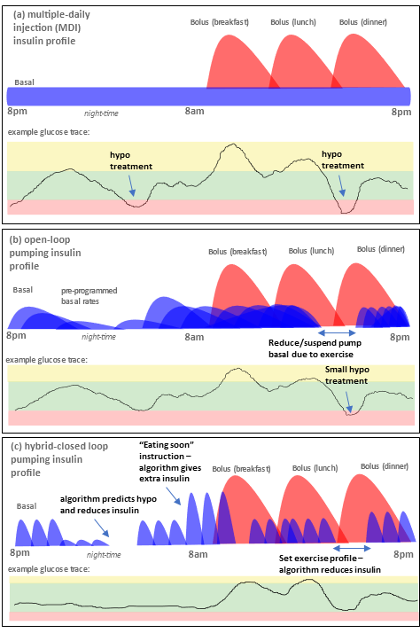

# Introdução ao APS e ao AAPS

```{contents} In this page
:backlinks: entry
:depth: 2
```

## O que é um «Sistema de Pâncreas Artificial»?

Um pâncreas humano faz muitas coisas além de regular o açúcar no sangue. No entanto, o termo **«Sistema de Pâncreas Artificial» (APS)** refere-se normalmente a um sistema que trabalha para manter automaticamente os níveis de açúcar no sangue dentro de limites saudáveis.

A forma mais simples de o fazer é detetar os **níveis de glicose**, usar estes valores para fazer **cálculos** e depois administrar ao corpo a quantidade certa (prevista) de **insulina**. Repete o cálculo a cada poucos minutos, 24 horas por dia, 7 dias por semana. Usa **alarmes** e **alertas** para informar o utilizador quando é preciso intervir ou prestar atenção. Este sistema é normalmente composto por um **sensor de glicose**, uma **bomba de insulina** e um **controlador** que faz os cálculos. No **AAPS** e noutros sistemas de código aberto, o controlador é uma app num telefone. Na maioria dos sistemas comerciais, é um software incorporado na própria bomba, com uma app no telefone usada sobretudo para visualização e controlo.

Para conhecer o contexto de como os sistemas de loop fechado se desenvolveram e como funcionam, este artigo de revisão de 2022 é um bom ponto de partida. Tenha em conta que é anterior à maioria dos sistemas disponíveis hoje, por isso não é um guia do que está atualmente no mercado:

 [Closed-Loop Insulin Delivery Systems: Past, Present, and Future Directions](https://www.frontiersin.org/journals/endocrinology/articles/10.3389/fendo.2022.919942/full) (Templer, _Frontiers in Endocrinology_, 2022).

Os chamados sistemas de «dupla hormona» administram glucagon juntamente com a insulina, com o objetivo de prevenir hipoglicemias graves e permitir um controlo da glicose ainda mais apertado. Um primeiro sistema deste tipo foi aprovado na Europa, mas só é fornecido através de estudos e projetos, e outros ainda estão em desenvolvimento. Nenhum está ainda à venda ao público em geral.

Um pâncreas artificial pode ser visto como um [«piloto automático para a sua diabetes»](https://www.artificialpancreasbook.com/). O que significa isto?

Num avião, o piloto automático não faz todo o trabalho do piloto humano; o piloto não pode dormir durante o voo inteiro. O piloto automático ajuda o trabalho do piloto. Liberta-o do peso de ter de gerir constantemente o avião, permitindo que o piloto se concentre numa monitorização mais ampla. O piloto automático recebe sinais de vários sensores, um computador avalia os dados juntamente com as indicações do piloto e depois faz os ajustes necessários, avisando o piloto de qualquer problema. O piloto deixa de ter de se preocupar em tomar decisões continuamente, e esta analogia pode ser aplicada ao **AAPS**.


(Introduction-what-does-hybrid-closed-loop-mean)=
## O que significa loop fechado híbrido?

A melhor solução para a diabetes tipo 1 seria uma «cura funcional» (provavelmente um implante de células do pâncreas protegidas do sistema imunitário). Enquanto a comunidade da diabetes tipo 1 (DT1) espera por isso, um pâncreas artificial de «loop totalmente fechado» é provavelmente a melhor alternativa. Trata-se de um sistema técnico que não precisa de nenhuma intervenção do utilizador (como dar bólus de insulina para as refeições ou anunciar exercício) e que regula bem os níveis de glicose no sangue. Quase todos os sistemas em uso diário são de loop fechado «híbrido», porque usam uma combinação de tecnologia automática e intervenção do utilizador. Os primeiros sistemas de loop totalmente fechado foram aprovados na Europa em 2026, mas nenhum está ainda amplamente disponível.

## Como e porque começou o loop?

O desenvolvimento de tecnologia comercial para pessoas com diabetes tipo 1 (DT1) é muito lento. Em 2013, a comunidade da DT1 fundou o movimento #WeAreNotWaiting. Desenvolveram sistemas por conta própria, com tecnologia já aprovada (bombas de insulina e sensores), para melhorar o controlo da glicose no sangue, a segurança e a qualidade de vida. São conhecidos como sistemas OS-AID (Open-Source Automated Insulin Delivery, administração automática de insulina de código aberto), antes chamados sistemas DIY («faça-você-mesmo»), porque não estão formalmente aprovados pelas autoridades de saúde (FDA, NHS, etc.). Existem quatro sistemas OS-AID principais: [OpenAPS](https://openaps.org/what-is-openaps/), **AAPS**, [Loop](https://loopkit.github.io/loopdocs/#what-is-loop) e [Trio](https://triodocs.org).

Uma ótima forma de perceber os fundamentos do loop OS-AID é ler o livro de Dana Lewis «Automated Insulin Delivery». Pode aceder ao livro [aqui](https://www.artificialpancreasbook.com/) gratuitamente (ou comprar uma cópia impressa). Para saber mais sobre o [OpenAPS](https://openaps.org/what-is-openaps/), a partir do qual o **AAPS** foi desenvolvido, o [site do OpenAPS](https://openaps.org/what-is-openaps/) é um ótimo recurso.

Também foram lançados vários sistemas comerciais de loop fechado híbrido. São muito diferentes dos sistemas OS-AID, sobretudo porque muitos incluem um «algoritmo de aprendizagem» que ajusta a quantidade de insulina administrada de acordo com as suas necessidades de insulina dos dias anteriores. Muitas pessoas na comunidade OS-AID já experimentaram sistemas comerciais e compararam-nos com o seu sistema OS-AID. Pode saber mais sobre como os diferentes sistemas se comparam perguntando nos grupos do Facebook dedicados a esses sistemas, no [grupo do AAPS no Facebook](https://www.facebook.com/groups/AndroidAPSUsers/) ou no [Discord](https://discord.com/invite/4fQUWHZ4Mw).

## O que é o Android APS (AAPS)?


**Figura 1**. Esquema básico do Android APS (Sistema de Pâncreas Artificial), AAPS.

O Android APS (**AAPS**) é um sistema de loop fechado híbrido, ou Sistema de Pâncreas Artificial (APS). Faz os cálculos das doses de insulina com os algoritmos estabelecidos do [OpenAPS](https://openaps.org/) (um conjunto de regras), desenvolvidos pela comunidade da DT1 #WeAreNotWaiting.

Como o OpenAPS só é compatível com certas bombas de insulina mais antigas, o **AAPS** (que pode ser usado com um leque maior de bombas de insulina) foi desenvolvido pela primeira vez em 2016 para um familiar com diabetes tipo 1. Desde esses primeiros tempos, o **AAPS** tem sido desenvolvido e melhorado continuamente por uma equipa de programadores voluntários e outros entusiastas com ligação ao mundo da diabetes tipo 1. Hoje, o **AAPS** é usado por muitos milhares de pessoas em todo o mundo. É um sistema muito personalizável e versátil e, por ser de código aberto, também é facilmente compatível com muitos outros programas e plataformas de código aberto para a diabetes. Os componentes fundamentais do sistema **AAPS** atual estão representados na **Figura 1** acima.


## Quais são os componentes básicos do AAPS?

O «cérebro» do AAPS é uma **app** que o próprio utilizador compila. Existem instruções detalhadas, passo a passo, para isso. Depois instala a **app AAPS** num **smartphone Android** [compatível](../Getting-Started/Phones.md) (**1**). Muitos utilizadores preferem ter o loop num telefone separado do seu telefone principal. Assim, não é obrigatório usar um telefone Android para tudo o resto na sua vida, apenas para executar o loop do AAPS.

Além do **AAPS**, o **smartphone Android** também precisa de ter outra app instalada. Esta [app adicional](../Getting-Started/CompatiblesCgms.md) recebe os dados de glicose de um sensor (**2**) por Bluetooth e depois envia os dados, dentro do telefone, para a **app AAPS**.

A **app AAPS** usa um processo de decisão (**algoritmo**) do OpenAPS. Quem está a começar usa o algoritmo básico **oref0**, mas é possível mudar para o algoritmo mais recente **oref1** à medida que avança com o AAPS. O algoritmo a usar (oref0 ou oref1) depende do que melhor se adapta à sua situação específica.  Em ambos os casos, o algoritmo tem em conta vários fatores e faz cálculos rápidos sempre que chega uma nova leitura do sensor. Depois, o algoritmo envia por Bluetooth instruções à bomba de insulina (**3**) sobre quanta insulina administrar. Toda a informação pode ser enviada para a internet (**4**) por dados móveis ou Wi-Fi. Estes dados também podem ser partilhados com seguidores, se desejar, e/ou recolhidos para análise. Opcionalmente, também pode emparelhar um [smartwatch](../Getting-Started/Watches.md) (**5**) com o telefone para ver os seus dados num relance e, com alguns relógios, enviar comandos básicos ao **AAPS**.

## Quais são as vantagens do sistema AAPS?

O algoritmo OpenAPS usado pelo **AAPS** controla os níveis de açúcar no sangue sem intervenção do utilizador, de acordo com os parâmetros definidos pelo utilizador (os mais importantes são as taxas basais, os fatores de sensibilidade à insulina, os rácios insulina-hidratos de carbono, a duração da ação da insulina, etc.), e reage a cada 5 minutos aos novos dados do sensor.

Algumas das vantagens referidas de usar o **AAPS** são as muitas opções que se podem afinar, as **Automatizações** e a maior transparência do sistema para o doente/cuidador. Isto pode resultar num melhor controlo da sua diabetes (ou da pessoa de quem cuida), o que por sua vez pode dar melhor qualidade de vida e mais tranquilidade.

Com algum investimento do seu tempo, o **AAPS** pode levar a:

- aliviar o stress e o peso da gestão da diabetes tipo 1;

- reduzir as muitas decisões do dia a dia que a diabetes tipo 1 exige;

- doses de insulina personalizadas e dinâmicas, baseadas em dados em tempo real, que podem diminuir a necessidade de tratar hipoglicemias e reduzir os episódios de hiperglicemia;

- maior conhecimento sobre a gestão da insulina e confiança para afinar melhor as suas definições;

- a possibilidade de criar definições automáticas (**automatizações**) adaptadas ao seu estilo de vida;

- melhor qualidade do sono e menos intervenções noturnas no geral;

- monitorização remota e administração de insulina à distância para cuidadores de pessoas com diabetes tipo 1; e

- juntar todo o seu equipamento portátil para a diabetes (recetor do monitor contínuo de glicose e dispositivos de controlo da insulina) num telefone Android controlado pelo **AAPS**.


No fim, o **AAPS** pode dar às pessoas meios para gerir melhor a sua diabetes, com glicoses estáveis e melhores resultados de saúde a longo prazo.

### As vantagens específicas incluem:

#### 1) Segurança incorporada
Para ler sobre as funções de segurança dos algoritmos, conhecidos como oref0 e oref1, [clique aqui](https://openaps.org/reference-design/). O utilizador controla os seus próprios limites de segurança.

#### 2) Flexibilidade de hardware

O **AAPS** funciona com uma grande variedade de bombas de insulina e sensores e oferece flexibilidade à medida que a vida muda. Por exemplo, se desenvolver uma alergia à cola do adesivo do sensor Dexcom, pode mudar para um sensor Libre. Os utilizadores não têm de voltar a compilar ou a instalar a app **AAPS**; basta selecionar outra bomba ou outra fonte da glicose em **Configuração** para mudar de hardware. O **AAPS** é independente de controladores de bomba específicos e também inclui uma «Bomba virtual», para que os utilizadores possam experimentar em segurança antes de o usar em si próprios.

#### 3) Muito personalizável, com parâmetros amplos

Os utilizadores podem adicionar ou remover facilmente módulos ou funcionalidades, e o **AAPS** pode ser usado em modo de loop aberto e de loop fechado. Eis alguns exemplos das possibilidades do sistema **AAPS**:

 a) A possibilidade de definir um alvo de **glicose** mais baixo 30 min antes de comer; pode definir o alvo até 72 mg/dl (4,0 mmol/l).

 b) Se tiver resistência à insulina, com glicose alta, o **AAPS** permite definir uma regra de **automatização** que é ativada quando a glicose sobe acima de 8 mmol/l (144 mg/dl) e muda para (por exemplo) um perfil de 120% (o que resulta num aumento de 20% da basal e também reforça outros fatores, em comparação com a definição normal do seu **perfil**). A automatização dura de acordo com o tempo programado que definir. Uma automatização destas pode ser definida para estar ativa só em certos dias da semana, a certas horas do dia e até em certos locais.

 c) Se o seu filho estiver num trampolim sem aviso prévio, o **AAPS** permite suspender a insulina por um período definido, diretamente no telefone.

 d) Depois de voltar a ligar uma bomba com tubo que esteve desligada para nadar, o **AAPS** calcula a insulina basal que perdeu enquanto esteve desligada e administra-a com cuidado, de acordo com a sua glicose atual. A insulina que não for necessária pode ser anulada simplesmente «cancelando» a basal em falta.

 e) O **AAPS** permite definir perfis diferentes para situações diferentes e mudar facilmente entre eles. Por exemplo, as funções que fazem o algoritmo baixar mais depressa a glicose elevada (como os supermicro bólus («**SMB**») e as refeições não anunciadas («**RNA**»)) podem ser definidas para funcionar só durante o dia, se tiver receio de hipoglicemias noturnas.

Estes são apenas exemplos; o conjunto completo de funções dá uma enorme flexibilidade no dia a dia, incluindo desporto, doença, ciclos hormonais _etc._ No fim, cabe ao utilizador decidir como usar esta flexibilidade, e não existe uma automatização que sirva para todos.

#### 4) Monitorização remota
Existem vários canais de monitorização possíveis (Sugarmate, Dexcom Follow, xDrip, Android Auto _etc._), úteis para pais/cuidadores e para adultos em certas situações (a dormir/a conduzir) que precisam de alertas personalizáveis. Em algumas apps (xDrip) também pode desligar totalmente os alarmes, o que é ótimo se tiver um sensor novo a «estabilizar» com o qual ainda não quer fazer loop.

#### 5) Controlo remoto
Uma vantagem importante do **AAPS** em relação aos sistemas comerciais é que os seguidores podem enviar uma grande variedade de comandos ao sistema **AAPS**, através de comandos de texto (SMS) autenticados ou de uma app **AAPSClient** emparelhada. Esta função é muito usada por pais de crianças com diabetes tipo 1 que usam o **AAPS**.

As funções de controlo remoto podem ser muito úteis: por exemplo, no parque infantil, se quiser dar um pré-bólus para um lanche a partir do seu próprio telefone enquanto a criança está ocupada a brincar. Também é possível monitorizar o sistema a partir de um smartwatch (_p. ex._ Garmin) ou enviar-lhe comandos básicos a partir dele (_p. ex._ um relógio Wear OS, como o Samsung Galaxy Watch).

#### 6) Sem restrições comerciais, graças a interfaces de aplicação abertas
Além da abordagem de código aberto, que permite ver o código-fonte do **AAPS** a qualquer momento, o princípio geral de oferecer interfaces de programação abertas dá também a outros programadores a oportunidade de contribuir com novas ideias. O **AAPS** está muito bem integrado com o Nightscout. Isto acelera o desenvolvimento e permite aos utilizadores acrescentar funções que tornam a vida com diabetes ainda mais prática. Bons exemplos destas integrações são o [Nightscout](https://nightscout.github.io/), o [Nightscout Reporter](https://nightscout-reporter.zreptil.de/), o xDrip, o [M5 stack](https://github.com/mlukasek/M5_NightscoutMon/wiki), etc. Existe um diálogo contínuo entre os programadores de código aberto e quem desenvolve sistemas comerciais. Muitas das inovações OS-AID são adotadas aos poucos pelos sistemas comerciais, onde o desenvolvimento é compreensivelmente mais lento, em parte porque as interfaces entre sistemas de empresas diferentes (bombas, apps, sensores _etc._) têm de ser cuidadosamente negociadas e licenciadas. Isto também pode atrasar inovações que são práticas para o doente (ou para um pequeno grupo de doentes com uma necessidade muito específica), mas que não geram lucro significativo.

#### 7) Interface da app detalhada
Com o **AAPS** é fácil acompanhar coisas como: nível de insulina na bomba, idade da cânula, idade do sensor, idade da pilha da bomba, insulina ativa _etc._ Muitas ações podem ser feitas através da app **AAPS** (purgar a bomba, desligar a bomba _etc_.), em vez de na própria bomba, o que significa que a bomba pode ficar no seu bolso ou cinto (ou no da pessoa de quem cuida).

#### 8) Acessibilidade e preço acessível
O **AAPS** dá às pessoas que atualmente não podem pagar do seu bolso, ou que não têm financiamento/seguro, acesso a um sistema de loop fechado híbrido que, em termos de desenvolvimento, está conceptualmente anos à frente dos sistemas comerciais. Atualmente, precisa de um servidor de relatórios (Nightscout ou Tidepool) para configurar o **AAPS**, embora não seja necessário para o funcionamento diário do loop do **AAPS**. Muitas pessoas continuam a usar o Nightscout para recolher os seus dados e para monitorização remota. Embora o **AAPS** seja gratuito, configurar o Nightscout numa das várias plataformas pode ter um custo (0 € – 12 €), consoante o nível de apoio que pretende (ver a tabela comparativa) e se quer continuar a usar o Nightscout depois da configuração ou não. O **AAPS** funciona com uma grande variedade de [telefones Android](https://docs.google.com/spreadsheets/u/1/d/e/2PACX-1vScCNaIguEZVTVFAgpv1kXHdsHl3fs6xT6RB2Z1CeVJ561AvvqGwxMhlmSHk4J056gMCAQE02sAWJvT/pubhtml?gid=683363241&single=true) acessíveis (a partir de cerca de 150 €). Existem versões diferentes para locais e idiomas específicos, e o AAPS também pode ser usado por pessoas [cegas](#accessibility-for-users-aaps-who-are-partially-or-completely-blind).

#### 9) Apoio
Nenhum sistema de administração automática de insulina é perfeito. Os sistemas comerciais e os de código aberto partilham muitas falhas comuns, tanto nas comunicações como em avarias temporárias do hardware. Existe apoio da comunidade de utilizadores do AAPS no Facebook, Discord e GitHub, que conceberam, desenvolveram e usam atualmente o **AAPS** em todo o mundo. Também existem grupos de apoio no Facebook e ajuda das clínicas/empresas para os sistemas APS comerciais. Vale a pena falar com os utilizadores, ou antigos utilizadores, destes sistemas para saber das falhas comuns, da qualidade do programa de formação e do nível de apoio contínuo oferecido.

#### 10) Previsibilidade, transparência e segurança
O **AAPS** é transparente, lógico e previsível, o que pode tornar mais fácil perceber quando uma definição está errada e ajustá-la. Pode ver exatamente o que o sistema está a fazer, porque o faz, e definir os seus limites de funcionamento, o que coloca o controlo (e a responsabilidade) nas suas mãos. Isto pode dar confiança ao utilizador e um sono mais tranquilo.

#### 11) Acesso a funções avançadas através de versões de desenvolvimento (dev), incluindo o loop totalmente fechado
Esta documentação do **AAPS** foca-se no branch principal **«master»** do **AAPS**. No entanto, a investigação e o desenvolvimento continuam o tempo todo. Os utilizadores mais experientes podem querer explorar as funções experimentais do branch de **desenvolvimento**. As inovações em desenvolvimento focam-se em estratégias para o loop totalmente fechado (sem ter de dar bólus para as refeições _etc._) e, de forma geral, em tornar a vida com diabetes tipo 1 o mais prática possível.

#### 12) Possibilidade de contribuir para novas melhorias
A diabetes tipo 1 pode ser muito frustrante e isoladora. Ter controlo sobre a sua própria tecnologia para a diabetes, com a possibilidade de «retribuir» assim que fizer progressos, ajudando outros no seu percurso, pode ser muito gratificante. Pode aprender por si, descobrir os obstáculos, procurar novos desenvolvimentos e até contribuir para eles e para a documentação. Haverá outras pessoas na comunidade com o mesmo objetivo, com quem pode trocar ideias e trabalhar. Esta é a essência do #WeAreNotWaiting.

## Como se compara o AAPS com as MDI e com o loop aberto?

As múltiplas injeções diárias (MDI, (a) na **Figura 2** abaixo) consistem normalmente numa injeção de insulina de ação prolongada (_p. ex._ Tresiba) uma vez por dia, com injeções de insulina de ação mais rápida (_p. ex._ Novorapid, Fiasp) às refeições ou para correções. A bomba sem loop (b) usa uma bomba para administrar a basal de insulina de ação rápida em taxas pré-programadas e depois bólus através da bomba às refeições ou para correções. O princípio de um sistema de loop é que a app de loop usa os dados de glicose do sensor para dizer à bomba que pare a administração de insulina quando prevê que vai ter uma hipoglicemia, e para lhe dar insulina extra se os seus níveis de glicose estiverem a subir e a previsão for de que vão ficar demasiado altos (c). Embora esta figura seja muito simplificada em comparação com a vida real, pretende mostrar as principais diferenças entre as abordagens. É possível conseguir um controlo da glicose excecionalmente bom com qualquer uma destas três abordagens.




**Figura 2**. Visão geral básica de (a) MDI, (b) bomba em loop aberto e (c) bomba em loop fechado híbrido.

## Como se compara o AAPS com outros sistemas de loop?

Em 25 de junho de 2023, existiam quatro grandes sistemas de loop fechado de código aberto: [OpenAPS](https://openaps.readthedocs.io/), **AAPS**, [Loop](https://loopkit.github.io/loopdocs/#what-is-loop) e [Trio](https://triodocs.org) (antigo FreeAPS X). As funcionalidades dos diferentes sistemas são apresentadas na tabela abaixo:


| Tipo de dispositivo | Nome                                                                         | [AAPS](https://wiki.aaps.app)              | [Loop](https://loopkit.github.io/loopdocs/) | [Open APS](https://openaps.readthedocs.io/en/latest/) | [Trio](https://triodocs.org)               |
| ------------------- | ---------------------------------------------------------------------------- | ------------------------------------------ | ------------------------------------------- | ----------------------------------------------------- | ------------------------------------------ |
| Telefone            | Android                                                                      |      |   |             |  |
| Telefone            | iPhone                                                                       |  |       |             |      |
| Rig                 | computador minúsculo (1)                                                     |  |   |                 |  |
| BOMBA               | [Dana I](../CompatiblePumps/DanaRS-Insulin-Pump.md)                          |      |       |             |      |
| BOMBA               | [Dana RS](../CompatiblePumps/DanaRS-Insulin-Pump.md)                         |      |       |             |      |
| BOMBA               | [Dana R](../CompatiblePumps/DanaR-Insulin-Pump.md)                           |      |   |             |  |
| BOMBA               | [Omnipod (Dash)](../CompatiblePumps/OmnipodDASH.md)                          |      |       |             |      |
| BOMBA               | [Omnipod (Eros)](../CompatiblePumps/OmnipodEros.md)                          |      |       |             |      |
| BOMBA               | [Diaconn G8](../CompatiblePumps/DiaconnG8.md)                                |      |   |             |  |
| BOMBA               | [EOPatch 2](../CompatiblePumps/EOPatch2.md)                                  |      |   |             |  |
| BOMBA               | [Medtrum TouchCare Nano 200U](../CompatiblePumps/MedtrumNano.md)             |      |       |             |      |
| BOMBA               | [Medtrum TouchCare 300U](../CompatiblePumps/MedtrumNano.md)                  |      |       |             |      |
| BOMBA               | [Roche Combo](../CompatiblePumps/Accu-Chek-Combo-Pump-v2.md)                 |      |   |             |  |
| BOMBA               | [Roche Insight](../CompatiblePumps/Accu-Chek-Insight-Pump.md)                |      |   |             |  |
| BOMBA               | [Medtronic antigas](../CompatiblePumps/MedtronicPump.md)                     |      |       |                 |      |
| BOMBA               | [Equil 5.3](../CompatiblePumps/Equil5.3.md)                                  |      |   |             |  |
| BOMBA               | [CareLevo](../CompatiblePumps/CareLevo.md)                                   |      |   |             |  |
| CGM                 | [Dexcom G7/One+/Stelo](../CompatibleCgms/DexcomG7.md)                        |      |       |             |      |
| CGM                 | [Dexcom One](../CompatibleCgms/DexcomG6.md)                                  |      |       |             |      |
| CGM                 | [Dexcom G6](../CompatibleCgms/DexcomG6.md)                                   |      |       |                 |      |
| CGM                 | [Libre 3/3+](../CompatibleCgms/Libre3.md)                                    |      |       |             |      |
| CGM                 | [Libre 2/2+](../CompatibleCgms/Libre2.md)                                    |      |       |             |      |
| CGM                 | [Libre 1](../CompatibleCgms/Libre1.md)                                       |      |       |             |      |
| CGM                 | [Eversense](../CompatibleCgms/Eversense.md)                                  |      |       |             |      |
| CGM                 | [MM640g/MM630g](../CompatibleCgms/MM640g.md)                                 |      |   |             |  |
| CGM                 | [PocTech](../CompatibleCgms/PocTech.md)                                      |      |   |             |  |
| CGM                 | [Ottai](../CompatibleCgms/OttaiM8.md)                                        |      |   |             |  |
| CGM                 | [Syai Tag](../CompatibleCgms/SyaiTagX1.md)                                   |      |   |             |  |
| CGM                 | [Nightscout como Fonte da Glicose](../CompatibleCgms/CgmNightscoutUpload.md) |      |       |                 |      |

_Notas da tabela:_
1. Um **rig** é um pequeno computador sem ecrã que se leva sempre consigo. Um dos tipos de dispositivo suportados é Intel Edison + Explorer Board e o outro Raspberry Pi + Explorer HAT ou Adafruit RFM69HCW Bonnet. Os primeiros sistemas APS baseavam-se nesta configuração, porque os telemóveis não eram capazes de executar os algoritmos necessários. O uso destes sistemas diminuiu, porque a configuração em telemóveis ficou mais fácil e os telemóveis já têm ecrã. A Intel também deixou de vender o Intel Edison. Os excelentes algoritmos OpenAPS **oref0** e **oref1** estão agora incorporados no AAPS e no Trio.


Uma declaração de consenso internacional, revista por pares, com orientações práticas sobre o loop de código aberto foi escrita por e para profissionais de saúde e publicada numa revista médica de referência em 2022: [_Lancet Diabetes Endocrinol_, 2022; 10: 58–74](https://www.ncbi.nlm.nih.gov/pmc/articles/PMC8720075/)(_1_). Vale muito a pena lê-lo (também para a sua clínica de diabetes); resume as principais diferenças técnicas entre os diferentes sistemas de loop fechado híbrido de código aberto.

É difícil ter uma «noção» de um sistema sem o usar ou sem falar com quem o usa, por isso não hesite em contactar outras pessoas no Facebook/Discord e perguntar. A maioria das pessoas acha o **AAPS** extremamente sofisticado em comparação com outros sistemas de loop fechado híbrido (sobretudo os comerciais), com um enorme número de definições e funções personalizáveis, descritas acima. Algumas pessoas podem achar isto um pouco esmagador no início, mas não há pressa em explorar todas as possibilidades de uma vez. Pode avançar tão devagar ou tão depressa quanto quiser, e há ajuda disponível em cada passo do caminho.


## O AAPS usa inteligência artificial ou algum algoritmo de aprendizagem?

A versão atual do **AAPS** (4.0) não tem algoritmos de aprendizagem automática, modelos de resposta à insulina com múltiplos parâmetros nem inteligência artificial. Assim, o sistema é aberto e transparente na forma como funciona, e pode ser compreendido não só por especialistas, mas também por médicos e doentes. Também significa que, se tiver uma rotina muito variável (por exemplo, passar de uma semana stressante no trabalho para umas férias tranquilas) e for provável precisar de uma quantidade de insulina muito diferente, pode mudar de imediato o **AAPS** para um perfil personalizado mais fraco/mais forte. Um «sistema de aprendizagem» faz este ajuste automaticamente, mas é provável que demore mais tempo a ajustar a administração de insulina.

(which-system-is-right-for-me-or-my-dependent)=
## Que sistema é o certo para mim ou para a pessoa de quem cuido?

Na prática, a escolha do sistema fica muitas vezes limitada pela bomba que já tem, ou que pode obter do seu prestador de cuidados de saúde, e pela escolha do telefone (Apple ou Android). Se ainda não tem bomba, tem a maior escolha de sistemas. A tecnologia está sempre a evoluir: há bombas que deixam de ser fabricadas e novas bombas e sensores a ser lançados. A maioria dos sistemas de código aberto funciona com os principais sensores (Libre e Dexcom) ou é rapidamente adaptada para funcionar com novos sensores cerca de um ano após o seu lançamento (com algum atraso para testes de segurança e estabilidade).

A maioria dos utilizadores do **AAPS** relata mais tempo no alvo, reduções da HbA1c e melhor qualidade de vida por ter um sistema que ajusta automaticamente as taxas basais durante o sono, e isto é verdade para a maioria dos sistemas de loop fechado híbrido. Algumas pessoas preferem um sistema muito simples e pouco personalizável (o que pode significar que prefere um sistema comercial), e outras acham esta falta de controlo muito frustrante (pode preferir um sistema de código aberto). Se o diagnóstico for recente (seu ou da pessoa de quem cuida), um caminho comum é habituar-se primeiro às MDI com um sensor de glicose, depois passar para uma bomba que permita fazer loop e depois para o **AAPS**, mas algumas pessoas (sobretudo crianças pequenas) podem passar diretamente para uma bomba.

É importante notar que o utilizador do **AAPS** tem de ser proativo para diagnosticar e resolver problemas por si, com a ajuda da comunidade. Esta é uma mentalidade muito diferente da de quem usa um sistema comercial. Com o **AAPS**, o utilizador tem mais controlo, mas também a responsabilidade, e tem de se sentir à vontade com isso.

## É seguro usar sistemas de código aberto como o AAPS?

### Segurança do sistema AAPS
Uma pergunta mais exata é provavelmente «é seguro **em comparação** com o meu sistema atual de administração de insulina?», uma vez que nenhum método de administração de insulina está isento de riscos. Há muitos controlos e salvaguardas no **AAPS**. Um [artigo](https://www.liebertpub.com/doi/epub/10.1089/dia.2019.0375) recente estudou o uso do **AAPS** numa configuração simulada em computador, que foi uma forma eficaz de testar objetivamente quão seguro e eficaz o sistema é. De forma mais geral, muitos milhares de pessoas em todo o mundo usam sistemas de administração automática de insulina de código aberto, e a adesão continua a aumentar a nível global.

Qualquer dispositivo que use comunicações por rádio pode ser pirateado, e isto também é verdade para uma bomba de insulina sem loop. Atualmente, não temos conhecimento de ninguém que tenha tentado prejudicar pessoas pirateando o seu equipamento médico para a diabetes. No entanto, há várias formas de se proteger contra estes riscos:

1.  Nas definições da bomba, limite tanto o bólus máximo permitido como a basal temporária máxima aos valores que considera mais seguros. Estes são limites rígidos que não acreditamos que um pirata informático mal-intencionado consiga contornar.

2.  Ative os alarmes do CGM para glicose alta e baixa.

3.  Monitorize a sua administração de insulina online. Os utilizadores do Nightscout podem definir alarmes adicionais para avisar numa grande variedade de situações, incluindo situações muito mais prováveis do que um ataque mal-intencionado. Além das glicoses altas e baixas, o Nightscout pode mostrar dados de diagnóstico úteis para verificar se a bomba está a funcionar como pretendido, incluindo a IA atual, o histórico de basais temporárias e o histórico de bólus da bomba. Também pode ser configurado para avisar os utilizadores de forma proativa sobre situações indesejadas, como glicoses altas e baixas previstas, pouca insulina no reservatório e pilha da bomba fraca.

Se houvesse um ataque mal-intencionado à sua bomba de insulina, estas estratégias reduziriam muito o risco. Cada potencial utilizador do **AAPS** tem de pesar os riscos de usar o **AAPS** face aos riscos de usar um sistema diferente.

#### Questões de segurança ao melhorar o controlo da glicose demasiado depressa

Uma redução rápida da HbA1c e um melhor controlo da glicose parecem atrativos. No entanto, baixar os níveis médios de glicose _demasiado depressa_ ao começar qualquer sistema de loop fechado pode causar danos permanentes, incluindo nos olhos, e neuropatia dolorosa que nunca desaparece. Estes danos podem ser evitados simplesmente baixando os níveis mais devagar. Se atualmente tem uma HbA1c elevada e vai passar para o AAPS (ou qualquer outro sistema de loop fechado), fale deste risco potencial com a sua equipa médica antes de começar e combine com ela um plano temporal. Mais informação geral sobre como baixar os seus níveis de glicose em segurança, incluindo ligações para literatura médica, encontra-se na secção de segurança [aqui](#preparing-safety-first).

#### Segurança médica dos dispositivos, consumíveis e outros medicamentos

Use uma bomba de insulina e um CGM testados, a funcionar plenamente e aprovados pela FDA ou com marcação CE para um loop de pâncreas artificial. Modificações de hardware ou de software nestes componentes podem causar doses de insulina inesperadas, com um risco significativo para o utilizador. Se encontrar ou lhe oferecerem bombas de insulina ou recetores de CGM avariados, modificados ou feitos em casa, não os use para criar um sistema AAPS.

Use consumíveis originais, como insersores, cânulas e reservatórios de insulina aprovados pelo fabricante da sua bomba e do seu CGM. O uso de acessórios não testados ou modificados pode causar valores imprecisos do CGM e erros na dose de insulina. A insulina é muito perigosa quando a dose está errada - por favor, não brinque com a sua vida modificando os seus consumíveis.

Não tome inibidores do SGLT-2 (gliflozinas) quando usar o **AAPS**, porque baixam os níveis de açúcar no sangue de forma imprevisível. Combinar este efeito com um sistema que baixa as taxas basais para aumentar a glicose é perigoso; há mais detalhes sobre isto na [secção de segurança](#preparing-safety-first) principal.

(introduction-how-can-i-approach-discussing-aaps-with-my-clinical-team)=
## Como posso abordar o AAPS com a minha equipa médica?

Recomenda-se que os utilizadores falem com os seus médicos sobre a intenção de usar o **AAPS**. Não tenha receio de ter uma conversa honesta com a sua equipa de diabetes se pretende usar o **AAPS** (ou, já agora, qualquer outro loop OS-AID). A transparência e a confiança entre doente e médico são fundamentais.

### Abordagem sugerida:
Comece uma conversa com o seu médico para saber qual o conhecimento e a atitude dele em relação à tecnologia para a diabetes, como CGM, bombas, loops híbridos e loops comerciais. O seu médico/endocrinologista deve conhecer a tecnologia básica e estar disposto a discutir consigo os avanços recentes dos produtos de loop comerciais disponíveis na sua região.

#### Precedente local

Peça a opinião dos seus médicos/endocrinologistas sobre o loop OS-AID _vs_ o loop comercial e avalie o conhecimento deles nesta área. Conhecem o **AAPS** e podem partilhar consigo alguma experiência útil com doentes que fazem loop OS-AID?

Pergunte se a sua equipa tem doentes a seu cargo que já fazem loop OS-AID. Por causa da confidencialidade, os médicos não podem passar-lhe dados de outros doentes sem obter o consentimento dessa pessoa. No entanto, se quiser, **pode** pedir-lhes que passem os **seus** contactos a um doente que já faça loop OS-AID, se houver algum com quem o médico ache que se vai «entender», indicando que gostaria que esse doente o contactasse para falarem sobre o loop OS-AID. Os médicos não são obrigados a fazê-lo, mas alguns fazem-no de bom grado, porque reconhecem a importância do apoio entre pares na gestão da diabetes tipo 1. Também pode ser útil conhecer pessoas simpáticas da sua zona que fazem loop OS-AID. Isto depende, claro, de si, e não é absolutamente necessário.

#### Precedente nacional e internacional

Se sentir que a sua equipa não o apoia para fazer loop com o **AAPS**, os seguintes pontos de discussão podem ajudar:

a) O sistema **AAPS** foi concebido POR doentes e pelos seus cuidadores. Foi concebido acima de tudo para a segurança, mas também com base em profunda experiência dos doentes. Há muitos milhares de utilizadores do **AAPS** em todo o mundo. Por isso, é provável que haja outros doentes a fazer loop OS-AID entre os doentes da sua clínica (quer a clínica saiba disso, quer não).

b) Orientações recentes, revistas por pares e publicadas na revista médica internacional de referência [The Lancet](https://www.ncbi.nlm.nih.gov/pmc/articles/PMC8720075/pdf/nihms-1765784.pdf)(_1_), confirmaram que os loops OS-AID são **seguros** e **eficazes para melhorar o controlo da diabetes**, incluindo o tempo no alvo. Há artigos regulares em revistas de referência como a [Nature](https://doi.org/10.1038/d41586-023-02648-9)(_3_) que destacam o progresso da comunidade de loop OS-AID.

c) Começar com o **AAPS** implica uma passagem _gradual_ da bomba em loop «aberto», passando pela suspensão por glicose baixa, até ao loop «fechado» híbrido, ao completar uma série de objetivos. Existe, portanto, um programa estruturado que exige que o utilizador demonstre um nível de competência em cada etapa e afine as suas definições básicas (basal, FSI e IHC) antes de poder fechar o loop.

d) Existe apoio técnico da comunidade OS-AID através do GitHub, do Discord e de grupos fechados do Facebook.

e) Poderá fornecer **informação do CGM e do loop/bomba de insulina** em relatórios combinados nas consultas (através do Nightscout ou do Tidepool), impressos ou no ecrã (se levar um portátil/tablet). Juntar os dados do CGM e da insulina permite aproveitar melhor o tempo do seu médico para rever os relatórios e ajuda a discussão sobre a avaliação do seu progresso.

f) Se a sua equipa continuar a opor-se fortemente, entregue ao seu médico cópias impressas dos artigos de referência indicados neste texto e dê-lhe a ligação para a secção do **AAPS** para médicos: [Para médicos – Introdução geral e guia do **AAPS**](../UsefulLinks/ClinicianGuideToAaps.md)

#### Apoio de outros médicos ao loop OS-AID

O artigo publicado na [Lancet Diabetes Endocrinology](https://www.ncbi.nlm.nih.gov/pmc/articles/PMC8720075/)(_1_) (coliderado pelo King’s e pelo Guy’s and St Thomas’ NHS Foundation Trust, e coliderado pelo Dr. Sufyan Hussain, diabetologista consultor e professor sénior honorário do King’s em Londres) apresenta:

a) **Garantia** para os profissionais de que os sistemas de pâncreas artificial OS-AID/de código aberto são uma opção de «tratamento seguro e eficaz» para a diabetes tipo 1, com orientações sobre recomendações, discussões, apoios e documentação;

b) **Reconhecimento** de que os sistemas de administração automática de insulina («AID») de código aberto podem aumentar o tempo no alvo (TIR), reduzindo a variabilidade das concentrações de glicose no sangue e o número de episódios de hipoglicemia e hiperglicemia em várias faixas etárias, géneros e comunidades;

c) **Recomendação** de que os profissionais de saúde devem **apoiar** os doentes com diabetes tipo 1 ou os seus cuidadores que escolham gerir a diabetes com um sistema AID de código aberto;

d) Recomendação de que os profissionais de saúde devem procurar conhecer todas as opções de tratamento que possam beneficiar os doentes, incluindo os sistemas AID de código aberto disponíveis.  Se os profissionais de saúde não tiverem meios para se formar, ou tiverem dúvidas legais ou regulamentares, devem considerar **cooperar ou trabalhar em equipa com outros profissionais de saúde** que os tenham;

e) Ênfase em que todos os utilizadores de CGM devem ter acesso aberto e em tempo real aos **seus próprios dados de saúde** em todos os momentos

f) Ênfase em que estes sistemas de código aberto não passaram pelas mesmas avaliações regulamentares que as tecnologias médicas comerciais e não há apoio técnico comercial. No entanto, **existe um amplo apoio da comunidade**; e

g) Recomendação de que a **regulamentação e os quadros legais** sejam atualizados para garantir clareza quanto à permissão de um tratamento ético e eficaz com estes sistemas de código aberto.

Outro artigo, na [Medical Law International, 2021](http://pure-oai.bham.ac.uk/ws/files/120241375/0968533221997510.pdf)(_4_), salienta também que as «orientações sobre consentimento» do General Medical Council do Reino Unido dão grande ênfase a que médico e doente tomem decisões em conjunto. O médico deve explicar os potenciais benefícios, riscos, encargos e efeitos secundários do APS OS-AID e pode recomendar uma opção específica sem pressionar o doente.

No fim, cabe ao doente pesar estes fatores, juntamente com quaisquer questões não clínicas relevantes para si, e decidir que opção de tratamento aceitar, se aceitar alguma.

Se um médico descobrir na consulta que o seu doente faz loop com um sistema OS-AID, não fica dispensado das suas obrigações de acompanhar o doente só porque não receitou a tecnologia específica que o doente usa; os médicos têm de continuar a acompanhar os doentes.

Os médicos (pelo menos no Reino Unido) não estão proibidos de receitar medicamentos não licenciados e podem usar o seu critério clínico. Por isso, devem usar o seu critério clínico para decidir se um APS OS-AID é adequado para um doente específico e discutir com o doente o que consideram ser os prós e os contras.

#### Os artigos referidos acima, e outras ligações úteis e tomadas de posição, estão listados abaixo:

1. Open-source automated insulin delivery: international consensus statement and practical guidance for health-care professionals [_Lancet Diabetes Endocrinol_, (2022) _10_, 58–74](https://www.ncbi.nlm.nih.gov/pmc/articles/PMC8720075/)
2. [In Silico Trials of an Open-Source Android-Based Artificial Pancreas: A New Paradigm to Test Safety and Efficacy of Do-It-Yourself Systems, 2020](https://www.liebertpub.com/doi/epub/10.1089/dia.2019.0375)
3. A DIY ‘bionic pancreas’ is changing diabetes care — what's next? [_Nature_ (2023), _620_, 940-941](https://doi.org/10.1038/d41586-023-02648-9)
4. Prescribing unapproved medical devices? The case of DIY artificial pancreas systems [_Medical law international_, (2021), _21_, 42-68](http://pure-oai.bham.ac.uk/ws/files/120241375/0968533221997510.pdf)
5. [Tomada de posição do Berlin Institute of Health, 2022](https://www.bihealth.org/en/notices/do-it-yourself-solutions-for-people-with-diabetes-are-safe-and-recommended)
6. Do-It-Yourself Automated Insulin Delivery: A Health-care Practitioner User’s Guide (posição e guia da Diabetes Canada) [_Canadian Journal of Diabetes_, (2023)_47_, E8, 389-397](https://www.canadianjournalofdiabetes.com/article/S1499-2671(23)00138-7/fulltext)
7.  Países Baixos (EN/NL) - para médicos - [how to help people on open source automated insulin delivery systems](https://www.diabetotech.com/blog/how-to-help-people-on-open-source-automated-insulin-delivery-systems) (como ajudar pessoas que usam sistemas de administração automática de insulina de código aberto)
8. First Use of Open-Source Automated Insulin Delivery AndroidAPS in Full Closed-Loop Scenario: Pancreas4ALLRandomized Pilot Study [_Diabetes Technol. Ther._, 25, _5_, 2023](https://www.liebertpub.com/doi/pdf/10.1089/dia.2022.0562?casa_token=D13eFx5vCwwAAAAA:MYvO8hChbViXVJFgov1T11RXBPx2N_wOMThLHwl3TVUxbCuANegPrIFRC5R5VXx_S71FoQYW-qg)
9. Pre-school and school-aged children benefit from the switch from a sensor-augmented pump to an AndroidAPS hybrid closed loop: A retrospective analysis [_Pediatr. Diabetes_ 2021, _22_, 594-604. 2021](https://onlinelibrary.wiley.com/doi/epdf/10.1111/pedi.13190)
10. Resultados do projeto OPEN, um projeto financiado pela UE sobre os resultados da tecnologia de pâncreas artificial «faça-você-mesmo» (Outcomes of Patient’s Evidence with Novel, Do-it-Yourself Artificial Pancreas Technology) (https://www.open-diabetes.eu/publications)


## Porque não posso simplesmente descarregar o AAPS e usá-lo logo?

A app **AAPS** não está disponível no Google Play: por razões legais, tem de a compilar por si a partir do código-fonte. O **AAPS** não está licenciado, ou seja, não tem aprovação de nenhuma autoridade reguladora em nenhum país. Usar o **AAPS** é considerado uma experiência médica em si próprio, feita por conta e risco do utilizador.

Configurar o sistema exige paciência, determinação e a aquisição gradual de conhecimentos técnicos. Toda a informação e apoio podem ser encontrados nestes documentos, noutros locais online ou junto de outras pessoas que já o fizeram. Muitos milhares de pessoas em todo o mundo compilaram com sucesso o **AAPS** e usam-no atualmente.

Os programadores do **AAPS** levam a segurança extremamente a sério e querem que os outros tenham uma boa experiência ao usar o **AAPS**. Por isso é essencial que cada utilizador (ou cuidador, se o utilizador for uma criança):

- compile o sistema AAPS por si e complete os **objetivos**, para ter definições pessoais razoavelmente boas e perceber o básico de como o **AAPS** funciona quando «fechar o loop»;

- faça uma cópia de segurança do seu sistema, exportando e guardando ficheiros importantes (como a keystore e o ficheiro .json das definições) num local seguro, para poder voltar a configurar tudo rapidamente se for preciso;

- atualize para versões master mais recentes à medida que forem disponibilizadas; e

- mantenha e monitorize o sistema para garantir que está a funcionar corretamente.

## Como é a conectividade do sistema AAPS?

A **Figura 3 (abaixo)** mostra um exemplo do sistema **AAPS** para um utilizador que não precisa de seguidores a interagir com o sistema. Também podem ser integrados outros programas e plataformas de código aberto que não estão representados.


A **Figura 4 (abaixo)** mostra todo o potencial do sistema **AAPS** para um utilizador que tem seguidores e precisa de monitorizar e ajustar o sistema remotamente (como uma criança com diabetes tipo 1). Também podem ser integrados outros programas e plataformas de código aberto que não estão representados.


## Como é que o AAPS é desenvolvido e melhorado continuamente?

A maioria dos utilizadores do **AAPS** usa a versão **master** do AAPS, totalmente testada quanto a erros e problemas antes de ser lançada para a comunidade. Nos bastidores, os programadores experimentam novas melhorias e testam-nas em versões de «desenvolvimento» (**dev**) do **AAPS**, com uma comunidade de utilizadores disposta a fazer atualizações de correção de erros em pouco tempo. Se as melhorias funcionarem bem, são depois lançadas como uma nova versão «master» do **AAPS**. Cada nova versão master é anunciada no grupo do Facebook, para que a maioria dos utilizadores do **AAPS** possa ler sobre ela e atualizar para a nova versão master.

Alguns utilizadores experientes e confiantes do **AAPS** fazem experiências com tecnologias emergentes e com versões dev da app **AAPS**. Pode ser interessante para os utilizadores menos aventureiros ler sobre isso, sem terem de o fazer eles próprios! As pessoas costumam partilhar estas experiências também no grupo do Facebook.

Pode ler mais sobre algumas destas experiências e discussões sobre tecnologias emergentes aqui:

Tim Street [https://www.diabettech.com/](https://www.diabettech.com/)

David Burren [https://bionicwookie.com/](https://bionicwookie.com/)

## Quem pode beneficiar do AAPS?

| Tipo de utilizador                                       |
| -------------------------------------------------------- |
| ✔️ pessoa com diabetes tipo 1                            |
| ✔️ cuidador ou pai/mãe de uma pessoa com diabetes tipo 1 |
| ✔️ utilizadores cegos com diabetes tipo 1                |
| ✔️ *médicos e profissionais de saúde                     |

A tabela acima pressupõe que o utilizador tem acesso a um monitor contínuo de glicose e a uma bomba de insulina.

*Todos os dados do **AAPS** podem ser disponibilizados aos profissionais de saúde através de plataformas de partilha de dados, incluindo o Nightscout, que regista e permite monitorizar em tempo real os dados do CGM, a administração de insulina, os hidratos de carbono introduzidos, as previsões e as definições. Os registos do Nightscout incluem relatórios diários e semanais que podem ajudar as conversas dos profissionais de saúde com os doentes com diabetes tipo 1, com dados mais exatos sobre o controlo glicémico e eventuais aspetos de comportamento.

(accessibility-for-users-aaps-who-are-partially-or-completely-blind)=

### Acessibilidade para utilizadores do AAPS com cegueira parcial ou total

#### Uso do AAPS no dia a dia:
O AAPS pode ser usado por pessoas cegas. Nos dispositivos Android, o sistema operativo tem um programa chamado TalkBack. Este permite orientar-se no ecrã através de saída de voz, como parte do sistema operativo. Com o TalkBack, pode usar o seu smartphone e o AAPS sem precisar de ver.

#### Compilar a app AAPS:
Como utilizador, vai compilar a app AAPS no Android Studio. Muitas pessoas usam o Microsoft Windows para isso, onde existe um leitor de ecrã semelhante ao TalkBack. Como o Android Studio é uma aplicação Java, o componente «Java Access Bridge» tem de estar ativado no Painel de Controlo. Caso contrário, o leitor de ecrã do PC não vai falar no Android Studio.

A forma de o fazer depende do seu sistema operativo; abaixo são descritos dois métodos:

1) No menu Iniciar do Windows, escreva «Painel de Controlo» no campo de pesquisa e abra com Enter. Abre-se: «Todos os Itens do Painel de Controlo».

Abra o «Centro de Facilidade de Acesso».

Depois abra «Utilizar o computador sem um ecrã» com Enter.

Em **Ouvir o texto lido em voz alta**, selecione **Ativar o Narrador** e **Ativar a descrição de áudio** e depois clique em **Aplicar**.

ou:

2) Prima a tecla Windows e escreva «Painel de Controlo» no campo de pesquisa e abra com Enter. Abre-se: «Todos os Itens do Painel de Controlo».

Prima a letra C para chegar ao «Centro de Facilidade de Acesso» e abra com Enter.

Depois abra «Utilizar o computador sem um ecrã» com Enter.

Aí, em baixo, encontra a caixa de verificação «Ativar Java Access Bridge»; selecione-a.

Pronto, basta fechar a janela! O leitor de ecrã deve funcionar agora.


Tem interesse em saber como começar a configurar o AAPS? Consulte a secção de [preparação](../Getting-Started/PreparingForAaps.md).
