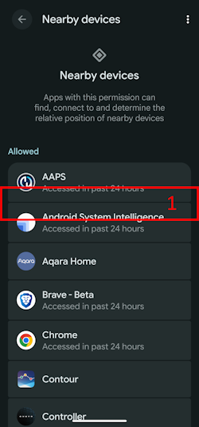

(bluetoothtroubleshooting-bluetooth-related-issues)=

# Problemas relacionados com o Bluetooth

Alguns utilizadores têm tido problemas com falhas na ativação do Omnipod DASH, problemas de ligação do Medtrum Nano e outros erros de pods relacionados com o Bluetooth. Muitos destes problemas têm origem numa das causas seguintes.

Alguns destes problemas também se aplicam provavelmente a outras bombas de insulina Bluetooth. O Medtrum Nano, tal como o Omnipod DASH, tem problemas conhecidos com a permissão de dispositivos próximos.

---

(bluetoothtroubleshooting-cannot-start-omnipod-with-android-16)=

## Não é possível iniciar o Omnipod com o Android 16
- O Android 16 precisa, no mínimo, da versão 3.3.2.1 do **AAPS** para o Omnipod DASH funcionar corretamente, porque esta versão tem correções feitas especificamente para os problemas conhecidos que o Android 16 trouxe para o Omnipod.

---

(bluetoothtroubleshooting-bluetooth-battery-optimisation)=

## Otimização da bateria do Bluetooth

As versões mais recentes do Android ativaram a otimização da bateria para a aplicação Bluetooth do sistema. Isto é conhecido por causar alguns problemas com bombas e CGM Bluetooth.

Se seguiu o [Assistente de Configuração](../SettingUpAaps/SetupWizard.md) e as definições da secção [Otimização da bateria do Bluetooth](#setup-wizard-bluetooth-battery-optimisation), esta definição deve estar correta. Mas se seguiu uma versão mais antiga deste guia, é possível que não tenha alterado esta definição.

Verifique se isto está bem configurado se tiver desconexões da bomba e do CGM.

---

(bluetoothtroubleshooting-apps-using-nearby-device-permission)=

## Aplicações que usam a permissão Android «Nearby devices» (Dispositivos próximos) podem causar quebras de ligação e problemas na ativação do Pod

O Android permite controlar, através de um sistema de permissões, o que cada aplicação pode fazer ou aceder no seu telefone. Para cada aplicação instalada, pode permitir ou recusar permissões específicas, por exemplo aceder a ficheiros no dispositivo, aceder ao Bluetooth, procurar dispositivos próximos, etc.

O **AAPS** precisa de várias permissões específicas para funcionar. Uma delas, necessária para que os Pods funcionem, é a permissão «Nearby devices» (Dispositivos próximos). Há muitas outras aplicações que também precisam desta permissão. A comunidade tem verificado que várias aplicações, quando recebem esta permissão, podem causar problemas na ativação de novos Pods em alguns dispositivos.

(bluetoothtroubleshooting-apps-using-nearby-device-permission-known-apps)=

### Aplicações que usam a permissão «Nearby device» (Dispositivos próximos) e que já causaram problemas:

As aplicações desta lista foram referidas num ou mais locais da comunidade como causa de problemas com dispositivos Omnipod DASH e, em alguns casos, também com o Medtrum Nano.

```{admonition} Updating the list
:class: note
Contacte @XiTatiON no canal Discord #omnipod-dash para discutir aplicações a adicionar a esta lista.
```

- **myBMW** A MyBMW interrompeu o Medtrum Nano e o Omnipod DASH. A aplicação MyBMW pede a permissão «find nearby devices» (encontrar dispositivos próximos) apenas uma vez. Se não a conceder, a aplicação continua a funcionar sem qualquer problema

- **Amazon Alexa**  Retirar a permissão «Nearby devices» (Dispositivos próximos) à aplicação Alexa resolveu o problema para algumas pessoas, mas impede o emparelhamento de dispositivos IoT Matter

- **MINI app**  Parece que esta aplicação é baseada na aplicação myBMW e, por isso, pode ter o mesmo comportamento

- **BM2** Aplicação de monitorização de baterias solares, usada em algumas autocaravanas e instalações solares de campismo. Com a aplicação em execução, não era possível ativar um novo Pod. Forçar a paragem da aplicação durante a ativação de um novo pod contorna o problema. Usar a aplicação depois disso não pareceu interferir com o funcionamento do Dash (num Pixel 8 Pro com Android 16).

(bluetoothtroubleshooting-revoke-nearby-device-permission)=

### Como retirar a permissão «Nearby device» (Dispositivos próximos) a outras aplicações:
Se tiver problemas ao ativar um novo Pod e estiver a usar a versão do **AAPS** suportada para a sua versão do Android, pode ser necessário retirar a permissão a outras aplicações durante a ativação de um novo Pod.

Siga este procedimento para retirar a permissão «Nearby device» (Dispositivos próximos) a todas as aplicações, exceto ao **AAPS**:

```{admonition} Menus and settings
:class: note
As capturas de ecrã e as instruções deste guia são de uma instalação Android 16 de origem (Vanilla) num Google Pixel 8 Pro. Em outros fabricantes e dispositivos, os menus e as descrições das definições provavelmente não serão exatamente iguais. Adapte os passos ao seu dispositivo e, se ficar bloqueado, veja a secção [Onde obter ajuda para o Dash](#omnipod-dash-where-to-get-help-for-dash) para saber como pedir ajuda à comunidade.
```

1. Abra as definições do Android no seu telefone, desça e toque em **Security and privacy (1)** (Segurança e privacidade).

    

2. Desça e toque em **Privacy controls (1)** (Controlos de privacidade).

   

3. Toque em **Permission manager (1)** (Gestor de autorizações).

   

3. Desça e toque em **Nearby devices (1)** (Dispositivos próximos).

   

4. Percorra a lista de aplicações e toque na aplicação à qual quer retirar a permissão **Nearby devices** (Dispositivos próximos).

   Neste guia, a aplicação à qual vamos retirar a permissão é o **Android Auto (1)**.

   Para evitar estragar mais pods, aconselhamos todos a retirar primeiro a permissão a todas as aplicações, exceto ao **AAPS**.

```{admonition} Which app to select?
:class: tip
Se não tiver a certeza de qual aplicação causa o problema, desative-as todas (verifique também a lista de aplicações problemáticas conhecidas e comece por essas). Se puder perder alguns pods pelo caminho, ative a permissão para uma nova aplicação antes de cada nova ativação de Pod, até descobrir qual aplicação causa os problemas com o seu Pod. Se encontrar novas aplicações problemáticas, informe-nos no canal Discord #omnipod-dash.
```

   

5. Para retirar a permissão, toque em **Don't allow (1)** (Não permitir) e depois em **Don't allow anyway (2)** (Não permitir mesmo assim). Se tudo estiver correto, deve ver **Don't allow (3)** (Não permitir) como opção selecionada. Pode agora voltar ao menu **Nearby device** (Dispositivos próximos) tocando na **Back arrow (4)** (seta para trás) e alterar esta definição noutras aplicações, se necessário.

      

(bluetoothtroubleshooting-re-enable-nearby-device-permission)=

### Como voltar a ativar a permissão «Nearby device» (Dispositivos próximos) para aplicações do sistema e outras aplicações:

1. Se necessário, veja a secção **«Como retirar a permissão "Nearby device" a outras aplicações»** para saber como chegar às definições de privacidade das aplicações. Depois, no menu **Nearby device** (Dispositivos próximos), continue no passo 2.

2. Percorra a lista de aplicações e toque na aplicação à qual quer permitir a permissão **Nearby devices** (Dispositivos próximos).

   Neste guia, a aplicação à qual vamos permitir a permissão é o **Android Auto (1)**.

   Vai reparar que o **Android Auto (1)** não aparece na lista de aplicações depois de a permissão ser retirada. Isto acontece porque o **Android Auto** é uma **System app** (aplicação do sistema) e, por predefinição, as aplicações do sistema estão ocultas.

   

3. Para mostrar as aplicações do sistema ocultas, toque no **menu de três pontos (⋮) (1)** no canto superior direito e depois em **"Show system" (2)** (Mostrar sistema). Deve agora ver na lista a aplicação do sistema que estava oculta, **Android Auto (3)**.

```{admonition} Find your app
:class: tip
Se a permissão de uma aplicação foi retirada, tem de descer até ver a lista das aplicações sem permissão, mais abaixo.
```

     

5. Siga as instruções de **«Como retirar a permissão "Nearby device" a outras aplicações»** pela ordem inversa para voltar a ativar a permissão para cada aplicação.

---

(bluetoothtroubleshooting-android-15-bluetooth-connection-problems)=

## Android 15: problemas frequentes de ligação Bluetooth

Depois de atualizar o Android ou de mudar para um telefone recente, o **AAPS** perde muitas vezes a ligação Bluetooth à bomba. O problema desaparece temporariamente quando reinicia o telefone. Se usar um **Omnipod DASH** e o seu telefone tiver o Android 15, ativar a definição **Emparelhamento Bluetooth (bonding)** pode ajudar a tornar a ligação Bluetooth mais estável. Para a ativar:

```{admonition} Android 16
:class: warning
Ative o **Emparelhamento Bluetooth (bonding)** apenas no Android 15 e apenas se tiver problemas de ligação. NÃO ative o emparelhamento (bonding) no Android 16.
```

1. Abra as [definições do Dash](#omnipod-dash-settings): abra o ecrã da bomba DASH com **Gerir** > **Bomba** e toque no ícone **Definições** (roda dentada) no canto superior direito.

   

2. Abra a secção **Definições avançadas** e ative o **Emparelhamento Bluetooth (bonding)**.

   

3. Se o telefone mostrar um pedido de emparelhamento, aceite-o.

4. Reinicie o seu telefone.
