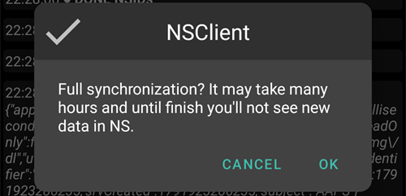

(reinstall-aaps)=
# Reinstalar o AAPS com uma nova keystore

Cada apk do **AAPS** é assinado com uma **keystore**. Uma atualização só é instalada por cima do seu **AAPS** atual se for assinada com a **mesma keystore**: nesse caso, todas as suas definições e dados são mantidos. Por isso, recomenda-se guardar a keystore e a respetiva senha num local seguro.

Se tentar instalar um apk assinado com uma keystore diferente da anterior, recebe uma mensagem de erro a dizer que a instalação falhou!

(reinstall-aaps-when)=
## Quando é preciso reinstalar?

Tem de desinstalar e reinstalar o **AAPS** quando o seu novo apk está assinado com uma keystore diferente, por exemplo:

- Não encontra a sua keystore antiga ou a respetiva senha.
- Criou uma nova keystore, por exemplo com a [Opção 1 da compilação no navegador](../SettingUpAaps/BrowserBuildKeystore.md) ou com **Create a new key** (criar uma nova chave) no [AAPS Builder](../SettingUpAaps/BrowserBuildAapsBuilder.md).
- Compila num computador novo e não copiou a sua keystore para ele.

Se ainda tem a sua keystore, não precisa desta página: use-a de novo e [atualize o **AAPS**](../Maintenance/UpdateToNewVersion.md) por cima da versão instalada.

(reinstall-aaps-before)=
## Antes de começar

- Desinstalar o **AAPS** apaga todas as suas definições, os seus [objetivos](../SettingUpAaps/CompletingTheObjectives.md) e a ligação atual à bomba. Recupera-os ao importar o seu **ficheiro de definições**, por isso confirme que tem um ficheiro recente.
- O ficheiro de definições não contém o seu histórico de tratamentos e de glicose. Se envia os dados para o [Nightscout](../SettingUpAaps/SettingUpTheReportingServer.md), pode carregá-lo de novo depois da reinstalação (passo 8).
- Precisa da sua [**Senha Mestre**](#Preferences-master-password): o ficheiro de definições está encriptado com ela.
- **Utilizadores de Omnipod e Medtrum:** leiam primeiro [Bombas sem tubo](#ExportImportSettings-tubeless-pumps). O seu ficheiro de definições tem de ter sido exportado durante o pod ou o patch que está a usar agora.
- Se for preciso, [configure o recetor da sua fonte de CGM/glicose](../Getting-Started/CompatiblesCgms.md) antes de começar.

(reinstall-aaps-steps)=
## Passos

As imagens mostram a mudança do **AAPS** 3.4 (passos 1 a 3) para o **AAPS** 4 (passos 6 a 8). Outras versões têm um aspeto um pouco diferente.

(reinstall-aaps-export)=
### 1. Exporte as suas definições

Exporte as suas definições com o **AAPS** que está agora instalado no seu telefone. Consulte [Exportar definições](#ExportImportSettings-Settings-Export) para mais detalhes.

No **AAPS** 3.4: abra **Manutenção** e toque em **Opções de exportação**. Em **Definições do utilizador**, marque **Armazenamento local** e toque em **OK**.

*Nota: também pode usar o [Armazenamento na nuvem](#preferences-maintenance-cloud) para ter uma cópia de segurança extra: é uma boa ideia, mas mantenha o armazenamento local para recuperar as definições depressa.*

O botão passa a mostrar **Exportar definições (local)**. Toque nele.

O **AAPS** mostra o nome do ficheiro que vai criar. Toque em **OK**, escreva a sua Senha Mestre e toque em **OK**.

No **AAPS** 4: abra **Manutenção**, selecione o chip **Local** ao lado de **Exportar definições** e toque em **Exportar definições**.

(reinstall-aaps-copy)=
### 2. Copiar o ficheiro de definições para fora do telefone

O ficheiro está na pasta **preferences** da sua [pasta do **AAPS**](#SetupWizard-StoragePermission) e tem um nome como `2026-10-13_222735_full.json`. Copie-o ou envie-o para um local externo (por exemplo, o seu computador, um serviço de armazenamento na nuvem...). Normalmente, o ficheiro fica no telefone depois da desinstalação, mas guarde uma cópia noutro local por segurança.

(reinstall-aaps-nightscout-before)=
### 3. Sincronizar com o Nightscout

Este passo não é obrigatório, mas é recomendado se usa o [DynISF](#Open-APS-features-DynamicISF): permite continuar logo com as definições atuais, em vez de esperar 5 dias para juntar os dados de que o plugin precisa. O NSClient V3 tem de estar [ativo e configurado](../SettingUpAaps/SettingUpTheReportingServer.md).

Confirme que o Nightscout tem todos os seus dados antes de desinstalar.

Abra o **ClienteNS**, toque no botão **Sincronização completa** na parte de baixo do ecrã e depois em **OK**.

*Nota: o tempo necessário depende do seu serviço de alojamento do Nightscout.*

Depois, o **AAPS** propõe limpar a sua base de dados. **OK** remove do telefone os dados com mais de 3 meses, o que torna a sincronização muito mais rápida. **Cancelar** sincroniza sem limpar. A base de dados do telefone é apagada de qualquer forma quando desinstala, por isso as duas opções servem.

Deixe o **AAPS** a funcionar até a sincronização terminar.

(reinstall-aaps-build)=
### 4. Compilar o novo apk

[Compile](../SettingUpAaps/BuildingAaps.md) um novo apk assinado com a sua nova keystore e transfira-o para o seu telefone.

(reinstall-aaps-uninstall)=
### 5. Desinstalar o AAPS

Nas **Settings** (Definições) > **Apps** (Aplicações) > **AAPS** do seu telefone, toque em **Uninstall** (Desinstalar) e confirme com **OK**.

(reinstall-aaps-install)=
### 6. Instalar e iniciar o novo AAPS

[Instale](../SettingUpAaps/TransferringAndInstallingAaps.md) o novo apk e inicie o **AAPS**. O [assistente de configuração](../SettingUpAaps/SetupWizard.md) pede as permissões de que o **AAPS** precisa: toque em **Conceder** em cada uma delas. Isto também volta a desligar a [otimização da bateria](#setup-wizard-bluetooth-battery-optimisation).

Em **Pasta AAPS**, selecione a mesma pasta do **AAPS** de antes (a que contém a pasta **preferences**), toque em **Use this folder** (Usar esta pasta) e em **Allow** (Permitir).

Quando o **AAPS** encontra as suas definições exportadas, o assistente de configuração mostra um ecrã [Definições armazenadas encontradas](#setup-wizard-import-settings), onde as pode importar. Também pode fechar o assistente e importar a partir de **Manutenção**, como descrito abaixo.

(reinstall-aaps-import)=
### 7. Importar as suas definições

Se o ficheiro de definições já não estiver no seu telefone, copie-o de volta para a pasta **preferences** da sua pasta do **AAPS**.

Abra o menu (☰) > **Manutenção**, selecione o chip **Local** ao lado de **Importar definições** e toque em **Importar definições**.

A lista mostra cada ficheiro com a sua versão do **AAPS** e a sua idade. Escolha o ficheiro que exportou no passo 1.

Não precisa de definir primeiro uma Senha Mestre no novo **AAPS**. Escreva a Senha Mestre que usou na exportação em **Senha de desencriptação** e toque em **Desencriptar**. A mensagem **O ficheiro foi encriptado com uma senha diferente** é normal: o novo **AAPS** ainda não conhece a sua senha. A importação restaura-a com as suas outras definições.

Marque **Substituir também as definições da bomba**: sem isto, a sua bomba e as suas definições não são restauradas. Utilizadores de Omnipod e Medtrum: marquem esta opção só se o ficheiro foi exportado durante o pod ou o patch atual (consulte [Bombas sem tubo](#ExportImportSettings-tubeless-pumps)).

Toque em **Importar**, depois em **OK** para aplicar as definições e de novo em **OK** em **Definições aplicadas**.

(reinstall-aaps-nightscout-after)=
### 8. Recuperar o seu histórico do Nightscout

Abra o menu (☰) > [**Configuração**](../SettingUpAaps/ChangeAapsConfiguration.md) > **Comunicação** e toque em **Abrir plugin** em **NSClientV3**. Verifique se o estado mostra **Ligado**. Se não mostrar, consulte [Resolução de problemas do NSClient](TroubleshootingNsClient.md).

Toque no botão **Sincronização completa** na parte de baixo do ecrã e em **OK**. A base de dados é nova, por isso pode responder como quiser à pergunta sobre a limpeza.

O **AAPS** carrega os seus dados do Nightscout. O registo mostra **Full sync finished** quando terminar.

(reinstall-aaps-check)=
### 9. Verificar e continuar com o loop

Verifique se a sua bomba está ligada e se os valores do CGM chegam; depois continue com o loop.

(reinstall-aaps-afterwards)=
## Depois

A partir de agora, use sempre a sua nova keystore e guarde-a com a respetiva senha num local seguro, fora do telefone. Consulte [Criar cópias de segurança](../Maintenance/ExportImportSettings.md).
