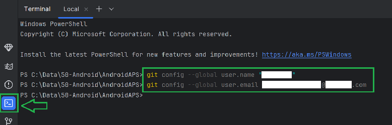
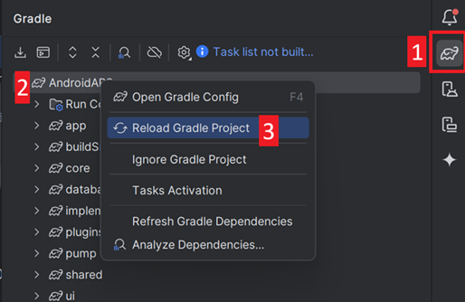

(troubleshooting_androidstudio-troubleshooting-android-studio)=

# Resolução de problemas do Android Studio

```{contents} List of common issues
:depth: 2
:local: true
```

(troubleshooting_androidstudio-lost-keystore)=
## Keystore perdida
Se perdeu a sua keystore ou a respetiva senha, um apk assinado com uma nova keystore não pode atualizar o seu **AAPS** atual: tem de o desinstalar e reinstalar. Consulte [Reinstalar o AAPS com uma nova keystore](#reinstall-aaps).

## Gradle Sync failed
O Gradle Sync pode falhar por vários motivos. Quando receber uma mensagem a dizer «gradle sync failed», abra o separador «Build» (1) na parte de baixo do Android Studio e veja que mensagem de erro (2) aparece.


```{contents} Likely reasons for gradle sync failures are:
:depth: 1
:local: true
```

*Importante*: Depois de seguir as instruções para o seu problema, tem de iniciar de novo a [sincronização do Gradle](#gradle-resync).

(troubleshooting_androidstudio-uncommitted-changes)=
### Uncommitted changes (alterações não submetidas)

Se receber uma mensagem de falha como esta:


```
Build file 'C:\Data\50-Android\AndroidAPS\app\build.gradle.kts' line: 243

There are uncommitted changes.
Clone de novo o código-fonte como descrito na wiki e não permita a atualização do Gradle
```

#### Passo 1 – Verificar a instalação do Git
  * Abra o separador Terminal (1) na parte de baixo do Android Studio, copie o texto seguinte e cole-o ou escreva-o no terminal (2).
    ```
    git --version
    ```

    

    Nota: há um espaço e dois hífenes entre Git e version!

  * Tem de receber uma mensagem a indicar que versão do Git está instalada, como pode ver na captura de ecrã acima. Neste caso, vá para o [Passo 2](#troubleshooting-android-studio-check-for-uncommitted-changes).

  * Se receber uma mensagem a dizer
    ```
    Git: command not found
    ```
    a sua instalação do Git não está correta.

  * [Verificar a instalação do Git](#BuildingAaps-steps-for-installing-git)

  * Se usa Windows e acabou de instalar o Git, deve reiniciar o computador depois da instalação para que o Git fique disponível em todo o sistema

  * Se o Git está instalado, já reiniciou (se usa Windows) e o Git continua a não ser encontrado:

  * Procure no seu computador um ficheiro «git.exe».

    Tome nota da pasta onde está guardado.

  * Vá às variáveis de ambiente (Environment variables) do Windows, selecione a variável «PATH» e clique em editar. Adicione a pasta onde encontrou a sua instalação do Git.

  * Guarde e feche.

  * Reinicie o Android Studio.

(troubleshooting-android-studio-check-for-uncommitted-changes)=
#### Passo 2: Verificar se há alterações não submetidas.

  * No Android Studio, abra o separador «Commit» (1) no lado esquerdo. 
  * Pode ver «Changes» (nas versões mais antigas do Android Studio chama-se «Default changeset») (2) ou «Unversioned Files» (3):

    * Em «Changes», provavelmente atualizou o «Gradle» ou alterou por engano o conteúdo de alguns ficheiros.

    * Clique com o botão direito em «Changes» e selecione «Rollback…» (1)

      

    * Os ficheiros são obtidos de novo do servidor Git. Se não houver outras alterações no separador Commit, vá para o [Passo 3](#gradle-resync).

  * Se vir «Unversioned Files», talvez tenha guardado ficheiros por engano na pasta do código-fonte. Podem ser ficheiros importantes, como o ficheiro da sua keystore, que devem ser movidos para outro local. Se não sabe que ficheiros são e não foi o próprio a criá-los, pode apagá-los.

    * Use o explorador de ficheiros normal do seu computador para mover (ou cortar e colar) esse ficheiro para um local seguro.

    * Volte ao Android Studio e clique no botão Refresh (4) no separador Commit, para confirmar que o ficheiro já não está guardado na pasta do **AAPS**.

      Se não houver outras alterações no separador Commit, vá para o [Passo 3](#gradle-resync).


#### Passo 3: Sincronizar o Gradle (outra vez)

Siga as instruções em [Sincronizar o Gradle de novo](#gradle-resync).

### Git Pull Failed - Please tell me who you are

Se vir esta mensagem, o Git precisa que se identifique.


Abra o terminal e escreva os dois comandos seguintes, um depois do outro.

```
git config --global user.name "Your name here"
git config --global user.email your.email@here.com
```

O seu nome tem de ser escrito entre aspas.



(troubleshooting_androidstudio-android-gradle-plugin-requires-java-11-to-run)=

(incompatible-gradle-jvm)=
### Incompatible Gradle JVM


```
Your build is currently configured to use incompatible Java 21.0.3 and Gradle 8.2.
Cannot sync the project.

We recommend upgrading to Gradle version 8.9.

The minimum compatible Gradle version is 8.5.

The maximum compatible Gradle JVM version is 19.
```

Ou:

```
Cause: error: invalid source release: 21
```

Se receber a mensagem de erro acima, tem de transferir uma versão correta da JVM antes de tentar compilar de novo:

1.  Veja na [tabela de requisitos](#Building-APK-recommended-specification-of-computer-for-building-apk-file) que versão da JVM precisa para a versão do **AAPS** que está a compilar, e tome nota dela.

2. Abra a vista Gradle clicando no elefante (1) no lado direito do Android Studio, abra as definições (2) e selecione **Gradle Settings** (3):


3.  No campo **Gradle JDK**, veja se a versão certa está selecionada (1). Se não estiver, clique no campo e veja se já está disponível na lista. O exemplo abaixo mostra a JVM 21 com o nome «jbr-21». Se a encontrar, basta selecioná-la e está concluído. Se não estiver disponível, selecione **Download JDK** (2).


4. Em Version (1), selecione o JDK necessário para a sua versão do **AAPS** (a que anotou quando consultou a tabela de requisitos). Em Vendor (2), selecione qualquer fornecedor. Location (3): não altere. Clique em **Download** (4).


5.  Feche a janela **Settings** com **OK**.
6. Agora tem de reiniciar o Gradle Sync. Siga as instruções em [Sincronizar o Gradle de novo](#gradle-resync).

(incompatible-version-of-android-gradle-plugin)=
### Incompatible version of Android Gradle plugin

  Se receber a seguinte mensagem de erro

`The project is using an incompatible version (AGP x.x.x) of the Android Gradle plugin. Latest supported version is AGP x.x.x`

  

  Está a usar uma versão desatualizada do Android Studio. No menu, vá a Help > Check for updates e instale todas as atualizações encontradas do Android Studio e dos seus plugins.

(troubleshooting_androidstudio-could-not-resolve-no-cached-version)=
### Could not resolve/No cached version

  Pode receber esta mensagem de erro:


  * No lado direito, abra o separador Gradle (1).

    Confirme que o botão indicado em (2) *NÃO* está selecionado.

    

  * Agora tem de iniciar uma [nova sincronização do Gradle](#gradle-resync)

(troubleshooting_androidstudio-unable-to-start-daemon-process)=
### Unable to start daemon process

  Se vir uma mensagem de erro como a que está abaixo, provavelmente usa um sistema Windows 10 de 32 bits. Isto não é suportado pelo Android Studio 3.5.1 e versões mais recentes e, infelizmente, os programadores do **AAPS** não podem fazer nada quanto a isso!

  Há informação na internet sobre como saber se tem um sistema operativo de 32 ou de 64 bits, por exemplo [esta](https://support.microsoft.com/en-us/windows/32-bit-and-64-bit-windows-frequently-asked-questions-c6ca9541-8dce-4d48-0415-94a3faa2e13d).

  

(gradle-resync)=
### Sincronizar o Gradle de novo

  Se ainda vir a mensagem de que o gradle sync falhou, selecione agora o link **Try again** (1). 


  Se já não vir a mensagem, pode iniciar isto manualmente:

  * Abra o separador Gradle (1) na margem direita do Android Studio.

    

  * Clique com o botão direito em AAPS (2)

  * Clique em «Reload Gradle Project» (3)

## Generate Signed APK generated successfully with 0 build variants

Quando gera o apk assinado, pode receber a notificação de que a geração foi bem-sucedida, mas que foram geradas «0 build variants»:


Este é um aviso falso. Veja a pasta que selecionou como «Destination folder» para a geração (passo [Gerar o APK assinado](#Building-APK-generate-signed-apk)) e vai encontrar lá o apk gerado!


## A app foi criada com avisos do compilador/kotlin

Se a compilação terminou com sucesso, mas recebe avisos do compilador ou do kotlin (indicados por um ponto de exclamação amarelo ou azul), pode simplesmente ignorar estes avisos.

 

O seu apk foi compilado com sucesso e pode ser transferido para o seu telefone!


## O AAPS não recebe dados do CGM

* Se usa a app Dexcom G6 modificada (patched): esta app está desatualizada. Use antes a app [BYODA](#DexcomG6-if-using-g6-with-build-your-own-dexcom-app).

* Se usa o xDrip: identifique o recetor como descrito na [página de definições do xDrip](#xdrip-identify-receiver).


## Apk não instalado


* Confirme que transferiu o ficheiro «app-full-release.apk» para o seu telefone.
* Este erro normalmente quer dizer que o novo apk está assinado com uma keystore diferente da do **AAPS** instalado. Se ainda tem a sua keystore anterior, selecione-a e compile de novo. Caso contrário, consulte [Reinstalar o AAPS com uma nova keystore](#reinstall-aaps).
* Se aparecer «App not installed» (app não instalada) no seu telefone, siga estes passos:

1. [Exporte as definições](../Maintenance/ExportImportSettings.md) (na versão do AAPS já instalada no seu telefone)
2. Desinstale o **AAPS** do seu telefone.
3. Ative o modo de avião e desligue o Bluetooth.
4. Instale a nova versão («app-full-release.apk»)
5. [Importar definições](../Maintenance/ExportImportSettings.md)
6. Volte a ligar o Bluetooth e desative o modo de avião

## Apk instalado, mas versão antiga

Se compilou a app com sucesso, a transferiu para o seu telefone e a instalou com sucesso, mas o número da versão continua igual, então talvez se tenha esquecido de [atualizar a sua cópia local](#Update-to-new-version-update-your-local-copy)

## Nada do que está acima resultou

Se nenhuma das dicas acima ajudou, pode pensar em compilar o apk do zero:

1. [Exporte as definições](../Maintenance/ExportImportSettings.md) (na versão do AAPS já instalada no seu telefone)

2. Tenha à mão a senha da chave (key password) e a senha da keystore (key store password).

    Ou simplesmente use uma nova keystore.

3. Compile o apk do zero, como descrito [aqui](#Building-APK-download-AAPS-code).

4. Depois de compilar o apk com sucesso, apague o apk existente no seu telefone, transfira o novo apk para o telefone e instale-o.
5. [Importe as definições](../Maintenance/ExportImportSettings.md) de novo para restaurar os seus objetivos e definições.
6. Verifique as suas opções de otimização da bateria e desative-as de novo.

## Na pior das hipóteses

Se o que está acima não resolver o seu problema de compilação, pode tentar desinstalar completamente o Android Studio e compilar de novo do zero.  Alguns utilizadores dizem que isto resolve o seu problema de compilação.  Ao apagar o Android Studio, não apague as definições de utilizador do Android e **confirme que desinstala todos os ficheiros associados ao Android Studio.** Se não remover completamente o Android Studio com todos os ficheiros ocultos, a desinstalação pode causar novos problemas em vez de resolver o(s) que já tem. Pode encontrar na internet instruções para uma desinstalação completa, por exemplo:

[https://stackoverflow.com/questions/39953495/how-to-completely-uninstall-android-studio-from-windowsv10](https://stackoverflow.com/questions/39953495/how-to-completely-uninstall-android-studio-from-windowsv10).

Instale o Android Studio do zero, como descrito [aqui](#Building-APK-install-android-studio).
