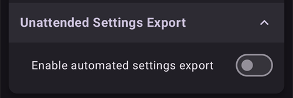

# Criar e restaurar cópias de segurança

Quando instala o AAPS no seu telefone, ele torna-se um «dispositivo médico» do qual depende todos os dias. Recomenda-se vivamente ter um plano de emergência para quando o seu telefone avariar, for roubado ou se perder. Por isso, é essencial preparar-se e perguntar a si próprio: «E se…?»

Para restaurar a sua configuração do AAPS num telefone existente ou novo, é importante guardar os seguintes itens num local seguro (ou seja: não no seu telefone). O melhor é ter pelo menos duas cópias de segurança separadas: num disco rígido local, numa pen USB e (de preferência) num armazenamento na nuvem como o Google Drive ou o Microsoft 365 OneDrive. Se guardar as cópias de segurança na nuvem, tem sempre tudo o que precisa acessível a partir do seu telefone para restaurar a sua configuração em qualquer lugar e a qualquer hora.

Pense em arranjar um segundo telefone de reserva e em praticar a restauração do AAPS, para garantir que o telefone de reserva funciona como esperado. Este passo dá-lhe a confiança de que o seu plano de emergência funciona e de que pode continuar a usar o AAPS sem interrupções se o seu telefone principal deixar de estar disponível.

```{admonition} Android backups and phone-transfer tools do not carry your AAPS settings
:class: warning
Since **AAPS** 4.0 the settings are kept in an encrypted store on the phone, and they are left out of the Google backup and of the phone-to-phone transfer of a new phone. A settings export, as described on this page, is the only way to carry them over.
```

Para conseguir restaurar, é importante ter à mão os seguintes itens:

- O seu **ficheiro da keystore do Android Studio** e a respetiva **senha**: necessários para (re)compilar o ficheiro de instalação .APK do AAPS.
- Uma cópia recente do **ficheiro de instalação .APK do AAPS**
- Um ficheiro recente de **exportação de definições**: para restaurar definições importantes (incluindo os seus objetivos!).
- A sua **senha mestre do AAPS**
- Cópias de segurança de utilitários adicionais: por exemplo BYODA e/ou xDrip.
- Notas pessoais sobre a sua configuração.

Abaixo estão os itens dos quais se recomenda guardar cópias de segurança.

## Criar cópias de segurança

### Ficheiro da keystore do computador que usou para compilar o APK
Quando compila o ficheiro de instalação .APK no Android Studio, ele usa o **ficheiro da keystore e a senha para assinar o ficheiro de instalação .APK**. Para atualizar a sua instalação atual do AAPS, o ficheiro de instalação .APK da atualização tem de ser assinado com a mesma keystore usada na primeira instalação. Ao atualizar, todas as definições e a base de dados do AAPS são mantidas. Sem isto, terá primeiro de desinstalar a aplicação atual e depois [reinstalar](#reinstall-aaps) e configurar de novo o AAPS.

Guardar a keystore e a respetiva senha torna muito mais simples atualizar o APK no futuro, sobretudo se precisar de compilar a app num computador novo. Veja a secção [Atualizar o AAPS](../Maintenance/UpdateToNewVersion.md) para mais detalhes sobre como usar a keystore ao compilar um novo APK.

**Quando fazer a cópia de segurança:** deve fazer uma cópia de segurança da keystore depois de compilar pela primeira vez o ficheiro de instalação .APK do **AAPS**.

**Como fazer a cópia de segurança:** encontre o caminho da sua keystore. Se não se lembrar, pode encontrá-lo no Android Studio ao selecionar **Build > APK > Next**. O caminho aparece em «Key store path». Com o seu explorador de ficheiros, vá até este caminho e faça uma cópia do seu ficheiro da keystore (com a extensão `.jks`). Guarde-a num local seguro na nuvem, para o caso de o seu computador deixar de estar disponível. Não se esqueça de anotar também a senha da keystore (key store password), o alias da chave (key alias) e a senha da chave (key password).

### Cópias do APK mais recente
Se o seu telefone principal do **AAPS** se perder ou estragar, ter uma cópia do APK disponível permite-lhe voltar rapidamente a usar o **AAPS** num telefone novo. Nota: também vai precisar de uma cópia de segurança das suas preferências, como descrito abaixo.

**Quando fazer a cópia de segurança:** deve guardar uma cópia de segurança do APK mais recente que instalou no seu telefone principal do **AAPS**. Pode também querer guardar uma versão anterior, para o caso de precisar de voltar a ela por algum motivo.

**Como fazer a cópia de segurança:** guarde uma cópia no computador usado para compilar o APK com o Android Studio. Além disso, recomenda-se usar uma plataforma na nuvem para guardar uma cópia do APK de instalação. Certifique-se de que sabe encontrar as duas cópias de segurança quando precisar delas. Pense em criar pastas dedicadas para guardar estas cópias de segurança.

### Ficheiro de definições do AAPS (também chamado «Preferências»)

```{admonition} Where are preferences stored on my phone?
:class: tip
Encontra as suas definições na **Pasta AAPS** que selecionou durante a [configuração do AAPS](#SetupWizard-StoragePermission).</br>
Também pode mudar a **Pasta AAPS** no ecrã **Manutenção** (**menu** (☰) > **Manutenção**), veja [Definir a pasta AAPS local](#preferences-maintenance-logdirectory).
```

Com uma cópia do ficheiro de instalação do APK (ver acima) e o seu ficheiro de **Definições**, pode voltar rapidamente a usar o AAPS num telefone existente ou novo.

O ficheiro de **Definições** serve para adaptar a aplicação AAPS à sua configuração específica. Incluem dados como as suas definições de **Configuração**, o estado dos objetivos, as definições de comunicação com terceiros (por exemplo, Nightscout, Tidepool), as automatizações e os perfis.

Exportar as definições do AAPS para um ficheiro permite-lhe restaurar a configuração tal como estava num momento específico. Como já foi dito, além de todas as definições de configuração, o ficheiro exportado contém também o estado dos seus objetivos, que tem de restaurar quando **(re)instala** o AAPS. Sem isto, terá de refazer todos os objetivos desde o início para ativar o loop fechado. Os ficheiros de definições permitem também restaurar as últimas definições que funcionavam bem, para desfazer alterações à configuração.

**Quando fazer uma cópia de segurança das definições do AAPS:**
* Sempre que completar um objetivo, para não perder o seu progresso. _Sem uma cópia das suas **Definições**, terá de completar de novo todos os objetivos se precisar de reinstalar o AAPS ou de substituir o seu telefone._

* Sempre que pensar fazer alterações importantes à sua configuração (alterar definições do SMB, mudar o tipo de insulina, mudar de bomba, alterar automatizações), deve fazer uma cópia de segurança das suas **Definições** antes e depois das alterações. Assim tem as suas definições mais recentes e também uma cópia das definições antes das alterações, para o caso de precisar de voltar a elas.

* Tubeless pumps (Such as Omnipod and Medtrum) users only: the **Settings** file contains connection details on your current pod and can be used to restore connection to that pod with a new phone. Se não tiver uma cópia das suas preferências exportada depois de iniciar o seu Pod atual, terá de iniciar um novo Pod se precisar de substituir o seu telefone atual.

**Como fazer uma cópia de segurança manualmente:**

1. If this is your first time importing or exporting **Settings** you will need to set a master password in [Settings > Protection](#Preferences-master-password). Defina uma senha e anote-a num local seguro. _Sem esta senha, não vai conseguir aceder às cópias de segurança das suas **Definições**._

2. No ecrã principal do **AAPS**, abra o **menu** (☰) > **Manutenção**. Escolha onde guardar o ficheiro com os chips **Local** e **Nuvem** ao lado de **Exportar definições** (veja **Exportar ou importar definições** abaixo) e depois toque em **Exportar definições**. O **AAPS** mostra para onde vai o ficheiro: o nome do ficheiro para **Local**, **Google Drive** para **Nuvem**. Toque em **OK**.

   

   

   Introduza a senha mestre definida acima e toque em **OK**.

   

   **Definições exportadas** (local) ou **Exportação para a nuvem bem-sucedida** (nuvem) confirma a exportação.

   

   

3. Com o explorador de ficheiros do seu telefone (normalmente chamado «Files» (Ficheiros) ou «My Files» (Os meus ficheiros)), vá até Internal Storage (Armazenamento interno) > AAPS > preferences. Aqui vê uma cópia de todos os ficheiros de preferências exportados. O nome do ficheiro deve ser `YYYY-MM-DD_Time_appname.json`. Carregue este ficheiro para a plataforma na nuvem que preferir. Depois, a partir da plataforma na nuvem, descarregue também uma cópia para o seu computador local.

(ExportImportSettings-Settings-Export)=

## Exportação de definições

```{admonition} Where are preferences stored on my phone?
:class: tip
Encontra as suas definições na **Pasta AAPS** que selecionou durante a [configuração do AAPS](#SetupWizard-StoragePermission).</br>
Também pode mudar a **Pasta AAPS** no ecrã **Manutenção** (**menu** (☰) > **Manutenção**), veja [Definir a pasta AAPS local](#preferences-maintenance-logdirectory).
```

Recomenda-se exportar as definições com regularidade, sobretudo antes e depois de alterar a configuração. Pode fazer as exportações **manualmente ou (de preferência) através da automatização**. Não se esqueça de anotar a sua senha mestre do AAPS e de fazer cópias de segurança dos seus ficheiros de definições, copiando-os para fora do telefone, por exemplo para um armazenamento na nuvem.

**Nota**: _As definições exportadas são encriptadas com a sua senha mestre do AAPS: sem a senha mestre usada na exportação não vai conseguir importar o ficheiro de definições!_

### Exportar ou importar definições
Para exportar ou importar definições, abra o **menu** (☰) e selecione **Manutenção**. Em **Gestão de ficheiros**, os chips **Local** e **Nuvem** ao lado de **Exportar definições** e **Importar definições** escolhem onde o ficheiro de definições é guardado ou de onde é lido: **Local** é a pasta AAPS no seu telefone, **Nuvem** fica disponível depois de configurar uma [Pasta na nuvem](#preferences-maintenance-cloud). Tocar num chip liga-o ou desliga-o; pelo menos um fica sempre selecionado, e as duas linhas partilham a mesma escolha. Depois toque no próprio **Exportar definições** ou **Importar definições** para começar.


(ExportImportSettings-Automating-Settings-Export)=
### Automatizar a exportação de definições

To automate settings exports [(**see Automation**)](../DailyLifeWithAaps/Automations.md#automating-preference-settings-export) open [**Settings** > **Maintenance**](#preferences-maintenance-settings), expand **Unattended Settings Export** and switch on **Enable automated settings export**.

Agora pode configurar a [Automatização](../DailyLifeWithAaps/Automations.md#automating-preference-settings-export) para exportar as definições, com regularidade (_por exemplo_, todas as semanas) ou depois de uma mudança de Pod.

_**Nota:** ao importar definições, é sempre preciso introduzir a senha mestre do AAPS!_



(ExportImportSettings-restoring-from-your-backups-on-a-new-phone-or-fresh-installation-of-aaps)=
## Restaurar a partir das suas cópias de segurança num telefone novo ou numa instalação nova do AAPS

```{admonition} Where are preferences stored on my phone?
:class: tip
Encontra as suas definições na **Pasta AAPS** que selecionou durante a [configuração do AAPS](#SetupWizard-StoragePermission).</br>
Também pode mudar a **Pasta AAPS** no ecrã **Manutenção** (**menu** (☰) > **Manutenção**), veja [Definir a pasta AAPS local](#preferences-maintenance-logdirectory).</br>
Se o **AAPS** perder o acesso a essa pasta (pode acontecer depois de uma reinstalação ou depois de limpar o armazenamento da app), mostra a notificação **Perdeu-se o acesso à pasta AAPS** e deixa de guardar as definições no telefone até [selecionar a pasta novamente](#preferences-maintenance-logdirectory).
```

Use estas instruções se tiver uma cópia de segurança do seu APK e das suas **Definições** que quer carregar num telefone novo, ou se precisou de apagar e reinstalar o APK no seu telefone atual por algum motivo.

_Se atualizar o **AAPS** com um APK compilado com a mesma keystore, não deve precisar de seguir este processo. No entanto, recomenda-se mesmo assim criar uma cópia de segurança antes de aplicar a atualização._

Se atualizar o **AAPS** depois de ter perdido ou substituído a sua keystore original (por exemplo, ao usar um novo computador de compilação sem transferir a keystore), faça uma cópia de segurança de todas as definições como descrito acima e depois desinstale a versão atual do **AAPS** no seu telefone. Veja [Reinstalar o AAPS com uma nova keystore](#reinstall-aaps) para o procedimento completo.

Se necessário, [configure o recetor da sua fonte de CGM/glicose](../Getting-Started/CompatiblesCgms.md) antes dos passos abaixo

(ExportImportSettings-tubeless-pumps)=
```{admonition} Tubeless pumps (Omnipod and Medtrum) users
:class: warning
O ficheiro de **Preferências** contém a sessão do Pod ou patch que estava ativo quando o exportou.
- **Exporte logo depois de cada ativação de Pod ou patch** e copie o ficheiro para fora do telefone.
- **Mesmo telefone, Pod ainda em funcionamento:** deixe **Substituir também as definições da bomba** desmarcado. O seu Pod atual é mantido e só as outras definições são importadas.
- **Telefone novo a assumir o Pod:** marque **Substituir também as definições da bomba** e use apenas um ficheiro exportado durante o Pod que está a usar agora. Um ficheiro de um Pod anterior substitui a sessão do seu Pod atual, e terá de iniciar um novo Pod.
- **Uma sessão antiga de Pod foi importada por engano:** o **AAPS** continua a tentar contactar esse Pod e não consegue ativar um novo. Desative-o; se isso falhar, descarte-o (veja, por exemplo, [Descartar um Pod](#omnipod-dash-discard-pod) para a Omnipod DASH).
```

```{admonition} Pump settings are kept unless you say otherwise
:class: note
Por predefinição, uma importação não mexe nas definições da bomba: a bomba selecionada em **Configuração**, o emparelhamento e todas as outras definições da bomba ficam como estão neste telefone. Marque **Substituir também as definições da bomba** no ecrã de importação apenas quando restaurar para um telefone novo que deve assumir a mesma bomba. As definições que não estão no ficheiro nunca são apagadas por uma importação.
```

1. Com a cópia de segurança do seu APK (ver acima), siga as instruções para uma [nova instalação](../SettingUpAaps/TransferringAndInstallingAaps.md)

2. Abra o **AAPS** e conceda todas as permissões pedidas

3. Saia do Assistente de Configuração. Vamos importar todas as definições necessárias a partir da cópia de segurança das **Definições**

4. No ecrã principal do **AAPS**, toque em **Conceder** e conceda todas as permissões listadas no painel **Permissões necessárias** no topo

5. No ecrã principal do **AAPS**, defina a senha mestre em [Definições > Proteção](#Preferences-master-password) com a mesma senha que usou nas suas cópias de segurança.

6. Se ainda não o fez, [defina a **Pasta AAPS**](#preferences-maintenance-logdirectory): no ecrã principal do **AAPS**, abra o **menu** (☰) > **Manutenção** > **Pasta AAPS**.

7. No ecrã principal do **AAPS**, abra o **menu** (☰) > **Manutenção** > **Exportar definições** > introduza a senha mestre definida acima > **OK**. Isto cria a pasta preferences, se ainda não existir no seu telefone.

8. Descarregue a cópia de segurança do seu ficheiro de **Preferências** da sua plataforma na nuvem.

9. Use o seu explorador de ficheiros (normalmente chamado «Files» (Ficheiros) ou «My Files» (Os meus ficheiros)) para mover o ficheiro das transferências para `/internal storage/AAPS/preferences`, se a sua **Pasta AAPS** estiver definida como `/internal storage/AAPS`

10. No ecrã principal do **AAPS**, abra o **menu** (☰) > **Manutenção** e toque em **Importar definições**. Selecione o ficheiro de preferências a partir do qual quer restaurar (o mais recente está no topo). Certifique-se de que seleciona o ficheiro de preferências correto: são mostrados todos os ficheiros .json da pasta preferences (ou da pasta na nuvem, com **Nuvem**).

    

    O **AAPS** mostra os detalhes do ficheiro. Introduza a senha mestre definida acima e toque em **Desencriptar e rever**.

11. Depois de o ficheiro ser desencriptado, decida o que fazer com as definições da bomba. Num telefone novo que assume a mesma bomba, marque **Substituir também as definições da bomba** para que o emparelhamento e as definições da bomba venham do ficheiro. Deixe a caixa desmarcada para manter a bomba com a qual este telefone já está emparelhado. Depois toque em **Importar**.

    

12. O **AAPS** pergunta **Aplicar as definições importadas?** e indica quantas definições vão mudar e, se deixou a caixa desmarcada, quantas definições da bomba são mantidas. Ainda não foi gravado nada, por isso **Cancelar** deixa o seu telefone exatamente como estava. Toque em **OK** para aplicar.

    

13. O **AAPS** aplica as definições importadas de imediato, sem reiniciar. Só os plugins cujas definições mudaram são reiniciados. Enquanto isto decorre, o **AAPS** mostra **A aplicar as definições…**; se a bomba estiver ocupada, mostra **A aguardar a bomba…** e aplica as definições quando a bomba ficar livre. Se a bomba continuar ocupada após um minuto, o **AAPS** oferece-se para tentar de novo. A mensagem **Definições aplicadas** confirma que as definições importadas estão em uso. Qualquer tratamento que tenha ficado em fila durante a importação é descartado e o **AAPS** informa que foi cancelado, para que nada seja enviado duas vezes para a bomba.

    

Se o ficheiro selecionou uma bomba que esta versão do **AAPS** não tem, o **AAPS** passa para a **Bomba virtual** e informa-o disso. Selecione de novo a sua bomba em **Configuração** e verifique as definições dela.

14. Apenas para utilizadores de bombas sem tubo (Omnipod e Medtrum): se marcou **Substituir também as definições da bomba** e as suas **Preferências** não foram guardadas com o mesmo Pod que está a usar agora, terá de iniciar um novo Pod para começar a administrar insulina.

**Resolução de problemas:** se não conseguir ativar um perfil a partir do ecrã principal do **AAPS**, abra o **menu** (☰) no canto superior esquerdo > **Configuração** > **Bomba** > mude para **Bomba virtual** > depois volte a mudar para o seu tipo de bomba

### Nota para utilizadores da Dana RS

- Se marcou **Substituir também as definições da bomba**, as definições de ligação da bomba também são importadas: o **AAPS** no seu telefone novo já vai «conhecer» a bomba e por isso não inicia uma pesquisa Bluetooth.
- Emparelhe manualmente o novo telefone e a bomba.