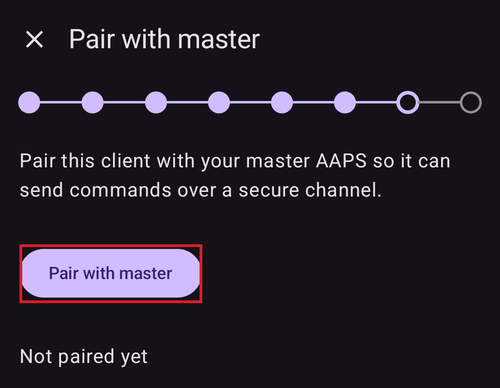

(aapsclient-app)=
# A aplicação AAPSClient

O **AAPSClient** é a aplicação complementar do **AAPS**: uma aplicação para um segundo telefone — normalmente o de um cuidador — que **segue** a pessoa que usa o **AAPS**. A partir da versão 4 do **AAPS**, o cuidador também pode **controlar** o loop à distância, através de comandos assinados. Os dois telefones comunicam através do seu site **Nightscout**; não é necessária uma ligação direta entre os telefones.

```{admonition} Wording used on this page
:class: note
- **Cliente** = um telefone com o **AAPSClient**.
- **Telefone principal** = o telefone com o **AAPS** principal, que controla a bomba e executa o loop.
```

```{admonition} iPhone version in development
:class: note
De momento, o **AAPSClient** funciona em telefones Android. Está em desenvolvimento uma versão do **AAPSClient** para iPhone, que está nos primeiros testes. Ainda não foi lançada: não está na App Store e não há nada para descarregar. Esta página será atualizada quando ficar disponível.
```

```{contents} Table of contents
:depth: 2
:local: true
```

## O que o AAPSClient é (e não é)

O **AAPSClient** tem o aspeto e o funcionamento do **AAPS**, mas **não tem loop próprio**:

- Não contém **nenhum algoritmo APS**, nem **Objetivos**, nem **controladores de bombas** — nunca administra insulina por si só.
- Os plugins usados apenas pela aplicação principal (**Comunicador SMS**, **Tidepool**, **Open Humans**) também não estão incluídos.
- O que *contém*: a sincronização **NSClientV3**, os plugins de fonte da glicose, a difusão para o **xDrip+** e as ligações a **Wear OS** / **Garmin** — tudo o que é necessário para seguir e para reencaminhar comandos. Um relógio **Garmin** ligado a um cliente pode mostrar os dados, mas os hidratos que envia não são introduzidos e não pode ligar nem desligar a bomba: o cliente mostra uma mensagem e deve introduzi-los no **AAPS**.

Tudo o que iniciar no **AAPSClient** é verificado, limitado, confirmado e **executado pelo telefone principal** (o telefone com a bomba). A página [Controlo principal ↔ cliente](ClientMasterControl.md) explica como isto funciona: como emparelhar os dois telefones, como o telefone principal escreve o texto de confirmação que vê, como é administrado um bólus iniciado no cliente e o que acontece quando o telefone principal está offline.

## Versões: AAPSClient, AAPSClient2 e AAPSClient3

Podem ser instaladas até três aplicações cliente lado a lado no mesmo telefone de seguidor, cada uma a seguir uma pessoa **diferente**: **AAPSClient** (ícone de coruja amarela), **AAPSClient2** (coruja azul) e — novidade na versão 4 do **AAPS** — **AAPSClient3** (coruja verde). Funcionam exatamente da mesma forma. Só o nome e a cor são diferentes (ícone da aplicação, fundo do widget e secção de estado no ecrã principal), para que as possa distinguir. Cada aplicação é emparelhada com o seu próprio telefone principal. Consulte [Sobre o AAPSClient, AAPSClient2 e AAPSClient3](#remotecontrol-aapsclient-versions) para mais detalhes.

## Obter a aplicação

O **AAPSClient** obtém-se da mesma forma que o **AAPS** — consulte [Transferência e instalação do AAPSClient](#RemoteControl_aapsclient) — e instala-se como a aplicação principal ([Transferir e instalar](../SettingUpAaps/TransferringAndInstallingAaps.md)).

## Primeiro arranque: um Assistente de Configuração mais curto

No primeiro arranque, o **AAPSClient** executa o mesmo **Assistente de Configuração** que conhece do **AAPS**, mas com muito menos passos — num seguidor não há configuração de perfil, insulina, bomba, APS ou objetivos:

1. **Bem-vindo**, **Condições de Utilização**, **Permissões** e **Senha Mestre** — iguais aos da aplicação principal, consulte o [Assistente de Configuração do AAPS](../SettingUpAaps/SetupWizard.md).
2. O cliente **não** pede as **Unidades** nem as **marcas baixa/alta**: recebe-os do telefone principal assim que estiver ligado ao Nightscout. Pode vê-los mais tarde nas **Definições**, onde um pequeno **ícone de telefone** mostra que estão [sincronizados com o telefone principal](#client-master-config-prefs). Só podem ser editados enquanto o telefone principal estiver acessível.
3. **Configurar a partir do telefone principal** — no telefone principal, abra **Gerir → Clientes autorizados**, adicione este telefone com um **código QR** e toque aqui em **Ler o código QR**. Uma única leitura configura o Nightscout com um token próprio deste telefone e, se o código incluir o emparelhamento, também emparelha o telefone. O telefone também usa como nome da instância o nome com que foi adicionado no telefone principal (as letras com acentos passam a letras simples: «Miloš» fica «Milos»). **Depois da leitura, a configuração fica concluída**: o assistente fecha, porque os passos seguintes só mostrariam o que o código já fez. Sem código QR, salte este passo. (Só no Android: o leitor ainda não está disponível no iOS.)

   

4. **Comunicação** — a lista de plugins só oferece o que um seguidor precisa (NSClientV3, xDrip+, Wear, Aplicações externas complementares, Garmin). Se não leu um código QR, ative o **NSClientV3** e introduza o **mesmo URL do Nightscout** que no telefone principal e um token de acesso, com os **websockets** ativados — exatamente como descrito em [Sincronização](#RemoteControl_aapsclient).

   

5. **Emparelhar com o telefone principal** — este passo existe **apenas** no cliente. Liga este dispositivo ao telefone principal através do canal seguro de comandos, com o PIN, e usa o nome com que o telefone foi adicionado no telefone principal, tal como o código QR. **Depois do emparelhamento, a configuração fica concluída.** Também pode saltar este passo e emparelhar mais tarde, a qualquer momento, em **Gerir → Emparelhar com o telefone principal**.

   

6. **Quem está a usar este telefone?** — só se não emparelhou no assistente: o nome da pessoa que usa este telefone. Serve para distinguir esta instância nos relatórios e na sincronização.

(aapsclient-pairing-with-the-master)=

## Emparelhar com o telefone principal

No **telefone principal**, abra **Gerir → Clientes autorizados** e adicione um cliente. Há duas formas de emparelhar:

- **Com um código QR** (a mais rápida, se o telefone tiver câmara): leia o código no passo do assistente «**Configurar a partir do telefone principal**» ou em **Gerir → Emparelhar com o telefone principal → Ler código QR** e confirme com «**Usar**». Também configura o Nightscout.
- **Com o PIN**: no **cliente**, abra o passo do assistente acima (ou **Gerir → Emparelhar com o telefone principal**), escreva o PIN de utilização única mostrado no telefone principal e prima «**Emparelhar**». O cliente mostra então em quem vai confiar — confirme com «**Emparelhar**»:


A partir do assistente, um emparelhamento bem-sucedido conclui a configuração e abre o ecrã principal. No telefone principal, o cliente aparece como **Ativo** na lista [Clientes autorizados](#client_master_master_setup). Depois disso, **Gerir → Emparelhar com o telefone principal** mostra «*Já emparelhado*», a função do telefone e se o modo reforçado está ligado:

 O procedimento completo de emparelhamento, os detalhes de segurança e a resolução de problemas estão em [Controlo principal ↔ cliente](#client_master_client_setup).

Depois do emparelhamento, o cliente recebe do telefone principal um token do Nightscout próprio (se o telefone principal tiver um token de administrador), só com os direitos de que um cliente precisa, e deixa de usar o token que possa ter introduzido. O **AAPSClient** nunca escreve tratamentos nem valores de glicose no Nightscout: tudo o que faz é enviado para o telefone principal, que o escreve. Veja [O token próprio do cliente no Nightscout](#client-master-control-own-token).

O telefone principal decide o que este telefone pode fazer através da sua **[função](#client-master-control-roles)** (Só leitura, Refeições, Cuidador ou Admin). **Gerir → Emparelhar com o telefone principal** mostra a função do telefone.

## O ecrã principal

O ecrã principal do cliente reflete o loop seguido:


- **A glicose, os gráficos, a IA/HCA e o perfil** vêm do Nightscout, tal como o telefone principal os enviou.
- O **estado do loop** mostrado é o **do telefone principal** (um cliente não tem loop próprio). Até o cliente receber do Nightscout o modo de funcionamento do telefone principal, o botão do modo de funcionamento mostra um **ponto de interrogação** (desconhecido).
- O **cartão de estado** mostra o reservatório e a bateria da **bomba seguida** e a bateria do telefone que envia os dados, retirados do estado do dispositivo no Nightscout — um cliente não tem bomba, por isso não há estado local da bomba nem gestão da bomba em parte nenhuma da aplicação.
- A barra inferior oferece **Tratamentos**, **Cenas** e **Gerir** depois de o cliente estar emparelhado (antes do emparelhamento, só **Gerir**) — não há separadores de bomba nem de objetivos.

## Tratamentos e ações

Tudo em **Gerir** funciona como na aplicação principal, com uma diferença importante: num cliente, as ações que alteram a terapia (bólus, hidratos, alvos temporários, cenas…) ficam **ocultas até o dispositivo estar emparelhado** e, depois do emparelhamento, são **reencaminhadas para o telefone principal** para confirmação e execução — consulte [Usar o controlo remoto](#client-master-control).

A entrada **Perfil** é a exceção: aparece mesmo num cliente **não emparelhado**, mas abre **só para consulta** — o cliente mostra os perfis que recebe através do Nightscout (precisa deles para os seus próprios cálculos), sem botões para editar ou ativar. Depois de o cliente estar **emparelhado**, a lista de perfis é sincronizada com o telefone principal e pode editar e ativar perfis a partir do cliente, como qualquer outra ação remota.

Num cliente **não emparelhado**, **Gerir** oferece apenas **Perfil** e **Emparelhar com o telefone principal**:


A faixa vermelha «*Telefone principal inacessível. A edição está desativada até a ligação ser restabelecida.*» também aparece num cliente não emparelhado. Isto é normal: ainda não há telefone principal para contactar. A faixa desaparece quando o cliente estiver emparelhado e o telefone principal estiver online.

Depois de o cliente estar emparelhado, aparecem as ações de terapia:


**Não há entrada Bomba** — um cliente não tem bomba.

Se o telefone principal não estiver acessível, a mesma faixa aparece num cliente emparelhado: as ações de terapia ficam a cinzento e tudo o que tentar é bloqueado antes de ser enviado. O cliente deteta que o telefone principal está offline quando tenta uma ação, e volta a ativar as ações quando o telefone principal estiver de novo online.


## Definições sincronizadas com o telefone principal

A **configuração** dos plugins ativos e muitas **preferências** são mantidas sincronizadas entre o telefone principal e os seus clientes emparelhados; os itens sincronizados estão marcados com um pequeno **ícone de telefone** e ficam desativados (com a faixa «*Telefone principal inacessível*») enquanto o telefone principal não estiver acessível. Isto está descrito em [Alterar a configuração e as preferências](#client-master-config-prefs).

## AAPSClient num smartwatch

Um relógio Wear OS pode ser emparelhado com o telefone **cliente**; as suas ações são reencaminhadas pelo cliente para o telefone principal. Consulte [Wear OS](../WearOS/WearOsSmartwatch.md) e as [opções de smartwatch em Controlo remoto](#RemoteControl_smartwatches).
