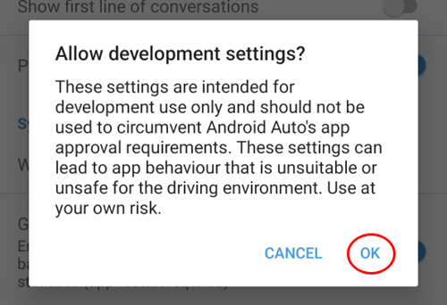
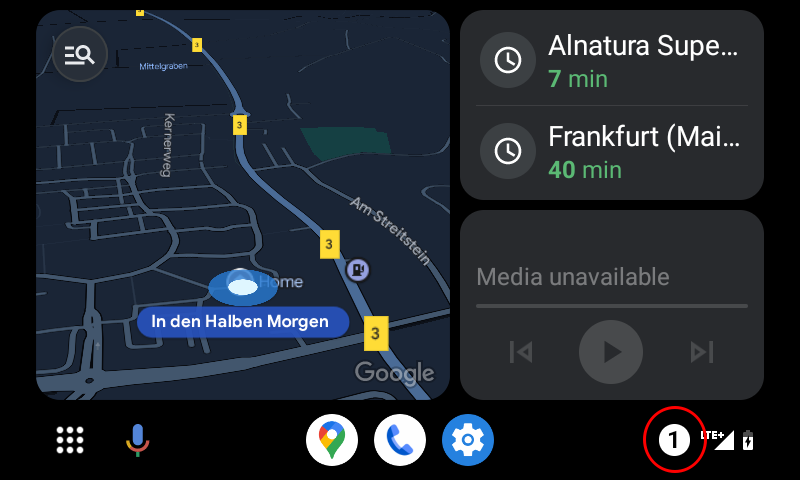

# Android Auto

O **AAPS** pode enviar-lhe informações sobre o seu estado atual como mensagem, diretamente para o Android Auto no seu carro.

## Requisitos

**AAPS** uses a feature of Android Auto which allows messages from apps on the mobile to be routed to the display of the car audio system.

Isto significa que:

* O Android tem de permitir que o **AAPS** mostre notificações e
* Como o **AAPS** é uma app não oficial, permita o uso de «unknown sources» (fontes desconhecidas) no Android Auto.

(androidauto-check-that-aaps-can-show-notifications)=

## Verificar se o AAPS pode mostrar notificações

O **AAPS** mostra sempre uma notificação de estado com a sua glicose atual, a IA e os HCA. Esta é a notificação que o Android Auto mostra no carro. Não há nada a ligar no **AAPS**, mas o Android tem de permitir que o **AAPS** mostre notificações.

No seu telefone, abra **Settings** (Definições) > **Apps** (Aplicações) > **AAPS** > **Notifications** (Notificações) e verifique se **All AAPS notifications** (Todas as notificações do AAPS) está ligado.

Deslize para baixo e verifique se **Estado em curso** está ligado: este é o canal da notificação de estado.

Verifique agora se vê a notificação de estado do **AAPS** no telefone antes de ir para o carro!

(androidauto-allow-the-use-of-unknown-sources-with-android-auto)=

## Permitir o uso de «unknown sources» (fontes desconhecidas) no Android Auto.

Como o **AAPS** não é uma app oficial do Android Auto, as notificações têm de ser ativadas para «unknown sources» (fontes desconhecidas) no Android Auto. Isto faz-se com o modo de programador, que mostramos aqui.

Go to your car and connect your mobile with the car's audio system.

Deve agora ver um ecrã parecido com este.

Toque no ícone das **definições** para iniciar a configuração.

Deslize até ao fim da página e selecione **see more in the phone** (ver mais no telefone).

Agora vamos ativar o modo de programador no telemóvel.

O primeiro ecrã tem este aspeto. Deslize até ao fim da página.

Aí vê a versão do Android Auto. Toque 10 vezes (dez vezes) na versão do Android Auto. Com esta combinação escondida, ativou agora o modo de programador.

Confirme que quer ativar o modo de programador na caixa de diálogo «Allow development settings?» (Permitir definições de programador?).

Nas **developer settings** (definições de programador), ative «Unknown sources» (fontes desconhecidas).

Agora pode sair do modo de programador, se quiser. Para isso, toque no menu de três pontos no canto superior direito.

## Mostrar notificações no carro

Toque no **ícone com o número** no canto inferior direito do Android Auto no seu carro.

Os seus dados do CGM são mostrados assim:

(android-auto-troubleshooting)=

## Resolução de Problemas:

* Se não vir a notificação, verifique se [permitiu que o AAPS mostre notificações](#androidauto-check-that-aaps-can-show-notifications) no Android e se o [Android Auto tem permissão de acesso às notificações](#androidauto-allow-the-use-of-unknown-sources-with-android-auto).