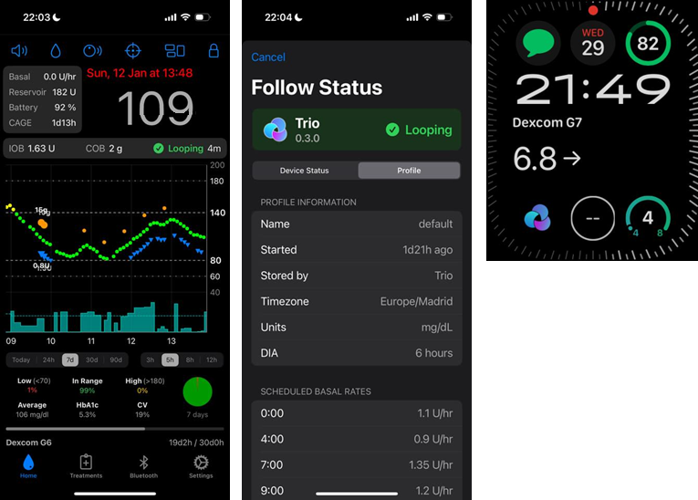
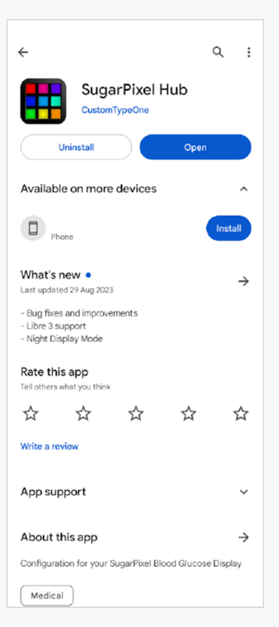

# Seguir o AAPS (sem interação com o sistema AAPS)

Além das várias possibilidades para controlar _e_ seguir o **AAPS** à distância, descritas em [controlo remoto](../RemoteFeatures/RemoteControl.md), há várias outras apps e dispositivos criados pela comunidade para simplesmente seguir os números (níveis da glicose e outras informações), sem interagir com o **AAPS**.

Uma boa visão geral das muitas opções para seguir o **AAPS** está na página web [Nightscout follower](https://nightscout.github.io/nightscout/downloaders/#).

```{contents} Table of contents
:depth: 1
:local: true
```

As estratégias mais usadas em conjunto com o **AAPS** são explicadas com mais detalhe abaixo.

## Apps para smartphone

```{contents} These are some of the main “follower” apps used by **AAPS** users. All of these apps are “free”: 
:depth: 1
:local: true
```

### Dexcom Follow ([Android](https://play.google.com/store/apps/details?id=com.dexcom.follow.region2.mgdl) e [iOS](https://apps.apple.com/fr/app/dexcom-follow-mg-dl-dxcm2/id1032203080))


* O Dexcom Follow é compatível com muitos telemóveis (Android e iPhone). O Dexcom Follow pode ser usado mesmo que não use a app oficial da Dexcom para receber os dados do sensor.

* Muitos cuidadores conhecem o Dexcom Follow e preferem a sua interface clara a algo mais complicado.

* O Dexcom Follow é muito bom para professores, avós e pessoas que sabem muito pouco sobre diabetes e níveis de glicose. Tem alertas personalizáveis (nível da glicose, que som tocar, etc.). Os alarmes podem ser totalmente desligados, se for preciso. Isto é muito útil se tiver um sensor que ainda está a estabilizar e que cria várias hipoglicemias falsas.

#### Configurar o Dexcom Follow: guia passo a passo

Se usar a app não oficial da Dexcom BYODA para receber os dados do sensor, poderá enviar convites aos seguidores a partir da app BYODA.

Já não é possível enviar e-mails de convite aos seguidores da Dexcom a partir de apps de terceiros. No xDrip, o pedido de convite resulta apenas na mensagem “invite not sent”.

Tem de instalar a app oficial da Dexcom, enviar o convite e depois desinstalar a app oficial.

Os passos são os seguintes:

1)  Instale a app oficial “Dexcom” em _qualquer_ smartphone (Android/iPhone). Pode ser o telefone do seguidor, se for mais prático. 2)  Inicie sessão com o seu nome de utilizador e a sua senha da Dexcom. São os mesmos dados de início de sessão que usaria no Dexcom Clarity, se já for cliente da Dexcom/Clarity. Se não tiver uma conta Dexcom, pode criar uma nova neste passo.   
3)  Passe pelos menus de introdução. 4)  Introduza “no code” como código do sensor. 5)  Em Transmitter SN, selecione “enter manually” e introduza um código de transmissor válido qualquer (use o código de um dos seus transmissores expirados, se souber algum, para não interferir com o funcionamento do seu transmissor atual. Os códigos seguem um formato específico de números e letras: “NLNNNL” e só usam certas combinações, por isso é mais fácil usar um que já sabe que é válido). 6)  Quando a app estiver a procurar o transmissor e o sensor, poderá convidar seguidores: selecione os três pequenos pontos no canto superior esquerdo da app e adicione um novo seguidor. Também pode usar isto se um dos seus seguidores tiver mudado de telemóvel e precisar de um novo convite: aqui pode apagá-lo da lista de seguidores e enviar um novo e-mail de convite para ele usar no novo telemóvel. 7)  No telefone do seguidor, instale o Dexcom Follow a partir da App Store (iPhone) ou da Play Store (Android). Configure a app Dexcom Follow. Ser-lhe-á pedido que abra o seu e-mail para encontrar o convite para ser seguidor.    
8)  Agora pode apagar a app oficial Dexcom G6.

Para o Dexcom Follow, os dados do sensor são então exportados do telefone do **AAPS**, diretamente do BYODA ou do xDrip, conforme a app que usa.


### [Nightguard](https://apps.apple.com/fr/app/nightguard/id1116430352) (iOS)


Vantagens (segundo os utilizadores):

* Disponível na [App Store](https://apps.apple.com/us/app/nightguard/id1116430352), com uma interface simples e fácil de usar.

* Deslize o botão ou abane o telefone para silenciar os alarmes por intervalos diferentes, de 5 min a 24 horas

* Alarmes personalizáveis (alertas de glicose alta e baixa, leituras em falta quando não há dados durante 15–45 minutos).

* Subida/descida rápida ao longo de 2–5 leituras seguidas (escolhe o número). Também pode escolher o delta entre duas leituras individuais

* Silenciamento inteligente: não alerta se os níveis estiverem a mudar na direção certa

* Há um separador Care que parece permitir definir um novo alvo temporário durante um certo tempo, apagar o alvo temporário ou introduzir hidratos de carbono.

Desvantagens (segundo os utilizadores)

* Só disponível para iOS

* O TT (alvo temporário) aparece sempre como 5 mmol, seja qual for o nível de TT definido

* Nunca mostra a taxa da basal temporária, embora mostre TB

### [Nightwatch](https://play.google.com/store/apps/details?id=se.cornixit.nightwatch) (Android)


* O Nightwatch apresenta-se como um cliente do Nightscout e monitoriza os níveis da glicose do utilizador no Nightscout, num telefone ou tablet Android.

* A app pode ser descarregada do [Google Play](https://play.google.com/store/apps/details?id=se.cornixit.nightwatch) e mostra os dados da glicose em tempo real.

* O utilizador pode ser avisado com alarmes de glicose baixa e alta, sonoros e personalizados.

* Os dados da glicose podem ser vistos em mmol/l ou em mg/dl.

* Precisa do Android 5.0 ou superior.

* Tem uma interface escura, leituras e botões grandes, e foi feito para usar à noite.

### xDrip (Android)

Pode usar o xDrip como seguidor.

#### Com o Nightscout

Configure o xDrip como seguidor do Nightscout (Nightscout Follower). Recebe a glicose e os tratamentos, mas não a basal.


#### Sem Nightscout - fonte de dados da glicose xDrip

Se a fonte de dados do **AAPS** for o xDrip (ou se o xDrip também puder receber a glicose de outra app, como BYODA, Juggluco, ...), pode usá-lo no telefone principal para partilhar dados com seguidores xDrip, mostrando a glicose, os tratamentos e as taxas da basal.


#### Sem Nightscout - app complementar de glicose do xDrip

Se a fonte de dados do **AAPS** não for o xDrip, mas puder mostrar os dados da glicose da fonte de dados Companion App, pode usá-lo no telefone principal para partilhar dados com seguidores xDrip, mostrando a glicose, os tratamentos e as taxas da basal.


### xDrip4iOS (iOS)


O xDripSwift foi criado ao adaptar a app original xDrip para iOS e evoluiu para "xDrip for iOS", escrito **xDrip4iOS** .

```{admonition} Further detail about how to attempt to obtain the original **xDrip4iOS** app
:class: dropdown
O [grupo do xDrip4iOS no Facebook](https://www.facebook.com/groups/853994615056838/announcements) é o principal apoio da comunidade para o xDrip4iOS e o Shuggah. O **xDrip4iOS** pode ligar-se a muitos sistemas de CGM e transmissores diferentes e mostrar valores da glicose, gráficos e estatísticas, e também dar alarmes. Também pode enviar dados para o Nightscout ou funcionar como [app de seguidor para o Nightscout](https://xdrip4ios.readthedocs.io/en/latest/connect/follower/). 

"Como posso obter o **xDrip4iOS** no meu iPhone?"
Há duas opções:

1. Se tiver um Mac e uma conta Apple Developer (99 EUR/USD por ano), pode compilar o seu próprio xDrip4iOS [seguindo as instruções](https://xdrip4ios.readthedocs.io/en/latest/install/build/).

Se quiser, pode depois tornar-se um "releaser" e [partilhar um Personal Testflight do xDrip4iOS](https://xdrip4ios.readthedocs.io/en/latest/install/personal_testflight/) com até 100 outras pessoas para as ajudar.

2. Junte-se ao [grupo do xDrip4iOS no Facebook](https://www.facebook.com/groups/853994615056838/announcements) e leia as publicações fixadas para saber as formas atuais de obter a app. **Não deve pedir um convite para a app** (leia as regras do grupo).
```




"O que é o **Shuggah**?" Um grupo de programadores ucranianos copiou o código do projeto xDrip4iOS (que é partilhado publicamente no GitHub) e publicou-o na App Store com uma conta empresarial. A versão Shuggah não é de modo nenhum gerida pelos programadores do xDrip4iOS.

O [grupo do xDrip4iOS no Facebook](https://www.facebook.com/groups/853994615056838/announcements) dá apoio ao xDrip4iOS e às respetivas apps para o Apple Watch.

### [Sugarmate](https://apps.apple.com/fr/app/sugarmate/id1111093108) (iOS)


O [Sugarmate](https://sugarmate.io/) pode ser descarregado para iPhones a partir da App Store. O Sugarmate é compatível com:
* Apple iPhone (precisa da versão de software 13.0 ou superior)
* Apple iPad (precisa da versão de software 13.0 ou superior)
* Google Android (guarde a app web no ecrã inicial)

Utilizadores do Sugarmate dizem que pode ser usado com o Apple CarPlay nos EUA para mostrar as leituras da glicose durante a condução. Ainda não se sabe se isto é possível noutros países fora dos EUA. Se souber mais sobre isto, adicione os detalhes aqui na documentação com um pull request (link), o que é rápido e fácil.


### [Spike](https://spike-app.com/) (iOS)


O Spike pode ser usado como recetor principal ou como app de seguidor, e mostra a glicose, alarmes, a IA e mais.

O site e a app já não são desenvolvidos. Encontra apoio no [Facebook](https://www.facebook.com/groups/1973791946274873) e no [Gitter](https://gitter.im/SpikeiOS/Lobby).

## Smartwatches para a **monitorização do AAPS** (dados completos do perfil, ou só a glicose) quando o **AAPS** está a funcionar num telefone.

Veja [aqui](../Getting-Started/Watches.md).


## Dispositivos para seguir o AAPS

```{contents} Devices include:
:depth: 1
:local: true
```

### M5 stack


O M5Stack é uma pequena caixa que pode ser programada para muitas aplicações. O projeto do Martin, [M5Stack NightscoutMon](https://github.com/mlukasek/M5_NightscoutMon/wiki), mostra os valores e as tendências da glicose do sensor, a IA e os HCA. Está numa caixa de plástico, com ecrã a cores, ranhura para cartão micro SD, 3 botões, altifalante e bateria interna. É um ótimo monitor da glicose e é relativamente fácil de configurar se tiver uma conta Nightscout. Normalmente, os utilizadores usam-no na rede Wi-Fi de casa, mas alguns dizem que o usam como ecrã quando andam de mota, ligado a um hotspot Wi-Fi do telefone.

### Sugarpixel

O SugarPixel é um dispositivo secundário de visualização e alerta da glicose para a monitorização contínua da glicose. Liga-se à app da Dexcom ou à app do Nightscout no smartphone do utilizador. O dispositivo mostra as leituras da glicose em tempo real. Este monitor de CGM tem alertas sonoros com tons aleatórios (que são muito altos), alertas por vibração para pessoas com problemas de audição, opções de ecrã personalizáveis e seguimento nativo por vários utilizadores.




* O SugarPixel tem várias opções de ecrã em mg/dl e mmol/l, para as necessidades do utilizador, com valores da glicose em cores.
* O mostrador padrão mostra a glicose, a seta de tendência e o delta. O delta é a variação, + ou -, em relação à última leitura.
* O SugarPixel pode ser ajustado para uso com pouco brilho com o mostrador BG and Time, para ver a leitura da glicose e a hora atual na mesa de cabeceira do utilizador.
* O mostrador de cor do SugarPixel usa todo o ecrã para mostrar uma única cor que representa o valor da glicose. Isto permite ao utilizador ver as leituras da glicose à distância através da janela, enquanto brinca lá fora no quintal, no pátio ou na piscina.
* O mostrador Big BG é útil para quem o tem na mesa de cabeceira e usa óculos ou lentes de contacto.

### Nightscout Clock no Ulanzi TC001

O **Nightscout Clock** é um software de código aberto que funciona no dispositivo **Ulanzi TC001**. Liga-se aos servidores da Dexcom ou ao Nightscout e mostra as leituras da glicose em tempo real.


* O relógio suporta as unidades mmol/l e mg/dl e tem alarmes sonoros.
* Há vários ecrãs disponíveis; veja o [Github nightscout-clock](https://github.com/ktomy/nightscout-clock?tab=readme-ov-file#more-information-for-people-who-needs-it) para uma visão geral.
* Configurar o dispositivo exige apenas alguns passos simples. Depois de configurado, só precisa de energia e de Wi-Fi para funcionar.
* O dispositivo Ulanzi TC001 é muito mais barato do que o SugarPixel.
* O software e as instruções de instalação estão no [Github nightscout-clock](https://github.com/ktomy/nightscout-clock?tab=readme-ov-file).
* É desenvolvido e mantido por Artiom Kenibasov, que dá apoio no [grupo Facebook AAPS Users](https://www.facebook.com/groups/cgminthecloud/posts/8776932509094594/).

### PC (TeamViewer)
Alguns utilizadores acham útil uma ferramenta de acesso remoto completo, como o [TeamViewer](https://www.teamviewer.com/), para resolver problemas avançados à distância.
