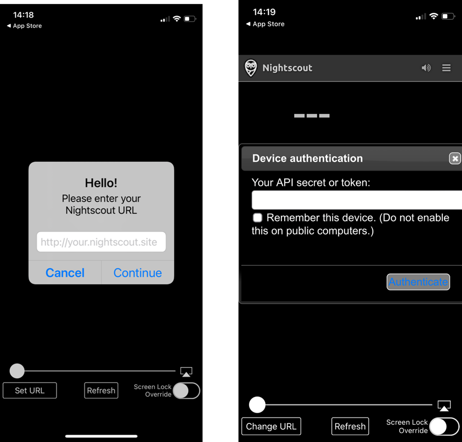
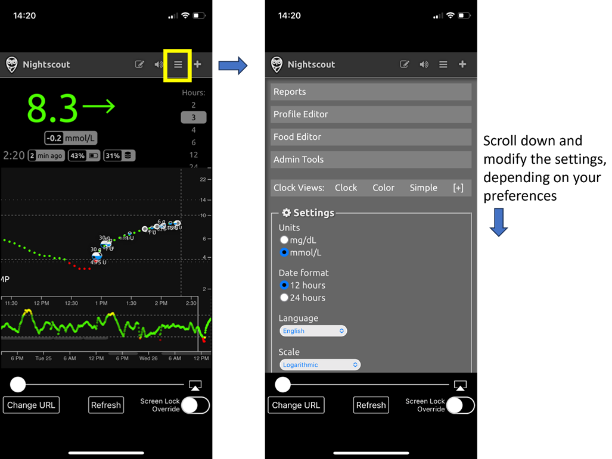

# Controlo remoto do AAPS

```{contents} In this page
:backlinks: entry
:depth: 2
```

Há quatro ferramentas muito eficazes para gerir o **AAPS** à distância:

1) [Comandos SMS](#RemoteControl_SMS-Commands) (o telefone do seguidor pode ser Android ou iOS), 2) [AAPSClient](#RemoteControl_aapsclient) (o telefone do seguidor é Android; está em desenvolvimento uma versão para iPhone) 3) [Nightscout](#RemoteControl_nightscout) (Android, iOS ou outro computador/dispositivo), sobretudo para seguir: veja a nota sobre o [controlo pelos clientes](#client-master-control) nessa secção.  
4) [Smartwatches](#RemoteControl_smartwatches) (Android)

As três primeiras são sobretudo adequadas para cuidadores/pais, mas os smartwatches são muito úteis para cuidadores/pais **e** para os próprios adultos com diabetes.


(RemoteControl_SMS-Commands)=

## 1) Comandos SMS

Veja a página própria [Comandos SMS](../RemoteFeatures/SMSCommands.md).

(RemoteControl_aapsclient)=
## 2) AAPSClient

O **AAPSClient** é muito parecido com o próprio **AAPS** e oferece ao cuidador os mesmos ecrãs e botões para enviar comandos à distância para o **AAPS**:


(remotecontrol-aapsclient-versions)=
### Sobre o AAPSClient, o AAPSClient2 e o AAPSClient3

Há 3 versões da app cliente: **AAPSClient**, **AAPSClient2** e **AAPSClient3**. Funcionam da mesma forma. A única diferença é que podem ser instaladas lado a lado no mesmo telefone do seguidor.

Um cuidador que segue uma pessoa só precisa do **AAPSClient**. Para seguir e controlar à distância uma segunda pessoa (com o seu próprio site **Nightscout** e o seu próprio telefone **AAPS**), instale também o **AAPSClient2**, e o **AAPSClient3** para uma terceira pessoa. Cada app é configurada e [emparelhada](#aapsclient-pairing-with-the-master) separadamente, com o site **Nightscout** e o telefone **AAPS** da pessoa que segue.

Para distinguir as apps, alguns elementos têm uma cor diferente: amarelo para o **AAPSClient**, azul para o **AAPSClient2** e verde para o **AAPSClient3**. Esses elementos são o ícone da app, o fundo do widget e a secção de estado do **AAPS** no ecrã principal da app. <br/> Nota: a opacidade do fundo do widget pode ser definida na configuração do widget. Com pouca opacidade, a cor é difícil de ver.


### Transferência e instalação

O **AAPSClient** pode ser instalado num único telefone ou em vários telefones de seguidores (por ex., o telefone de seguidor do pai 1 e o do pai 2), para que ambos os cuidadores tenham acesso e possam controlar à distância o telefone **AAPS** de um doente.

To download **AAPSClient**, navigate to the [GitHub repository](https://github.com/nightscout/AndroidAPS/releases/) and click on the asset **“app-AAPSClient-release_x.x.x.x”** (it may be a newer version to that shown in the screenshot below):


Depois, vá às  _transferências_ no seu computador. No Windows, as _transferências_ aparecem na barra do lado direito:


Depois de descarregar, clique em _mostrar na pasta_ para encontrar o ficheiro.

O apk **AAPSClient** pode agora ser:

Transferido por cabo USB para o telefone do seguidor; ou Arrastado para uma pasta do Google Drive e depois instalado no telefone do seguidor tocando no ficheiro "app-AAPSClient-release".

Should you be needing **AAPS** for yourself, and **AAPSClient** for monitoring someone else, you will need to build **AAPSClient** yourself instead of downloading it from the GitHub repository as described above. O motivo é que não é possível instalar o **AAPS** e o **AAPSClient** no mesmo telefone se forem assinados com chaves diferentes. <br/> Para compilar o **AAPSClient**, siga o mesmo processo da [compilação normal do AAPS](../SettingUpAaps/BuildingAaps.md). Na página **Generate signed App Bundle or APK**, selecione **aapsclientRelease** em vez de **fullRelease**.

A mesma regra aplica-se quando instala várias apps cliente (**AAPSClient**, **AAPSClient2**, **AAPSClient3**) num telefone de seguidor: todas têm de ser assinadas com a **mesma chave**. Caso contrário, o Android recusa instalar a segunda (erro `INSTALL_FAILED_DUPLICATE_PERMISSION`).

### Sincronização: configuração do AAPSClient e do AAPS

Depois de instalar o apk __AAPSClient__ no telefone do seguidor, verifique se o **NSClientV3** está configurado da mesma forma nos dois telefones para o Nightscout 15 (veja as [notas de atualização](../Maintenance/UpdateToNewVersion.md)). O exemplo abaixo mostra a configuração da sincronização com o NSClientV3 e o Nightscout 15; há outras fontes de dados disponíveis no __AAPS__ (por ex., xDrip).

Em **Configuração** > **Comunicação**, o utilizador sincroniza os seus dados com o Nightscout através do __NSClientV3__ (com a API v3), configurado da mesma forma no __AAPS__ e no telefone do seguidor.


O utilizador tem de garantir que __ambos__ os telefones, o do AAPS e o do AAPSClient, estão sincronizados, configurando o NSClientV3 em cada um. No telefone do seguidor, isto pode ser feito lendo um código QR mostrado pelo **AAPS**; veja [Emparelhar o AAPSClient com o AAPS](#remotecontrol-pairing) abaixo:

- Introduza o **URL do Nightscout** nas **Definições** do NSClientV3

- Introduza o **Token de acesso do Nightscout** nas mesmas definições. Siga as notas [aqui](https://nightscout.github.io/nightscout/security/#create-a-token). No telefone **AAPS**, use um **token de administrador**: com ele, o **AAPS** cria um token próprio para cada telefone de seguidor.

- Ative **Usar websockets** em **ambos** os telefones. No telefone **AAPS**, os websockets são **obrigatórios** para o controlo remoto: sem eles, o **AAPS** não pode receber comandos do **AAPSClient**. Em ambos os telefones, também tornam a sincronização mais rápida, com um gasto de bateria um pouco maior.


O utilizador deve verificar que o __AAPSClient__ e o __AAPS__ mostram  «Ligado» no ecrã **NSClientV3** de cada telefone. Neste ponto, o **AAPSClient** segue o **AAPS** (glicose, tratamentos, perfil), mas ainda não o pode controlar: emparelhe os dois telefones como descrito abaixo.

(remotecontrol-pairing)=
### Emparelhar o AAPSClient com o AAPS (controlo remoto)

A partir da versão 4 do **AAPS**, o **AAPSClient** controla o **AAPS** através de uma ligação segura e **emparelhada**. A sincronização sozinha não chega: enquanto os telefones não estiverem emparelhados, o **AAPSClient** só mostra **Gerir**, com um **Perfil** só de leitura e **Emparelhar com o telefone principal**.

1. No telefone **AAPS**, abra **Gerir → Clientes autorizados** e ligue **Permitir controlo pelos clientes** (está desligado por predefinição e sempre ligado no Modo simples).
2. Toque em **+**, introduza um nome para o telefone do seguidor, escolha como é configurado e escolha a sua **função**:
   - **Código QR: Nightscout e emparelhamento** — o **AAPS** mostra um código QR que configura o Nightscout no telefone do seguidor e o emparelha, numa só leitura. Isto precisa de um token de administrador nas definições do NSClientV3 do telefone **AAPS**.
   - **PIN** — para um telefone de seguidor sem câmara, já ligado ao Nightscout: anote o **PIN** de utilização única (válido durante cerca de dois minutos).
3. No telefone **AAPSClient**, leia o código (no Assistente de Configuração ou em **Gerir → Emparelhar com o telefone principal → Ler código QR**) ou abra **Gerir → Emparelhar com o telefone principal** e introduza o PIN. Confirmar.

O telefone do seguidor aparece então como **Ativo** na lista **Clientes autorizados**, e o **AAPSClient** mostra **Tratamentos**, **Cenas** e **Gerir**. O telefone do seguidor recebe um token do Nightscout próprio, só com os direitos de que precisa. O procedimento completo, com capturas de ecrã e resolução de problemas, está em [Controlo principal ↔ cliente](#client_master_master_setup).

Verifique se a configuração funciona: introduza hidratos de carbono no **AAPSClient**, confirme a quantidade mostrada e verifique se o registo aparece em **Tratamentos** nos dois telefones.

(remotecontrol-nightscout-access-token)=

### Resolver problemas de configuração do «Token de acesso do Nightscout»

A configuração exata do «Token de acesso do Nightscout» pode ser diferente conforme o seu fornecedor do Nightscout seja um site alojado pago ou não.

Se tiver dificuldade em fazer o **AAPS** aceitar o «Token de acesso do Nightscout» e usar um site Nightscout alojado pago, pode ser melhor falar primeiro com o seu fornecedor do Nightscout sobre como resolver as dificuldades com o «Token de acesso do Nightscout». Caso contrário, contacte o grupo do **AAPS**, mas antes verifique bem se seguiu corretamente as notas [aqui](https://nightscout.github.io/nightscout/security/#create-a-token).

### O que o AAPSClient oferece

Depois de emparelhado, o **AAPSClient** oferece ao cuidador quase os mesmos ecrãs que o próprio **AAPS**:

- **Tratamentos**: bólus de insulina, hidratos de carbono e o assistente de bólus.
- **Cenas**: iniciar e parar [cenas](../DailyLifeWithAaps/Scenes.md).
- **Gerir**: perfis, definições da insulina, alvos temporários, Assistente Rápido, automatização, alimentos, rotação dos locais, emparelhamento e a basal temporária em curso.
- **Menu principal**: histórico de tratamentos, navegador do histórico, estatísticas, manutenção, configuração.

No **AAPSClient** não há bomba nem objetivos. Veja [A aplicação AAPSClient](AapsClient.md) para uma descrição detalhada.

O **AAPSClient** permite ao cuidador fazer à distância, pela rede móvel ou pela internet, a maioria dos ajustes possíveis diretamente no **AAPS**, **incluindo bólus de insulina**. Cada comando é assinado e enviado através do Nightscout para o telefone **AAPS**, que o verifica com os seus próprios dados, o limita, lhe mostra a sua própria confirmação e só depois o executa. O **AAPSClient** _pode_ ser muito mais rápido do que os [Comandos SMS](../RemoteFeatures/SMSCommands.md), sobretudo para comandos que precisariam de autenticação.

Os tratamentos introduzidos no Nightscout por outros meios (por exemplo, no site do Nightscout) não são aplicados enquanto o controlo pelos clientes estiver ligado: o **AAPS** fica então em [modo reforçado](#client-master-control-hardened-mode) e só aceita alterações de clientes emparelhados. Com o controlo pelos clientes desligado, só são aplicados se as opções **Receber** correspondentes estiverem ativas na [secção Sincronização das preferências do NSClient](#Preferences-nsclient-synchronization).

O controlo remoto através do **AAPSClient** só é recomendado se a sua sincronização funcionar bem (_ou seja_, se não vir alterações indesejadas nos dados, como alvos temporários, basais temporárias, etc. que se alteram sozinhos).

### AAPSClient com opções de smartwatch

Um smartwatch pode ser uma ferramenta muito útil para ajudar a gerir o **AAPS** com crianças. São possíveis algumas configurações diferentes. Se o **AAPSClient** estiver instalado no telefone do cuidador, a [app **AAPSClient WearOS**](https://github.com/nightscout/AndroidAPS/releases/) pode ser descarregada e instalada num smartwatch compatível que esteja ligado ao telefone do pai/mãe. Isto mostra a glicose atual e o estado do loop. Depois de o **AAPSClient** estar emparelhado com o **AAPS**, as ações do relógio (incluindo bólus, hidratos de carbono, alvos temporários e mudanças de perfil) são reencaminhadas através do **AAPSClient** para o **AAPS**, que as confirma e executa: veja [Wear OS num cliente](#clientmastercontrol-wear-os-on-a-client). Pode ler mais sobre smartwatches [aqui](#remotecontrol-smartwatches).

(RemoteControl_nightscout)=
## 3) Nightscout

Além de o Nightscout ser um servidor «na nuvem», existe também uma app **Nightscout** própria, que pode ser descarregada diretamente da App Store no seu iPhone. If you have an Android follower phone, there is not a dedicated Nightscout app and it is better to use [**AAPSClient**](#RemoteControl_aapsclient), or, if you only want to follow, and not send treatments you can download and install the [Nightwatch](https://play.google.com/store/apps/details?id=se.cornixit.nightwatch) app from the Playstore.

Depois de instalar a app **Nightscout** no iPhone, abra a app e siga as instruções de configuração, introduzindo o endereço do seu Nightscout (ver abaixo, à esquerda). O formato do endereço pode variar conforme o local onde o seu Nightscout está alojado. (_por ex._ http://youraddresshere.herokuapp.com). Depois, introduza o API secret do seu Nightscout (ver abaixo, à direita). Se a app não pedir a senha da API, tem de a introduzir tocando no cadeado no topo da app:



Mais informações sobre a configuração estão disponíveis diretamente no [Nightscout](https://nightscout.github.io/nightscout/discover/)

Quando inicia sessão pela primeira vez, vê um ecrã muito simples. Personalize as opções do ecrã selecionando o menu “hamburger” no canto superior direito e deslizando para baixo:



Deslize para baixo até “Settings”. Pode querer mudar a “scale” para “linear”, porque o gráfico da glicose é logarítmico por predefinição, e em “render basal” selecionar “default” para que a basal da bomba apareça.


Selecione as opções que quer. Desmarque os alarmes se usar outra app para os alarmes.


Continue a deslizar para baixo até chegar a “show plugins”.

Tem de confirmar que “careportal” está selecionado e pode também selecionar várias outras métricas (as mais úteis são: IOB, care portal, pump, cannula age, insulin age, basal profile e OpenAPS).

Importante: agora tem de clicar em “save” no fundo para que estas alterações tenham efeito.


Depois de premir “save”, a app volta ao ecrã principal do Nightscout, que terá mais ou menos este aspeto:

1. Valor atual da glicose
2. Informações sobre o estado do sistema AAPS - toque em cada separador no ecrã para ver mais detalhes. Adicione ou remova estas opções de visualização com o menu hamburger.
3. Curva recente da glicose com os tratamentos (hidratos de carbono, bólus) mostrados
4. Curva da glicose a mais longo prazo
5. Menu “hamburger” para definir as opções de visualização, criar relatórios, editar perfis e ferramentas de administração do Nightscout
6. Menu "**+**" para introduzir tratamentos (veja [abaixo](#RemoteControl_nightscout-treatments) quando o **AAPS** os aplica).
7. Selecionar outro período de tempo para mostrar
8. Perfil da insulina basal
9. Linha verde = glicose passada Linhas azuis = glicose prevista


Vejamos com mais detalhe o menu no canto superior esquerdo da app Nightscout:

1. Edição retrospetiva no Careportal
2. Ligar/desligar alarmes
3. Hamburger - para definir as preferências
4. Careportal - registar tratamento (veja [abaixo](#RemoteControl_nightscout-treatments) quando o **AAPS** os aplica)


Neste ecrã há muita informação sobre o estado do sistema **AAPS** nos separadores cinzentos (e ainda mais informação aparece se tocar no separador):

1. Tendência da glicose em 5 min
2. Pré-visualização do assistente de bólus (Bolus wizard preview)
3. Prima Basal para ver o seu perfil atual e as informações da basal
4. Tempo desde a última leitura do CGM no AAPS
5. **Pump** (bomba): insulina, bateria (%) e quando o AAPS se ligou a ela pela última vez
6. Última atualização do AAPS - se passaram mais de 5 min, pode indicar um problema de ligação entre o telefone AAPS e a bomba/CGM
7. Prima IOB para ver a divisão entre insulina basal e insulina de bólus
8. Idade da insulina no reservatório
9. Idade da cânula
10. Estado da bateria do telefone AAPS
11. Tamanho da sua base de dados. Se ficar demasiado cheia (só no Nightscout DIY; nos serviços alojados pode ignorar), pode começar a ter problemas de ligação. Pode apagar dados para reduzir este número no menu Admin tools (através do menu hamburger).


Prima "refresh" no fundo da página para fechar a janela.

(RemoteControl_nightscout-treatments)=
### Enviar tratamentos para o AAPS através da app Nightscout

In **AAPS** 4 the supported way to control **AAPS** remotely is a **paired AAPSClient**, see [Master ↔ Client control](#client-master-control): each client has a [role](#client-master-control-roles) that limits what it may do, and every command is signed by the client, then checked and confirmed by the **AAPS** phone. Enquanto o controlo pelos clientes estiver ligado, o telefone **AAPS** está em [modo reforçado](#client-master-control-hardened-mode): os tratamentos, alvos temporários e trocas de perfil introduzidos no site do Nightscout ou na app Nightscout **não** são aplicados. A app Nightscout serve então apenas para seguir.

```{admonition} Only when client control is off
:class: warning
Se **Permitir controlo pelos clientes** estiver desligado em **Gerir → Clientes autorizados** (e o Modo simples estiver desligado), o **AAPS** aplica os registos do careportal vindos do Nightscout só para os tipos de dados que ativou em **Receber** na [secção Sincronização das definições do NSClientV3](#Preferences-nsclient-synchronization): hidratos de carbono, alvos temporários, trocas de perfil e os outros registos do careportal. A insulina nunca é administrada desta forma: um "Correction bolus" introduzido no Nightscout é apenas *anunciado*, e o **AAPS** conta-o como insulina ativa sem a administrar. Esta configuração não é recomendada para controlo remoto; use antes um **AAPSClient** emparelhado.
```

Leia mais sobre as opções do **Nightscout** [aqui](https://nightscout.github.io/)

### Dicas para tirar o máximo partido da app Nightscout

1). Se ficar «preso» numa página e quiser ver de novo o ecrã principal, basta clicar em “refresh” (em baixo, ao centro). Isto leva-o de volta à página inicial do **Nightscout** com o gráfico da glicose.

Para ver o perfil atual que está a funcionar no telefone, prima os vários ícones no ecrã acima do gráfico. Pode ver mais informações (rácio de hidratos atual, sensibilidade, fuso horário, etc.) ao premir “basal”, e “OpenAPS” dá informações sobre o perfil, o alvo atual, etc. Também pode monitorizar a bateria do telefone (%) e a bateria da bomba (%). O BWP dá informações sobre o que o algoritmo prevê que vai acontecer, com base na IA e nos HCA.

#### Outros ícones no menu: o que significa o lápis (editar)?

(Tecnicamente) pode usar o lápis de edição para mover ou apagar tratamentos de bólus ou de correção das últimas 48 h.

Mais sobre isto [aqui](https://nightscout.github.io/nightscout/discover/#edit-mode-edit)

Embora isto possa ser útil para apagar hidratos de carbono anunciados (mas sem bólus dado), na prática não funciona bem com o **AAPS** neste momento. Recomendamos fazer este tipo de alterações diretamente na app **AAPS**.

(RemoteControl_smartwatches)= (remotecontrol-smartwatches)=

## 4) Smartwatches

### Opção 1) Controlar o AAPS a partir de um relógio Wear OS


Depois de [configurar o **AAPS** no seu relógio](../WearOS/BuildingAapsWearOS.md), encontra muitos detalhes sobre as watchfaces do smartwatch e as suas funções em [Usar o AAPS Wear num smartwatch](../WearOS/WearOsSmartwatch.md).

Em resumo, as seguintes funções podem ser iniciadas a partir do smartwatch:

* definir um alvo temporário

* usar a calculadora de bólus (as variáveis de cálculo podem ser definidas nas definições do telefone)

* administrar eCarbs

* administrar um bólus (insulina + hidratos de carbono)

* definições do relógio

* estado

* verificar estado da bomba

* verificar o estado do loop

* verificar e mudar o perfil, CPP (Circadian Percentage Profile = deslocamento horário + percentagem)

* mostrar a TID (dose total diária = bólus + basal por dia)

* Bólus remoto quando o cuidador e a criança com DM1 estão em locais diferentes (isto é possível com o relógio **AAPS** e o telefone **AAPS**, desde que ambos os dispositivos estejam ligados à rede)

#### Comunicação dos cuidadores para o relógio através de outras apps (como o WhatsApp)

É possível adicionar outras apps ao relógio, como o WhatsApp, para trocar mensagens (por exemplo) entre cuidadores e crianças. É importante ter apenas UMA conta Google associada ao telefone, caso contrário o relógio não recebe estes dados. Precisa de ter 13 anos ou mais para ter uma conta Samsung, e esta tem de ser criada com o mesmo endereço de e-mail usado no telefone Android.

Um vídeo que explica como configurar o WhatsApp para mensagens no relógio Galaxy 4 (não é possível ter todas as funções do WhatsApp) está [aqui](https://gorilla-fitnesswatches.com/how-to-get-whatsapp-on-galaxy-watch-4/)

Com ajustes na app **Galaxy wearable** no telefone **AAPS** e no relógio, as mensagens do WhatsApp podem ser anunciadas com uma leve vibração e a mensagem do WhatsApp pode aparecer por cima da watchface atual.

### Opção 2) **AAPS** no relógio, para controlo remoto do **AAPS** num telefone

Tal como com um telefone de seguidor com o **AAPSClient** ou com comandos SMS (ver as secções acima), um smartwatch pode ser usado para controlar o **AAPS** à distância e dar os dados completos do perfil. Uma diferença importante em relação a um telefone de seguidor é que a ligação entre o smartwatch e o telefone **AAPS** é feita por Bluetooth e não precisa nem do Nightscout nem de um código de autenticação. Como nota à parte: se o smartwatch e o telefone **AAPS** ligados por Bluetooth também estiverem numa rede Wi-Fi/dados móveis, o relógio também comunica com o telefone **AAPS** por essa rede, o que dá um alcance maior. Isto inclui a administração remota de um bólus quando o cuidador com o relógio **AAPS** e a criança com DM1 (com o telefone **AAPS**) estão em locais diferentes, o que pode ser útil quando a criança com DM1 está na escola.

Por isso, um smartwatch para controlo remoto é muitas vezes útil em qualquer situação em que:

a)  Os comandos **AAPSClient** ou **SMS** não podem funcionar; ou

b)  O utilizador quer evitar escrever um código de autenticação (como é preciso nos comandos SMS).

Um smartwatch precisa do **Wear OS 3 ou mais recente** para poder controlar o **AAPS**. Verifique as especificações técnicas do relógio e veja a [página Smartwatches e o AAPS](../Getting-Started/Watches.md). Search, or ask in the **AAPS** Facebook/Discord groups if unsure.

Abaixo encontra guias específicos para configurar o **AAPS** no popular Samsung Galaxy Watch 4 (40 mm). O relógio [Garmin](https://apps.garmin.com/en-US/apps/a2eebcac-d18a-4227-a143-cd333cf89b55?fbclid=IwAR0k3w3oes-OHgFdPO-cGCuTSIpqFJejHG-klBTm_rmyEJo6gdArw8Nl4Zc#0) também é uma escolha popular. Se tem experiência a configurar outro smartwatch e acha que pode ser útil a outras pessoas, adicione-o a estas páginas ([editar a documentação](../SupportingAaps/HowToEditTheDocs.md)) para partilhar o que aprendeu com a comunidade **AAPS**.

### Opção 3) AAPSClient num relógio, para controlo remoto do **AAPS** num telefone


The software for the watch, **AAPSClient** Wear apk, can be downloaded directly from [GitHub](https://github.com/nightscout/AndroidAPS/releases/).

Para descarregar o software, clique na app de relógio que corresponde à app cliente no telefone: **wear-aapsclient-release_**_versão_ corresponde ao **AAPSClient**, **wear-aapsclient2-release_**_versão_ corresponde ao **AAPSClient2** (veja [Sobre o AAPSClient, o AAPSClient2 e o AAPSClient3](#remotecontrol-aapsclient-versions)):


Depois, use «guardar como» e guarde o ficheiro num local prático do seu computador:


O apk **AAPSClient** Wear pode ser transferido para o seu telefone e instalado manualmente no relógio da mesma forma que a app **AAPS** Wear, como descrito em [Transferir a app Wear para o seu telefone AAPS](#remote-control-transferring-the-aaps-wear-app-onto-your-aaps-phone)  


