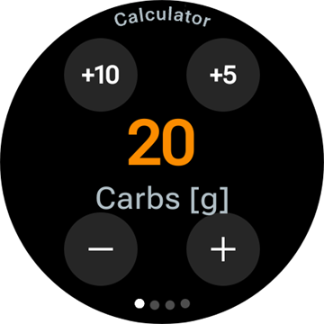
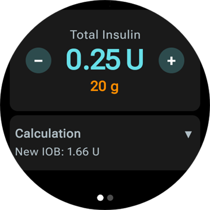
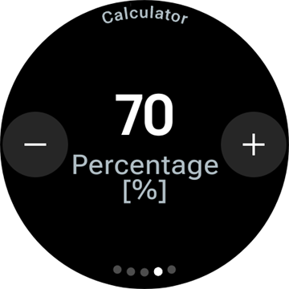
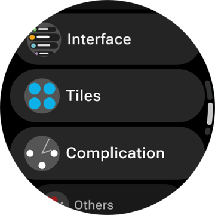
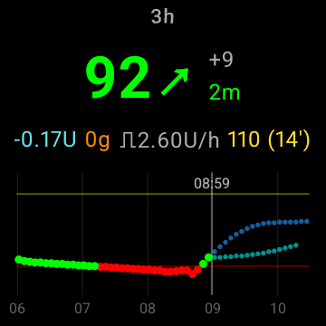

# Usar o AAPS com o seu smartwatch Wear OS

(Watchfaces-aaps-watchfaces)=

## Watchfaces do AAPS

```{warning}
As watchfaces clássicas do **AAPS** só funcionam no Wear OS 5 e anteriores, e o Wear OS 5 já as limita. No **Wear OS 6 e mais recentes**, a app do relógio instala, em vez disso, uma watchface no formato Watch Face Format da Google: a sua watchface personalizada como imagem, ou a **Watchface de complicações**. Veja [Alterações das watchfaces no Wear OS](#wearos-watchface-changes) para saber o que deixa de funcionar em cada versão do Wear OS, e [a watchface que o AAPS instala](#wearos-aaps-v4-watchface) para o Wear OS 6.
```

No Wear OS 5 e anteriores, há várias watchfaces clássicas incluídas na app **AAPS** do relógio. Mostram o valor da glicose com o delta, a IA, a taxa basal ativa e um gráfico das leituras. Funcionam dois toques nelas:

* Toque duas vezes no valor da glicose para abrir o menu principal do **AAPS**
* Toque duas vezes no gráfico para mudar o seu intervalo de tempo

Em todas as versões do Wear OS, as [complicações](#Watchfaces-complications) e os [mosaicos](#WearOsSmartwatch-wear-os-tiles) descritos nesta página funcionam com qualquer watchface que tenha espaço para eles.

## Configuração

Ative **Android Wear** em [**Configuração** > **Comunicação**](#Config-Builder-wear).

Para dar bólus ou fazer outras ações a partir do relógio, ative **Controlo pelo Wear**. As opções do assistente de bólus para o relógio definem-se no mesmo sítio: ver [Definições > Android Wear](#preferences-wear). Enquanto o **Controlo pelo Wear** estiver desligado, o telefone recusa todos os tratamentos ou mudanças de modo enviados do relógio, e o relógio mostra *"O controlo pelo relógio está desligado nas definições do Wear no telefone."*

Com **Abrir plugin** no cartão **Android Wear**, abre o ecrã do Wear:


A linha de cima mostra o nome do relógio ligado, ou **(Nenhum relógio ligado)**. Neste ecrã pode

* Reenviar Todos os Dados. Pode ser útil se o relógio esteve desligado durante algum tempo e quer enviar as informações para o relógio.
* Abrir as definições do relógio diretamente a partir do telefone.
* Escolher que watchface o **AAPS** instala no relógio (**Watchface instalada no relógio**: a sua watchface personalizada ou a watchface de complicações). Este cartão só aparece enquanto estiver ligado um relógio com **Wear OS 6** ou mais recente. Ver [a watchface que o AAPS instala](#wearos-aaps-v4-watchface).
* Gerir a **Watchface personalizada** (o cartão aparece enquanto houver um relógio ligado): **Carregar Watchface** envia uma watchface personalizada para o relógio, **Infos Watchface** mostra os detalhes da watchface carregada e os campos que contém, **Mais watchfaces** abre o [site de partilha](../ExchangeSiteCustomWatchfaces/index.md) no navegador, e **Exportar modelo** guarda um modelo que pode editar. Por baixo dos botões aparece uma pré-visualização da watchface carregada. Ver [Mudar para uma watchface do AAPS](#WearOS_changing-to-AAPS-watchface).

Certifique-se de que as notificações do AAPS não estão bloqueadas no relógio. A confirmação de uma ação (por exemplo, bólus, alvo temporário) chega por uma notificação, que tem de deslizar e confirmar com o visto.

## Aceder ao menu principal do AAPS


Para abrir o menu principal do **AAPS**, use uma destas formas:

* abra o **AAPS** na lista de apps do relógio
* toque numa complicação do **AAPS** que abra o menu, ver [Definições das complicações](#WearOsSmartwatch-complication-settings)
* toque no mosaico **Gráfico de glicose** com a **Ação ao tocar** definida como **Menu principal**, ver [Definições dos mosaicos](#WearOsSmartwatch-wear-os-tiles)
* numa watchface clássica do **AAPS**, toque duas vezes no valor da glicose

(WearOsSmartwatch-loop-status)=

## Ecrã Estado do loop

O ecrã **Estado do loop** mostra um resumo do que o loop está a fazer, sem tirar o telefone. Abra-o no menu principal do AAPS (**Estado do loop**, ou **Estado → Loop**), ou tocando na complicação **Glicose**. O menu **Estado** também tem uma página **Bomba** e uma página **TID** com as doses diárias totais.


O ecrã é uma lista de cartões. Deslize para baixo para os ver todos:

* **Modo de funcionamento** — o modo atual (loop fechado, loop aberto, SGB, suspenso, desligado…) e, para um modo temporário, quanto tempo ainda falta.
* **Resultado do loop** — quando o loop correu pela última vez, e a basal temporária ou o SMB que pediu.
* **Cena** — só enquanto uma [cena](#scenes-from-watch) estiver ativa: o nome, o tempo que falta (ou **Até terminar** para uma cena sem hora de fim) e a cena **Seguinte**, que começa quando ela terminar.
* **Alvos** — o seu alvo e o alvo temporário, se houver um ativo.
* **Perfil** — o nome do perfil ativo, com a sua **Percentagem** e o seu **Deslocamento temporal** quando não têm os valores predefinidos. Uma troca de perfil temporária aparece destacada e mostra quanto tempo ainda falta e o perfil a que regressa quando terminar (**Regressa a**).
* **Sensibilidade** — as mesmas linhas do chip de sensibilidade no ecrã principal do telefone: o valor do autosens e o FSI do perfil, variável e efetivo.

Um pequeno ícone de cena junto a um modo de funcionamento, a um alvo temporário ou a uma troca de perfil quer dizer que foi **Definido pela cena ativa**. O mesmo ícone aparece no seletor do **Modo de funcionamento**.


(WearOsSmartwatch-bolus-calculator)=

## A calculadora de bólus no relógio

Abra a **Calculadora** no menu principal do **AAPS**, no [mosaico Ações](#WearOsSmartwatch-wear-os-tiles) ou numa complicação definida para abrir a calculadora. Tem algumas páginas; deslize da direita para a esquerda para avançar:

| Hidratos                                                             | Pedido                                                               | Resultado                                                              | Cálculo                                                                           | Confirmar                                                               |
| -------------------------------------------------------------------- | -------------------------------------------------------------------- | ---------------------------------------------------------------------- | --------------------------------------------------------------------------------- | ----------------------------------------------------------------------- |
|  |  |  |  |  |

1. **Hidratos**: introduza os hidratos de carbono com os botões **+10**, **+5**, **−** e **+**.
2. **Pedido**: a última página antes de o telefone assumir. Mostra o que introduziu: os hidratos de carbono e, se os usar, o tipo de refeição, a hora dos hidratos e a percentagem, ver [Páginas opcionais](#WearOsSmartwatch-calculator-optional-pages). Toque no visto para enviar para o telefone, que faz o cálculo.
3. **Resultado**: o bólus que o **AAPS** propõe, com os hidratos de carbono por baixo: os hidratos de agora e os eCarbs mais tarde, a hora dos hidratos e a campainha do lembrete para comer. Ajuste a dose com **−** e **+**, ver abaixo. Deslize para baixo até ao cartão **Cálculo**: toque nele para ver todas as linhas do cálculo, tal como no telefone.
4. **Confirmar**: deslize para a segunda página e toque no visto. O telefone administra o bólus e regista os hidratos de carbono.

(WearOsSmartwatch-calculator-optional-pages)=

### Páginas opcionais

Três definições do relógio acrescentam, cada uma, uma página depois de **Hidratos**. Estão desligadas por predefinição. Abra o menu principal do **AAPS**, depois **Definições** > **Interface**, e ative as que quiser; quando há mais do que uma ativa, as páginas aparecem por esta ordem: **Tipo de refeição**, **Hora dos hidratos**, **Percentagem**. Os pontos no fundo da calculadora mostram quantas páginas tem.

| Definições                                                                                   | Tipo de refeição                                                                 | Hora dos hidratos                                                                 | Percentagem                                                                  |
| -------------------------------------------------------------------------------------------- | -------------------------------------------------------------------------------- | --------------------------------------------------------------------------------- | ---------------------------------------------------------------------------- |
|  |  |  |  |

* **Tipo de refeição na Calculadora**: **Pão**, **Bolo** ou **Pizza**, que divide os hidratos de carbono de uma refeição lenta em hidratos de agora e eCarbs mais tarde, ver [Escolher o tipo de refeição](#WearOsSmartwatch-wizard-meal-type).
* **Hora dos hidratos na Calculadora**: os minutos até comer, com uma campainha **Definir alarme** para o lembrete para comer, ver [Hora dos hidratos e o lembrete para comer](#WearOsSmartwatch-wizard-carb-time).
* **Percentagem da Calculadora**: uma percentagem do bólus calculado, por exemplo 70 % quando quer uma dose menor. Começa na **Percentagem do bólus** das [definições do Assistente de Bólus](#Preferences-deliver-this-part-of-bolus-wizard-result) do telefone, que é 100 % se não a alterou. Veja também a nota em [Ajustar o bólus na página de resultado](#WearOsSmartwatch-wizard-result).

(WearOsSmartwatch-wizard-result)=

### Ajustar o bólus na página de resultado

A página de resultado mostra o bólus que o **AAPS** propõe, com um botão **−** e um botão **+**. Use-os para ajustar a dose antes de a confirmar, sem voltar ao telefone.

| Proposto                                                                        | Mais                                                                                 | Menos                                                                                  |
| ------------------------------------------------------------------------------- | ------------------------------------------------------------------------------------ | -------------------------------------------------------------------------------------- |
|  |  |  |

* Cada toque muda o bólus em **um passo da sua bomba**, por isso as quantidades oferecidas correspondem sempre ao que a bomba consegue mesmo administrar.
* **Mantenha premido** um botão para continuar a mudar o valor. Quanto mais tempo o mantiver premido, mais depressa muda.
* Não pode descer abaixo de **0 U**, nem subir acima da sua definição de **bólus máximo**.

O total atual aparece na página de resultado, por isso vê sempre a quantidade que vai confirmar. A alteração aparece depois dos hidratos de carbono, por exemplo *(+0.20 U)*, e o botão que usou fica verde para mais ou vermelho para menos.

Se o **AAPS** tiver de limitar a dose, por exemplo porque o bólus calculado está acima da sua definição de **bólus máximo**, uma linha de aviso cor de âmbar por baixo do total indica-o (por exemplo *"Restrição de bólus aplicada"*). O mesmo se aplica a uma quantidade de hidratos de carbono limitada.

```{admonition} Isto não é o mesmo que a Percentagem da Calculadora :class: note A definição **Percentagem da Calculadora** permite introduzir uma *percentagem* do bólus calculado **antes** de aparecer a página de resultado. Os botões **−** e **+** ajustam a *quantidade final* **na** página de resultado. Pode usar os dois.

    <br />(WearOsSmartwatch-wizard-meal-type)=
    
    ### Escolher o tipo de refeição
    
    A calculadora do relógio pode dividir os hidratos de carbono de uma refeição lenta em hidratos de agora e eCarbs mais tarde, como o [tipo de hidratos](#AapsScreens-carbs-type) do assistente do telefone. Ative **Tipo de refeição na Calculadora** em **Definições** > **Interface** do relógio. A definição está desligada por predefinição, e então a página **Tipo de refeição** é saltada.
    
    * Depois de introduzir os hidratos de carbono, uma página **Tipo de refeição** mostra três ícones: **Pão**, **Bolo** e **Pizza**. Toque num ícone: o nome e os hidratos de carbono que dá aparecem por baixo dos ícones, por exemplo *65 g* para pão, ou *52+22 g* para pizza (52 g agora e 22 g de eCarbs mais tarde). **Pão** é a predefinição e mantém todos os hidratos de carbono para agora.
    * As páginas de pedido e de confirmação mostram os hidratos de carbono da mesma forma (*52+22 g*). A página de resultado mostra também quando os eCarbs começam e quanto tempo duram.
    * O bólus é calculado só para os hidratos de carbono comidos agora. A divisão usa os mesmos números que o assistente do telefone.
    
    (WearOsSmartwatch-wizard-carb-time)=
    
    ### Hora dos hidratos e o lembrete para comer
    
    Com **Hora dos hidratos na Calculadora** ativada em **Definições** > **Interface** do relógio, uma página **Hora dos hidratos** aparece a seguir aos hidratos: os minutos até comer, como a [hora dos hidratos](#aaps-screens-bolus-wizard) do assistente do telefone. **Agora** é a predefinição. **−** e **+** mudam a hora em passos de 5 minutos, até uma hora antes ou depois de agora. Uma hora no passado serve para hidratos de carbono que já comeu.
    
    Com uma hora no futuro, aparece uma campainha **Definir alarme** por baixo do valor. Está ligada por predefinição; toque nela para a desligar. As páginas de pedido e de resultado mostram a hora dos hidratos, por exemplo *+30 min*, e a campainha. O telefone regista os hidratos de carbono a essa hora, desloca com eles os eCarbs do tipo de refeição e inicia o seu lembrete **Hora de comer**.
    
    | Resultado | Gráfico de glicose | A correr | Hora de comer |
    | --- | --- | --- | --- |
    |  |  |  |  |
    
    O lembrete também existe no relógio, por isso toca mesmo quando o telefone está fora de alcance:
    
    * O ecrã **Gráfico de glicose**, o mosaico **Gráfico de glicose** e o gráfico da **Watchface de complicações** desenham uma linha laranja tracejada onde o lembrete toca, com os minutos que faltam ao lado.
    * Enquanto corre, uma notificação silenciosa **Hora de comer**, com **Parar** e **+5 min**, fica na lista de notificações. Volta a aparecer se a afastar com o dedo, até o lembrete terminar.
    * Quando chega a hora, o relógio vibra, e de novo a cada meio minuto durante cinco minutos, até responder. A notificação oferece **Silenciar** e **+5 min**, e afastá-la com o dedo também a silencia.
    
    **Parar**, **Silenciar** e **+5 min** fazem o mesmo no relógio, no telefone e num **AAPSClient**, e todos mostram o mesmo lembrete.
    
    (Watchfaces-complications)=
    
    ## Complicações
    
    _Complicação_ é um termo da relojoaria tradicional, onde descreve um acrescento à watchface principal - como outra pequena janela ou um submostrador (com a data, o dia da semana, a fase da lua, etc.). O Wear OS 2.0 trouxe esta ideia para permitir fornecedores de dados personalizados, como meteorologia, notificações, contadores de fitness e outros, que podem ser adicionados a qualquer watchface que suporte complicações.
    
    A app AAPS para Wear OS suporta complicações desde a versão `2.6` e permite configurar qualquer watchface de terceiros que suporte complicações para mostrar dados do AAPS (glicose com a tendência, IA, HCA, etc.).
    
    As complicações também servem de **atalho** para funções do AAPS. Ao tocar nelas, pode abrir menus e diálogos do AAPS (conforme o tipo e a configuração da complicação).
    
    
    
    ### Tipos de complicações
    
    A app AAPS para Wear OS fornece só dados em bruto, em formatos predefinidos. É a watchface de terceiros que decide onde e como mostrar as complicações, incluindo a disposição, a moldura, a cor e o tipo de letra. Dos muitos tipos de complicações do Wear OS disponíveis, o AAPS usa:
    
    * `SHORT TEXT` - Contém duas linhas de texto, com 7 caracteres cada, às vezes chamadas valor e etiqueta. Normalmente mostrada dentro de um círculo ou de uma pequena pílula - uma por baixo da outra, ou lado a lado. É uma complicação com muito pouco espaço. O AAPS tenta retirar os caracteres desnecessários para caber: arredonda os valores, retira os zeros à esquerda e à direita dos valores, etc.
    * `LONG TEXT` - Contém duas linhas de texto, com cerca de 20 caracteres cada. Normalmente mostrada dentro de um retângulo ou de uma pílula comprida - uma por baixo da outra. É usada para mais detalhes e para o estado em texto.
    * `RANGED VALUE` - Usado para valores dentro de um intervalo predefinido, como uma percentagem. Contém um ícone e uma etiqueta e normalmente é mostrada como um mostrador circular de progresso.
    * `LARGE IMAGE` - Imagem de fundo personalizada que pode ser usada como fundo (quando a watchface o suporta).
    * `SMALL IMAGE` / `MONOCHROMATIC IMAGE` - Um ícone pequeno. Num espaço `SMALL IMAGE`, o AAPS desenha-o com a sua própria cor; num espaço `MONOCHROMATIC IMAGE`, é a watchface que lhe dá a cor.
    
    ### Configuração das complicações
    
    Para adicionar uma complicação à watchface, configure-a com um toque longo e tocando no ícone da roda dentada por baixo. Conforme a forma como cada watchface as configura - toque nos espaços reservados ou entre no menu de configuração das complicações da watchface. As complicações do AAPS estão agrupadas na entrada de menu AAPS.
    
    Quando configura complicações na watchface, o Wear OS mostra e filtra a lista das complicações que cabem no espaço de complicação escolhido na watchface. Se não encontrar uma complicação na lista, provavelmente é porque o seu tipo não pode ser usado nesse espaço.
    
    ### Complicações fornecidas pelo AAPS
    
    O AAPS fornece as complicações abaixo. «Abre» indica o que um toque faz quando a **Ação ao tocar na complicação** está em **Predefinido**, ver [Definições das complicações](#WearOsSmartwatch-complication-settings).
    
    **Glicose**
    
    * **Glicose** (`SHORT TEXT`, abre _Estado do loop_): o valor da glicose com a seta de tendência na primeira linha, a idade da leitura e o delta na segunda.
    * **Glicose (grande)** (`SHORT TEXT`, abre _Gráfico de glicose_): só o valor da glicose na primeira linha, para que a watchface o possa desenhar em grande. A idade e a seta de tendência estão na segunda linha.
    * **Gráfico de glicose** (`SMALL IMAGE` / `LARGE IMAGE`, abre _Gráfico de glicose_): o gráfico de glicose como imagem, para watchfaces com um espaço para imagem. É o gráfico da **Watchface de complicações**.
    * **Estado completo** (`LONG TEXT`, abre _Menu_): a maior parte dos dados numa linha: o valor da glicose com a seta de tendência, o delta e a idade da leitura, depois os hidratos de carbono ativos, a insulina ativa e a taxa basal.
    * **Estado completo (invertido)** (`LONG TEXT`, abre _Menu_): o mesmo, com as duas linhas trocadas, para watchfaces que só mostram uma das duas linhas de um espaço `LONG TEXT`.
    
    **Insulina e hidratos de carbono**
    
    * **Ícone IA** (`SHORT TEXT`, abre _Bólus_): a insulina ativa com um ícone de seringa.
    * **IA detalhada** (`SHORT TEXT`, abre _Bólus_): a insulina ativa total na primeira linha, as partes de bólus e de basal na segunda.
    * **Ícone HCA** (`SHORT TEXT`, abre _Calculadora_): os hidratos de carbono ativos com um ícone de hidratos.
    * **HCA detalhados** (`SHORT TEXT`, abre _Calculadora_): os hidratos de carbono ativos agora na primeira linha, os hidratos ainda por vir (eCarbs) na segunda.
    * **HCA & IA** (`SHORT TEXT`, abre _Calculadora_): a insulina ativa na primeira linha, os hidratos de carbono ativos na segunda.
    
    **Basal e alvo**
    
    * **Taxa basal** (`SHORT TEXT`, abre _Menu_): a taxa basal atual.
    * **Basal & IA** (`SHORT TEXT`, abre _Menu_): a insulina ativa na primeira linha, a taxa basal na segunda.
    * **Basal & Alvo** (`SHORT TEXT`, abre _Alvo temporário_): o alvo na primeira linha, com o tempo que falta quando há um alvo temporário ativo, e a taxa basal na segunda.
    * **Alvo** (`SHORT TEXT`, abre _Alvo temporário_): o alvo na primeira linha e, enquanto houver um alvo temporário ativo, o tempo que lhe falta na segunda.
    * **Basal, HCA & IA** (`SHORT TEXT`, abre _Menu_): a taxa basal na primeira linha, os hidratos de carbono ativos e a insulina ativa na segunda.
    
    **Loop e telefone**
    
    * **Modo de funcionamento** (`SMALL IMAGE` / `ICON`, abre _seletor do modo de funcionamento_): o modo atual do loop como ícone: loop fechado, loop aberto, suspensão por glicose baixa, suspenso, desligado ou desativado. Um toque abre um seletor com as mudanças de modo permitidas nesse momento, por exemplo **Suspender loop**, **Desligar bomba**, **Retomar loop** ou **Religar bomba**. O mesmo seletor está no menu principal do **AAPS**, em **Modo de funcionamento**.
    * **Bateria do uploader/telefone** (`RANGED VALUE` / `SHORT TEXT` / `ICON`, abre _Estado_): a bateria do telefone com o **AAPS**, como indicador com um ícone de bateria, como número, ou só como ícone. Atualiza-se com os outros dados do **AAPS**, normalmente a cada 5 minutos, com uma nova leitura.
    
    O seletor do **Modo de funcionamento**, aberto a partir da complicação, do menu principal ou do mosaico Modo de funcionamento:
    
    
    
    (WearOsSmartwatch-complication-settings)=
    
    ### Definições das complicações
    
    No menu principal do **AAPS** no relógio, abra **Definições** > **Complicação**:
    
    
    
    * **Ação ao tocar na complicação** (predefinição `Predefinido`): o que um toque numa complicação do **AAPS** abre, para todas as complicações ao mesmo tempo:
      * _Predefinido_: o que a própria complicação abre, ver a lista acima
      * _Menu_: o menu principal do **AAPS**
      * _Calculadora_: a calculadora de bólus
      * _Tratamento_: o diálogo de tratamento, insulina e hidratos de carbono
      * _eCarbs_: o diálogo de eCarbs
      * _Estado_: o menu de estado
      * _Modo de funcionamento_: o seletor do modo de funcionamento. Precisa de ter o **Controlo pelo Wear** ativado nas definições do Wear no telefone; caso contrário, abre o menu principal.
      * _Nenhum_: um toque não faz nada
    * **Intervalo de tempo do gráfico de glicose** (predefinição `3 horas`): quantas horas a complicação **Gráfico de glicose** mostra: 1, 3 ou 6. O mosaico Gráfico de glicose tem a sua própria definição.
    * **Unicode em Complicações** (predefinição `Ligado`): as complicações usam símbolos Unicode como `Δ` para o delta, `⁞` como separador e `⎍` para a taxa basal. O aspeto depende do tipo de letra da watchface. Ponha esta opção em `Desligado` quando uma watchface os mostrar como quadrados ou espaços vazios.
    
    (WearOsSmartwatch-wear-os-tiles)=
    
    ## Mosaicos do Wear OS
    
    Os mosaicos são as páginas a que chega deslizando a partir da watchface. O **AAPS** traz sete mosaicos, cada um com até quatro botões. Um toque num botão abre o diálogo correspondente no relógio, ou pede-lhe confirmação, e depois o telefone faz o trabalho. Um mosaico é um atalho, não um ecrã de estado: não guarda o estado da app do telefone.
    
    Antes de usar os mosaicos, ative **Controlo pelo Wear** em [Definições > Android Wear](#preferences-wear).
    
    ### Adicionar um mosaico
    
    Há duas formas, conforme o seu relógio e o seu telefone:
    
    1. No relógio: a partir da watchface, deslize para lá do último mosaico até **Add tile** (Adicionar mosaico) e escolha um mosaico do **AAPS**. Na maioria dos relógios, um toque longo num mosaico também abre a vista para adicionar e remover.
    2. No telefone, na app complementar do seu relógio (**Galaxy Wearable** para Samsung, **Wear OS** para outras marcas): abra **Tiles** (Mosaicos), toque em **Add** (Adicionar) e escolha os mosaicos do **AAPS** que quiser. Pode mudar a ordem dos mosaicos arrastando-os.
    
    
    
    ### Definições dos mosaicos
    
    Os mosaicos **Ações**, **Alvo temporário**, **Gráfico de glicose** e **Cena** têm definições no relógio. Abra o menu principal do **AAPS**, depois **Definições** > **Mosaicos**, e escolha o mosaico. Um toque longo no mosaico também abre as suas definições, exceto nos relógios Pixel. Os outros três mosaicos são preenchidos a partir do telefone e não têm nada para definir no relógio.
    
    | Menu principal | Definições | Mosaicos |
    | --- | --- | --- |
    |  |  |  |
    
    As definições de um mosaico são uma lista dos seus quatro lugares. Toque num lugar para escolher o que mostra, ou em **Nenhum** para o deixar vazio.
    
    | Toque longo no mosaico | Definições do mosaico Alvo temporário |
    | --- | --- |
    |  |  |
    
    Todos os mosaicos têm quatro lugares. Um mosaico com mais entradas do que isso mostra as primeiras quatro.
    
    ### Mosaico Ações
    
    
    
    Atalhos para os diálogos da app **AAPS** do relógio. Escolha até quatro destes nas definições do mosaico:
    
    * **Calc**: a calculadora de bólus, com introdução dos hidratos de carbono, uma percentagem opcional [1] e um tipo de refeição opcional [2]
    * **Tratar**: insulina e hidratos de carbono de uma só vez
    * **Insulina**: um bólus, introduzido em unidades
    * **Hidratos**: hidratos de carbono, também hidratos prolongados. É aceite uma quantidade **negativa**, até aos seus HCA atuais, para corrigir hidratos de carbono que introduziu antes. As remoções de hidratos de carbono aparecem no gráfico de glicose do relógio.
    * **eCarbs**: hidratos de carbono prolongados
    * **AlvoT**: um alvo temporário com alvo e duração à sua escolha
    * **Troca de Perfil**: uma troca de perfil com percentagem, deslocamento temporal e duração
    
    
    
    Os diálogos que os botões abrem. Deslize da direita para a esquerda para chegar à página seguinte de um diálogo, e toque no visto da última página para enviar o pedido para o telefone:
    
    | Tratar | Insulina | Hidratos | eCarbs | AlvoT | Troca de Perfil |
    | --- | --- | --- | --- | --- | --- |
    |  |  |  |  |  |  |
    
    [1] Em **Definições** > **Interface** do relógio, ative **Percentagem da Calculadora** para mostrar a introdução da percentagem na calculadora de bólus. The default percentage comes from the phone's ["Bolus percentage"](#Preferences-deliver-this-part-of-bolus-wizard-result). As outras definições da calculadora são as do telefone, em **Definições** > **Definições do Assistente de Bólus**.
    
    [2] Em **Definições** > **Interface** do relógio, ative **Tipo de refeição na Calculadora** para mostrar a página **Tipo de refeição**, onde escolhe **Pão**, **Bolo** ou **Pizza** para dividir os hidratos de carbono de uma refeição lenta em hidratos de agora e eCarbs mais tarde. Ver [Escolher o tipo de refeição](#WearOsSmartwatch-wizard-meal-type).
    
    ### Mosaico Alvo temporário
    
    
    
    Alvos temporários a partir das predefinições do telefone. Defina a duração e o alvo de cada predefinição no telefone, em **Definições** > [Alvos temporários predefinidos](#Preferences-default-temp-targets). Escolha até quatro destes nas definições do mosaico:
    
    * **Atividade**: para desporto
    * **Comer**: comer brevemente, um alvo mais baixo para haver mais insulina ativa à refeição
    * **Hipo**: um alvo mais alto durante o tratamento de uma hipoglicemia
    * **Manual**: alvo e duração à sua escolha
    * **Cancelar**: para o alvo temporário ativo. O botão só aparece enquanto houver um alvo temporário ativo.
    
    ### Mosaico Assistente Rápido
    
    
    
    As entradas do [Assistente Rápido](#quickwizards) do telefone que têm **Mostrar no relógio** ativado, dentro das suas horas válidas. Uma entrada de hidratos mostra os hidratos em g, uma entrada de insulina a sua dose fixa em U. Um toque executa a entrada, depois de uma confirmação no relógio. Não há nada para definir no relógio: edite as entradas no telefone e ative **Mostrar no relógio** em **Seleção do dispositivo** para cada entrada que quer no mosaico. Fora das horas válidas de todas as suas entradas, o mosaico mostra **Nenhuma configuração disponível**.
    
    
    
    ### Mosaico Cena
    
    
    
    As [Cenas](#scenes-from-watch) do telefone. Cada um dos quatro lugares é definido como **Automático**, **Nenhum** ou uma cena, nas definições do mosaico. Um lugar **Automático** fica com a cena seguinte da lista do telefone que nenhum outro lugar ocupou. Um lugar definido com uma cena que já não existe no telefone mostra **Indisponível**.
    
    
    
    ### Mosaico Modo de funcionamento
    
    
    
    Os [modos de funcionamento](#aaps-screens-running-mode) para os quais pode mudar a partir do atual, com os mesmos ícones do telefone: loop fechado, suspensão por glicose baixa, loop aberto, desativar loop, suspender loop e desligar bomba, ou retomar e religar enquanto um destes estiver ativo. **Suspender loop** e **Desligar bomba** pedem primeiro uma duração. É o telefone que decide que modos são oferecidos; o relógio mostra os primeiros quatro e deixa de fora **Desativar Loop** quando **Suspender loop** está na lista.
    
    ### Mosaico Ação do utilizador
    
    
    
    Um botão para cada [automatização](#automations-automation-triggers) do telefone cujo gatilho é **Ação do utilizador**. Um toque pede-lhe confirmação e depois o telefone executa as ações da automatização. Os botões têm o nome das automatizações, por isso dê-lhes nomes curtos. Não há nada para definir no relógio.
    
    ### Mosaico Gráfico de glicose
    
    
    
    O valor da glicose com a seta, o delta e a idade, por baixo a IA, os HCA, a taxa basal e o alvo, e o gráfico de glicose com as previsões, os bólus, os hidratos de carbono e os SMB. Duas definições no relógio: **Intervalo de tempo** (1, 3 ou 6 horas) e **Ação ao tocar**, que abre o **Gráfico de glicose** completo, o **Menu principal** ou o ecrã **Estado do loop**.
    
    
    
    
    
    ## Sempre ligado
    
    Esta secção e a seguinte aplicam-se às watchfaces clássicas do **AAPS** no Wear OS 5 e anteriores. No Wear OS 6, a **Watchface de complicações** tem o seu próprio ecrã sempre ligado, ver [a watchface que o AAPS instala](#wearos-aaps-v4-watchface).
    
    Uma bateria de longa duração é um desafio nos smartwatches Android Wear OS. Alguns smartwatches aguentam até 30 horas antes de precisarem de carregar. Para poupar o máximo de energia, o ecrã deve estar desligado quando não está a ser usado. A maioria dos relógios suporta o ecrã “sempre ligado”.
    
    Desde a versão 3 do AAPS, podemos usar «Simplificar a Interface» durante o modo sempre ligado. Esta interface só contém a glicose, a direção e a hora. Esta interface está otimizada para poupar energia: atualiza menos vezes, mostra menos informação e acende menos píxeis, para poupar energia nos ecrãs OLED.
    
    O modo de interface simplificada está disponível para as watchfaces Digital Style e personalizadas. A interface simplificada é opcional e configura-se nas definições da watchface (toque longo na watchface e toque em “editar” ou no ícone da roda dentada). Selecione a configuração “Simplificar a Interface” e defina-a como “Modo Permanentemente Ligado” ou “Permanentemente ligado e a carregar”.
    
    ### Modo noturno
    
    Durante o carregamento, seria útil que o ecrã ficasse “sempre ligado” e mostrasse a sua glicose durante a noite. No entanto, as watchfaces normais são demasiado brilhantes e têm demasiada informação, e os detalhes são difíceis de ler com olhos sonolentos. Por isso, adicionámos uma opção para a watchface simplificar a interface só durante o carregamento, quando isso está definido na configuração.
    
    O modo de interface simplificada está disponível para as watchfaces Digital Style e personalizadas. A interface simplificada é opcional e configura-se nas definições da watchface (toque longo na watchface e toque em “editar” ou no ícone da roda dentada). Selecione a configuração “Simplificar a Interface” e defina-a como “Durante o carregamento” ou “Permanentemente ligado e a carregar”.
    
    As opções de programador do Android permitem que o relógio fique ativo durante o carregamento. Para tornar as opções de programador disponíveis, veja a [documentação oficial](https://developer.android.com/training/wearables/get-started/debugging). Set the “Stay awake when charging” to “on” in the developer options.
    
    Nota: nem todos os ecrãs lidam bem com o modo sempre ligado. Pode causar marcas permanentes no ecrã (burn-in), sobretudo nos ecrãs OLED mais antigos. Em geral, os relógios escurecem o ecrã para evitar o burn-in; consulte o manual do utilizador, o fabricante ou a internet para obter conselhos.
    
    
    
    
    
    (WearOsSmartwatch-phone-alarms)=
    
    ## Alarmes do telefone no relógio
    
    
    
    O relógio mostra os alarmes do telefone, para que veja porque é que o telefone faz um som e possa responder a partir do pulso. O relógio vibra, e de novo a cada meio minuto durante cinco minutos, até responder. Uma notificação mostra o título e o texto do alarme, com as mesmas respostas do lembrete [Hora de comer](#WearOsSmartwatch-wizard-carb-time):
    
    * **Silenciar**, ou deslizar: o alarme para, e o ecrã de alarme no telefone fecha-se.
    * **Silenciar 5 min**: o alarme para e volta a tocar ao fim de cinco minutos, no telefone e no relógio.
    
    Chegam ao relógio dois tipos de alarme:
    
    * O ecrã de alarme do telefone (erros da bomba, alarmes de automatizações, alarmes de glicose): **Silenciar** e **Silenciar 5 min**.
    * Notificações urgentes com som, como *Bomba inacessível* ou um alarme do Nightscout: só **Silenciar**. O telefone só tem **Fechar** para estas, e elas voltam sozinhas enquanto a causa durar.
    
    O lembrete *Hora de comer* não é enviado desta forma: o relógio toca-o sozinho.
    
    ## Atalho Adiar Alerta
    
    O relógio [mostra o alarme](#WearOsSmartwatch-phone-alarms) por si próprio; o atalho é uma segunda forma de o silenciar, com um só toque. É possível criar um atalho para adiar os alertas/alarmes do AAPS. Silenciar o som pelo relógio é prático e mais rápido do que pegar no telefone. Note: you still have to check your alarm message on your phone and handle it accordingly, but you can check that later. Se o seu relógio tiver dois botões, pode atribuir um botão ao programa `AAPS Snooze Alert` (Adiar Alerta AAPS).
    
    Para associar o botão no Samsung Watch 4, vá a `Settings > Advanced Features > Customize Buttons > Double press > AAPS Snooze Alert` (Definições, Funções avançadas, Personalizar botões, Premir duas vezes, Adiar Alerta AAPS)
    
    Numa watchface com complicações, uma complicação **App shortcut** (atalho de app) definida como **AAPS Snooze Alert** faz o mesmo com um toque. A [configuração alternativa da Watchface de complicações](#wearos-complications-watchface-setup) usa o seu espaço superior direito para isso.
    
    ### Adiar o xDrip
    
    Se usar o xDrip e tiver o xDrip instalado no relógio, o atalho 'AAPS Snooze Alert' também adia qualquer alarme do xDrip. 
    
    
    ## Dicas de desempenho e de duração da bateria
    
    Os relógios Wear OS são aparelhos com muito pouca energia disponível. O tamanho da caixa do relógio limita a capacidade da bateria. Mesmo com os avanços recentes no hardware e no software, os relógios Wear OS continuam a precisar de ser carregados todos os dias.
    
    Se a bateria durar menos de um dia (de manhã à noite), aqui ficam algumas dicas para resolver o problema.
    
    As principais áreas que gastam bateria são:
    
    * Ecrã ativo com a retroiluminação ligada (para LED) ou em intensidade máxima (para OLED)
    * Desenho no ecrã
    * Comunicação por rádio através do Bluetooth
    
    Como não podemos poupar na comunicação (precisamos de dados atualizados) e queremos mostrar os dados mais recentes, a maior parte das otimizações pode ser feita no _tempo de ecrã_:
    
    * As watchfaces de origem são normalmente mais otimizadas do que as personalizadas, descarregadas da loja.
    * É melhor usar watchfaces que limitam a quantidade de dados mostrados no modo inativo / escurecido.
    * Tenha cuidado ao misturar outras complicações, como widgets de meteorologia de terceiros, ou outras - que usam dados de fontes externas.
    * Comece com watchfaces mais simples. Adicione uma complicação de cada vez e observe como afeta a duração da bateria.
    * Use um tema escuro na watchface. Nos ecrãs OLED, menos píxeis acesos significam menos energia e menos marcas permanentes.
    * Verifique o que funciona melhor no seu relógio: as watchfaces de origem do AAPS ou outras watchfaces com complicações do AAPS.
    * Observe durante alguns dias, com perfis de atividade diferentes. A maioria dos relógios ativa o ecrã quando olha para ele, quando há movimento e com outros gatilhos ligados ao uso.
    * Verifique as definições gerais do sistema que afetam o desempenho: notificações, tempo limite da retroiluminação/do ecrã ativo, quando o GPS está ativado.
    * Veja a [lista de telefones e relógios testados](#Phones-list-of-tested-phones) e [pergunte à comunidade](../GettingHelp/WhereCanIGetHelp.md) as experiências de outros utilizadores e a duração da bateria que indicam.
    * **Não podemos garantir que os dados mostrados na watchface ou na complicação estão atualizados**. No fim, é o Wear OS que decide quando atualizar uma watchface ou uma complicação. Mesmo quando a app AAPS pede uma atualização, o sistema pode adiar ou ignorar atualizações para poupar bateria. Em caso de dúvida e com pouca bateria no relógio - confirme sempre na app AAPS principal, no telefone.
    
    (Watchfaces-troubleshooting-the-wear-app)=
    
    ## Resolução de problemas da app Wear
    
    Se o relógio não mostrar dados ou mostrar dados antigos, verifique primeiro a ligação entre o relógio e o telefone, ver [Resolução de problemas da comunicação entre o relógio AAPS e o telefone AAPS](#wear-os-watch-phone-communication). Para um relógio com Wear OS 5, veja também as [recomendações gerais de resolução de problemas para o Wear OS 5](#wear-os-5-troubleshooting). Uma complicação que não se atualiza tem as mesmas causas que um mosaico ou uma watchface que não se atualiza, por isso verifique primeiro esses.
    
    ## Também há mais watchfaces personalizadas do AAPS
    
    [Aqui](../ExchangeSiteCustomWatchfaces/index.md) pode descarregar ficheiros Zip com watchfaces personalizadas feitas por outros utilizadores.
    
    ## Crie a sua própria watchface
    
    Se quiser criar a sua própria watchface, siga o [guia aqui](../ExchangeSiteCustomWatchfaces/CustomWatchfaceReference.md).
    
    Once you have built a custom watchface, you can share your own **AAPS** custom watchface with others, the zip-file can be uploaded in the folder "ExchangeSiteCustomWatchfaces" via a Pull Request into GitHub. Ao juntar o pull request, a equipa da documentação extrai o ficheiro CustomWatchface.png e põe-lhe como prefixo o nome do ficheiro Zip.
    
    (WearOsSmartwatch-complications-watchface-download)=
    
    ## Fazer a sua própria versão da Watchface de complicações
    
    A **Watchface de complicações** que o **AAPS** instala no Wear OS 6 (ver [a watchface que o AAPS instala](#wearos-aaps-v4-watchface)) foi feita com o **Watch Face Studio** da Samsung. O seu ficheiro de projeto pode ser descarregado gratuitamente, para que o possa alterar ao seu gosto, ou usá-lo num relógio com Wear OS 5 ou anterior, onde o **AAPS** não o instala:
    
    [Watchface de complicações (AAPS V4), zip](https://github.com/openaps/AndroidAPSdocs/raw/refs/heads/master/docs/_static/wearos/Complications_watchface_AAPS_V4.zip)
    
    O zip contém quatro ficheiros:
    
    * `AAPS V4_0_2.wfs`: o projeto. Abra-o no [Watch Face Studio](https://developer.samsung.com/watch-face-studio/download.html), altere o que quiser e instale-o no relógio a partir daí.
    * `com.watchfacestudio.aapsv4.apk`: a watchface tal como está, pronta a instalar com o [adb](https://developer.android.com/tools/releases/platform-tools): `adb install com.watchfacestudio.aapsv4.apk` com o relógio ligado por depuração ADB.
    * `README.txt`: as duas configurações de complicações recomendadas, as mesmas da [página do Wear OS](#wearos-complications-watchface-setup).
    * `AAPS V4.png`: uma pré-visualização.
    
    ```{admonition} Isto não é uma watchface personalizada
    :class: note
    O zip não é uma watchface personalizada para **Carregar Watchface** no plugin **Android Wear**, e o telefone não a consegue instalar. Tem de ser descomprimido e instalado no relógio com o Watch Face Studio ou com o adb, como acima.