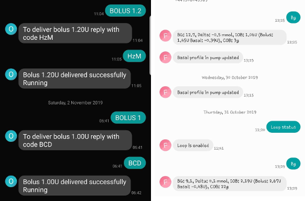

# Comandos SMS

```{contents} Table of contents
:depth: 2
```

A maioria dos ajustes remotos (alvos temporários, hidratos de carbono, trocas de perfil e, depois de o cliente estar emparelhado, bólus) pode ser feita com a [app **AAPSClient**](../RemoteFeatures/RemoteMonitoring.md) num telefone Android com ligação à internet, ver [Controlo principal ↔ cliente](#client-master-control) (uma versão do **AAPSClient** para iPhone está em desenvolvimento, ver [AAPSClient](AapsClient.md)). Os comandos SMS continuam a ser uma alternativa que funciona sem internet, e a única opção remota se usar um iPhone como seguidor e ainda não tiver o **AAPSClient**.

**Os comandos SMS são muito úteis:**
1. Para o controlo remoto do dia a dia

2. Se quiser dar bólus de insulina à distância sem um **AAPSClient** emparelhado

3. Numa região com má receção de internet, onde as mensagens de texto passam, mas os dados móveis/a internet do telefone são limitados. Isto é muito útil quando vai para zonas isoladas (por exemplo, campismo, esqui).

4. Se o seu outro método de controlo remoto (**AAPSClient**) não estiver a funcionar temporariamente

## Segurança em primeiro lugar

Se ativar o **Comunicador SMS** no **AAPS**, tenha em conta que o telefone configurado para dar comandos remotos pode ser roubado e/ou usado por outra pessoa. Bloqueie sempre o seu telefone, pelo menos com um PIN. Recomenda-se muito uma senha forte e/ou um bloqueio biométrico; garanta que é diferente da Senha Mestre da APK (a senha necessária para exportar as definições do **AAPS**).

Além disso, recomenda-se permitir um [segundo número de telefone](#SMSCommands-authorized-phone-numbers) para os comandos SMS. Assim, pode usar o segundo número para [desativar](#SMSCommands-other) o Comunicador SMS, se o seu telefone remoto principal for comprometido.

O intervalo mínimo predefinido entre comandos de bólus é de 15 minutos. Por razões de segurança, tem de adicionar pelo menos dois números de telefone autorizados para mudar este intervalo para um valor mais curto. Se tentar dar outro bólus remoto nos 15 minutos seguintes ao bólus anterior, recebe a resposta “O bólus remoto não está disponível. Tente novamente mais tarde”

O AAPS também o informa por mensagem de texto se os seus comandos remotos, como um bólus ou uma troca de perfil, foram executados. É aconselhável configurar isto de forma que as mensagens de confirmação sejam enviadas para, pelo menos, dois números de telefone diferentes, para o caso de um dos telefones ser roubado.

**Se der um bólus por comandos SMS, tem de introduzir os hidratos de carbono à parte (segundo SMS, AAPSClient...)!** Se não o fizer, a IA fica correta, mas os HCA ficam demasiado baixos, o que pode levar a que um bólus de correção não seja dado, porque o **AAPS** assume que tem demasiada insulina ativa.

Para os comandos sensíveis, tem de ser usada uma app de autenticação com uma senha única baseada no tempo, para aumentar a segurança.

Se quiser retirar a um telefone de cuidador a possibilidade de enviar comandos SMS, use o botão de emergência “[Repor Autenticadores](#sms-commands-authenticator-setup)” no **AAPS** ou envie o comando SMS “[SMS stop](#SMSCommands-other)”. Ao repor os autenticadores, torna inválidos TODOS os telefones dos cuidadores. Deverá configurá-los novamente.

## Configuração dos comandos SMS

```{contents} The overall process is as follows
:depth: 1
:local: true
```

(sms-commands-authenticator-setup)=
### Configuração do Autenticador

A autenticação de dois fatores é usada para melhorar a segurança.

No telefone do cuidador, descarregue (da App Store ou do Google Play) e instale uma app de autenticação. Apps gratuitas populares:
  - [Authy](https://authy.com/download/)
  - Google Authenticator - [Android](https://play.google.com/store/apps/details?id=com.google.android.apps.authenticator2) / [iOS](https://apps.apple.com/de/app/google-authenticator/id388497605)
  - [LastPass Authenticator](https://lastpass.com/auth/)
  - [FreeOTP Authenticator](https://freeotp.github.io/)

Estas apps de autenticação geram uma senha única de 6 dígitos, válida por pouco tempo, como no banco online ou nas compras online. Pode usar outra app de autenticação, desde que suporte tokens RFC 6238 TOTP. O Microsoft Authenticator não funciona.

### Verificar as definições do telefone

No seu telefone, vá a **Apps > AAPS > Permissions** (Aplicações, AAPS, Autorizações). Certifique-se de que **SMS** e **Phone** (Telefone) estão permitidos.


```{admonition} "App was denied access to SMS"
:class: tip
O Android pode bloquear a autorização **SMS** para apps que não foram instaladas a partir de uma loja de apps, como o **AAPS**. Se vir esta mensagem quando der a autorização **SMS**, abra **Settings > Apps > AAPS** (Definições, Aplicações, AAPS) do telefone, toque no menu **⋮** (em cima, à direita) e selecione **Allow restricted settings** (Permitir definições restritas). Depois, dê novamente a autorização **SMS**.
```


### Sincronizar a data e a hora

A hora dos dois telefones tem de estar sincronizada. O melhor é definir a hora automaticamente pela rede. Diferenças de hora podem causar problemas de autenticação.

Tanto no telefone com o **AAPS** como no telefone do cuidador, verifique se a data e a hora estão sincronizadas. A forma exata de o fazer depende do seu aparelho; pode ser preciso experimentar várias definições.

Exemplo (para Samsung S23): **Settings > General management > Date and time** (Definições, Gestão geral, Data e hora): certifique-se de que **Automatic date and time** (Data e hora automáticas) está ativado.

Algumas opções podem estar a cinzento, porque precisam de um administrador através de uma conta familiar, se o telefone foi configurado como conta de criança. No iPhone de um cuidador/pai, esta definição de data e hora chama-se “set automatically” (definir automaticamente). Se não tiver a certeza de que sincronizou os telefones, não se preocupe: pode configurar os comandos SMS e resolver o problema depois, se parecer que isto causa problemas (peça ajuda, se precisar).

### Definições do AAPS

Depois de verificar as definições do telefone, na própria app **AAPS**, vá a [**Configuração** → **Comunicação**](../SettingUpAaps/ConfigBuilder.md) e ative o plugin **Comunicador SMS**.

Abra as definições do **Comunicador SMS**.

Ative **Permitir comandos remotos por SMS**. As opções **PIN obrigatório adicional no token final** e **Configuração do Autenticador** só aparecem depois de ativar esta opção:


(SMSCommands-authorized-phone-numbers)=
#### Números de telefone permitidos

Introduza o(s) número(s) de telefone do cuidador. Inclua o indicativo do país e retire o primeiro “0” do número de telefone, como nestes exemplos:
* Número de telefone do Reino Unido: +447976304596
* Número de telefone dos EUA: +11234567890
* Número de telefone de França:  +33612344567
* _etc._

O “+” antes do número pode ou não ser necessário, conforme o local onde está. Para saber isto, envie um texto de teste, que mostra o formato recebido no ecrã do plugin **Comunicador SMS** (**Configuração** → **Comunicação** → **Comunicador SMS** → **Abrir plugin**).

Se tiver mais do que um número de telefone para adicionar, separe-os com ponto e vírgula, **SEM espaço entre os números** (isto é muito importante!). Selecione **OK**:


#### Intervalo mín. entre bólus remotos

- Pode definir o intervalo mínimo (em minutos) entre dois bólus dados por SMS.
- Por razões de segurança tem de adicionar pelo menos dois números de telefone autorizados para editar este valor.

#### PIN obrigatório adicional no token final

Por razões de segurança, o código de resposta tem de ser seguido de um PIN. Escolha um PIN que vai usar (tal como qualquer outro cuidador) no fim do código do autenticador, quando enviar o comando SMS.

Requisitos do PIN:

* pelo menos 6 dígitos
* só dígitos

Para um PIN mais seguro, não use o mesmo dígito muitas vezes (_por exemplo,_ 111111) nem uma sequência (_por exemplo,_ 123456).


#### Configuração do Autenticador

* Toque em **Configuração do Autenticador** e siga as instruções passo a passo no ecrã.
* Abra a app de autenticação instalada no _telefone do cuidador_, configure uma nova ligação e
* Use o telefone do cuidador para ler o código QR mostrado em **Digitalize o código para configurar os códigos OTP AAPS**.


* Em **Testar Uma-Senha-Única (OTP)**, introduza em **Código para verificar** a senha única da app de autenticação do telefone do cuidador, seguida do seu PIN:

Exemplo:
* O token da app de autenticação é 457051
* O seu PIN obrigatório é 2401
* Código para verificar: 4570512401

Se o código estiver certo, o texto vermelho “PIN ERRADO” muda automaticamente para um “OK” verde. **Não há nenhum botão para premir!** O processo está concluído; não existe um botão “OK” para premir depois de introduzir o código:


Os comandos SMS devem agora estar configurados.

Use o botão **Repor Autenticadores**, no fundo do ecrã **Configuração do Autenticador**, se quiser remover os autenticadores já configurados. (Ao repor o autenticador, torna inválidos TODOS os autenticadores já configurados. Deverá configurá-los novamente.)

## Usar os comandos SMS

### Primeiros passos com os comandos SMS

1)  Para verificar se configurou tudo corretamente, teste a ligação: escreva “bg” numa mensagem SMS do telefone do cuidador para o telefone com o **AAPS**. Deve receber uma resposta parecida com a que se mostra aqui:


Se não receber nenhuma resposta, veja a secção [Resolução de problemas](#SMSCommands-troubleshooting) abaixo.

2)  Agora experimente um comando SMS que precise do autenticador, _por exemplo,_ “target hypo”. O telefone do cuidador recebe uma mensagem de resposta, que pede a **senha de seis dígitos** da app de autenticação, seguida do **PIN** secreto adicional, que só os cuidadores/seguidores conhecem (no total, uma sequência de doze dígitos, se o seu PIN tiver 6 dígitos).

Quando enviar um comando SMS pela primeira vez, faça-o perto do telefone com o **AAPS**, para ver como funciona:


O telefone do cuidador recebe um SMS de resposta do **AAPS** a confirmar se o comando SMS remoto foi executado com sucesso.

Se o comando tiver sucesso, recebe uma resposta a confirmá-lo. Se houver um problema, recebe uma mensagem de erro. Veja [Resolução de problemas](#SMSCommands-troubleshooting) abaixo, para os erros mais comuns.

**Dica**: pode ser útil ter SMS ilimitados no seu tarifário (para cada telefone usado), se forem enviados muitos SMS.

### Dar bólus de refeição com comandos SMS

O bólus de insulina à distância pode ser dado com **Comandos SMS** ou através de um **AAPSClient** emparelhado (ver [Controlo principal ↔ cliente](#client-master-control)); não pode ser dado através do site do Nightscout. Os hidratos de carbono também podem ser anunciados por SMS ou pelo **AAPSClient**. Com SMS, não é possível enviar comandos de hidratos de carbono e de insulina numa só mensagem SMS. Estes comandos têm de ser enviados em separado, assim:

1)  Enviar o bólus de insulina (_por exemplo,_ “bolus 2” dá um bólus de 2 unidades) por comandos SMS equivale a **Tratamentos** → **Insulina** no **AAPS**. 2)  Envie os hidratos de carbono (_por exemplo,_ “carbs 20” anuncia 20 g de hidratos de carbono). Isto equivale a **Tratamentos** → **Hidratos** no **AAPS**.

Para evitar hipoglicemias, é boa ideia começar com prudência e dar **menos insulina** do que seria preciso segundo o seu rácio de hidratos de carbono, porque não está a ter em conta o nível de glicose atual nem a tendência da glicose.

**A ordem em que envia estes comandos é importante**. Se anunciar uma grande quantidade de hidratos de carbono, por qualquer via, e tiver os SMB ativados, o **AAPS** pode responder logo com um bólus parcial de insulina. Assim, se a seguir tentar enviar um bólus de insulina _depois_ de anunciar os hidratos de carbono, pode ter um atraso frustrante e uma mensagem de «bólus em curso», e depois tem de verificar o que foi dado como SMB. Ou, se não se aperceber de que está a ser dado um SMB e o seu próprio bólus a seguir também tiver sucesso, pode ser administrada demasiada insulina para a refeição no total. Por isso, se der bólus de refeição à distância, envie sempre o bólus de insulina _antes_ de anunciar os hidratos de carbono. Se preferir, pode combinar o **AAPSClient** com os comandos SMS: os hidratos de carbono introduzidos num **AAPSClient** emparelhado não precisam de código de autenticação e, por isso, são mais rápidos do que os comandos SMS. Os hidratos de carbono ou outros tratamentos introduzidos no site do Nightscout **não** são aplicados enquanto o controlo pelo cliente estiver ligado; o **AAPS** fica então em [modo reforçado](#client-master-control-hardened-mode).

(SMSCommands-commands)=
## Comandos

```{contents} List of command groups
:depth: 1
:local: true
```

Os comandos têm de ser enviados em inglês; a resposta vem na sua língua, se o texto da resposta já estiver [traduzido](#translations-translate-strings-for-AAPS-app). Os comandos não distinguem maiúsculas de minúsculas; pode usar minúsculas ou maiúsculas.



As **tabelas de comandos SMS** abaixo mostram todos os comandos SMS possíveis. São dados _valores de exemplo_ para ajudar a perceber. Os comandos aceitam os mesmos intervalos de valores (alvos, percentagem do perfil, etc.) que são permitidos na própria app **AAPS**.

(authentication-or-not)=
### Com ou sem autenticação?

Alguns comandos SMS dão uma resposta imediata e outros exigem uma **autenticação** forte através da app de autenticação. Um pedido simples como “**BG**” (que pede a glicose atual) é rápido de escrever, não precisa de autenticação e devolve as informações de estado do **AAPS** mostradas abaixo:


Os comandos que precisam de mais segurança exigem que se introduza um código, por exemplo:


A coluna *Aut.* nas tabelas abaixo indica se cada comando exige esta autenticação forte.

### Dados do CGM

| Comando    | Aut. | Função e *Resposta*                                                                                                                                                                        |
| ---------- | ---- | ------------------------------------------------------------------------------------------------------------------------------------------------------------------------------------------ |
| BG         | Não  | Devolve: última glicose, delta, IA (bólus e basal), HCA<br/>*Última GLIC: 5.6 4min atrás, Delta: -0,2 mmol, IA: 0.20U (Bólus: 0.10U Basal: 0.10U)*                                   |
| CAL 5.6/90 | Sim  | Calibra o CGM com o valor 5.6/90<br/>(use o valor adequado às suas unidades de glicose)<br/>Só funciona se estiver bem configurado no **AAPS**.<br/>*Calibração enviada* |

### Bomba

| Comando              | Aut. | Função e *Resposta*                                                                                   |
| -------------------- | ---- | ----------------------------------------------------------------------------------------------------- |
| BOMBA                | Não  | Last conn: 1 min ago<br/>Temp: 0.00U/h @11:38 5/30min<br/>IOB: 0.5U Reserv: 34U Batt: 100 |
| PUMP DISCONNECT *30* | Sim  | Para desligar a bomba durante *30* minutos                                                            |
| PUMP CONNECT         | Sim  | Bomba religada                                                                                        |

### Basal

| Comando           | Aut. | Função e *Resposta*                             |
| ----------------- | ---- | ----------------------------------------------- |
| BASAL 0.3         | Sim  | Para iniciar uma basal de 0.3U/h durante 30 min |
| BASAL 0.3 20      | Sim  | Para iniciar uma basal de 0.3U/h durante 20 min |
| BASAL 30%         | Sim  | Para iniciar uma basal de 30% durante 30 min    |
| BASAL 30% 50      | Sim  | Para iniciar uma basal de 30% durante 50 min    |
| BASAL STOP/CANCEL | Sim  | Para parar a basal temporária                   |

Algumas bombas só aceitam uma basal temporária em percentagem, outras só em U/h. Se usar a outra forma, o **AAPS** responde *"Esta bomba aceita uma basal temporária só em percentagem, não em U/h."* (ou o inverso) e não define nada. A duração tem de ser um múltiplo do passo de duração da basal temporária da sua bomba.


### Loop

| Comando           | Aut. | Função e *Resposta*                                                                                                                                                                                                                                   |
| ----------------- | ---- | ----------------------------------------------------------------------------------------------------------------------------------------------------------------------------------------------------------------------------------------------------- |
| LOOP STATUS       | Não  | A resposta depende do estado atual:<br/> - *Loop está desativado* se o loop estiver desativado ou em SGB<br/> - *Loop ativado* se o loop estiver fechado ou aberto<br/> - *Suspenso (10 m)* se o loop estiver desligado ou suspenso |
| LOOP STOP/DISABLE | Sim  | A bomba volta à taxa basal programada.<br/>*Loop foi desativado*                                                                                                                                                                                |
| LOOP SUSPEND 20   | Sim  | *Loop suspenso durante 20 minutos*                                                                                                                                                                                                                    |
| LOOP RESUME       | Sim  | *Loop retomado*                                                                                                                                                                                                                                       |
| LOOP CLOSED       | Sim  | *Modo de funcionamento atual: Loop fechado*                                                                                                                                                                                                           |
| LOOP LGS          | Sim  | *Modo de funcionamento atual: Suspensão por glicose baixa*                                                                                                                                                                                            |

### Bólus

Bólus remoto não permitido durante 15 min (este valor é editável apenas se estiverem inseridos 2 números de telefone) após último comando de bólus ou comandos remotos! Neste caso, a resposta seria *O bólus remoto não está disponível. Tente novamente mais tarde.* Esta resposta também é enviada quando a bomba está a administrar um bólus.

| Comando              | Aut. | Função e *Resposta*                                                                                                                                                                |
| -------------------- | ---- | ---------------------------------------------------------------------------------------------------------------------------------------------------------------------------------- |
| BOLUS 1.2            | Sim  |                                                                                                                                                                                    |
| BOLUS 0.60 MEAL      | Sim  | Administra o bólus indicado de 0.60U<br/>**e** define o [Alvo temporário Comer Brevemente](#TempTargets-eating-soon-temp-target)                                             |
| CARBS 5              | Sim  | Para introduzir 5 g, sem bólus                                                                                                                                                     |
| CARBS 5 17:35/5:35PM | Sim  | Para introduzir 5 g às 17:35.<br/>O formato de hora aceite depende<br/> da definição de hora (12h/24h) do telefone.                                                    |
| EXTENDED 2 120       | Sim  | Para iniciar um bólus prolongado de 2U durante 120 min.<br/>Só para [bombas compatíveis](#Extended-Carbs-extended-bolus-and-switch-to-open-loop-dana-and-insight-pump-only). |
| EXTENDED STOP/CANCEL | Sim  | Para parar o bólus prolongado                                                                                                                                                      |

### Perfil

| Comando        | Aut. | Função e *Resposta*                                                                                                                               |
| -------------- | ---- | ------------------------------------------------------------------------------------------------------------------------------------------------- |
| PROFILE STATUS | Não  | Perfil atual e percentagem                                                                                                                        |
| PROFILE LIST   | Não  | A lista atual de perfis no **AAPS**, por exemplo:<br/>1. Perfil1<br/> 2. Perfil2                                                      |
| PROFILE 1      | Sim  | Para mudar para o perfil 1 da lista.<br/>Use os números devolvidos pelo **PROFILE LIST**,<br/>não os nomes dos perfis como os guardou |
| PROFILE 2 30   | Sim  | Para mudar para o Perfil2 a 30%                                                                                                                   |

A percentagem tem de estar entre 30 e 250 %, como na app. Um valor fora deste intervalo é recusado antes de lhe ser pedido o código de autenticação.

### Alvos temporários

| Comando                   | Aut. | Função e *Resposta*                               |
| ------------------------- | ---- | ------------------------------------------------- |
| TARGET MEAL/ACTIVITY/HYPO | Sim  | Para definir o Alvo temporário MEAL/ACTIVITY/HYPO |
| TARGET STOP/CANCEL        | Sim  | Para cancelar o Alvo temporário                   |


(SMSCommands-other)=
### Outro

| Comando          | Aut. | Função e *Resposta*                                                                                                                                                                                                                                      |
| ---------------- | ---- | -------------------------------------------------------------------------------------------------------------------------------------------------------------------------------------------------------------------------------------------------------- |
| RESTART          | Sim  | Reinicia o AAPS. Útil se tiver problemas que normalmente se resolvem com um reinício.                                                                                                                                                                    |
| SMS DISABLE/STOP | Sim  | Para desativar o Serviço Remoto SMS, responda com o código.<br/>Tenha em conta que só o poderá reativar diretamente<br/>no telefone principal do **AAPS**.                                                                                   |
| HELP             | Não  | Devolve todas as funções que pode consultar:<br/>BG, LOOP, PUMP, BASAL, BOLUS, EXTENDED, CAL, PROFILE, TARGET, SMS, CARBS, HELP, RESTART<br/>Envie depois o comando ***HELP ***FUNÇÃO****** para ver<br/>todas as opções desta secção. |
| HELP BOLUS       |      | *BOLUS 1.2<br/>BOLUS 1.2 MEAL*                                                                                                                                                                                                                     |

(SMSCommands-troubleshooting)=
## Resolução de problemas e perguntas frequentes

```{contents} List of questions and issues
:depth: 1
:local: true
```

### O que _não_ se pode fazer com comandos SMS?

1)  **Não pode definir uma troca de perfil _temporária_** (por exemplo, definir "profile exercise" durante 60 minutos), mas pode mudar de forma permanente para “profile exercise”. Em vez disso, as trocas de perfil temporárias podem ser definidas através do **AAPSClient**.

2)  **Não pode cancelar automatizações** nem **definir alvos à sua escolha**, mas há soluções aproximadas: Por exemplo, imagine que o alvo normal do perfil é 5,5. Definiu uma automatização no AAPS para pôr sempre um alvo alto de 7,0 entre as 14:30 e as 15:30, por causa de uma aula de desporto na escola, e uma das condições da automatização é que «não exista nenhum alvo temporário». Esta semana, soube em cima da hora que a aula de desporto foi cancelada e substituída por uma sessão de pizza, mas a criança já está na escola com o telefone com o **AAPS**. Se o alvo temporário alto de 7,0 for iniciado pela automatização e o cancelar (no telefone com o **AAPS** ou à distância), as condições da automatização continuam cumpridas e o **AAPS** volta simplesmente a definir o alvo alto um minuto depois.

**Se tivesse acesso ao telefone com o AAPS**, podia desativar/alterar a automatização ou, se não quisesse fazer isso, podia simplesmente definir um novo alvo temporário de 5,6 durante 60 min, tocando no alvo no ecrã principal ou através de **Gerir** → **Alvo temporário**. Isto impediria a automatização de definir o alvo alto de 7,0.

**Se não tiver acesso ao telefone com o AAPS**, os comandos SMS podem servir para uma solução aproximada: por exemplo, com o comando “target meal” para definir um alvo de 5,0 durante 45 min (os outros alvos predefinidos são 8,0 para atividade ou hipo, ver a tabela). No entanto, com comandos SMS não pode indicar um valor de alvo _específico_ (por exemplo, 5,6 durante 60 minutos); para isso, teria de usar o **AAPSClient**.

### O que acontece se mudar de ideias sobre um comando que acabei de enviar?

O **AAPS** só executa o comando mais recente. Por isso, se escrever “bolus 1.5” e depois, sem autenticar, enviar um novo comando “bolus 1”, o comando anterior de 1.5 é ignorado. O **AAPS** envia sempre ao telefone do cuidador uma resposta a confirmar qual é o comando SMS, antes de lhe ser pedido o código de autenticação, e também uma resposta depois da ação.

### Porque não recebi resposta a um comando SMS?

Pode ser por uma destas razões:

1)  A mensagem não chegou ao telefone (problemas de rede). 2)  O **AAPS** ainda está a processar o pedido (_por exemplo,_ um bólus, que pode demorar algum tempo a ser administrado, conforme a sua velocidade de bólus). 3)  O telefone com o **AAPS** não tem uma boa ligação Bluetooth à bomba quando o comando é recebido, e o comando falhou (isto normalmente cria um alarme no telefone com o **AAPS**).

### Nenhuma resposta aos comandos SMS

No telefone do cuidador e/ou no telefone com o **AAPS**, experimente desativar as seguintes opções:
* **Send as chat message** (enviar como mensagem de chat) 
* Se usar a app Android Messages ou Google Messages, desative as mensagens RCS:
  - abra a conversa SMS em causa na app Mensagens
  - Selecione o menu de opções (três pontos) no canto superior direito
  - selecione "Details" (Detalhes)
  - Ative "Only send SMS and MMS messages" (enviar apenas mensagens SMS e MMS) 

### Erros ao executar comandos

Há várias razões possíveis para o comando não ter sucesso:

* A configuração dos comandos SMS não está completa/correta
* Enviou um comando com formato errado (como “disconnect pump 45” em vez de “pump disconnect 45”)
* Usou um código do autenticador errado ou expirado (normalmente é bom esperar alguns segundos por um código novo, se o atual estiver quase a expirar)
* O código+PIN estava certo, mas houve um atraso no envio/chegada do SMS, e por isso o **AAPS** calculou que o código do autenticador tinha expirado
* O telefone com o **AAPS** está fora de alcance/sem contacto com a bomba
* O sistema já está ocupado a administrar um bólus

Os erros mais comuns são mostrados nos exemplos abaixo:


### Como posso parar um comando depois de ter sido autenticado?

Não pode. No entanto, pode cancelar um bólus enviado por SMS no próprio telefone com o **AAPS**, cancelando-o simplesmente na janela do bólus, se for rápido. Muitos comandos SMS (exceto os bólus e os anúncios de hidratos de carbono) podem ser facilmente revertidos, ou podem ser tomadas medidas para reduzir efeitos não desejados, se houver um erro.

Para erros em bólus e em anúncios de hidratos de carbono, ainda pode agir. Por exemplo, se anunciou 20 g de hidratos de carbono mas a criança só come 10 g, e o cuidador (ou um cuidador presente) não consegue apagar o tratamento diretamente no telefone com o **AAPS**, pode definir um alvo temporário alto ou um perfil reduzido, para que o **AAPS** seja menos agressivo.

### Múltiplos SMS

Se receber a mesma mensagem várias vezes (_por exemplo,_ uma troca de perfil), pode ter criado sem querer um ciclo com outras apps. Pode ser o xDrip, por exemplo. Se for o caso, certifique-se de que o xDrip (ou qualquer outra app) não envia tratamentos para o Nightscout.

Se a outra app estiver instalada em vários telefones, desative o envio em todos eles.

(sms-commands-too-many-messages)=
### Recebo demasiadas mensagens de texto dos comandos SMS. Posso reduzir a frequência ou fazer com que parem?

Usar comandos SMS pode gerar muitas mensagens automáticas do telefone com o **AAPS** para o telefone do cuidador. Também recebe mensagens, por exemplo «Perfil Basal atualizado na bomba», se tiver automatizações configuradas no **AAPS**. Pode ser útil ter SMS ilimitados no tarifário do telefone com o **AAPS** (e de cada telefone de cuidador usado), se forem enviados muitos SMS, e desativar as notificações, alarmes ou vibrações dos SMS em todos os telefones. Não é possível usar comandos SMS sem receber estas atualizações. Por isso, pode querer outra forma de comunicar diretamente com a criança (se tiver idade para isso), em vez de SMS. Apps de comunicação alternativas usadas com frequência pelos cuidadores do **AAPS** incluem Whatsapp, Lime, Telegram e Facebook Messenger.

É possível desativar o SMS "Profile changed" (perfil alterado), quando a alteração do perfil veio do Nightscout. Para isso, crie um ficheiro com o nome **exatamente**  `do_not_send_sms_on_profile_change` na pasta `extra` da pasta do AAPS.
