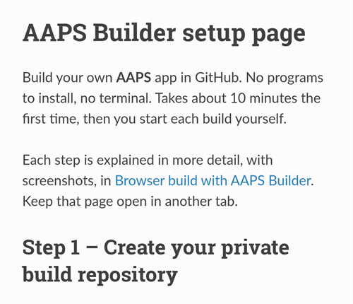
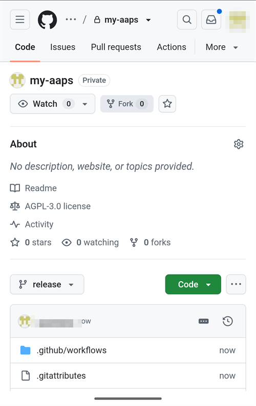
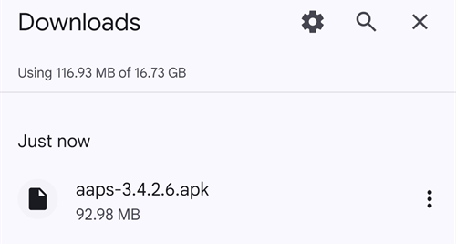
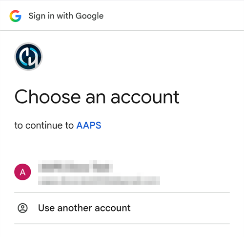

(aaps-builder)=

# Compilação no navegador com o AAPS Builder

```{note}
Esta é a forma recomendada de compilar o AAPS a partir de um **telefone Android**. Também funciona a partir do navegador de qualquer computador. Para as outras formas de compilar a partir de um computador ou de um iPhone, veja a visão geral da [Compilação no navegador](BrowserBuild.md).
```

```{contents} In this page
:backlinks: entry
:depth: 2
```

O **AAPS Builder** compila a app AAPS por si no GitHub, o site gratuito de alojamento de código. Não há nada para instalar no seu telefone, nem ficheiro de preparação para abrir.

Uma página de configuração guia-o em todos os passos. Da primeira vez demora cerca de 10 minutos:

1. Crie a sua própria **cópia privada** do AAPS Builder na sua conta GitHub: a página de configuração abre o GitHub com tudo já preenchido, só tem de confirmar. O workflow de compilação, o ficheiro que diz ao GitHub como compilar o AAPS, já está incluído.
2. Crie ou envie a sua **chave de assinatura** (a keystore).
3. Dê a chave ao seu repositório como um **secret** do GitHub.
4. **Compile** a app. Uma compilação demora 15 a 30 minutos.
5. **Transfira e instale** a app no seu telefone.

**Não** precisa de fazer fork do AndroidAPS: o código-fonte do AAPS é transferido do repositório oficial do AndroidAPS em cada compilação. Também **não** precisa do Google Drive: transfere a app diretamente do GitHub.

```{admonition} Where the code comes from
:class: note

O workflow de compilação é mantido pelos programadores do AAPS no repositório [nightscout/aaps-builder](https://github.com/nightscout/aaps-builder), e o seu repositório é uma cópia dele. O [workflow](https://github.com/nightscout/aaps-builder/blob/main/.github/workflows/build.yml) na sua cópia é curto: executa os [passos de compilação](https://github.com/nightscout/aaps-builder/blob/main/.github/workflows/aaps-builder.yml) guardados nesse repositório, por isso as melhorias chegam até si sem nenhuma alteração no seu repositório. Pode ler os dois ficheiros. Quando compila, o workflow transfere apenas o código-fonte oficial do AAPS e as ferramentas de compilação do próprio GitHub. A sua keystore nunca sai do seu navegador nem do seu repositório privado.
```

(aaps-builder-before-you-start)=

## Antes de começar

Vai precisar de:

- Uma **conta GitHub** (gratuita). Se não tiver uma, crie-a primeiro em [github.com](https://github.com/signup).
- Um **navegador web**: o Chrome no seu telefone, ou qualquer navegador num computador. Inicie sessão em github.com nesse navegador antes de começar.
- **Tem a app GitHub no seu telefone?** Pode mantê-la. Nesse caso, alguns botões da página de configuração abrem a app em vez do Chrome. A compilação funciona na app, mas a app **não consegue transferir** o AAPS pronto: o [passo 5](#aaps-builder-step5) mostra como mudar para o Chrome para a transferência.
- A sua **keystore existente** (ficheiro `.jks`), a sua senha e o seu alias, se já compilou o AAPS antes e quer atualizá-lo sem o reinstalar.

```{warning}
**O seu repositório de compilação tem de continuar privado.** Tudo o que uma compilação produz é visível para qualquer pessoa que consiga ver o repositório. A página de configuração cria um repositório privado para si. Nunca o mude para público, e não faça **fork** do AAPS Builder em vez disso: um fork é sempre público.

Um repositório privado recebe 2000 minutos gratuitos de GitHub Actions por mês, o que chega para várias compilações.
```

```{warning}
**Chave nova ou chave existente: isto decide se pode atualizar o AAPS.**

- **Já tem o AAPS no seu telefone, compilado com uma keystore que ainda tem**: escolha **I already have a keystore** na página de configuração e envie-a. A sua próxima compilação vai atualizar o AAPS instalado. Compilou o AAPS com a compilação no navegador anterior (o seu próprio fork)? A sua keystore está no seu fork: [obtenha primeiro uma cópia dela](#aaps-builder-from-fork).
- **Compila o AAPS pela primeira vez, ou perdeu a sua keystore ou a sua senha**: escolha **Create a new key**. Uma app assinada com uma chave nova **não consegue atualizar** um AAPS assinado com outra chave. Tem de exportar as suas definições, copiar o ficheiro para fora do seu telefone, desinstalar o AAPS antigo, instalar o novo e depois importar as suas definições: veja [Reinstalar o AAPS com uma nova keystore](#reinstall-aaps).

Depois, continue sempre a usar a mesma chave. Quando criar uma chave nova, transfira a cópia de segurança que a página oferece e guarde-a com a sua senha e o seu alias (`key0`) num local seguro, fora do seu telefone.
```

(aaps-builder-from-fork)=

## Vindo da compilação no navegador anterior (fork)

Ignore esta secção se nunca compilou o AAPS com o método anterior de compilação no navegador (a sua própria cópia, ou fork, do AndroidAPS no GitHub, com o ficheiro de preparação e o Google Drive).

A sua keystore está guardada como secrets no seu fork. O GitHub nunca volta a mostrar um secret, por isso não o pode copiar para o seu novo repositório. Primeiro obtenha uma cópia da sua keystore e depois use-a no [passo 2](#aaps-builder-step2) com **I already have a keystore**.

```{warning}
Não escolha **Create a new key**. Um AAPS compilado com uma chave nova não consegue atualizar o AAPS no seu telefone.
```

Qual é o seu caso?

- **Usou a Opção 2** (enviou a sua própria keystore do Android Studio) e ainda tem o ficheiro `.jks`, as suas senhas e o seu alias: não há nada a fazer aqui. Use esse ficheiro no passo 2.
- **Usou a Opção 1** (o ficheiro de preparação criou a sua chave), ou já não tem o ficheiro da sua keystore: exporte-a do seu fork como indicado abaixo.

Para exportar a sua keystore do seu fork:

1. No seu fork, abra **Settings** → **Secrets and variables** → **Actions** e adicione um secret com o nome `ZIP_PASSWORD`. Escolha uma senha só com letras inglesas e números. Ela protege o ficheiro que vai criar.
2. Abra o separador **Actions** do seu fork, toque em **CI Keystore Export** e depois em **Run workflow**. Mais detalhes: [Exportar a sua keystore](#ci-keystore-export).
3. Quando a execução tiver um visto verde, abra o seu Google Drive: o ficheiro `keystore.zip` está na pasta **AAPS** → **KeyStore**. Se a execução falhar no passo do Google Drive, o acesso do seu fork ao Google Drive expirou: veja [O token de atualização da Google expirou](#aaps-ci-google-token-expired).
4. Transfira `keystore.zip` e abra-o com a sua `ZIP_PASSWORD`: num computador, ou no seu telefone com uma app de gestão de ficheiros que consiga abrir ficheiros ZIP protegidos por senha. Contém:
   - `keystore.jks`: a sua keystore,
   - `keyStoreInfo.txt`: a sua `KEYSTORE_PASSWORD`, a sua `KEY_PASSWORD` e o seu `ALIAS` (normalmente `key0`).
5. Copie `keystore.jks` para o seu telefone (ou para o Google Drive, para o poder escolher a partir daí).

No [passo 2](#aaps-builder-step2) da página de configuração:

1. Toque em **I already have a keystore**.
2. Em **Keystore file**, escolha `keystore.jks`.
3. Em **Keystore password**, escreva a `KEYSTORE_PASSWORD` de `keyStoreInfo.txt`.
4. Em **Key alias**, escolha ou escreva o `ALIAS` de `keyStoreInfo.txt`.
5. Se a `KEY_PASSWORD` for diferente da `KEYSTORE_PASSWORD`, desmarque **Key password is the same as the keystore password** e escreva a `KEY_PASSWORD`.

Guarde `keystore.zip` e a sua `ZIP_PASSWORD` num local seguro, fora do seu telefone: é a cópia de segurança da sua chave.

Para guardar também as compilações do AAPS Builder no Google Drive, faça o [passo 6](#aaps-builder-google-drive): a página de configuração obtém um novo `GDRIVE_OAUTH2` para si. Pode manter o seu fork até o AAPS compilado com o AAPS Builder estar instalado no seu telefone.

## Abrir a página de configuração

**→ [Abrir a página de configuração do AAPS Builder](#aaps-builder-setup)**

A página de configuração faz parte desta documentação, no seu idioma. Mantenha também esta página aberta noutro separador: as secções abaixo explicam com mais detalhe cada passo da página de configuração, com capturas de ecrã.

A página de configuração abre cada página do GitHub num novo separador do Chrome. Para voltar à página de configuração, toque no botão dos separadores ao lado da barra de endereço do Chrome (o quadrado com um número) e escolha a página de configuração do AAPS Builder.


A página de configuração funciona inteiramente no seu navegador: a sua chave e as suas senhas nunca são enviadas para lado nenhum, exceto para o secret do GitHub onde as cola o próprio utilizador. Só o seu nome de utilizador do GitHub é enviado ao GitHub, para verificar se existe. Ela lembra-se do seu nome de utilizador do GitHub e do nome do repositório, para que possa voltar a ela a qualquer momento para reabrir a sua página de secrets ou as suas compilações.



(aaps-builder-step1)=

## Passo 1 – Criar o seu repositório privado de compilação

Este passo cria a sua própria cópia privada do AAPS Builder na sua conta GitHub, já com o workflow de compilação. Só o utilizador consegue ver o repositório e as apps que ele compila.

1. Confirme que tem sessão iniciada em github.com neste navegador.

2. Em **Your GitHub username**, escreva o seu nome de utilizador do GitHub, não o seu e-mail. A página verifica-o com o GitHub: **✓ Utilizador do GitHub encontrado** significa que está correto.

3. Em **Name of your repository**, mantenha a sugestão `my-aaps`. Se já criou o seu repositório com outro nome, escreva exatamente esse nome.

   ```{note}
   **Já tem um repositório do AAPS Builder** (criado com uma versão anterior da página de configuração)? Não crie um novo: escreva o nome exato dele, salte **Create my private repository** e atualize o workflow dele uma vez, como explicado em [Atualizar o AAPS](#aaps-builder-updates). Os seus secrets ficam como estão. Se mesmo assim quiser um repositório novo, escolha um nome que ainda não tenha, por exemplo `my-aaps-2`, e use a mesma keystore no passo 2.

   Não escreva o nome do seu fork do AndroidAPS: um fork é público e já compila com o seu próprio workflow **AAPS CI**.
   ```

   

4. Verifique a linha **O seu repositório:** mostra `github.com/<your username>/my-aaps`. A página de configuração lembra-se do nome da sua última visita: verifique-o sempre antes de usar os botões dela.

5. Toque em **Create my private repository**.

   

6. O GitHub abre **Create a new repository** num novo separador. Está tudo já preenchido: em **Start with a template**, o modelo `nightscout/aaps-builder` com **Include all branches** desligado, e em **General**, a sua conta como **Owner** e o nome que escolheu.

   

   Não altere nada.

7. Deslize para baixo: em **Configuration**, **Choose visibility** já está em **Private**. Toque no botão verde **Create repository**.

   

   O GitHub mostra o seu novo repositório: contém uma pasta `.github` (com o workflow de compilação) e um ficheiro `README.md`. **Volte ao separador da página de configuração** para o passo 2: toque no botão dos separadores ao lado da barra de endereço do Chrome e escolha a página de configuração.

   

```{warning}
**O seu novo repositório está vazio**, sem ficheiros? Não foi criado a partir do modelo e não consegue compilar. Apague-o (**Settings** → fundo da página → **Delete this repository**) e depois toque de novo em **Create my private repository** na página de configuração.
```

```{tip}
O GitHub diz **my-aaps already exists in this account**? Já tem o seu repositório: feche o separador do GitHub e continue na página de configuração. Se a sua chave já estiver lá, continue com o [passo 4](#aaps-builder-step4). See [troubleshooting](#aaps-builder-ts-repo-exists).
```

(aaps-builder-step2)=

## Passo 2 – A sua chave de assinatura

A app tem de ser assinada com a sua própria chave. Escolha um dos dois separadores. Leia primeiro o [aviso sobre chave nova ou chave existente](#aaps-builder-before-you-start).


### Já tenho uma keystore

1. Toque em **I already have a keystore**.
2. Em **Keystore file**, escolha o seu ficheiro `.jks` (ou `.keystore`, `.p12`, `.pfx`). Num telefone, copie primeiro o ficheiro para o seu telefone ou para o Google Drive.
3. Em **Keystore password**, escreva a senha da keystore.
4. Em **Key alias**, escolha o seu alias da lista, ou escreva-o se não houver lista. Nas keystores criadas com o Android Studio é normalmente `key0`.
5. Se a senha da sua chave for diferente da senha da keystore, desmarque **Key password is the same as the keystore password** e escreva a senha da chave.
6. Toque em **Check and continue**.

A página verifica a senha e o alias no seu dispositivo. **Keystore OK! Continue with step 3.** significa que está tudo certo. Se disser que a senha vai ser verificada quando compilar, continue na mesma: a compilação diz-lhe se algo estiver errado.

### Criar uma chave nova

1. Toque em **Create a new key**.

2. Escolha uma senha e escreva-a duas vezes. Regras: pelo menos 8 caracteres, apenas as letras a–z e A–Z, os algarismos 0–9 e símbolos como `! ? #`. Sem espaços, sem letras acentuadas e sem o carácter `|`.

3. Toque em **Create key**. Demora alguns segundos até aparecer **Key created**.

   

4. Toque em **Download backup (aaps-keystore.jks)**. Se o Chrome perguntar **Download file again?** (Transferir o ficheiro novamente?), já existe no seu telefone uma cópia de segurança mais antiga com o mesmo nome: toque em **Download again** (Transferir novamente). O Chrome guarda então a nova chave como `aaps-keystore (1).jks`: é este o ficheiro que corresponde a esta chave; guarde-o e não o confunda com o mais antigo.

   Guarde estes três elementos juntos, num local seguro fora do seu telefone (por exemplo, o seu próprio armazenamento na nuvem):

   - o ficheiro `aaps-keystore.jks`,
   - a sua senha,
   - o alias da chave: **`key0`**.

   Vai precisar dos três se alguma vez compilar o AAPS de outra forma, por exemplo com o Android Studio. As chaves criadas com uma versão anterior da página de configuração têm o alias `aaps`.

   

(aaps-builder-step3)=

## Passo 3 – Dar a chave ao seu repositório

O passo 3 fica disponível quando o passo 2 estiver concluído. A sua chave, as suas senhas e o seu alias são juntos num único valor, o secret `KEYSTORE_SET`.

1. Toque em **Open the secrets page**.


2. O GitHub abre a página **New secret** do seu repositório. Num telefone, fica abaixo do menu de definições: desça.


3. Mude para o separador da página de configuração e toque em **Copy name**. Volte ao separador do GitHub e cole-o no pequeno campo **Name**. O nome é `KEYSTORE_SET`.

4. Mude para o separador da página de configuração e toque em **Copy secret**. Volte ao separador do GitHub e cole-o na caixa grande **Secret** (num telefone, toque longo). O secret é um código muito longo, com milhares de caracteres: a página de configuração mostra os seus primeiros caracteres ao lado do botão. Não cole aí a palavra `KEYSTORE_SET`.

5. Toque em **Add secret**. `KEYSTORE_SET` aparece agora em **Repository secrets**.


Só tem de fazer isto uma vez.

```{tip}
O GitHub mostra **Page not found** (404)? Primeiro, verifique se iniciou sessão em github.com neste navegador: o GitHub mostra 404 para repositórios privados quando não tem sessão iniciada. Caso contrário, o nome de utilizador ou o nome do repositório no passo 1 não corresponde ao seu repositório. Verifique o nome em github.com, corrija-o no passo 1 e toque de novo no botão.
```

(aaps-builder-step4)=

## Passo 4 – Compilar a app

1. Na página de configuração, toque em **Open the build page**. O GitHub abre a página **Build AAPS** do seu repositório.

   

   Se em vez disso abrir a **app GitHub**: toque em **RUN WORKFLOW**, verifique a versão e a variante e toque de novo em **RUN WORKFLOW**. A app pode ainda mostrar **Nothing to see here**: puxe a lista para baixo para a atualizar e ver a sua compilação. Depois continue com o passo 4 abaixo.

2. Se o GitHub pedir, toque no botão verde para ativar os workflows.

   A lista de workflows mostra duas entradas: use **Build AAPS**. Ignore **AAPS Builder**: contém os passos de compilação e não tem botão **Run workflow**.

3. Toque em **Run workflow**. Abre-se um pequeno formulário:
   - **Version**: deixe `latest` para compilar a versão mais recente do AAPS, ou escreva um número de versão, como `4.0.0`.
   - **Variant**: mantenha `fullRelease` para o uso normal com uma bomba. As outras variantes são explicadas em [variantes de compilação](#browserbuild-variant). `aapsclient3Release` compila o **AAPSClient3**, disponível a partir da versão 4.0 do **AAPS** (veja [Sobre o AAPSClient, o AAPSClient2 e o AAPSClient3](#remotecontrol-aapsclient-versions)).
   - Toque no botão verde **Run workflow**.

   

4. A compilação começa e mostra **In progress**, com duas partes: **AAPS / Check** e depois **AAPS / Build AAPS**.

   

5. Aguarde 15 a 30 minutos. Um visto verde significa que a compilação terminou. Uma cruz vermelha significa que falhou: abra a compilação para ler a mensagem e depois veja [resolução de problemas](#aaps-builder-troubleshooting).

   

   ```{tip}
   **E-mail quando uma compilação termina:** o GitHub só lhe envia um e-mail quando uma compilação falha. Para receber também um e-mail quando tem sucesso: em github.com, abra a sua foto de perfil → **Settings** → **Notifications** → **System** → **Actions** e desmarque **Only notify for failed workflows**.
   ```

Se não houver o botão **Build AAPS** ou **Run workflow**:

- Abra o seu repositório e verifique se tem uma pasta `.github` com o ficheiro `workflows/build.yml`. Se o repositório estiver vazio, não foi criado a partir do modelo: apague-o (**Settings** → fundo da página → **Delete this repository**) e faça de novo o [passo 1](#aaps-builder-step1) com o botão.
- O ficheiro está lá, mas o GitHub mostra **This workflow does not exist**: veja a [resolução de problemas](#aaps-builder-ts-workflow-not-found).
- Abra o separador **Actions**. Se disser que os workflows estão desativados, toque no botão verde para os ativar e depois toque em **Build AAPS** na lista.

(aaps-builder-step5)=

## Passo 5 – Instalar a app no seu telefone

```{warning}
**Antes de cada atualização**, [exporte as suas definições](#ExportImportSettings-Automating-Settings-Export) no AAPS e copie o ficheiro **para fora do telefone** (Google Drive, Dropbox…). Guarde lá também várias exportações mais antigas e os ficheiros APK, para poder sempre voltar atrás.
```

1. No seu telefone, abra a página de configuração no **Chrome**. Inicie sessão em github.com, se lhe for pedido.
2. Toque em **Open my builds** e depois na compilação mais recente com um visto verde.

   ```{admonition} The GitHub app opened instead of Chrome?
   :class: note

   A app GitHub não consegue transferir compilações. Na app, abra a compilação mais recente e depois toque em **Artifacts ↗**, ou toque no ícone de partilha no topo e escolha **Chrome** (ou **Copy link**, e depois cole o link na barra de endereço do Chrome). A compilação abre no Chrome: continue lá com o passo seguinte.

   Para impedir que os links do GitHub abram na app: Android **Settings** (Definições) → **Apps** (Aplicações) → **GitHub** → **Open by default** (Abrir por predefinição) → desative **Open supported links** (Abrir links suportados).
   ```

   

3. Desça até ao resumo da compilação e toque no link **Download AAPS**.

   

   ```{tip}
   Deslize com o dedo sobre o texto, não sobre o diagrama dos passos da compilação: senão move-se o diagrama em vez da página.
   ```

   Também pode descer mais até **Artifacts** e tocar no ícone de transferência ao lado de `aaps-….apk`.

   

4. Quando a transferência terminar, abra o menu do Chrome **⋮** → **Downloads** (Transferências), toque em `aaps-….apk` e escolha **Install** (Instalar). Se lhe for pedido, permita a instalação de apps desta origem.

   

`aaps-wear-….apk` é a app do smartwatch. Ignore-a se não usar um.

A app fica guardada na página da compilação durante **14 dias**. Não aparece em **Code** no seu repositório. Copie-a para um local seguro, fora do seu telefone, juntamente com as exportações das suas definições.

Para mais formas de instalar a app, veja [Transferir e instalar o AAPS](TransferringAndInstallingAaps.md).

```{note}
A partir de setembro de 2026, a [verificação de programadores Android](#android-developer-verification) da Google pode bloquear a instalação do APK com um toque no ficheiro, conforme o seu país. Essa página explica soluções gratuitas.
```

(aaps-builder-google-drive)=

## Passo 6 (opcional) – Guardar também a app no Google Drive

Também pode guardar cada compilação no seu Google Drive, na pasta `AAPS/<version>`. Isto é opcional: a app está sempre disponível na página da compilação.

É preciso mais um secret, `GDRIVE_OAUTH2`. O passo 6 da página de configuração obtém-no da Google por si, num telefone ou num computador. O **AAPS** só pode então ver e alterar os ficheiros que ele próprio cria no seu Google Drive, mais nada.

1. Na página de configuração, toque em **Connect Google Drive**. A Google abre num novo separador.

2. Escolha a sua conta Google e permita o acesso. Se a Google disser que a app não está verificada, toque em **Advanced** e depois em **Go to …**.

   

   

3. O novo separador mostra depois um erro como **This site can't be reached** ou **127.0.0.1 refused to connect**. **Isto é normal:** a resposta da Google está no endereço desse separador. Toque na barra de endereço e depois no ícone de copiar ao lado do endereço (num computador: selecione o endereço inteiro e copie-o). Começa por `http://127.0.0.1:47913/`.

   

   

4. Volte ao separador da página de configuração dentro de poucos minutos: a resposta da Google só é válida durante pouco tempo, e só uma vez. Cole o endereço em **Paste the copied address here** e toque em **Get GDRIVE_OAUTH2**. A página mostra **GDRIVE_OAUTH2 is ready**.

   

   

5. Toque em **Open the secrets page**. Toque em **Copy name** e depois cole-o no pequeno campo **Name** (o nome é `GDRIVE_OAUTH2`). Toque em **Copy secret**, cole-o na caixa grande **Secret** e toque em **Add secret**.

   

A partir da compilação seguinte, os APK também são guardados no Google Drive.

Já tem um valor `GDRIVE_OAUTH2` do ficheiro de preparação dos outros métodos de compilação no navegador? Também funciona: adicione-o como o secret `GDRIVE_OAUTH2`.

A Google termina o acesso se não compilar durante 6 meses, ou se alterar a sua senha Google. Nesse caso, a compilação avisa-o: repita estes passos. Veja [O token de atualização da Google expirou](#aaps-ci-google-token-expired).

(aaps-builder-updates)=

## Atualizar o AAPS

O seu repositório nunca compila nada sozinho: é o utilizador que decide quando compilar, que versão e que variante. Quando sair uma nova versão do AAPS:

1. [Faça uma cópia de segurança das suas definições](#aaps-builder-step5) como explicado no passo 5.
2. Compile a nova versão como no [passo 4](#aaps-builder-step4). Mantenha `latest`, ou escreva o número da versão.
3. Transfira-a e instale-a como no [passo 5](#aaps-builder-step5).

As **atualizações dos passos de compilação** chegam até si sozinhas: em cada compilação, o seu repositório executa os passos de compilação publicados pelos programadores do AAPS em nightscout/aaps-builder. Nada muda no seu repositório e não há nenhuma compilação automática.

As **atualizações do seu ficheiro de workflow** são raras: só quando o formulário **Run workflow** muda, por exemplo para uma nova variante de compilação, ou uma vez se o seu repositório foi criado com uma versão anterior da página de configuração (um repositório vazio com um ficheiro de workflow curto) ou a partir do modelo antigo. A página [Atualizações e alterações da documentação](../Maintenance/DocumentationUpdate.md) indica-o. O seu secret `KEYSTORE_SET` fica como está. Na página de configuração, abra **Updating your copy** no fim do passo 1:

1. Toque em **Open the newest workflow**. Num computador, clique no **ícone de copiar** («Copy raw file») no canto superior direito do ficheiro. Num telefone, abra antes a **versão em texto simples**, prima e mantenha o dedo no texto e depois toque em **Select all** e **Copy**.
2. Toque em **Open my workflow file**, depois no menu **⋯** no canto superior direito do ficheiro e em **Edit file… In place** (num computador, clique no lápis).
3. Substitua todo o texto pelo workflow copiado (num telefone, toque longo: **Select all** e depois **Paste**).
4. Toque em **Commit changes…** e depois em **Commit changes**.

A primeira linha do ficheiro mostra a versão dele.

## Resolução de Problemas

Something went wrong? Veja a [resolução de problemas do AAPS Builder](#aaps-builder-troubleshooting).

```{toctree}
:hidden:

AAPS Builder setup page <BrowserBuildAapsBuilderSetup.md>
```
