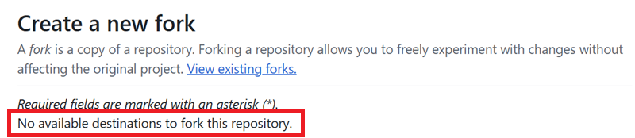

(github-fork)=

# Compilação no navegador – Passo 1: Criar o seu fork no GitHub

```{note}
Este é o **Passo 1** da [Compilação no navegador](BrowserBuild.md).
```

You will need to store your personal Android Java Key and Google Drive information as secrets in GitHub (later in the process, we will explain how).

Como isto não pode ser feito no repositório público do AndroidAPS, tem de criar a sua cópia pessoal do código-fonte (chamada fork).

## Conta GitHub

Se ainda não tiver uma, tem de [criar uma conta GitHub](https://github.com/signup).  
Pode registar-se com o seu e-mail ou com a sua conta Google. Siga o processo de registo e de verificação.

Quando tiver uma conta, [inicie sessão no GitHub](https://github.com/login).

## Fazer o fork do AndroidAPS

Abra o repositório oficial do AndroidAPS com [este link](https://github.com/nightscout/AndroidAPS).

Toque no ícone de fork. Isto cria uma cópia na sua própria conta.


Desça no ecrã seguinte e toque em **Create Fork**.


*Note: you can **unselect** "Copy the master branch only" if you will want to build developer versions or customizations.*


```{note}
You cannot fork and you see this?<br/><br/>
**`No available destinations to fork this repository.`**<br/><br/>
<br/><br/>
This means you already have an existing fork of AndroidAPS.<br/>
Make sure it's up to date and continue to Preparation Steps.
```

```{warning}
**Nunca apague o seu fork sem ter feito uma cópia de segurança dos seus secrets!**
```

O GitHub mostra agora a sua cópia pessoal do AndroidAPS. Deixe este separador do navegador aberto.


----

**Seguinte: [Passo 2 – Criar a sua keystore de assinatura](BrowserBuildKeystore.md) →**
