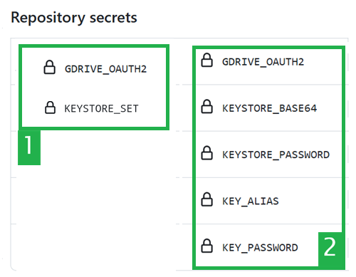

(aaps-ci-google-drive-auth)=

# Compilação no navegador – Passo 3: Autorizar o Google Drive

```{note}
Este é o **Passo 3** da [Compilação no navegador](BrowserBuild.md). Primeiro, conclua o [Passo 2 – Criar a sua keystore de assinatura](BrowserBuildKeystore.md).
```

```{warning}
Seja qual for o conjunto de instruções que seguiu antes (Opção 1 ou Opção 2), TEM de adicionar a autorização do Google Drive para usar a compilação no navegador com sucesso.
```

Nota: se já fez esta parte no vídeo, pode agora passar para o [Passo 4 – Compilar o APK](BrowserBuildAPK.md).

```{warning}
Se a autorização da Google não começar ou se a página de preparação falhar, feche a página de preparação, abra de novo `aaps-ci-preparation.html` da mesma forma que no Passo 2 e repita este passo desde o início. Consulte a [resolução de problemas](#aaps-ci-preparation-web).
```

Volte ao separador da página de preparação.

Desça até à secção Google Drive Auth (autorização do Google Drive) e toque em Start Auth.


Selecione a sua conta Google.


Desça e aceite o acesso. A página web precisa dele para obter a chave de autenticação do Google Drive.

Toque em Continue (Continuar).


O campo `GDRIVE_OAUTH2` fica preenchido. Toque no botão Copy de cima.


Volte ao separador do GitHub.

Desça até Repository secrets e toque em New repository secret.

Se seguiu a Opção 1, deve ver isto:


Se seguiu a Opção 2, haverá mais chaves:


No campo Name, cole o texto que acabou de copiar. Toque longamente na caixa de texto para mostrar o menu de colar.


Mude para o separador da página de preparação.

Toque no segundo botão Copy.


Volte ao separador do GitHub.

1. No campo Secret, cole o texto que acabou de copiar. Toque longamente na caixa de texto para mostrar o menu de colar.

2. Toque em Add secret.


Agora deve ter dois (Opção 1) ou cinco (Opção 2) secrets.



Depois da compilação, o GitHub vai poder guardar o ficheiro apk do AAPS no seu Google Drive.

----

**Seguinte: [Passo 4 – Compilar o APK](BrowserBuildAPK.md) →**
