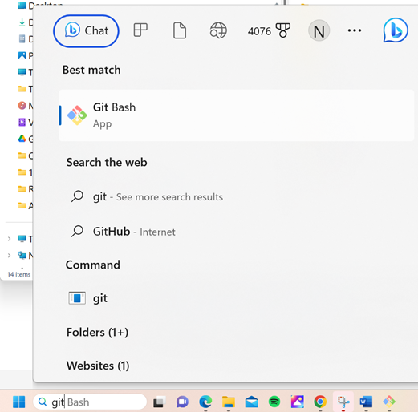
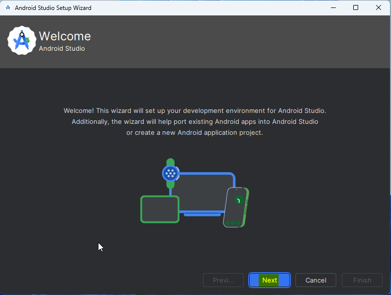
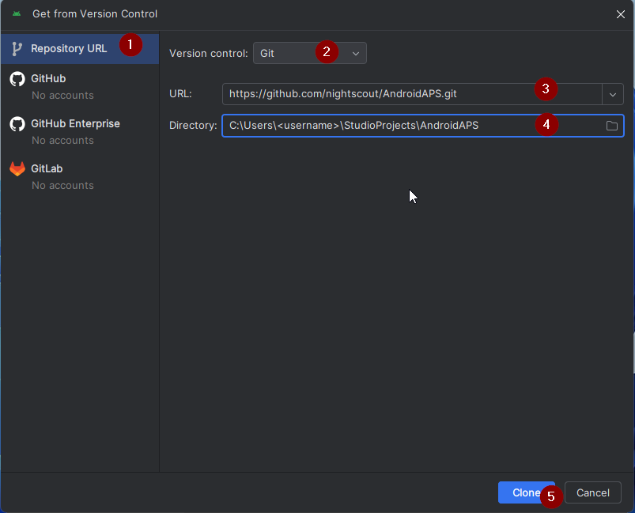

<!-- Android Studio Build, FKA Computer Build. Preserve filenames to avoid breaking URLs. -->

# Compilação com o Android Studio

Este é o método tradicional para compilar a sua app AAPS.

Pode compilar a app sem computador com o método [Compilação no navegador](./BrowserBuild.md).

## Compilar em vez de transferir

**A app AAPS (um ficheiro apk) não está disponível para transferência, por causa das regras sobre dispositivos médicos. É legal compilar a app para uso próprio, mas não pode dar uma cópia a outras pessoas!**

Veja a [página FAQ](../UsefulLinks/FAQ.md) para mais detalhes.

---

(Building-APK-recommended-specification-of-computer-for-building-apk-file)=
## Computer and software specifications for building AAPS

* Pode ser necessária uma versão específica do **[Android Studio](https://developer.android.com/studio/)** para compilar o apk. Veja a tabela abaixo:

| Versão AAPS             | Versão<br/>preferida do<br/>Android Studio | Versão<br/>alternativa do<br/>Android Studio | Gradle | JVM |
| ----------------------- | ------------------------------------------------------ | -------------------------------------------------------- | ------ |:--- |
| 2.6.2                   | 3.6.1                                                  |                                                          | 5.6.4  | 11  |
| 2.8.2.1                 | 4.1.1                                                  |                                                          | 6.1.1  | 13  |
| [3.1.0.3](#version3100) | 2020.3.1                                               | testado até ao Quail 4                                   | 7.3.3  | 17  |
| [3.2.0.4](#version3204) | Hedgehog (2023.1.1)                                    | testado até ao Quail 4                                   | 8.2    | 17  |
| [3.3.1.3](#version3300) | Ladybug Feature Drop (2024.2.2)                        | testado até ao Quail 4                                   | 8.10   | 21  |
| [3.3.2](#version3300)   | Meerkat (2024.3.1)                                     | testado até ao Quail 4                                   | 8.11.1 | 21  |
| [3.3.2.1](#version3321) | Narwhal (2025.1.2)                                     | testado até ao Quail 4                                   | 8.13   | 21  |
| [3.4.2.6](#version3426) | Panda 2 (2025.3.2)                                     | testado até ao Quail 4                                   | 9      | 21  |
| [4.0.0](#version400)    | Rabbit 2 (2026.2.2)                                    | Latest                                                   | 9.8    | 21  |

A «versão preferida» já inclui a versão adequada da JVM. A versão preferida é também a versão mínima que pode usar para compilar o **AAPS**. **NÃO** vai conseguir compilar numa versão mais antiga do que a «preferida». Se usar outra versão, pode ter problemas relacionados com a versão da JVM. Veja a página [Resolução de problemas do Android Studio](#troubleshooting_androidstudio-uncommitted-changes) para o ajudar a resolver estes problemas. Se a sua versão atual do Android Studio não está na tabela, tem de a atualizar primeiro.

A versão do Gradle está ligada ao código-fonte. Recebe sempre a versão correta do Gradle quando transfere / atualiza o código-fonte. Só é indicada aqui como referência. Não precisa de fazer nada com ela.

* Os [sistemas Windows de 32 bits](#troubleshooting_androidstudio-unable-to-start-daemon-process) não são suportados pelo Android Studio. Tenha em conta que **um CPU de 64 bits e um sistema operativo de 64 bits são condições obrigatórias.** Se o seu sistema NÃO cumpre esta condição, tem de mudar o hardware ou o software em causa, ou o sistema inteiro.

<table class="tg">
<tbody>
  <tr>
    <th class="tg-baqh">OS (Only 64 bit)</th>
    <td class="tg-baqh">Windows 10 or higher</td>
    <td class="tg-baqh">macOS 12 or higher</td>
    <td class="tg-baqh">Any Linux distribution that supports Gnome, KDE, or Unity DE;&nbsp;&nbsp;GNU C Library (glibc) 2.31 or later</td>
  </tr>
  <tr>
    <th class="tg-baqh"><p align="center">CPU (Only 64 bit)</th>
    <td class="tg-baqh">x86_64 CPU from 2017 or newer (Intel 8th generation Core i5, AMD Ryzen, or newer) with <a href="https://developer.android.com/studio/install" target="_blank" rel="noopener noreferrer">virtualization support</a> (Intel VT-x or AMD-V) enabled in the BIOS</td>
    <td class="tg-baqh">Apple Silicon (M1 or newer), or 6th generation Intel Core or newer (support for Intel Macs is being phased out)</td>
    <td class="tg-baqh">x86_64 CPU from 2017 or newer (Intel 8th generation Core i5, AMD Ryzen, or newer) with virtualization support (Intel VT-x or AMD-V) enabled in the BIOS</td>
  </tr>
  <tr>
    <th class="tg-baqh"><p align="center">RAM</th>
    <td class="tg-baqh" colspan="3"><p align="center">16GB or more (8GB is the strict minimum for Android Studio alone, 32GB is recommended)</td>
  </tr>
  <tr>
    <th class="tg-baqh"><p align="center">Disk</th>
    <td class="tg-baqh" colspan="3"><p align="center">At least 32GB free space. SSD is recommended.</td>
  </tr>
  <tr>
    <th class="tg-baqh"><p align="center">Resolution</th>
    <td class="tg-baqh" colspan="3"><p align="center">1280 x 800 minimum (1920 x 1080 recommended)<br></td>
  </tr>
  <tr>
    <th class="tg-baqh"><p align="center">Internet</th>
    <td class="tg-baqh" colspan="3"><p align="center">Broadband</td>
  </tr>
</tbody>
</table>

**Recomenda-se muito (não é obrigatório) usar um SSD (Solid State Disk) em vez de um HDD (Hard Disk Drive), porque a compilação do ficheiro apk do AAPS demora menos tempo.**  Pode na mesma usar um HDD para compilar o ficheiro apk do **AAPS**. If you do, the building process may take a long time to complete, but once it has started, you can leave it running unattended.

## Help and support during the building process

Se tiver dificuldades ao compilar a app **AAPS**, há uma secção própria de [**resolução de problemas do Android Studio**](../GettingHelp/TroubleshootingAndroidStudio.md); consulte-a primeiro.

Se achar que algo nas instruções de compilação está errado, falta ou não é claro, ou se ainda tiver dificuldades, contacte o grupo de utilizadores do **AAPS** no [Facebook](https://www.facebook.com/groups/AndroidAPSUsers) ou no [Discord](https://discord.gg/4fQUWHZ4Mw). Se quiser mudar algo (atualizar capturas de ecrã _etc._), envie um [pull request (PR)](../SupportingAaps/HowToEditTheDocs.md).

## Step-by-step guide to building the AAPS app

```{admonition} WARNING
:class: warning
Se já compilou o AAPS antes, não precisa de repetir todos os passos seguintes.
Passe diretamente para o [guia de atualização](../Maintenance/UpdateToNewVersion.md)!
```

```{contents} The overall steps for building the **AAPS** apk file
:depth: 1
:local: true
```

Neste guia encontra capturas de ecrã de _exemplo_ da compilação do ficheiro apk do **AAPS**. Como o **Android Studio** - o programa que usamos para compilar o apk do **AAPS** - é atualizado com frequência, estas capturas de ecrã podem não ser iguais à sua instalação, mas deve conseguir segui-las na mesma.

Como o **Android Studio** corre em Windows, Mac OS X e Linux, também pode haver pequenas diferenças nos passos para as diferentes plataformas.

(install-git-if-you-dont-have-it)=
### Instalar o Git

```{admonition} Why Git? 
:class: dropdown

O Git é conhecido como um «_Sistema de Controlo de Versões_» (VCS, Versioning Control System).\
O Git é um programa que permite acompanhar as alterações no código e colaborar com outras pessoas. Vai usar o Git para fazer uma cópia do código-fonte do **AAPS** do site GitHub para o seu computador. Depois, vai usar o Android Studio no seu computador para compilar a aplicação **AAPS** (apk). 
```

(BuildingAaps-steps-for-installing-git)=
#### Steps for Installing Git

1.  Confirme que ainda não tem o **Git** instalado. Para isso, escreva «git» na barra de pesquisa do Windows – se vir **«Git bash»** ou outra forma do Git, já está instalado e pode passar diretamente para a [instalação do Android Studio](#install-android-studio):




2. Se não tem o Git instalado, transfira e instale a versão mais recente para o seu sistema na secção «Download» [**aqui**](https://git-scm.com/downloads). Any recent Git version should work, select the correct version according to your system, either Mac, Windows and Linux.

**Nota para utilizadores de Mac:** a página do Git também o vai guiar para instalar um programa adicional chamado «homebrew», que ajuda na instalação. If you install Git via homebrew, there is no need to change any preferences.

(Make_a_note_of_Git_path)=

* Durante a instalação, quando lhe for pedido para «select destination location», tome nota de _onde_ o Git está a ser instalado (o «**caminho de instalação**»), porque vai precisar de o verificar no passo seguinte. It will be something similar to "C:\Program Files\Git\cmd\git.exe"

*  As you proceed through several steps of the Git installation, just accept all the default options.

*  After the install, if you forgot to make a note of the where Git was installed, you can find it as follows: type "git" into the PC search bar, right click on "Git bash", select "open file location" hover over the "Git bash" icon with your mouse, which will then reveal where it is installed.

* Reboot your computer before the next step.

(Building-APK-install-android-studio)=
### Instalar o Android Studio

- **Tem de estar sempre ligado à internet durante os passos seguintes, porque o Android Studio transfere várias atualizações**

```{admonition} What is Android Studio?
:class: dropdown
O Android Studio é um programa que corre no seu computador. Permite transferir código-fonte da internet (com o Git) e compilar apps para smartphones (e smartwatches). Não pode «estragar» uma versão atual do **AAPS** que esteja a usar em loop num smartphone por compilar uma app nova ou atualizada no seu PC com o Android Studio; são processos totalmente separados. 
```

Uma das coisas mais importantes ao instalar o Android Studio é **ter paciência!** Durante a instalação e a configuração, o Android Studio transfere muitos ficheiros, o que leva tempo.

```{admonition} Different UI
:class: warning
Nota importante: o Android Studio mudou a sua interface nas últimas versões. Este guia mostra os passos com a *nova interface*. As capturas de ecrã foram feitas com o «Ladybug», por isso as versões mais recentes podem ter um aspeto um pouco diferente. Se ainda usa a interface antiga, pode querer mudar primeiro o Android Studio para a nova interface, seguindo [estas instruções](#computerbuild-NewUI).
```

A versão do Android Studio é muito importante. Veja as [instruções acima](#Building-APK-recommended-specification-of-computer-for-building-apk-file) para escolher a versão certa do Android Studio.

Transfira a [versão atual do Android Studio](https://developer.android.com/studio) ou uma versão mais antiga dos [**Archives**](https://developer.android.com/studio/archive) (arquivo) e aceite os acordos de transferência.


Once the download is finished, start the downloaded application to install it on your computer. You might need to accept/confirm some warnings about downloaded apps from Windows!

Install Android Studio by clicking "Next", as shown in the following screenshots. **Não** precisa de alterar nenhuma definição!


Se quiser poupar espaço no disco rígido, pode desmarcar Android Virtual Device: não é usado para compilar o **AAPS**.


Now click on "Install":


Once it's completed, press "Next"


In the last step, click on "Finished" to start Android Studio for the first time.


You will be asked if you want to help improve Android Studio. Choose the option to your liking, it won't make any difference for the following steps.


The welcome screen greets you to the installation of Android Studio. Press "Next".



Select "Standard" as installation type.


Verify the settings by clicking "Next" again.


Now you need to accept the license agreements. You have two sections (1 + 3) on the left side which you have to select one after the other and each select "Accept" (2 + 4) on the right side.

Then the "Finish" (5) button can be clicked.


Some Android packages will now be downloaded and installed. Be patient and wait.

When it's finished, you will find the following screen where you can select "Finish" again.


You will now see the Welcome screen of Android Studio.


(Building-APK-download-AAPS-code)=
### Download the AAPS code

```{admonition} Why can it take a long time to download the AAPS code?
:class: dropdown

Da primeira vez que o **AAPS** é transferido, o Android Studio liga-se pela internet ao site GitHub para transferir o código-fonte do **AAPS**. Isto deve demorar cerca de 1 minuto. 

Depois, o Android Studio usa o **Gradle** (uma ferramenta de desenvolvimento para apps Android) para identificar outros componentes necessários para compilar estes itens no seu computador. 
```

No ecrã de boas-vindas do Android Studio, confirme que «**Projects**» (1) está destacado à esquerda.

Depois clique em «**Clone Repository**» (2) à direita:


We will now tell Android Studio where to get the code from:



* "Repository URL" should be selected (by default) on the left (1).
* "Git" should be selected (by default) as version control (2).
* Now copy this URL:
    ```
    https://github.com/nightscout/AndroidAPS.git
    ```
    and paste it into the URL textbox (3).

* Confirme que a pasta (predefinida) onde o código clonado vai ser guardado ainda não existe no seu computador (4). You can change it to some directory, but please remember where you stored it!
* Now click the button "Clone" (5).

```{admonition} INFORMATION
:class: note
Tome nota da pasta. É onde o seu código-fonte fica guardado!
```

You will now see a screen telling you that the repository is being cloned:


At some point, Android Studio will close and start again. You may be asked whether you want to trust the project. Click on "Trust project":

  


Only for Windows users: If your firewall asks for permission, grant access:

 

After the repository is cloned successfully, Android Studio will open the cloned project.

(computerbuild-NewUI)=
```{admonition} New UI
:class: note
O Android Studio mudou a sua interface recentemente. As novas instalações do Android Studio usam a nova interface por predefinição!

Só se o seu Android Studio tiver um aspeto diferente é que pode precisar de mudar para a nova interface:
Clique no menu de hambúrguer no canto superior esquerdo e selecione **Settings** (ou **Preferences** nos computadores Apple).
Em **Appearance & Behavior**, vá a **New UI** e marque **Enable new UI**. Depois reinicie o Android Studio para começar a usá-la.

Se não encontrar a opção **New UI**, não se preocupe: já a está a usar!
```


Quando o Android Studio abrir, espere com paciência (pode demorar alguns minutos) e, sobretudo, **não** atualize o projeto como sugerido na janela que aparece.

Android Studio will start a "Gradle project sync" automatically, which will take a couple of minutes to finish. You can see it (still) running:


```{admonition} NEVER UPDATE GRADLE!
:class: warning

O Android Studio pode recomendar que atualize o sistema gradle. **Nunca atualize o gradle!** Isso vai causar problemas.
```

Só em computadores Windows: pode receber uma notificação sobre o Windows Defender estar a correr: clique em **Automatically** (automaticamente) e confirme; isto torna a compilação mais rápida!


You can leave the gradle sync running and follow the next steps already.

(Building-APK-set-git-path-in-preferences)=
### Set Git path in Android Studio preferences

Agora vamos indicar ao Android Studio onde encontrar o Git, que instalou [antes](#install-git-if-you-dont-have-it).

* Só para utilizadores de Windows: confirme que reiniciou o computador depois de [instalar o Git](#install-git-if-you-dont-have-it). If not, restart now and re-open Android Studio

No canto superior esquerdo do **Android Studio**, abra o menu de hambúrguer e vá a **File** > **Settings** (no Windows) ou **Android Studio** > **Preferences** (no Mac). Isto abre a janela seguinte; clique para expandir a lista chamada **Version Control** (1) e selecione **Git** (2)


Verifique se o **Android Studio** consegue encontrar automaticamente o **Path to Git executable** (caminho do executável do Git) correto, clicando no botão «Test» (1):


Se a definição automática funcionar, a sua versão atual do **Git** aparece ao lado do caminho.

   


Se o **git.exe** não for encontrado automaticamente, ou se clicar em «Test» der um erro, pode
* introduzir manualmente o caminho que guardou [antes](#BuildingAaps-steps-for-installing-git), ou
* clicar no ícone da pasta (1) e navegar manualmente até à pasta onde o **git.exe** foi instalado [antes](#BuildingAaps-steps-for-installing-git)
* Verifique as suas definições com o botão **Test**!

  

(Building-APK-generate-signed-apk)=
### Build the AAPS "signed" APK

```{admonition} Why does the AAPS app need to be "signed"?
:class: dropdown

O Android exige que cada app seja _assinada_, para garantir que só pode ser atualizada mais tarde a partir da mesma fonte de confiança que publicou a app original. Para mais informações sobre este tema, siga [esta ligação](https://developer.android.com/studio/publish/app-signing.html#generate-key). 

Para o nosso objetivo, isto significa apenas que geramos um ficheiro de assinatura, ou «keystore», e o usamos quando compilamos a app **AAPS**.
```


**Importante: confirme que a sincronização do gradle terminou com sucesso antes de continuar!**


Click the hamburger menu on the top left to open the menu bar. Selecione **Build** (1) e depois **Generate Signed App Bundle / APK** (2)


Selecione «APK» (1) em vez de «Android App Bundle» e clique em «Next» (2):


No ecrã seguinte, confirme que «Module» está definido como «AndroidAPS.app» (1). A parte antes de «.app» é o nome da pasta para onde clonou o código.

(Building-APK-wearapk)=
```{admonition} INFORMATION!
:class: note
Se quiser criar o apk para o seu relógio, tem agora de selecionar AndroidAPS.wear!
```


Click "Create new..." (2) to start creating your key store.

```{admonition} INFORMATION!
:class: note
Só precisa de criar a keystore uma vez.
Se já compilou o AAPS antes, NÃO crie uma nova keystore: selecione a keystore que já tem e introduza as senhas dela!
```

**_Nota:_** a keystore é um ficheiro onde fica guardada a informação para assinar a app. It is encrypted, and the information is secured with passwords.


* Click the "folder" symbol (1) to select a path on your computer for your key store.

  **Não** use a pasta onde guardou o código-fonte, mas sim uma pasta que também transferiria para um computador novo.

```{admonition} WARNING!
:class: warning
Tome nota de onde a sua keystore está guardada. Vai precisar dela quando compilar a próxima atualização do AndroidAPS!
```

* Now choose a simple password (and make a note of it), enter it in the password box (2), and confirm it (2).

  The passwords for key store and key do not have to be sophisticated. Se perder a sua senha no futuro, veja [Reinstalar o AAPS com uma nova keystore](#reinstall-aaps).

```{warning}
**Evite caracteres especiais nas suas senhas.** Use só letras e algarismos nas senhas da keystore e da chave. Em particular, não use `$`, um acento grave (backtick), `"` nem `\`. Se mais tarde mudar para a [Compilação no navegador](#aaps-ci-option2) e usar de novo esta keystore, estes caracteres podem fazer falhar o passo de assinatura; veja [Compilação no navegador: resolução de problemas](#aaps-ci-password-special-characters).
```

* The default alias (3) for your key is "key0", leave this unchanged.

* You now need a password for your key. To keep it simple, if you want, you can use the same password you used for your keystore, above. Enter a password (4) and confirm it.

```{admonition} WARNING!
:class: warning
Tome nota destas senhas! Vai precisar delas quando compilar a próxima atualização do AAPS!
```

* The validity is 25 years by default, leave it as it is.

* Enter your first and last name (5). No other information needs to be added but you are free to do (6-7).

* Click "OK" (8) to continue:


Na página **Generate signed App Bundle or APK**, aparece agora o caminho da sua keystore. Now re-enter the Key Store password (1) and Key password (2), and tick the box (3) to remember passwords, so you don't have to enter them again next time you build the apk (i.e. when updating to a new AAPS version). Click "Next" (4):


No ecrã seguinte, selecione a variante de compilação «fullRelease» (1) e clique em «Create» (3). Lembre-se da pasta de destino mostrada em (2), porque é lá que vai encontrar mais tarde o ficheiro apk compilado!

   

O Android Studio vai agora compilar o apk do **AAPS**. It will show "Gradle Build running" (2) at the bottom right. O processo demora algum tempo, conforme o seu computador e a ligação à internet, por isso **tenha paciência!** Se quiser acompanhar o progresso da compilação, clique no pequeno martelo «build» (1) na parte de baixo do Android Studio:


Now you can watch the building progress:


Android Studio will display the information "BUILD SUCCESSFUL" after build is finished. You may see a popup notification which you can click to select "locate". Se não viu isto, clique no ícone de notificações (1) para abrir as notificações e depois em **locate** (2):


**_Se a compilação não tiver sucesso, consulte a [secção Resolução de problemas do Android Studio](../GettingHelp/TroubleshootingAndroidStudio.md)._**

In the Notifications box, click on the blue link "locate":

 O seu gestor de ficheiros abre e mostra o ficheiro apk que acabou de compilar.

   

Parabéns! Agora que compilou o ficheiro apk do **AAPS**, vai transferir este ficheiro para o seu smartphone na secção seguinte da documentação.

```{tip}
Se pensa que pode querer usar um smartwatch Android Wear no futuro, esta é a melhor altura para compilar o apk do AAPS Wear, para ter a certeza de que fica sincronizado com o seu apk do AAPS.
```

Passe à etapa seguinte: [Transferir e instalar o **AAPS**](../SettingUpAaps/TransferringAndInstallingAaps.md).


