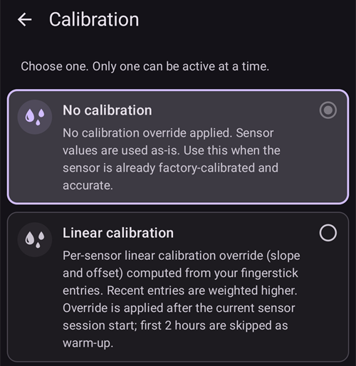
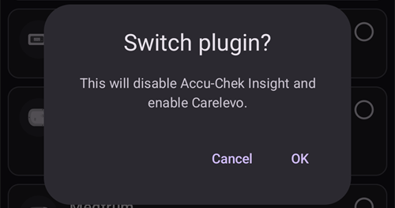

# Configuração (Config Builder)

```{admonition} Vem do AAPS v3? :class: note O **Configurador** (Config Builder) chama-se agora **Configuração** e está no **menu** (☰). Veja [O que mudou no AAPS v4](#v4-changes).

    <br />A **Configuração** é onde escolhe que plugins estão ativos (CGM, bomba, algoritmo APS, sensibilidade, sincronização, …) e onde abre cada plugin e as suas definições. O [guia passo a passo](#configuration-v4) está abaixo; o resto desta página descreve cada secção em pormenor.
    
    (configuration-v4)=
    ## Configuração no AAPS v4
    
    No **AAPS** v4, toque no **menu** (☰) no **canto superior esquerdo** do ecrã principal e escolha **Configuração** (*«Configure o seu sistema (CGM, bomba, ...) e ative funções»*).
    
    
    
    Os plugins estão agrupados por **categoria** — por exemplo *Suavização*, *Calibração*, *Deteção de sensibilidade*, *APS*, *Comunicação* e *Geral*. Cada linha mostra o nome da categoria e o plugin **atualmente ativo** (p. ex. *APS → OpenAPS SMB*). Toque numa linha para abrir uma categoria.
    
    
    
    Dentro de uma categoria, vê os plugins disponíveis para ela. Nas categorias de escolha única, escolhe o plugin ativo; algumas categorias permitem escolher vários (*«Escolha todos os que se aplicam.»*). Cada plugin oferece duas ações:
    
    - **Abrir plugin** — abre o ecrã próprio do plugin.
    - **Definições** — abre as preferências do plugin (as definições podem estar agrupadas em secções que se expandem).
    
    
    
    (configuration_sync_icon)=
    ### O ícone de telemóvel — «sincronizado a partir do telefone principal»
    
    Um pequeno **ícone de telemóvel** ao lado de uma categoria ou definição significa que esse item é **sincronizado a partir do telefone principal** — o seu valor/escolha chega a este dispositivo pelo canal do NSClientV3 (Nightscout).
    
    Num **cliente** (**AAPSClient**), estes itens são **mantidos sincronizados com o telefone principal**. O ícone só aparece num cliente, por isso não aparece na imagem acima, que foi tirada na app **AAPS** principal. Num cliente, aparece normalmente em *Suavização*, *Calibração*, *Deteção de sensibilidade* e *APS*. A forma exata como o telefone principal e os clientes se mantêm alinhados — e que definições pode alterar de cada lado — é explicada em [Controlo principal ↔ cliente](#client-master-config-prefs).
    
    O mesmo ícone também aparece **dentro das definições**, ao lado de cada preferência sincronizada. No exemplo abaixo, *Corte da absorção* tem o ícone; as definições sem o ícone são configuradas em cada dispositivo:
    
    
    
    Os itens **sem** o ícone são configurados **em cada dispositivo**. O exemplo mais importante é a própria ligação do **NSClientV3 (Comunicação)** — o **URL do Nightscout**, o **token de acesso** e os **websockets** são definidos em cada telefone, por isso **não** mostram o ícone de telemóvel.
    
    ---
    
    (Config-Builder-tab-or-hamburger-menu)=
    ## Abrir o ecrã de um plugin
    
    O ecrã de cada plugin abre-se de uma destas formas (os separadores e a caixa de seleção com o olho do **AAPS** v3 já não existem, veja [O que mudou no AAPS v4](#v4-changes)):
    
    - **Configuração** → a categoria do plugin → **Abrir plugin**,
    - o painel **Gerir** da navegação inferior, para os ecrãs que usa mais (Perfil, Definições de insulina, Bomba, Automatização, Alimentos...),
    - um botão [QuickLaunch](../DailyLifeWithAaps/QuickLaunch.md) que adiciona por si,
    - a **barra de pesquisa** no ecrã principal.
    
    ```{contents}
    :backlinks: entry
    :depth: 2
    

(ConfigBuilder_Profile)=

## Perfil

Este módulo não pode ser desativado, porque é uma parte central do **AAPS**.

Veja [O seu perfil AAPS](../SettingUpAaps/YourAapsProfile.md) para entender o básico do que vai dentro do seu **Perfil**.

(insulin)= (Config-Builder-insulin)=

## Insulina


No **AAPS** 4, a insulina já não é um plugin escolhido em **Configuração**. Abra **Gerir → Definições de insulina** para configurar a insulina que usa.

O editor de insulina permite:

* give the insulin an **Insulin nickname** so it is easy to recognise,
* set the **Peak** (time to maximum insulin activity, in minutes) and the **DIA** (Duration of Insulin Action, in hours), either by typing the value or using the **–** / **+** buttons,
* tocar num botão predefinido de **Carregar pico de** — **Novorapid** (75 min), **Fiasp** (55 min) ou **Lyumjev** (45 min) — para preencher num só passo o tempo de pico padrão dessa insulina.

Os intervalos permitidos são os mesmos para qualquer insulina:

* **DAI**: 5 a 9 horas (5 a 10 horas se o tipo de paciente for **Gravidez**). Veja [Duração da ação da insulina (DAI) e pico](#Config-Builder-insulin-dia) para escolher um valor.
* **Pico**: 35 a 120 minutos.

As curvas de **IA** (insulina ativa) e de **Atividade** mostradas na parte de baixo do editor atualizam-se quando altera os valores, por isso vê logo como as suas definições moldam a ação da insulina.

Mais informações para entender o perfil da insulina, tal como aparece no **AAPS**, [aqui](#AapsScreens-insulin-profile).

(Config-Builder-insulin-change-active)=

### Alterar a insulina em uso (DAI ou pico)

A insulina marcada como **ATIVO** é a que o seu perfil em uso utiliza. Os seus campos estão a cinzento: não a pode editar nem eliminar. Assim, o nome da insulina mostrado no seu perfil em uso corresponde sempre às definições realmente usadas.

Para alterar a DAI ou o pico que está a usar:

1. Abra **Gerir → Definições de insulina**. Se o ecrã abrir apenas para leitura (um **✏️ lápis** na barra superior), toque no lápis e desbloqueie as suas definições.
2. Toque em **+** (*Adicionar nova insulina*). O **AAPS** cria uma cópia da insulina mostrada no ecrã.
3. Defina o novo **Pico** e/ou a nova **DAI** e toque no ícone de guardar (canto superior direito).
4. Toque em **▶** (*Ativar insulina*) e confirme. A nova insulina fica marcada como **ATIVO**.

```{admonition} O nome inclui o pico e a DAI :class: note O **AAPS** acrescenta automaticamente o pico, a DAI e a concentração ao nome da insulina (por exemplo *Fiasp 55m 8h U100*), para que possa distinguir as suas configurações num relance.

    <br />Pode eliminar a insulina antiga quando já não estiver ativa.
    
    ### Os botões predefinidos «Carregar pico de»
    
    No **AAPS** 4 não há uma lista de tipos de insulina para escolher. Todas as insulinas usam a mesma curva de atividade exponencial; só o **Pico** e a **DAI** são diferentes. Os botões predefinidos **Carregar pico de** no editor de insulina preenchem com um toque o pico recomendado para as insulinas mais comuns (o pequeno ⓘ ao lado de **Carregar pico de** mostra a lista com os valores de pico). Depois, ainda pode ajustar o **Pico** e a **DAI**.
    
    Só altere o pico para um valor diferente do recomendado se entender o efeito dessa alteração. O [gráfico da curva da insulina](#AapsScreens-insulin-profile) ajuda a entender as curvas.
    
    #### Novorapid
    
    
    
    * recomendado para Humalog, Novolog e Novorapid (chamado *Rapid-Acting Oref* no **AAPS** v3)
    * Pico = 75 minutos após a injeção
    
    #### Fiasp
    
    
    
    * recomendado para Fiasp (chamado *Ultra-Rapid Oref* no **AAPS** v3)
    * Pico = 55 minutos após a injeção
    
    (Config-Builder-lyumjev)=
    #### Lyumjev
    
    
    
    * recomendado para Lyumjev
    * Pico = 45 minutos após a injeção
    
    #### Pico personalizado
    
    * No **AAPS** 4 não há um tipo de insulina "Free-Peak Oref" separado: introduza qualquer **Pico** (35 a 120 minutos) diretamente no [editor de insulina](#Config-Builder-insulin), sem usar um botão predefinido.
    * Um pico personalizado é útil se usar uma insulina que não está na lista, ou uma mistura de insulinas diferentes.
    
    (Config-Builder-insulin-dia)=
    ### Duração da ação da insulina (DAI) e pico
    
    ```{warning}
    No loop, diminuir a DAI ou o pico aumenta sempre a insulina administrada. A DAI funciona de forma diferente no AAPS e nos sistemas AID comerciais, e alterações descuidadas destas definições podem mudar a dose de insulina muito mais ou muito menos do que o esperado.
    

O AAPS modela o decorrer da ação da insulina com uma fórmula matemática, configurada com a **DAI** e com a definição muito ligada a ela, o **pico**. A DAI é a duração teórica até a IA chegar a zero, e o pico é o momento em que o efeito da insulina é mais forte. Daqui resulta uma curva de IA e uma curva de atividade, que é simplesmente a **velocidade** com que a IA diminui.

Tenha em conta que, quando o AAPS está em loop, é normal haver períodos de [basal temporária de zero](#Open-APS-features-super-micro-bolus-smb). Esta insulina basal em falta é totalmente subtraída da IA, o que explica porque é que, na prática, a IA chega a zero muitas horas antes da DAI configurada. Pode ver a [IA do bólus e a IA da basal](#aaps-screens-iob-cob-basal-sens) em separado a partir do ecrã principal.

Para configurar a DAI e o pico, toque em **Gerir** no ecrã principal e depois toque em **Definições de insulina**. O AAPS mostra a configuração da insulina ativa assim:


Neste exemplo, o pico está definido para 55 minutos, a DAI é de 8 horas e a [concentração da insulina](#Insulin-Concentration) é a padrão de 100 UI/ml.

Devido à influência das basais temporárias de zero, explicada acima, e à fórmula usada no AAPS para a diminuição da IA, a maioria dos utilizadores define uma DAI claramente mais alta do que nos sistemas comerciais. Em geral, muitas pessoas acham que uma **DAI** de 9 h funciona bem para elas. Quando tiver mais experiência com o AAPS e um perfil bem afinado, pode tentar encontrar valores pessoais de DAI e de pico com as informações abaixo.

````{admonition} Detalhes sobre o efeito da configuração da DAI e do pico :class: dropdown

Como no AAPS a taxa basal tem uma influência indireta na diminuição da IA, taxas basais demasiado altas podem esconder uma DAI demasiado alta, e vice-versa. Faz sentido afinar primeiro com cuidado as taxas basais, antes de ajustar a DAI e o pico. Além disso, tenha em conta que as definições de DAI e de pico interagem: o efeito da DAI depende do pico, e vice-versa.

Estes gráficos mostram o efeito exato da DAI e do pico nas curvas de IA, em todo o intervalo de valores permitidos.

Ajustar a DAI:

```{image} ../images/iob_remaining_static_peak.png :width: 400px

    <br />Ajustar o pico:
    
    ```{image} ../images/iob_remaining_static_dia.png
    :width: 400px
    

Por fim, uma comparação em que a DAI e o pico são ajustados ao mesmo tempo. A lógica é que os dois valores são ajustados na mesma proporção, de forma que `49/35 ~ 7/5`. Ou, da mesma forma, `120/93 ~ 9/7`. Os intervalos são coerentes, seja qual for a DAI ou o pico de partida, desde que a alteração relativa seja a mesma para os dois.

```{image} ../images/iob_remaining_uniform.png :width: 400px

    <br />Note que, quando a DAI e o pico são ajustados desta forma, cada ponto da curva desloca-se na mesma proporção.
    
    ````
    
    #### Mais leituras sobre a configuração da DAI e do pico
    
    * [Detalhes técnicos e contexto histórico do antecessor do AAPS, o OpenAPS](https://openaps.readthedocs.io/en/latest/docs/While%20You%20Wait%20For%20Gear/understanding-insulin-on-board-calculations.html#understanding-the-new-iob-curves-based-on-exponential-activity-curves).
    * [Why we are regularly wrong in the duration of insulin action (DIA) times we use, and why it matters…](https://www.diabettech.com/insulin/why-we-are-regularly-wrong-in-the-duration-of-insulin-action-dia-times-we-use-and-why-it-matters/) (porque erramos muitas vezes na DAI que usamos, e porque isso importa), no Diabettech.
    * [Exponential Insulin Curves + Fiasp](https://web.archive.org/web/20220630154425/http://seemycgm.com/2017/10/21/exponential-insulin-curves-fiasp/) (curvas exponenciais da insulina + Fiasp), no See My CGM (arquivo).
    * [Revised Humalog model in a closed loop](https://bionicwookiee.com/2022/04/13/revised-humalog-model-in-a-closed-loop/) (modelo revisto do Humalog num loop fechado) e outros artigos no Bionic Wookie, que recomendam uma DAI de 9 h para Lyumjev, Fiasp, NovoRapid e Humalog.
    
    (Config-Builder-bg-source)=
    ## Fonte da Glicose
    Selecione a fonte de glicose que está a usar. Veja a página [Fonte da Glicose](../Getting-Started/CompatiblesCgms.md) para mais informações de configuração.
    
    
    
    Deslize para baixo para ver as outras fontes:
    
    
    
    
    
    * [xDrip+ BG](../CompatibleCgms/xDrip.md) - também para apps compatíveis, como o [Juggluco](../CompatibleCgms/Juggluco.md)
    * [NSClient BG](../CompatibleCgms/CgmNightscoutUpload.md) - só se souber o que está a fazer, veja [Fonte da Glicose](../Getting-Started/CompatiblesCgms.md).
    * [MM640g](../CompatibleCgms/MM640g.md)
    * Glimp - só são suportadas a versão 4.15.57 e mais recentes
    * [BYODA (Build Your Own Dexcom App)](#DexcomG6-if-using-g6-with-build-your-own-dexcom-app).
    * MicroTech CGM App - para o CGM Aidex / LinX
    * [Poctech](../CompatibleCgms/PocTech.md)
    * Tomato (MiaoMiao) - app Tomato para o dispositivo MiaoMiao
    * [Glunovo](https://infinovo.com/) - app Glunovo para o sistema CGM Glunovo
    * Intelligo - app Intelligo
    * Syai/Ottai - para as apps Syai e Ottai (veja [Syai Tag](../CompatibleCgms/SyaiTagX1.md) e [Ottai](../CompatibleCgms/OttaiM8.md))
    * SI App - SI App modificada ou app Sibionics para o CGM Sibionics
    * Sino App - app modificada para o CGM Sinocare
    * Notification Reader - lê os valores de glicose das notificações mostradas pelas apps oficiais dos CGM (Dexcom, Medtronic, Eversense, etc.)
    * Instara - app Instara
    * Random BG - gera dados de glicose aleatórios para testes. Só pode ser ativada numa compilação de engenharia (de programador) com a **Bomba virtual**, por isso não pode ser usada numa instalação normal do **AAPS**.
    
    ## Suavização
    
    
    
    Veja [Suavizar os dados da glicose](../CompatibleCgms/SmoothingBloodGlucoseData.md).
    
    ## Calibração
    
    Escolha como o **AAPS** trata os valores que recebe do seu sensor:
    
    - **Sem calibração**: os valores do sensor são usados tal como chegam. Use esta opção quando o sensor já vem calibrado de fábrica e é preciso. Esta é a opção por defeito.
    - **Calibração linear**: o **AAPS** corrige os valores do sensor com um declive e um desvio que calcula a partir das suas medições de glicose capilar.
    
    How to use **Linear calibration**:
    
    1. Select **Linear calibration** in the **Calibration** category.
    2. When you insert a new sensor, log the sensor change: use **Log sensor change** on the calibration screen, or enter a CGM sensor insert in the Careportal. This tells **AAPS** when the sensor session started. If **AAPS** notices a gap of more than 30 minutes in the readings, it may ask you to mark a sensor change; this prompt appears on the master only, not on a client.
    3. Open the plugin and tap **Add calibration**. Enter your fingerstick value. **AAPS** pairs it with the sensor value from the last 10 minutes.
    
    A calibration is accepted only when:
    
    - a sensor change is logged and at least **2 hours** have passed since then (warm-up),
    - your glucose is stable. If it changes too fast, the dialog tells you and shows the limit,
    - there is a CGM reading from the last 10 minutes,
    - it is for the current moment. You cannot enter older fingerstick values.
    
    How the correction works:
    
    - **AAPS** draws a straight line through the pairs of the current sensor: `corrected value = slope × sensor value + offset`.
    - Newer pairs count more than older ones: a pair that is 2 days old counts about 37 %, a 4-day-old pair about 14 %. The line therefore follows your sensor as it drifts.
    - At least **2 pairs** are needed.
    - If the pairs are close together (less than 54 mg/dL / 3 mmol/L apart), only the values are shifted (offset, no slope).
    - The slope is kept between 0.55 and 1.6. A slope outside this range is limited to the nearest value.
    - Safety limit: if the correction at 100 mg/dL (5.5 mmol/L) would be more than ±30 mg/dL (1.7 mmol/L), no correction is applied. This protects you from a wrong entry.
    
    What it changes:
    
    - The corrected value is used everywhere: the BG on the main screen, the graph and the loop. The sensor readings themselves are not changed. The correction is applied on top, also to the earlier readings of the current sensor.
    - A new sensor change starts from zero. Pairs from earlier sensors no longer count.
    - On the graph, a calibration is shown as a marker at the fingerstick value.
    - Calibrations are synchronized through Nightscout, so your clients show the same corrected values.
    
    Check and remove entries:
    
    - **Open plugin** shows the status (for example *Slope 0.85, mid-range correction -0.4*), a chart of your pairs with the line, and the list of entries.
    - If an entry is wrong (for example, you had sugar on your finger), tap the bin icon next to it. The line is calculated again at once.
    
    ```{admonition} Using xDrip+ as BG source?
    :class: note
    xDrip+ has its own calibration. Calibrate in one place only, so that the sensor values are not corrected twice.
    

    {admonition} Calibrate with care
    :class: warning
    A wrong fingerstick value leads to wrong glucose values and therefore to wrong insulin dosing. Lave as mãos antes de medir e não calibre enquanto a sua glicose está a mudar depressa.



(Config-Builder-pump)=

## Bomba

Selecione a bomba que está a utilizar. Veja a página [Bombas compatíveis](../Getting-Started/CompatiblePumps.md) para mais informações de configuração.


Deslize para baixo para ver todos os drivers de bomba:


Quando escolhe outra bomba, o **AAPS** pede-lhe para confirmar a alteração:



* [Dana R](../CompatiblePumps/DanaR-Insulin-Pump.md)
* DanaR Coreana (para a bomba DanaR do mercado coreano)
* Dana Rv2 (bomba DanaR com atualização não oficial do firmware)
* [Dana-i/RS](../CompatiblePumps/DanaRS-Insulin-Pump.md)
* [Accu Chek Insight](../CompatiblePumps/Accu-Chek-Insight-Pump.md)
* [Accu Chek Combo](../CompatiblePumps/Accu-Chek-Combo-Pump-v2.md)
* Omnipod para [Omnipod Eros](../CompatiblePumps/OmnipodEros.md)
* Dash para [Omnipod DASH](../CompatiblePumps/OmnipodDASH.md)
* [Medtronic](../CompatiblePumps/MedtronicPump.md)
* [Diaconn G8](../CompatiblePumps/DiaconnG8.md)
* [EOPatch2](../CompatiblePumps/EOPatch2.md)
* [Medtrum](../CompatiblePumps/MedtrumNano.md)
* [Equil 5.3](../CompatiblePumps/Equil5.3.md)
* [Carelevo](../CompatiblePumps/CareLevo.md)
* Bomba virtual: loop aberto - apenas sugestões do **AAPS** 
  * as you make your first steps with **AAPS**, during the first [objectives](../SettingUpAaps/CompletingTheObjectives.md)
  * para uma bomba que ainda não tem nenhum driver

(config-builder-wrong-pump-data)=

### Mensagem: "Os dados vêm de uma bomba diferente"

O **AAPS** memoriza a bomba a que está ligado (tipo de bomba e número de série). Se receber dados de outra bomba, por exemplo depois de a sua bomba ter sido substituída por uma nova do mesmo modelo, mostra esta mensagem e ignora os dados dessa bomba:


Para usar a nova bomba, mude o driver da bomba: escolha **Bomba virtual**, confirme e depois escolha novamente a sua bomba. O **AAPS** regista então a bomba a que está ligado agora.

(Config-Builder-sensitivity-detection)=

## Deteção de sensibilidade


Selecione o tipo de deteção de sensibilidade. Para mais detalhes sobre os diferentes modelos, [leia aqui](../DailyLifeWithAaps/SensitivityDetectionAndCob.md). Analisa os dados históricos de forma contínua e faz ajustes se reconhecer que está a reagir à insulina de forma mais sensível (ou, pelo contrário, mais resistente) do que o habitual. Pode encontrar mais detalhes sobre como a própria relação de sensibilidade é calculada em [Principais funcionalidades do AAPS > Autosens](#Open-APS-features-autosens).

You can view your sensitivity on the main screen in an [additional graph](#AapsScreens-section-g-additional-graphs), by selecting SENS% and watching the white line. Note que tem de estar no [Objetivo 8](#objectives-objective8) para que a deteção de sensibilidade/o [Autosens](#Open-APS-features-autosens) possa ajustar automaticamente a quantidade de insulina administrada. Antes de atingir esse objetivo, a percentagem do Autosens / a linha no seu gráfico é mostrada apenas como informação.

### Configurações de absorção

Se usar o Oref1 com **SMB**, tem de alterar **min_5m_carbimpact** para 8. O valor só é usado durante falhas nas leituras do **CGM** ou quando a atividade física "consome" toda a subida da glicose que, de outra forma, faria o **AAPS** reduzir os HCA. Quando a [absorção dos hidratos de carbono](../DailyLifeWithAaps/CobCalculation.md) não pode ser calculada de forma dinâmica a partir das reações da sua glicose, é aplicada uma redução padrão aos seus hidratos de carbono. Basicamente, é uma medida de segurança.

(Config-Builder-aps)=

## APS


Selecione o algoritmo APS desejado para ajustes da terapia. Pode ver os detalhes ativos do algoritmo escolhido com **Abrir plugin**.

* OpenAPS AMA 
  * Advanced Meal Assist (AMA): algoritmo antigo, já não recomendado.
  * Em termos simples, a vantagem é que, depois de dar um bólus para a refeição, o sistema pode aumentar a basal temporária mais depressa SE introduzir os hidratos de carbono de forma fiável.
* [OpenAPS SMB](#Open-APS-features-super-micro-bolus-smb) 
  * Super Micro Bolus (SMB): o algoritmo mais recente, recomendado para todos os utilizadores.
  * Ao contrário do AMA, o SMB não usa basais temporárias para controlar a glicose, mas sobretudo pequenos **Super Micro Bolus**.
  * Nota: recomenda-se usar este algoritmo desde o início, mesmo que só receba SMB a partir do [Objetivo 9](#objectives-objective9).
* [Auto ISF](#Open-APS-features-auto-isf) 
  * Algoritmo experimental para utilizadores avançados. Só aparece na lista depois de concluídos os objetivos.

Se mudar do algoritmo AMA para o SMB, *min_5m_carbimpact* tem de ser alterado manualmente para **8** (valor por defeito para o SMB) em [Definições → Definições de absorção](#Preferences-min_5m_carbimpact).

## Loop

Este módulo não pode ser desativado, porque é uma parte central do **AAPS**.


## Restrições


### Objetivos

O **AAPS** tem um programa de aprendizagem (uma série de objetivos) que tem de cumprir passo a passo. Isto deve guiá-lo com segurança na configuração de um sistema de loop fechado.

Veja a página [Objetivos](../SettingUpAaps/CompletingTheObjectives.md) para mais informações.

## Comunicação

Nesta categoria (chamada **Sincronização** no **AAPS** v3), escolhe se/para onde quer que o **AAPS** envie os seus dados.


Deslize para baixo para ver o resto da lista:


### NSClientV3

Pode ser usado como [servidor de relatórios](../SettingUpAaps/SettingUpTheReportingServer.md) e/ou para [monitorização remota](../RemoteFeatures/RemoteMonitoring.md) e [controlo remoto](../RemoteFeatures/RemoteControl.md).

Veja [Sincronização com o servidor de relatórios](#SetupWizard-synchronization-with-the-reporting-server-and-more) para configurar a sincronização do NSClientV3.

### Tidepool

Pode ser usado como [servidor de relatórios](../SettingUpAaps/SettingUpTheReportingServer.md).

Veja [Tidepool](../SettingUpAaps/Tidepool.md).

### xDrip

Usado para **enviar** dados, como valores de glicose e tratamentos, para o xDrip+ no mesmo telefone. As suas definições também incluem **Enviar estado para xDrip+**, uma linha de estado com IA e HCA que o xDrip+ e algumas apps complementares de relógio mostram.

### Open Humans

Veja [Open Humans](../SupportingAaps/OpenHumans.md).

(Config-Builder-wear)=

### Wear

Monitorize e controle o **AAPS** a partir de um relógio Wear OS. A configuração do relógio é explicada em [Configurar o AAPS no seu relógio Wear OS](../WearOS/WearOsSmartwatch.md). Depois de ativar o plugin, escolha as suas opções em [Definições > Wear](#preferences-wear). A utilização do relógio é explicada em [Usar o AAPS com o seu smartwatch Wear OS](../RemoteFeatures/RemoteControlWearOS.md).

(external-companion-apps)=

### Aplicações externas complementares

Difunde os dados de estado do **AAPS** no telefone, para que outras apps nele instaladas os possam mostrar — por exemplo, apps complementares de relógio ou de widgets. A difusão inclui a glicose e a tendência, IA, HCA, basal e basal temporária, nome do perfil, estado do loop, bateria do telefone e da bomba, nível do reservatório e progresso do bólus. Só a ative se uma app complementar que usa pedir estes dados.

As apps que se sabe que leem esta difusão são a [WatchDrip+](https://bigdigital.home.blog/) (relógios Xiaomi e Amazfit), a [GlucoDataHandler](https://github.com/pachi81/GlucoDataHandler) (complicações e widgets Wear OS, e Android Auto através da GlucoDataAuto) e a app G-Watch. A sua configuração é descrita em [Smartwatches e o AAPS](#watches-external-companion-apps). Algumas também usam **Enviar estado para xDrip+** do plugin **xDrip** acima, para uma linha de estado com IA e HCA.

Em versões anteriores, este plugin chamava-se **Samsung Tizen**, por causa da [app G-Watch para relógios Samsung Tizen](#Watchfaces-tizen), para a qual foi criado.

### Garmin

Ligação a um dispositivo Garmin (Fenix, Edge...)

## Tratamentos

Abra o **menu** (☰) e escolha [Histórico de tratamentos](#aaps-screens-treatments) para ver os tratamentos registados. Se quiser editar ou eliminar uma entrada (p. ex. comeu menos hidratos de carbono do que esperava), escolha 'Remover' e introduza o novo valor (altere a hora, se necessário) em **Tratamentos → Hidratos** na navegação inferior (veja [Hidratos](#screens-bolus-carbs)).

## Geral

No **AAPS** 4, a categoria **Geral** da **Configuração** só tem o **Autoajuste**. As outras funções descritas abaixo estão sempre disponíveis e já não precisam de ser ativadas aqui; cada parágrafo diz onde as encontrar.


### Visão Geral

O [ecrã principal](#AapsScreens-the-homescreen) do **AAPS** já não é um plugin e não tem definições próprias em **Configuração**. As opções que estavam aqui estão agora em **Definições** (ícone de engrenagem): [Mostrar notas nas caixas de diálogo](#Preferences-show-notes-field-in-treatments-dialogs), [Luzes de Estado](#Preferences-status-lights) e a [Percentagem do bólus](#Preferences-deliver-this-part-of-bolus-wizard-result) usada pelo assistente de bólus. A opção de superbólus do **AAPS** 3.x [não está disponível como definição](#Preferences-advanced-settings-overview) no **AAPS** 4.

(Config-Builder-actions)=

### Ações

O separador Ações do **AAPS** 3.x já não existe. Os seus botões estão agora no painel **Gerir** — veja [Para onde foi o separador Ações?](#screens-action-tab).

### Automatização

**Gerir → Automatização** permite gerir as suas [Automatizações](../DailyLifeWithAaps/Automations.md), a partir do [Objetivo 10](#objectives-objective10).

(Config-Builder-sms-communicator)=

### Comunicador SMS

Permite que cuidadores à distância controlem algumas funções do **AAPS** por SMS; veja [Comandos SMS](../RemoteFeatures/SMSCommands.md) para mais informações de configuração.

### Alimentos

**Gerir → Alimentos** mostra os alimentos predefinidos na base de dados de alimentos do Nightscout; veja o [Readme do Nightscout](https://github.com/nightscout/cgm-remote-monitor#food-custom-foods) para mais informações de configuração.

Nota: as entradas não podem ser usadas na calculadora do **AAPS**. (Apenas visualização)

(Config-Builder-autotune)=

### Autoajuste

Pode ativar o Autoajuste, veja [aqui](../AdvancedOptions/Autotune.md).

### Manutenção

Abra o **menu** (☰) e escolha **Manutenção** para exportar / importar definições e gerir os ficheiros de registo.


### Configuração

Agora chama-se **Configuração**: esta página.