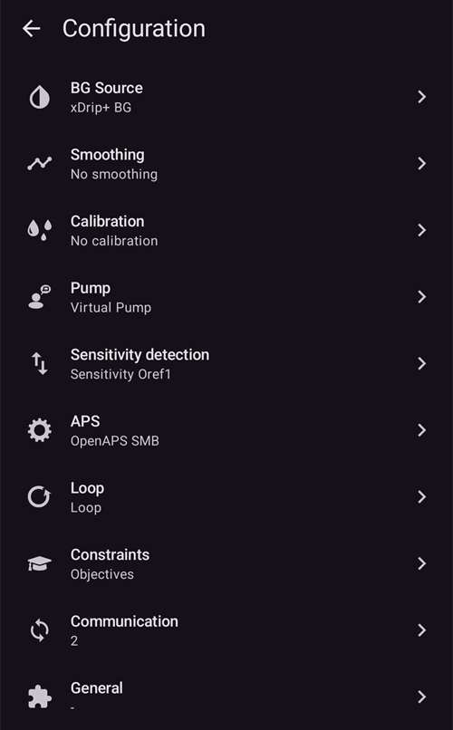
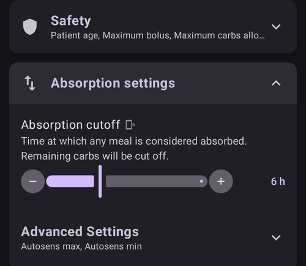
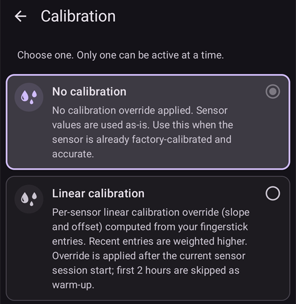
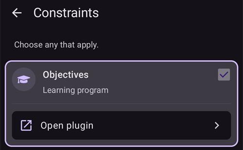
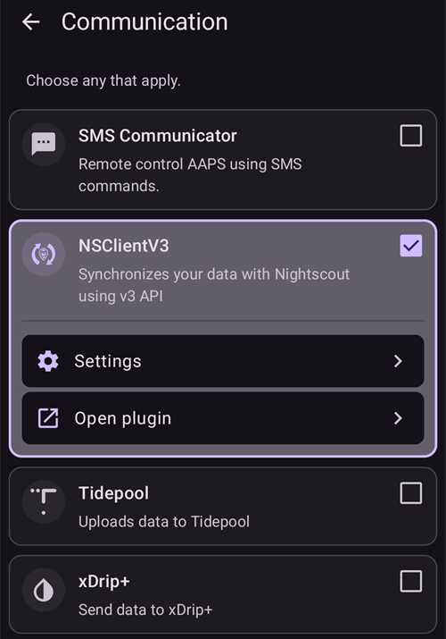
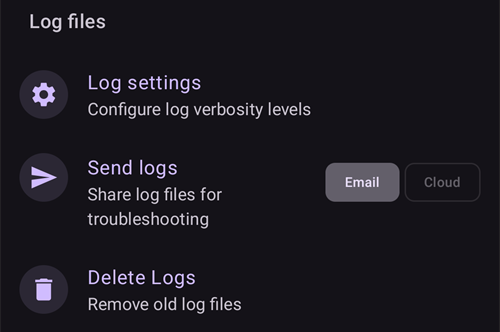
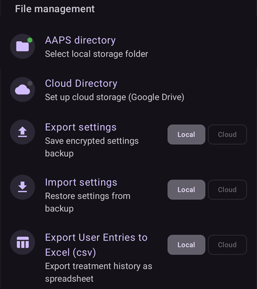

# Configuração (Config Builder)

```{admonition} Coming from AAPS v3?
:class: note
O **Config Builder** chama-se agora **Configuração** e está no **menu** (☰). Veja [O que mudou no AAPS v4](#v4-changes).
```

Em **Configuração** escolhe quais os plugins que estão ativos (CGM, bomba, algoritmo APS, sensibilidade, sincronização, …) e abre cada plugin e as suas definições. O [guia passo a passo](#configuration-v4) está abaixo; o resto desta página descreve cada secção em pormenor.

(configuration-v4)=
## Configuração no AAPS v4

No **AAPS** v4, toque no **menu** (☰) no canto **superior esquerdo** do ecrã principal e escolha **Configuração** (_«Configure o seu sistema (CGM, bomba, …) e ative funções»_).


Os plugins estão agrupados por **categoria** — por exemplo _Suavização_, _Calibração_, _Deteção de sensibilidade_, _APS_, _Comunicação_ e _Geral_. Cada linha mostra o nome da categoria e o plugin **atualmente ativo** (p. ex. _APS → OpenAPS SMB_). Toque numa linha para abrir uma categoria.



Dentro de uma categoria vê os plugins disponíveis para ela. Nas categorias de escolha única, escolhe o plugin ativo; algumas categorias permitem escolher vários (_«Escolha todos os que se aplicam.»_). Cada plugin oferece duas ações:

- **Abrir plugin** — abre o ecrã próprio do plugin.
- **Settings** — opens the plugin's preferences (settings may be grouped into expandable sections).


(configuration_sync_icon)=
### O ícone de telemóvel — «sincronizado a partir do principal»

Um pequeno **ícone de telemóvel (telefone)** ao lado de uma categoria ou definição significa que esse item é **sincronizado a partir do principal** — o seu valor/escolha chega a este dispositivo pelo canal NSClientV3 (Nightscout).

Num **cliente** (**AAPSClient**), estes itens são **mantidos sincronizados com o telefone principal**. O ícone só é mostrado num cliente, por isso não aparece na captura de ecrã acima, que foi tirada na app **AAPS** principal. Num cliente, aparece normalmente em _Suavização_, _Calibração_, _Deteção de sensibilidade_ e _APS_. A forma exata como o telefone principal e os clientes se mantêm alinhados — e que definições pode alterar de cada lado — é explicada em [Controlo principal ↔ cliente](#client-master-config-prefs).

O mesmo ícone também aparece **dentro das definições**, ao lado de cada preferência sincronizada. No exemplo abaixo, _Corte da absorção_ tem o ícone; as definições sem o ícone são configuradas em cada dispositivo:



Os itens **sem** o ícone são configurados **em cada dispositivo**. O exemplo mais importante é a própria ligação do **NSClientV3 (Comunicação)** — o **URL do Nightscout**, o **token de acesso** e os **websockets** são definidos em cada telefone, por isso **não** mostram o ícone de telemóvel.

---

(Config-Builder-tab-or-hamburger-menu)=
## Abrir o ecrã de um plugin

O ecrã de cada plugin abre-se de uma destas formas (os separadores e a caixa de seleção do olho do **AAPS** v3 já não existem, veja [O que mudou no AAPS v4](#v4-changes)):

- **Configuração** → a categoria do plugin → **Abrir plugin**,
- o painel **Gerir** da navegação inferior, para os ecrãs que usa mais (Perfil, Definições de insulina, Bomba, Automatização, Alimentos...),
- um botão [QuickLaunch](../DailyLifeWithAaps/QuickLaunch.md) que adiciona o próprio utilizador,
- a **barra de pesquisa** no ecrã principal.

```{contents}
:backlinks: entry
:depth: 2
```

(ConfigBuilder_Profile)=

## Perfil

Este módulo não pode ser desativado, porque é uma parte central do **AAPS**.

Veja [O seu perfil AAPS](../SettingUpAaps/YourAapsProfile.md) para perceber o básico do que vai dentro do seu **Perfil**.

(insulin)=
(Config-Builder-insulin)=
## Insulina


No **AAPS** 4, a insulina já não é um plugin escolhido em **Configuração**. Abra **Gerir → Definições de insulina** para configurar a insulina que usa.

O editor de insulina permite:

- dê à insulina uma **Alcunha da insulina**, para a reconhecer facilmente,
- defina o **Pico** (tempo até à atividade máxima da insulina, em minutos) e a **DAI** (duração da ação da insulina, em horas), escrevendo o valor ou usando os botões **–** / **+**,
- toque num botão predefinido **Carregar pico de** — **Novorapid** (75 min), **Fiasp** (55 min) ou **Lyumjev** (45 min) — para preencher de uma só vez o tempo de pico normal dessa insulina.

Os intervalos permitidos são os mesmos para qualquer insulina:

- **DAI**: 5 a 9 horas (5 a 10 horas se o tipo de paciente estiver definido como **Gravidez**). Veja [Duração da ação da insulina (DAI) e pico](#Config-Builder-insulin-dia) para escolher um valor.
- **Pico**: 35 a 120 minutos.

As curvas de **IA** (insulina ativa) e de **Atividade** mostradas no fundo do editor atualizam-se à medida que altera os valores, para que veja logo como as suas definições moldam a ação da insulina.

Mais informação para perceber o perfil da insulina como é mostrado no **AAPS** [aqui](#AapsScreens-insulin-profile).

(Config-Builder-insulin-change-active)=
### Alterar a insulina em uso (DAI ou pico)

A insulina marcada como **ATIVO** é a que o seu perfil em uso utiliza. Os seus campos estão a cinzento: não a pode editar nem eliminar. Assim, o nome da insulina mostrado no seu perfil em uso corresponde sempre às definições realmente usadas.

Para alterar a DAI ou o pico que está a usar:

1. Abra **Gerir → Definições de insulina**. Se o ecrã abrir só para leitura (um **✏️ lápis** na barra superior), toque no lápis e desbloqueie as suas definições.
2. Toque em **+** (_Adicionar nova insulina_). O **AAPS** cria uma cópia da insulina mostrada no ecrã.
3. Defina o novo **Pico** e/ou a nova **DAI** e depois toque no ícone de guardar (canto superior direito).
4. Toque em **▶** (_Ativar insulina_) e confirme. A nova insulina fica marcada como **ATIVO**.

```{admonition} The name includes peak and DIA
:class: note
O **AAPS** junta automaticamente o pico, a DAI e a concentração ao nome da insulina (por exemplo _Fiasp 55m 8h U100_), para que distinga as suas configurações num relance.
```

Pode eliminar a insulina antiga quando já não estiver ativa.

### Os botões predefinidos «Carregar pico de»

No **AAPS** 4 não há uma lista de tipos de insulina para escolher. Todas as insulinas usam a mesma curva de atividade exponencial; só o **Pico** e a **DAI** são diferentes. Os botões predefinidos **Carregar pico de** no editor de insulina preenchem com um toque o pico recomendado para as insulinas mais comuns (o pequeno ⓘ ao lado de **Carregar pico de** mostra a lista com os valores de pico). Depois, ainda pode ajustar o **Pico** e a **DAI**.

Só altere o pico para um valor diferente do recomendado se entender o efeito dessa alteração. O [gráfico da curva da insulina](#AapsScreens-insulin-profile) ajuda a entender as curvas.

#### Novorapid


- recomendado para Humalog, Novolog e Novorapid (chamado _Rapid-Acting Oref_ no **AAPS** v3)
- Peak = 75 minutes after injection

#### Fiasp


- recomendado para Fiasp (chamado _Ultra-Rapid Oref_ no **AAPS** v3)
- Peak = 55 minutes after injection

(Config-Builder-lyumjev)=
#### Lyumjev


- recomendado para Lyumjev
- Peak = 45 minutes after injection

#### Pico personalizado

- Não há um tipo de insulina «Oref Pico-Livre» separado no **AAPS** 4: escreva qualquer **Pico** (35 a 120 minutos) diretamente no [editor da insulina](#Config-Builder-insulin), sem usar um botão predefinido.
- A custom peak is useful if you use an insulin that is not in the list, or a mixture of different insulins.

(Config-Builder-insulin-dia)=
### Duração da ação da insulina (DAI) e pico

```{warning}
Em loop, baixar a DAI ou o pico aumenta sempre a insulina administrada. A DAI funciona de forma diferente no AAPS e nos sistemas AID comerciais, e alterações descuidadas destas definições podem mudar a dosagem de insulina de uma forma muito maior ou muito menor do que o esperado.
```

O AAPS modela a evolução da ação da insulina no tempo com uma fórmula matemática, configurada com a **DAI** e com a definição muito ligada a ela, o **pico**. A DAI é a duração teórica até a IA chegar a zero, e o pico é o momento em que o efeito da insulina é mais forte. Isto dá uma curva de IA e uma curva de atividade, que é simplesmente a **velocidade** a que a IA diminui.

Tenha em conta que, quando o AAPS está em loop, é normal haver períodos de [basal temporária a zero](#Open-APS-features-super-micro-bolus-smb). Esta insulina basal em falta é totalmente subtraída da IA, o que explica porque é que, na prática, a IA chega a zero muitas horas antes da DAI configurada. Pode ver a [IA do bólus e a IA da basal](#aaps-screens-iob-cob-basal-sens) separadamente no ecrã principal.

Para configurar a DAI e o pico, toque em **Gerir** no ecrã principal e depois em **Definições de insulina**. O AAPS mostra a configuração da insulina ativa assim:


Neste exemplo, o pico está definido para 55 minutos, a DAI para 8 horas e a [concentração da insulina](#Insulin-Concentration) é a normal, 100 U/ml.

Devido à influência das basais temporárias de zero, explicada acima, e à fórmula usada no AAPS para a diminuição da IA, a maioria dos utilizadores define uma DAI claramente mais alta do que nos sistemas comerciais. Em geral, muitas pessoas acham que uma **DAI** de 9 h funciona bem para elas. Quando tiver mais experiência com o AAPS e um perfil bem afinado, pode tentar encontrar valores pessoais de DAI e de pico com as informações abaixo.

````{admonition} Details on the impact of DIA and peak configuration
:class: dropdown

Como a taxa basal tem uma influência indireta na diminuição da IA no AAPS, taxas basais demasiado altas podem esconder uma DAI demasiado alta, e vice-versa. Faz sentido ajustar primeiro com cuidado as taxas basais, antes de ajustar a DAI e o pico. Além disso, tenha em conta que as definições da DAI e do pico interagem: o efeito da DAI depende do pico, e vice-versa.

Estes gráficos mostram o impacto exato da DAI e do pico nas curvas de IA, em toda a faixa de valores permitidos.

Ajustar a DAI:

```{image} ../images/Profile/iob_remaining_static_peak.png
:width: 400px
```

Ajustar o pico:

```{image} ../images/Profile/iob_remaining_static_dia.png
:width: 400px
```

Por fim, uma comparação em que a DAI e o pico são ajustados em paralelo. A lógica aqui é que os dois valores são ajustados nas mesmas proporções, de forma que `49/35 ~ 7/5`. Ou, da mesma forma, `120/93 ~ 9/7`. Os intervalos são consistentes, seja qual for a DAI ou o pico de partida, desde que a alteração relativa seja a mesma para os dois.

```{image} ../images/Profile/iob_remaining_uniform.png
:width: 400px
```

Repare que, quando a DAI e o pico são ajustados desta forma, cada ponto da curva desloca-se na mesma proporção.

````

#### Mais leitura sobre a configuração da DAI e do pico

- [Detalhes técnicos e contexto histórico do antecessor do AAPS, o OpenAPS](https://openaps.readthedocs.io/en/latest/docs/While%20You%20Wait%20For%20Gear/understanding-insulin-on-board-calculations.html#understanding-the-new-iob-curves-based-on-exponential-activity-curves).
- [Why we are regularly wrong in the duration of insulin action (DIA) times we use, and why it matters…](https://www.diabettech.com/insulin/why-we-are-regularly-wrong-in-the-duration-of-insulin-action-dia-times-we-use-and-why-it-matters/) on Diabettech.
- [Exponential Insulin Curves + Fiasp](https://web.archive.org/web/20220630154425/http://seemycgm.com/2017/10/21/exponential-insulin-curves-fiasp/) on See My CGM (archive).
- [Revised Humalog model in a closed loop](https://bionicwookiee.com/2022/04/13/revised-humalog-model-in-a-closed-loop/) and other articles on Bionic Wookie, recommending a DIA of 9h for Lyumjev, Fiasp, NovoRapid, Humalog.

(Config-Builder-bg-source)=
## Fonte da Glicose
Selecione a fonte de glicose que usa. Veja a página [Fonte da Glicose](../Getting-Started/CompatiblesCgms.md) para mais informações de configuração.


Deslize para baixo para ver as outras fontes:


- [Glicose xDrip+](../CompatibleCgms/xDrip.md) - também para apps compatíveis, como o [Juggluco](../CompatibleCgms/Juggluco.md)
- [Glicose NSClient](../CompatibleCgms/CgmNightscoutUpload.md) - só se souber o que está a fazer, veja [Fonte da Glicose](../Getting-Started/CompatiblesCgms.md).
- [MM640g](../CompatibleCgms/MM640g.md)
- Glimp - só são suportadas a versão 4.15.57 e mais recentes
- [BYODA (Build Your Own Dexcom App)](#DexcomG6-if-using-g6-with-build-your-own-dexcom-app).
- Aplicação MicroTech CGM - para o CGM Aidex / LinX
- [Poctech](../CompatibleCgms/PocTech.md)
- Tomato (MiaoMiao) - app Tomato para o dispositivo MiaoMiao
- [Glunovo](https://infinovo.com/) - app Glunovo para o sistema CGM Glunovo
- Intelligo - app Intelligo
- Syai/Ottai - para as apps Syai e Ottai (veja [Syai Tag](../CompatibleCgms/SyaiTagX1.md) e [Ottai](../CompatibleCgms/OttaiM8.md))
- SI App - SI App modificada ou app Sibionics para o CGM Sibionics
- Sino App - app modificada para o CGM Sinocare
- Leitor de notificações - lê os valores de glicose das notificações mostradas pelas apps oficiais dos CGM (Dexcom, Medtronic, Eversense, etc.)
- Instara - app Instara
- Glicose aleatória - gera dados de glicose aleatórios para testes. Só pode ser ativada numa compilação de engenharia (de programador) com a **Bomba virtual**, por isso não pode ser usada numa instalação normal do **AAPS**.

## Smoothing


Veja [Suavizar os dados da glicose](../CompatibleCgms/SmoothingBloodGlucoseData.md).

## Calibração

Escolha como o **AAPS** trata os valores que recebe do seu sensor:

- **Sem calibração**: os valores do sensor são usados tal como chegam. Use esta opção quando o sensor já vem calibrado de fábrica e é preciso. Esta é a opção por defeito.
- **Linear calibration**: **AAPS** corrects the sensor values with a slope and an offset that it computes from your fingerstick entries.

Como usar a **Calibração linear**:

1. Selecione **Calibração linear** na categoria **Calibração**.
2. Quando inserir um sensor novo, registe a troca de sensor: use **Registar troca de sensor** no ecrã de calibração, ou registe uma inserção de sensor CGM no Careportal. Isto indica ao **AAPS** quando começou a sessão do sensor. Se o **AAPS** detetar uma falha de mais de 30 minutos nas leituras, pode pedir-lhe que marque uma troca de sensor; este pedido só aparece no principal, não num cliente.
3. Abra o plugin e toque em **Adicionar calibração**. Introduza o seu valor de glicose capilar. O **AAPS** junta-o ao valor do sensor dos últimos 10 minutos.

Uma calibração só é aceite quando:

- foi registada uma troca de sensor e passaram pelo menos **2 horas** desde então (aquecimento),
- a sua glicose está estável. Se mudar depressa demais, o diálogo avisa-o e mostra o limite,
- há uma leitura do CGM dos últimos 10 minutos,
- é para o momento atual. Não pode introduzir valores de glicose capilar mais antigos.

Como funciona a correção:

- O **AAPS** traça uma linha reta através dos pares do sensor atual: `corrected value = slope × sensor value + offset` (valor corrigido = declive × valor do sensor + desvio).
- Os pares mais recentes contam mais do que os mais antigos: um par com 2 dias conta cerca de 37 %, um par com 4 dias cerca de 14 %. Assim, a linha acompanha o seu sensor quando este se desvia.
- São precisos pelo menos **2 pares**.
- Se os pares estiverem próximos uns dos outros (menos de 54 mg/dl / 3 mmol/l de diferença), os valores são apenas deslocados (desvio, sem declive).
- O declive é mantido entre 0,55 e 1,6. Um declive fora deste intervalo é limitado ao valor mais próximo.
- Limite de segurança: se a correção a 100 mg/dl (5,5 mmol/l) fosse maior do que ±30 mg/dl (1,7 mmol/l), não é aplicada nenhuma correção. Isto protege-o de uma entrada errada.

O que altera:

- O valor corrigido é usado em todo o lado: a glicose no ecrã principal, o gráfico e o loop. As leituras do sensor em si não são alteradas. A correção é aplicada por cima, também às leituras anteriores do sensor atual.
- Uma nova troca de sensor começa do zero. Os pares de sensores anteriores deixam de contar.
- No gráfico, uma calibração é mostrada como um marcador no valor da glicose capilar.
- As calibrações são sincronizadas através do Nightscout, por isso os seus clientes mostram os mesmos valores corrigidos.

Verificar e remover entradas:

- **Abrir plugin** mostra o estado (por exemplo _Slope 0.85, mid-range correction -0.4_), um gráfico dos seus pares com a linha, e a lista das entradas.
- Se uma entrada estiver errada (por exemplo, tinha açúcar no dedo), toque no ícone do caixote do lixo ao lado dela. A linha é calculada de novo de imediato.

```{admonition} Using xDrip+ as BG source?
:class: note
O xDrip+ tem a sua própria calibração. Calibre só num sítio, para que os valores do sensor não sejam corrigidos duas vezes.
```

```{admonition} Calibrate with care
:class: warning
Um valor errado da glicose capilar leva a valores de glicose errados e, por isso, a doses de insulina erradas. Lave as mãos antes de medir e não calibre enquanto a sua glicose está a mudar depressa.
```



(Config-Builder-pump)=
## Bomba
Selecione a bomba que está a utilizar. Veja a página [Bombas compatíveis](../Getting-Started/CompatiblePumps.md) para mais informação sobre a configuração.


Deslize para baixo para ver todos os drivers de bomba:


Quando escolhe outra bomba, o **AAPS** pede-lhe que confirme a mudança:


- [Dana R](../CompatiblePumps/DanaR-Insulin-Pump.md)
- DanaR Coreana (para a bomba DanaR do mercado coreano)
- Dana Rv2 (bomba DanaR com atualização não oficial do firmware)
- [Dana-i/RS](../CompatiblePumps/DanaRS-Insulin-Pump.md)
- [Accu Chek Insight](../CompatiblePumps/Accu-Chek-Insight-Pump.md)
- [Accu Chek Combo](../CompatiblePumps/Accu-Chek-Combo-Pump-v2.md)
- Omnipod para o [Omnipod Eros](../CompatiblePumps/OmnipodEros.md)
- Dash para o [Omnipod DASH](../CompatiblePumps/OmnipodDASH.md)
- [Medtronic](../CompatiblePumps/MedtronicPump.md)
- [Diaconn G8](../CompatiblePumps/DiaconnG8.md)
- [EOPatch2](../CompatiblePumps/EOPatch2.md)
- [Medtrum](../CompatiblePumps/MedtrumNano.md)
- [Equil 5.3](../CompatiblePumps/Equil5.3.md)
- [Carelevo](../CompatiblePumps/CareLevo.md)
- [AP550](../CompatiblePumps/AP550-Insulin-Pump.md)
- Bomba virtual: loop aberto - apenas sugestões do **AAPS**
  - quando dá os primeiros passos com o **AAPS**, durante os primeiros [objetivos](../SettingUpAaps/CompletingTheObjectives.md)
  - para uma bomba que ainda não tem nenhum driver

(config-builder-wrong-pump-data)=
### Mensagem: "Os dados vêm de uma bomba diferente"

O **AAPS** lembra-se da bomba a que está ligado (tipo de bomba e número de série). Se receber dados de outra bomba, por exemplo depois de a sua bomba ter sido substituída por uma nova do mesmo modelo, mostra esta mensagem e ignora os dados dessa bomba:


Para usar a nova bomba, mude o driver da bomba: escolha **Bomba virtual**, confirme e depois escolha de novo a sua bomba. O **AAPS** regista então a bomba a que está ligado agora.

(Config-Builder-sensitivity-detection)=

## Deteção de sensibilidade


Selecione o tipo de deteção de sensibilidade. Para mais detalhes sobre os diferentes modelos, [leia aqui](../DailyLifeWithAaps/SensitivityDetectionAndCob.md). Analisa os dados históricos de forma contínua e faz ajustes se reconhecer que está a reagir à insulina de forma mais sensível (ou, pelo contrário, mais resistente) do que o habitual. Mais detalhes sobre como é calculado o próprio rácio de sensibilidade estão em [Principais funcionalidades do AAPS > Autosens](#Open-APS-features-autosens).

Pode ver a sua sensibilidade no ecrã principal num [gráfico adicional](#AapsScreens-section-g-additional-graphs), escolhendo SENS% e observando a linha branca. Atenção: precisa de estar no [Objetivo 8](#objectives-objective8) para deixar a Deteção de sensibilidade/o [Autosens](#Open-APS-features-autosens) ajustar automaticamente a quantidade de insulina administrada. Antes de atingir esse objetivo, a percentagem do Autosens / a linha no seu gráfico é mostrada apenas como informação.

### Configurações de absorção
Se usar o Oref1 com **SMB**, tem de alterar **min_5m_carbimpact** para 8. O valor só é usado durante falhas nas leituras do **CGM** ou quando a atividade física «gasta» toda a subida da glicose que, de outra forma, faria o **AAPS** diminuir os HCA. Nos momentos em que a [absorção dos hidratos de carbono](../DailyLifeWithAaps/CobCalculation.md) não pode ser calculada dinamicamente a partir das reações do seu sangue, é aplicada uma diminuição padrão aos seus hidratos de carbono. Basicamente, é uma medida de segurança.

(Config-Builder-aps)=
## APS


Selecione o algoritmo APS desejado para ajustes da terapia. Pode ver os detalhes ativos do algoritmo escolhido com **Abrir plugin**.
- OpenAPS AMA
  - Advanced Meal Assist (AMA): algoritmo antigo, já não recomendado.
  - Em termos simples, a vantagem é que, depois de dar um bólus para a refeição, o sistema pode aumentar a basal temporária mais depressa SE introduzir os hidratos de carbono de forma fiável.
- [OpenAPS SMB](#Open-APS-features-super-micro-bolus-smb)
  - Super Micro Bolus (SMB): o algoritmo mais recente, recomendado para todos os utilizadores.
  - Ao contrário do AMA, o SMB não usa basais temporárias para controlar a glicose, mas sobretudo pequenos **Super Micro Bólus**.
  - Nota: recomenda-se usar este algoritmo desde o início, mesmo que só receba SMB a partir do [Objetivo 9](#objectives-objective9).
- [Auto ISF](#Open-APS-features-auto-isf)
  - Algoritmo experimental para utilizadores avançados. Só aparece na lista depois de concluídos os objetivos.

Se mudar do algoritmo AMA para o SMB, o _min_5m_carbimpact_ tem de ser alterado manualmente para **8** (valor predefinido para o SMB) em [Definições → Definições de absorção](#Preferences-min_5m_carbimpact).

## Loop

Este módulo não pode ser desativado, porque é uma parte central do **AAPS**.


## Restrições



### Objetivos

O **AAPS** tem um programa de aprendizagem (uma série de objetivos) que tem de cumprir passo a passo. Isto deve guiá-lo com segurança na configuração de um sistema de loop fechado.

Veja a página [Concluir os objetivos](../SettingUpAaps/CompletingTheObjectives.md) para mais informação.

## Comunicação

Nesta categoria (chamada **Sincronização** no **AAPS** v3), escolhe se e para onde quer que o **AAPS** envie os seus dados.



Deslize para baixo para ver o resto da lista:


### NSClientV3

Pode ser usado como [servidor de relatórios](../SettingUpAaps/SettingUpTheReportingServer.md) e/ou para [monitorização remota](../RemoteFeatures/RemoteMonitoring.md) e [controlo remoto](../RemoteFeatures/RemoteControl.md).

Veja [Sincronização com o servidor de relatórios](#SetupWizard-synchronization-with-the-reporting-server-and-more) para configurar a sincronização NSClientV3.

### Tidepool

Pode ser usado como [servidor de relatórios](../SettingUpAaps/SettingUpTheReportingServer.md).

Veja [Tidepool](../SettingUpAaps/Tidepool.md).

### xDrip

Usado para **enviar** dados, como valores de glicose e tratamentos, para o xDrip+ no mesmo telefone. As suas definições também têm **Enviar estado para xDrip+**, uma linha de estado com IA e HCA que o xDrip+ e algumas apps complementares de relógio mostram.

### Open Humans

Veja [Upload para o Open Humans](../SupportingAaps/OpenHumans.md).

(Config-Builder-wear)=
### Wear
Monitorize e controle o **AAPS** a partir de um relógio Wear OS. A configuração do relógio é explicada em [Configurar o AAPS no seu relógio Wear OS](../WearOS/WearOsSmartwatch.md). Depois de ativar o plugin, escolha as opções dele em [Definições > Android Wear](#preferences-wear). O uso do relógio é explicado em [Usar o AAPS com o seu smartwatch Wear OS](../RemoteFeatures/RemoteControlWearOS.md).

(external-companion-apps)=
### Aplicações externas complementares

Difunde os dados de estado do **AAPS** no telefone, para que outras apps instaladas nele os possam mostrar — por exemplo apps complementares de relógio ou de widgets. A difusão inclui a glicose e a tendência, IA, HCA, basal e basal temporária, nome do perfil, estado do loop, bateria do telefone e da bomba, nível do reservatório e progresso do bólus. Só a ative se uma app complementar que usa pedir estes dados.

As apps que se sabe que leem esta difusão são o [WatchDrip+](https://bigdigital.home.blog/) (relógios Xiaomi e Amazfit), o [GlucoDataHandler](https://github.com/pachi81/GlucoDataHandler) (complicações e widgets Wear OS, e Android Auto através do GlucoDataAuto) e a app G-Watch. A configuração delas está descrita em [Smartwatches e o AAPS](#watches-external-companion-apps). Algumas também usam **Enviar estado para xDrip+** do plugin **xDrip** acima, para ter uma linha de estado com IA e HCA.

Em versões anteriores, este plugin chamava-se **Samsung Tizen**, por causa da [app G-Watch para relógios Samsung Tizen](#Watchfaces-tizen), para a qual foi feito primeiro.

### Garmin

Ligação a um dispositivo Garmin (Fenix, Edge...)
## Tratamentos
Abra o **menu** (☰) e escolha [Histórico de tratamentos](#aaps-screens-treatments) para ver os tratamentos que foram registados. Se quiser editar ou apagar uma entrada (por exemplo, comeu menos hidratos de carbono do que esperava), escolha «Remover» e introduza o novo valor (altere a hora se for preciso) através de **Tratamentos → Hidratos** na navegação inferior (veja [Hidratos de carbono](#screens-bolus-carbs)).

## Geral

No **AAPS** 4, a categoria **Geral** da **Configuração** só mostra o **Autoajuste**. As outras funções descritas abaixo estão sempre disponíveis e já não precisam de ser ativadas aqui; cada parágrafo diz onde as encontrar.


### Visão Geral

O [ecrã principal](#AapsScreens-the-homescreen) do **AAPS** já não é um plugin e não tem definições próprias em **Configuração**. As opções que estavam aqui estão agora em **Definições** (ícone da roda dentada): [Mostrar notas nas caixas de diálogo](#Preferences-show-notes-field-in-treatments-dialogs), [Luzes de Estado](#Preferences-status-lights) e a [Percentagem do bólus](#Preferences-deliver-this-part-of-bolus-wizard-result) usada pelo assistente de bólus. A opção de super bólus do **AAPS** 3.x [não está disponível como definição](#Preferences-advanced-settings-overview) no **AAPS** 4.

(Config-Builder-actions)=
### Ações

O separador Ações do **AAPS** 3.x já não existe. Os botões dele estão agora no painel **Gerir** — veja [Onde está o separador Ações?](#screens-action-tab).

### Automatização

**Gerir → Automatização** permite gerir as suas [Automatizações](../DailyLifeWithAaps/Automations.md), a partir do [Objetivo 10](#objectives-objective10).

(Config-Builder-sms-communicator)=
### Comunicador SMS
Permite que cuidadores à distância controlem algumas funções do **AAPS** por SMS; veja [Comandos SMS](../RemoteFeatures/SMSCommands.md) para mais informação sobre a configuração.

### Alimentos
**Gerir → Alimentos** mostra os alimentos predefinidos na base de dados de alimentos do Nightscout; veja o [Nightscout Readme](https://github.com/nightscout/cgm-remote-monitor#food-custom-foods) para mais informação sobre a configuração.

Nota: as entradas não podem ser usadas na calculadora do **AAPS**. (Apenas visualização)

(Config-Builder-autotune)=
### Autoajuste

Pode ativar o Autoajuste, veja [aqui](../AdvancedOptions/Autotune.md).

### Manutenção

Abra o **menu** (☰) e escolha **Manutenção** para exportar / importar definições e gerir os ficheiros de registo.






### Configuração

Agora chama-se **Configuração**: é esta página.