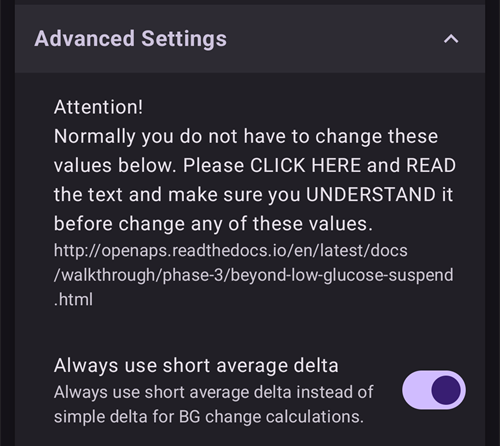
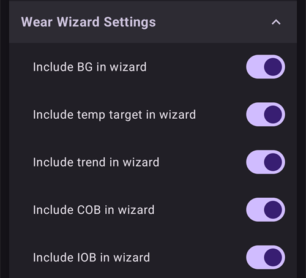

# Definições

No **AAPS** v4, as preferências estão no ecrã **Definições**. Há três caminhos para lá chegar — veja [Fazer alterações à configuração do AAPS](../SettingUpAaps/ChangeAapsConfiguration.md) para mais detalhes:

1. Toque no ícone **Definições** (engrenagem) no canto superior direito do ecrã principal: todas as definições, agrupadas em secções que se expandem.
2. Em **Configuração**, toque em "**Definições**" por baixo de um plugin ativo: só as definições desse plugin.
3. Use a **barra de pesquisa** no topo do ecrã principal: comece a escrever parte do texto que procura. Encontra definições individuais (mesmo as que não aparecem no ecrã Definições), caixas de diálogo e documentação.


- As **secções** abrem-se e fecham-se com um toque. As secções que vê dependem dos plugins que ativou e do [Modo simples](#preferences-simple-mode).


```{contents}
:backlinks: entry
:depth: 2
```

(Preferences-general)=
## Geral


**Unidades**

- Defina as unidades para mmol/l ou mg/dl, conforme preferir.

**Idioma**

- By default **AAPS** follows the language of the phone (recommended).

- If you want **AAPS** in another language than the phone, choose it here. On Android 13 and newer, **AAPS** registers it as its own app language in Android, so all its screens, the main screen, the widgets and the way numbers are written follow it.

- Quando muda o idioma, os textos do **AAPS** passam logo para o novo idioma. Se alguns textos ainda aparecerem no idioma antigo, reinicie o **AAPS**.
- On Android 12 this setting is not shown: **AAPS** always uses the language of the phone.
- Definição oculta no [modo simples](#preferences-simple-mode).

(preferences-simple-mode)= **Modo simples**

O **modo simples** está ativado por defeito quando instala o **AAPS** pela primeira vez. No **modo simples**, muitas definições ficam ocultas e as preferências são substituídas por valores predefinidos. Deve desligar o Modo simples quando já conhecer bem a interface e as definições do **AAPS**.

**Suporte de concentração de insulina**

- Ativa o suporte para diferentes concentrações de insulina (U50, U200, ...). Só ative esta opção se usar mesmo uma concentração diferente de U100, e leia os avisos com atenção.
- Definição oculta no [modo simples](#preferences-simple-mode).

**Manter o ecrã ligado**

- Obriga o Android a manter o ecrã sempre ligado. Isto é útil para apresentações, etc. Mas gasta muita bateria. Por isso, recomenda-se ligar o telefone a um carregador.

**Nome da instância**

- O nome da pessoa que usa este telefone. Distingue esta instância do **AAPS** nos relatórios e na sincronização, por exemplo se duas crianças com diabetes tipo 1 da sua família usarem o **AAPS**.
- Usado nos nomes dos ficheiros de definições exportados.
- Mostrado na [watchface Dual](../WearOS/WearOsSmartwatch.md).

(Preferences-skin)=
### Tema gráfico

A escolha do tema do **AAPS** 3.x (Original, Baixa resolução, Ecrã grande...) já não existe no **AAPS** 4. A nova interface adapta-se automaticamente ao seu ecrã, e o esquema de cores pode ser alterado em [Aparência](#preferences-appearance).

(preferences-appearance)=
## Aparência


(Preferences-range-for-visualization)=
### Intervalo para visualização

Escolha os limites alto e baixo do gráfico de glicose no ecrã principal do **AAPS** e no smartwatch. Isto refere-se apenas à visualização, não ao intervalo-alvo para a sua glicose no sangue. Exemplo: 70 - 180 mg/dl ou 3,9 - 10 mmol/l

(Preferences-show-notes-field-in-treatments-dialogs)=
### Mostrar notas nas caixas de diálogo

Dá-lhe a opção de adicionar notas de texto curtas aos seus tratamentos (assistente de bólus, hidratos, insulina...)

Definição oculta no [modo simples](#preferences-simple-mode).

### Esquema de Cores da Aplicação

Escolha entre o tema claro, o tema escuro ou seguir a definição de sistema do telefone.

(Preferences-protection)=
## Protecção


(Preferences-master-password)=
### Senha Mestre

Obrigatória para poder [exportar as definições](../Maintenance/ExportImportSettings.md), porque são encriptadas a partir da versão 2.7.

**A proteção biométrica pode não funcionar em telefones OnePlus. É um problema conhecido da OnePlus em alguns telefones.**


(Preferences-settings-protection)=
### Proteção das definições

- Proteja as suas definições com uma senha ou com a autenticação biométrica do telefone (p. ex. quando uma [criança usa o **AAPS**](../RemoteFeatures/RemoteMonitoring.md)). Se ativar esta função, é-lhe pedida autenticação sempre que quiser aceder a qualquer vista relacionada com as Definições.

- Os ecrãs de gestão (**Perfil**, **Definições de insulina**, **Alvo temporário**, **Assistente Rápido**) abrem então em modo **só leitura**. Pode continuar a ativar ou usar uma entrada, mas adicionar, editar, clonar e eliminar ficam ocultos até desbloquear as suas definições. Veja [A proteção das definições agora também bloqueia os ecrãs de gestão](#v4changes-read-only-management).

- Deve usar uma senha personalizada se quiser usar a senha mestre só para proteger as [definições exportadas](../Maintenance/ExportImportSettings.md), e outra senha para editar as definições.

- Se usar uma senha personalizada, toque na linha "Senha Definições" para definir a senha, como descrito [acima](#Preferences-master-password).

### Proteção da aplicação

Se a app estiver protegida, tem de introduzir a senha ou usar a autenticação biométrica do telefone para abrir o **AAPS**, e outra vez quando voltar à app depois do [tempo limite da proteção](#Preferences-password-and-pin-retention).

O **AAPS** fecha logo se for introduzida uma senha errada - mas continua a funcionar em segundo plano se tiver sido aberto antes com sucesso.

### Proteção do bólus

- A proteção do bólus pode ser útil se o **AAPS** for usado por uma criança pequena e se der [bólus por SMS](../RemoteFeatures/SMSCommands.md).

- A **Proteção do bólus** só pode ser escolhida depois de definir a **Proteção das definições** (nível 2).

- No exemplo abaixo, a proteção do bólus usa a **Senha Mestre**: o **AAPS** pede-a antes de abrir uma caixa de diálogo de tratamento, como **Insulina**. Com **Biométrico**, se a autenticação biométrica não funcionar, pode introduzir a senha mestre em vez dela.


(Preferences-password-and-pin-retention)=
### Retenção de senha e PIN

O **Tempo limite da proteção** define durante quanto tempo (em segundos) as definições ou as funções de bólus ficam desbloqueadas depois de introduzir a senha com sucesso.

## Segurança dos tratamentos


(preferences-patient-type)=
### Idade do paciente

- Os limites de segurança são definidos com base na idade que escolher nesta definição.
- Se começar a atingir estes limites rígidos (como o bólus máximo), está na altura de subir um nível.
- It's a bad idea to select higher than real age because it can lead to overdosing by entering the wrong value in the insulin dialog (by skipping the decimal separator, for example).
- Se quiser saber os números reais destes limites de segurança fixos, procure a função do algoritmo que usa [nesta página](../DailyLifeWithAaps/KeyAapsFeatures.md).

(Preferences-maximum-bolus)=
### Bólus máximo

- Define a quantidade máxima de insulina de bólus, em unidades de insulina, que o **AAPS** pode administrar de uma vez.
- Esta definição existe como limite de segurança para evitar a administração de um bólus enorme por introdução acidental ou erro do utilizador.
- Recomenda-se definir um valor razoável, que corresponda mais ou menos à quantidade máxima de insulina de bólus de que alguma vez poderá precisar para uma refeição ou uma dose de correção.
- Esta restrição também é aplicada aos resultados da calculadora de bólus.

### Máximo de hidratos permitido

- Define a quantidade máxima de hidratos de carbono, em gramas, para a qual a calculadora de bólus do **AAPS** pode calcular uma dose.
- Esta definição existe como limite de segurança para evitar a administração de um bólus enorme por introdução acidental ou erro do utilizador.
- Recomenda-se definir um valor razoável, que corresponda mais ou menos à quantidade máxima de hidratos de carbono de que alguma vez poderá precisar para uma refeição.

## Fonte da Glicose

As definições da [fonte de glicose](#Config-Builder-bg-source) escolhida aparecem numa secção própria. Por exemplo, com **Glicose xDrip+**:


- **Enviar dados de glicose para o NS**: deixa o **AAPS** enviar para o Nightscout os valores de glicose recebidos. Só ative esta opção se a própria app do CGM ainda não os enviar.
- **Registar troca de sensor**: cria automaticamente um evento de terapia de troca de sensor quando o sensor é inserido.

## O ecrã principal

No **AAPS** 3.x, estas definições estavam agrupadas numa secção "Visão Geral". No **AAPS** 4, são configuradas diretamente a partir dos elementos do ecrã principal a que pertencem.

(Preferences-buttons)=
### Botões QuickLaunch

Defina que botões de ação aparecem no ecrã principal: toque na pequena **engrenagem** ao centro, na parte de baixo do ecrã principal ("Configurar QuickLaunch") e **Adicionar** as ações a que quer acesso rápido (tratamentos, ações do CGM, entradas do careportal...).


(Preferences-quick-wizard)=
### Assistente Rápido

Crie botões personalizados para certas refeições ou lanches padrão, que vão aparecer no ecrã principal. Útil para refeições padrão que come muitas vezes.

Para cada botão, define os hidratos de carbono e o método de cálculo do bólus. Depois, define em que período de tempo o botão aparece no seu ecrã principal - só um botão por período. O botão não aparece fora do período de tempo definido, ou se tiver IA suficiente para cobrir os hidratos de carbono definidos no botão do Assistente Rápido. Se definir horas diferentes para as diferentes refeições, terá sempre no ecrã principal o botão de refeição padrão adequado à hora do dia.

Para gerir as predefinições do Assistente Rápido, escreva "QuickWizard" na barra de pesquisa do ecrã principal e abra **Assistente Rápido - Gerir as predefinições do assistente rápido**.

Se tocar no botão do Assistente Rápido, o **AAPS** calcula e propõe um bólus para esses hidratos de carbono, com base nos seus rácios atuais (tendo em conta o valor da glicose ou a insulina ativa, se estiver configurado).

A proposta tem de ser confirmada antes de a insulina ser administrada.

(Preferences-default-temp-targets)=
### Alvos temporários predefinidos

Os [alvos temporários (AT)](../DailyLifeWithAaps/TempTargets.md) permitem alterar o seu alvo de glicose durante um certo período. Ao definir um AT padrão, pode alterar facilmente o seu alvo para atividade, comer brevemente, etc.

Toque no **intervalo do alvo** no ecrã principal para abrir o ecrã **Alvo temporário**. Deslize pelos cartões das predefinições (Comer Brevemente, Atividade, Hipo) e altere o alvo e a duração de cada predefinição em **Definições das predefinições**. Os valores predefinidos são:

* Comer Brevemente: alvo 90 mg/dl / 5,0 mmol/l, duração 45 min
* Atividade: alvo 140 mg/dl / 7,8 mmol/l, duração 90 min
* Hipo: alvo 160 mg/dl / 8,9 mmol/l, duração 60 min


Saiba aqui como [ativar alvos temporários](#TempTargets-where-can-i-select-a-temp-target).

### Quantidades padrão de insulina para Purgar/Preencher

Se quiser encher o tubo ou purgar a cânula através do **AAPS**, pode fazê-lo com os botões **Purgar/Preencher** no painel de estado expandido do ecrã principal.

As quantidades padrão dos três botões de enchimento podem ser definidas nas definições de **Purgar/Preencher**, conforme o comprimento do seu cateter. Escreva "prime" na barra de pesquisa do ecrã principal para as abrir.


(Preferences-status-lights)=
### Luzes de Estado

As Luzes de Estado dão um aviso visual para:

- Idade do sensor
- Idade da insulina (nº de dias em que o reservatório está em uso)
- Nível de reservatório (unidades)
- Idade da cânula
- Idade da bateria da bomba
- Nível de bateria da bomba (%)

Se o limiar de aviso for ultrapassado, os valores aparecem a amarelo. Se o limiar crítico for ultrapassado, os valores aparecem a vermelho.

Para alterar os limiares, expanda o painel de estado no ecrã principal (seta à direita da linha de estado) e toque no pequeno ícone **Definições** ao lado de "Estado":


Toque num item (**Cânula**, **Insulina**, **Sensor** ou **Bateria da Bomba**) para abrir os seus limiares de aviso e crítico:


A última opção permite importar essas definições do Nightscout, se estiverem definidas lá. Veja a [documentação do Nightscout](https://nightscout.github.io/nightscout/setup_variables/#age-pills) para mais informações.

(Preferences-deliver-this-part-of-bolus-wizard-result)=
### Definições do assistente de bólus

Escreva "bolus" na barra de pesquisa do ecrã principal para abrir as definições do **Assistente de Bólus**:


A **Percentagem do bólus** define a [percentagem por defeito](#AapsScreens-section-j) do bólus calculado quando usa o assistente de bólus.

O valor por defeito é 100 %: sem correção. Mesmo que defina aqui outro valor, pode alterá-lo sempre que usar o assistente de bólus. Se esta definição for 75 % e precisar de um bólus de 10 U, o assistente de bólus propõe um bólus de refeição de apenas 7,5 unidades.

Quando usam o [SMB](#objectives-objective9), muitas pessoas não dão 100 % da insulina necessária no bólus de refeição, mas só uma parte (p. ex. 75 %), e deixam o SMB com RNA (deteção de refeições não anunciadas) fazer o resto. Usar aqui um valor abaixo de 100 % pode ser útil:
* para pessoas com digestão lenta: dar todo o bólus logo no início pode causar uma hipoglicemia, porque a insulina atua mais depressa do que a digestão.
* para deixar mais espaço ao **AAPS** para lidar sozinho com a **subida da glicose**. Nos dois casos, o **AAPS** compensa a parte do bólus em falta com SMB, se/quando o considerar adequado.

**Usar conselheiro de bólus**

Quando ativado, se usar o assistente de bólus com a glicose alta, recebe um aviso que pergunta se quer dar o bólus antes e comer mais tarde, quando a sua **glicose** voltar ao intervalo do alvo.

(Preferences-advanced-settings-overview)=
### Superbólus

A opção Superbólus do **AAPS** 3.x não está disponível como definição no **AAPS** 4.

## Loop

Veja [Ecrãs do AAPS > O ecrã principal > Estado do loop](#AapsScreens-loop-status) para mudar agora o modo do loop.

(Preferences-minimal-request-change)=
### Alteração mínima em modo aberto

Quando usa o **loop aberto**, recebe notificações sempre que o **AAPS** recomenda ajustar a taxa basal. Para reduzir o número de notificações, pode usar um [intervalo do alvo de glicose mais largo](#profile-glucose-targets) ou aumentar a percentagem da definição "**Alteração mínima em modo aberto**". Isto define a alteração relativa necessária para gerar uma notificação.


## Advanced Meal Assist (AMA) ou Super Micro Bolus (SMB)

Conforme as suas definições em [Configuração > APS](../SettingUpAaps/ConfigBuilder.md), pode escolher entre dois algoritmos:

- [Advanced meal assist (OpenAPS AMA)](#Open-APS-features-advanced-meal-assist-ama) - o estado do algoritmo em 2017
- [Super Micro Bolus (OpenAPS SMB)](#Open-APS-features-super-micro-bolus-smb) - o algoritmo mais recente, recomendado para principiantes

As of [**AAPS** version 3.3](#version3300), the [Dynamic ISF](../DailyLifeWithAaps/DynamicISF.md) feature has been moved into OpenAPS SMB.

### OpenAPS AMA

Todas as definições do OpenAPS AMA estão descritas na secção própria em [Principais funcionalidades do AAPS > Advanced Meal Assist (AMA)](#Open-APS-features-advanced-meal-assist-ama).

(Preferences-openaps-smb-settings)=
### OpenAPS SMB

Todas as definições do OpenAPS SMB estão descritas na secção própria em [Principais funcionalidades do AAPS > Super Micro Bolus (SMB)](#Open-APS-features-super-micro-bolus-smb).

A lista de definições que vê depende do seu progresso nos [Objetivos](../SettingUpAaps/CompletingTheObjectives.md) e do [Modo simples](#preferences-simple-mode). Numa instalação nova, só aparece **Usar sensibilidade dinâmica**. Depois de concluídos os objetivos, a secção fica assim:


As **Definições avançadas**, no fim da secção, têm valores que normalmente não precisa de alterar:




## Configurações de absorção


(Preferences-min_5m_carbimpact)=
### SMB: impacto mín. dos hidratos em 5 min (min_5m_carbimpact)

Definição oculta no [modo simples](#preferences-simple-mode).

O algoritmo usa o IG (impacto na glicose) para determinar quando os [hidratos de carbono são absorvidos](../DailyLifeWithAaps/CobCalculation.md).

Quando a absorção dos hidratos de carbono não pode ser calculada de forma dinâmica a partir das reações da sua glicose, o **AAPS** aplica uma redução padrão aos seus hidratos de carbono. Basicamente, é uma medida de segurança. Este valor só é usado durante falhas nas leituras do **CGM** ou quando a atividade física “consome” toda a subida da glicose que, de outra forma, faria o **AAPS** reduzir os HCA.

Em termos simples: o algoritmo "sabe" como a sua glicose *deveria* comportar-se com o efeito da dose atual de insulina, etc. Sempre que há um desvio positivo em relação ao comportamento esperado, considera-se que alguns hidratos de carbono foram absorvidos. Grande alteração = muitos hidratos de carbono, etc.

O min_5m_carbimpact define o impacto padrão da absorção dos hidratos de carbono por cada 5 minutos. Para a referência completa dos parâmetros, veja a [documentação do OpenAPS sobre preferências e definições de segurança](https://openaps.readthedocs.io/en/latest/docs/While%20You%20Wait%20For%20Gear/preferences-and-safety-settings.html?highlight=carbimpact#min-5m-carbimpact).

O valor padrão para o AMA é 3 e para o SMB é 8.

O gráfico de HCA no ecrã principal indica quando o min_5m_carbimpact está a ser usado, com pontos cor de laranja ao longo do topo da curva de HCA.


### Corte da absorção

Tempo a partir do qual qualquer refeição é considerada absorvida; os hidratos de carbono restantes são cortados. Se comer muitas vezes refeições ricas em gordura ou proteína, terá de aumentar o tempo de absorção das refeições.

### Definições avançadas - rácio do autosens


- Defina o rácio mínimo e máximo do [autosens](#Open-APS-features-autosens).
- Normalmente, os valores padrão (máx. 1,2 e mín. 0,7) não devem ser alterados.

## Bomba


### Watchdog BT

Ative o Watchdog BT se necessário (p. ex. para bombas Dana). Desliga o Bluetooth durante um segundo se não for possível ligar à bomba. Isto pode ajudar em alguns telefones em que o Bluetooth bloqueia.

## Definições da bomba

As opções aqui dependem do driver da bomba que escolheu em [Configuração > Bomba](#Config-Builder-pump). Emparelhe e configure a sua bomba de acordo com as [instruções da sua bomba](../Getting-Started/CompatiblePumps.md).

Por exemplo, com a **Bomba virtual**, a secção chama-se **Definições da bomba virtual**. Escolhe o **Modelo de bomba** que a bomba virtual imita, e se o seu estado é enviado para o Nightscout:


## Tidepool

Mais informações na página própria do [Tidepool](../SettingUpAaps/Tidepool.md).

(Preferences-nsclient)=
## NSClientV3


O plugin NSClient (que aparece como **NSClientV3** no menu de configuração) sincroniza os seus dados com o Nightscout. Usa a API v3 do Nightscout.

```{admonition} Data uploaders
:class: warning

Quando usa o NSClientV3, todos os programas de envio (uploaders) têm de usar a API v3 do Nightscout. Se outro programa de envio (por exemplo a sua app do CGM) não for compatível com a API v3, **deixe o AAPS enviar todos os dados** (glicose, tratamentos, ...) para o Nightscout e desative esse programa de envio.
```

- Defina o seu *URL do Nightscout* (p. ex. <https://yoursitename.yourplatform.dom>).
- **Confirme que o URL NÃO tem /api/v1/ no fim.**
- No Nightscout, crie um *[token Admin](https://nightscout.github.io/nightscout/security/#create-a-token)* (precisa do [Nightscout 15](https://nightscout.github.io/update/update/) para usar a API V3) e introduza-o em **Token de acesso do Nightscout** (não o seu API Secret!). No **AAPSClient**, pode em vez disso ler o código QR do telefone principal, o que configura um token próprio do cliente. Um cliente emparelhado com o PIN recebe o seu próprio token do telefone principal depois do emparelhamento. Veja [O token próprio do cliente no Nightscout](#client-master-control-own-token).
- Isto permite ler e escrever dados entre o site do Nightscout e o **AAPS**.
- Se estiver bloqueado no Objetivo 1, verifique bem se há erros de escrita aqui.
- Deixe "Usar websockets" ativado (recomendado).

(Preferences-nsclient-synchronization)=
### Sincronização


As escolhas de sincronização dependem da forma como quer usar o **AAPS**.

Pode escolher que dados quer [enviar para o Nightscout e receber do Nightscout](#Nightscout-aaps-settings).

Enquanto o controlo pelos clientes estiver ligado (sempre no Modo simples), estas definições ficam ocultas: o **AAPS** está então em [modo reforçado](#client-master-control-hardened-mode), não aceita alterações feitas diretamente no Nightscout e envia todos os seus dados.

### Opções de alarme


- As Opções de alarme permitem escolher que alarmes do Nightscout quer usar através da app. O **AAPS** dá um alarme quando um alarme do Nightscout dispara.
- Para os alarmes tocarem, tem de definir os valores dos alarmes Urgent High, High, Low e Urgent Low nas suas [variáveis do Nightscout](https://nightscout.github.io/nightscout/setup_variables/#alarms).
- Só funcionam enquanto tiver ligação ao Nightscout e destinam-se aos pais/cuidadores.
- Se tiver a fonte do **CGM** no seu telefone (p. ex. xDrip ou BYODA), use os alarmes dessa app em vez dos alarmes do Nightscout.
- Os Anúncios NS repetem os [anúncios](https://nightscout.github.io/nightscout/discover/#announcement) do Nightscout nas notificações do **AAPS**.
- Pode alterar o limiar dos alarmes de dados desatualizados e de dados desatualizados urgentes, que tocam quando não são recebidos dados do Nightscout durante um certo tempo.

### Controlo remoto

O interruptor "**Permitir controlo pelos clientes**" já não está nestas definições: está no topo de **Gerir → Clientes autorizados**, onde se gerem os clientes emparelhados. Veja a página própria [Controlo principal ↔ cliente](../RemoteFeatures/ClientMasterControl.md), incluindo o [modo reforçado](#client-master-control-hardened-mode), que este interruptor liga.

### Definições de ligação


- As Definições de ligação definem quando a ligação ao Nightscout está ativa.
- Limite o envio para o Nightscout apenas a Wi-Fi, ou até a certos SSID de Wi-Fi.
- Se quiser usar só uma rede Wi-Fi específica, pode introduzir o seu SSID WiFi.
- Pode separar vários SSID com ponto e vírgula.
- Para apagar todos os SSID, introduza um espaço em branco no campo.

(Preferences-advanced-settings-nsclient)=
### Advanced settings (NSClientV3)


As opções nas definições avançadas são fáceis de entender.

## Comunicador SMS

Mais informações na página própria dos [Comandos SMS](../RemoteFeatures/SMSCommands.md).

(preferences-wear)=
## Wear

Esta secção aparece quando o plugin **Wear** está ativado em [Configuração > Comunicação](#Config-Builder-wear). Mais informações nas páginas próprias [Configurar o AAPS no seu relógio Wear OS](../WearOS/WearOsSmartwatch.md) e [Usar o AAPS com o seu smartwatch Wear OS](../RemoteFeatures/RemoteControlWearOS.md).


- **Controlo pelo Wear**: permite enviar tratamentos e outras ações a partir do relógio. Sem esta opção, o relógio só mostra dados: o telefone recusa qualquer comando do relógio, e tocar numa complicação que abriria um ecrã de controlo abre, em vez disso, o menu do **AAPS** no relógio.

As **Definições do assistente do Wear** definem que cálculos entram no resultado do assistente de bólus no relógio. No relógio só introduz os hidratos de carbono; estes interruptores substituem as escolhas que faria no assistente de bólus no telefone:

- **Incluir glicose no assistente**: adiciona uma correção para a diferença entre a sua glicose atual e o seu alvo.
- **Incluir alvo temporário no assistente**: usa o alvo temporário em curso em vez do alvo do perfil para esta correção.
- **Incluir tendência no assistente**: tem em conta a tendência atual da glicose.
- **Incluir HCA no assistente**: adiciona insulina para os hidratos de carbono ainda ativos.
- **Incluir IA no assistente**: subtrai a insulina ainda ativa.



As **Definições da watchface personalizada** contêm **Autorizar watchfaces personalizadas**. Um ficheiro de watchface personalizada pode incluir valores para algumas definições do relógio. Quando este interruptor está ligado, carregar uma watchface destas pode alterar essas definições no relógio; quando está desligado, a watchface é carregada mas as definições ficam como estão:


As **Definições Gerais** contêm **Notificar SMB**, para receber uma notificação no relógio sempre que é administrado um SMB:


## Autoajuste

Esta secção aparece quando o plugin **Autoajuste** está ativado em [Configuração > Geral](#Config-Builder-autotune). As definições estão descritas na página própria do [Autoajuste](../AdvancedOptions/Autotune.md).


## Automatização


Escolha que serviço de localização deve ser usado:

- Usar a localização passiva: o **AAPS** só obtém a localização se outras apps a pedirem
- Usar a localização da rede: localização da sua rede Wi-Fi
- Usar a localização GPS (Atenção! Pode gastar muita bateria!)

## Alertas local


As definições devem ser fáceis de entender.

**Override Do Not Disturb mode** (on by default): the **AAPS** alarms ring even when the phone is silent or in Do Not Disturb. Turn it off if **AAPS** should respect those modes: the alarms do not ring then, and in Do Not Disturb they only vibrate, on the phone and on the watch. Loop suggestions that arrive during Do Not Disturb are shown without a sound.

When an alarm rings, the alarm screen offers **Silence alarm** (the screen stays open, so you can read the message) and **Silence and close**. Swiping the alarm notification away in the notification tray mutes the alarm. When you open **AAPS** later, an alarm you did not answer is shown again.

(preferences-maintenance-settings)=
## Definições de manutenção


**Destinatário do e-mail**: o destinatário padrão dos registos é <logs@aaps.app>.

**Número de registos a enviar**: quantos dos ficheiros de registo mais recentes são anexados quando envia os registos.

**Escolha de Dados**


Pode ajudar a desenvolver o **AAPS** enviando relatórios de falhas aos programadores.

**Exportação de definições sem intervenção**<br/> Ao ativar esta função, permite que o **AAPS** exporte as definições sem intervenção do utilizador. For this the master password is securely stored on your phone (only) at the next manual export. A senha guardada é usada durante até 4 semanas. Após 4 semanas, recebe uma notificação de que a senha está quase a expirar. Durante um período de tolerância de 1 semana, pode então renovar a senha exportando manualmente as definições a partir do menu de manutenção.

Depois de passar o período de tolerância de 1 semana, a senha guardada expira e qualquer exportação automática das definições é cancelada com uma notificação ao utilizador, que pede para introduzir novamente a senha. [(**Exportações automáticas das definições**)](../DailyLifeWithAaps/Automations.md#automating-preference-settings-export) ficam registadas nas listas 'Careportal' e 'Entrada de Utilizador' do **AAPS**, em Tratamentos.

Depois de ativar esta opção, faça uma exportação manual das definições, na qual lhe será pedida a senha, para que o **AAPS** a possa guardar.

### Ficheiros de registo

O AAPS guarda registos para a resolução de problemas.

Não desative esta função: ajuda a perceber as razões se algo correr mal.

Se tiver de enviar os registos aos programadores, descreva o problema com exatidão no e-mail. É preferível enviar registos só quando lhe pedirem, depois de um [relatório de problema no GitHub](https://github.com/nightscout/AndroidAPS/issues).

Pode encontrar os registos do AAPS na memória do telefone -> Android -> data -> info.nightscout.androidaps -> files.

A gestão dos registos (definições dos registos, envio e eliminação de registos) e a gestão de ficheiros estão no ecrã **Manutenção**, aberto a partir do **menu** (☰) no canto superior esquerdo do ecrã principal:


(preferences-maintenance-logdirectory)=

### Definir a pasta local do AAPS

O ecrã **Manutenção** também inclui a **Pasta do AAPS**. Esta definição permite ao utilizador escolher uma pasta no telefone onde o **AAPS** guarda as preferências, os registos e outros ficheiros. Depois de escolher uma pasta, o seu caminho (por exemplo `Documents/AAPS`) aparece por baixo de **Pasta do AAPS**, para ver sempre onde os seus ficheiros são guardados.

Recomenda-se muito usar uma pasta diretamente na raiz da memória do telefone. O valor por defeito é AAPS.


Se escolher uma subpasta de AAPS, verá uma mensagem de erro. Toque em "OK" e tente novamente, escolhendo a pasta correta (um nível acima). Não escolha "DISMISS" (dispensar), a não ser que saiba bem o que está a fazer.


O Android pode retirar a permissão da pasta sem avisar, por exemplo depois de reinstalar o **AAPS** ou de limpar o seu armazenamento. Quando isso acontece, o **AAPS** mostra uma notificação permanente **Perdeu-se o acesso à pasta AAPS** e a exportação local das definições deixa de funcionar até voltar aqui e escolher novamente a pasta. Faça-o logo, caso contrário as suas cópias de segurança no telefone deixam de ser atualizadas.

(preferences-maintenance-cloud)=

### Definir uma pasta na nuvem

Pode exportar as suas definições, registos e dados CSV para um serviço na nuvem.

1. Abra o **menu** (☰), escolha **Manutenção** e toque em **Pasta na nuvem** (em **Gestão de ficheiros**).

   

2. Em **Selecionar tipo de armazenamento**, escolha **Google Drive**.

   

3. Abre-se uma página de início de sessão da Google. Escolha a conta Google que vai guardar as suas cópias de segurança (pode usar uma [conta Google dedicada](../UsefulLinks/DedicatedGoogleAccountForAaps.md)).

   

4. Verifique se a conta é a correta e toque em **Continue** (Continuar) para dar acesso ao **AAPS**. Se já configurou a pasta na nuvem antes, a página diz que o **AAPS** já tem algum acesso.

   

5. De volta ao **AAPS**, aparece a mensagem **Autenticação no armazenamento na nuvem bem-sucedida** na parte de baixo do ecrã principal:

   

   No menu **Manutenção**, a **Pasta na nuvem** tem agora um ponto verde, e os botões **Nuvem** ao lado de **Enviar registos**, **Exportar definições**, **Importar definições** e **Exportar Entradas do Utilizador para o Excel (csv)** ficam disponíveis.

   

Para deixar de exportar para a nuvem, toque no ícone **✕** (**Limpar definições**) no fim da linha **Pasta na nuvem** do menu **Manutenção** (aparece depois de configurar um serviço na nuvem) e confirme **Limpar definições na nuvem**. Isto volta ao armazenamento local e apaga a autorização.

## Open Humans

Pode ajudar a comunidade ao doar os seus dados para projetos de investigação! Os detalhes estão descritos na [página Open Humans](../SupportingAaps/OpenHumans.md).

Em **Definições → Open Humans**, pode definir quando os dados devem ser enviados
- apenas quando ligado a Wi-Fi
- apenas quando estiver a carregar
