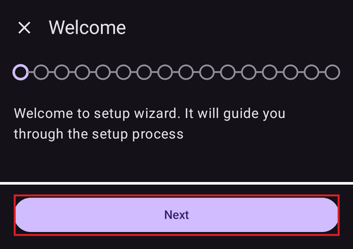
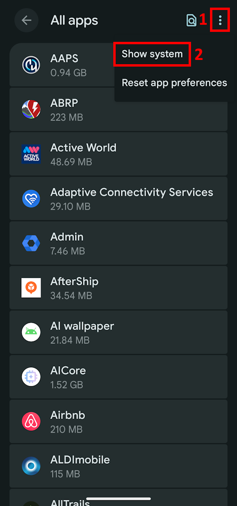
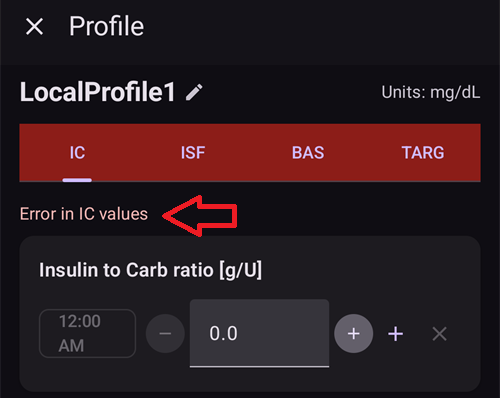
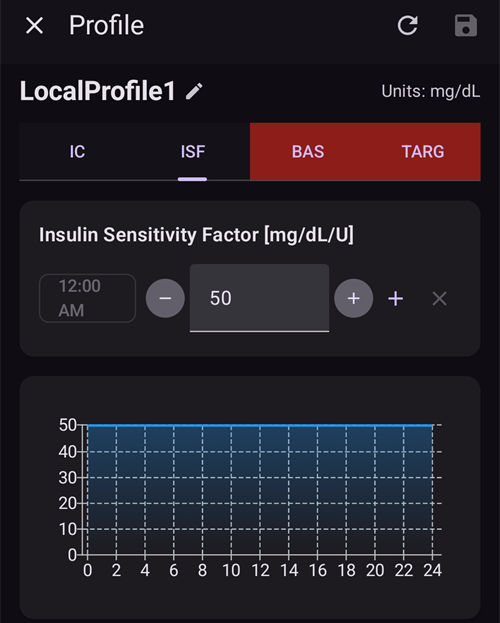
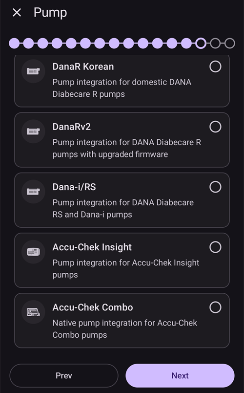

# AAPS Setup Wizard

```{contents} In this page
:backlinks: entry
:depth: 2
```

Quando inicia o **AAPS** pela primeira vez, é guiado pelo "**Assistente de Configuração**", para configurar rapidamente, de uma só vez, todas as definições básicas da app. O **Assistente de Configuração** guia-o para evitar que se esqueça de algo essencial. Por exemplo, as **definições de permissões** são fundamentais para configurar corretamente o **AAPS**.

No entanto, não é obrigatório deixar tudo configurado na primeira utilização do **Assistente de Configuração**: pode sair facilmente do assistente e voltar a ele mais tarde. Depois do **Assistente de Configuração**, há três caminhos para otimizar ou alterar mais a configuração. These will be explained in the next section. So, it's okay if you skip some points in the Setup Wizard, you can easily configure them later.

Durante a utilização do **Assistente de Configuração**, e logo a seguir, pode não notar mudanças visíveis importantes no **AAPS**. Para ativar o loop do **AAPS**, tem de seguir os **Objetivos** para ativar uma função após outra. Vai iniciar o **Objetivo 1** no fim do Assistente de Configuração. É o utilizador que manda no **AAPS**, e não o contrário.

```{admonition} Preview Objectives
:class: note
Se quiser conhecer a estrutura dos objetivos, leia [Concluir os objetivos](../SettingUpAaps/CompletingTheObjectives.md), mas depois volte aqui para executar primeiro o Assistente de Configuração.

```

Pela experiência anterior, sabemos que quem está a começar se pressiona muitas vezes para configurar o **AAPS** o mais depressa possível, o que pode levar a frustração, porque há muito para aprender.

Por isso, tome o seu tempo a configurar o seu loop; os benefícios de um loop do **AAPS** que funciona bem são enormes.

```{admonition} Ask for Help
:class: note
If there is an error in the documentation or you have a better idea for how something can be explained, you can ask for help from the community as explained at [Connect with other users](../GettingHelp/WhereCanIGetHelp.md).
```
## Welcome message

Quando o Assistente de Configuração abre, mostra uma curta mensagem de boas-vindas e logo um painel "**Permissões necessárias**" na parte de baixo do ecrã (ver a secção seguinte).

Depois de conceder as permissões, o painel fecha-se e o ecrã de boas-vindas mostra um botão "**Seguinte**". Toque em "**SEGUINTE**" para continuar:



## Required permissions

O **AAPS** precisa de algumas permissões para funcionar corretamente. O assistente agrupa-as num único painel "**Permissões necessárias**", cada uma com o seu próprio botão "**Conceder**". Conceda-as uma a uma — o ícone ao lado de cada item passa a um visto quando estiver feito.


### Otimização da bateria

O consumo de bateria nos smartphones é um ponto a ter em conta, porque o desempenho das baterias ainda é bastante limitado. Por isso, o sistema operativo Android do seu smartphone é restritivo quanto a deixar as aplicações funcionar e consumir tempo de CPU e, portanto, bateria.

No entanto, o **AAPS** precisa de funcionar regularmente, _por exemplo_ para receber os valores da glicose a cada poucos minutos e depois aplicar o algoritmo para decidir o que fazer com os seus níveis de glicose, com base nas suas definições. Por isso, tem de ser excluído da otimização da bateria.

Toque em "**Conceder**" ao lado de "**Otimização da bateria**" e depois selecione "**Allow**" (Permitir) na janela "Let app always run in background?" (Permitir que a app seja sempre executada em segundo plano?):


(SetupWizard-StoragePermission)=

### Pasta AAPS

O **AAPS** precisa de guardar as suas definições e informações de registo no armazenamento permanente do seu smartphone. Permanent storage means that it will be available even after rebooting your smartphone. Other information is just lost, as it is not saved to permanent storage.

Toque em "**Conceder**" ao lado de "**Pasta AAPS**". Isto abre o sistema de ficheiros do seu telefone e permite escolher onde o **AAPS** guarda as suas informações.

```{tip}
Recomenda-se escolher a pasta AAPS predefinida.</br>
**Não** selecione uma subpasta da pasta AAPS.
```

A pasta predefinida é **AAPS**, mas pode usar qualquer outra pasta dedicada à sua escolha. Crie a pasta se for preciso, entre nela e escolha "**USE THIS FOLDER**" (Usar esta pasta):


Confirme com "**ALLOW**" (Permitir) que quer dar ao **AAPS** acesso à pasta selecionada:


### Notificações

Android requires special permission for apps if they want to send you notifications.

Embora seja útil desativar as notificações, _por exemplo_ das apps de redes sociais, é essencial que permita que o **AAPS** lhe envie notificações.

Toque em "**Conceder**" ao lado de "**Notificações**" e selecione "**Allow**" (Permitir) no pedido do sistema:


### Alarmes e lembretes

No **Android 14 e mais recente**, o **AAPS** precisa da permissão "**Alarmes e lembretes**" para que os alarmes possam acender o ecrã enquanto o **AAPS** está em segundo plano e para que os lembretes (por exemplo de uma **Automatização**) toquem a horas.

Este item só é mostrado enquanto for necessário. Quando o **AAPS** estiver excluído da otimização da bateria (ver acima), o Android concede automaticamente os alarmes exatos e o item desaparece. Se ainda estiver na lista, toque em "**Conceder**" ao lado de "**Alarmes e lembretes**". Isto abre um ecrã de definições do sistema para o **AAPS**; ative o interruptor e volte ao **AAPS**. No Android 13 e mais antigo, este item não aparece e não é preciso fazer nada.

Quando todas as permissões mostrarem um visto (três, ou quatro no Android 14 e mais recente), o painel "**Permissões necessárias**" fecha-se sozinho e pode tocar em "**SEGUINTE**" no ecrã de boas-vindas para continuar.

(setup-wizard-bluetooth-battery-optimisation)=
### Otimização da bateria do Bluetooth

```{admonition} Extra Android setting, not part of the Wizard
:class: note
O que se segue é uma configuração adicional do Android, feita fora do Assistente de Configuração. Não é um dos botões "Conceder" acima, mas é importante para uma ligação fiável à bomba.
```

As versões mais recentes do Android também aplicam a otimização da bateria à aplicação de sistema Bluetooth.

Além de desativar a otimização da bateria para o **AAPS**, provavelmente também vai ter de a desativar para a app de sistema Bluetooth. Se não o fizer, podem ocorrer falhas e problemas na ligação à bomba.

***NOTA: A documentação do xDrip explica como fazer isto aqui: [documentação do xDrip](https://navid200.github.io/xDrip/docs/BluetoothBatteryOpt.html)***

Siga estes passos no Android 16; nas outras versões, os ecrãs são um pouco diferentes das capturas de ecrã mostradas:

1. Abra as definições do Android, procure **Apps** (Aplicações) e abra as definições das apps.

   

2. Vai ver as definições das apps, mas é preciso expandir a lista para ver todas as apps: clique em **See all apps** (Ver todas as apps) para a expandir.

   

3. Como a app Bluetooth é uma app de sistema, está oculta por predefinição, por isso temos de mostrar as apps de sistema. Clique nos **três pontos** (⋮) no canto superior direito (1). Depois clique em **Show system** (Mostrar sistema) (2).

   

4. Procure a app `Bluetooth` e clique em `Bluetooth` e/ou `Legacy Bluetooth`; se ambas existirem, siga o procedimento para as duas.

   ***NOTA: Pode ignorar o `Bluetooth MIDI Service` com segurança; não é usado pelo AAPS***

           

   1. No Android 12 clique em `Battery` (Bateria), no Android 13+ clique em `App battery usage` (Utilização da bateria pela app),

   )   

5. No Android 12+ selecione a opção `Unrestricted` (Sem restrições); no Android 15+ tem de expandir a definição `Allow background usage` (Permitir utilização em segundo plano): clique na secção destacada a vermelho para o fazer e depois siga o passo 6 para terminar.

       

6. No Android 16 selecione `Unrestricted` (Sem restrições)

   

## License agreement

O contrato de licença do utilizador final contém informações importantes sobre os aspetos legais da utilização do **AAPS**. Please read it carefully.

Se não compreender ou não puder aceitar o contrato de licença do utilizador final, não use o **AAPS**!

Se compreende e concorda, toque no botão "**EU ENTENDO E CONCORDO**" e siga o Assistente de Configuração:


Depois de concordar, aparece um botão "**Seguinte**". Toque em "**SEGUINTE**".

O ecrã seguinte, "**Permissões**", mostra de novo a lista de permissões. Todas devem mostrar um visto, porque já as concedeu no início. Se faltar alguma, toque em "**Conceder**" ao lado dela. Toque em "**SEGUINTE**" para continuar:


## Senha Mestre

Como a configuração do **AAPS** contém alguns dados sensíveis (_por exemplo_ o token de acesso ao seu servidor Nightscout), é encriptada com uma senha que define aqui.

O assistente mostra "**Senha não foi definida**". Toque em "**Definir**":


Isto abre o ecrã "**Proteção**". Toque em "**Senha Mestre**" (mostrada como "Senha não foi definida"):


Introduza a mesma senha nos dois campos e toque em "**OK**":


Volte atrás com a seta no canto superior esquerdo. O assistente mostra agora "**Senha foi definida!**":


```{admonition} Do not lose your Master Password
:class: danger
**NÃO PERCA A SUA SENHA MESTRE**. Anote-a, _por exemplo_ no Google Drive, que é um bom local porque a Google faz cópias de segurança por si. Your smartphone or PC can crash and you may have no actual copy. If you forget your Master Password, it can be difficult to recover your profile configuration and progress through the **Objectives** at a later date.
```

Quando terminar, toque em "**SEGUINTE**" para ir para o ecrã seguinte.

(setup-wizard-import-settings)=
## Importar definições

Este ecrã só é mostrado quando o **AAPS** encontra definições exportadas antes na pasta do **AAPS** ("Definições armazenadas encontradas"), por exemplo quando reinstala a app ou muda para um telefone novo.

- Para restaurar a sua configuração anterior, toque em "**Importar definições**" — consulte [Criar e restaurar cópias de segurança](../Maintenance/ExportImportSettings.md).
- Para começar com uma configuração nova, toque em "**SEGUINTE**" e continue com o assistente.


## Unidades (mg/dl <-> mmol/l)

Selecione se os seus valores de glicose estão em mg/dl ou mmol/l e depois toque no botão "**SEGUINTE**":


## Definições Ecrã

Aqui define a "**Marca BAIXA**" e a "**Marca ALTA**" para a apresentação da glicose do sensor. Os valores de glicose entre estas duas marcas são mostrados como "no alvo". Pode deixar os valores predefinidos (72 e 180 mg/dl) por agora e alterá-los mais tarde.

The values you choose only affect the graphical presentation of the diagram, and nothing else.

O seu alvo de glicose, _por exemplo_, é configurado à parte no seu perfil.

Your range to analyze TIR (time in range) is configured separately in your reporting server.

Se for preciso, ajuste as marcas com os botões "−" / "+" e depois toque no botão "**SEGUINTE**":


(SetupWizard-synchronization-with-the-reporting-server-and-more)=
## Comunicação

O ecrã "**Comunicação**" mostra os plugins usados para enviar, sincronizar e difundir os seus dados:

- **Comunicador SMS** – controlo remoto do **AAPS** com comandos SMS
- **NSClientV3** – sincroniza os seus dados com o Nightscout usando a API v3
- **Tidepool** – envia dados para o Tidepool
- **xDrip** – envia dados para o xDrip
- **Open Humans** – enviar e doar os seus dados da diabetes a projetos científicos
- **Android Wear** – monitorizar e controlar o **AAPS** a partir de um relógio Wear OS
- **Aplicações externas complementares** – difusão de dados para várias apps externas
- **Garmin** – ligação a um dispositivo Garmin


Deslize para baixo para ver o resto da lista:


Pode configurar vários destes agora, mas na primeira utilização vamos concentrar-nos só no servidor de relatórios. Se não o conseguir configurar agora, salte este passo por enquanto — pode configurá-lo mais tarde.

Neste exemplo usamos o Nightscout como servidor de relatórios. Marque a caixa à direita de "**NSClientV3**" para o ativar. For Tidepool it is even simpler, as you only need your personal login information.

Depois de ativado, toque em "**Definições**" por baixo de NSClientV3 para o configurar:


Aqui configura o servidor de relatórios Nightscout. As definições do NSClientV3 são mostradas numa única página que se pode deslocar:


Toque em "**URL do Nightscout**" e introduza o endereço do seu servidor Nightscout pessoal (o URL que configurou ou que recebeu do seu fornecedor de serviço). Confirme com "**OK**".

Toque em "**Token de acesso do Nightscout**" e introduza o token de acesso do seu servidor Nightscout. Without this token, access will not work. Se ainda não o tiver, consulte a documentação sobre a configuração do servidor de relatórios.

Deixe "**Usar websockets**" ativado para a comunicação em tempo real com o Nightscout.

As restantes secções podem ficar com os valores predefinidos por agora. São descritas aqui para saber onde as encontrar mais tarde:

**Opções de alarme** — alarmes do Nightscout, anúncios e limiares para dados desatualizados. Deixe os interruptores desligados por agora; só as abrimos para que conheça as opções.

**Definições de ligação** — escolha como os dados são transferidos. Os cuidadores têm de ativar "**Usar dados móveis**", caso contrário o telefone da pessoa de quem cuidam (_por exemplo_ uma criança) não consegue enviar dados fora do alcance do Wi-Fi, _por exemplo_ a caminho da escola. Os outros utilizadores podem desativar a transferência por dados móveis para poupar dados ou bateria. Em caso de dúvida, deixe tudo ativado.


**Definições avançadas** — ative "**Registar evento de início da aplicação**" se quiser ver no Nightscout quando a app reinicia (útil para cuidadores). Mantenha "**Criar anúncios a partir de erros**" e "**Criar anúncios a partir de hidratos necessários**" ativados. Deixe "**Usar sincronização lenta**" desligado; só o usaria se o servidor Nightscout fosse lento a processar uma grande quantidade de dados.


Volte à lista de plugins e toque em "**SEGUINTE**" para ir para o ecrã seguinte.

## Controlo pelos clientes

A partir da versão 4 do **AAPS**, os dispositivos cliente com o **AAPSClient** podem ser **emparelhados** com este telefone (o telefone **principal**) e controlá-lo com comandos assinados enviados através do Nightscout. Esta é a nova forma recomendada de controlar o **AAPS** à distância — consulte [Controlo principal ↔ cliente](../RemoteFeatures/ClientMasterControl.md) para a explicação e a configuração completas.

Não tem de configurar nada neste ecrã agora; pode emparelhar clientes em qualquer momento mais tarde, em **Gerir → Clientes autorizados**. Aí adiciona um cliente com um **código QR** (que também configura o Nightscout no cliente) ou com um **PIN**, e atribui-lhe uma **função**.

- "**Clientes autorizados**" — gerir os dispositivos cliente emparelhados que podem controlar este telefone principal.
- "**Aceitação de dados do Nightscout**" — aceitar tratamentos e dados introduzidos diretamente no Nightscout (a forma antiga e menos segura) está agora desativado por predefinição. Só abra estas definições se ainda precisar disso, _por exemplo_ para introduzir dados através do Nightscout ou de apps de terceiros.

Quando o controlo pelos clientes já está ativo — sempre no [Modo simples](#preferences-simple-mode) — este telefone está em [modo reforçado](#client-master-control-hardened-mode): só aceita alterações de clientes emparelhados, por isso o ecrã explica o modo reforçado em vez de oferecer as definições "**Aceitação de dados do Nightscout**".


"**Aceitação de dados do Nightscout**" abre as definições de "**Sincronização**", onde cada tipo de dados recebidos do Nightscout tem o seu próprio interruptor:


Toque em "**SEGUINTE**" para ir para o ecrã seguinte.

(setup-wizard-instance-name)=
## Quem está a usar este telefone?

Aqui introduz o nome da pessoa que usa este telefone. Serve para distinguir esta instância do **AAPS** de outras nos relatórios e na sincronização, por exemplo se duas crianças da sua família usam o **AAPS**. Também é usado nos nomes dos ficheiros de definições exportados e é mostrado no relógio.

It can be anything. Pode alterá-lo mais tarde em **Definições → Geral → Nome da instância**.

Toque em "**SEGUINTE**" para ir para o ecrã seguinte.


## Patient type

Aqui seleciona o seu "Tipo de paciente", o que é importante, porque o software **AAPS** tem limites diferentes conforme a idade do paciente. This is important for security and safety reasons.

É também aqui que configura o **bólus máximo permitido** para uma refeição. That is, the largest bolus you need to give to cover your typical meals. É uma função de segurança para ajudar a evitar uma sobredosagem acidental quando dá um bólus para uma refeição.

The second limit is similar in concept, but relates to the max carbohydrate intake you expect.

Depois de definir estes valores, toque em "**SEGUINTE**" para ir para o ecrã seguinte:


## Insulina

Aqui configura a insulina usada na sua bomba. Os novos perfis de insulina exigem uma **DAI de pelo menos 5 h**.

Toque no botão "**Insulina**" para abrir o editor de insulina:


No editor pode dar à insulina um **nome curto** e definir o seu **Pico** (em minutos) e a **DAI** (em horas). A forma mais rápida é carregar uma predefinição com "**Carregar pico de**" — escolha **Novorapid**, **Fiasp** ou **Lyumjev** — e o pico é preenchido automaticamente. O gráfico em baixo mostra uma pré-visualização da curva de atividade da insulina resultante.


Escolha a predefinição que corresponde à sua insulina, por exemplo **Fiasp**:


```{admonition} Use your insulin brand's preset peak
:class: danger
Não altere o pico, a não ser que seja um especialista — normalmente os valores predefinidos funcionam bem para cada marca de insulina.
```

Se é um novo utilizador do **AAPS**, defina a **DAI** para 9 horas — consulte [Duração da ação da insulina (DAI) e pico](#Config-Builder-insulin-dia) para perceber porquê.

```{admonition} "Insulin configuration changed" dialog
:class: note
Se um cliente emparelhado (_por exemplo_ outro telefone) alterou a configuração da insulina, aparece uma janela. Toque em **OK** para carregar as alterações dele, ou em **Cancelar** para continuar a editar (a sua próxima gravação vai substituir as alterações dele).
```


Toque no ícone de guardar (canto superior direito) e depois toque em "**SEGUINTE**" para ir para o ecrã seguinte.

## Blood sugar source

Aqui seleciona de onde o **AAPS** recebe os dados da glicose. Leia a documentação da sua [fonte da glicose](../Getting-Started/CompatiblesCgms.md).

Há muitas fontes disponíveis — percorra a lista e selecione a que usa:


Quando seleciona uma fonte, o seu cartão expande-se e mostra dois botões: "**Definições**" para ajustar a forma como os dados são recebidos, e "**Abrir plugin**" para abrir o ecrã da própria fonte. No exemplo abaixo, está selecionado o **BYODA**. Algumas fontes não têm nada para configurar nesta fase, por isso normalmente pode passar logo para o ecrã seguinte:


Depois de fazer a sua escolha, toque em "**SEGUINTE**" para ir para o ecrã seguinte.

(setup-wizard-profile)=
## Perfil

Now we are entering a very important part of the Setup Wizard.

Leia a documentação sobre [perfis](../SettingUpAaps/YourAapsProfile.md) antes de tentar introduzir os dados do seu perfil no ecrã seguinte.

```{admonition} Working profile required - no exceptions here !
:class: danger
É necessário um perfil exato para controlar a ação segura do **AAPS**.

É obrigatório que tenha determinado e discutido o seu perfil com o seu médico e que ele tenha sido comprovado com testes bem-sucedidos da taxa basal, do FSI e do IHC!

Se um robô recebe dados errados, falha - sempre. O **AAPS** só pode trabalhar com a informação que recebe. Se o seu perfil for demasiado forte, arrisca uma hipoglicemia; se for demasiado fraco, arrisca uma hiperglicemia. 
```

Toque no botão "**Perfil**" para abrir o editor de perfis:


O editor abre vazio ("Não há registos disponíveis"). Toque no botão "**+**" em baixo para criar um novo perfil:


You can have several profiles in the long-term if needed. We only create one here.

```{admonition} Profile only for tutorial - not for your usage
:class: note
O perfil de exemplo aqui serve apenas para mostrar como introduzir os dados.

Não pretende ser um perfil exato nem muito bem otimizado, porque as necessidades de cada pessoa são muito diferentes.

Não a use para fazer loop a sério!
```

O novo perfil (por exemplo "**LocalProfile1**") tem quatro separadores: **IHC**, **FSI**, **BAS** e **ALV**. Toque no lápis ao lado do nome do perfil para lhe mudar o nome. Preencha todos os separadores — um separador fica vermelho e mostra uma mensagem de erro até ter valores válidos:



Toque em "**IHC**" e introduza os seus valores de [IHC](#your-aaps-profile-insulin-to-carbs-ratio). Use o botão "**+**" para adicionar mais blocos de tempo:


Toque em "**FSI**" e introduza os seus [valores de FSI](#your-aaps-profile-insulin-sensitivity-factor):



Toque em "**BAS**" e introduza os seus [valores da basal](#your-aaps-profile-basal-rates):


Toque em "**ALV**" e introduza os seus valores alvo de glicose.

Em loop aberto, este alvo pode ser um intervalo mais largo, caso contrário o **AAPS** avisa-o constantemente para alterar a basal temporária ou outra definição, o que pode ser cansativo.

Later, for closed looping, you will generally have only one value for top and bottom. Isto facilita ao **AAPS** atingir o alvo e dar-lhe um melhor controlo geral da diabetes.


Quando os quatro separadores estiverem válidos, o **ícone de guardar** (canto superior direito) fica ativo. Toque nele para guardar o perfil:


Feche o editor com o "**X**" no canto superior esquerdo. O resumo do perfil mostra então o seu nome, a basal diária total (∑), as unidades e os valores de IHC e FSI com os respetivos gráficos:


```{admonition} Several defined but only one active profile
:class: note
Pode ter vários perfis definidos, mas só um perfil ativado a funcionar de cada vez.
```

Toque no botão "**▶**" (ativar) no canto inferior direito. Abre-se o ecrã "**Ativar**". Como ainda não há nenhuma insulina em uso, primeiro pede-lhe para selecionar a insulina que está a usar, para que a troca de perfil a possa registar. O botão "**Ativar**" fica cinzento até o fazer:


Toque em "**Selecionar insulina**" e escolha a insulina que configurou antes. Deixe a percentagem em 100 % e toque em "**Ativar**":


Aparece uma janela de troca de perfil. Neste caso, deixe-a como está e confirme com "**OK**":

```{admonition} Profile switch dialog
:class: note
Mais tarde vai aprender a usar esta janela geral para lidar com situações como doença ou desporto, em que precisa de alterar o seu perfil de acordo com as circunstâncias.
```


O seu perfil está agora ativo. Toque em "**SEGUINTE**" para ir para o ecrã seguinte.

## Bomba de Insulina

Agora seleciona a sua bomba de insulina. Leia a documentação da sua [bomba de insulina](../Getting-Started/CompatiblePumps.md).

Percorra a lista e selecione a sua bomba. Neste exemplo usamos a "**Bomba virtual**", que é útil enquanto ainda está a aprender e ainda não ligou uma bomba real:


São suportadas muitas bombas — desloque a lista para baixo para encontrar a sua:



Quando seleciona uma bomba real, o **AAPS** pede uma confirmação, porque vai copiar as taxas basais do seu perfil para a bomba e substituir as taxas basais lá guardadas. Toque em "**OK**" apenas se as taxas basais do seu perfil do **AAPS** estiverem corretas; caso contrário, toque em "**Cancelar**" e mude para a bomba mais tarde:


Se a bomba que selecionar comunica por Bluetooth, o **AAPS** pede permissão para se ligar a dispositivos próximos quando terminar o assistente (consulte [Permissão de Bluetooth](#bluetooth-permission)).

Se já configurou o seu perfil e sabe como ligar a sua bomba, pode ligá-la agora. Caso contrário, deixe-a por enquanto em **Bomba virtual** — pode mudá-la em qualquer momento, ou sair do Assistente de Configuração com a seta no canto superior esquerdo e deixar que o **AAPS** lhe mostre primeiro alguns valores de glicose.

Toque em "**SEGUINTE**" para ir para o ecrã seguinte.

## APS algorithm

Use the OpenAPS SMB algorithm as your APS algorithm. Apesar do nome, a função SMB do algoritmo está desativada até estar familiarizado com o AAPS e ter completado os primeiros objetivos. De qualquer forma, o OpenAPS SMB é mais recente e, em geral, melhor do que o OpenAPS AMA.

O SMB está desativado no início porque a função SMB reage mais depressa a uma subida da glicose, usando um Super Micro Bólus em vez de aumentar a percentagem da taxa basal. Como o seu perfil, em geral, não é tão bom no início como depois de alguma experiência, a função fica desativada no princípio.

```{admonition} Only use the older algorithm **OpenAPS AMA** if you know what you are doing
:class: note
O OpenAPS AMA é o algoritmo mais básico e não suporta micro bólus para corrigir valores altos. Pode haver situações em que é melhor usar este algoritmo, mas não é a recomendação.
```

Selecione "**OpenAPS SMB**" e depois toque em "**Definições**" para ver os detalhes:


A única opção aqui é "**Usar sensibilidade dinâmica**". Deixe-a desligada e não altere nada por agora — leia apenas o texto.

De qualquer forma, devido às limitações impostas pelos **Objetivos**, de momento não pode usar o "loop fechado" nem as "funções SMB".

Volte atrás e toque em "**SEGUINTE**" para ir para o ecrã seguinte:


## Deteção de sensibilidade

Deixe "**Sensibilidade Oref1**" selecionado como plugin de sensibilidade padrão:


Se tocar em "**Definições**", pode rever as definições de absorção; os valores predefinidos (_por exemplo_ um limite de absorção de 6 h) servem por agora.


Toque em "**SEGUINTE**" para ir para o ecrã seguinte.

## Start Objective 1

Está agora a entrar nos Objetivos — a qualificação para aceder a mais funções do **AAPS**.

Toque em "**Abrir Objetivos**":


Here we start Objective 1, even if at the moment our setup is not completely ready to successfully complete this Objective. But this is the start.

Toque no botão "**Iniciar**" ao lado de "**1. Objetivo**":


O objetivo expande-se e mostra as suas verificações individuais. Pode ver que já fez algum progresso, enquanto outros itens ainda estão por fazer:


Volte atrás e depois toque em "**TERMINAR**" para concluir o Assistente de Configuração:


Depois de tocar em "**TERMINAR**", chega ao ecrã principal do **AAPS**. Pode abrir-se um painel "**Notificação**" com mensagens informativas, por exemplo sobre a troca de perfil que acabou de fazer — toque em "**Fechar**" por baixo de cada mensagem para a apagar.

Se sair do Assistente de Configuração por engano em qualquer momento, pode simplesmente reiniciar o assistente ou alterar manualmente a [configuração do loop do AAPS](../SettingUpAaps/ChangeAapsConfiguration.md).

## Permissão de Bluetooth

Se selecionar uma bomba que se liga por Bluetooth (por exemplo a **Omnipod Dash**), uma faixa lembra-lhe que o **AAPS** precisa da permissão de Bluetooth. Pode tocar em "**Fechar**" por agora — a permissão é concedida depois de terminar o assistente:


Depois de terminar o Assistente de Configuração, o ecrã principal do **AAPS** mostra um painel "**Permissões necessárias**". As outras permissões já estão concedidas; toque em "**Conceder**" ao lado de "**Bluetooth**":


Selecione "**Allow**" (Permitir) para que o **AAPS** possa encontrar a sua bomba e ligar-se a ela:


Se o seu loop do **AAPS** já está totalmente configurado, passe para a secção seguinte, ["Concluir os objetivos"](../SettingUpAaps/CompletingTheObjectives.md).
