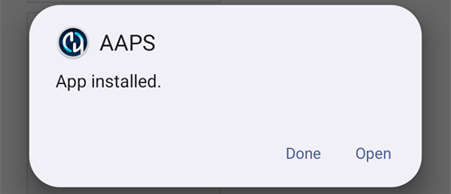

# Transferir e instalar o AAPS no seu smartphone

Na secção anterior, [compilar o **AAPS**](../SettingUpAaps/BuildingAaps.md), compilou a app **AAPS** (que é um ficheiro .apk) num computador.

Os próximos passos são **transferir** o ficheiro APK do **AAPS** (e outras apps de que possa precisar, como o BYODA, o xDrip ou outra app recetora do CGM) para o seu smartphone Android e depois **instalar** a(s) app(s). Depois de instalar o **AAPS** no smartphone, pode passar para a [**configuração do loop do AAPS**](../SettingUpAaps/SetupWizard.md).

Esta página também explica a [verificação de programadores Android](#android-developer-verification), uma mudança que a Google está a introduzir a partir de setembro de 2026 e que afeta a instalação de apps compiladas pelo próprio utilizador, e os [métodos de instalação gratuitos](#android-developer-verification-free-methods) que continuam a funcionar depois da mudança.

```{contents} Table of contents
:depth: 1
:local: true
```

## Instalar o AAPS tocando no ficheiro APK

Hoje, o **AAPS** instala-se transferindo o ficheiro APK para o telefone e abrindo-o (tocando nele). Há várias formas de transferir o ficheiro APK do **AAPS** do seu computador para o smartphone. Here we explain two different ways:

* Option 1 -  Use your Google drive (Gdrive)
* Option 2 -  Use a USB cable

Please note that transfer by email might cause difficulties, and is discouraged.

```{admonition} Android developer verification
:class: warning
A Google está a introduzir a [verificação de programadores Android](#android-developer-verification) a partir de setembro de 2026 (primeiro no Brasil, na Indonésia, em Singapura e na Tailândia; no resto do mundo em 2027). Onde for aplicada, a instalação de um APK tocando no ficheiro — como descrito nas duas opções abaixo — fica bloqueada. Nesse caso, use um dos [métodos de instalação gratuitos](#android-developer-verification-free-methods) mais abaixo nesta página.
```

### Option 1. Use Google drive to transfer files

Abra [Google.com](https://www.google.com/) no seu navegador e inicie sessão na sua conta Google.

On the right upper side select the Drive app in the Google menu.


Clique em **New** (Novo) no canto superior esquerdo (ou clique com o botão direito numa área vazia por baixo dos seus ficheiros e pastas) e selecione **File upload** (Carregar ficheiro).


The apk file should now be uploaded on Google Drive.

#### Use the Google Drive app to execute the apk file for installation

Switch to your mobile and start the Google Drive app. It is a preinstalled app and can be found where the other Google apps are located or with search for the name of the app.


Inicie a instalação do apk tocando no nome do ficheiro na app Google Drive no telemóvel.


Se receber um aviso de segurança a dizer que, de momento, não pode instalar apps a partir do Google Drive, toque em "Settings" (Definições) e permita-o durante esse curto momento; depois volte a bloqueá-lo, porque deixá-lo sempre ativado é um risco de segurança.


Quando a instalação terminar, este passo está concluído.

Deve ver o ícone do **AAPS** e conseguir abrir a app.

```{warning}
**AVISO DE SEGURANÇA IMPORTANTE**
Lembrou-se de voltar a bloquear a instalação a partir do Google Drive?
```

Continue com a [configuração do loop do AAPS](../SettingUpAaps/SetupWizard.md).

### Option 2. Use a USB cable to transfer files

A segunda forma de transferir o ficheiro apk do AAPS é com um [cabo USB](https://support.google.com/android/answer/9064445?hl=en).

Transfer the file from its location on your computer to the "downloads" folder on the phone.

On your phone, you will have to allow installation from unknown sources. Pode encontrar explicações sobre como fazer isto na internet (_por exemplo_ [aqui](https://www.expressvpn.com/de/support/vpn-setup/enable-apk-installs-android/) ou [aqui](https://www.androidcentral.com/unknown-sources)).

Depois de transferir o ficheiro arrastando-o, abra a pasta "Downloads" (Transferências) no telefone e toque no ficheiro apk do AAPS:


Na primeira vez, o Android avisa que o telefone não tem permissão para instalar apps desconhecidas a partir desta origem. Toque em "**Settings**" (Definições):


Ative "**Allow from this source**" (Permitir a partir desta origem) e depois volte atrás:


Toque de novo no ficheiro apk e selecione "**Install**" (Instalar):


Quando a instalação terminar, toque em "**Open**" (Abrir) para iniciar o **AAPS**, ou em "**Done**" (Concluído) para o abrir mais tarde:



```{warning}
**AVISO DE SEGURANÇA IMPORTANTE**
Lembre-se de voltar a desativar "Allow from this source" (Permitir a partir desta origem) depois da instalação, porque deixá-lo sempre ativado é um risco de segurança.
```

Continue com a [configuração do loop do AAPS](../SettingUpAaps/SetupWizard.md).

(transferring-installing-play-protect-warning)=
## Aviso do Google Play Protect

Quando instala o **AAPS**, o Google Play Protect pode avisar que a app não é segura, que foi feita para uma versão mais antiga do Android e que não inclui as proteções de privacidade mais recentes.


Isto é normal numa app que o próprio utilizador compilou. Toque em **More details** (Mais detalhes) e depois em **Install anyway** (Instalar mesmo assim).

Se a instalação for **bloqueada** com uma mensagem sobre um programador não verificado (e não apenas um aviso), consulte [Verificação de programadores Android](#android-developer-verification) abaixo.

(android-developer-verification)=

## Verificação de programadores Android

A Google está a introduzir a **verificação de programadores Android**: na maioria dos telefones Android, as apps só se instalam se tiverem sido registadas na Google por um programador verificado. Isto também se aplica às apps instaladas a partir de um ficheiro APK ("sideloading") — que é a forma como instala a app **AAPS** que compilou.

### O que está a mudar

Quando instala o **AAPS** num telefone com os serviços Google (um dispositivo Android "certificado" — praticamente todos os telefones vendidos com a Play Store), o Android verifica se a app vem de um programador registado na Google. Se não vier, a instalação normal tocando no ficheiro APK fica bloqueada.

**A verificação acontece quando uma app é instalada ou atualizada.** Não remove apps que já estão instaladas e a funcionar.

A Google está a introduzir isto aos poucos:

| Quando                 | O que acontece                                                                                                                                                              |
| ---------------------- | --------------------------------------------------------------------------------------------------------------------------------------------------------------------------- |
| Agosto de 2026         | As contas de programador gratuitas de "distribuição limitada" ficam abertas em todo o mundo e o "fluxo avançado" ("advanced flow") começa a chegar aos telefones            |
| 30 de setembro de 2026 | A verificação passa a ser aplicada no **Brasil, na Indonésia, em Singapura e na Tailândia**, para apps instaladas a partir do Google Play e de algumas outras lojas de apps |
| 2027                   | A aplicação alarga-se ao **resto do mundo** e a **todas as instalações**, incluindo ficheiros APK                                                                           |

A Google publica os detalhes nas páginas de [verificação de programadores Android](https://developer.android.com/developer-verification), incluindo umas [perguntas frequentes (FAQ)](https://developer.android.com/developer-verification/guides/faq). A Google ainda pode alterar datas e detalhes; esta página será atualizada à medida que a introdução avança.

### Isto afeta-me?

- **A compilação do AAPS não é afetada.** A [compilação no navegador](#browser-build), a [compilação com o Android Studio](ComputerBuild.md) e a [compilação pela linha de comandos (CLI)](CLIBuild.md) funcionam exatamente como antes, e a sua keystore não muda.
- **O seu AAPS atual continua a funcionar.** A verificação só é feita quando se instala ou atualiza uma app.
- **Se vive no Brasil, na Indonésia, em Singapura ou na Tailândia:** a partir de 30 de setembro de 2026, a verificação é aplicada às apps instaladas a partir do Google Play e de algumas outras lojas de apps. A Google afirma que a instalação direta de um ficheiro APK não está incluída nesta primeira fase, por isso o **AAPS** deve continuar a instalar-se como habitualmente. Mesmo assim, prepare já um dos [métodos de instalação gratuitos](#android-developer-verification-free-methods) abaixo, para não ser apanhado de surpresa se isto mudar.
- **Se vive noutro país:** nada muda para si antes de 2027, e não fazer nada por agora é uma escolha válida. Mas configure um dos [métodos de instalação gratuitos](#android-developer-verification-free-methods) abaixo enquanto tudo funciona: descobrir o bloqueio no dia em que uma atualização é recusada, com a espera de 24 horas do [fluxo avançado](#android-developer-verification-advanced-flow) pela frente, é o pior momento.
- **Telefones antigos:** a verificação aplica-se a telefones com Android 7 ou superior, ou seja, a todos os telefones capazes de executar o **AAPS**.

(android-developer-verification-free-methods)=

## Formas gratuitas de instalar o AAPS

**Não** precisa de pagar nada à Google para continuar a usar o **AAPS**. Há vários métodos gratuitos; escolha o que corresponde à sua situação.

```{admonition} Which method should I use?
:class: tip
- Tem um **computador** (seja qual for a forma como compilou o **AAPS**): use o [ADB](#android-developer-verification-adb) ou, se preferir evitar a linha de comandos, o [instalador web](#android-developer-verification-web). Ambos estão isentos da verificação, não têm limites e não precisam de conta Google.
- **Não tem computador nenhum**: use o [fluxo avançado](#android-developer-verification-advanced-flow) no seu telefone.
- Prefere registar-se na Google para que a instalação normal "tocar no APK" continue a funcionar: existe uma [conta gratuita de distribuição limitada](#android-developer-verification-limited-account), mas não foi testada com o **AAPS**.
```

(android-developer-verification-adb)=

### Opção 1: Instalar com o ADB (precisa de computador)

O ADB (Android Debug Bridge) é a ferramenta oficial da Google para instalar apps a partir de um computador num telefone, com um cabo USB. A Google confirmou que **as apps instaladas com o ADB não precisam de verificação** — não há período de espera, nem limite de dispositivos, nem registo.

Preparação (feita uma única vez):

1. No seu telefone, ative as opções de programador ocultas: vá a **Settings** (Definições) > **About phone** (Acerca do telefone; nalguns telefones **Software information**, Informações do software) e toque sete vezes em **Build number** (Número de compilação), até o telefone confirmar que é um programador.
1. Volte às **Settings** (Definições) principais, abra a nova entrada **Developer options** (Opções de programador) e ative **USB debugging** (Depuração USB).
1. No seu computador, confirme que o ADB está disponível:
   - Se usa o **Android Studio**, o ADB já está instalado com ele.
   - Caso contrário, transfira as [SDK Platform Tools](https://developer.android.com/tools/releases/platform-tools) gratuitas da Google e descompacte a pasta. Não é preciso instalar nada; o ADB é o programa `adb` dentro dessa pasta.

Instalar (e mais tarde atualizar) o **AAPS**:

1. Ligue o telefone ao computador com um cabo USB. Não é preciso transferir primeiro o ficheiro APK para o telefone: o ADB envia-o diretamente a partir do computador.
1. No telefone, aceite o pedido **Allow USB debugging?** (Permitir depuração USB?) (só na primeira vez).
1. No computador, abra um terminal (linha de comandos) na pasta que contém o ADB e o ficheiro APK do **AAPS** e execute:

   ```
   adb install -r app-full-release.apk
   ```

   Substitua `app-full-release.apk` pelo nome real do seu ficheiro APK. A opção `-r` atualiza um **AAPS** já instalado e mantém todos os seus dados e definições.

1. Espere até aparecer `Success`. O **AAPS** está agora instalado no seu telefone.

O mesmo comando é usado em todas as atualizações futuras. As [páginas do Wear OS](../WearOS/WearOsSmartwatch.md) já usam o ADB da mesma forma para instalar a app do relógio.

Se preferir não usar um cabo: no Android 11 e mais recente, a **depuração sem fios** (também em **Developer options**, Opções de programador) pode fazer o mesmo por Wi-Fi, depois de um emparelhamento feito uma única vez com um código mostrado no telefone.

(android-developer-verification-web)=

### Opção 2: Instalar a partir de uma página web (computador, sem linha de comandos)

Se a linha de comandos não é para si, uma página web pode fazer exatamente o mesmo que o ADB, diretamente a partir do seu navegador. Como comunica com o telefone pelo mesmo mecanismo que o ADB, tem a **mesma isenção da verificação** — mas não há nada para transferir, nenhuma pasta para descompactar e nenhum comando para escrever.

Este é o caminho mais fácil se usou a [compilação no navegador](#browser-build) e nunca abriu uma linha de comandos.

1. Ative a **depuração USB** no telefone (passos 1 e 2 do [método ADB](#android-developer-verification-adb) acima — configuração feita uma única vez).
1. Abra o **[Instalador web do AAPS](#web-installer)** no seu navegador.
1. Ligue o telefone com um cabo USB e siga as instruções na página: ligar, escolher o seu ficheiro APK e instalar.

Três coisas a saber:

- Só funciona no **Chrome, Edge ou Opera**. O Firefox e o Safari não conseguem comunicar com dispositivos USB.
- Só um programa de cada vez pode usar a ligação ADB do telefone, por isso **feche o Android Studio** (ou qualquer outro programa que use o ADB) antes de ligar.
- Uma página web ligada desta forma obtém o controlo total do seu telefone. **Use apenas o endereço acima**, da documentação do **AAPS** — nunca uma página de instalação encontrada num motor de pesquisa. O instalador web do **AAPS** funciona inteiramente no seu navegador: o seu ficheiro APK não é enviado para lado nenhum.

```{admonition} No computer? A second phone works too
:class: tip
O instalador web também funciona a partir do **Chrome noutro telefone Android** com um cabo USB-C para USB-C — assim, um pai ou uma mãe pode instalar o **AAPS** no telefone de uma criança sem ter computador em casa.
```

(android-developer-verification-advanced-flow)=

### Opção 3: O "fluxo avançado" ("advanced flow") no seu telefone (sem computador)

A Google oferece uma saída para utilizadores experientes que compreendem os riscos de instalar apps não verificadas, chamada **fluxo avançado** ("advanced flow"). A Google começou a disponibilizá-lo nos telefones em agosto de 2026, antes da aplicação da verificação, por isso pode configurá-lo já. É uma configuração feita uma única vez no próprio telefone, que **demora 24 horas** a concluir:

1. Ative as opções de programador ocultas (veja o passo 1 do método ADB acima) e depois abra **Settings** (Definições) > **Developer options** (Opções de programador) > **Apps from unverified developers** (Apps de programadores não verificados).
1. Ative **Allow apps from unverified developers** (Permitir apps de programadores não verificados). O telefone pede o seu bloqueio de ecrã para confirmar que é o próprio.
1. O telefone pergunta se alguém lhe está a pedir para ativar esta definição e explica que bancos, organismos do Estado ou a polícia nunca lhe pediriam isso. Leia o aviso e confirme que ninguém o está a pressionar ou a orientar (isto é uma proteção contra burlões).
1. **Reinicie o seu telefone.** Isto inicia um **período de espera de 24 horas**, feito uma única vez.
1. Após 24 horas, volte a **Settings** (Definições) > **Developer options** (Opções de programador) > **Apps from unverified developers** (Apps de programadores não verificados) para concluir a configuração.
1. Escolha se quer permitir apps não verificadas durante **7 dias** ou **indefinidamente**. Para o **AAPS**, escolha **indefinidamente**; caso contrário, a sua próxima atualização será bloqueada quando passarem os 7 dias.

Depois desta configuração, instalar ou atualizar o APK do **AAPS** funciona como hoje, com um aviso extra de que a app é de um programador não verificado — toque em **Install anyway** (Instalar mesmo assim).

É bom saber:

- Pode voltar a desativar as **Developer options** (Opções de programador) depois: o fluxo avançado continua ativado. A Google também não dá às apps (como as apps de bancos) nenhuma forma de detetar que o fluxo avançado está ativado.
- Se desativar o fluxo avançado, a instalação **ou a atualização** do **AAPS** volta a ficar bloqueada (o **AAPS** instalado continua a funcionar). Tem 10 minutos para o voltar a ativar; depois disso, o período de espera de 24 horas recomeça.
- Mudar o relógio do telefone não encurta o período de espera, e o ADB não o consegue saltar.
- A Google afirma que a sua escolha acompanha a sua conta Google para os seus outros dispositivos, por isso um telefone novo não deverá significar outra espera de 24 horas.
- Se não encontrar **Apps from unverified developers** (Apps de programadores não verificados) nas opções de programador, o seu telefone ainda não recebeu esta função. Ela é fornecida por um componente do sistema chamado **Android Developer Verifier**, que a Google está a disponibilizar aos poucos através da Play Store. Pode acelerar o processo abrindo o **Android Developer Verifier** na Play Store.

```{note}
A Google descreve isto como uma primeira versão e ainda pode mudar os ecrãs e os passos; esta secção será atualizada com capturas de ecrã quando a versão final estiver disponível.
```

(android-developer-verification-limited-account)=

### Opção 4: Registar-se na Google (conta gratuita de distribuição limitada)

A Google oferece um tipo de conta de programador **gratuita** para amadores e uso pessoal, chamada **conta de distribuição limitada** (limited distribution account), aberta a todos desde agosto de 2026:

- **Sem documento de identificação oficial** e **sem taxa** (ao contrário da conta de programador paga, que não é necessária para o uso pessoal do **AAPS**). Precisa de uma conta Google com verificação em dois passos, de um perfil de pagamentos Google com o seu nome legal e morada, e de um endereço de email de contacto.
- Regista o nome do pacote da sua app na Android Developer Console da Google e autoriza os telefones em que pode ser instalada, até **20 dispositivos**, através de uma confirmação com um código QR ou uma ligação entre o telefone e a consola.
- Depois do registo, a instalação normal (tocar no ficheiro APK) volta a funcionar nos telefones autorizados, sem ADB e sem o fluxo avançado.
- Uma conta de distribuição limitada pode mais tarde ser convertida numa conta completa, mas não ao contrário.

```{warning}
A Google não explicou como funciona o registo quando muitas pessoas compilam a mesma app de código aberto: cada **AAPS** compilado pelo próprio utilizador usa o mesmo nome de pacote (`info.nightscout.androidaps`) com uma chave de assinatura diferente, e as perguntas frequentes da Google dizem que um nome de pacote já usado por outros não pode ser simplesmente reclamado e requer uma revisão adicional. O resultado dessa revisão é desconhecido, e a conta de programador paga (25 $ e um documento de identificação oficial) não ajuda aqui: pagar só remove o limite de 20 dispositivos, não a revisão do nome do pacote.

Por este motivo, ainda não é possível escrever instruções passo a passo. Esta secção será completada quando o registo tiver sido testado com o **AAPS**. Entretanto, o ADB, o instalador web e o fluxo avançado acima são alternativas fiáveis.
```

## O que não muda

- Compilar o **AAPS** por si próprio, com qualquer um dos três [métodos de compilação](BuildingAaps.md).
- A sua conta GitHub, o seu repositório de compilação (AAPS Builder) ou fork, e a sua keystore.
- A app **AAPS** instalada, as suas definições e os seus [objetivos](CompletingTheObjectives.md).
- Telefones sem serviços Google e, em geral, as [instalações com o ADB](#android-developer-verification-adb).

## Onde obter ajuda

1. **Leia** as [perguntas frequentes sobre a verificação de programadores](https://developer.android.com/developer-verification/guides/faq) da Google para questões sobre a verificação em si.
2. **Pergunte** no canal *#AAPS* do [Discord](https://discord.gg/4fQUWHZ4Mw), ou num dos outros [canais da comunidade](../GettingHelp/WhereCanIGetHelp.md), se uma instalação for bloqueada.
3. Ao pedir ajuda, indique a marca e o modelo do telefone, a versão do Android, o seu país e a mensagem exata mostrada quando a instalação falha.

```{toctree}
:hidden:

Instalador web do AAPS <WebInstaller.md>
```
