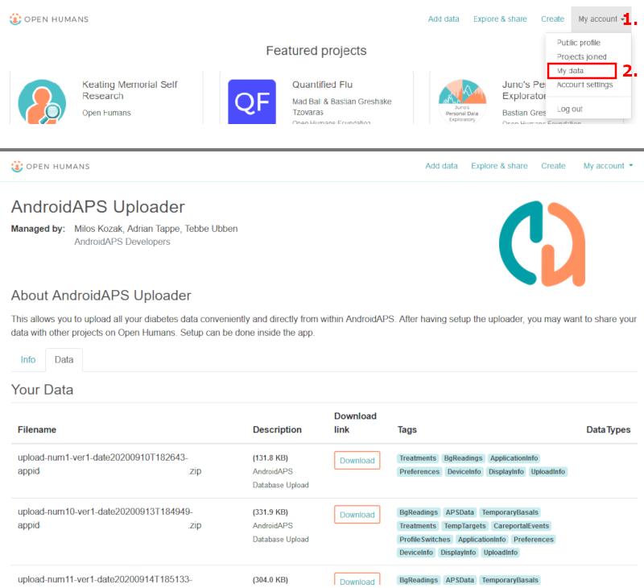

# Upload para o Open Humans

## Doe os seus dados para a ciência

Pode ajudar a comunidade ao doar os seus dados para projetos de investigação! Isto ajuda os cientistas a retribuir, a desenvolver novas ideias científicas e a alargar o conhecimento sobre sistemas de loop fechado de código aberto. O AAPS está pronto para sincronizar os seus dados com o [Open Humans](https://www.openhumans.org), uma plataforma que permite enviar, ligar e guardar os seus dados pessoais – como dados genéticos, de atividade e de saúde.

Mantém o controlo total sobre o que acontece aos seus dados e sobre os projetos que quer apoiar, ao dar-lhes acesso aos seus dados. Conforme o projeto em que participa, os dados são avaliados e usados de formas e em medidas diferentes.

Os seguintes dados vão ser enviados para a sua conta Open Humans:

- Valores de glicose
- Eventos do Careportal (exceto notas)
- Bólus prolongados
- Mudanças de perfil
- Doses diárias totais
- Basais temporárias
- Alvos temporários
- Preferências
- Versão da aplicação
- Modelo do dispositivo
- Dimensões do ecrã

Informação secreta ou privada, como o URL do seu Nightscout ou o API secret, não é enviada.

## Instalação

1. Crie a sua conta no [Open Humans](https://www.openhumans.org), se ainda não o fez. Se quiser, pode usar a sua conta Google ou Facebook.
2. Ative o plugin **Open Humans** em [**Configuração** > **Comunicação**](../SettingUpAaps/ConfigBuilder.md).


3. Toque em **Definições** no cartão **Open Humans**. Pode limitar os envios aos momentos em que o telefone usa Wi-Fi (**Só por WiFi**) e/ou está a carregar (**Só durante o carregamento**).


4. Toque em **Abrir plugin** no cartão **Open Humans** e depois toque em **Instalação**.


5. No ecrã **Bem-vindo ao Open Humans**, toque em **Seguinte**. Leia com atenção o ecrã **Consentimento**: mostra os termos de utilização e os dados que são e não são enviados.
6. Ative **Compreendo e concordo.** (1) e toque em **Iniciar sessão no Open Humans** (2).


7. O site do Open Humans vai abrir. Inicie sessão com os seus dados de acesso.
8. Decida se quer esconder a sua participação no AAPS Uploader no seu perfil público do Open Humans (1).
9. Clique em **Authorize project** (2).


```{admonition} Older screenshot
:class: note
As capturas de ecrã acima mostram uma versão antiga do site do Open Humans e ainda usam o nome antigo do projeto, **AndroidAPS Uploader**. Os passos são os mesmos.
```

10. De volta ao **AAPS**, o ecrã **Últimos passos** pergunta se quer continuar. Toque em **Continuar**.
11. Espere até aparecer **Concluído!** e depois toque em **Fechar**. A partir de agora, o seu telefone envia dados em segundo plano, de vez em quando.
12. O ecrã do plugin **Open Humans** mostra agora o seu **ID Membro do Projeto**. Toque em **Fazer o upload agora** se quiser começar um envio imediatamente.
13. Toque em **Terminar Sessão** se quiser parar de enviar dados para o Open Humans.
14. Uma notificação Android informa-o sobre o upload em curso.


```{admonition} Older screenshot
:class: note
A captura de ecrã acima é de uma versão anterior do **AAPS**. No **AAPS** 4, os ecrãs de confirmação são **Últimos passos** e **Concluído!**, não há tamanho da fila e os botões são **Fazer o upload agora** e **Terminar Sessão**.
```

15. Pode gerir os seus dados ao iniciar sessão no [site do Open Humans](https://www.openhumans.org).



## Oportunidades de partilha

### [O projeto 'OPEN'](https://www.open-diabetes.eu/)

O projeto 'OPEN' junta um consórcio internacional e intersetorial de pacientes inovadores, médicos, cientistas sociais, informáticos e organizações de defesa de pacientes, para estudar vários aspetos dos sistemas de pâncreas artificial «faça você mesmo» (DIY APS), que são usados por cada vez mais pessoas com diabetes. Para mais detalhes, veja o [site](https://www.open-diabetes.eu/) do projeto.

Em setembro de 2020, o projeto 'OPEN' lançou um [inquérito](https://survey.open-diabetes.eu/) com a opção de doar os dados que enviou para o Open Humans. Um [tutorial](https://open-diabetes.eu/en/open-survey/survey-tutorials/) sobre como doar os seus dados ao projeto 'OPEN' está disponível no site do projeto e no próprio inquérito.

### [OpenAPS Data Commons](https://www.openhumans.org/activity/openaps-data-commons/)

O OpenAPS Data Commons foi criado para permitir uma forma simples de partilhar conjuntos de dados da comunidade DIYAPS para investigação. Os dados são partilhados tanto com investigadores tradicionais, que vão criar estudos de investigação tradicionais, como com grupos ou pessoas da comunidade que querem analisar os dados nos seus próprios projetos de investigação. O OpenAPS Data Commons usa a plataforma 'Open Humans' para que as pessoas possam enviar e partilhar facilmente os seus dados de sistemas DIYAPS, incluindo AAPS, Loop e OpenAPS.

Pode colocar os seus dados no Open Humans de uma de três formas:

1. usar a opção de upload do AAPS para colocar os seus dados no Open Humans
2. usar o Nightscout Data Transfer para colocar os seus dados no Open Humans
3. enviar manualmente ficheiros de dados para o Open Humans.

Depois de criar uma conta e de os seus dados começarem a chegar ao Open Humans, junte-se também ao OpenAPS Data Commons para doar os seus dados para investigação, se assim o decidir.

## Termos de Utilização

Esta é uma ferramenta de código aberto que vai copiar os seus dados para o [Open Humans](https://www.openhumans.org). Não temos nenhum direito de partilhar os seus dados com terceiros sem a sua autorização explícita. Os dados que o projeto e a aplicação recebem são identificados através de um ID de utilizador aleatório e só são transmitidos de forma segura para uma conta Open Humans com a sua autorização. Pode parar o envio e apagar os dados enviados a qualquer momento em [www.openhumans.org](https://www.openhumans.org). Tenha em conta que alguns projetos que recebem dados podem não suportar isto.

Veja também os [Termos de Utilização do Open Humans](https://www.openhumans.org/terms/).

## Privacidade dos dados

O Open Humans protege a sua privacidade ao atribuir-lhe um ID numérico para cada projeto. Isto permite que os projetos o reconheçam, mas não o identifiquem. O ID da aplicação enviado pelo AAPS é parecido e serve apenas para gerir os dados. Mais informação aqui:

- [Política de Utilização de Dados do Open Humans](https://www.openhumans.org/data-use/)
- [RGPD do Open Humans](https://www.openhumans.org/gdpr/)
