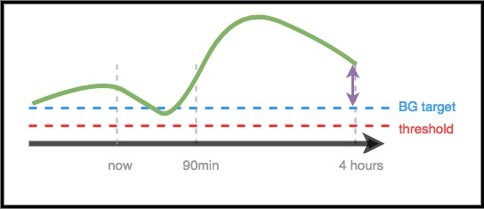

# Para médicos – Introdução geral e guia do AAPS

```{note}
Esta página é uma introdução geral para médicos. Foi revista pela última vez em junho de 2026. O AAPS está em desenvolvimento contínuo; por isso, para a informação mais exata e atualizada, consulte sempre a [documentação principal do AAPS](../index.md).
```

Esta página destina-se a médicos que manifestaram interesse em tecnologia de pâncreas artificial de código aberto, como o AAPS, ou a doentes que queiram partilhar esta informação com os seus médicos.

Este guia contém informação geral sobre loops fechados DIY e, em particular, sobre o funcionamento do AAPS. Para mais detalhes sobre todos estes temas, consulte a [documentação completa do AAPS online](../index.md). Se tiver perguntas, peça mais detalhes ao seu doente ou, em qualquer momento, contacte a comunidade com a sua questão. (Se não usar redes sociais (por exemplo, [Twitter](https://twitter.com/kozakmilos) ou Facebook), pode enviar um e-mail para developers@aaps.app). [Pode também encontrar aqui alguns dos estudos e dados de resultados mais recentes](https://openaps.org/outcomes/).

## Os passos para construir um loop fechado DIY:

Para começar a usar o AAPS, devem ser dados os seguintes passos:

* Encontrar uma [bomba compatível](../Getting-Started/CompatiblePumps.md), um [dispositivo Android compatível](../Getting-Started/Phones.md) e uma [fonte de CGM compatível](../Getting-Started/CompatiblesCgms.md).
* [Descarregar o código-fonte do AAPS e compilar o software](../SettingUpAaps/BuildingAaps.md).
* [Configurar o software para comunicar com os dispositivos da diabetes e escolher as definições e as preferências de segurança](../SettingUpAaps/SetupWizard.md).

## Como funciona um loop fechado DIY

Sem um sistema de loop fechado, a pessoa com diabetes recolhe os dados da bomba e do CGM, decide o que fazer e age.

Com a administração automática de insulina, o sistema faz o mesmo: recolhe os dados da bomba, do CGM e de qualquer outro sítio onde haja informação registada (como o Nightscout), usa esta informação para fazer os cálculos e decidir quanto mais ou menos insulina é necessária (acima ou abaixo da taxa basal programada) e usa taxas basais temporárias para fazer os ajustes necessários, de forma a manter a glicose no intervalo alvo ou a trazê-la de volta para esse intervalo.

If the device running AAPS breaks or goes out of range of the pump, once the latest temporary basal rate ends, the pump falls back to being a standard pump with the preprogrammed basal rates running.

## Como são recolhidos os dados:

Com o AAPS, um dispositivo Android executa uma aplicação especial que faz os cálculos; o dispositivo comunica por Bluetooth com uma bomba compatível. O AAPS pode comunicar com outros dispositivos e com a nuvem através de Wi-Fi ou dados móveis, para recolher informação adicional e para informar o doente, os cuidadores e os familiares sobre o que está a fazer e porquê.

O dispositivo Android tem de:

* comunicar com a bomba e ler o histórico - quanta insulina foi administrada
* comunicar com o CGM (diretamente ou através da nuvem) - para ver o que a glicose está a fazer e o que fez

Depois de o dispositivo recolher estes dados, o algoritmo é executado e toma as decisões com base nas definições (FSI, IHC, DAI, alvo, etc.). Se for necessário, envia então comandos à bomba para alterar o débito de administração de insulina.

Recolhe também qualquer informação sobre bólus, ingestão de hidratos de carbono e ajustes de alvos temporários, a partir da bomba ou do Nightscout, para a usar no cálculo dos débitos de administração de insulina.

## Como sabe o que fazer?

O software de código aberto foi concebido para que o dispositivo faça facilmente o trabalho que as pessoas faziam antes (em modo manual) para calcular como ajustar a administração de insulina. It first collects data from all the supporting devices and from the cloud, prepares the data and runs the calculations, makes predictions of what BG levels are expected to do during the next hours in different scenarios, and calculates the needed adjustments to keep or bring BG back into target range. A seguir, envia à bomba os ajustes necessários. Depois lê novamente os dados, e repete o processo continuamente.

Como o parâmetro de entrada mais importante é o nível de glicose que vem do CGM, é importante ter dados do CGM de alta qualidade.

O AAPS foi concebido para registar de forma transparente todos os dados de entrada que recolhe, a recomendação resultante e qualquer ação tomada. Por isso, é fácil responder a qualquer momento à pergunta «porque está a fazer X?», consultando os registos.

## Exemplos de tomada de decisão do algoritmo do AAPS:

O AAPS usa o mesmo algoritmo central e o mesmo conjunto de funções que o OpenAPS. O algoritmo faz várias previsões (com base nas definições e na situação), que representam diferentes cenários do que pode acontecer no futuro. No Nightscout, são mostradas como «linhas roxas». O AAPS usa cores diferentes para distinguir estas [linhas de previsão](#aaps-screens-prediction-lines). Nos registos, é indicado qual destas previsões e qual horizonte temporal determinam as ações necessárias.

### Seguem-se exemplos das linhas roxas de previsão e de como podem ser diferentes:


(clinicianguide-dosing-scenarios)=

### Seguem-se exemplos de diferentes horizontes temporais que influenciam os ajustes necessários à administração de insulina:

### Cenário 1 - Basal temporária zero por segurança

Neste exemplo, a glicose está a subir no curto prazo; no entanto, prevê-se que fique baixa num horizonte temporal mais longo. De facto, prevê-se que desça abaixo do alvo *e* do limiar de segurança. Por segurança, para evitar a hipoglicemia, o AAPS define uma basal temporária zero (taxa basal temporária de 0 %), até que a eventualBG (glicose final prevista, em qualquer horizonte temporal) esteja acima do limiar.


### Cenário 2 - Basal temporária zero por segurança

Neste exemplo, prevê-se que a glicose fique baixa no curto prazo, mas que acabe por ficar acima do alvo. No entanto, como a descida de curto prazo fica de facto abaixo do limiar de segurança, o AAPS define uma basal temporária zero até que nenhum ponto da linha de previsão esteja abaixo do limiar.


### Cenário 3 - É necessária mais insulina

Neste exemplo, uma previsão de curto prazo mostra uma descida abaixo do alvo. No entanto, não se prevê que fique abaixo do limiar de segurança. A glicose final prevista está acima do alvo. Therefore, AAPS will refrain from adding any insulin that would contribute to a near-term low (by adding insulin that would make the prediction go below threshold). Depois avalia se pode adicionar insulina para trazer o nível mais baixo da glicose final prevista até ao alvo, quando for seguro fazê-lo. *(Depending on settings and the amount and timing of insulin required, this insulin may be delivered via temp basals or SMBs (super micro boluses)).*



### Cenário 4 - Basal temporária baixa por segurança

Neste exemplo, o AAPS vê que a glicose está a subir muito acima do alvo. No entanto, devido ao tempo de ação da insulina, já há insulina suficiente no corpo para acabar por trazer a glicose para o intervalo alvo. De facto, prevê-se que a glicose acabe por ficar abaixo do alvo. Por isso, o AAPS não dá insulina extra, para não contribuir para uma hipoglicemia num horizonte temporal mais longo. Embora a glicose esteja alta ou a subir, é provável aqui uma basal temporária baixa.


## Otimizar as definições e fazer alterações

Como médico, talvez sem experiência com o AAPS ou com loops fechados DIY, pode achar difícil ajudar o seu doente a otimizar as definições ou a fazer alterações para melhorar os resultados. Na comunidade, temos várias ferramentas e [guias](https://openaps.readthedocs.io/en/latest/docs/Customize-Iterate/optimize-your-settings.html) que ajudam os doentes a fazer pequenos ajustes testados para melhorar as suas definições.

O mais importante para os doentes é fazer uma alteração de cada vez e observar o efeito durante 2–3 dias antes de decidir alterar outra definição (a não ser que seja claramente uma má alteração que piora a situação; nesse caso, devem voltar de imediato à definição anterior). A tendência humana é mexer em todos os botões e mudar tudo ao mesmo tempo; mas, se o fizerem, podem acabar com definições ainda menos adequadas no futuro e ter dificuldade em voltar a um estado que se sabe ser bom.

Uma das ferramentas mais úteis para alterar definições é uma ferramenta de cálculo automático para as taxas basais, o FSI e o IHC. Chama-se «[Autotune](#autotune-how-autotune-calculates-adjustments)» (Autoajuste). It is designed to allow the data to guide you or your patient in making incremental changes to settings. Na comunidade, a boa prática é executar (ou rever) primeiro os relatórios do Autoajuste (Autotune), antes de tentar fazer ajustes manuais às definições. O Autoajuste (Autotune) está integrado no AAPS como plugin (**Configuração** → **Geral** → **Autoajuste**); ver [Autoajuste (Autotune)](../AdvancedOptions/Autotune.md). Pode ser executado a pedido ou automaticamente. Como estes parâmetros são um pré-requisito tanto para a administração de insulina com bomba convencional como para a administração em loop fechado, a discussão dos resultados do Autoajuste e o ajuste destes parâmetros são o ponto natural de ligação com o médico.

Além disso, o comportamento humano (aprendido no tratamento manual da diabetes) influencia muitas vezes os resultados, mesmo com um loop fechado DIY. Por exemplo, se se prevê que a glicose desça e o AAPS reduz a insulina durante a descida, pode ser necessária apenas uma pequena quantidade de hidratos de carbono (por exemplo, 3–4 g) para subir a glicose de 70 mg/dl (3,9 mmol/l). No entanto, em muitos casos, a pessoa pode tratar com muito mais hidratos de carbono (por exemplo, seguindo a regra dos 15), o que causa um pico mais rápido, tanto pela glicose a mais como porque a insulina foi reduzida no período que antecedeu a hipoglicemia.

## OpenAPS

**This guide was adapted from [The clinician's guide to OpenAPS](https://openaps.readthedocs.io/en/latest/docs/Resources/clinician-guide-to-OpenAPS.html).** OpenAPS is a system developed to be run on a small portable computer (generally referred to as the "rig"). O AAPS usa muitas das técnicas implementadas no OpenAPS e partilha grande parte da lógica e dos algoritmos; por isso, este guia é muito semelhante ao guia original. Grande parte da informação sobre o OpenAPS pode ser facilmente adaptada ao AAPS; a principal diferença é a plataforma de hardware onde cada software é executado.

## Resumo

Esta é uma visão geral do funcionamento do AAPS. Para mais detalhes, pergunte ao seu doente, contacte a comunidade ou leia a documentação completa do AAPS, disponível online.

Leitura adicional recomendada:

* A [documentação completa do AAPS](../index.md)
* O [OpenAPS Reference Design](https://OpenAPS.org/reference-design/) (desenho de referência do OpenAPS), que explica como o OpenAPS foi concebido para ser seguro: https://openaps.org/reference-design/
* A [documentação completa do OpenAPS](https://openaps.readthedocs.io/en/latest/index.html) 
  * Consulte [como o AAPS transforma as previsões numa decisão de dosagem](#aaps-screens-how-predictions-become-a-dosing-decision) nesta documentação, ou a [documentação determine-basal do OpenAPS](https://openaps.readthedocs.io/en/latest/docs/While%20You%20Wait%20For%20Gear/Understand-determine-basal.html#understanding-the-determine-basal-logic) para o algoritmo de base com todo o detalhe técnico