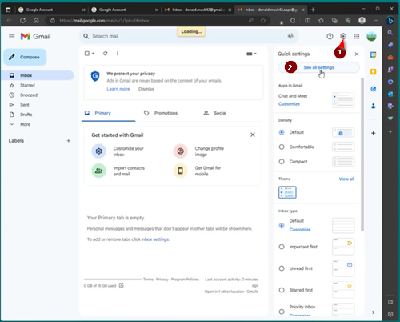

# Uma conta Google dedicada ao AAPS (opcional)

Alguns utilizadores do **AAPS** preferem usar também a sua conta de e-mail principal para o **AAPS**. Em alternativa, alguns utilizadores do **AAPS** (ou os seus cuidadores) criam uma conta de e-mail dedicada ao **AAPS** - isto é opcional; mostramos abaixo um exemplo de como o fazer.

Se não quiser criar uma conta Gmail dedicada ao **AAPS**, pode passar diretamente para a secção seguinte, [Compilar o AAPS](../SettingUpAaps/BuildingAaps.md).

```{admonition} Advantages of a dedicated Google account for AAPS
:class: dropdown

- Com um espaço dedicado no Google Drive, não corre o risco de encher o limite do seu Google Drive pessoal com **Exportar definições**.
- Cada versão do **AAPS** (e das aplicações de apoio, como xDrip, BYODA, etc.) fica guardada num único sítio, que não depende do hardware do seu computador. Se o seu PC ou telefone for roubado, perdido ou avariar, continua a ter acesso.
- Uma configuração igual para todos, com uma estrutura de pastas semelhante, torna o apoio online mais simples.
- Dependendo da configuração (ver abaixo), terá uma identidade separada, um pseudónimo, para comunicar na comunidade, o que pode proteger a sua privacidade. 
- As crianças com DM1 podem manter a sua própria conta de e-mail do «dia a dia» como menores, enquanto usam o **AAPS** e funções associadas que exigem uma conta de adulto.
- O Gmail permite registar até 4 contas com o mesmo número de telefone.
```

## Como criar uma conta Google dedicada ao AAPS

(⌛Cerca de 10 minutos)


Requisitos:

* Tem um PC com Windows (Windows 10 ou mais recente) e um telefone Android (Android 12 ou mais recente) onde vai ficar a aplicação **AAPS**. Ambos têm as últimas atualizações de segurança, acesso à Internet e privilégios de administrador, porque alguns passos exigem descarregar e instalar programas.
* O telefone Android já está configurado com o seu endereço de e-mail pessoal do «dia a dia», por exemplo uma conta Gmail.

```{admonition} Things to consider when setting up your new account
:class: dropdown
- Por razões de privacidade, pode usar um nome diferente do seu, que tenha relação com a conta (por exemplo, t1dsuperstar). Pode então usá-lo nos fóruns públicos do **AAPS** e manter a sua identidade privada. Como a Google exige um e-mail de recuperação e um número de telefone, a conta continua a poder ser rastreada.
- A nova conta **AAPS** usa para verificação o mesmo número de telefone que a sua conta do «_dia a dia_». Usa o endereço de e-mail do «dia a dia» para verificação;
- Vamos configurar o reencaminhamento de e-mail, para que todos os e-mails enviados para a nova conta dedicada ao AAPS sejam reencaminhados para a conta principal (assim não precisa de ver duas caixas de correio diferentes);
- Use senhas diferentes para a sua conta Gmail do _dia a dia_ e para a conta Gmail dedicada ao AAPS
- Se usar a autenticação de «2-step verification» (verificação em dois passos, também chamada multifator) da Google numa conta Gmail, faça o mesmo nas duas contas Gmail.
- Se pretende usar as «Passkeys» (chaves de acesso) da Google, registe vários dispositivos. Assim não fica sem acesso à conta. Faça-o apenas em dispositivos a que mais ninguém tem acesso (_ou seja_, não num PC com uma conta partilhada que outras pessoas podem desbloquear).
```


```{admonition} Video Walkthrough!
:class: note
Clique [aqui](<https://drive.google.com/file/d/1dMZTIolO-kd2eB0soP7boEVtHeCDEQBF/view?usp=drive_link>) para ver um vídeo que mostra passo a passo como criar uma conta Google dedicada.
```

 Estes são os passos mostrados no vídeo:

Neste exemplo: 
- A sua conta Google do «_dia a dia_» já existente é <donald.muck42@gmail.com>; 
- A sua nova conta Gmail «_AAPS_» será: <donald.muck42.aaps@gmail.com>; 


### Go to <https://myaccount.google.com> 

 Se já tiver sessão iniciada na Google, isto leva-o à página **My Account** (A minha conta) do «dia a dia». (1) Clique na sua fotografia de perfil, no canto superior direito da página (neste caso, um simples ) (2) selecione «_add another account_» (adicionar outra conta).


### Introduza os dados da sua NOVA conta dedicada: 

- Introduza a nova conta: 
- Create Account (Criar conta)
- for my personal use (para uso pessoal). 


### Introduza a sua identidade:
 - Introduza o nome próprio
 - o apelido
 - a data de nascimento (tem de ser maior de idade)

### Escolha o seu NOVO endereço de e-mail & senha

Este exemplo acrescenta «.AAPS» ao endereço já existente de Donald Muck…\
Defina uma senha

### Introduza um número de telefone que possa receber o SMS de verificação

O Gmail envia-lhe agora um código único para introduzir na validação.

### Introduza o endereço de e-mail de recuperação

Neste caso, será o seu e-mail do «_dia a dia_» já existente…

### Termine a configuração da conta

O Gmail mostra o nome da conta. Vai pedir-lhe que aceite os termos e condições do Gmail & confirme as definições de personalização.

### Personalize a apresentação do novo perfil

Neste ponto, deve estar na página MyAccount do Gmail, com a sua nova conta de e-mail dedicada ao **AAPS**. A fotografia de perfil é, por predefinição, a primeira letra do seu nome. Mude-a para algo único para evitar confusões… neste exemplo, Donald.Muck.AAPS substituiu  por .

\


### Abra o site do Gmail nas duas janelas para configurar a nova conta

Para não ter de vigiar outra conta de e-mail, reencaminhe todos os e-mails da nova conta dedicada ao **AAPS** para a sua conta do dia a dia\
Esta parte pode ser um pouco confusa, porque vai ter de alternar várias vezes entre as duas contas. Para facilitar, abra 2 janelas do navegador separadas, uma por cima da outra:

1. Mova o navegador já aberto para a parte de cima do ecrã e mude o tamanho para que ocupe só cerca da metade de cima do ecrã…
2. Clique com o botão direito no ícone do navegador na barra de tarefas
3. No menu, selecione «New Window» (Nova janela)... e ajuste-a para que ocupe só a metade de baixo do ecrã.

Abra <https://gmail.com> em cada janela do navegador. Confirme que a sua conta pessoal está em cima e a nova conta dedicada ao **AAPS** está em baixo, e que é fácil de identificar pela fotografia de perfil no canto superior direito. Se precisar, pode sempre mudar de conta ao clicar na fotografia de perfil e selecionar a conta certa.


Os ecrãs iniciais do Gmail devem ficar assim:\


 ### Na nova conta Gmail (janela de baixo), abra as definições do Gmail…

- Clique na roda dentada à esquerda da fotografia de perfil
- depois selecione «**See all Settings**» (Ver todas as definições)



### Configure o reencaminhamento…

- Clique no separador de definições «Forwarding and POP/IMAP» (Encaminhamento e POP/IMAP)
- Clique em «add a forwarding address» (adicionar um endereço de encaminhamento)
- Adicione o seu endereço de e-mail do «dia a dia»
- O Gmail envia um código de verificação para o seu endereço de e-mail do «dia a dia».
- Vai voltar ao seu perfil do dia a dia e clicar no link para confirmar que aceita o reencaminhamento (ou copiar o código do e-mail de verificação do Gmail na sua janela do Gmail do «dia a dia» e colá-lo na sua janela do Gmail «nova dedicada ao AAPS»).

Há bastantes idas e voltas entre as janelas, mas assim, quando vir os e-mails da sua conta do «dia a dia», vê também os e-mails reencaminhados da sua conta dedicada ao AAPS, como os alertas do Gmail.


### Verifique o endereço de e-mail de reencaminhamento

- No Gmail do «dia a dia» (janela de cima), vai receber o e-mail «Gmail forwarding Confirmation» (confirmação do reencaminhamento do Gmail).
- Abra-o e «clique no link para confirmar o pedido»

### Arquive os e-mails reencaminhados na nova conta Gmail dedicada (janela de baixo)

<!---->

1. Atualize a janela de baixo
2. Marque «forward incoming email» (reencaminhar o e-mail recebido)
3. E arquive a cópia do Gmail (para manter limpa a sua nova caixa de correio dedicada)
4. Desloque a página até ao fim para guardar as alterações\
   


Parabéns! Criou uma conta Google dedicada ao AAPS. O passo seguinte é [compilar a aplicação AAPS](../SettingUpAaps/BuildingAaps.md).