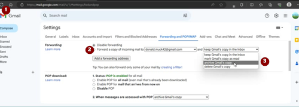

# Uma conta Google dedicada ao AAPS (opcional)

Alguns utilizadores do **AAPS** preferem usar também a sua conta de e-mail principal para o **AAPS**. Em alternativa, alguns utilizadores do **AAPS** (ou os seus cuidadores) criam uma conta de e-mail dedicada ao **AAPS** - isto é opcional; mostramos abaixo um exemplo de como o fazer.

Se não quiser criar uma conta Gmail dedicada ao **AAPS**, pode passar diretamente para a secção seguinte, [Compilar o AAPS](../SettingUpAaps/BuildingAaps.md).

```{admonition} Advantages of a dedicated Google account for AAPS
:class: dropdown

- Um espaço dedicado no Google Drive significa que não corre o risco de encher o limite do seu Google Drive pessoal com **Exportar definições**.
- Cada versão do **AAPS** (e das aplicações de apoio, como xDrip, BYODA, etc.) fica guardada num único sítio, que não depende do hardware do seu computador. Se o seu PC ou telefone for roubado, perdido ou avariar, continua a ter acesso.
- Uma configuração igual para todos, com uma estrutura de pastas semelhante, torna o apoio online mais simples.
- Dependendo da configuração (ver abaixo), terá uma identidade separada, um pseudónimo, para comunicar na comunidade, o que pode proteger a sua privacidade. 
- As crianças com DM1 podem manter a sua própria conta de e-mail do «dia a dia» como menores, enquanto usam o **AAPS** e funções associadas que exigem uma conta de adulto.
- O Gmail permite registar até 4 contas com o mesmo número de telefone.
```

## How to set up a dedicated Google account for AAPS

(⌛About 10 minutes)


Requirements:

* Tem um PC com Windows (Windows 10 ou mais recente) e um telefone Android (Android 12 ou mais recente) onde vai ficar a aplicação **AAPS**. These both have all the latest security updates, internet access and admin privileges, since some steps require downloading and installing programs.
* O telefone Android já está configurado com o seu endereço de e-mail pessoal do «dia a dia», por exemplo uma conta Gmail.

```{admonition} Things to consider when setting up your new account
:class: dropdown
- Por razões de privacidade, pode usar um nome diferente do seu, que tenha relação com a conta (por exemplo, t1dsuperstar). Pode então usá-lo nos fóruns públicos do **AAPS** e manter a sua identidade privada. Como a Google exige um e-mail de recuperação e um número de telefone, a conta continua a poder ser rastreada.
- A nova conta **AAPS** usa para verificação o mesmo número de telefone que a sua conta do «_dia a dia_». Usa o endereço de e-mail do «dia a dia» para verificação;
- Vamos configurar o reencaminhamento de e-mail, para que todos os e-mails enviados para a nova conta dedicada ao AAPS sejam reencaminhados para a conta principal (assim não precisa de ver duas caixas de correio diferentes);
- Use senhas diferentes para a sua conta Gmail do _dia a dia_ e para a conta Gmail dedicada ao AAPS
- Se usar a autenticação de «2-step verification» (verificação em dois passos, também chamada multifator) da Google numa conta Gmail, faça o mesmo nas duas contas Gmail.
- Se pretende usar as «Passkeys» (chaves de acesso) da Google, registe vários dispositivos. Assim não fica sem acesso à conta. Faça-o apenas em dispositivos a que mais ninguém tem acesso (_ou seja_, não num PC com uma conta partilhada que outras pessoas podem desbloquear).
```


```{admonition} Video Walkthrough!
:class: note
Clique [aqui](<https://drive.google.com/file/d/1dMZTIolO-kd2eB0soP7boEVtHeCDEQBF/view?usp=drive_link>) para ver um vídeo que mostra passo a passo como criar uma conta Google dedicada.
```

 These are the steps outlined in the video:

Neste exemplo: 
- A sua conta Google do «_dia a dia_» já existente é <donald.muck42@gmail.com> ; 
- A sua nova conta Gmail «_AAPS_» será: <donald.muck42.aaps@gmail.com>; 


### Vá a <https://account.google.com> 

 Se já tiver sessão iniciada na Google, isto leva-o à página **My Account** (A minha conta) do «dia a dia». (1) Clique na sua fotografia de perfil, no canto superior direito da página (neste caso, um simples  (2) selecione «_add another account_» (adicionar outra conta).


### Introduza os dados da sua NOVA conta dedicada: 

- Introduza a nova conta: 
- Create Account
- for my personal use (para uso pessoal). 


### Enter your persona:
 - Enter firstname
 - lastname
 - birthdate (needs to be an Adult age)

### Escolha o seu NOVO endereço de e-mail & senha

Este exemplo acrescenta «.AAPS» ao endereço já existente de Donald Muck…\
Defina uma senha

### Introduza um número de telefone que possa receber o SMS de verificação

Gmail will now send you a unique code to enter for validation.

### Introduza o endereço de e-mail de recuperação

Neste caso, será o seu e-mail do «_dia a dia_» já existente…

### Finish setting up the account

Gmail will display the account name. Vai pedir-lhe que aceite os termos e condições do Gmail & confirme as definições de personalização.

### Customize the new profile display

Neste ponto, deve estar na página MyAccount do Gmail, com a sua nova conta de e-mail dedicada ao **AAPS**. The profile picture will be set by default to the first letter of your name. Mude-a para algo único, para evitar confusões… neste exemplo, Donald.Muck.AAPS substituiu  por 

\


### Open the Gmail website on both windows to configure the new account

Para não ter de vigiar outra conta de e-mail, reencaminhe todos os e-mails da nova conta dedicada ao **AAPS** para a sua conta do dia a dia\
Esta parte pode ser um pouco confusa, porque vai ter de alternar várias vezes entre as duas contas. To make it easier, open 2 separate browser windows on top of each other:

1. Mova o navegador já aberto para a parte de cima do ecrã e mude o tamanho para que ocupe só cerca da metade de cima do ecrã…
2. Clique com o botão direito no ícone do navegador na barra de tarefas
3. No menu, selecione «New Window» (Nova janela)... e ajuste-a para que ocupe só a metade de baixo do ecrã.

Abra <https://gmail.com> em cada janela do navegador. Confirme que a sua conta pessoal está em cima e a nova conta dedicada ao **AAPS** está em baixo, e que é fácil de identificar pela fotografia de perfil no canto superior direito. (if needed you can always switch accounts by clicking on the profile picture and selecting the correct one.


Os ecrãs iniciais do Gmail devem ficar assim:\


 ### Na nova conta Gmail (janela de baixo), abra as definições do Gmail…

- Clique na roda dentada à esquerda da fotografia de perfil
- depois selecione «**See all Settings**» (Ver todas as definições)


### Setup forwarding…

- Click on the “Forwarding and POP/IMAP” Setting tab
- Click on “add a forwarding address”
- Add your “everyday” email address
- O Gmail envia um código de verificação para o seu endereço de e-mail do «dia a dia».
- You will switch back to your everyday profile and click on the link to verify that you accept the forwarding (or get the code from Gmail’s verification email in your “everyday” Gmail window and cut and paste it in your “new AAPS dedicated” Gmail window).

There is quite a bit of back and forth between the windows but this will ensure that when you check your “everyday” account emails you will also see the emails forwarded from your AAPS dedicated account such as Gmail alerts.


### Verify the forwarded email address

- No Gmail do «dia a dia» (janela de cima), vai receber o e-mail «Gmail forwarding Confirmation» (confirmação do reencaminhamento do Gmail).
- Open it and “click the link to confirm the request”

### Archive forwarded emails in the new dedicated Gmail account (bottom window)

<!---->

1. Refresh the bottom window
2. Check “forward incoming email”
3. And archive Gmail’s copy (to keep your new dedicated mailbox clean)
4. Desloque a página até ao fim para guardar as alterações\
   


Parabéns! Now you have created an AAPS-dedicated Google account. O passo seguinte é [compilar a aplicação AAPS](../SettingUpAaps/BuildingAaps.md).