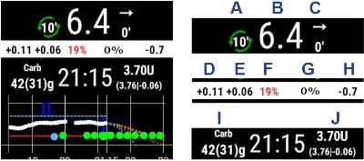

# Configurar o AAPS no seu relógio Wear OS

As instruções abaixo aplicam-se ao APK do **AAPS Wear**, que tem de compilar. Se ainda não o compilou, veja o guia [aqui](../WearOS/BuildingAapsWearOS.md). Ao compilar, use o mesmo ficheiro keystore que usou para o APK do **AAPS** do telefone.

Também pode usar parte destas informações para o APK **Wear** do **AAPSClient** e do **PumpControl**. Cada app **Wear** só comunica com a app do telefone correspondente. Por exemplo: a app **AAPSClient Wear** pode ser usada para mostrar dados do **AAPSClient** e não dados do **AAPS**. Quando várias variantes de cliente (**AAPSClient**, **AAPSClient2**, **AAPSClient3**) estão instaladas lado a lado, os mosaicos de cada uma têm um pequeno cabeçalho com a cor de destaque dessa variante, para os distinguir ao deslizar.

## Versões do Wear OS e compatibilidade

(wearos-watchface-changes)=

### Alterações das watchfaces no Wear OS (impacto nas watchfaces do AAPS)

```{admonition} Why newer Wear OS watches break AAPS watchfaces
:class: warning

Em junho de 2025, a Google [anunciou alterações](https://android-developers.googleblog.com/2025/06/upcoming-changes-to-wear-os-watch-faces.html) que retiram aos poucos o antigo motor de watchfaces (o motor AndroidX / Wearable Support Library, ou "WSL") e o substituem pelo novo formato declarativo **Watch Face Format**. As watchfaces personalizadas do **AAPS** usam o motor antigo. Por isso, quanto mais recente for a versão do Wear OS, maior a probabilidade de uma watchface do AAPS funcionar mal ou deixar de funcionar.

Isto afeta só as **watchfaces** — as **complicações**, os mosaicos e as funções de controlo remoto do AAPS não são afetados. É também por isso que **uma atualização do firmware/sistema num relógio Wear OS pode estragar as watchfaces do AAPS**, e depois não é possível voltar a uma versão mais antiga do Wear OS no relógio. Se a sua watchface do AAPS funciona neste momento, **desative as atualizações automáticas do relógio**.
```

A tabela abaixo resume como a alteração da Google afeta as watchfaces do AAPS (motor antigo) em cada versão do Wear OS:

| Versão do Wear OS       | Android de base | Nível de API | Impacto nas watchfaces do AAPS (antigas)                                                                                                                                                                     |
| ----------------------- | --------------- | ------------ | ------------------------------------------------------------------------------------------------------------------------------------------------------------------------------------------------------------ |
| Wear OS 6               | Android 16      | 36           | **As watchfaces antigas deixam de estar disponíveis** — o AAPS instala uma [watchface em Watch Face Format](#wearos-aaps-v4-watchface): a sua watchface personalizada ou a watchface de complicações AAPS V4 |
| Wear OS 5               | Android 14      | 34           | **Grave** — o modo ativo (interativo) falha muitas vezes, as complicações ficam paradas, as animações param                                                                                                  |
| Wear OS 4               | Android 13      | 33           | **Moderado** — limitação de atualizações, atualizações perdidas, falhas parciais                                                                                                                             |
| Wear OS 3.0 / 3.2 / 3.5 | Android 11      | 30           | **Baixo** — o motor antigo ainda é suportado                                                                                                                                                                 |

Se o seu relógio tem uma versão em que as watchfaces do AAPS não são fiáveis, pode mostrar os dados do AAPS através de **complicações** numa watchface compatível, ou usar o [GlucoDataHandler](https://play.google.com/store/apps/details?id=de.michelinside.glucodatahandler) com uma complicação, alimentado pelo plugin [Aplicações externas complementares](#external-companion-apps) do **AAPS**. No **Wear OS 6 e mais recente**, o AAPS instala uma watchface de substituição feita no novo formato — veja abaixo.

(wearos-aaps-v4-watchface)=

### Wear OS 6 e mais recente — a watchface que o AAPS instala

Os relógios com **Wear OS 6 ou mais recente** não conseguem executar as watchfaces clássicas do AAPS como watchfaces. Para estes relógios, a app AAPS do relógio traz duas watchfaces feitas no novo **Watch Face Format** da Google. O Wear OS só deixa uma app instalar **uma** watchface, por isso escolhe qual das duas fica no relógio:

- **Watchface personalizada** (predefinida): mostra a watchface personalizada que carregou a partir do telefone com **Carregar Watchface** (veja [Mudar para uma watchface do AAPS](#WearOS_changing-to-AAPS-watchface)). O relógio desenha o seu design como uma imagem, por isso todas as watchfaces personalizadas existentes funcionam. As posições de complicações que uma watchface personalizada possa definir **não estão disponíveis** nesta imagem, porque o Wear OS só entrega dados de complicações a uma watchface verdadeira. Prima sem soltar a watchface para chegar à sua única definição: se o ecrã sempre ligado mostra um relógio simples ou o seu próprio design, escurecido.
- **Watchface de complicações** (a watchface **AAPS V4**): as suas **sete posições de complicações** vêm **já configuradas com dados do AAPS**: valor da glicose, IA, HCA, a [complicação Gráfico de glicose](#Watchfaces-complications), taxa basal / alvo temporário, e o ícone **Modo de funcionamento** na posição superior esquerda (toque nele para mudar o modo do loop a partir do relógio). Toque na hora, em cima, para abrir a app de alarmes do relógio. Pode mudar o que cada posição mostra no editor da watchface.

A escolha é feita no telefone: abra o plugin **Android Wear** e, em **Watchface instalada no relógio**, selecione uma das duas. Este cartão só aparece enquanto estiver ligado um relógio com Wear OS 6 ou mais recente. O **AAPS** pede-lhe para confirmar, porque o relógio substitui logo a sua watchface. Ao mudar da **Watchface de complicações** para a outra, as complicações que alterou no editor da watchface também voltam aos valores predefinidos, e a mensagem de confirmação avisa disso. Enquanto a **Watchface de complicações** estiver selecionada, os botões da watchface personalizada ficam escondidos e aparece em vez deles uma pré-visualização da watchface. Se carregar uma watchface personalizada enquanto a **Watchface de complicações** estiver selecionada, o **AAPS** lembra-lhe que tem de mudar para **Watchface personalizada** para a ver no relógio.

- A watchface selecionada é **instalada e ativada automaticamente** da primeira vez que a app AAPS do relógio é executada num relógio destes, e é **atualizada automaticamente** junto com a app do relógio.
- Se removeu a watchface, aparece uma entrada **Instalar watchface** no fundo do **Menu principal** da app AAPS do relógio — toque nela para a reinstalar.

Enquanto estiver ligado um relógio com Wear OS 5 ou mais antigo, o cartão **Watchface instalada no relógio** não aparece (o mecanismo de que depende precisa do Wear OS 6); aí, as watchfaces clássicas funcionam como antes.

(wearos-complications-watchface-setup)=

### Watchface de complicações — configuração recomendada

A **Watchface de complicações** tem sete posições de complicações. Prima sem soltar a watchface, toque em **Customize** (Personalizar) e escolha uma fonte de dados para cada posição. As posições estão numeradas como no editor da watchface: **1** à esquerda, **2** ao centro, **3** à direita, **4** o gráfico, **5** em baixo, **6** em cima à esquerda e **7** em cima à direita.

| Configuração predefinida                                                                                     | Configuração alternativa                                                                                         |
| ------------------------------------------------------------------------------------------------------------ | ---------------------------------------------------------------------------------------------------------------- |
|  |  |

| Posição | Posição            | Predefinida                                                                  | Alternativa                              |
| ------- | ------------------ | ---------------------------------------------------------------------------- | ---------------------------------------- |
| 1       | Esquerda           | Ícone IA                                                                     | HCA & IA                                 |
| 2       | Centro             | Glicose                                                                      | Glicose                                  |
| 3       | Direita            | Ícone HCA                                                                    | Basal & Alvo                             |
| 4       | Gráfico            | Gráfico de glicose                                                           | Gráfico de glicose                       |
| 5       | Em baixo           | Basal & Alvo                                                                 | Bateria do uploader/telefone             |
| 6       | Em cima à esquerda | Modo de funcionamento                                                        | Modo de funcionamento                    |
| 7       | Em cima à direita  | Bateria do uploader/telefone, ou um atalho de app para **Adiar Alerta AAPS** | Atalho de app para **Adiar Alerta AAPS** |

O atalho **Adiar Alerta AAPS** é escolhido nas complicações **App shortcut** (Atalho de app) do próprio relógio. Tocar nele silencia o alarme que está a tocar no telefone.

```{tip}
Ative **Always-on display** (Ecrã sempre ligado) no relógio (**Settings** (Definições) > **Display** (Ecrã)). A watchface continua então a mostrar a sua glicose quando o pulso está em baixo, em vez de um ecrã vazio ou de um relógio simples.
```

```{admonition} No complication data while the watch is locked
:class: note
Se estiver definido um **Lock type** (Tipo de bloqueio) em **Settings** (Definições) > **Security and privacy** (Segurança e privacidade), o relógio esconde os dados das complicações enquanto está bloqueado, e a watchface mostra posições vazias até o desbloquear. Para manter os dados visíveis, desligue **Hide information** (Ocultar informações) no mesmo menu.
```

### Wear OS 3

Instale o APK do **AAPS Wear** com o [Wear Installer 2](https://youtu.be/abgN4jQqHb0?si=5L7WUeYMSd_8IdPV), com o Easy Fire Tools (descrito abaixo) ou com o ADB.  
Sem limitações no funcionamento do **AAPS Wear**.

(BuildingAapsWearOs-WearOS5)=

### Wear OS 4 e Wear OS 5

Exemplo: Galaxy Watch 4, 5, 6, 7 e Ultra ou Pixel Watch que **ainda não** foram atualizados para o Wear OS 6. Veja a versão em **Settings** (Definições) > **About watch** (Acerca do relógio) > **Software**.

Instale o APK do **AAPS Wear** com o [Wear Installer 2](https://youtu.be/abgN4jQqHb0?si=5L7WUeYMSd_8IdPV) (para o Wear OS 5, siga [este vídeo](https://www.youtube.com/watch?v=yef_qGvcCnk)). Todas as funções do **AAPS Wear** funcionam, mas as watchfaces clássicas do **AAPS** estão limitadas como descrito na tabela acima: com limitação de atualizações no Wear OS 4, com falhas frequentes no Wear OS 5.

```{admonition} Wear OS 5
:class: warning
No Wear OS 5, a watchface do AAPS tem de ser selecionada com o Wear Installer 2 logo depois de instalar a app Wear: no fim da instalação, o instalador propõe a watchface **AAPS (Custom)** (AAPS(personalizado)). Se mudar por engano para outra watchface, repita a instalação. Pode não ser possível mudar as definições da watchface (Escuro, Divisor correspondente, etc.).

Se a watchface clássica funciona neste momento, **desative as atualizações automáticas do relógio**: a próxima atualização do firmware vai provavelmente estragá-la. Se mesmo assim atualizar para o Wear OS 6, leia a secção acima: o **AAPS** instala então a sua própria watchface no novo formato.
```

Se a watchface não for fiável, pense em usar o [GlucoDataHandler](https://play.google.com/store/apps/details?id=de.michelinside.glucodatahandler) com uma complicação. Precisa do plugin [Aplicações externas complementares](#external-companion-apps) ativo no **AAPS**.

### Wear OS 6 e mais recente

Exemplo: Galaxy Watch 4 e mais recentes com One UI 8 Watch, Pixel Watch depois da atualização de 2025. A maioria dos relógios Galaxy e Pixel já recebeu esta atualização.

Instale o APK do **AAPS Wear** com o [Wear Installer 2](https://youtu.be/abgN4jQqHb0?si=5L7WUeYMSd_8IdPV). As watchfaces clássicas não estão disponíveis; o **AAPS** instala automaticamente a watchface selecionada no telefone, veja [a watchface que o AAPS instala](#wearos-aaps-v4-watchface). Sem limitações no funcionamento do **AAPS Wear**.

## Como configurar um smartwatch Samsung Galaxy Watch 4 com o **AAPS**

Esta secção parte do princípio de que nunca usou um smartwatch. Dá uma orientação básica sobre um relógio popular, o **Galaxy Watch 4**, e depois um guia passo a passo para configurar o **AAPS** no relógio.

_Este guia foi escrito para um Galaxy Watch com Wear OS 3._ No Wear OS 4 e mais recente, o relógio pede um **código de emparelhamento** quando um telefone ou computador se liga por ADB. O Wear Installer 2 e o procedimento no terminal [abaixo](#BuildingAapsWearOs-WearOS5-TShoot) suportam isto.

Aqui estão guias de configuração básica para o [Galaxy Watch 5](https://www.youtube.com/watch?v=Y5upzOIxwTU) e para o [Galaxy Watch 6](https://www.youtube.com/watch?v=D6bq20KzPW0)

## Conhecer o básico do smartwatch

Depois da configuração básica do seu relógio, como no vídeo acima, abra a Play Store no telefone e descarregue as seguintes apps: "Galaxy Wearable", “Samsung” e “Easy Fire tools” ou "Wear Installer 2".

Há muitos vídeos de terceiros no YouTube que o ajudam a conhecer o seu novo smartwatch, por exemplo:

[https://www.youtube.com/watch?v=tSVkqWNmO2c](https://www.youtube.com/watch?v=tSVkqWNmO2c)

A app “Galaxy Wearable” também tem uma secção com um manual de instruções. Abra o Galaxy Wearable no telefone, procure o relógio e tente emparelhar o relógio com o telefone. Conforme a sua versão, pode ser-lhe pedido para instalar mais uma app, “galaxy watch 4 plugin”, a partir da Play Store (a transferência demora algum tempo). Instale-a no telefone e depois tente de novo emparelhar o relógio e o telefone na app Wearable. Passe por uma série de menus e marque várias preferências.

## Criar uma conta Samsung

A conta de e-mail que usa para criar a conta Samsung tem de ter uma data de nascimento que dê ao utilizador 13 anos ou mais. Caso contrário, é muito difícil aprovar as permissões da Samsung. Se deu à sua criança com menos de 13 anos uma conta Gmail e usa esse endereço de e-mail, não pode simplesmente mudá-la para uma conta de adulto. Uma forma de contornar isto é alterar a data de nascimento atual para que a idade seja 12 anos e 364 dias. No dia seguinte, a conta passa a ser uma conta de adulto e pode continuar a configuração da conta Samsung.

(remote-control-transferring-the-aaps-wear-app-onto-your-aaps-phone)=

## Transferir a app **AAPS** Wear para o seu telefone **AAPS**

Pode passar o Wear.apk do Android Studio para o seu telefone de uma destas formas:

a)  com um cabo USB, copie o ficheiro APK do **AAPS** Wear para o telefone e depois instale-o no relógio por «side-load» (instalação manual). Transfira o Wear.apk para o telefone por USB, para a pasta de transferências; ou

b)  corte e cole o Wear.apk do Android Studio para o seu Google Drive.


Para instalar o AAPS no relógio por side-load, pode usar: 1) Wear Installer 2 2) Easy Fire tools 3) Android Debug Bridge (ADB) Aqui recomendamos o Wear Installer 2, porque as instruções e o processo no vídeo são muito claros e bem explicados. Se o Wear Installer 2 não funcionar, experimente o Easy Fire Tools ou o ADB, ambos descritos abaixo.

### Usar o Wear Installer 2 para instalar o **AAPS** Wear do telefone para o relógio por side-load

 

O Wear Installer 2, criado por [Malcolm Bryant](https://www.youtube.com/@Freepoc), pode ser descarregado do Google Play para o seu telefone e serve para instalar a app AAPS Wear no relógio por side-load. A app inclui um [vídeo](https://youtu.be/abgN4jQqHb0?si=5L7WUeYMSd_8IdPV) prático sobre «como fazer o side-load».

```{tip}
Para relógios com Wear OS 5, siga [este vídeo](https://www.youtube.com/watch?v=yef_qGvcCnk).
Veja as dicas de resolução de problemas [abaixo](#BuildingAapsWearOs-WearOS5-TShoot).
```

O vídeo dá todos os detalhes necessários (é melhor abrir o vídeo noutro dispositivo, para o poder ver enquanto configura o telefone).

Como diz o vídeo, quando terminar, desligue a depuração ADB no relógio, para não gastar a bateria do smartwatch.

Em alternativa, mas não para o Wear OS 5, pode:

### Usar o Easy Fire tools para instalar o **AAPS** Wear no relógio por side-load

1)   Descarregue o _[Easy Fire Tools](https://play.google.com/store/apps/details?id=de.agondev.easyfiretools&hl=en)_ da Play Store para o telefone


2)  Torne-se programador no relógio (depois de o configurar e ligar ao telefone):

Abra **Settings** (Definições) > **System** (Sistema) > **About** (Acerca de) > **Versions** (Versões) (os nomes dos menus variam entre marcas de relógios — em alguns relógios é **About watch** (Acerca do relógio) > **Software info** (Informações do software) > **Software version** (Versão do software)).


Toque rapidamente várias vezes em **Build number** (Número de compilação) (ou em **Software version**) até aparecer uma mensagem a dizer que agora é programador.


Volte a **Settings** (Definições) > **System** (Sistema): aparece agora um novo menu **Developer options** (Opções de programador).

Em **Developer options**, ative **ADB debugging** (Depuração ADB) e **Wireless debugging** (Depuração sem fios) e confirme as mensagens. A depuração sem fios mostra então o **IP address & Port** (endereço IP e porta) do relógio, algo como: **192.168.1.214** : 5555. Só precisa do endereço IP (aqui **192.168.1.214**), não do número da porta depois dos dois pontos. Atenção: o endereço IP pode mudar, por exemplo sempre que muda para um novo telefone para o AAPS.


PASSO 3)     Introduza o endereço IP, _por exemplo_ **192.168.1.214**, no Easy Fire tools no telefone (abra o menu hambúrguer à esquerda, as definições, e introduza o endereço IP).


Depois toque no ícone da tomada no canto superior direito. Fica verde quando estiver ligado.


PASSO 4) Siga as instruções [aqui](https://wearablestouse.com/blog/2022/01/04/install-apps-apk-samsung-galaxy-watch-4/?utm_content=cmp-true) para instalar por side-load (ou seja, transferir) o aaps-wear.apk para o smartwatch com o Easy Fire tools


(BuildingAapsWearOs-WearOS5-TShoot)=

### Usar o terminal
Ligue o smartwatch e o computador à mesma rede Wi-Fi.

- Para instalar o ADB, descarregue-o de: https://developer.android.com/tools/releases/platform-tools
- Abra um terminal.
- No Windows, crie uma nova pasta chamada `adb` no seu disco `C:`. Abra o ficheiro `platform-tools-latest-windows.zip` que descarregou acima. Copie todos os ficheiros que estão em `platform-tools` para `C:\adb` e abra esta pasta numa linha de comandos (clique com o botão direito e Open in Terminal (Abrir no Terminal)). Escreva o comando abaixo para definir o caminho para a pasta onde está o ADB: `setx PATH "%PATH%;C:\adb"`
- No Mac, em vez de instalar manualmente, pode usar o homebrew: `brew install android-platform-tools`

No relógio:
- Abra Settings (Definições) → About watch (Acerca do relógio) → **Software Information** (Informações do software)
- Toque 7 vezes em Software version (Versão do software) até ver a mensagem de que o modo de programador foi ativado.
- Abra Settings (Definições) → Developer options (Opções de programador). Ative **ADB debugging** (Depuração ADB)
- Abra Settings (Definições) → Developer options (Opções de programador) → Wireless debugging (Depuração sem fios) → **Pair new device** (Emparelhar novo dispositivo)

Vai ver aparecer um código de emparelhamento Wi-Fi, o endereço IP e a porta:


- No terminal: `adb pair ipaddress:port` Por exemplo: `adb pair 10.10.1.125:36299`
- É-lhe pedido o código de emparelhamento. Introduza-o.
- Vai ver uma resposta:<br> `Successfully paired to 10.10.1.125:36299 [guid=adb-RXXXW20LMKJY-eh5zBj]`<br>
- No terminal, escreva: <br>`adb devices`.<br> Deve ver algo como:<br> `List of devices attached`<br> `10.10.1.125:36299  offline`<br> `adb-RFAW20LMKJY-eh5zBj._adb-tls-connect._tcp   device`<br>

- Agora abra a pasta do seu computador onde está o Wear apk e escreva<br> `adb install wear-full.apk` <br>substituindo wear-full.apk pelo nome do seu ficheiro APK.
- Vai ver:<br> `Performing Streamed Install`<br> `Success`


(wear-os-5-troubleshooting)=

### Recomendações gerais de resolução de problemas para o Wear OS 5

- Não use a partilha de Wi-Fi (Wi-Fi Tethering). Isso não funciona.
- Não precisa de ativar a depuração ADB no telefone (só no relógio). Desative a depuração ADB no telefone.
- Ligue-se à sua rede local, onde o telefone e o relógio se veem um ao outro (não use a rede Wi-Fi de convidados).
- O relógio e o telefone têm de estar na mesma rede e no mesmo dispositivo Wi-Fi. Sobretudo os repetidores Wi-Fi ou os pontos de acesso podem criar problemas.
- Fique perto do seu router principal e depois reinicie o telefone e o relógio.

**Emparelhamento:**

- Relógio: Wireless Debugging (Depuração sem fios): anote o endereço IP.
- Wear Installer: introduza o IP na app Wear Installer.
- Selecione Pair new (Emparelhar novo), anote o código de emparelhamento e o número da porta que aparecem.
- Wear Installer: introduza o código de emparelhamento + espaço + número da porta.
- O Wear Installer deve indicar que o emparelhamento foi bem-sucedido. Se não indicar, saia do Wear Installer e tente de novo.

Depois de emparelhar, deve conseguir instalar o APK do AAPS Wear:

- Saia/feche e depois reinicie o Wear Installer.
- Na depuração sem fios, anote o IP e o número da porta e verifique/introduza o IP e o número da porta no Wear Installer.
- Nota: o número da porta é diferente do usado para o emparelhamento!

## Configurar a ligação entre o relógio e o telefone a partir do **AAPS**

O último passo é configurar o **AAPS** no telefone para comunicar com o **Wear.apk** no relógio. Para isso, ative o plugin Android Wear:

* Abra a app **AAPS** no telefone

* Abra o **menu** (☰) no canto superior esquerdo e vá a **Configuração** > **Comunicação**

* Marque a caixa **Android Wear**


Para dar bólus ou fazer outras ações a partir do relógio, ative também **Controlo pelo Wear** em [Definições > Android Wear](#preferences-wear).

Para mudar para outra watchface do **AAPS**, prima o ecrã inicial do relógio e aparece «customise» (personalizar). Depois deslize para a direita até ver todas as watchfaces do **AAPS**.

Se o Wear.apk do **AAPS** foi instalado com sucesso no smartwatch, o ecrã fica assim:


Em alguns smartwatches, como o Samsung Galaxy, a opção 'Remote Connection' (Ligação remota) nas Advanced Features (Funcionalidades avançadas) do Samsung Galaxy tem de estar **ligada** para usar o **Wear.apk** & o **AAPS** à distância por Wi-Fi.


(wear-os-watch-phone-communication)=

### Resolução de problemas da comunicação entre o relógio **AAPS** e o telefone **AAPS**

1.  Se o Easy Fire tools não ligar, ou se receber ‘authorisation failed’ (autorização falhada) > verifique se o endereço IP foi introduzido corretamente.
2.  Verifique se o smartwatch está ligado à internet (e não apenas ligado ao telefone por Bluetooth).
3.  Verifique se o telefone **AAPS** e o smartwatch estão emparelhados ou associados na app Samsung.
4.  Também pode ajudar reiniciar completamente o telefone e o smartwatch (ou seja, desligar e voltar a ligar o telefone)
5.  Se conseguiu descarregar o Wear.apk para o telefone mas não recebe dados de glicose, _verifique_ se instalou no relógio o APK do **AAPS** Wear correto: a app do relógio de uma compilação no navegador é o ficheiro `aaps-wear-….apk`, veja [Compilar a app Wear](../WearOS/BuildingAapsWearOS.md). Se o ficheiro que instalou é um dos seguintes: a) um APK Wear do **AAPSClient** (enquanto o telefone executa o **AAPS**); b) um ficheiro `.aab`; ou c) um ficheiro com a palavra ‘debug’ no nome, então não selecionou o APK Wear OS correto durante a compilação.
6.  Verifique se o seu router não isola os dispositivos uns dos outros.

Pode encontrar mais dicas de resolução de problemas [aqui](https://freepoc.org/wear-installer-help-page/#:~:text=If%20you%20are%20having%20problems,your%20phone%20and%20your%20watch.)

(WearOS_changing-to-AAPS-watchface)=

## Mudar para uma watchface do AAPS no seu relógio Wear OS

A compilação normal do APK do AAPS Wear OS traz várias watchfaces. Depois de instalar o APK do AAPS Wear no seu relógio, ficam disponíveis. Estes são os passos para escolher uma:

1. No seu relógio (com Wear OS), prima sem soltar a watchface atual para abrir o ecrã de escolha de watchfaces, deslize totalmente para a direita até ver o botão "Add Watch Face" (Adicionar mostrador) e selecione-o


2. Percorra a lista até encontrar "AAPS (Custom)" (AAPS(personalizado)) (conforme o relógio, as watchfaces das apps instaladas aparecem numa secção "Downloaded" (Transferidas) ou agrupadas por app) e toque no meio da imagem para a juntar à sua lista curta de watchfaces atuais. Não se preocupe com o aspeto atual da watchface "AAPS (Custom)" (AAPS(personalizado)); vai escolher o seu design preferido no próximo passo.


3. Agora abra o AAPS no seu telefone e abra o plugin Android Wear: **Configuração** > **Comunicação** > **Android Wear** > **Abrir plugin** (marque primeiro **Android Wear** se não estiver ativo).


4. Toque no botão "Carregar Watchface" e selecione a watchface de que gosta


5. Veja o seu relógio: a watchface "AAPS (Custom)" (AAPS(personalizado)) deve agora mostrar o design que escolheu. Espere alguns segundos até atualizar. O ecrã **Android Wear** no telefone mostra agora o nome da watchface carregada e uma pré-visualização dela. **Infos Watchface** mostra os detalhes e os campos que ela contém, e **Mais watchfaces** abre o [site de partilha](../ExchangeSiteCustomWatchfaces/index.md), onde pode descarregar outras watchfaces personalizadas. Agora pode personalizar as complicações, etc.: prima sem soltar a watchface e depois toque no botão "Customize" (Personalizar) na imagem da watchface.

```{admonition} Complications on a custom watchface
:class: note
As watchfaces personalizadas feitas com a versão 3.0 ou mais recente do formato de watchfaces personalizadas podem ter até cinco posições de complicações, com a posição e o tamanho definidos pela watchface (**Disposição das complicações**). No relógio, prima sem soltar a watchface, toque em **Customize** (Personalizar) e toque em **Complicação 1** a **Complicação 5** para escolher a fonte de dados mostrada em cada posição. As mesmas linhas aparecem na app AAPS do relógio em **Definições** > **AAPS(personalizado)**; tocar numa delas abre o mesmo seletor. **Prioridade do tipo de complicação** decide se uma posição prefere um valor ou indicador, texto ou um ícone, quando a fonte de dados oferece vários. Uma prioridade alterada só se aplica da próxima vez que escolher uma fonte de dados para essa posição.

Estas posições só funcionam em relógios com **Wear OS 5 ou mais antigo**, onde a watchface personalizada funciona como uma watchface verdadeira. No **Wear OS 6 e mais recente**, a watchface personalizada aparece como uma imagem sem as suas posições de complicações, e os passos 1 e 2 acima não são necessários: verifique se **Watchface personalizada** está selecionada em **Watchface instalada no relógio** no plugin **Android Wear** do telefone (veja [a watchface que o AAPS instala](#wearos-aaps-v4-watchface)).
```

## Watchface AAPSv2 - Legenda



A - tempo desde a última execução do loop

B - leitura do CGM

C - minutos desde a última leitura do CGM

D - variação em relação à última leitura do CGM (em mmol ou mg/dl)

E - variação média da leitura do CGM nos últimos 15 minutos

F - bateria do telefone

G - taxa basal (em U/h com a taxa normal e em % durante uma basal temporária)

H - BGI (IG, impacto na glicose) -> o quanto a glicose «deveria» estar a subir ou a descer só por causa da atividade da insulina.

I - hidratos de carbono (HCA | eCarbs no futuro)

J - insulina ativa (IA) (do bólus | da basal)
