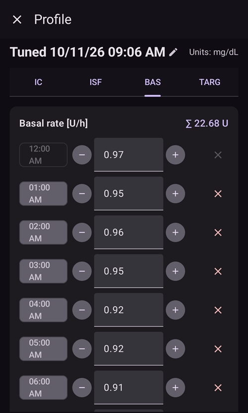
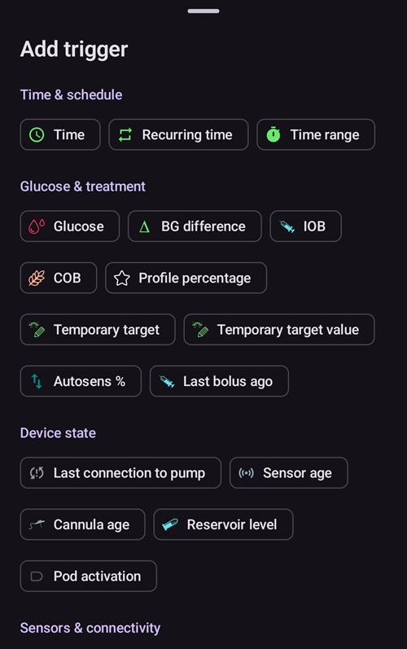

# Cum să utilizați modulul Autotune

Modulul Autotune este o implementare a algoritmului autotune OpenAPS în AAPS. Analizează istoricul recent din AAPS pentru a propune ajustări ale ratelor bazale, ale FSI și ale RIC.

Modulul Autotune este disponibil în versiunile AAPS de la [3.4](#version3400), dar este ascuns în mod implicit.

(autotune-how-autotune-calculates-adjustments)=
## Cum calculează Autotune ajustările

Autotune analizează istoricul recent din AAPS — citirile CGM, bolusurile, carbohidrații și ratele bazale temporare — și găsește unde **profilul** dumneavoastră (rate bazale, FSI, RIC) nu se potrivește bine cu ce s-a întâmplat de fapt cu glicemia.

Pentru fiecare punct de date de 5 minute, compară **schimbarea reală a glicemiei** cu schimbarea prezisă de profil și pune deviația rezultată într-una din trei categorii:

* deviații care au apărut fără carbohidrați activi și fără activitate a insulinei (folosite pentru ajustarea **ratelor bazale**, oră cu oră),
* deviații care au apărut după un bolus sau o corecție fără carbohidrați (folosite pentru ajustarea **FSI**), sau
* deviații care au apărut în timp ce carbohidrații erau absorbiți (folosite pentru ajustarea **RIC**).

Apoi analizează tiparul deviațiilor din fiecare categorie (folosind percentile în loc de o medie simplă, astfel încât câteva puncte de date cu zgomot să nu denatureze rezultatul) și propune o valoare nouă pentru acea oră sau acel parametru.

Pentru ca o singură rulare să nu corecteze prea mult, fiecare rulare Autotune mută o valoare doar o parte din drum spre ceea ce sugerează datele: cel mult 10% pentru FSI și RIC și cel mult 20% pentru fiecare segment bazal. Abaterea totală este limitată în plus de setările **Max autosens ratio** / **Min autosens ratio** (vedeți [Alte setări](#autotune-other-settings) mai jos), aceleași limite care limitează Autosens. De aceea Autotune trebuie rulat în mod repetat (zi după zi sau în fiecare noapte) și nu trebuie să aveți încredere în el după o singură rulare: rezultatele ar trebui să se apropie treptat de o valoare stabilă, iar un salt mare la o rulare este un semn că trebuie să vă verificați din nou datele (carbohidrați neintroduși, o zi proastă a senzorului, _șamd_), în loc să aveți încredere oarbă în el.

Autotune poate fi rulat în trei moduri: manual, o singură dată, din modul (cum este descris mai jos), automat în fiecare noapte printr-o [regulă de automatizare](#autotune-run-autotune-with-an-automation-rule) sau, complet în afara AAPS, ca instrument separat din linia de comandă pe date exportate; așa cum descriu unele ghiduri ale comunității folosirea lui fără un telefon care rulează AAPS.

*Pentru algoritmul oref0 de bază, cu toate detaliile matematice, vedeți [documentația Autotune OpenAPS](https://openaps.readthedocs.io/en/latest/docs/Customize-Iterate/autotune.html).*

## Arătați modulul Autotune

Creați un fișier gol numit `enable_autotune` în subdosarul `extra` din [dosarul AAPS](#preferences-maintenance-settings) al telefonului dumneavoastră.

***NOTĂ: Verificați în setările AAPS unde este dosarul AAPS și dacă ați pus fișierul în dosarul corect. Mai mulți utilizatori au pus fișierul în dosarul greșit.***


Reporniți **AAPS**. Apoi deschideți **meniul** (☰), selectați **Configurație**, apoi categoria **General** și bifați **Autotune**. Cardul afișează apoi **Setări** și **Deschideți modulul**:


## Interfața utilizatorului pentru Autotune

Apăsați **Deschideți modulul** pe cardul **Autotune** pentru a deschide ecranul Autotune:


- Puteți selecta în meniul derulant profilul de intrare pe care doriți să-l ajustați (în mod implicit profilul dvs. activ în prezent va fi selectat)
  - Notă: de fiecare dată când selectați un profil nou, rezultatele anterioare vor fi șterse, iar **Număr de zile de date** va fi setat la valoarea implicită
- Apoi **Număr de zile de date** (numit **Zile ajustare** în versiunile mai vechi) servește la selectarea numărului de zile folosite în calcul pentru a vă ajusta profilul. Valoarea minimă este de 1 zi, iar valoarea maximă este de 30 de zile. Acest număr nu ar trebui să fie prea mic astfel încât să se obțină rezultate iterative și omogene (peste 7 zile pentru fiecare calcul)
  - Notă: de fiecare dată când modificați **Număr de zile de date**, rezultatele anterioare vor fi șterse
- Ultima Rulare reprezintă o legătură care recuperează ultimul calcul valid. Dacă nu ați lansat Autotune în ziua curentă sau dacă rezultatele anterioare au fost șterse cu o modificare a parametrului de calcul de mai sus, atunci puteți recupera parametrii și rezultatele ultimei rulări reușite.
- Atenționare vă arată, de exemplu, unele informații despre profilul selectat (dacă aveți mai multe valori ICI sau mai multe valori ISF)
  - Notă: Calcularea automată funcționează cu o singură valoare IC și o singură valoare ISF. În prezent nu există niciun algoritm Autotune care să regleze un IC circadian sau un ISF circadian. Dacă profilul tău de intrare are mai multe valori, poți vedea în secțiunea de avertizări valoarea medie luată în considerare pentru a-ți regla profilul.
- Butonul Verificați profilul de intrare deschide vizualizatorul de profil, pentru o verificare rapidă a profilului dumneavoastră (unități, RIC, FSI, bazală și țintă)
  - Notă: Autotune va regla doar IC (o valoare unică), ISF (o valoare unică) și bazala (cu variația circadiană). Units and target will remain unchanged in output profile.

- "Run Autotune" will launch Autotune calculation with selected profile and the selected number of days of data
  - Notă: Calculația Autotune poate dura destul de mult. Odată lansat, puteți comuta la altă parte a interfeței (vederea de ansamblu, șamd) și să reveniți mai târziu în modulul Autotune pentru a vedea rezultatele

  

- Apoi în timpul rulării veți vedea rezultatele intermediare mai jos

  - Notă: În timpul rulării, setările sunt blocate, astfel încât să nu mai poți modifica profilul de intrare sau numărul de zile. Va trebui să așteptați sfârșitul calcului curent dacă doriți să porniți o altă execuție cu alți parametri.

  

- Când calculul Autotune este finalizat, veți vedea rezultatul (profilul reglat) și patru butoane mai jos.

  

- Este important să se compare întotdeauna profilul de intrare (coloana "Profil"), profilul de ieșire (coloana "Reglat") și procentajul variației pentru fiecare valoare (coloana "%").

- Pentru ratele bazale, aveți și numărul de "zile lipsă". Aveți zile lipsă atunci când Autotune nu are suficiente date clasificate ca "Bazală" pentru a regla rata bazală pentru această perioadă (spre exemplu după fiecare masă când ai absorbție de carbohidrați). Acest număr ar trebui să fie cât mai scăzut posibil, în special atunci când bazala este importantă (spre exemplu, în timpul nopții sau la sfârșitul după-amiezii)

- Butonul "Comparați profilele" deschide interfața de comparare a profilelor. Profilul de intrare este în albastru, și profilul de ieșire (denumit "Reglat") este în roșu.

  - Notă: în exemplul de mai jos, profilul de intrare are variații circadiene pentru IC și ISF, dar profilul de ieșire calculat are o singură valoare. Dacă este important pentru dumneavoastră să obțineți un profil de ieșire circadian vedeți [Profilul Circadian ICR sau ISF](#autotune-circadian-ic-or-isf-profile) mai jos.

  

- Dacă aveți încredere în rezultate (un procentaj scăzut de variație între profilul de intrare și profilul de ieșire), atunci puteți apăsa pe butonul "Activați profil" și apoi dați pe OK pentru a valida.

  - "Activați profil" va crea automat un profil nou "Ajustat" în lista de profiluri (**Gestionați → Profil**).
  - If you already have a profile named "Tuned" in **Manage → Profile**, then this profile will be updated with calculated Autotune profile before the activation

  

- Dacă credeți că profilul ajustat mai trebuie reglat (spre exemplu, dacă credeți că anumite variații sunt prea importante), atunci puteți apăsa pe butonul "Copiați la profilul local"

  - A new profile with the prefix "Tuned" and the date and time of the run will be created in **Manage → Profile**

  

- You can then edit the Tuned profile: open **Manage** > **Profile**, swipe to the card named "Tuned" with the date and time of the run, and tap the **Edit** (pencil) button

  - the values in the profile will be rounded in the user interface to your pump capabilities

  

- Dacă doriți să înlocuiți profilul de intrare cu rezultatul Autotune, apasăți pe butonul "Actualizați profilul de intrare" și validați notificarea prin apăsarea pe OK

  - Note: if you click on "Activate profile" after "Update input profile", then you will activate your updated profile and not the default "Tuned" profile.

  

- Dacă ați actualizat profilul de intrare, atunci butonul "Actualizați profilul de intrare" este înlocuit de butonul "Reveniți la profilul de intrare" (a se vedea captura de ecran de mai jos). You can that way immediately see if your current input profile in **Manage → Profile** already includes the result of last run or not. You also have the possibility to recover your input profile without autotune result with this button

  


## Setări Autotune

(autotune-plugin-settings)=

### Setări modul Autotune

  

```{admonition} Only DEV
:class: note
The **Auto switch profile** feature is only available in Dev/Engineering mode.
```

- **Auto switch profile** (default Off): see [Run Autotune with an automation rule](#autotune-run-autotune-with-an-automation-rule) below. Dacă schimbați această setare pe Pornit, profilul de intrare va fi actualizat automat de către profilul Ajustat și va fi activat.
  - **Fiți atenți, trebuie să aveți încredere și să verificați în următoarele zile, că după o actualizare și o activare a profilului ajustat fără modificare, se îmbunătățește sistemul de buclă**

- **Clasificați UAM ca bazală** (implicit oprit): Această setare este pentru utilizatorii care folosesc AAPS fără să introducă deloc carbohidrați (complet UAM). Va opri (când este oprit) să catalogheze UAM ca bazală.
  - Notă: dacă aveți cel puțin o oră detectată de absorbție a carbohidraților în timpul unei zile, apoi toate datele clasificate ca "UAM" vor fi clasificate ca bazală, indiferent de această setare (pornită sau oprită)
- **Default tune days** (default 5): You can define the default value with this setting. Each time you select a new profile in the Autotune plugin, the **Number of days of data** will be replaced by this default value
- **Use circadian IC/ISF** (default Off): see [Circadian IC or ISF profile](#autotune-circadian-ic-or-isf-profile) below.

(autotune-other-settings)=
### Alte setări

- Autotune folosește și raportul Max autosens și raportul Min autosens pentru a limita variația. You can see and adjust these values in [**Settings** > **Absorption settings** > **Advanced Settings**](../SettingUpAaps/Preferences.md) (**Autosens max** and **Autosens min**).

  


## Caracteristici avansate

(autotune-circadian-ic-or-isf-profile)=

### Profil Circadian IC sau ISF

- If you have important variation of IC and/or you ISF in your profile, and you fully trust in your circadian time and variation, then you can enable **Use circadian IC/ISF** (called "Apply average result in circadian IC/ISF" in older versions)

  - Țineți cont că calculul Autotune se va face întotdeauna cu o singură valoare, iar variația circadiană nu va fi reglată de Autotune.

- Vedeți în captura de ecran de mai jos profilul ajustat cu Aplică variația medie, oprită (pe partea stângă) și pornită (pe partea dreaptă)

  


### Ajustați anumite zile ale săptămânii

- If you tap the **eye** icon on the right of the **Number of days of data** field, you will see the day selection. Puteți specifica care zi a săptămânii ar trebui inclusă în calculul Autotune (în captura de ecran de mai jos puteți vedea un exemplu pentru "zile lucrătoare" cu sâmbătă și duminică eliminate din calculul Autotune)
  - If the number of days included in Autotune calculation is lower than the **Number of days of data**, then you will see how many days will be included on the right of the days selector (10 days in the example below)
  - This setting gives good results only if the number of remaining days is not too small (for example if you Tune a specific profile for week end days with only Sunday and Saturday selected, you should set **Number of days of data** to at least 21 or 28 to have 6 or 8 days included in Autotune calculation)

  

- During Autotune calculation, you can see the progress of the calculations ("Partial result day 1 / 4 tuned" in the example below, with Saturday and Sunday excluded)

  


(autotune-run-autotune-with-an-automation-rule)=

## Execuția Autotune cu o condiție de automatizare

```{admonition} Only DEV
:class: note
The **Auto switch profile** feature is only available in Dev/Engineering mode.
```

Primul pas este definirea unui declanșator corect pentru o regulă de automatizare cu Autotune:

Notă: pentru mai multe informații despre cum să setați o condiție de automatizare, vedeți [aici](../DailyLifeWithAaps/Automations.md).

- Ar trebui să selectați declanșatorul pentru execuții programate: executați Autotune doar o dată pe zi, Autotune este proiectat să fie executat zilnic (pentru fiecare nouă execuție schimbați ziua și modificarea profilului ar trebui să fie minusculă)

  

- Este mai bine la început să executați Autotune în timpul zilei pentru a putea verifica rezultatele. Dacă doriți să rulați Autotune în timpul nopții, trebuie să selectați în declanșator ora 4 dimineața sau mai târziu pentru a include ziua curentă în următorul calcul Autotune.

  

- Apoi puteți selecta acțiunea **Rulați Autotune** (din grupul **Buclă & insulină**)

  

- You can then adjust the parameters of the action for your run. In a new action, **Select profile to tune** shows the first profile of your local profile list, the **Tune days** field is empty and all days are selected. Choose the profile to tune and enter the number of **Tune days** (1 to 30).

  

- After a few days, if you fully trust Autotune results and percentage of modification is low, you can modify [Autotune settings](#autotune-plugin-settings) "**Auto switch profile**" to enabled to automatically update and activate profile tuned after calculation.

Notă: dacă doriți să reglați automat profiluri pentru anumite zile ale săptămânii (de exemplu, un profil pentru "Zilele săptămânii" și altul pentru "Zile lucrătoare"), apoi creați o regulă pentru fiecare profil, selectează aceleași zile în declanșator și în acțiunea Autotune, zilele de reglare trebuie să fie suficient de multe pentru a fi sigur că se va face reglarea cu cel puțin 6 sau 8 zile, și nu uitați să selectați timpul după 4 dimineața în declanșator...

- See below an example of rule that runs every working day (Monday to Friday) at 04:00 and tunes the profile "Normal" with 14 **Tune days**, working days only (so only 10 days are included in the Autotune calculation).

  


## Sfaturi și trucuri

Autotune funcționează cu informații existente în baza de date, deci dacă tocmai ați instalat AAPS pe un telefon nou, va trebui să așteptați câteva zile înainte de a putea lansa Autotune cu suficiente zile pentru a obține rezultate relevante.

Autotune este doar un ajutor, este important să verificați periodic dacă sunteți de acord cu profilul calculat. Dacă aveți îndoieli, schimbați setările de autoreglare (de exemplu numărul de zile) sau copiați rezultatele în profilul local și ajustați profilul înainte de a-l folosi.

Utilizați întotdeauna Autotune câteva zile manual pentru a verifica rezultatele înainte de a le aplica. Și doar atunci când aveți încredere deplină în rezultatele Autotune și când diferența dintre profilul anterior și profilul calculat devine foarte mică, începeți să utilizați Automatizarea (niciodată înainte)

- Autotune poate funcționa foarte bine pentru unii utilizatori și pentru alții nu, așa că **Dacă nu aveți încredere în rezultatul Autotunei, nu îl folosiți**

It's also important to analyze Autotune results to understand (or try to understand) why Autotune proposes these modifications

- puteți avea o creștere sau o scădere totală a intensității profilului dumneavoastră (de exemplu o creștere a valorii bazalei totale asociată scăderii valorilor ISF și IC). ar putea urma câteva zile următoare cu corecție autosens peste 100% (este nevoie de mai mult agresivitate) sau sub 100% (sunteți mai sensibil)
- Uneori Autotune propune un echilibru diferit între ratele bazale și IC/FSI (de exemplu bazale mai mici și IC/FSI mai agresive)

Recomandăm să nu se folosească Autotune în următoarele cazuri:

- Nu introduceți toți carbohidrații
  - Dacă nu introduceți corecția carbohidraților pentru hipoglicemie, Autotune va vedea o creștere neașteptată a valorii glicemiei și va crește ratele bazalelor cu 4 ore mai devreme, ar putea fi opusul a ceea ce trebuie pentru a evita o hipoglicemie, mai ales dacă este la miezul nopții. De aceea e important să introduceți toți carbohidrații, mai ales când corectați pentru hipoglicemie.
- Aveți o mulțime de cicluri cu UAM detectate în timpul zilei.
  - Ați introdus toți carbohidrații și ați estimat corect carbohidrații?
  - Toate perioadele UAM (cu excepția cazului în care nu introduceți niciun carbohidrat într-o zi și clasificarea UAM ca bazală este dezactivată), toate perioadele dumneavoastră UAM vor fi clasificate ca bazale, acest lucru poate crește mult bazala dumneavoastră (mai mult decât este necesar)

- Absorbția dumneavoastră de carbohidrați este foarte lentă: dacă cea mai mare parte a absorbției de carbohidrați este calculată cu parametrul min_5m_carbimpact (poți vedea aceste perioade cu un punct portocaliu mic în partea superioară a curbei COB), calcularea COB ar putea fi greșită și ar putea duce la rezultate greșite.
  - Atunci când practicați sport, în general sunteți mai sensibili și glicemia dumneavoastră nu crește mult, așa că, în timpul sau după un exercițiu fizic, se obișnuiește să vedeți unele perioade cu carbohidrați lenți. Dar dacă aveți prea des absorbție lentă neașteptată a carbohidraților, atunci este posibil să aveți nevoie de o ajustare de profil (valoare mai mare de IC) sau un min_5m_carbimpact un pic prea mare.
- Aveți "zile foarte proaste", de exemplu sunteți blocați câteva ore în hiperglicemie cu o cantitate imensă de insulină pentru a putea coborî în interiorul intervalului țintă sau după schimbarea senzorului aveți perioade lungi de valori eronate ale glicemiei. Dacă în ultimele săptămâni aveți doar una sau două "zile rele", puteți dezactiva manual aceste zile în calculul Auotutne pentru a le exclude din calcul, și din nou **verificați cu atenție dacă puteți avea încredere în rezultate**
- Dacă procentajul modificării este prea important
  - Puteți încerca să creșteți numărul de zile pentru a obține rezultate mai omogene
