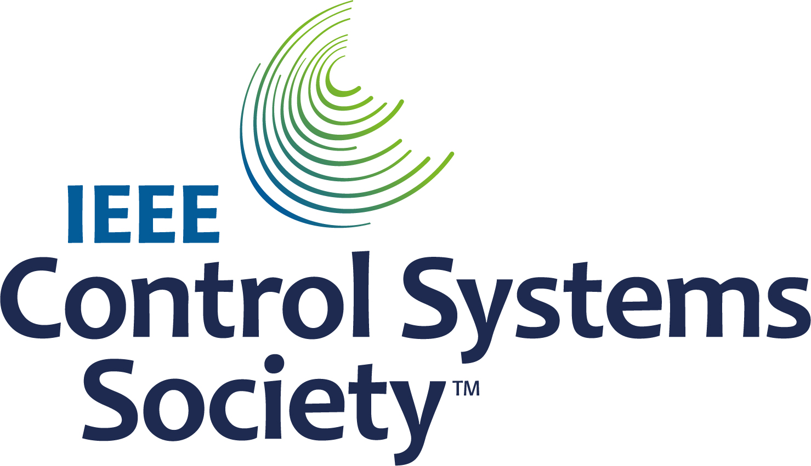

# Buclă închisă complet

```{contents} In this page
:backlinks: entry
:depth: 2
```

Principala atracție a buclei complet închise **FCL** este aceea că are potențialul de a imita un pancreas artificial și de a facilita gestionarea de zi cu zi fără a fi nevoie de bolus pentru mese.

În timp ce **buclă închisă hibrid** ('HCL') se bazează pe algoritm, acesta necesită totuși ca utilizatorul să livreze bolusuri manual înainte de mese. Drept rezultat, bucla poate intra într-o oprire temporară (bazală temporară zero) pentru a preveni administrarea în exces a insulinei.

În **FCL** bolusurile legate de mărimea mesei nu mai sunt necesare: lăsați totul pe seama algoritmului!  **AAPS** can handle meals without the user giving any bolus, and without making carb inputs, in a mode called ‘un-announced meals’ **(‘UAM’)**. **UAM** permite **AAPS** să tolereze mai bine intrările incorecte de carbohidrați fiind mai agresiv.

## La ce să ne așteptăm?

Există multe studii publicate cu privire la rezultatele favorabile pe care **FCL** le poate obține. Pentru lecturi suplimentare, vedeți:

1)   Biblioteca Națională de Medicină, PubMed [Prima utilizare a sistemului open-source de administrare automată a insulinei AndroidAPS în scenariul de buclă complet închisă: studiul pilot randomizat Pancreas4ALL](https://pubmed.ncbi.nlm.nih.gov/36826996/);

2)  ClinicalTrials.gov Biblioteca Națională de Medicină, studiu clinic [Studiu de fezabilitate și siguranță al sistemului de administrare automată a insulinei în buclă închisă Pancreas4ALL (ASAP)](https://www.clinicaltrials.gov/study/NCT04835350?term=Feasibility%20and%20Safety%20Study%20of%20the%20Automated%20Insulin%20Delivery%20Closed%20Loop%20System%20Pancreas4ALL%20(ASAP)&rank=1)

Succesul pentru **FCL** cere utilizatorului să:

- verifice dacă au îndeplinit cerințele **FCL**;
- creeze **Automatizări** care sunt adaptate nevoilor zilnice ale managementului lor; și
- ajusteze setările **AAPS** (în special **Automatizările**).


## Considerații generale de ce (nu) se trece de la HCL la FCL

**FCL** nu este pentru toată lumea:

- Unii utilizatori **FCL** ating TIR (70-180) aproximativ 90% și HbA1c sub 6%, dar alți utilizatori preferă un control mai strict. Notably, minimizing values over 140 mg/dL at diets with rapid carbs probably requires pre-bolusing.
- Reglarea **AAPS** poate fi dificilă. Nu este pentru utilizatorii care se simt copleșiți de AAPS.  Va trebui să dedicați câteva săptămâni pentru a ajusta și a regla **FCL**. Să dedicați acest timp poate duce la rezultate mai bune și la controlul **glicemiei**.
- Gestionarea meselor poate deveni mai ușoară, însă exercițiul fizic poate reprezenta încă o provocare în **FCL**. Celor mai mulți dintre noi ne place să limităm gustările din timpul sportului în încercarea de a controla greutatea corporală.
- Rămân încă dificultăți în a stabili un **FCL** pentru copii (discutat mai jos).


## Buclă hibridă închisă reglată bine

It is advisable to first establish a well-tuned **HCL** before considering the transition to **FCL**.  Succesul cu **FCL** necesită o reglare individualizată a setărilor utilizatorului astfel încât **AAPS** să poată oferi insulină pentru a imita îndeaproape modul reușit de buclă hibridă închisă al DUMNEAVOASTRĂ.

**FCL** cere utilizatorului să configureze și să regleze **Automatizările**. Cu toate acestea, utilizatorul trebuie să aibă o înțelegere sigură a nevoilor sale de gestionare a insulinei înainte de a se înhăma la **FCL**. Erorile pot fi mascate de contra-erori. Acest lucru poate crea un sistem **FCL** instabil, și îl poate face greu de corectat ulterior. Ar trebui să vă așteptați să atingeți un %TIR comparabil cu FCL așa cum vedeți astăzi în **HCL**.

**FCL is a DIY set up of Automations determined by the user by analyzing their data from both their successful HCL and  initial FCL experience when tuning your settings.**

## Insulină rapidă (Lyumjev, Fiasp)

**FCL** necesită insulină rapidă.  This is so that at the start of meal-related **BG** rise, **FCL** is able to keep **BG** in range (by common definition, under 180 mg/dL (10 mmol/L)).

Un studiu de modelare (detalii vedeți LINK FullLoop V2/March2023; secțiunea 2.2) poate arăta în termeni cantitativi că <0>insulinele mai rapide</0>

Sursă:

 


IEEE Control Systems Magazine, ResearchGate [The Artificial Pancreas and Meal Control: An Overview of Postprandial Glucose Regulation in Type 1 Diabetes](https://www.researchgate.net/publication/322866519_The_Artificial_Pancreas_and_Meal_Control_An_Overview_of_Postprandial_Glucose_Regulation_in_Type_1_Diabetes);

- will result in significantly lower **BG** peaks than slower insulins;
- tolerează primul bolus de la masă cu o întârziere de câteva minute fără a aduce la înălțimi inacceptabile ale vârfurilor; și
- minimize the effect on **BG** peak from different carb loads (meal sizes).

**FCL** este puțin probabil să fie eficace cu altă insulină decât Lyumjev sau Fiasp, cu excepția cazului în care utilizatorul urmează o dietă foarte moderată până la mică de carbohidrați.

However, Fiasp or Lyumjev can result in frequent pump occlusions, even after optimizing things like needle length. Este important să fiți atent la canulă sau la durata de utilizare a pompei. Mulți utilizatori găsesc că 48 de ore sunt limita de eficacitate a insulinei, înainte de a rezulta un eșec al canulei/pompei.

## Cerințe preliminare

**BG** values and stable Bluetooth connectivity are required to ensure **AAPS** can optimally perform without losing valuable time. **FCL** necesită un sistem stabil din punct de vedere tehnic 24/7:

- your **CGM’s performance**. Your CGM should not produce jumpy **BG** values that could be misinterpreted by **FCL** as a sign of a starting meal. Similar, calibrările **CGM** pot produce rezultate săltărețe.
- cum și unde se face orice netezirea valorilor de la **CGM** și ce poate implica acest lucru pentru ajustările dumneavoastră. Notably how delta is defined, and AAPS recognizing this as being sign of a starting meal.
- stabilitatea Bluetooth pentru pompă și CGM;
- evitarea (sau cel puțin recunoașterea precoce) a ocluziei pompei;
- fluxul de date și aplicațiile utilizate ale telefonului dumneavoastră și diferența între zilele de utilizare a senzorului;
- păstrarea tuturor componentelor **AAPS** bine încărcate și a pieselor de schimb la îndemână; și
- schimbarea canulei (sau a pompei) întotdeauna suficient de devreme pentru a reduce riscul de ocluzie;

Cele de mai sus vor depinde de componentele sistemului dumneavoastră **AAPS** și de stilul de viață.

## Limitări legate de masă

- Setarea unei **FCL** poate fi mai ușoară pentru persoanele ale căror diete nu constau în componente alimentare cu efect rapid ridicat asupra **glicemiei**, și tipare la de masă care nu variază în mod dramatic de la o zi la alta. Aceasta nu înseamnă neapărat o dietă săracă în carbohidrați.

- Dietele bogate în grăsimi sau proteine sau o digestie lentă/gastropareză, face lucrurile mai degrabă ușoare decât grele pentru **FCL**  pentru că acei carbohidrați târzii acoperă frumos "cozile" inevitabile ale acțiunii tardive din bolusurile necesare în jurul momentului de vârf.

### Indexul glicemic și efectul asupra glicemiei

Provocarea pentru modul **UAM** crește odată cu creșterea „Efectului asupra glicemiei” („EBG”)

- Porniți moderat/scăzut și reglați setările **Profilului** dumneavoastră. Numai atunci, "testați" mesele cu **EBG** mare.
- Luați în considerare un bolus inițial < 50% dacă consumați ceva cu **EBG foarte mare**.

1) **Fără EBG**: de exemplu, carne proaspătă, pește, ouă, șuncă, uleiuri, brânză. 2) **EBG scăzut**: de exemplu legume proaspete și fructe de pădure, ciuperci, nuci, lapte, iaurt, brânză de vaci. 3) **EBG moderat**: de exemplu pâine integrală/tăieței, cartofi, orez sălbatic, ovăz și fructe uscate. 4) **EBG ridicat**: de exemplu pâine de grâu, baghetă, pâine prăjită, vafe, biscuiți, piure de cartofi, tăiței, orez. 5) **EBG foarte mare**: spre exemplu zahăr, băuturi dulci, sucuri de fructe, fulgi de porumb, bomboane, dulciuri, chipsuri de cartofi, sticksuri.


Cele mai dificile mese pentru **FCL** sunt acele alimente cu componente **EBG** exclusiv mari și foarte mari (a se vedea textul în roșu): Nu numai că **glicemia** sare rapid, dar și componenta de grăsime/proteină/fibră este mică pentru a echilibra inevitabila "coadă" a activității insulinei care ar veni cu încercările de la început de a controla glicemiile mari.

Consumul dezordonat de gustări și băuturi dulci care sunt încărcate cu carbohidrați ce se absorb rapid este problematic pentru **FCL**.


## Pregătirea pentru activitate/sport

Atunci când se efectuează exerciții fizice sau sunteți activ, cu o pompă sau o buclă închisă hibrid, este recomandat ca utilizatorul să reducă **IOB** înainte de a efectua exercițiile.

Cu **FCL**, algoritmul este reglat pentru a detecta **UAM** și pentru a administra automat insulină care să contracareze creșterile **glicemiei**.  O **țintă temporară** mare și un **procentaj al profilului** mai mic (activat deja în jurul începerii mesei) ar trebui setate cu mult timp înainte de orice activitate.

Nivelurile neobișnuite sau neregulate ale activității fizice prezintă dificultăți pentru **FCL**. Planificarea este necesară pentru exerciții fizice (în special dacă doriți să reduceți nevoia de carbohidrați de salvare/gustări în timpul unei hipoglicemii cauzate de sport). După o zi activă, se recomandă ca **Procentajul profilului** să fie setat mai mic pentru noapte, după ce cina a fost digerată complet: setați în **Automatizări** o țintă **glicemică** ridicată (>100 mg/dL), cu opțiunea **Activați SMB cu ținte temporare ridicate** oprită în **Setări** **AAPS**.

## Dificultăți pentru copii

**FCL** poate prezenta provocări suplimentare pentru copii, iar acestea includ:

- Lyumjev or Fiasp may not be available or well tolerated.
- Rata bazală orară poate fi foarte mică, ceea ce oferă o bază slabă pentru **SMB** mari.
- Dieta poate fi bogată în componente dulci. Cu volumul sangvin tipic scăzut al unui corp mic, tendință puternică către vârfuri ale **glicemiei**.
- Hormonii de creștere și modificările substanțiale ale sensibilității la insulină fac dificilă menținerea cu precizie a unui <0>FCL</0> ajustat


## Activarea SMB amplificate: siguranță

În **HCL** restricțiile de siguranță sunt implementate în ceea ce privește dimensiunile bolusurilor care pot fi date automat prin buclă.

Utilizatorii **FCL** nu mai trebuie să dea un bolus considerabil în jurul începutului mesei. Impactul acestui lucru înseamnă că restricțiile privind limitele de dimensiune pentru **SMB** trebuie lărgite pentru a face bucla capabilă să furnizeze **SMB** suficient de mari.

If you are operating with **AAPS** in the Master release, it is suggested **AAPS**' **Settings** are set up with the maximum allowed **SMB** size so that **FCL** can give (maxUAMSMBBasalMinutes=120, i.e. 2 hours worth of basal at that daytime).

Dacă rata bazală este foarte mică, limitele **SMB** rezultate ar putea fi prea mici pentru a permite un control suficient pentru a contracara creșterile de după masă **ale glicemiei**. One possible solution is to avoid diets that cause strong **BG** spikes. The [Auto ISF](#Open-APS-features-auto-isf) algorithm (only available in a dev build with engineering mode) has a **SMB max range extension** setting that expands the standard maximum of 2 hours worth of basal by a factor of >1, and lets you raise the default 50% **SMB delivery ratio**.

**Urmați instrucțiunile pentru a permite AAPS să imite bolusul dumneavoastră prin câteva SMB**.

Check the **APS** plugin screen (**Configuration → APS → Open plugin**) periodically to see whether your **SMBs** are allowed to be sufficient enough to deliver the required insulin needed for the loop around meal starts.

Dacă nu, eforturile dumneavoastră de ajustare vor fi câteodată în zadar!


```{admonition} Boosting **ISF** can become dangerous
:class: danger

Carefully observe/analyze the **SMB** sizes shortly after your meal commences. Ajustați în trepte și nu modificați mai mult de 1 sau 2 parametri deodată.

Setările **AAPS** trebuie să fie configurate suficient de bine pentru a face față varietății (!) meselor dumneavoastră.
```

## Detectarea mesei/ Automatizările dumneavoastră pentru amplificare

Pentru succesul **FCL**, **ISF** este parametrul cheie de ajustare. Când se utilizeaza **AAPS** varianta master + **Automatizări**, **o schimbare de profil > 100% trebuie să fie declanșată în mod automat la momentul recunoașterii mesei** (prin diferențele dintre citirile de glicemie, delta), și să propună un **ISF** mărit.

**AAPS** Master allows up to 130% temporary **Profile** in **HCL** mode. Amplificarea **ISF** se face în 3 pași:

- Pasul 1 - verificați **ISF** valabil pentru ora acestei mese în **Profil** și vedeți dacă, de exemplu, Autosens sugerează o modificare care ține cont de starea actuală (ultimele câteva ore) a sensibilității la insulină a corpului.
- Pasul 2 - aplicați un factor (1/Profil%, așa cum este setat în **Automatizare**) pentru a amplifica **ISF**.
- Pasul 3 - verifică dacă **ISF** sugerat se încadrează în limitele de siguranță stabilite.

### Șabloanele de automatizare pentru FCL

Căsuțe de bifat în partea de sus. Aveți opțiunea:

- În lista dumneavoastră de **Automatizări**, poți bifa semnul de înregistrare (la stânga fiecărui câmp) Oprit => Acest lucru dezactivează **Automatizarea**. De exemplu, puteți face asta pentru toate **Automatizările** **FCL** asociate cu micul dejun pentru a merge pe varianta **HCL** pentru micul dejun.

- Pentru fiecare regulă de **Automatizare** puteți bifa căsuța pentru acțiunea utilizatorului =>, atunci acțiunile definite nu vor fi executate în mod automat când se întrunesc condițiile. Mai degrabă, ecranul principal **AAPS** vă va avertiza ori de câte ori **FCL** va da automat un **SMB**. Aveți apoi posibilitatea să spuneți "da" sau "nu". Acest lucru este extrem de util în faza de reglare.

This feature can be useful for certain situations like “foot to floor” syndrome where there is a sudden rise in **BG** when getting up in the morning, but the user wants to prevent a fully automatic “breakfast started” response.

Secțiunea de mai jos oferă îndrumări despre cum să grupați Condițiile **Automatizărilor** și cum să abordați situațiile în care **AAPS** ar trebui să crească (sau să scadă) administrarea de insulină. Deoarece **ISF** nu poate fi ajustat direct, creșterea **Procentajului de profil** peste 100% va face același lucru pentru ceea ce vrem.

### SMB mari automate la creșterea glicemiei

Cheia succesului cu **FCL**: **la începutul creșterii glicemiei de la mese, bucla trebuie să dea cât mai repede SMB automate foarte mari** „pentru a ajunge din urmă” **IOB**-ul necesar (comparați cu bolusul pe care îl administrați de obicei pentru o masă similară în **HCL**!)

Pentru aceasta, trebuie analizate datele din **HCL** pentru a stabili care **delte** probabil nu sunt legate de masă și care ar putea fi.

- As you can define the **Automation** within a pre-defined time-window, you need only to analyze there.
- Dacă aveți mese foarte diferite (de exemplu un mic dejun bogat în carbohidrați; dar la prânz cu carbohidrați mai puțini) puteți alege să aveți două (seturi) diferite de **Automatizări** pentru fiecare interval orar.
- Excludeți nopțile dacă vedeți sărituri ocazionale cauzate de hipoglicemiile de compresie
- De obicei, este suficient să folosiți delta din ultimele 5 minute.
- Dar puteți folosi o delta medie. Prin compararea diferențelor (detlta) în condițiile **Automatizărilor** dumneavoastră ați putea defini chiar și acțiuni de agresivitate diferită în funcție dacă creșterea **glicemiei** este într-o manieră accelerată sau nu.

> ( delta – media scurtă delta )>n   este un termen care poate fi folosit pentru detectarea accelerării, pentru a declanșa primul **SMB** la cel mai timpuriu semn de creștere a **glicemiei**. -                                                                             
> Atenție: nu se poate folosi cu valori **CGM** slabe sau foarte netezite!

Un **CGM** cu date nepotrivite pune utilizatorul într-o poziție proastă deoarece, pentru a fi în siguranță, ai nevoie să "îndiguiești" definiția ta de delta, care ar putea fi sigur un semn al unei mese începute. Asta înseamnă:

- **FCL** pierde timp suplimentar, ce rezultă în vârfuri **glicemice** mai mari și %**TIR** mai mic;
- nu puteți folosi un delta de mai devreme sau mai mic care ar putea să declanșeze, de asemenea în absența unei mese, **SMB** care să țină loc de bolusul utilizatorului în **FCL**.

În plus, primele creșteri de după masă se caracterizează printr-un **IOB scăzut**. Așadar, o Automatizare(#1) pentru o cină ar putea arăta în felul următor:


Automatizarea #1

Dacă condițiile sunt îndeplinite, **AAPS** ar da 1 sau 2 **SMB** în următoarele 12 minute, utilizând un **ISF** amplificat conform **Procentajului profilului** ridicat setat (în exemplu, o amplificare de 30% a insulinReq). Atâta timp cât se întrunesc aceste condiții, regula de **Automatizare** se extinde cu alte 12 minute. O masă cu carbohidrați puțini poate avea caracteristici de creștere mai lentă a **glicemiei**. Ar putea beneficia de o altă automatizare (#2) care s-ar declanșa la o delta inferioară și ar oferi o amplificare mai mică în ceea ce privește insulina.


Aceeași **Automatizare** se va declanșa probabil și la mesele mai bogate în carbohidrați, după ce creșterea abruptă definită în Automatizarea #1 s-a terminat.

Trebuie să „etapizați” aceste două (+ poate o a treia) **Automatizări** ca să se potrivească cu ce vedeți la mesele dumneavoastră (varietate) => Stabilirea mărimilor potrivite ale salturilor, a criteriilor **IOB** și a amplificărilor va fi un proces de ajustare repetat.  De asemenea, dacă includeți intervale orare adecvate în Condiții, puteți face cu ușurință diferite Automatizări pentru diferitele ore ale meselor de zi cu zi (mic dejun, prânz, cină).

Țineți cont de asta, încă din faza de creștere (!), "abundența" de **IOB** trebuie blocată astfel încât efectele tardive ale **insulinei** (**coada** de după 3-5 ore) să nu depășească capacitatea de frânare a buclei prin bazala temporară zero ("tăierea" bazalei, pentru a reduce riscul hipoglicemiei).

Cu mese mari există uneori o **a doua creștere**. Până atunci, de obicei, și IOB a scăzut puțin, iar Automatizările mai agresive intră din nou în vigoare. (Check that your iob condition in Automation #2 is not set too low for this to happen).

La scurt timp după ce câteva **SMB** inițiale sunt date vine o **perioadă echilibrată** unde administrarea moderată de insulină trebuie să acopere carbohidrații suplimentari ce sunt absorbiți. (Except in low carb meals, where the loop might see too weak of a **BG** rise, and go into zero-temping right away already now).

Ecranul principal **AAPS** (unde vedeți COB=0 în **UAM** bucla completă) s-ar putea ca în această fază să ceară mai mulți carbohidrați necesari. În modul **UAM** asta pur și simplu înseamnă, ai putea face o verificare estimativă a plauzibilității: Este acea cantitate de carbohidrați probabil în corpul tău, neabsorbită de la masa dumneavoastră de acum aproximativ o oră (în legătură cu care nu v-ați furnizat bucla cu informații)?


### Prag IOB

Deseori, **Automatizările** #1 și/sau #2 fac IOB să crească la înălțimi care de obicei sunt suficiente pentru mesele **dumneavoastră**. Pentru reglarea personalizată, uitați-vă în datele **HCL** la valorile maxime de IOB care apar în timpul meselor bine gestionate (de cele mai multe ori: bolusul mesei introdus), și peste ce valoare a survenit la sfârșit o hipoglicemie (sau o cerință pentru carbohidrați suplimentari).

Praguri IOB de bun-simț la care ați reduce agresivitatea buclei dumneavoastră, s-ar putea să nu fie la fel pentru fiecare masă. Dar mai ales în prima oră de la începerea mesei, ceea ce este crucial în modul **UAM**. It will differ for each user. Pentru unii utilizatori, în jur de 30g/oră se absoarbe și pentru a defini un **IOB** semnificativ independent de masa exactă poate fi posibil.

Pentru mese excepționale, sau pentru o diminuare a acesteia în cazul în care urmează sportul, pragul **IOB** poate fi stabilit rapid în mod diferit în **Automatizare**.

Automatizarea (#3), „iobTH atins => **SMB** oprite”, este definită pentru a opri (sau a întrerupe, până când vine un alt val de creștere cauzată de carbohidrați) amplificarea agresivă a **SMB**.


Automatizarea #3

Aceasta îi spune algoritmului că peste **pragul IOB** stabilit este mai bine să nu mai utilizeze nici un alt **SMB**

- The given example does that by setting TT=111 (which is kind of arbitrary; pick a number>100 that you easy recognize as your automated **SMB** shut-off)
- In **AAPS**' [Settings → OpenAPS SMB](#Preferences-openaps-smb-settings), generally do not allow **SMB** at elevated target.                                                                                                                   
  The insulin required will then have to be delivered with much more caution through the bottleneck of **TBRs**

**Atenție: Automatizarea #3 funcționează numai atunci când nu există o țintă temporară activă.** Deci, în cazul în care ați lucrat cu ținta temporară mănânc în curând, trebuie să se încheie până atunci, care de obicei ar trebui să se întâmple în jur de 30-40 de minute după începerea mesei.

O modalitate este să creați o Condiție de **Automatizare** care oprește o eventuală țintă temporară mănânc în curând activă, cu Condiția **IOB**>65% * iobTH.
> Modalități de a folosi ținta temporară mănânc în curând Unii utilizatori de buclă setează (apăsând butonul Țintă temporară sau automat, printr-o țintă **glicemică** mai mică în **Profil**, dacă orele meselor sunt destul de fixe) o țintă temporară mănânc în curând cu aproximativ o oră sau mai mult înainte de începerea mesei, doar pentru a avea sigur o **glicemie** de pornire scăzută și un **IOB** puțin crescut. Dar, presupunând că **FCL** este întotdeauna pe drum spre țintă, s-ar putea ca aceasta să nu aducă mare lucru și puteți prefera să definiți o **Automatizare** care setează o țintă temporară „Mănânc în curând” la recunoașterea începutului mesei (delta glicemiei sau accelerația = delta > delta medie). O **țintă temporară** scăzută este importantă în această etapă, deoarece bucla calculează orice **SMB** folosind (glicemia prezisă minus TT)/sens, astfel că o TT mică face ca insulinReq rezultat să fie mai mare.

After the first boosted **SMB**s were given, your set iobTH and **Automation** #3 should strike a good balance of limiting the glucose peak, but also not leading to a hypo after the meal.

Dacă micul dejun deviază substanțial în conținutul de carbohidrați de cina obișnuită, poți beneficia de definirea **Automatizărilor** care se aplică în orele respective, și să aveți un profil **iobTH** diferit (posibil și delte diferite și diferite **Procentaje de Profil** setate). Amândoi, dumneavoastră cu definiția spectrului de masă și cu setările (în special, **iobTH**), și bucla care gestionează curba **glicemică** în desfășurare, trebuie să acceptați anumite înălțimi ale vârfurilor astfel încât să reduceți pericolul de hipoglicemie către sfârșitul **duratei de acțiune a insulinei DIA** de la **SMB**.

### Stagnare la valori mari ale glicemiei

In case, after a “rich” meal, a long-lasting stagnation with **high BG** value is seen, **Automation** #4 (below), “post-meal High”, helps deal with fatty acid resistance: After multi-course meals, large greasy pizza, raclette evening, the glucose curve can form two humps or, very often, an elongated high plateau.


Automatizarea #4


Automatizarea #5

Automatizarea #4, "Hiperglicemie post-masă", este de asemenea potrivită în bucla închisă hibridă.

În plus, este necesară o Automatizare #5 de terminare, "Stop pmH", astfel încât agresivitatea administrării insulinei să fie redusă, imediat ce valoarea glicemiei scade. (Cu toate acestea, adesea bucla limitează oricum mai mult insulina pentru prevenirea hipoglicemiei deoarece glicemia prognozată indică deja o scădere).

## Prevenirea hipoglicemiei

Problema de bază este că **UAM** **FCL** (fără introducere de carbohidrați) **nu poate ști câte grame de carbohidrați mai sunt disponibile** pentru absorbție, carbohidrați care ar putea consuma acea insulină din „coadă” fără ca dumneavoastră să faceți hipoglicemie.

Folosind **SMB** amplificate, **FCL** "prinde din urmă" ceea ce făceam în trecut cu un bolus de masă. Dar, **la sfârșitul "cozii" activității insulinei, prevenirea hipoglicemiei poate deveni un subiect grav**.

În pregătirea pentru **FCL**, utilizatorul trebuie să analizeze mai atent **evoluția în timp a IOB** pentru mesele tipice și să judece **când devine prea mult și cum puteți preveni asta prin ajustarea Automatizărilor**. Acest lucru este posibil deoarece avem mai multe elemente de ajustare. Realizarea acestui lucru poate reprezenta o provocare

Generally, it makes no sense to keep optimizing settings for one kind of meal. Odată ce aveți o setare suficient de bună, de exemplu pentru un tip de prânz pe care îl luați des, testați cum funcționează cu alte tipuri de mese și cum ați face "compromisul".

Pentru a preveni hipoglicemia în orele 3-5 de după masă, reduceți agresivitatea înainte ca prea mult IOB să se acumuleze. Abordări specifice:

- Faceți ca **ISF** să fie din ce în ce mai blând deja în timpul creșterii de glicemie, ca în exemplele date de Automatizare #1 și #2.
- Definiți pragul de IOB, dincolo de care **AAPS** devine semnificativ mai prudent (Automatizarea #3, de mai sus). Note this **iob** can be exceeded, by the last **SMB** before it went into effect; and then further by TBRs if the loop sees insulinReq. Carbs getting absorbed will provide a counter-movement towards lower iob.
- Pragul de IOB poate fi diferențiat în funcție de mese: prin clonarea automatizărilor, se poate diferenția cu ușurință pentru intervalele orare de mic dejun, prânz și cină (sau chiar pentru locuri geografice, cum ar fi cantina companiei sau soacra șamd)
> S-ar putea diferenția și mai mult în aceste intervale orare, prin stabilirea unor ținte temporare diferite pentru carbohidrați înceți față de carbohidrați rapizi, șamd și, prin urmare, să se poată "programa pentru" diferite tipuri de masă care pot apărea în acest moment al zilei, și prin apeluri la **Automatizările** special ajustate pentru ele. Acest lucru nu este probabil necesar, cu excepția cazului în care obiceiurile dumneavoastră alimentare variază mult.

Before a special meal challenge, you can raise your **iob** threshold, or make another change in any of your Automations within under 5 seconds, right on your AAPS phone (**Manage → Automation**).

Pericolul unei hipoglicemii la câteva ore după masă este, în esență, o chestiune legată de faptul dacă felul în care a fost compusă masa dumneavoastră a făcut ca **excesul de insulină rămas după "lupta" cu cea mai mare parte a carbohidraților** să fie **consumat de "carbohidrații extinși"** (absorbție excesivă/întârziată a carbohidraților/proteine/grăsimi/fibre).

De-a lungul timpului veți învăța tipare, veți ajusta automatizările - poate chiar vă veți ajusta obiceiurile alimentare puțin, spre exemplu bucurați-vă doar de puțin din gustarea târzie ceea ce poate ajuta la menținerea unui bun **echilibru al activității insulinei și al absorbției carbohidraților** pentru **întreaga** durată a masei (digestie, timp de absorbție) și astfel să vă faceți viața pentru bucla dumneavoastră (și pentru dumneavoastră) mai ușoară.

### Ordinea Automatizărilor programate

Pot apărea probleme cu suprapunerea definițiilor în **Automatizări**. Exemplu: Problema este că delta >8 este, de asemenea, delta >5, adică pot exista două **Automatizări** concurente. Ce face bucla atunci? It always decides according to the sequence in which your **Automations** appear in **Manage → Automation**.  Exemplu: Regula delta > +8 trebuie să vină întâi (și să lanseze cel mai puternic impuls dacă toate condițiile sunt întrunite); apoi vine verificarea pentru delta >5 (și un răspuns mai blând). Dacă s-ar face invers, regula delta>8 nu ar intra niciodată în vigoare deoarece delta>5 se aplică deja, caz închis.
> Sfat pentru automatizări: Modificările ce țin de ordine sunt foarte ușor de făcut. In **Manage → Automation**, touch and hold the **=** handle on the right of a rule and drag it to another position.

De asemenea, este foarte ușor și rapid să ajustați oricare din condiții sau acțiuni în orice moment, în câteva secunde, doar pe telefonul dumneavoastră inteligent cu AAPS; de exemplu, dacă vă duceți la un eveniment gastronomic deosebit. (Dar nu uitați să reveniți la normal în/pentru ziua următoare).

(full-closed-loop-troubleshooting)=

## Depanare

### Cum să vă întoarceți la bucla închisă hibrid

You can untick the checkboxes of the **Automations** related to your **FCL**, and go back to bolusing for meals and make carb inputs again. If you had removed the **Insulin** or **Calculator** buttons from your main screen, add them back in the [QuickLaunch toolbar](#quicklaunch) configuration (they always remain available under **Treatments** in the bottom navigation). Țineți cont de faptul că acum depinde din nou de dumneavoastră să faceți bolusuri pentru mese.

Poate fi un lucru înțelept să faceți **FCL** doar pentru mese (intervale orare) unde **Automatizările** sunt complet definite și bifate, și să le debifați pe acelea pentru celelalte momente de masă când doriți să faceți **HCL** (sau nu ați definit încă nimic, în perioada dumneavoastră de tranziție).

De exemplu, este perfect posibil, fără pași suplimentari după ce **Automatizările** pentru intervalele orare de cină sunt definite, să faceți **FCL** doar pentru cine, în timp ce micul dejun și prânzul sunt efectuate într-un regim **HCL** așa cum sunteți obișnuiți.


### Sunt condițiile preliminare pentru FCL încă îndeplinite?

- Este **profilul** de bază încă corect?
- S-a deteriorat calitatea **senzorului de monitorizare continuă a glicemiei (CGM)**
- Consultați cerințele prealabile (a se vedea mai sus).

### Glicemia este prea mare

- Mesele nu sunt recunoscute de îndată
    - Verificați (in)stabilitatea Bluetooth
    - Verificați dacă puteți seta delta mai mici pentru a declanșa primul **SMB**
    - Încercați un aperitiv sau o supă cu câteva minute înainte de începerea mesei
- SMB sunt prea slabe
    - Verificați ordinea **Automatizărilor** (spre exemplu, delta mare înainte de delta mic)
    - Check (real-time) in the **APS** plugin screen whether hourly profile basal and set minutes (max 120) limit allowed SMB size
    - Check (real-time) in the **APS** plugin screen whether %profile must  be set bigger
- Dacă toate setările sunt la limită, atunci s-ar putea să fie nevoie să trăiți cu acea hiperglicemie temporară, sau să vă ajustați dieta.
> If you are ready to test a dev build, [Auto ISF](#Open-APS-features-auto-isf) also allows further expanded SMB sizes. Unii utilizatori recurg și la utilizarea unui mic pre-bolus în "FCL". Totuși, acest lucru interferează cu modul în care se comportă curba glicemiei și, prin urmare, detectarea creșterilor și a declanșării **SMB**, și, prin urmare, nu este ușor de pus în aplicare în general cu un beneficiu concret.
- O observație importantă a utilizatorilor-pilot a fost, faptul că modul în care curbele glicemiei și IOB-ului se prezintă înainte de masă contează foarte mult în ceea ce privește modul în care se atinge vârful de la carbohidrați: O coborâre (spre exemplu, către o țintă temporară mănânc în curând ), acumularea de IOB, și înclinarea deja către o accelerare pozitivă puternică pare foarte utilă pentru a menține vârfurile glicemice la un nivel scăzut.

### Glicemia scade prea mult

- Mesele sunt recunoscute în mod eronat
    - Verificați dacă ați putea seta delta mai mari pentru a declanșa primul **SMB**
    - Click “User action” in the related Automation, so in the future you can ad hoc decide to block execution of the Automation if not meal-related
    - Pentru a preveni gustările să declanșeze **SMB** ca la o masă, setați o țintă temporară>100 când luați gustări (așa cum ați face oricum în timpul activităților sportive și pentru gustările anti-hipoglicemie)
- SMB livrează în general prea multă insulină
    - Check (real-time) in the **APS** plugin screen whether **SMB max range extension** must be set smaller
    - Check (real-time) in the **APS** plugin screen whether **Percentage Profile** must  be set smaller
    - Raportul livrării SMB poate fi probabil mai mic. Notă: în acest caz, funcționează pentru toate **SMB** (toate intervalele orare),
- Probleme cu "coada" de insulină după mese
    - Este posibil să fie nevoie să luați o gustare (dacă vedeți o predicție de hipoglicemie) sau tablete de glucoză (dacă sunteți deja în zona de hipoglicemie). Dar țineți cont că carbohidrații necesari, de care v-ar spune bucla la un moment dat, sunt foarte probabil exagerați, deoarece bucla nu are absolut nicio informație despre cantitatea de carbohidrați (în timp ce dumneavoastră puteți ghici câți ar mai fi, inclusiv din grăsimi și proteine) care încă așteaptă să fie absorbită.
    - O informație valoroasă ar fi dacă problema își are originea în cea mai mare parte încă din faza de creștere a glicemiei. Atunci stabilirea unui iobTH mai mic ar putea fi un remediu facil.
    - Dacă nevoia de carbohidrați suplimentari apare des, notați câte grame au fost necesare (fără să numărați ce ați luat în cele din urmă în plus și a necesitat din nou insulină suplimentară).  Apoi folosiți valoarea IC din profil pentru a estima cu câtă insulină mai puțin ar fi trebuit să administreze **SMB** și folosiți această informație la ajustare (privind **Procentajul profilului** din **Automatizări** sau poate și iobTH setat). Acest lucru se poate referi la **SMB** date când glicemia era mare, sau și la **SMB** din timpul creșterii **glicemiei**.
    - S-ar putea să trebuiască pur și simplu să acceptați vârfuri mai mari de **glicemie** pentru a nu face hipoglicemie. Or change diet to something with lower amounts of carbs, and higher amount of protein and fats.


### Mai multe informații

Asigurați-vă că sunteți în legătură cu alți utilizatori **FCL**.

Discuții despre bucla complet închisă cu Automatizări:

- Engleză:   [Canal Discord](https://discord.gg/ChXj8BaKwA)

- Germană:  [Comunitatea germană Looper](https://de.loopercommunity.org/t/ueber-die-kategorie-full-loop/10107)
